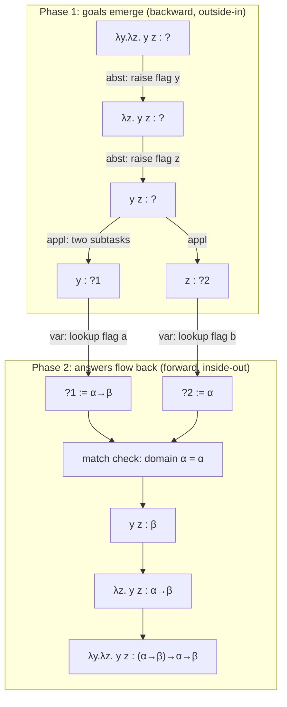

[[book-guidelines|↩ Back to guidelines]]
Complements [[Simple-Types-and-the-Simply-Typed-Lambda-Calculus]] (which states WT/TC/TF and the $\lambda\to$ metatheory) and [[Natural-Deduction-and-Flag-Style-Proofs]] (flags in $\lambda D$). This note zooms into one thing only: the *dynamics* of building a derivation from the goal.

---

## 0. The question behind the exercises

A derivation system tells you what a finished derivation looks like. It does not tell you how to *find* one. The book's Section 2.7 asks: if the derivation has not been given, how should we try to find one? Its answer is the whole subject of this note: **run [[Polymorphism-and-Higher-Order-Typed-Lambda-Calculi#The rules|the rules]] from conclusion to premisses**, and write the work-in-progress in the flag format so that the unfinished parts are visible as "holes".

Three things happen while you do that, and the prompt asks about each:

1. the exercise is attacked **backwards** (Section 1),
2. **subtasks emerge** from rule premisses (Section 2),
3. each subtask is a **judgement under assumptions**, and the assumptions are exactly the flags (Section 3).

Section 4 then shows a failure, Section 5 compares with term finding (the same machine pointed the other way), and Sections 6-7 turn it into code and into the project's vocabulary.

---

## 1. Why backwards: rules read in two directions

The three rules of $\lambda\to$ (Definition 2.4.5), with $\Gamma$ the context:

$$\frac{x:\sigma \in \Gamma}{\Gamma\vdash x:\sigma}\ (\text{var}) \qquad \frac{\Gamma\vdash M:\sigma\to\tau \quad \Gamma\vdash N:\sigma}{\Gamma\vdash M\,N:\tau}\ (\text{appl}) \qquad \frac{\Gamma,\,x:\sigma\vdash M:\tau}{\Gamma\vdash \lambda x{:}\sigma.\,M:\sigma\to\tau}\ (\text{abst})$$

Remark 2.4.7 says a rule can be read in two directions.

- **Top to bottom** (forward): if you stand in the situation described by the premisses, you may conclude. This extends knowledge step by step and is how a derivation is *checked* or *read*. It also shows the rules inductively define the set of derivable judgements.
- **Bottom to top** (backward): the rule is a *recipe for achieving a goal*. For (appl): to type $M\,N$, try to find types for $M$ and $N$ and see whether they match. For (abst): to type $\lambda x{:}\sigma.M$, type $M$ in the context extended with $x:\sigma$.

What breaks without the backward reading? Nothing is *wrong*, but you get no procedure. Starting from the axioms (var) and going forward, you would have to guess which of infinitely many derivable judgements will eventually reach your term. Going backward, the target is fixed, and the book points out why this is cheap: there is a strict parallel between the three kinds of pre-typed terms (variable, application, abstraction) and the three rules. Each term shape has **exactly one** rule that can end its derivation.

> Author's commentary (not in the book in these words): this "one shape, one rule" property is what makes the backward search deterministic. The book makes it precise later as the Generation Lemma; here it is only used implicitly ("only the (abst)-rule may be of help, since it is the only one to deliver an abstraction term in the conclusion").
---

### 1.1 Solving a well-typedness exercise backwards

The exercise asks you to show $\Gamma \vdash M : A$. You start from that goal and ask which rule could have produced it. The syntax of $M$ decides the rule, so there is no real choice. This is the _syntax-directed_ structure of the system.

The standard rules are:

$$\dfrac{(x{:}A) \in \Gamma}{\Gamma \vdash x : A}\ (\mathsf{Var})$$

$$\dfrac{\Gamma, x{:}A \vdash M : B}{\Gamma \vdash \lambda x{:}A.,M : A \to B}\ (\mathsf{Abs})$$

$$\dfrac{\Gamma \vdash M : A \to B \quad \Gamma \vdash N : A}{\Gamma \vdash M,N : B}\ (\mathsf{App})$$

**Procedure.**

1. Write the goal $\Gamma \vdash M : A$ at the bottom.
2. Look at the outermost constructor of $M$ (variable, abstraction, application). That picks the rule.
3. Match the goal against the rule's conclusion. This fixes how the metavariables are instantiated.
4. The rule's premises become the new goals. Repeat on each.
5. Stop when every leaf is closed by an axiom ($\mathsf{Var}$, or a constant rule), or when a leaf fails and the term is ill-typed.

**Example.** Show $\vdash \lambda f{:}A \to B.,\lambda x{:}A.,f,x : (A \to B) \to A \to B$.

The outermost constructor is an abstraction, so apply $\mathsf{Abs}$. The new goal is

$$f{:}A \to B \vdash \lambda x{:}A.,f,x : A \to B$$

This is again an abstraction, so apply $\mathsf{Abs}$ once more:

$$f{:}A \to B,\ x{:}A \vdash f,x : B$$

Now the term is an application, so apply $\mathsf{App}$. The rule's conclusion says the result type is $B$ but not what the argument type is. That is the first place a _guess_ appears. You have to find $A'$ such that $f : A' \to B$ and $x : A'$. The subgoals are

$$\Gamma' \vdash f : A' \to B \qquad \Gamma' \vdash x : A'$$

where $\Gamma' = f{:}A \to B,\ x{:}A$. Both close by $\mathsf{Var}$. The first forces $A' = A$, and the second then confirms it.

### 1.2. Where subtasks come from, and why they become judgements under assumptions

**Subtasks are the premises of the rule you applied.** Backward application of a rule $\dfrac{J_1 \ \cdots \ J_n}{J}$ replaces the goal $J$ by the $n$ goals $J_1,\dots,J_n$. A proof is complete when no open goals remain. Axioms are the rules with $n=0$, so they close goals without creating new ones.

**Why they are judgements under assumptions.** Under a binder, the premise is not about the same context as the conclusion. Take $\mathsf{Abs}$. To type the _body_ $M$, you must know the type of the bound variable. So the subtask is posed in an extended context:

$$\Gamma \vdash \lambda x{:}A.,M : A \to B \quad\leadsto\quad \Gamma,, x{:}A \vdash M : B$$

The hypothesis $x{:}A$ is not proved. It is _assumed_ for the scope of the subgoal. Three consequences follow:

- **Assumptions accumulate going upward.** Each binder you pass adds one entry to $\Gamma$. By the time you reach a leaf, $\Gamma$ records every binder on the path from the root.
- **Leaves discharge the assumptions.** $\mathsf{Var}$ checks that the variable occurs in the accumulated context. This is the only place assumptions are consumed.
- **This is the intuitionistic reading.** A hypothetical judgement $\Gamma \vdash J$ says that $J$ holds provided the hypotheses in $\Gamma$ hold. By the Curry–Howard correspondence, $\mathsf{Abs}$ is implication introduction: to prove $A \to B$, assume $A$ and prove $B$.

**The two kinds of subtask.**

|Source|What happens|Example|
|---|---|---|
|Rules without binders|The context is unchanged and the goals are siblings|$\mathsf{App}$: both premises use $\Gamma$|
|Rules with binders|The context is extended and the goal moves under an assumption|$\mathsf{Abs}$, $\mathsf{Let}$, $\mathsf{Fix}$|

**Unknowns in subtasks.** Sometimes a premise mentions something the conclusion does not determine, like $A'$ in $\mathsf{App}$. There are two standard ways to handle it:

1. **Checking and inference together (bidirectional typing).** Split the judgement into $\Gamma \vdash M \Leftarrow A$ (check) and $\Gamma \vdash M \Rightarrow A$ (infer). For $\mathsf{App}$ you first _infer_ the function type, which determines $A'$, and then _check_ the argument against it. Information flows in a fixed order, so no guessing is needed.
2. **Unification (Hindley–Milner style).** Introduce a fresh metavariable $\alpha$ for $A'$, continue, and record equations such as $\alpha = A$. Solve these at the end. Each leaf adds a constraint, and the subtasks are discharged by unification.

**Summary.** Reading the rules bottom-up turns a typing exercise into a deterministic procedure. The term's shape selects the rule, the rule's premises become the subgoals, binders extend the context so subgoals become hypothetical judgements, and variable leaves discharge the assumptions. Where a premise contains something the conclusion didn't fix, bidirectional annotations or unification supply it.

### Flag style derivations

The flag format is a good fit for goal-directed search. A flag derivation is read top to bottom, but goal-directed search builds it from the bottom up. The search state is a flag derivation with some lines still marked $?$ (open goals).

#### Conventions

- A flag $\boxed{x:A}$ introduces an assumption. Its pole $\vert$ runs down over all lines that may use it.
- A line's context is the set of flags whose poles pass through it.
- A flag can be cited directly as a line, which is the $(\mathsf{var})$ rule.
- Rules used:
    - $(\mathsf{form})$: from $A:\ast$ and $B:\ast$ conclude $A\to B:\ast$.
    - $(\mathsf{appl})$: from $f:A\to B$ and $a:A$ conclude $f,a:B$.
    - $(\mathsf{abst})$: from a flag $\boxed{x:A}$ with $M:B$ in its pole, and $A\to B:\ast$, conclude $\lambda x{:}A.,M:A\to B$. The flag is then closed.

___


### Exercise

Show $\lambda f{:}A\to B.\,\lambda x{:}A.\,f\,x : (A\to B)\to A\to B$ in the context $A:\ast,\ B:\ast$.

#### Stage 0: the goal as a line with $?$

$$\begin{array}{rll}
1 & \boxed{A:\ast} & \\
2 & \vert\;\boxed{B:\ast} & \\
3 & \vert\;\vert\;\ \lambda f{:}A\to B.\,\lambda x{:}A.\,f\,x : (A\to B)\to (A\to B) & ?
\end{array}$$


#### Stage 1: backward $(\mathsf{abst})$ opens a flag

The term is an abstraction, so $(\mathsf{abst})$ is the only rule that can produce the goal. Its premises become two new subtasks:

- $G_1$: the type is well formed, so $(A\to B)\to(A\to B):\ast$.
- $G_2$: the body $\lambda x{:}A.\,f\,x : A\to B$ holds under a new flag $\boxed{f:A\to B}$.

$G_2$ lives inside the pole of $f$. This is what "judgement under assumption" means in flag form. The original goal now sits outside the pole of $f$ and is justified by $G_1$ and $G_2$.

$$\begin{array}{rll}
1 & \boxed{A:\ast} & \\
2 & \vert\;\boxed{B:\ast} & \\
3 & \vert\;\vert\;\ (A\to B)\to(A\to B):\ast & G_1\ ?\\
4 & \vert\;\vert\;\boxed{f:A\to B} & \\
5 & \vert\;\vert\;\vert\;\ \lambda x{:}A.\,f\,x : A\to B & G_2\ ?\\
6 & \vert\;\vert\;\ \lambda f{:}A\to B.\,\lambda x{:}A.\,f\,x : (A\to B)\to(A\to B) & (\mathsf{abst}\ 4,5,3)
\end{array}$$


#### Stage 2: close $G_1$, reduce $G_2$

$G_1$ is a type, so $(\mathsf{form})$ applies. It needs $A\to B:\ast$ twice, which in turn needs $A:\ast$ and $B:\ast$. Both are flags already in scope, so this branch closes with no new flags.

$G_2$ is again an abstraction, so $(\mathsf{abst})$ opens $\boxed{x:A}$ and leaves the subgoal $f\,x:B$ inside its pole. The side condition $A\to B:\ast$ is the line already produced for $G_1$.

$$\begin{array}{rll}
1 & \boxed{A:\ast} & \\
2 & \vert\;\boxed{B:\ast} & \\
3 & \vert\;\vert\;\ A\to B:\ast & (\mathsf{form}\ 1,2)\\
4 & \vert\;\vert\;\ (A\to B)\to(A\to B):\ast & (\mathsf{form}\ 3,3)\\
5 & \vert\;\vert\;\boxed{f:A\to B} & \\
6 & \vert\;\vert\;\vert\;\boxed{x:A} & \\
7 & \vert\;\vert\;\vert\;\vert\;\ f\,x:B & ?\\
8 & \vert\;\vert\;\vert\;\ \lambda x{:}A.\,f\,x:A\to B & (\mathsf{abst}\ 6,7,3)\\
9 & \vert\;\vert\;\ \lambda f{:}A\to B.\,\lambda x{:}A.\,f\,x:(A\to B)\to(A\to B) & (\mathsf{abst}\ 5,8,4)
\end{array}$$

Lines 8 and 9 are only conditionally justified, because they depend on the open goal at line 7.

#### Stage 3: backward $(\mathsf{appl})$ and the unknown argument type

To get $f\,x:B$ from $(\mathsf{appl})$ you need some $A'$ with $f:A'\to B$ and $x:A'$. The conclusion does not determine $A'$. The search resolves it in two steps:

1. Solve the function premise first. The term $f$ is a variable, so look up its flag. This gives $f:A\to B$ and fixes $A'=A$.
2. Check the argument premise $x:A$. It is the flag at line 6, so it closes.

Both premises are flags in scope. No open goals remain:

$$\begin{array}{rll}
1 & \boxed{A:\ast} & \\
2 & \vert\;\boxed{B:\ast} & \\
3 & \vert\;\vert\;\ A\to B:\ast & (\mathsf{form}\ 1,2)\\
4 & \vert\;\vert\;\ (A\to B)\to(A\to B):\ast & (\mathsf{form}\ 3,3)\\
5 & \vert\;\vert\;\boxed{f:A\to B} & \\
6 & \vert\;\vert\;\vert\;\boxed{x:A} & \\
7 & \vert\;\vert\;\vert\;\vert\;\ f\,x:B & (\mathsf{appl}\ 5,6)\\
8 & \vert\;\vert\;\vert\;\ \lambda x{:}A.\,f\,x:A\to B & (\mathsf{abst}\ 6,7,3)\\
9 & \vert\;\vert\;\ \lambda f{:}A\to B.\,\lambda x{:}A.\,f\,x:(A\to B)\to(A\to B) & (\mathsf{abst}\ 5,8,4)
\end{array}$$

#### A failing search

Try $\lambda x{:}A.\,x\,x$ with $A:\ast$.

$$\begin{array}{rll}
1 & \boxed{A:\ast} & \\
2 & \vert\;\boxed{x:A} & \\
3 & \vert\;\vert\;\ x\,x:\ ? & ?
\end{array}$$

Backward $(\mathsf{appl})$ requires $x:A'\to B$ and $x:A'$. The lookup for $x$ gives $A$, and $A$ is a type variable, not an arrow type. So $A=A'\to B$ has no solution. There is no other rule for an application, so the search fails at this leaf. The term is ill-typed.


### What the dynamics look like

|Move|Effect on the flag picture|
|---|---|
|$(\mathsf{abst})$ backward|A flag opens above the body goal, and the goal sits inside its pole. A sibling goal (type well-formedness) appears outside it.|
|$(\mathsf{appl})$ backward|Two sibling goals appear at the same pole depth. The function is solved first, and its type determines the argument type.|
|$(\mathsf{form})$ backward|Sibling goals appear at the same pole depth. They usually close by citing flags or earlier lines.|
|A variable or flag citation|A goal closes. This is the only place assumptions are consumed.|
|A flag's pole ends|All goals that needed that assumption are done, and the abstraction line is written just outside the pole.|

Two properties are worth noticing. First, the depth of a pending goal equals the number of binders above it in the term, so poles grow only through $(\mathsf{abst})$. Second, lines already derived at shallower depth stay usable at deeper depth (weakening). That is why line 3 serves both line 8 and line 9.

---

## 2. The exercise, move by move (Section 2.7)

**Problem (Well-typedness, WT).** Is $M \equiv \lambda y{:}\alpha\to\beta.\ \lambda z{:}\alpha.\ y\,z$ legal? Formally: find $\Gamma$ and $\rho$ with $\Gamma\vdash M:\rho$. Shape of the question: $?\vdash \text{term}:\ ?$ (Section 2.6).

**Setup.** Two unknowns, and the book disposes of the first by reasoning: a context gives types to *free* variables, $M$ has none, so conjecture $\Gamma\equiv\emptyset$. Only the type $?$ remains. The initial state is a single open line:

```text
(n)    λy:α→β . λz:α . y z : ?
```

Now repeat one loop: *pick an open line, look at the head symbol of its term, apply the unique matching rule backwards.*

### Move 1: head is $\lambda y$, use (abst)

(abst) has one premiss, so one subtask emerges: type the body in the extended context. The book writes this by drawing a **flag** for the new assumption and leaving dots for the unfinished derivation:

```text
(a)  | y : α→β
     |   ⋮
(m)  | λz:α . y z : ?
(n)  λy:α→β . λz:α . y z : …            (abst) on (m)
```

Two things appear at once. A **new open goal** (line $(m)$, the body, with a hole for its type), and a **new assumption** (flag $(a)$). Line $(n)$ is not deleted: it is *kept, but suspended*. Its type is written "…" because it is determined by the answer to $(m)$. The book states the dependency explicitly: "If that goal is solved, then this also solves the 'old' goal in line $(n)$, by a simple use of the (abst)-rule."

### Move 2: head is $\lambda z$, use (abst) again

Another flag, another open line, another suspended line:

```text
(a)  | y : α→β
(b)  |  | z : α
     |  |   ⋮
(l)  |  | y z : ?
(m)  | λz:α . y z : …                   (abst) on (l)
(n)  λy:α→β . λz:α . y z : …            (abst) on (m)
```

The flagpoles are nested: $(b)$ lives inside $(a)$'s scope. The line $(l)$ is judged in the context $y{:}\alpha\to\beta,\ z{:}\alpha$.

### Move 3: head is an application, use (appl)

(appl) has **two** premisses, so two subtasks emerge from a single goal, both in the *same* context (no new flag):

```text
(a)  | y : α→β
(b)  |  | z : α
     |  |   ⋮
(k1) |  | y : ?1
     |  |   ⋮
(k2) |  | z : ?2
(l)  |  | y z : …                      (appl) on (k1) and (k2)
(m)  | λz:α . y z : …                   (abst) on (l)
(n)  λy:α→β . λz:α . y z : …            (abst) on (m)
```

Note the asymmetry between the rules: (abst) *changes the context* and produces one subgoal. (appl) *keeps the context* and produces several. Variables never produce any (they are leaves).

### Move 4: heads are variables, use (var) to close the leaves

Both $(k_1)$ and $(k_2)$ are variables, and (var) is the only rule with a variable in its conclusion. It has no judgement premisses, only the side condition $x{:}\sigma\in\Gamma$, so these goals close immediately: $?_1:=\alpha\to\beta$ from flag $(a)$, $?_2:=\alpha$ from flag $(b)$. (The book also notes the shortcut of skipping $(k_1),(k_2)$ and citing (appl) directly on the flags. That is the "silent (var)" convention of Section 2.5.)

### Move 5: the match check, then unwind

(appl) is only legal when the argument type matches the function's domain. The book calls the remainder "routine": the side conditions are satisfied ($\alpha=\alpha$), so line $(l)$ gets $\beta$; then $(m)$ gets $\alpha\to\beta$, then $(n)$ gets $(\alpha\to\beta)\to\alpha\to\beta$.

The finished derivation, in the book's shortened flag format (Section 2.5):

```text
(a)  | y : α→β
(b)  |  | z : α
(1)  |  | y z : β                         (appl) on (a) and (b)
(2)  | λz:α . y z : α→β                    (abst) on (1)
(3)  λy:α→β . λz:α . y z : (α→β)→α→β      (abst) on (2)
```

(The book's printout of line $(3)$ has a typo, dropping the second $z$; the derivation is the one above.)

### The shape of the whole run

Figure 2.2 in the book (Remark 2.9.2) describes it: for WT and TC, start with a term at the bottom, replace it by simpler terms going *up* until it can be typed, then compute the other types going *down* until the original term's type is derived.



---

## 3. Subtasks as judgements under assumptions

Strip the flag decoration and look at what each "open line" really is. It is a **judgement with a hole**:

$$\underbrace{y{:}\alpha\to\beta,\ z{:}\alpha}_{\text{flags in force}}\ \vdash\ y\,z\ :\ \underbrace{?}_{\text{unknown}}$$

- The **context** is the stack of flags enclosing the line. The book's convention (Section 2.5): each declaration sits in a flag "and presumes that this declaration is part of the context for all statements behind the attached flag pole". So the flag notation is a way of *not repeating* the context to the left of every $\vdash$ (the book notes these duplications "become annoying in more complex derivations").
- The **statement** is $\text{term}:\text{type}$, with the type possibly still a variable $?_i$.
- A **subtask emerging** is therefore: take the premisses of a rule instance whose conclusion is the current goal, and *instantiate them as new judgements*, each with its own context. For (abst) the new context is $\Gamma, x{:}\sigma$ (one more flag). For (appl) the context is $\Gamma$ (same flags) with two premisses.

So "converting subtasks to judgements under assumptions" is the central bookkeeping act: **an (abst) step converts a goal about a $\lambda$ into a goal about its body, moving the binder from the term into the context**. The binder $x{:}\sigma$ stops being syntax and becomes an assumption. The same mechanism appears in the book's logical reading (Example 2.4.9): the context extension in (abst) corresponds to the flag in $(\Rightarrow\text{-intro})$, which marks the assumption "Assume : A"; the flagpole delimits the assumption's scope.

> The flag is a *scope* and the flagpole is its *lifetime*. When the subtask for the body is solved, the flagpole ends and the assumption is **discharged**: the conclusion $(m)$ sits to the left of the pole, outside the assumption, with an arrow type that records it, $\alpha\to\beta$. That is exactly the discharge of an assumption in natural deduction.

### Suspended lines and the pending $(?)$

Two kinds of dependent bookkeeping appear in the written trace:

- **Suspended conclusions.** Lines $(l),(m),(n)$ above carry "…" for their type. They are *continuations*: "once my premisses are solved, I will finish by applying this rule". Each has a rule annotation already written, `(abst) on (m)`.
- **Deferred side conditions.** In the type-checking example (Section 2.8) the book writes a reminder $(?)$ at an (appl) line: "Since use of the (appl)-rule is only allowed when the corresponding types match, we add a reminder $(?)$ in the last line: at this moment we cannot yet check the match, since $?_1$ and $?_2$ are still unknown." The match check is postponed until both sub-answers exist.

Putting all three together, a goal-directed state consists of: open lines (goals with holes), suspended lines (continuations), and deferred checks. Nothing else.

---

## 4. The same machine, on a failing input (Remark 2.7.1)

Change the inner binder to $z{:}\beta$: $\lambda y{:}\alpha\to\beta.\ \lambda z{:}\beta.\ y\,z$. Moves 1-4 are identical; the leaves give $?_1:=\alpha\to\beta$ and $?_2:=\beta$. At the deferred check, the domain $\alpha$ of $y$'s type does not match $\beta$, so line $(l)$ cannot be completed. The book's conclusion: "a derivation of a type is impossible: the conclusion of the Well-typedness problem is that the term has no type."

Two observations worth stating, because they separate *this* search from general proof search:

- **No backtracking is needed.** At each step there was exactly one applicable rule and no choice of premisses, so the failure at the match check is a verdict about the *term*, not an artifact of a bad earlier choice.
- **Failure is local and informative.** It names the application $y\,z$ and the two types that did not match: "show where it goes wrong", as the Section 2.6 problem statement puts it for WT.

The only genuine freedom is in the initial guess of $\Gamma$ and in the order of independent subgoals. Remark 2.7.2 records both: any $\Gamma$ extending the needed declarations works, and $(k_1)$, $(k_2)$ can be interchanged. This is a mild form of the partial-order structure the book describes in Section 2.5 (the order of independent judgements in a derivation "may be interchanged, without effect on the full derivation").

---

## 5. The mirror image: Term Finding (Section 2.9)

WT/TC have a term and compute a type. Term Finding has a type and searches for a term: $\emptyset\vdash\ ?:A\to B\to A$. The same backward loop applies, but now the loop dispatches on the **shape of the type** rather than of the term, and a hole stands for the *term*:

```text
(a)  | x : A
(b)  |  | y : B
(l)  |  |   ? : A            goal: find an inhabitant of A
```

- Goal type is an arrow: use (abst) backwards, raising a flag for the argument (here $x{:}A$, then $y{:}B$; the book notes a fresh variable must be taken, per Definition 2.4.2(3)).
- Goal $A$ is not an arrow: the solution has to come from the flags. "Clearly, the goal $?$ can be solved by the $x$ in line (a)". This is (var).
- Unwind: $(1)\ x{:}A$; $(2)\ \lambda y{:}B.x : B\to A$; $(3)\ \lambda x{:}A.\lambda y{:}B.x : A\to B\to A$.

Remark 2.9.2 contrasts the two shapes: in WT/TC you replace a *term* by simpler terms; in TF you replace a *type* by simpler types until a term inhabits one, and then terms are rebuilt downward. And the book flags the real difference in difficulty (Section 2.6): all of WT, TC and TF are decidable in $\lambda\to$, but "in more complicated systems... Term Finding is the real problem. It is undecidable in many cases."

> Author's commentary: that is exactly where the dynamics diverge. In WT the head symbol of the *given* term fixes the rule, so there is no search. In TF with a non-arrow goal, several flags might fit and several (appl) decompositions are possible (to build an $A$ you may apply any function whose result type is $A$, requiring new subgoals for its arguments). *That* is the point where backward goal reduction becomes a genuine search with choice points. The book's Section 2.9 example is picked so that the choice is obvious by inspection.

By the PAT reading (Section 2.9), the flags read aloud as: "Assume that $x$ is a proof of $A$. Also assume that $y$ is a proof of $B$. Then $x$ is (still) a proof of $A$. So $\lambda y{:}B.x$ proves $B\to A$..." The backward phase is the proof strategy ("to prove an implication, assume its antecedent"), and the forward phase is the proof as written.

A last remark of the book matters for tooling: it suffices to store the final term, because the derivation can be reconstructed from it by solving the WT problem (Remark 2.9.1). The term is a compact **proof certificate**, and the backward procedure of this note is the **reconstruction** step.

---

## 6. Grounding in code

### 6.1 Rust: an explicit agenda that makes the dynamics visible

The recursion hides the two phases in the call stack. Here they are made explicit: `Solve` tasks are open lines; `Abst` and `Appl` tasks are the suspended lines / deferred checks; `slots[i]` are the holes $?_i$. Pushing a `Solve` pushes its continuation *first*, so the continuation fires only after its subgoals are filled. I compiled and ran this.

```rust
use std::fmt;

#[derive(Clone, Debug, PartialEq)]
enum Ty { Atom(&'static str), Arr(Box<Ty>, Box<Ty>) }

#[derive(Clone, Debug)]
enum Tm {
    Var(&'static str),
    App(Box<Tm>, Box<Tm>),
    Lam(&'static str, Ty, Box<Tm>),
}

type Ctx = Vec<(&'static str, Ty)>; // the flagpoles currently in force

impl fmt::Display for Ty {
    fn fmt(&self, f: &mut fmt::Formatter) -> fmt::Result {
        match self {
            Ty::Atom(a) => write!(f, "{a}"),
            Ty::Arr(a, b) => match **a {
                Ty::Arr(..) => write!(f, "({a}) -> {b}"),
                _ => write!(f, "{a} -> {b}"),
            },
        }
    }
}

enum Task {
    Solve { ctx: Ctx, term: Tm, out: usize },                  // open line:  ctx |- term : ?out
    Abst { dom: Ty, body: usize, out: usize },                 // suspended:  lower the flag
    Appl { fun: usize, arg: usize, out: usize },               // suspended:  the pending (?) match
}

fn well_typed(term: &Tm, ctx: Ctx) -> Result<Ty, String> {
    let mut slots: Vec<Option<Ty>> = vec![None];               // slot 0 = the original `?`
    let mut agenda = vec![Task::Solve { ctx, term: term.clone(), out: 0 }];
    let fresh = |slots: &mut Vec<Option<Ty>>| { slots.push(None); slots.len() - 1 };

    while let Some(task) = agenda.pop() {
        match task {
            Task::Solve { ctx, term: Tm::Var(x), out } => {            // (var): leaf, no subgoals
                let ty = ctx.iter().rev().find(|(y, _)| *y == x)
                    .ok_or(format!("{x} is not declared in the context"))?.1.clone();
                slots[out] = Some(ty);
            }
            Task::Solve { mut ctx, term: Tm::Lam(x, s, body), out } => { // (abst): raise a flag
                let b = fresh(&mut slots);
                agenda.push(Task::Abst { dom: s.clone(), body: b, out });
                ctx.push((x, s));                                       // binder becomes assumption
                agenda.push(Task::Solve { ctx, term: *body, out: b });
            }
            Task::Solve { ctx, term: Tm::App(m, n), out } => {          // (appl): two subgoals, same ctx
                let (f, a) = (fresh(&mut slots), fresh(&mut slots));
                agenda.push(Task::Appl { fun: f, arg: a, out });
                agenda.push(Task::Solve { ctx: ctx.clone(), term: *n, out: a });
                agenda.push(Task::Solve { ctx, term: *m, out: f });
            }
            Task::Abst { dom, body, out } => {                          // flagpole ends: discharge
                let t = slots[body].take().unwrap();
                slots[out] = Some(Ty::Arr(Box::new(dom), Box::new(t)));
            }
            Task::Appl { fun, arg, out } => {                           // deferred side condition
                match (slots[fun].take().unwrap(), slots[arg].take().unwrap()) {
                    (Ty::Arr(d, c), a) if *d == a => slots[out] = Some(*c),
                    (f, a) => return Err(format!("cannot apply {f} to an argument of type {a}")),
                }
            }
        }
    }
    Ok(slots[0].take().unwrap())
}
```

Running it on the book's term gives `(a -> b) -> a -> b`; on the variant with `z : b` it gives `cannot apply a -> b to an argument of type b`.

Mapping to the flag trace:

| Flag-format phenomenon | In the code |
|---|---|
| a flag $x{:}\sigma$ | `ctx.push((x, s))` in the `Lam` arm |
| flagpole ends (assumption discharged) | the `Abst` task popping; `ctx` of the child is simply not carried over |
| a hole $?_i$ | `slots[i] == None` |
| suspended line "… : … (abst) on (m)" | an `Abst`/`Appl` task sitting on `agenda` below its children |
| reminder $(?)$ on an (appl) line | the `Appl` arm's `*d == a` check |
| "two subgoals from one" | `App` pushes two `Solve` tasks |
| failure at a specific line | `Err` out of the `Appl` arm, naming the types |

Because `agenda` is a `Vec` used as a stack, popping order is last-in-first-out; the phase split (all goals emerge, then answers flow back) is an *emergent* consequence of continuations being pushed beneath their subgoals.

The equality test `*d == a` is syntactic. That suffices here because $\lambda\to$ types are first-order trees and Church typing puts every binder's type in the term. It is the place that becomes unification (or definitional equality) in richer systems.

### 6.2 Lean: the goal display is the open flag

Lean's tactic mode is the interactive version of Section 5. `intro` is (abst) backwards, and the goal pane shows the flagpoles as hypotheses.

```lean
example (A B : Prop) : A → B → A := by
  intro x y        -- raises two flags:  x : A, y : B   ⊢ A
  exact x          -- (var): closes the leaf from a flag

-- the term the tactic script elaborates to (the book's final line (3)):
#check fun (A B : Prop) (x : A) (y : B) => x
```

Each hypothesis in the pane is a flag; the turnstile goal is the open line; closing the goal with `exact` is the (var) step; the term Lean prints for the proof is the book's Remark 2.9.1 "stored proof". In Lean's actual elaborator the holes $?_i$ are literal *metavariables* (`?m.123`), assigned when a goal is closed, which is the same role as `slots[i]` above (author's commentary; the book has no metavariables, it just writes $?$).

### 6.3 Python: the recursive version in a few lines

```python
def wt(ctx, m):
    kind = m[0]
    if kind == "var":
        return dict(ctx)[m[1]]                       # (var): flag lookup
    if kind == "lam":
        _, x, s, body = m
        return ("arr", s, wt(ctx + [(x, s)], body))  # (abst): extend the context, recurse
    _, f, a = m                                      # (appl): two subgoals, same context
    tf, ta = wt(ctx, f), wt(ctx, a)
    assert tf[0] == "arr" and tf[1] == ta, "types do not match"
    return tf[2]
```

Here the call stack plays the role of the agenda. Same algorithm, but the two phases of Figure 2.2 are invisible.

---

## 7. Synthesis

**What the exercises illustrate.** Solving WT backwards is goal-directed proof search in its simplest, *deterministic* form: (1) the goal fixes the rule; (2) a rule application replaces one goal by zero, one or two smaller goals; (3) (abst) additionally pushes a new assumption, so goals live in nested scopes; (4) closed leaves send answers back up, and deferred side conditions fire in the process; (5) the first mismatch is a definite refutation. The flag format is a *picture of the proof state*: open lines are the agenda, nested flagpoles are the context stack, "…" lines are continuations.

```text
         goal ───rule applied backwards──▶ subgoals (each with its own flags)
           ▲                                   │
           │                                   ▼
   conclusion typed  ◀──side conditions──  leaves closed by (var)
```

**What it depends on.** The rules of Definition 2.4.5, the one-rule-per-term-shape property (later made precise by the Generation Lemma, see [[Simple-Types-and-the-Simply-Typed-Lambda-Calculus]]), and Church-style typing, where binder types are explicit so that no type has to be *guessed* in WT. **What depends on it:** the same flag layout is used for the whole of $\lambda D$ ([[Natural-Deduction-and-Flag-Style-Proofs]]), where goals are defined constants applied to flags; the decidability theorem (Theorem 2.10.10) is exactly the claim that this procedure terminates; and in the dependent systems later in the book, Term Finding is the part that stops being a mechanical backward walk.

**How it bears on the project** (Focus Areas `type-theory` and `automated-reasoning`):

- *Judgments and contexts as the state.* The agenda item `Solve { ctx, term, out }` is a judgement with a hole; `ctx` is the context. This is the data structure a Rust checker/elaborator would use. The flag stack is its human-readable rendering, and the thing to log in error messages.
- *Metavariables and elaboration.* The holes $?_1,?_2$ and the deferred $(?)$ side condition are the seed of what Lean's elaborator does with metavariables: create a hole, continue, check consistency when the hole gets assigned. In $\lambda\to$ with Church typing, the hole is always filled by lookup, so `*d == a` is a plain comparison. With implicit arguments or Curry-style typing the same slot would need first-order unification (Miller pattern unification in the dependent case). The book does not go there; this is the project-side extension.
- *Bidirectional typing.* WT/TC with a given term is the *inference (synthesis)* direction (type flows up from leaves); TF is the *checking-against-a-goal* direction (type flows down, from the goal into (abst) flags). A bidirectional elaborator is effectively these two modes interleaved. Again, the book does not use that framing.
- *Proof search and certificates.* Backward phase = goal reduction (the shape of tactic provers, and of backward chaining in logic programming); forward phase = proof reconstruction. Remark 2.9.1's observation that the term suffices as a certificate, because WT recovers the derivation, is exactly why a trusted kernel can be small: it only needs the checker, not the search.
- *Where search appears.* The deterministic regime ends where a goal admits several rules (non-arrow goals in TF, richer rule sets, undecidable Term Finding for most systems beyond $\lambda\to$). The agenda design above generalizes by turning `Vec<Task>` into a backtracking search or a work-list with choice points.

## Where this leads

Section 5.4 re-reads these same rules as natural deduction (PAT), Chapter 6 extends the rule set to $\lambda C$ with the same decidability story for type checking, and from Chapter 9 on every flag derivation, now with definitions, is built with this backward discipline: you write down the goal, raise the flags it demands, and fill the lines in.
