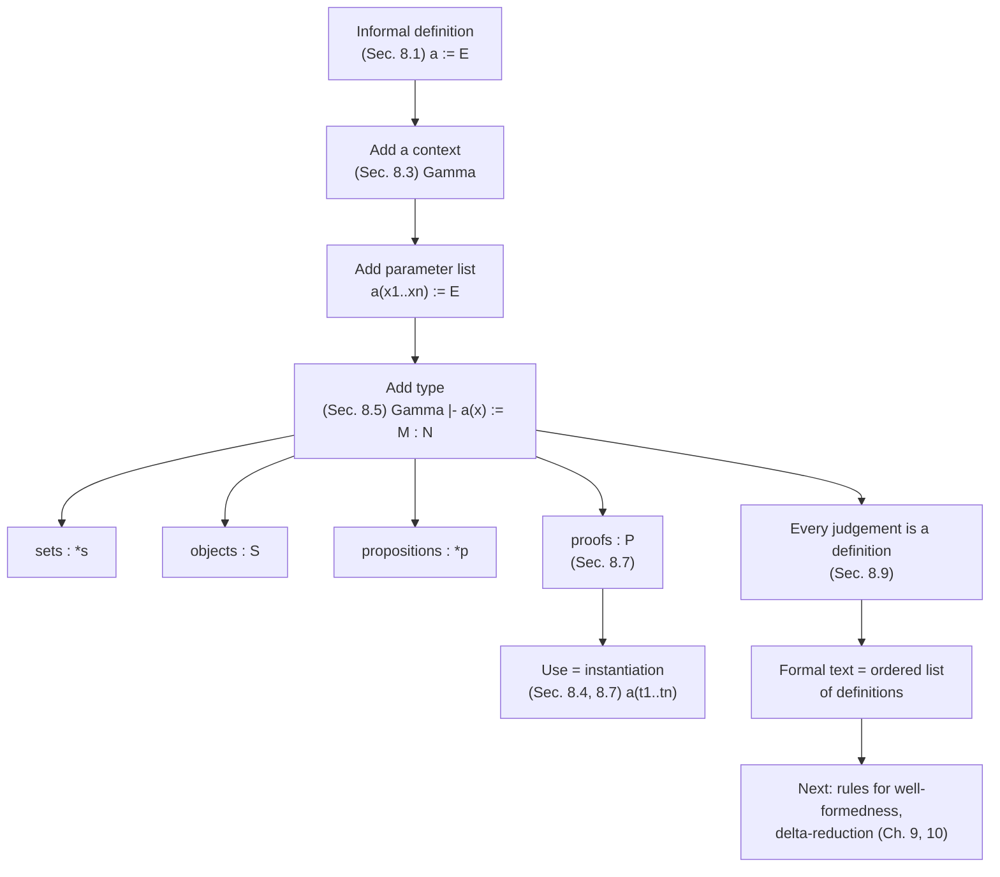

[[book-guidelines|↩ Back to guidelines]]

# Definitions and Abbreviations

> Focus Areas: `type-theory`, `automated-reasoning`. Source: Chapter 8 of Nederpelt & Geuvers, re-read from the book. Notation follows the book: $\ast$ is the sort of types/propositions, $\Gamma \vdash \ldots$ a judgement, $:=$ both definition and substitution (Remark 8.7.3 flags this overloading). This chapter is informal on purpose. It builds the *pragmatics* of definitions; the typing rules arrive in Chapters 9 and 10 (the systems $\lambda D_0$ and $\lambda D$).

## 1. The problem: you cannot write mathematics without names

Take a pure type theory such as $\lambda C$ with $\Pi$-types. It can express everything you want. Expressing it is a different matter. Without names, every use of a notion must be spelled out in full, and nested notions blow up. The book states this bluntly (Sec. 8.1): without definitions, texts grow beyond reasonable bounds, and definition-free mathematics can reach a complexity "considerably worse than exponential growth".

Think of a compiler with no functions, no `type` aliases and no constants. Every call site is the callee's body inlined, recursively. Programs still exist in principle. Nobody can write, read, or check them.

So definitions are a *pragmatic* necessity, not a logical one. That tension drives the chapter. The authors want to add names to $\lambda C$ in a way that:

1. keeps the usual mathematical reading ("let $S$ be a set, $R$ a relation on $S$; $R$ is *total* if ...");
2. is typed, so a definition is checked like any other term;
3. lets a *proven theorem* be named and then reused at specific arguments.

Item 3 is where the chapter gets its punch (Sec. 8.7-8.9).

## 2. The nature of a definition (Sec. 8.1, 8.3)

A definition singles out a useful notion and gives it a name. The book's examples are worth keeping in mind, because each exposes a different feature:

| Example | What it shows |
|---|---|
| "A rectangle is a quadrilateral with four right angles" | a name for a composite notion, built from older names |
| "$f:\mathbb R\to\mathbb R$ is *increasing* if $x<y \Rightarrow f(x)<f(y)$" | the notion needs an input ($f$) |
| "$R$ on $S$ is *total* if ..." | needs a set *and* a relation on *that* set; $S$ comes first |
| "$c := \frac{1+\sqrt5}{2}$" | a pure abbreviation, no input |
| "$D_n$ = positive divisors of $n$" | a defined *object* (a set) that depends on a number |

Standard format, borrowed from mathematics: $a := E$.

**Definition 8.3.1.** In $a := E$:
- $a$ is the *definiendum* (also: defined name, defined constant),
- $E$ is the *definiens*.

**What breaks without it.** Without a stable name there is no way to say "the same notion again, elsewhere". You would re-derive, or re-typeset, the body at each use, and nothing would guarantee two copies stayed in sync.

The book also makes a small point about names (Remark 8.1.3). They are mnemonics ("rectangle", "increasing", "total", $c$ for constant). For a tool builder the relevant fact is that names are *for humans*; a checker treats them as opaque identifiers.

### Variable vs. defined name (Sec. 8.1, 8.3)

Both introduce a new name. They differ in an essential way:

- A **variable** ("let $x$ be a real number") names an *arbitrary* element of a collection.
- A **defined name** names *one specific* thing or notion, fixed by its definiens.

This distinction is the seed of the variables/parameters/constants split in section 5 below.

## 3. Definitions in a context, with parameter lists (Sec. 8.3-8.5)

### 3.1 The context as the "setting"

Many definitions need a setting: "increasing" needs a function $f$, "total" needs $S$ and $R$, $D_n$ needs an $n$. The book formalises the setting as a **context**, drawn in flag format (Figure 8.1):

```
f : R -> R
   increasing(f) := forall x,y in R (x < y => f(x) < f(y))
```

(The flag notation is the book's; the ASCII above only mimics the layout of Figure 8.1. Each flag is a declaration $x : A$, and the pole shows how far its scope reaches.)

### 3.2 Parameter lists

Each defined constant gets a **parameter list**: the context's subject variables, in the original order. So:

- $\text{increasing}(f)$ depends on the parameter $f$,
- $\text{total}(S,R)$ depends on $S, R$,
- $D(n)$ depends on $n$.

Remark 8.3.2 admits the list is redundant: it can always be reconstructed from the context. It is kept anyway because $f(x,y) := x^2+y^2$ reads more naturally than $f := x^2+y^2$ in context $x:\mathbb R, y:\mathbb R$. Constants defined in the empty context carry an *empty* list, $c(\,)$, which Notation 8.3.3 lets you drop when writing or using them.

**Programmer's view.** A parameter list is exactly a function signature's argument list. The context is the list of typed formal arguments; the definiens is the body.

### 3.3 The formal format (Sec. 8.5)

$$\Gamma \vdash a(x_1,\ldots,x_n) := M : N$$

Read: *in context $\Gamma$, define $a(x_1,\dots,x_n)$ as $M$, which has type $N$.* Here $\Gamma \equiv x_1{:}A_1,\ldots,x_n{:}A_n$, and the type $N$ is the type of the definiendum as well. Abbreviation (Notation 8.5.1): $\vec x$ for the variable list, $\vec A$ for the type list, $\vec x : \vec A$ for the context, giving $\vec x : \vec A \vdash a(\vec x) := M : N$. With $n=0$ (empty $\Gamma$) it is a plain constant.

Because the definiens is *typed*, the same format covers sets, objects and propositions (Figure 8.4):

| Kind | Format | Type of definiens |
|---|---|---|
| sets | $\Gamma_1 \vdash A(\ldots) := E_1$ | $\ast_s$ |
| objects | $\Gamma_2 \vdash a(\ldots) := E_2$ | $S$ with $S:\ast_s$ |
| propositions | $\Gamma_3 \vdash B(\ldots) := E_3$ | $\ast_p$ |
| proofs (Sec. 8.7) | $\Gamma_4 \vdash b(\ldots) := E_4$ | $P$ with $P:\ast_p$ |

Notation 8.7.1: $\ast_s$ and $\ast_p$ are only *sugar*. The formal system has just $\ast$. Under propositions-as-types (PAT), a set and a proposition are both "a type", and the labels only help the reader.

### 3.4 A series of definitions (Figure 8.2)

Four definitions share one context $S:\ast,\ R:(S\times S)\to\ast$:

- $\text{reflexive}(S,R) := \forall x{\in}S\,(R(x,x)) : \ast$
- $\text{antisymmetric}(S,R) := \forall x,y{\in}S\,((R(x,y)\wedge R(y,x))\Rightarrow x=y) : \ast$
- $\text{transitive}(S,R) := \forall x,y,z{\in}S\,((R(x,y)\wedge R(y,z))\Rightarrow R(x,z)) : \ast$
- $\text{partially-ordered}(S,R) := \text{reflexive}(S,R)\wedge(\text{antisymmetric}(S,R)\wedge\text{transitive}(S,R)) : \ast$

Two lessons the book draws:

**(a) Parameter list vs. instantiation.** In lines (1) to (4), the $(S,R)$ left of $:=$ is a parameter list. The $(S,R)$ after `reflexive`, `antisymmetric`, `transitive` *inside* line (4) is an **instantiation**, specifically an *identity instantiation* ($S$ instantiated with $S$, $R$ with $R$). Same letters, different roles.

**(b) Flag overloading and renaming.** The flag $S$ and the $S$ in each definition are "overloaded". The book removes the ambiguity by renaming apart ($S_1,R_1,x_1$; $S_2,R_2,x_2,y_2$; ...), producing four fully separate definitions-in-a-context. This is alpha-renaming to avoid capture, the plumbing from [[Untyped-Lambda-Calculus]] showing up in a new place.

**Dependencies.** Definition (iv) uses constants from (i) to (iii), so there is a partial order on definitions. (i), (ii), (iii) may be listed in any order; (iv) must follow all three. That is a *definition-before-use* discipline, the basis of an ordered environment in the next chapters. Exercise 8.3 asks you to draw such a dependency order.

### 3.5 Descriptive vs. primitive definitions

Everything in this chapter is a **descriptive definition**: the name is *fully determined* by a definiens $M$, so it is a pure abbreviation that could in principle be unfolded away. Chapter 8 does not formalise the other kind. The **primitive definition** (an axiom or primitive notion, introduced with no definiens) is deferred: the opening of Ch. 9 says $\lambda D_0$ covers descriptive definitions only and "does not yet allow a satisfactory representation of axioms and axiomatic notions", which Ch. 10 adds to reach $\lambda D$. The integers, assumed axiomatically in Sec. 14.2, are the book's first big use of that.

## 4. Instantiation: using a definition (Sec. 8.4)

A definition's second life is its *use*. The constant has two stages (the book's "birth" and "path of life"):

1. **Birth:** introduced in a definition, e.g. $\text{total}(S,R)$.
2. **Path of life:** used with varying instantiations, e.g. $\text{total}(\mathbb R,\le)$ and $\text{total}(\mathbb N^+,\mid)$.

Each parameter is **instantiated**: substituted by an actual argument. Facts the book spells out:

- A parameter is necessarily a *variable* (a context subject). An instantiation can be a variable or **any well-formed expression** (Remark 8.4.1).
- Instantiations must **respect the typing in the context**. For $\text{increasing}(\lambda x{:}\mathbb R.\,x^3)$ to be legal, $\lambda x{:}\mathbb R.\,x^3 : \mathbb R\to\mathbb R$ must hold.
- Once instantiated, the flag is superfluous. Its typing information has been *used* to check the instantiation, then discarded.
- With several parameters, type conditions are **cumulative**: the second declaration's type mentions $S$, so it must be checked *after* substituting the first instantiation. For $\text{total}$:

  | flag | needs | instantiation 1 | instantiation 2 |
  |---|---|---|---|
  | $S:\ast$ | $\mathbb R:\ast$ | $\mathbb R$ | $\mathbb N^+$ |
  | $R:(S\times S)\to\ast$ | $\le : (\mathbb R\times\mathbb R)\to\ast$ | $\le$ | $\mid\ :(\mathbb N^+\times\mathbb N^+)\to\ast$ |

- A *well-typed instantiation* is not a *true proposition*. $\text{total}(\mathbb N^+,\mid)$ is a legal instance, even though it is false ($3\nmid5$ and $5\nmid3$). Well-formedness and truth are separate questions. Type checking only gives you the first.

**What breaks without the type conditions.** If you instantiate $R$ with a relation on a different set than the one chosen for $S$, the result $\text{total}(\mathbb R, \mid_{\mathbb N^+})$ is ill-typed. It is a category error, caught precisely by checking each instantiation against the (already substituted) flag types.

### 4.1 Grounding: parameterised definitions in Rust, Lean, Python

The structural match is a generic function. A definition in context is a function whose type parameters and arguments are the context, in dependency order.

**Rust.** A context $S{:}\ast,\ R{:}S\times S\to\ast$ becomes a generic with a predicate argument. Rust cannot express "type-valued" definitions, but it expresses the dependency order of parameters well:

```rust
// context:  S : *,  R : (S x S) -> bool-like
// total(S, R) := forall x y in S. R(x,y) || R(y,x)
// Rust can only *check* this over a finite sample, but the shape is right.
fn total<S, R>(universe: &[S], r: R) -> bool
where
    R: Fn(&S, &S) -> bool,
{
    universe
        .iter()
        .all(|x| universe.iter().all(|y| r(x, y) || r(y, x)))
}

fn main() {
    let nats = [1u32, 2, 3, 4, 5];
    // instantiation: S := u32 (via the slice), R := <=
    assert!(total(&nats, |a, b| a <= b));
    // instantiation: R := divisibility. Well-typed, but false:
    assert!(!total(&nats, |a, b| b % a == 0));
}
```

The last two lines mirror the book's point: both instantiations *type-check*; only one is *true*.

**Lean.** Here the correspondence is literal. A `def` with explicit binders is the book's $\Gamma \vdash a(\vec x) := M : N$, and each binder is a flag.

```lean
def total (S : Type) (R : S → S → Prop) : Prop :=
  ∀ x y : S, R x y ∨ R y x

def reflexive (S : Type) (R : S → S → Prop) : Prop := ∀ x : S, R x x
def antisymmetric (S : Type) (R : S → S → Prop) : Prop :=
  ∀ x y : S, R x y ∧ R y x → x = y
def transitive (S : Type) (R : S → S → Prop) : Prop :=
  ∀ x y z : S, R x y ∧ R y z → R x z

-- (iv) depends on (i)-(iii): order of definitions matters.
def partiallyOrdered (S : Type) (R : S → S → Prop) : Prop :=
  reflexive S R ∧ (antisymmetric S R ∧ transitive S R)

-- instantiation: S := Nat, R := (· ≤ ·).  Type-correct instance.
#check total Nat (· ≤ ·)
```

`Type`/`Prop` plays the role of the book's $\ast_s$/$\ast_p$ split. Lean, unlike the book, makes the split real, but the book itself warns that its own system has only $\ast$.

**Python.** Quick sketch of "definition + instantiation + dependency order" as an environment of named definitions:

```python
defs = {}  # constant name -> (param names, body-as-callable)

def define(name, params, body):
    assert name not in defs          # definitions are introduced once
    defs[name] = (params, body)

def use(name, *args):                # instantiation
    params, body = defs[name]
    assert len(args) == len(params)  # arity must match the parameter list
    return body(*args)

define("increasing", ["f"], lambda f: all(f(x) < f(y) for x in range(5) for y in range(x+1, 5)))
print(use("increasing", lambda x: x**3))   # True
```

## 5. Variables, parameters, constants (Sec. 8.3-8.6)

The chapter does not give one table, but its text pins down three roles. Collecting them:

| Role | Where it lives | Meaning | Example |
|---|---|---|---|
| **Variable** (subject of a flag) | the context $\Gamma$ | names an *arbitrary* element of its type; binding occurrence | $f$ in `f : R -> R` |
| **Parameter** | the parameter list of a defined constant | a context variable *on which the constant depends*; to be substituted at use | $f$ in $\text{increasing}(f)$ |
| **Constant** | the definiendum | names *one specific* thing, fixed by the definiens | $\text{increasing}$, $c$, $\text{total}$ |

Further facts the book states:

- A parameter is *necessarily* a variable; an instantiation is *any* well-formed expression (Rem. 8.4.1).
- Variables in parameter lists and definiens are *bound* to the flag variables (the flag poles show the scope).
- Variables and constants are drawn from **disjoint** sets (stated formally in Ch. 9: $V \cap C = \emptyset$), so one can never be mistaken for the other.

### 5.1 Definitions that depend on assumptions (Sec. 8.6)

A context may hold not only objects and sets, but also **assumptions**. "Let $S$ be partially ordered by $R$. $m$ is *minimal* if $R(x,m)\Rightarrow x=m$." In [[Polymorphism-and-Higher-Order-Typed-Lambda-Calculi#The formal version|the formal version]] two more flags are added (Figure 8.3):

```
...
  u : partially-ordered(S, R)      <- an assumption: u is a proof
    m : S
      minimal-element(S, R, u, m) := forall x in S (R(x,m) => x = m) : *
```

The flag $u$ is declared with a *proposition as its type*. Under PAT that means $u$ is a hypothetical **proof**. So an assumption is, formally, nothing special: just another variable whose type happens to be a proposition. It is then a parameter of the constant, and instantiating it requires a genuine proof term.

In Lean:

```lean
def minimalElement (S : Type) (R : S → S → Prop)
    (u : partiallyOrdered S R) (m : S) : Prop :=
  ∀ x : S, R x m → x = m
```

Note that `u` is never *used* in the body. It sits in the signature purely as a precondition. This is the same shape as a Hoare-style `requires` clause turned into an argument.

## 6. Naming proofs and lemmas (Sec. 8.7-8.8)

### 6.1 The missing line in the table

Figure 8.4 lists definitions of sets, objects and propositions. Figure 8.5 asks the obvious question: where is [[Polymorphism-and-Higher-Order-Typed-Lambda-Calculi#The definition|the definition]] of a **proof**?

$$\Gamma_4 \vdash b(\ldots) := E_4 : P \qquad (P : \ast_p)$$

This names a proof $E_4$ of a proposition $P$. The book argues this is *essential*, because a theorem is something you want to **apply**.

### 6.2 The Bezout example

The statement: for coprime positive naturals $m,n$ there are integers $x,y$ with $mx+ny=1$. The context is

$$m:\mathbb N^+,\quad n:\mathbb N^+,\quad u:\text{coprime}(m,n)$$

and the conclusion $\exists x,y{:}\mathbb Z.\,(mx+ny=1)$. If `formalproof` is a correct proof, then by PAT it *has* that type. Name it:

$$m:\mathbb N^+,\ n:\mathbb N^+,\ u:\text{coprime}(m,n)\ \vdash\ p(m,n,u) := \text{formalproof} : \exists x,y{:}\mathbb Z.\,(mx+ny=1)$$

To use the theorem at $m=55,\ n=28$ you need a proof $U$ of $\text{coprime}(55,28)$ and then instantiate with the substitution $[m:=55],[n:=28],[u:=U]$. Result:

$$p(55,28,U) : \exists x,y{:}\mathbb Z.\,(55x+28y=1).$$

Two details are easy to miss:

1. **The instantiation is dependent.** $u$'s *type* mentions $m,n$. After substituting $m:=55, n:=28$, the type of $u$ becomes $\text{coprime}(55,28)$, so $U$ must prove *that*. This is the cumulative effect of Sec. 8.4 made concrete.
2. **Application of a theorem = function application.** Nothing here is a new logical rule. A lemma is a function from its hypotheses (and objects) to its conclusion.

### 6.3 General proof vs. specialised proof (Sec. 8.8)

The book writes out both the general proof (Fig. 8.6) and the specialised proof for 55 and 28 (Fig. 8.7). They are the same text with $m,n$ replaced by $55,28$. Each is a valid standalone proof. The cumbersome route is to write the specialisation out by hand. The formal route is that **$p(55,28,U)$ already encapsulates it**: instantiation of the name *is* the specialisation, done mechanically. (Remark 8.8.1 notes a short direct proof exists because $55\cdot(-1)+28\cdot2=1$, but that is beside the point.)

Hand specialisation is what a mathematician does implicitly. A proof assistant does it by substitution, without ever regenerating the text.

**What breaks without named proofs.** Every application of a lemma would require re-copying and re-substituting its entire proof term. Term size would grow with every reuse, and nothing would link the copy back to the lemma it came from (no "this step is by Bezout").

### 6.4 Grounding: a lemma is a function

```lean
-- coprime / Bezout statement, with sorry for the proof body
def Coprime' (m n : Nat) : Prop := Nat.gcd m n = 1

theorem bezout (m n : Nat) (u : Coprime' m n) :
    ∃ x y : Int, (m : Int) * x + (n : Int) * y = 1 := by
  sorry

-- instantiation: apply the named proof to arguments
example (U : Coprime' 55 28) : ∃ x y : Int, (55 : Int) * x + (28 : Int) * y = 1 :=
  bezout 55 28 U
```

`bezout 55 28 U` is the book's $p(55,28,U)$, literally. `theorem` and `def` differ in Lean (opacity, `Prop` irrelevance), but the book's point is that they are the same kind of declaration: a typed, named, parameterised body.

In Rust, the nearest honest analogy is a generic function whose argument is a **witness token** (typestate/newtype that can only be constructed by a validating function):

```rust
// Witness that gcd(m, n) == 1. Only constructible via `Coprime::check`.
struct Coprime { m: u64, n: u64 }
impl Coprime {
    fn check(m: u64, n: u64) -> Option<Coprime> {
        fn gcd(a: u64, b: u64) -> u64 { if b == 0 { a } else { gcd(b, a % b) } }
        (gcd(m, n) == 1).then_some(Coprime { m, n })
    }
}

// "p(m, n, u)": needs the proof object u, returns Bezout coefficients.
fn bezout(u: &Coprime) -> (i64, i64) {
    // extended Euclid; correctness is the "proof body"
    fn ext(a: i64, b: i64) -> (i64, i64, i64) {
        if b == 0 { (a, 1, 0) } else {
            let (g, x, y) = ext(b, a % b);
            (g, y, x - (a / b) * y)
        }
    }
    let (_g, x, y) = ext(u.m as i64, u.n as i64);
    (x, y)
}
```

This is only an analogy. Rust's `Coprime` token is a *runtime* check; the book's $u$ is a type-level proof term checked at compile time. The analogy captures "the hypothesis is a parameter you must supply", not "proofs are erased/checked statically".

## 7. Mathematical statements as definitions (Sec. 8.9)

Every judgement $\Gamma \vdash M : N$ can be rewritten in definition format $\Gamma \vdash a(\ldots) := M : N$, just by inventing a name for $M$. This unifies *statements* and *definitions*. The price is a name and parameter list on every statement; the gain, when $M$ is a proof of $N$, is that the theorem becomes applicable (Sec. 8.7).

Figure 8.8 shows a small text, turned into a flag-format list of six items:

| # | Item | Type |
|---|---|---|
| (1) | $\text{total}(S,R) := \forall x,y{:}S.\,(R(x,y)\vee R(y,x))$ | $\ast_p$ |
| (2) | $\text{inverse}(S,R) := \lambda(x,y){:}(S\times S).\,R(y,x)$ | $(S\times S)\to\ast_p$ |
| (3) | $p_1(S,R) := \text{open-term}_1$ | $\text{total}(S,R)\Rightarrow\text{total}(S,\text{inverse}(S,R))$ |
| (4) | $\text{Id}(S) := \lambda(x,y){:}(S\times S).\,(x=y)$ | $(S\times S)\to\ast_p$ |
| (5) | $p_2(S) := \text{open-term}_2$ | $(\lvert S\rvert\ge2)\Rightarrow\neg\text{total}(S,\text{Id}(S))$ |
| (6) | $p_3 := \text{open-term}_3$ | $\text{total}(\mathbb R,\le)$ |

Items (1), (2), (4) are definitions of notions. Items (3), (5), (6) are *statements* with proofs left as placeholders ("open terms"). The book's conclusion: **a formalised mathematical text is no more than a list of well-formed definitions.** Well-formedness of such lists is the job of the next two chapters.

Lean analogue of an open term is `sorry`; Rust analogue is `todo!()`.

```lean
theorem p1 (S : Type) (R : S → S → Prop) :
    total S R → total S (fun x y => R y x) := by sorry
```

(In Lean `fun x y => R y x` is item (2), $\text{inverse}$, inlined as a lambda. The book's version names it and instantiates it.)

## 8. Inductive and recursive definitions: deliberately left out (Sec. 8.2)

The book's type theory has **no primitive inductive types and no recursive definitions**. Systems like the Calculus of Inductive Constructions (CIC, as in Coq) define $\mathbb N$ from $0$ and successor and get the induction principle and well-founded recursion automatically. Here:

- **Inductive definitions** are instead obtained as predicates in higher-order logic, or assumed axiomatically (the integers, Sec. 14.2).
- **Recursive definitions** (e.g. $\text{fac}(0)=1,\ \text{fac}(n+1)=\text{fac}(n)\cdot(n+1)$) are avoided by using the descriptor $\iota$ ("the unique entity with ..."; Sec. 12.7). Integer addition and multiplication are handled this way in Secs. 14.4 and 14.11.

The stated reasons:

1. keep the system relatively simple;
2. avoid the burden of proving that *each* recursive definition terminates with a unique answer (a soundness obligation per definition).

The stated cost: $\text{fac}$ is **not a program**, so it cannot be executed. $\text{fac}(3)=6$ **requires a proof** rather than evaluation.

**Why this matters to a builder.** This is the central design trade-off between this book and Lean/Coq. In a kernel with inductive types, the termination/positivity checks live in the *trusted computing base* (the kernel) and evaluation by $\iota$-reduction gives you $\text{fac}(3)=6$ by `rfl`. Here the kernel stays tiny (only $\lambda C$ plus definitions), but computation turns into reasoning.

```lean
def fac : Nat → Nat
  | 0     => 1
  | n + 1 => fac n * (n + 1)

example : fac 3 = 6 := rfl      -- by evaluation: needs a kernel that computes
```

In the book's $\lambda D$ the corresponding fact has no `rfl` proof; one would derive it from the axiomatised/descriptor-based characterisation of $\text{fac}$.

## 9. Conclusions and further reading (Sec. 8.10-8.11)

Chapter 8 observes that earlier chapters already used hidden definitions: $\Leftrightarrow$ (Remark 7.3.1), $\bot := \Pi\alpha{:}\ast.\,\alpha$, and $\neg A := A\to\bot$. Those were meta-level abbreviations. Formal logic books typically leave definitions "unanalysed": no rules for what makes a definition well-formed, how to instantiate it, or how to **unfold** it (replace the constant by its properly instantiated definiens). The book promises such rules, with unfolding treated in Sec. 9.5 ($\delta$-reduction).

Points from the further-reading section that matter for implementation:

- **Unfolding is used sparingly** in real proof assistants, because unlimited unfolding inflates formula size. This is the origin of Lean's reducibility attributes and lazy delta reduction in `isDefEq`.
- **Severi & Poll (1994)** study definitions in $\lambda C$. Their rules do not allow parameterised definitions: you write $\text{Total} := \lambda S{:}\ast_s.\ \lambda R{:}S\to S\to\ast_p.\ \forall x,y{:}S.\,(R(x,y)\vee R(y,x))$ with explicit $\lambda$-abstraction. That works only if the type theory permits the abstractions (in $\lambda C$ it does). Their system adds **local definitions** ($c := t : A$ in $M$), with the rule
  $$\frac{\Gamma,\ c := t : A \vdash M : B}{\Gamma \vdash (c := t : A\ \text{in}\ M) : (c := t : A\ \text{in}\ B)}$$
  This is Lean's `let`. The book's design instead uses only *global* parameterised definitions and says local ones can be represented by global ones.
- **Automath**: a definition can be modelled as a $\beta$-redex. $c := t : A$ in $M$ is convertible with $(\lambda c{:}A.\,M)\,t$, with a "mini reduction" to replace a single occurrence of $c$.

## 10. How the pieces fit



## 11. Synthesis: what this feeds

**Depends on.**
- Contexts and flags (Ch. 2 onward) as the "setting" of a definition.
- Substitution and variable renaming ([[Untyped-Lambda-Calculus]]): instantiation is multi-substitution; flag overloading is solved by alpha-renaming.
- Propositions-as-types and $\Pi$-types ([[Dependent-Types]]): a proof is a term whose type is the proposition; a lemma's statement is a $\Pi$-type over its hypotheses; applying the lemma is application.

**Leads to.**
- Ch. 9-10: environments $\Delta$, rules that add and instantiate definitions, and $\delta$-reduction giving $\lambda D_0$ and $\lambda D$.
- Ch. 14-15: integer arithmetic via axioms and descriptor $\iota$, and the formal Bezout proof built as a list of definitions.

**Project connections (Focus Areas `type-theory`, `automated-reasoning`).**

- **Environment as a first-class data structure** (`type-theory`). The elaborator and kernel need an ordered global environment of constants, each carrying a context (parameters), a body (optional) and a type. That is exactly $\Gamma \vdash a(\vec x) := M : N$. Lean's `ConstantInfo` (for `defnInfo`/`thmInfo`) has the same fields: name, level params, type, value.

```rust
// Sketch of a kernel environment entry mirroring  Gamma |- a(xs) := M : N
struct Decl {
    name: ConstId,
    params: Vec<(VarId, Term)>, // the context, dependency-ordered
    body: Option<Term>,         // Some = definition; None = axiom/primitive (cf. Ch. 10)
    ty: Term,                   // N
}
struct Env { decls: Vec<Decl> } // order = definition-before-use
```

- **Definitional equality and delta** (`type-theory`). Once constants have bodies, the kernel's `isDefEq` must decide when $a(\vec t)$ equals its unfolded body with $\vec x := \vec t$ substituted. That is $\delta$-conversion, previewed here by the "unfolding" remark in Sec. 8.11. The advice that proof assistants unfold *sparingly* is the practical reason for lazy delta strategies, and the book's observation that unrestricted unfolding blows up term size is the performance motivation.
- **Instantiation checking is cumulative substitution** (`type-theory`, `automated-reasoning`). Checking $a(\vec t)$ means checking $t_1 : A_1$, then $t_2 : A_2[x_1:=t_1]$, and so on. This is the core of application checking in a bidirectional checker: after synthesising the head's type, check each argument against the substituted binder type. It is also where **metavariables** will enter: an elaborator that lets you write `bezout _ _ U` must solve $m,n$ by unification against the type of $U$, i.e. against $\text{coprime}(55,28)$. The book never does this (all arguments explicit), but the structure it lays out is precisely what implicit-argument resolution later relaxes.
- **Lemmas as reusable, checkable proof objects** (`automated-reasoning`). Naming a proof as a constant with parameters is the minimal mechanism for **proof certificates** that compose: a proof checker only needs to verify the signature once, then each use is a typed instantiation. In a verifier with an embedded prover, discharged verification conditions can be stored as named lemmas and cited by later proofs, keeping the trusted kernel small.
- **Assumptions as parameters** (`automated-reasoning`). The treatment of $u:\text{partially-ordered}(S,R)$ as a parameter is the type-theoretic form of `requires` clauses. A dependent-subtyping or Hoare-style contract on a function is a hypothesis-parameter whose instantiation demands a proof.
- **Trusted computing base trade-off.** Omitting inductive/recursive definitions keeps the kernel tiny but makes computation a proof burden (section 8). A kernel for the target compiler should decide this early: either include inductive types and a termination check in the TCB, or follow $\lambda D$ and axiomatise.

Not everything here bears on the abstract-interpretation or CSP kernels. For those, this chapter is background only.

## Where this leads

Chapter 9 turns the informal format $\Gamma \vdash a(\vec x) := M : N$ into inference rules over an environment $\Delta$, with $\delta$-reduction to unfold definitions, producing $\lambda D_0$; Chapter 10 adds primitive definitions (axioms) to reach $\lambda D$, the system used for the book's formalisations, including the full Bezout proof in Chapter 15.
