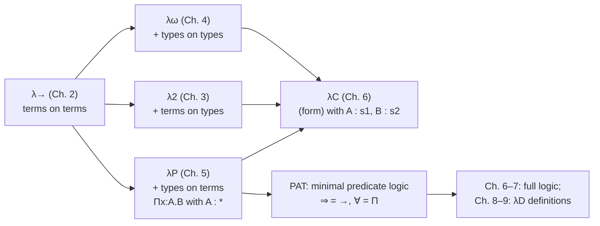

[[book-guidelines|↩ Back to guidelines]]

# Dependent Types (λP)

> Focus Area: `type-theory`. Source: Chapter 5 of Nederpelt & Geuvers, re-read directly from the book. Notation follows the book: $\ast$ is the sort of types, $\square$ the sort of kinds, $\Gamma \vdash A : B$ a judgement, $B[x := N]$ substitution.

## 1. The problem: a type that needs a value

Up to this point the book has built three systems on top of simply typed $\lambda\to$. Each adds one kind of dependency:

| Chapter | System | New dependency |
|---|---|---|
| 2 | $\lambda\to$ | terms depending on terms (ordinary functions) |
| 3 | $\lambda 2$ | terms depending on types (polymorphism) |
| 4 | $\lambda\omega$ | types depending on types (type constructors like $\mathsf{List}$) |
| **5** | **$\lambda P$** | **types depending on terms** |

The fourth cell is the missing one. Chapter 5 fills it, and the result is the first genuinely *dependent* system.

Why would you want it? Take the type "vectors of length $n$". The length $n$ is a number, a term. A type that mentions $n$ is a type that depends on a term. Without this you can write `Vec` but you cannot say, in the type, how long it is. Likewise a predicate such as "$n$ is prime" gives a proposition for each number $n$. If propositions are types (the PAT reading, section 4 below), then "is prime" is a type that depends on the term $n$.

The book's general format for such a thing is

$$\lambda x : A \,.\, M \qquad\text{where } M \text{ is a type and } x \text{ is a term variable (so } A \text{ is a type)}.$$

It is a type-valued function, i.e. a type constructor whose input is a term. Two flavours the book singles out:

1. **Set-valued functions.** Let $S_n$ be a set for each $n : \mathsf{nat}$. Then $\lambda n : \mathsf{nat}\,.\,S_n$ is a *family of types* (an *indexed type*). Example: $S_n = \{0, n, 2n, \ldots\}$ sends $0 \mapsto \{0\}$, $1 \mapsto \mathsf{nat}$, $2 \mapsto$ the even naturals. Another: $V_n$ = vectors of length $n$.
2. **Proposition-valued functions.** Let $P_n$ be the proposition "$n$ is prime". Then $\lambda n : \mathsf{nat}\,.\,P_n$ sends $3$ to "3 is prime" (true) and $4$ to "4 is prime" (false). This is what logic calls a *predicate*.

Both have the same type, $\mathsf{nat} \to \ast$. The "P" in $\lambda P$ stands for *predicate*.

Applying such a constructor to a term gives a type, and $\beta$-reduction computes it: $(\lambda n : \mathsf{nat}\,.\,S_n)\,3 \to_\beta S_3$.

**What breaks without it.** In $\lambda\omega$ the only type-level functions take types as input. You cannot form $P\,3$ or $V_3$. Predicates and length-indexed data are simply inexpressible, so quantifying over elements ($\forall x \in S$) has nothing to be about.

## 2. Dependent function types: $\Pi x : A\,.\,B$

In $\lambda\to$, a function type $A \to B$ means: for every input in $A$, the output is in the *same fixed* type $B$. For $\mathsf{vec} : \Pi n : \mathsf{nat}\,.\,\mathsf{Vec}\,n$ that is not enough: the output type must change with the input value.

The fix is the **dependent product**
$$\Pi x : A \,.\, B,$$
the type of functions that send each $a : A$ to something in $B[x := a]$. The variable $x$ may occur free in $B$. Notation 5.2.1: when $x \notin FV(B)$ we write $A \to B$ as shorthand. Officially $\lambda P$ has *only* $\Pi$-types; $\to$ is an abbreviation.

Remark 5.2.2 gives two readings. If $A$ is finite with elements $a_1, a_2$, then
$$\Pi x : A\,.\,B \;=\; B[x := a_1] \times B[x := a_2],$$
a Cartesian product, which is why Martin-Löf calls it the Cartesian product of a family of types. If $x \notin FV(B)$ it collapses to the function space $A \to B$. So $\Pi$ generalises both.

Examples from the book (note the two levels):
- $\Pi n : \mathsf{nat}\,.\,\mathsf{nat} : \ast$, inhabited by $\lambda n : \mathsf{nat}\,.\,f(f\,n)$.
- $\Pi n : \mathsf{nat}\,.\,\ast : \square$, a *kind*, inhabited by both $\lambda n : \mathsf{nat}\,.\,S_n$ and $\lambda n : \mathsf{nat}\,.\,P_n$.

### Grounding: what Rust can and cannot do

Rust has a restricted shadow of this: const generics.

```rust
// A type depending on a *term* N, but only a compile-time constant.
struct Vector<const N: usize>([f64; N]);

fn dot<const N: usize>(a: &Vector<N>, b: &Vector<N>) -> f64 {
    a.0.iter().zip(b.0.iter()).map(|(x, y)| x * y).sum()
}
```

`Vector` has kind "usize $\to$ type", so `Vector<3>` is a type depending on the term `3`. That is the $\lambda n : \mathsf{nat}\,.\,V_n$ of the book. But it is only a shadow: `N` must be a compile-time constant, you cannot take a *runtime* `n: usize` and return a `Vector<n>`, and there is no $\Pi$ over runtime values. In $\lambda P$ the dependency is on arbitrary terms, including variables bound by $\lambda$.

### Grounding: Lean

Lean's kernel is $\lambda P$ plus much more, so this is nearly literal:

```lean
#check (fun (n : Nat) => Fin n)          -- Nat → Type : a family of types
#check (fun (n : Nat) => n = n + 0)      -- Nat → Prop : a predicate
#check ∀ n : Nat, n = n + 0              -- a Π-type; ∀ is Π

inductive Vec (α : Type) : Nat → Type where
  | nil  : Vec α 0
  | cons {n : Nat} : α → Vec α n → Vec α (n + 1)

def Vec.head {α : Type} {n : Nat} : Vec α (n + 1) → α
  | .cons a _ => a                       -- no nil case: the type rules it out
```

`Vec.head` is the "what you gain" example: the type makes the empty case unreachable. (Lean's inductive families go beyond $\lambda P$, which has no inductive types; Nederpelt and Geuvers mention these only in the further reading.)

## 3. The rules of $\lambda P$

[[Polymorphism-and-Higher-Order-Typed-Lambda-Calculi#The rules|The rules]] are those of $\lambda\omega$ with a revised product rule (Figure 5.1). All judgements have the form $\Gamma \vdash A : B$ and $s$ ranges over $\{\ast, \square\}$.

$$\frac{}{\emptyset \vdash \ast : \square}\;(\text{sort}) \qquad \frac{\Gamma \vdash A : s}{\Gamma, x:A \vdash x : A}\;(\text{var})\quad x \notin \Gamma$$

$$\frac{\Gamma \vdash A : B \quad \Gamma \vdash C : s}{\Gamma, x : C \vdash A : B}\;(\text{weak}) \qquad \frac{\Gamma \vdash A : \ast \quad \Gamma, x:A \vdash B : s}{\Gamma \vdash \Pi x : A\,.\,B : s}\;(\text{form})$$

$$\frac{\Gamma \vdash M : \Pi x : A\,.\,B \quad \Gamma \vdash N : A}{\Gamma \vdash M\,N : B[x := N]}\;(\text{appl}) \qquad \frac{\Gamma, x : A \vdash M : B \quad \Gamma \vdash \Pi x : A\,.\,B : s}{\Gamma \vdash \lambda x : A\,.\,M : \Pi x : A\,.\,B}\;(\text{abst})$$

$$\frac{\Gamma \vdash A : B \quad \Gamma \vdash B' : s \quad B =_\beta B'}{\Gamma \vdash A : B'}\;(\text{conv})$$

(sort), (var), (weak) and (conv) are identical to $\lambda\omega$. The differences, in the book's words:

**(i) Upgrading of $\to$ to $\Pi$.** The output type may mention $x$. Two mechanical consequences:
- In (form), the second premise needs the *extended* context $\Gamma, x : A$, because $B$ may use $x$.
- In (appl), the result type is $B[x := N]$, not a fixed $B$: you must substitute the actual argument into the output type.

**(ii) Downgrading of the input type.** In (form), the domain must satisfy $A : \ast$. This is the whole difference from $\lambda C$ (Chapter 6), where $A : s_1$ is allowed. Since $A : \ast$, the bound $x$ is a *term*, so $\Pi x : A\,.\,B$ ranges over terms only. There is no $\Pi\alpha : \ast\,.\,\ldots$ as in $\lambda 2$/$\lambda\omega$. The rule has two instances, which is the "double role" the book keeps pointing out:
- $s = \ast$: $A : \ast$, $B : \ast$, so $\Pi x : A\,.\,B : \ast$ (an ordinary dependent function type);
- $s = \square$: $A : \ast$, $B : \square$, so $\Pi x : A\,.\,B : \square$ (a kind, like $\mathsf{nat} \to \ast$).

**What breaks without the substitution in (appl).** Without $B[x := N]$, applying `vec : Πn:nat. Vec n` to `3` would have type "`Vec n`" with a dangling $n$, or the constant type "Vec of something". The dependency would be forgotten at exactly the point where it is used. Likewise, without extending the context in (form), the premise $B : s$ would be ill-scoped.

The book defers the metatheory (strong normalisation, subject reduction, uniqueness of types, decidability) to Chapter 6 where it is stated for the whole family. For $\lambda P$ it says only that it "has the same nice properties as $\lambda 2$ and $\lambda\omega$". Exercise 5.4 asks the reader to prove that $\ast$ is the only legal kind in $\lambda P$: every kind is of the form $A_1 \to \cdots \to \ast$ with the $A_i : \ast$.

### Grounding: the rules as a Rust checker

This is the shape of the checker you eventually have to write. (Named variables, and I assume binder names are distinct so substitution cannot capture; real code should use de Bruijn indices or fresh renaming. See the capture discussion in the [[Untyped-Lambda-Calculus|Untyped Lambda Calculus]] notes.)

```rust
#[derive(Clone, Debug, PartialEq)]
enum Term {
    Star,
    Box,                                // the sort □
    Var(String),
    Pi(String, Box<Term>, Box<Term>),   // Πx:A. B
    Lam(String, Box<Term>, Box<Term>),  // λx:A. M
    App(Box<Term>, Box<Term>),
}

type Ctx = Vec<(String, Term)>;

fn subst(t: &Term, x: &str, n: &Term) -> Term {
    use Term::*;
    match t {
        Var(y) if y == x => n.clone(),
        Var(_) | Star | Box => t.clone(),
        App(f, a) => App(Box::new(subst(f, x, n)), Box::new(subst(a, x, n))),
        Pi(y, a, b) | Lam(y, a, b) => {
            let a2 = Box::new(subst(a, x, n));
            let b2 = if y == x { b.clone() } else { Box::new(subst(b, x, n)) };
            if matches!(t, Pi(..)) { Pi(y.clone(), a2, b2) } else { Lam(y.clone(), a2, b2) }
        }
    }
}

fn whnf(t: &Term) -> Term {
    if let Term::App(f, a) = t {
        if let Term::Lam(x, _, body) = whnf(f) {
            return whnf(&subst(&body, &x, a));
        }
    }
    t.clone()
}

// β-conversion, the premise of (conv): compare normal forms structurally.
fn conv(a: &Term, b: &Term) -> bool {
    use Term::*;
    match (whnf(a), whnf(b)) {
        (Star, Star) | (Box, Box) => true,
        (Var(x), Var(y)) => x == y,
        (App(f, a), App(g, b)) => conv(&f, &g) && conv(&a, &b),
        (Pi(_, a, b), Pi(_, c, d)) | (Lam(_, a, b), Lam(_, c, d)) => conv(&a, &c) && conv(&b, &d),
        _ => false,
    }
}

fn infer(g: &Ctx, t: &Term) -> Result<Term, String> {
    use Term::*;
    match t {
        Star => Ok(Box),                                        // (sort)
        Box => Err("□ has no type".into()),
        Var(x) => g.iter().rev().find(|(y, _)| y == x)          // (var)/(weak)
            .map(|(_, a)| a.clone()).ok_or(format!("unbound {x}")),
        Pi(x, a, b) => {                                        // (form), λP version
            if whnf(&infer(g, a)?) != Star { return Err("domain must have type *".into()); }
            let mut g2 = g.clone(); g2.push((x.clone(), (**a).clone()));
            let s = whnf(&infer(&g2, b)?);                      // extended context!
            if matches!(s, Star | Box) { Ok(s) } else { Err("bad codomain".into()) }
        }
        Lam(x, a, m) => {                                       // (abst)
            let mut g2 = g.clone(); g2.push((x.clone(), (**a).clone()));
            let b = infer(&g2, m)?;
            let pi = Pi(x.clone(), a.clone(), Box::new(b));
            infer(g, &pi)?;                                     // second premise
            Ok(pi)
        }
        App(m, n) => match whnf(&infer(g, m)?) {                // (appl) + (conv)
            Pi(x, a, b) => {
                let na = infer(g, n)?;
                if conv(&na, &a) { Ok(subst(&b, &x, n)) }       // B[x := N]
                else { Err("argument type mismatch".into()) }
            }
            _ => Err("not a function".into()),
        },
    }
}
```

Two things to notice. First, `infer` is syntax-directed: every term form has one rule, and (conv) is not a rule you search over but a call to `conv` inside the (appl) case. This is the algorithmic reading of the declarative rules. Second, `conv` is the *only* place where the type checker runs programs. Since types now contain terms, checking `P (2+2)` against `P 4` requires evaluation. This is why dependent type checking and normalisation are tied together (Chapter 6 shows the type checker terminates because $\lambda C$ is strongly normalising).

## 4. Worked derivation: building $\Pi x : A\,.\,P\,x \to P\,x$

Section 5.3 derives a result "from scratch" in flag format. Here is its content, line numbers as in the book.

1. $\vdash \ast : \square$ (sort)
2. flag $A : \ast$
3. (3) $\ast : \square$ in context $A : \ast$ by (weak); (4) the same in context $A : \ast, x : A$ by (weak); (5) $A \to \ast : \square$ by (form) on (2) and (4)

The key new line is (5): the *kind* $A \to \ast$, officially $\Pi x : A\,.\,\ast$, which was **not** derivable in $\lambda\omega$. Its inhabitants are type constructors depending on terms. Continuing, with $P : A \to \ast$ and $x : A$:

- (11) $P\,x : \ast$ by (appl): the first real dependent type.
- (12) $\Pi x : A\,.\,P\,x : \ast$ by (form): here $x$ occurs in the body.
- (14) $P\,x \to P\,x : \ast$, then (15) $\Pi x : A\,.\,P\,x \to P\,x : \ast$.
- (16) $y : P\,x \vdash y : P\,x$ by (var), then (17) $\lambda y : P\,x\,.\,y : P\,x \to P\,x$ and
- (18) $\lambda x : A\,.\,\lambda y : P\,x\,.\,y \;:\; \Pi x : A\,.\,P\,x \to P\,x$ by (abst).

In the book's three questions (Remark 5.3.1), line (18) answers all at once: (Q1) well-typedness, (Q2) type checking $A : \ast,\, P : A \to \ast \vdash \lambda x{:}A.\,\lambda y{:}P\,x.\,y : \Pi x{:}A.\,P\,x \to P\,x$, and (Q3) term finding for that type. The book notes that building forward from $\emptyset \vdash \ast : \square$ was convenient here but is not the right strategy when you start from a goal type (Remark 2.9.2 and the backward derivation of section 5.5).

Shortened derivations drop the (sort), (var), (weak), (form) lines and the second premise of (abst), keeping only the lines that matter.

The same term in Lean:

```lean
example (A : Type) (P : A → Prop) : ∀ x : A, P x → P x :=
  fun _ y => y          -- λx:A. λy:P x. y
```

## 5. Predicates, propositions-as-types and minimal predicate logic

Why is $\lambda P$ the "logic" system? Because of PAT, the reading of Section 5.4:

- **Propositions as types:** a proposition $B$ is a type, $B : \ast$.
- **Proofs as terms:** an inhabitant $b : B$ is a *proof object* of $B$.
- Hence: $B$ is true iff $B$ is inhabited; $B$ is false iff there is no $b : B$. (To *show* inhabitation you need a context $\Gamma$ and a term $b$ with $\Gamma \vdash b : B$.)

The dictionary (Figure 5.2):

| Minimal predicate logic | Type theory of $\lambda P$ |
|---|---|
| $S$ is a set | $S : \ast$ |
| $A$ is a proposition | $A : \ast$ |
| $a \in S$ | $a : S$ |
| $p$ proves $A$ | $p : A$ |
| $P$ is a predicate on $S$ | $P : S \to \ast$ |
| $A \Rightarrow B$ | $A \to B \;(= \Pi x : A\,.\,B)$ |
| $\forall x \in S\,(P(x))$ | $\Pi x : S\,.\,P\,x$ |
| ($\Rightarrow$-elim), ($\Rightarrow$-intro) | (appl), (abst) |
| ($\forall$-elim), ($\forall$-intro) | (appl), (abst) |

Predicates are the reason dependent types are needed at all. A predicate on $S$ is a term $P : S \to \ast$, so for each $a : S$, $P\,a : \ast$ is a proposition. "$P$ holds for $a$" means $P\,a$ is inhabited; "does not hold for $b$" means $P\,b$ is not.

### Implication

The book justifies $\Rightarrow$ as $\to$ by a chain of equivalences: $A \Rightarrow B$ is true; if $A$ is true then $B$ is true; if $A$ is inhabited then $B$ is inhabited; there is a function from inhabitants of $A$ to those of $B$; there is an $f : A \to B$; $A \to B$ is inhabited. Since $x \notin FV(B)$, we may write $A \to B$ instead of $\Pi x : A\,.\,B$ (Remark 5.4.1) and the rules specialise to

$$\frac{\Gamma \vdash M : A \to B \quad \Gamma \vdash N : A}{\Gamma \vdash M N : B}\qquad \frac{\Gamma, x : A \vdash M : B \quad \Gamma \vdash A \to B : s}{\Gamma \vdash \lambda x : A\,.\,M : A \to B}$$

which are ($\Rightarrow$-elim) (modus ponens) and ($\Rightarrow$-intro).

### Universal quantification

Same chain: $\forall x \in S\,(P(x))$ is true; for each $x \in S$, $P\,x$ is inhabited; there is a function sending each $x$ to an inhabitant of $P\,x$, with type $\Pi x : S\,.\,P\,x$. So $\forall$ is coded as $\Pi$, and here $x$ genuinely occurs in the body. The book compares the rules side by side:

- ($\forall$-elim) is (appl): $S \leftrightarrow A$, $P(x) \leftrightarrow B$, $P(N) \leftrightarrow B[x := N]$. Differences: (appl) carries an explicit context, and adds proof objects ($M$ proves $\Pi x{:}A.B$, $M N$ proves $B[x:=N]$).
- ($\forall$-intro) is (abst): the flag "Let $x \in S$" is the context extension $x : S$. The "arbitrary $x$" side condition of natural deduction is *enforced by scoping*: $x$ is only in the context of the sub-derivation. (abst)'s second premise ($\Pi x : A\,.\,B$ is well formed) has no counterpart in natural deduction, where well-formedness of formulas is assumed.

### Worked logical example (section 5.5)

Prove $\forall x \in S\,\forall y \in S\,(Q(x,y)) \Rightarrow \forall u \in S\,(Q(u,u))$. Natural deduction: assume the hypothesis (a), let $u \in S$ (b), instantiate twice with $\forall$-elim to get $Q(u,u)$, then $\forall$-intro and $\Rightarrow$-intro.

Coding: curry $Q$ as $Q : S \to S \to \ast$ rather than $S \times S \to \ast$ (no product type yet). The goal is
$$\Pi x : S\,.\,\Pi y : S\,.\,Q\,x\,y \;\to\; \Pi u : S\,.\,Q\,u\,u,$$
in context $S : \ast,\; Q : S \to S \to \ast$. Working *backwards* from the goal (the book's recommended strategy for term finding): the $\to$ gives an (abst) with $z : \Pi x{:}S.\Pi y{:}S.\,Q\,x\,y$; the $\Pi u$ gives an (abst) with $u : S$; then two (appl)s: $z\,u : \Pi y : S\,.\,Q\,u\,y$ (note $u$ replaces $x$ by $B[x:=N]$) and $z\,u\,u : Q\,u\,u$. The proof object is

$$\lambda z : (\Pi x : S\,.\,\Pi y : S\,.\,Q\,x\,y)\,.\,\lambda u : S\,.\,z\,u\,u.$$

In Lean, literally the same term:

```lean
example (S : Type) (Q : S → S → Prop) : (∀ x y : S, Q x y) → ∀ u : S, Q u u :=
  fun z u => z u u
```

The book stresses that the proof object contains enough information to reconstruct the full derivation, so the derivation is in a sense redundant. It also notes the (conv) subtlety (Remark 5.5.2): the type computed for a proof object may differ from the intended proposition by $\beta$-conversion, which is harmless thanks to (conv).

**Consequences read off.** Line (18) is a tautology $\forall x \in A\,(P(x) \Rightarrow P(x))$. But $\Pi x : A\,.\,P\,x$ alone is not a tautology, and indeed has no inhabitant in context $A : \ast, P : A \to \ast$.

### What $\lambda P$ cannot express

No $\bot$, no negation, no $\wedge$, $\vee$ or $\exists$. Those need the quantification over types ($\Pi\alpha : \ast$) of $\lambda 2$, and so the combination of systems in Chapter 6. Minimal predicate logic, with just $\Rightarrow$ and $\forall$, is all that the single rule (form) with $A : \ast$ buys.

### Python sketch (illustrative only)

Python cannot check any of this statically, but the *shape* of a $\Pi$-type, a function whose result's "type" depends on its argument, is easy to show with runtime checks:

```python
def Vec(n):                      # a type-valued function: nat -> *
    return lambda xs: isinstance(xs, list) and len(xs) == n

def replicate(n, a):             # intended: Π n:nat. A -> Vec n
    xs = [a] * n
    assert Vec(n)(xs)            # in λP this is checked once, statically
    return xs
```

## 6. Historical notes in section 5.7

- Dependent types go back to Curry's *illative logic*; Seldin (1975/1979) formalised it.
- **Automath** (de Bruijn, early 1970s) was the first system to formalise mathematics via type theory. Its first versions used the *Logical Framework* interpretation of PAT: use $\lambda P$ as a meta-calculus, defining a logic $L$ by choosing a context $\Gamma_L$ that declares its language and rules. The framework then handles binding, substitution and capture-avoidance for you. This was revived in Edinburgh LF (Harper et al., 1987) and Twelf.
- The interpretation developed in this chapter (proofs *inside* $\lambda P$ by coding logic directly) is the Curry-Howard isomorphism (Howard 1968, published 1980), also called Curry-Howard-de Bruijn.
- Martin-Löf's intuitionistic type theory extends $\lambda P$ with $\Sigma$-types ($\Sigma x : A\,.\,B$: pairs $\langle a, b\rangle$ with $a : A$, $b : B[x := a]$) and inductive types. It is *intensional* (types equal only if $\beta$-convertible); extensional type theory makes type checking undecidable, which is why Martin-Löf abandoned it. Systems: Coq (Calculus of Inductive Constructions), Nuprl, ALF, Agda.

## 7. Closing synthesis



**Depends on:** $\lambda\to$ (Chapter 2: abstraction, application, contexts and judgements), the $\Pi$-type and conversion machinery of $\lambda 2$/$\lambda\omega$ (Chapters 3-4), and the PAT idea first sketched in section 2.9.

**What depends on it:** Chapter 6 generalises the single side-condition $A : \ast$ in (form) to arbitrary pairs of sorts and obtains $\lambda C$ and the $\lambda$-cube. Chapters 7 and 8-9 add the missing connectives and definitions on top of exactly the $\Pi$-and-predicate machinery here.

### How this bears on your project (`type-theory`)

- **Dependent types, $\Pi$-types, judgements, contexts.** This chapter is the minimal core of the term/type representation for the elaborator: one syntactic category for terms and types, a context of declarations, and $\Pi$ as the only binder-in-types. The `Term` enum above is that representation; $\Sigma$-types and inductive families are the extensions still to add.
- **Definitional equality / `isDefEq`.** Dependent typing forces (conv) into the checker: `conv` above is a toy `isDefEq` (here just $\beta$). The kernel's `isDefEq` in Lean extends this with $\delta$, $\eta$, $\iota$ and proof-irrelevance rules; Chapter 9 of this book adds $\delta$.
- **Substitution and context management.** $B[x := N]$ in (appl) and the extended context in (form) and (abst) are the plumbing that recurs in elaboration and Hoare-style soundness. Capture-avoidance is the one thing the naive `subst` above does *not* do, and it must in real code.
- **Refinement types.** A predicate $P : A \to \ast$ is the raw ingredient. A refinement type $\{x : A \mid P\,x\}$ is, in a $\Sigma$-type reading (section 5.7), the pair $\Sigma x : A\,.\,P\,x$ of a value and a proof object. A dependent-subtyping style contract is then a $\Pi$-type whose codomain mentions the argument, e.g. $\Pi n : \mathsf{nat}\,.\,\mathsf{Vec}\,n \to P\,n$. The checker has to discharge the $P\,n$ obligations: inhabiting $P\,n$ is the proof-search step you will hand to the automated prover.
- **Bidirectional typing.** Read the rules algorithmically: (appl) *infers* the type of the function and *checks* the argument against the domain; (abst) is *checked* against a $\Pi$-type, with the domain coming from the annotation. The Rust above is the inference mode only; the book's shortened backward derivations (section 5.5, building the term from the goal type) are the checking mode in disguise.
- **Trusted kernel / proof certificates.** Because proofs are terms, the type checker *is* the proof checker, and a proof object is a self-contained certificate: the book notes the derivation can be reconstructed from the term alone. A prover that emits $\lambda P$ terms can be checked by a small kernel, which is the trusted-core architecture your toolchain aims for.
- **Metavariables / unification.** The book does not treat these here. In $\lambda P$ the (appl) rule requires the argument $N$ explicitly; implicit-argument resolution (solving for $N$ in $\Pi x{:}A.B$ from the expected type) is the elaboration layer on top, and appears in later books of this vault, not in this chapter.

## Where this leads

Chapter 6 relaxes the restriction $A : \ast$ in (form) and merges $\lambda P$ with $\lambda 2$ and $\lambda\omega$ into the Calculus of Constructions $\lambda C$, giving a single rule set for the whole $\lambda$-cube and a system with enough power to encode $\bot$, $\wedge$, $\vee$, $\exists$ (Chapter 7). The proofs-as-terms reading begun here becomes the basis for definitions in $\lambda D$ (Chapters 8-9) and for all of the formalised mathematics later in the book.

## Checklist against the Topic List entry

- Types depending on terms: sections 1, 2.
- The system $\lambda P$: sections 3, 4.
- Predicates as type-valued functions: sections 1 (flavour 2), 5.
- Dependent function types: section 2 and the $\Pi$ discussion in 3.
