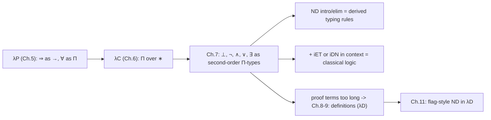

[[book-guidelines|↩ Back to guidelines]]

# Encoding Logic in the Calculus of Constructions

> Focus Areas: `automated-reasoning` (primary tag in this book's goals file), with strong `type-theory` content. Source: Chapter 7 of Nederpelt & Geuvers, re-read from the PDF. Notation follows the book: $\ast$ is the sort of types/propositions, $\Gamma \vdash M : A$ a judgement, $\Pi x : A . B$ the dependent product (written $A \to B$ when $x$ is not free in $B$), $B[x := N]$ substitution, $\equiv$ syntactic identity / abbreviation.

## 0. The question this chapter answers

By Chapter 5 the book has a dependent system $\lambda P$ in which [[Dependent-Types#Implication|implication]] is a function type and $\forall$ is a $\Pi$-type. That is *minimal* predicate logic: only $\Rightarrow$ and $\forall$. Everything else a mathematician uses ($\bot$, $\neg$, $\wedge$, $\vee$, $\exists$, excluded middle) is missing.

The chapter's claim: in $\lambda C$ you do not need to add any of those as new primitives. Each can be *defined* as a type, using only $\Pi$ over $\ast$, and the usual natural-deduction introduction and elimination rules then fall out as *derivable* typing judgements. The only thing you must postulate is the classical principle, if you want classical logic, and that goes in as a hypothesis at the front of the context.

The common trick, which I will keep calling "the pattern":

> A connective is the type of a function that says "whatever you want to conclude, $C$, I can conclude it from the connective by supplying what its elimination rule needs."

This is the Church encoding of data, read as logic. If you know continuation-passing style, you already know it.

## 1. Absurdity and negation (Section 7.1)

### 1.1 First principles

What does it mean that $\bot$ (absurdity, contradiction) holds? The classical slogan is *ex falso quodlibet*: if $\bot$ is true, every proposition is true. In type-theoretic phrasing (book's own words): if $\bot$ is inhabited, every proposition $\alpha$ is inhabited. Make that constructive: an inhabitant $M$ of $\bot$ gives a *function* that sends any proposition $\alpha$ to an inhabitant of $\alpha$.

A function from "any proposition $\alpha : \ast$" to "an inhabitant of that very $\alpha$" has type $\Pi\alpha : \ast . \alpha$. By the application rule, if $f : \Pi\alpha : \ast . \alpha$ then $f\,A : \alpha[\alpha := A] \equiv A$ for every $A : \ast$. Conversely, having such an $f$ makes every proposition true, which is absurd. So the book's summary: $\bot$ is inhabited iff $\Pi\alpha : \ast . \alpha$ is inhabited. Hence [[Polymorphism-and-Higher-Order-Typed-Lambda-Calculi#The definition|the definition]]

$$\bot \;\equiv\; \Pi\alpha : \ast . \alpha .$$

What breaks without this? If $\bot$ were just an atomic proposition letter, you would have to add $\bot$-elimination as an extra rule. With this definition it is *free* (Remark 7.1.1): the elimination step is a single application,

| natural deduction | type theory |
|---|---|
| from $\bot$ conclude $A$ | $f : \Pi\alpha : \ast . \alpha$, then $f\,A : A$ by (appl) on $f$ and $A : \ast$ |

Where does $\bot$ live in the $\lambda$-cube? $\Pi\alpha : \ast . \alpha$ quantifies a type over $\ast$ with body in $\ast$, so $(s_1, s_2) = (\square, \ast)$: that is polymorphism, system $\lambda 2$. The book notes $\bot : \ast$ is derivable in $\lambda 2$ (Exercises 3.5, 6.1).

### 1.2 Negation

Now $\neg A$ is "A implies absurdity":

$$\neg A \;\equiv\; A \to \bot \;(=\Pi x : A . \bot).$$

The arrow has $(s_1, s_2) = (\ast, \ast)$, but because $\bot$ is involved you still need at least $\lambda 2$.

### 1.3 The rules that disappear (Remark 7.1.2)

Natural deduction has dedicated rules for $\bot$ and $\neg$. With $\neg A \equiv A \Rightarrow \bot$, they are special cases of the implication rules:

- ($\bot$-intro): from $A$ and $\neg A$ conclude $\bot$. This is just ($\Rightarrow$-elim) applied to $A$ and $A \Rightarrow \bot$.
- ($\neg$-elim) is the *same* rule (Note in the book: identical special cases of $\Rightarrow$-elim).
- ($\neg$-intro): assume $A$, derive $\bot$, conclude $\neg A$. This is ($\Rightarrow$-intro) with $B = \bot$ (an abstraction).

The book makes a small but sharp point: ($\bot$-intro) and ($\neg$-elim) are identical as inference but differ in *role*. ($\bot$-intro) is a backward rule (how to *obtain* $\bot$: find $A$ and $\neg A$). ($\neg$-elim) is a forward rule (how to *use* a negation: check whether $A$ also holds, which yields absurdity). That introduction rules are used backward and elimination rules forward is the heuristic behind proof search, see Section 8.

### 1.4 Grounding

Lean. Lean has its own `False` (an inductive type with no constructors), but here is the book's definition transcribed. `Prop` plays the role of $\ast$ (and, like $\ast$ in $\lambda C$, it is impredicative, which is exactly why quantifying over all propositions is allowed to produce a proposition).

```lean
def MyBot : Prop := ∀ α : Prop, α
def MyNot (A : Prop) : Prop := A → MyBot

-- ⊥-elim is free: it is just application
theorem my_bot_elim (f : MyBot) (A : Prop) : A := f A

-- ⊥-intro / ¬-elim are ⇒-elim
theorem my_bot_intro {A : Prop} (a : A) (na : MyNot A) : MyBot := na a
```

Rust. `Void` (an empty enum) is the idiomatic bottom, and `match v {}` is its elimination. The second-order version needs a *generic method*, because `Πα. α` is a polymorphic value, and Rust expresses rank-2 polymorphism only through a trait with a generic method.

```rust
enum Void {}                       // no constructors: the "inductive" bottom
fn absurd<A>(v: Void) -> A { match v {} }

// Πα:∗. α  as a trait: "whoever holds this can produce any type"
trait Bottom { fn elim<A>(self) -> A; }
impl Bottom for Void { fn elim<A>(self) -> A { match self {} } }

type Not<A> = Box<dyn FnOnce(A) -> Void>;  // ¬A ≡ A → ⊥
```

## 2. Conjunction and disjunction (Section 7.2)

### 2.1 Conjunction

$A \wedge B$ holds iff both do. The book's second-order encoding:

$$A \wedge B \;\equiv\; \Pi C : \ast . (A \to B \to C) \to C .$$

Reading $\Pi$ as "for all" and $\to$ as "implies": for every proposition $C$, if $A$ and $B$ together imply $C$, then $C$ holds. The "hypothesis" $A \to B \to C$ can only be a vacuous detour if $A$ and $B$ are already true, so this says $A$ and $B$ hold. Conversely if $A$ and $B$ hold, then "$A, B$ imply $C$" yields $C$.

It is called *second order* because it quantifies over propositions $C$, which are themselves objects of sort $\ast$. The *first order* alternative $A \wedge B \equiv \neg(A \to \neg B)$ works only classically (Section 7.4). The second-order one is more general because it is valid constructively. That is the book's answer to Key Question 2.

What breaks without it: in $\lambda P$ you cannot even state $A \wedge B$ as a type. You could only say a pair of hypotheses in the context.

Formal check. The book states the natural-deduction rules next to their encoded versions and asks for a term in place of the question marks, with $\Gamma \equiv A : \ast, B : \ast$:

$$\frac{\Gamma \vdash a : A \quad \Gamma \vdash b : B}{\Gamma \vdash {?}_1 : \Pi C : \ast . (A \to B \to C) \to C}\ (\wedge\text{-intro-sec-tt})$$

The derivation (in the book's shortened flag style, which ignores the second premise of (abst)):

```text
(a) A : *
(b)   B : *
(c)     x : A
(d)       y : B
(e)         C : *
(f)           z : A -> B -> C
(1)             z x   : B -> C                   (appl) on (f),(c)
(2)             z x y : C                        (appl) on (1),(d)
(3)           λz:A->B->C. z x y : (A->B->C)->C   (abst) on (2)
(4)         λC:*. λz:A->B->C. z x y : ΠC:*.(A->B->C)->C   (abst) on (3)
```

So $\langle x, y\rangle \equiv \lambda C : \ast . \lambda z : A \to B \to C . z\,x\,y$, the pair is a function waiting for a "consumer" $z$ of both components. Elimination applies the pair to a continuation: with $c : \Pi C : \ast . (A \to B \to C) \to C$, left projection is $c\,A\,(\lambda u : A . \lambda v : B . u)$ and right projection $c\,B\,(\lambda u : A . \lambda v : B . v)$. (The book leaves these two derivations as Exercise 7.4; the terms above are the standard answers, not text from the page.)

### 2.2 Disjunction

$$A \vee B \;\equiv\; \Pi C : \ast . (A \to C) \to (B \to C) \to C .$$

Intuition (the book's "case distinction" argument): if $A$ or $B$ holds, and you can get $C$ from $A$ and also $C$ from $B$, then $C$ holds. The quantifier over $C$ makes this the *only* thing you can do with an $A \vee B$ without knowing which side it came from. Again the first order form $\neg A \to B$ is classical only.

Rules and encodings, side by side:

- ($\vee$-intro-left): from $A$ get $A \vee B$. Term: $\lambda C : \ast . \lambda f : A \to C . \lambda g : B \to C . f\,a$.
- ($\vee$-intro-right): symmetrically with $g\,b$. (Exercise 7.7 in the book; terms are the standard ones.)
- ($\vee$-elim): from $A \vee B$, $A \Rightarrow C$, $B \Rightarrow C$ get $C$. The book gives the derivation in full, with $x : \Pi D : \ast . (A \to D) \to (B \to D) \to D$, $y : A \to C$, $z : B \to C$:

```text
(1) x C     : (A -> C) -> (B -> C) -> C    (appl) on (d),(c)
(2) x C y   : (B -> C) -> C                (appl) on (1),(e)
(3) x C y z : C                            (appl) on (2),(f)
```

Notice that the elimination rule is *application to the motive $C$*. (Dependent-type people: the $C$ you pick is the motive of the eliminator; here it ranges over $\ast$, so it is non-dependent.) The book renames the bound variable to $D$ in the rule to avoid clashing with the free $C$.

### 2.3 Connectives as abstractions (Remark 7.2.1)

The definitions above have free variables $A, B$. To make their kinds explicit the book offers

$$\neg \equiv \lambda\alpha : \ast . (\alpha \to \bot),\quad \wedge \equiv \lambda\alpha\,\beta : \ast . \Pi\gamma : \ast . (\alpha\to\beta\to\gamma)\to\gamma,\quad \vee \equiv \lambda\alpha\,\beta : \ast . \Pi\gamma : \ast . (\alpha\to\gamma)\to(\beta\to\gamma)\to\gamma.$$

Then $\neg A$ is $(\lambda\alpha : \ast . \alpha \to \bot)\,A \to_\beta A \to \bot$. Cost: these abstractions are type constructors ($\ast \to \ast$, $\ast \to \ast \to \ast$), so you need $\lambda\omega$, not just $\lambda 2$. Biimplication is the usual $A \Leftrightarrow B \equiv (A \Rightarrow B) \wedge (B \Rightarrow A)$.

This matters for implementation: with the abstracted version, a connective occurrence is a $\beta$-redex, and the conversion rule (conv) is what lets you use it. Remark 7.3.2 shows exactly this: when a hypothesis has type $(\lambda\alpha\,\beta : \ast . \ldots)\,A\,B$, you insert a step $x : \Pi\gamma : \ast . \ldots$ justified by (conv) from the redex. That is the book's cleanest small example of definitional equality doing real work during proof construction.

### 2.4 Grounding

Rust. The pair is Church-encoded as a trait with a generic method; the disjunction as a trait taking two handlers.

```rust
// A ∧ B ≡ ΠC:∗. (A→B→C)→C
trait And<A, B> { fn elim<C>(self, k: impl FnOnce(A, B) -> C) -> C; }
struct Pair<A, B>(A, B);
impl<A, B> And<A, B> for Pair<A, B> {
    fn elim<C>(self, k: impl FnOnce(A, B) -> C) -> C { k(self.0, self.1) }
}
fn fst<A, B>(p: impl And<A, B>) -> A { p.elim(|a, _| a) }   // ∧-elim-left
fn snd<A, B>(p: impl And<A, B>) -> B { p.elim(|_, b| b) }   // ∧-elim-right

// A ∨ B ≡ ΠC:∗. (A→C)→(B→C)→C
trait Or<A, B> { fn elim<C>(self, f: impl FnOnce(A) -> C, g: impl FnOnce(B) -> C) -> C; }
struct Inl<A>(A);
struct Inr<B>(B);
impl<A, B> Or<A, B> for Inl<A> {
    fn elim<C>(self, f: impl FnOnce(A) -> C, _g: impl FnOnce(B) -> C) -> C { f(self.0) }
}
impl<A, B> Or<A, B> for Inr<B> {
    fn elim<C>(self, _f: impl FnOnce(A) -> C, g: impl FnOnce(B) -> C) -> C { g(self.0) }
}
```

Note the two Rust types `Inl<A>` and `Inr<B>` both implement the *same* trait: that is the encoding's selling point. Consumers see only `Or<A, B>`, never which injection built it. (An ordinary `enum Either<A, B>` is the inductive version; the trait is the encoded one.)

Lean.

```lean
def MyAnd (A B : Prop) : Prop := ∀ C : Prop, (A → B → C) → C
def MyOr  (A B : Prop) : Prop := ∀ C : Prop, (A → C) → (B → C) → C

theorem my_and_intro {A B : Prop} (a : A) (b : B) : MyAnd A B :=
  fun _ z => z a b
theorem my_and_left  {A B : Prop} (c : MyAnd A B) : A := c A (fun a _ => a)
theorem my_and_right {A B : Prop} (c : MyAnd A B) : B := c B (fun _ b => b)

theorem my_or_inl {A B : Prop} (a : A) : MyOr A B := fun _ f _ => f a
theorem my_or_inr {A B : Prop} (b : B) : MyOr A B := fun _ _ g => g b
theorem my_or_elim {A B C : Prop} (x : MyOr A B) (y : A → C) (z : B → C) : C :=
  x C y z                -- exactly the book's line (3): x C y z
```

Lean's native `And`/`Or` are inductive instead. The book's closing remark (Section 7.8) says the same of Coq: it began with $\lambda C$ and this style, then moved to inductively defined connectives.

## 3. A propositional example (Section 7.3)

The book proves the tautology $(A \vee B) \Rightarrow (\neg A \Rightarrow B)$. Unfolded, the goal type is

$$(\Pi C : \ast . (A \to C) \to (B \to C) \to C) \to (A \to \bot) \to B .$$

Derivation (Figure 7.1), with $x$ the disjunction, $y$ the negation:

```text
(a) A : *
(b)   B : *
(c)     x : ΠC:*. (A->C)->(B->C)->C
(d)       y : A -> ⊥
(1)         x B : (A->B)->(B->B)->B
(e)           u : A
(2)             y u   : ⊥
(3)             y u B : B                          -- ⊥-elim, free
(4)         λu:A. y u B : A -> B
(5)         x B (λu:A. y u B) : (B->B)->B
(f)           v : B
(7)         λv:B. v : B -> B
(8)         x B (λu:A. y u B)(λv:B. v) : B
(9)       λy:A->⊥. x B (λu:A. y u B)(λv:B. v) : (A->⊥)->B
(10)    λx:(...). λy:A->⊥. x B (λu:A. y u B)(λv:B. v) : the goal
```

The proof-search story is worth reading as the book tells it. The "flash of inspiration" is to apply $x$ to the goal type $B$ itself (line 1), because the result type then *ends in $B$*. After that you only need an $A \to B$ (from the contradiction $y\,u$ and $\bot$-elim) and a $B \to B$ (identity). This is backward reasoning driven by the target: pick the hypothesis whose conclusion matches the goal, instantiate its universally quantified variable, and generate subgoals for its premises. That is the skeleton of every goal-directed prover.

Lean check:

```lean
theorem taut {A B : Prop} : MyOr A B → MyNot A → B :=
  fun x y => x B (fun u => y u B) (fun v => v)   -- y u : MyBot, so y u B : B
```

## 4. Classical logic (Section 7.4)

### 4.1 What is missing

Everything so far is *constructive* (intuitionistic) logic. Classical logic additionally has

- excluded third (ET): $A \vee \neg A$ for every $A$,
- double negation (DN): $\neg\neg A \Rightarrow A$ for every $A$.

Neither is derivable in $\lambda C$ (the book cites Troelstra & van Dalen 1988, p. 79). Over constructive logic they are equivalent: adding ET lets you derive DN, and vice versa, so either one suffices. This is the book's answer to Key Question 3.

### 4.2 How to add an axiom: put it in the context

The principle must be something "callable in every derivation". The book's mechanism is a declaration at the front of the context (an axiom):

$$i_{ET} : \Pi\alpha : \ast . \alpha \vee \neg\alpha$$

i.e. an assumed inhabitant. For DN, $i_{DN} : \Pi\alpha : \ast . \neg\neg\alpha \to \alpha$.

Why this works: in this system a hypothesis is just a variable of a given type. A global hypothesis is a variable in the *outermost* context, so every derivation that mentions that context can use it. Nothing in the type theory has changed; you are working *relative to an assumption*. In particular, no new reduction rule exists, so $i_{ET}\,A$ is a stuck term and the computational content of proofs that use it is lost (Section 6 below).

### 4.3 Worked derivation: ET implies DN

Goal: from $i_{ET}$ derive $\Pi\beta : \ast . \neg\neg\beta \to \beta$. The book's steps:

```text
(a) iET : Πα:*. α ∨ ¬α
(b)   β : *
(c)     x : ¬¬β
(1)       iET β : β ∨ ¬β
(2)       iET β : Πγ:*. (β->γ)->(¬β->γ)->γ          -- unfold ∨
(3)       iET β β : (β->β)->(¬β->β)->β              -- choose γ := β
(4)       λy:β. y : β->β
(5)       iET β β (λy:β. y) : (¬β->β)->β
(d)         z : ¬β
(6)           x z   : ⊥                              -- ¬¬β ≡ ¬β -> ⊥
(7)           x z β : β                              -- ⊥-elim
(8)         λz:¬β. x z β : ¬β->β
(9)       iET β β (λy:β. y)(λz:¬β. x z β) : β
```

The remaining abstractions give $\lambda\beta : \ast . \lambda x : \neg\neg\beta . (9)$. Same pattern as before: instantiate the disjunction at the goal $\beta$, then discharge the two branches, one by identity and one by contradiction. The book asks the reader to finish the last two lines.

In Lean this is `Classical.byContradiction` in spirit. With an axiom as a hypothesis:

```lean
variable (iET : ∀ α : Prop, MyOr α (MyNot α))

theorem dn_of_et (β : Prop) (x : MyNot (MyNot β)) : β :=
  iET β β (fun y => y) (fun z => x z β)
```

### 4.4 Classical definitions become available

Section 7.8 adds that, in the presence of DN, one can also define the connectives from $\Rightarrow$, $\neg$, $\forall$ classically: $A \vee B := \neg A \Rightarrow B$, $A \wedge B := \neg(\neg A \vee \neg B)$, $\exists x . P(x) := \neg\forall x . \neg P(x)$. These are the "first order" versions that the second-order encodings improve on.

## 5. Predicate logic: $\forall$ and $\exists$ (Sections 7.5-7.6)

### 5.1 Universal quantification

Already done in Section 5.4 V: $\forall x \in S\,(P(x))$ is $\Pi x : S . P\,x$, and its intro/elim rules are the abstraction and application rules. Nothing new.

### 5.2 Existential quantification, from the elimination rule

The first order encoding $\exists x \in S\,P(x) \equiv \neg\forall x \in S\,(\neg P(x))$ is classical only. The constructive, second order one:

$$\exists x \in S\,(P(x)) \;\equiv\; \Pi\alpha : \ast . \big((\Pi x : S . (P\,x \to \alpha)) \to \alpha\big) .$$

Where does it come from? Start from the natural-deduction elimination rule

$$\frac{\exists x \in S\,P(x) \qquad \forall x \in S\,(P(x) \Rightarrow A)}{A}\ (\exists\text{-elim})$$

If an existential is *only* usable through this rule, then it should behave as: "for all $A$, if $\forall x\,(P\,x \Rightarrow A)$ then $A$." That is the definition, with $\alpha$ for $A$. As with $\wedge$ and $\vee$: the encoding is the type of "the thing that eliminates itself".

The proof that ($\exists$-elim-sec) is derivable is two lines (with $y : \Pi\alpha : \ast . ((\Pi x : S . (P\,x \to \alpha)) \to \alpha)$, $z : \Pi x : S . (P\,x \to A)$):

```text
(1) y A   : (Πx:S. (P x -> A)) -> A      (appl) on (d),(c)
(2) y A z : A                            (appl) on (1),(e)
```

Remark 7.5.2: this requires $x \notin FV(A)$ (the eigenvariable condition), otherwise the application in line (2) is illegal. This is the type-theoretic shadow of the side condition of the logical rule.

Remark 7.5.1 is a nice editorial point: mathematicians write "let $x$ be such that $P(x)$" and keep using $x$, silently ignoring scope. The book insists on the formal rule because scope of $x$ is exactly what is at stake. The type theory enforces it: the witness $x$ is bound by the $\Pi$ in the *continuation* $z$, not visible outside.

### 5.3 Introduction

$$\frac{a \in S \qquad P(a)}{\exists x \in S\,(P(x))}\ (\exists\text{-intro})$$

With $a : S$ and $u : P\,a$ in context, the proof object is

$$\lambda\alpha : \ast . \lambda v : (\Pi x : S . (P\,x \to \alpha)) . v\,a\,u .$$

An existence proof is a "package" that remembers the witness $a$ and the evidence $u$, and that gives them to whoever supplies a consumer $v$. This is the Church-encoded $\Sigma$-type (in the sense of "dependent pair"), but note that the encoding is *proof-irrelevant in use only*: you cannot project the witness out as a term of type $S$. Elimination is only into propositions $\alpha : \ast$ that do not mention $x$.

As with connectives (Remark 7.5.3): abstracting over $S, P$ gives $\exists \equiv \lambda S : \ast . \lambda P : S \to \ast . \Pi\alpha : \ast . \ldots$ which needs full $\lambda C$ (its type is $\Pi S : \ast . (S \to \ast) \to \ast$); the unabstracted instance for fixed $S, P$ needs only $\lambda P 2$.

### 5.4 Example (Section 7.6): $\neg\exists x\,P(x) \Rightarrow \forall y\,\neg P(y)$

Target (second order): $((\Pi\alpha : \ast . (\Pi x : S . (P\,x \to \alpha)) \to \alpha) \to \bot) \to \Pi y : S . (P\,y \to \bot)$. Three abstractions raise flags $u : \neg\exists x . P\,x$, $y : S$, $v : P\,y$ with goal $\bot$. Applying $u$ to an inhabitant of $\exists x . P\,x$ gives $\bot$, and that inhabitant is the $\exists$-intro term with witness $y$:

```text
(1) λα:*. λw:(Πx:S. (P x -> α)). w y v : ∃x:S. P x
(2) u (λα:*. λw:(Πx:S. (P x -> α)). w y v) : ⊥
```

Final proof term:

$$\lambda u : \neg(\exists x : S . P\,x) . \lambda y : S . \lambda v : P\,y . u\,(\lambda\alpha : \ast . \lambda w : (\Pi x : S . (P\,x \to \alpha)) . w\,y\,v)$$

Lean transcription:

```lean
def MyEx (S : Type) (P : S → Prop) : Prop := ∀ α : Prop, (∀ x : S, P x → α) → α

theorem my_ex_intro {S : Type} {P : S → Prop} (a : S) (u : P a) : MyEx S P :=
  fun _ v => v a u

theorem my_ex_elim {S : Type} {P : S → Prop} {A : Prop}
    (y : MyEx S P) (z : ∀ x : S, P x → A) : A := y A z

theorem not_ex_forall_not {S : Type} {P : S → Prop}
    (u : MyEx S P → MyBot) : ∀ y : S, P y → MyBot :=
  fun y v => u (my_ex_intro y v)
```

(Here `S : Type` plays the role of $S : \ast$. In $\lambda C$ "sets" and propositions share the single sort $\ast$; Lean separates them into `Type` and `Prop`.)

## 6. Constructive versus classical, and what the encodings buy and cost

- **Constructive baseline.** All second-order encodings are valid in $\lambda C$ with no axioms: constructive propositional and predicate logic.
- **Classical extension.** Add ET or DN as a context declaration. Proofs that use it are legal but *open*: they are terms with a free variable $i_{ET}$, which cannot be reduced away.
- **First order encodings** ($\neg(A \to \neg B)$, $\neg A \to B$, $\neg\forall\neg$) are valid only classically; second-order ones are valid in both, hence preferred.
- **Cost: proof-term size.** Section 7.6's final remark: terms grow long, subexpressions repeat, and the logical rule used (e.g. a hidden $\exists$-intro) is no longer visible. This is the book's explicit motivation for definitions (Chapter 8 onward): "$\bot$ for $\Pi\alpha : \ast . \alpha$", "$\wedge$", "$\forall$/$\exists$" were already informal abbreviations.

### What the encoding gives you, in the book's words (Section 7.7)

1. In ordinary logic the justification ("by $\Rightarrow$-elimination") is meta-level; in type theory the inhabitant $M$ of $A$ puts it on the object level. You must supply it.
2. So a machine can check proofs: "proof checking = type checking".
3. The same machinery extends from logic to mathematics (Chapters 12-15).
4. Disadvantage: derivations are harder to read than ordinary logic.

## 7. Natural deduction, sequents, Hilbert (Section 7.8, further reading)

This section shows the book's wider framing of the three families of formal systems:

| System | Judgement | Rules | Remark |
|---|---|---|---|
| Natural deduction (Gentzen, Jaśkowski) | $A_1, \ldots, A_n \vdash B$ | one intro and one elim per connective | what the book adopts; $\lambda C$ is a "more formal treatment" because proofs get term representations |
| Sequent calculus (Gentzen) | $A_1, \ldots, A_n \vdash B_1, \ldots, B_k$ | left and right introduction per connective | symmetric, built to *study* proofs (consistency results); same derivable judgements as ND |
| Hilbert / axiomatic | formulas | many axiom schemes, only modus ponens | e.g. $A \Rightarrow (B \Rightarrow A)$ and $(A \Rightarrow (B \Rightarrow C)) \Rightarrow ((A \Rightarrow B) \Rightarrow (A \Rightarrow C))$; "unnatural" to derive in |

Also in this section: flag-style (Fitch/Jaśkowski) ND is a linear presentation, not fundamentally different from tree style; Prawitz's work on proof structure maps $\beta$-reduction to *cut elimination* in derivations; Coq started from $\lambda C$ and this encoding, then moved to inductive types for connectives, and uses tactics so users do not write the huge proof terms by hand.

## 8. Synthesis: where this sits and how it feeds the project



**What depends on it.** Chapter 8's motivation (definitions) and Chapters 9-11 (λD, flag-style natural deduction with $\wedge$-in, $\wedge$-el, etc. as *constants* with declared types) are built directly from the observation here that connectives are best handled as named, typed abbreviations. The other direction: this chapter depends on $\lambda 2$/$\lambda\omega$/$\lambda P$ and on conversion, because connective abstractions are $\beta$-redexes.

**How it bears on the goals** (tags: `automated-reasoning`, `type-theory`):

- *Judgements as the shared ancestor of type checker and proof checker.* This chapter is the cleanest statement of it: "proof checking = type checking". A kernel for your verifier only has to implement the $\lambda C$ rules (var, sort, appl, abst, form, conv) and a $\beta$-conversion test. Everything logical lives in *types you write*, not in kernel code. That is the trusted-kernel argument: the smaller the primitive rule set, the smaller the trusted computing base.
- *Trusted kernels and proof certificates.* A proof is a term plus a checkable derivation. Producing the term is search (elaborator / ATP side); checking it is cheap and independent. Contrast with the hidden `Classical.choice`-style axioms: adding $i_{ET}$ to the context is the book's own demonstration that "trust" can be localised to explicit hypotheses a checker can list.
- *Proof search and unification.* Backward reasoning with intro rules, forward reasoning with elim rules (Section 1.3 above), and the "apply the hypothesis to the goal" step in Figure 7.1 (instantiating $\Pi C$ with $C := B$) is higher-order matching: the goal type fixes $C$ and generates subgoals. In an elaborator with metavariables, the same step reads: apply `x ?C`, unify the result type `?C` with `B`, emit goals `A → B`, `B → B`. That is first-order unification at the conclusion; it becomes a Miller pattern when the $\Pi x : S$ bodies in the $\exists$ case have the bound variable applied only to distinct variables.
- *Conversion in use.* Remark 7.3.2 shows the (conv) rule being applied to $\beta$-unfold a connective. That is the concrete place where a kernel's `isDefEq` is exercised: a connective abstraction applied to arguments must be reduced to weak-head normal form before the Π-type structure is visible to (appl).
- *Where to be careful with refinement types / verification conditions.* Encoded $\exists$ and $\vee$ are not computationally informative: you cannot extract a witness or decide which branch from them. In Lean, `Or` and `Exists` also live in `Prop`, and the same restriction (no elimination into data) holds; `Sigma` is the data-carrying variant. If a verifier ever needs witnesses (e.g. for counterexample extraction in the CSP side), it needs $\Sigma$ or an inductive pair, not the second-order $\exists$.
- *Rust [[Polymorphism-and-Higher-Order-Typed-Lambda-Calculi#Grounding|grounding]].* The traits above show the encoding as rank-2 polymorphism through generic methods. This is one way a Rust verifier could represent proof objects for connectives, but the practical design is an explicit `enum Term` with `Pi`, `Lam`, `App`, `Sort` and a `Context`, and the connectives as *defined constants* in a library (Chapter 8's solution), not as host-language types.

## Where this leads

Chapter 8 turns the abbreviations used informally here into a systematic definition mechanism; Chapters 9-11 build $\lambda D$ and flag-style natural deduction on it, where $\bot$, $\wedge$, $\vee$, $\exists$ and the classical axioms become declared constants with intro/elim rules, and later chapters (12-15) use the same logic for sets, relations, [[Numbers-and-Arithmetic|numbers and arithmetic]].

---
*[[Propositions-as-Types-and-the-Curry-Howard-Isomorphism#Source notes|Source notes]].* Book pp. 137-161 are the chapter text; pp. 162-164 are Exercises 7.1-7.14 (not reproduced here). The terms for $\wedge$-elim, $\vee$-intro and the Lean and Rust code are (not machine-compiled here) my own illustrations of the book's definitions; the derivations for $\wedge$-intro, $\vee$-elim, Figure 7.1, ET $\Rightarrow$ DN, $\exists$-elim and the $\neg\exists \Rightarrow \forall\neg$ example are the book's.
