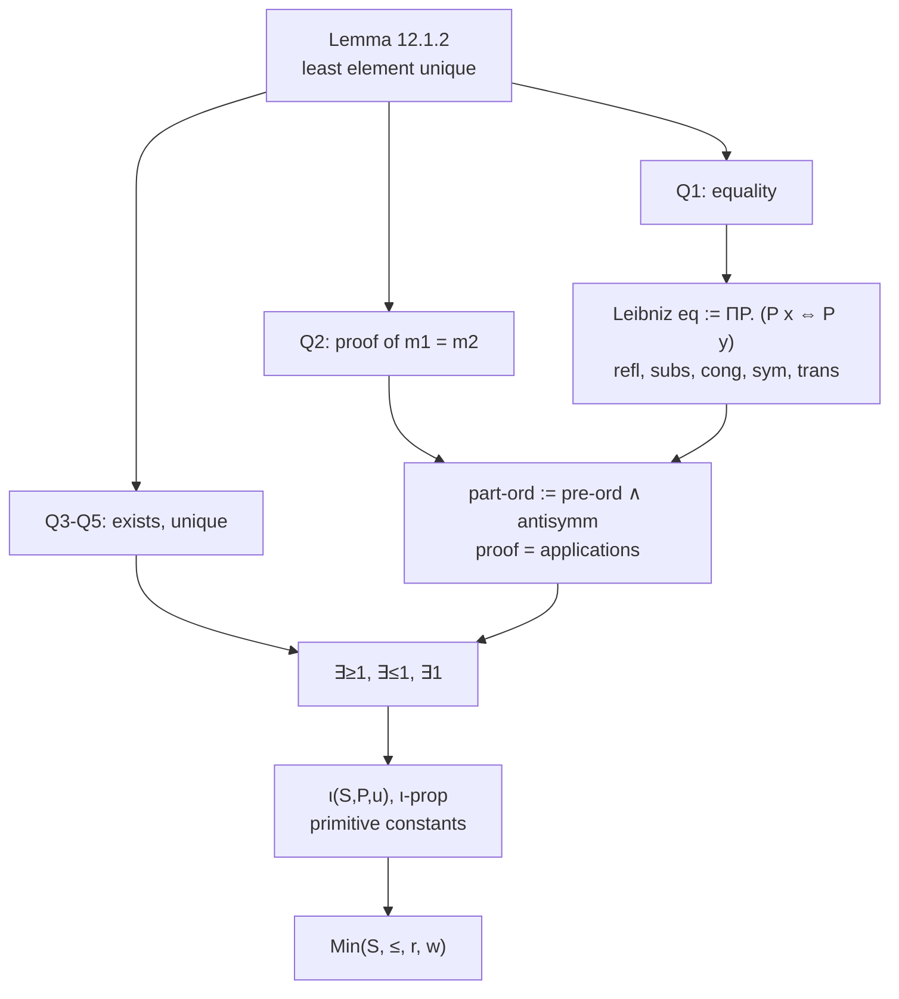

[[book-guidelines|↩ Back to guidelines]]

# Formalising Elementary Mathematics in $\lambda D$

> Focus Areas: `type-theory` and `automated-reasoning`. Source: Chapter 12 of Nederpelt & Geuvers, re-read from the book. Notation as in the book: $\ast_s$ is the sort of sets (types of data), $\ast_p$ the sort of propositions, $\Pi$ is dependent function type, $\Rightarrow,\Leftrightarrow,\wedge,\forall,\exists$ are the defined connectives of Chapter 11 (see [[Natural-Deduction-and-Flag-Style-Proofs]]), $c(\vec x) := M : N$ is a definition line, and $=_S$ is equality on the set $S$. Flag derivations are written below as indented lists; the book's flagpoles become nesting.

## 1. The problem: logic is not mathematics yet

Chapter 11 showed that $\lambda D$ can express natural deduction faithfully. But proving "$A \Rightarrow A \vee B$" is not doing mathematics. Mathematics talks about **elements** with **equality**, **orders**, **"there is exactly one"** and **"the such-and-such"**. Where does each of those live in a type theory that so far has only $\Pi$, $\lambda$, sorts and definitions?

The book's method is a deliberate experiment: take one tiny, honest piece of mathematics, formalise it, and see what is missing. It is a *discovery-driven* chapter: every gap becomes a new definition or a new primitive.

**The example (Definition 12.1.1, Lemma 12.1.2).** Let $S$ be a set and $\le$ a binary relation on $S$. Then $m \in S$ is a *least element* if $\forall n \in S\,(m \le n)$. If $S$ is partially ordered by $\le$ and has a least element, that element is unique. Informal proof: if $m_1$, $m_2$ are both least, then $m_1 \le m_2$ and $m_2 \le m_1$, so $m_1 = m_2$ by antisymmetry.

Five questions surface when the first formal attempt (Figure 12.1) is written down:

| # | Question | Answered in |
|---|---|---|
| Q1 | What is "$=$"? It is not in the system. | 12.2 |
| Q2 | What proof term $t_3$ proves $m_1 = m_2$? | 12.4 |
| Q3 | How to say "$S$ has a least element"? | 12.6 |
| Q4 | How to say that it is unique? | 12.6 |
| Q5 | What is the proof object of the whole lemma? | 12.6 |

What breaks if you skip this: treating equality and orders as "foreknowledge" (the book's word) means the checker has no rules for them, so any proof that uses them is a proof with unaccounted-for assumptions. The point of the chapter is that a formal system must *state* these rules, either as definitions (best) or as axioms (visible, and to be minimised).

The two lines that were easy (Section 12.1): "$\forall$" is just $\Pi$ (Section 5.4), so lines (1)-(2) are $\forall$-elimination, i.e. plain application: $t_1 \equiv u\,m_2$ and $t_2 \equiv v\,m_1$.

## 2. Equality (and Leibniz equality)

### 2.1 First principles

Equality must be typed. Equality in $\mathbb N$ and in $\mathbb Z$ are different relations, so $=_S : S \to S \to \ast_p$ is a *family* of relations indexed by the set $S$. Write $x =_S y$ for $\mathrm{eq}(S,x,y)$.

What should "equal" mean? Leibniz's answer (1646-1716): **indiscernibility**. $x$ and $y$ are equal iff no property can tell them apart. Concretely, for every predicate $P$ on $S$, $P\,x$ holds iff $P\,y$ holds. You could add this as an axiom ("Leibniz's law"). The book instead notes it can be a **descriptive definition**, so no axiom is needed:

$$
\mathrm{eq}(S,x,y) \;:=\; \Pi P : S \to \ast_p .\; (P\,x \Leftrightarrow P\,y) \;:\; \ast_p
$$

Remark 12.2.1: the weaker $\Pi P : S \to \ast_p . (P\,x \Rightarrow P\,y)$ also works (Exercise 12.2 asks you to check that this variant is again reflexive, symmetric, transitive and substitutive).

Remark 12.2.2: the $\Pi$ ranges over predicates $P : S \to \ast_p$, so this is a **second-order** quantifier. It cannot be handled by the first-order $\forall$-rules of Sections 5.4 and 7.5. Consequently, proofs that introduce it use $\lambda$ (rule $(\textit{abst})$), not $\forall\text{-in}$. This impredicativity is exactly what the Calculus of Constructions provides (see [[The-Calculus-of-Constructions-and-the-Lambda-Cube]] and [[Encoding-Logic-in-the-Calculus-of-Constructions]]).

### 2.2 Reflexivity, substitutivity

*Reflexivity.* Raise a flag $P : S \to \ast_p$; we need a proof of $P\,x \Leftrightarrow P\,x$. Two strategies: ad hoc, $\Leftrightarrow\text{-in}(P x, P x, \lambda u{:}P x.u, \lambda u{:}P x.u)$; or general, first prove a lemma $\Leftrightarrow\text{-refl}(A)$ and instantiate it. Then

$$
\mathrm{eq\text{-}refl}(S,x) := \lambda P : S\to\ast_p .\; a_2(S,x,P) \;:\; x =_S x .
$$

Note the name convention: `eq-refl` names the *proof*, not the property.

*Substitutivity* ("one may substitute equals for equals"). Given $u : x =_S y$ and $v : P\,x$ we want $P\,y$. Because $x =_S y$ *unfolds to* a $\Pi$-type, $u$ is itself a function from predicates to biimplications:

- (1) $u\,P : P\,x \Leftrightarrow P\,y$ (application, i.e. the $(\textit{appl})$ rule)
- (2) $\Leftrightarrow\text{-el}_1(Px, Py, \cdot) : P\,x \Rightarrow P\,y$
- (3) $\mathrm{eq\text{-}subs}(S,P,x,y,u,v) := a_2\,v : P\,y$

The central insight: **a proof of $x =_S y$ is a "substitution engine"**. It *is* the thing that carries any proof about $x$ to one about $y$.

### 2.3 The congruence property

For $f : S \to T$ and $x, y : S$: $x =_S y \Rightarrow f\,x =_T f\,y$. This differs from substitutivity because $f$ is an ordinary function into a set, not into propositions. Strategy: unfold the goal $f\,x =_T f\,y$ to $\Pi Q : T \to \ast_p.(Q(fx) \Leftrightarrow Q(fy))$, raise a flag $Q$, and apply substitutivity to the predicate $\lambda z{:}S.\,Q(f\,z)$. This is the first proof (Figure 12.5), ending with $\Rightarrow\text{-in}$ and $(\textit{abst})$, then $(\textit{conv})$ to fold back into $f\,x =_T f\,y$.

A second proof (Figure 12.6) picks a cleverer predicate directly:

$$
Q_1 := \lambda z : S .\; (f\,x =_T f\,z), \qquad
\mathrm{eq\text{-}cong}_2 := \mathrm{eq\text{-}subs}(S, Q_1, x, y, u, \mathrm{eq\text{-}refl}(T, f\,x)) .
$$

Here $Q_1\,x \to_\beta (f x =_T f x)$, proved by reflexivity, and $Q_1\,y \to_\beta (f x =_T f y)$ is the goal. **The whole art of Leibniz-equality proofs is choosing the right predicate $Q$** and letting $\beta$-conversion do the bookkeeping.

### 2.4 Symmetry and transitivity from substitutivity (Section 12.5)

The book first notes that they follow from the corresponding facts for $\Leftrightarrow$ (Exercise 12.1), then gives the alternative derivation from reflexivity + substitutivity (pp. 266-268):

- **Symmetry.** Assume $x =_S y$. We have $x =_S x$; "focus" on its *first* $x$, replace it by $y$. Predicate $Q_2 := \lambda z{:}S.\,(z =_S x)$, so $Q_2\,x \to_\beta x =_S x$ and $Q_2\,y \to_\beta y =_S x$. Compactly (Figure 12.11):
$$\mathrm{eq\text{-}sym}(S,x,y,u) := \mathrm{eq\text{-}subs}(S, \lambda z{:}S.(z =_S x), x, y, u, \mathrm{eq\text{-}refl}(S,x)) : y =_S x$$
- **Transitivity.** $Q_3 := \lambda w{:}S.\,(x =_S w)$; given $u : x=_S y$ and $v : y =_S z$:
$$\mathrm{eq\text{-}trans}(S,x,y,z,u,v) := \mathrm{eq\text{-}subs}(S, Q_3, y, z, v, u) : x =_S z$$

Which side you "focus" on is the predicate. Same machine, two different $Q$'s. Answer to Key Question 1: symmetry and transitivity follow because substitutivity is *all* of Leibniz equality's content, and reflexivity supplies the seed equation to rewrite.

The book also shows the **inlining** trade-off: Figure 12.10 names $Q_2$ and $a_2$ for readability, Figure 12.11 unfolds them into one term. Same derivation, differently abbreviated, justified by definitional unfolding ($\delta$-reduction; see [[Definitions-and-Abbreviations]] and [[Type-Theory-with-Definitions]]).

### 2.5 Grounding: Leibniz equality in Lean and Rust

In **Lean**, the Leibniz definition is directly expressible in `Prop` because `Prop` is impredicative, mirroring $\ast_p$:

```lean
def LEq {S : Type} (x y : S) : Prop := ∀ P : S → Prop, P x ↔ P y

theorem LEq.refl {S : Type} (x : S) : LEq x x := fun _ => Iff.rfl

theorem LEq.subs {S : Type} (P : S → Prop) {x y : S}
    (u : LEq x y) (v : P x) : P y := (u P).mp v

theorem LEq.symm {S : Type} {x y : S} (u : LEq x y) : LEq y x :=
  LEq.subs (fun z => LEq z x) u (LEq.refl x)   -- Q₂ := fun z => z =_S x

theorem LEq.trans {S : Type} {x y z : S} (u : LEq x y) (v : LEq y z) : LEq x z :=
  LEq.subs (fun w => LEq x w) v u              -- Q₃ := fun w => x =_S w

theorem LEq.cong {S T : Type} (f : S → T) {x y : S} (u : LEq x y) : LEq (f x) (f y) :=
  LEq.subs (fun z => LEq (f x) (f z)) u (LEq.refl (f x))  -- Q₁
```

Lean's *built-in* `Eq` is not Leibniz equality but an **inductive family** with constructor `rfl` and an eliminator `Eq.rec`/`▸` that plays the role of $\mathrm{eq\text{-}subs}$. The book's two choices (axiom vs. definition) correspond to the design space: Lean takes equality as primitive inductive; $\lambda D$ defines it. Lean's `Eq` and `LEq` are provably equivalent, and `Eq.rec` is stronger in that it also works for motives not in `Prop` (large elimination). The Leibniz definition only substitutes into **propositions** (predicates with codomain $\ast_p$), which is why the congruence property needs the extra argument of Section 12.3.

In **Rust**, equality is a trait, and the "substitution engine" reading survives as a typeclass law that the compiler cannot check:

```rust
/// Law (not enforced by the compiler): reflexive, symmetric, transitive,
/// and substitutive: a == b implies f(a) == f(b) for every pure f.
trait Setoid { fn eq(&self, other: &Self) -> bool; }
```

This is the exact gap that `PartialEq`'s documentation hints at (it only *asks* you to be an equivalence relation). The $\lambda D$ approach turns the laws into *proof obligations*, not documentation.

## 3. Orders

An order on $S$ is a binary predicate $\le : S \to S \to \ast_p$, applied as a twofold application $\le x\,y \equiv (\le x)\,y$, written $x \le_S y$ (Remark 12.4.1: the subscript $S$ is not part of the term; it is a notation convention only). Figure 12.7 builds partial orders by composition of definitions:

$$
\begin{aligned}
\mathrm{refl}(S,\le) &:= \forall x{:}S.\,(x \le_S x) \\
\mathrm{trans}(S,\le) &:= \forall x,y,z{:}S.\,(x \le_S y \Rightarrow y \le_S z \Rightarrow x \le_S z) \\
\mathrm{pre\text{-}ord}(S,\le) &:= \mathrm{refl}(S,\le) \wedge \mathrm{trans}(S,\le) \\
\mathrm{antisymm}(S,\le) &:= \forall x,y{:}S.\,(x \le_S y \Rightarrow y \le_S x \Rightarrow x =_S y) \\
\mathrm{part\text{-}ord}(S,\le) &:= \mathrm{pre\text{-}ord}(S,\le) \wedge \mathrm{antisymm}(S,\le)
\end{aligned}
$$

A partial order is "an antisymmetric preorder", and **it is a type** (a conjunction of $\forall$'s). An inhabitant $r : \mathrm{part\text{-}ord}(S,\le)$ is a *proof that $\le$ is a partial order*, and it appears as a flag, i.e. as an assumption in the context. This is the Curry-Howard reading doing real work: "structure with axioms" is "a context with proof variables".

Note that antisymmetry mentions $=_S$, which must be the Leibniz equality of Section 2. That is why equality had to come first.

**The skeleton proof method (Figure 12.8).** Before filling proof terms, write only the flags and the *types* of each line, with $\ldots$ for the unknown terms. Then fill in (Figure 12.9). This is backward proof search by hand: goal, then the needed lemma, then the term. The filled proof:

- (a)-(e) flags $S$, $\le$, $r : \mathrm{part\text{-}ord}(S,\le)$, $m_1,m_2$, $u : \forall n.(m_1 \le n)$, $v : \forall n.(m_2 \le n)$
- (1) $a_1 := u\,m_2 : m_1 \le_S m_2$; (2) $a_2 := v\,m_1 : m_2 \le_S m_1$
- (3)-(4) $\wedge\text{-el}_2$ extracts $\mathrm{antisymm}$ from $r$; (5) the *same* term re-typed with its definition unfolded, allowed by $(\textit{conv})$ and included only "to help the reader"
- (6) $a_5\,m_1\,m_2$; (7) $a_6\,a_1$; (8) $a_7\,a_2 : m_1 =_S m_2$

So the answer to Q2 is: $t_3$ is a chain of *applications* of the antisymmetry hypothesis to the two facts. The proof is nothing but function application. This is the minimal "modus ponens as application" idea.

*Remark on the book's own caution:* a least element does not need $\le$ to be a partial order ([[Polymorphism-and-Higher-Order-Typed-Lambda-Calculi#The definition|the definition]] `Least` of Figure 12.13 only needs $\le$), but *uniqueness* does.

**Lean [[Polymorphism-and-Higher-Order-Typed-Lambda-Calculi#Grounding|grounding]]:**

```lean
def Least {S : Type} (le : S → S → Prop) (m : S) : Prop := ∀ n, le m n

theorem least_unique {S : Type} (le : S → S → Prop)
    (antisymm : ∀ x y, le x y → le y x → x = y)
    {m₁ m₂ : S} (u : Least le m₁) (v : Least le m₂) : m₁ = m₂ :=
  antisymm m₁ m₂ (u m₂) (v m₁)       -- exactly lines (1)-(8)
```

## 4. Unique existence

Three quantifiers, three different questions about "how many $x$ satisfy $P$" (Figure 12.14), with $P : S \to \ast_p$:

$$
\begin{aligned}
\exists(S,P) &:= \Pi A : \ast_p .\; \big((\forall x{:}S.\,(P\,x \Rightarrow A)) \Rightarrow A\big) \quad &(\exists_{\ge 1}) \\
\exists_{\le 1}(S,P) &:= \forall y,z{:}S.\,(P\,y \Rightarrow P\,z \Rightarrow y =_S z) \quad &\text{(at most one)}\\
\exists_{1}(S,P) &:= \exists_{\ge 1}(S,P) \wedge \exists_{\le 1}(S,P) \quad &\text{(exactly one)}
\end{aligned}
$$

Intuition for each:

- **At least one**: the impredicative encoding. A proof of $\exists x.P\,x$ is a *consumer*: give it any goal $A$ and a way to prove $A$ from an arbitrary witness, and it hands you $A$. You never get the witness itself. (This is Chapter 11's $\exists$-elimination discipline.)
- **At most one**: you prove "two is impossible". If two elements both satisfy $P$, they are equal. That implicitly excludes three, four, and so on, since any pair among them is equal.
- **Exactly one**: the conjunction. Notation: $\exists x{:}S.\,P\,x$ for $\exists(S,P)$ and $\exists^{1}x{:}S.\,P\,x$ for $\exists_1(S,P)$ (Notation 12.6.2).

Because Figure 12.9's line (9) has type $\forall m_1,m_2.(\mathrm{Least}\ m_1 \Rightarrow \mathrm{Least}\ m_2 \Rightarrow m_1 = m_2)$, which is *convertible* to $\exists_{\le 1} x{:}S.\,\mathrm{Least}(S,\le,x)$ by $(\textit{conv})$ with $P := \lambda m.\,\mathrm{Least}(S,\le,m)$, the first half of the lemma is already "at most one". Add a flag $w : \exists_{\ge 1}x{:}S.\mathrm{Least}(S,\le,x)$ and finish (Figure 12.15):

$$
a_{11}(S,\le,r,w) := \wedge\text{-in}(\exists_{\ge1}\ldots,\ \exists_{\le1}\ldots,\ w,\ a_{10}) \;:\; \exists^1 x{:}S.\,\mathrm{Least}(S,\le,x) .
$$

This answers Q3-Q5 and Key Question 3's first half: the lemma is the *type*, the proof is the *term*.

**General principle (p. 271, "Theorems and proofs").** If $\Gamma \vdash a(\vec x) := N : \ast_p$ and $\Gamma \vdash b(\vec x) := M : N$ are derivable, then in context $\Gamma$, $a(\vec x)$ (or $N$) is a **theorem** and $b(\vec x)$ (or $M$) is a **proof**. A lemma is formally the same thing, only less important.

Remark 12.6.3 is worth reading honestly: one definition, one lemma, one proof, and a whole chapter. That cost is not an accident but the price of *starting from nothing*; later chapters amortise it.

**Lean grounding.** Lean has this as `ExistsUnique` (`∃! x, P x`), defined as `∃ x, P x ∧ ∀ y, P y → y = x`. Note the different packaging: Lean puts uniqueness *relative to a witness*, whereas the book's $\exists_{\le1}$ is witness-free (a statement about all pairs). They are provably equivalent.

```lean
-- at-most-one, as in Figure 12.14 line (3)
def AtMostOne {S : Type} (P : S → Prop) : Prop := ∀ y z, P y → P z → y = z
def ExactlyOne {S : Type} (P : S → Prop) : Prop := (∃ x, P x) ∧ AtMostOne P
```

**Python sketch** of the "at most one" idea as a check over a finite domain, to see its shape (not load-bearing):

```python
def at_most_one(domain, P):
    return all(y == z for y in domain for z in domain if P(y) and P(z))
```

This is a decision procedure only for finite domains; in $\lambda D$, it is a *proposition* you must prove for all of $S$.

## 5. The descriptor $\iota$

### 5.1 Why

Once uniqueness is proved, mathematicians speak of **the** minimum, not "a" minimum, and give it a name, $\mathrm{Min}(S)$. Until uniqueness is proved you may only say "a minimum"; uniqueness licenses "the". Frege proposed the descriptor $\iota x{\in}S\,(P(x))$: "the unique $x$ in $S$ with property $P$". We need this in $\lambda D$ because there is otherwise no *term* for the unique witness: $\exists_1$ lives in $\ast_p$ and so cannot be projected into $S$ (the existential only lets you prove *propositions* from it).

### 5.2 Definition: a primitive constant, with a primitive proof

In $\lambda D$ the descriptor is added as a **primitive constant** (Figure 12.16). It takes the set, the predicate and a proof of unique existence:

- $\iota(S,P,u) : S$ where $u : \exists^1 x{:}S.\,P\,x$, with notation $\iota^{u}_{x:S}(P\,x)$,
- $\iota\text{-prop}(S,P,u) : P(\iota^{u}_{x:S}(P\,x))$ (a primitively assumed proof that the described element has the property).

In the book's figure both lines have the symbol "$\perp$" in the definiens position, the marker for a constant *without a definiens* (primitive; the book's usual convention for axioms, see [[Type-Theory-with-Definitions]]). Lemma 12.7.1, with its proof in Figure 12.17, shows how to use it:

> Let $\exists^1 x{\in}S\,(P(x))$. Then $\forall z{\in}S\,(P(z) \Rightarrow z =_S \iota^u_{x:S}(P\,x))$.

Proof: from $u$ extract the "at most one" half with $\wedge\text{-el}_2$, instantiate it at $z$ and $\iota(S,P,u)$, and feed it $v : P\,z$ and $\iota\text{-prop}(S,P,u)$.

Then the minimum can finally be defined (Figure 12.18), using $a_{11}$ as the uniqueness proof:

$$
\mathrm{Min}(S,\le,r,w) := \iota\big(S,\ \lambda m{:}S.\,\mathrm{Least}(S,\le,m),\ a_{11}(S,\le,r,w)\big) : S
$$

and the lemma "every least element equals $\mathrm{Min}$" follows from Lemma 12.7.1. This is the answer to Key Question 2 (what $\iota$ needs: the set, the predicate and a **proof** of unique existence) and Key Question 3 (once uniqueness is proved, $\mathrm{Min}$ is a legitimate term).

### 5.3 Irrelevance of proof

$\iota(S,P,u)$ *syntactically* depends on $u$. Could two proofs $u_1 \neq u_2$ of the same unique existence yield different elements? Remark 12.7.2: no. Both $\iota(S,P,u_1)$ and $\iota(S,P,u_2)$ satisfy $P$ (by $\iota\text{-prop}$), and there is only one element satisfying $P$, so they are equal in $=_S$. Note the exact claim: they are **propositionally** equal ($=_S$ is provable), not necessarily **definitionally** equal ($\beta\delta$-convertible). The book calls this *irrelevance of proof* and defers the general treatment to Section 14.13.

**Lean grounding.** Lean's kernel makes proof irrelevance *definitional* for `Prop`: any two proofs of the same proposition are judgmentally equal. That gives you the book's Remark 12.7.2 for free, at the price of baking an extra conversion rule into the kernel. A $\lambda D$-style system without that rule must prove it, as above.

```lean
noncomputable def theThe {S : Type} (P : S → Prop) (u : ∃! x, P x) : S :=
  Classical.choose u.exists        -- the descriptor, defined from choice
theorem the_spec {S : Type} (P : S → Prop) (u : ∃! x, P x) : P (theThe P u) :=
  Classical.choose_spec u.exists   -- plays the role of ι-prop
```

Lean needs `Classical.choose` (and so the `Classical` axioms), in the same spirit as the book adding $\iota$ and $\iota\text{-prop}$ as axioms.

### 5.4 What $\iota$ buys you, and does not (Section 12.9)

- $\iota$ is a **definite description** operator (Russell 1905; Church 1940 introduced it axiomatically in higher-order logic, with Leibniz equality as well, which is exactly the book's choice).
- It is a **conservative extension**: it proves no new formulas that could not be proved without it. Alternative: reason "under $\exists$-elimination" by raising flags $x : A$ and $q : P(x)$, proving $C$, and dropping the flags. Uniqueness guarantees every elimination yields the *same* element, so $\iota$ just saves the flags.
- It is weaker than Hilbert's $\varepsilon$ (choice) operator, which yields an element satisfying $P$ whenever $\exists x.P(x)$ with no uniqueness. Both are much weaker than the **Axiom of Choice**, which cannot be eliminated this way.

**What breaks without the uniqueness argument.** If $\iota$ took only an $\exists_{\ge1}$ proof, it would be a choice operator: it would pick an element, and two different proofs could pick different elements, with no way to prove them equal. $\exists_{\le1}$ is what makes the operator well-defined.

## 6. Closing the loop: the chapter's design lessons



Three practical points from the book:

1. **Foreknowledge must be formalised.** Everything the informal proof takes for granted (equality, $\le$, "there is exactly one") needs a definition. Cost is high up front.
2. **Prefer definitions to axioms.** Equality, orders and the three quantifiers are *defined*; only $\iota$ and $\iota\text{-prop}$ are axiomatic. The trusted base grows only where definitions cannot reach.
3. **Notation is a presentation layer.** $x =_S y$, $x \le_S y$, $\exists^1$, $\iota^u_{x:S}$, the combined binders $\forall x,y{:}S$ and $\lambda x,y{:}S$ (Remark 12.4.1), and parameter suppression all abbreviate terms without changing them. $(\textit{conv})$ lets you restate a line under a definition's unfolding.

Exercises (not worked here): 12.2 (alternative equality with $\Rightarrow$), 12.4 (strict order $<$), 12.5 (characterising $\iota$), 12.6 (minimal vs. least elements), 12.7 (monoid unit uniqueness).

## 7. Synthesis

**What it depends on.** Chapter 11's flag-style natural deduction and named rules ($\Leftrightarrow\text{-in/el}$, $\wedge\text{-in/el}$, $\forall\text{-el}$, $\exists$) ([[Natural-Deduction-and-Flag-Style-Proofs]]); the impredicative $\lambda C$ encodings of connectives ([[Encoding-Logic-in-the-Calculus-of-Constructions]]); the $(\textit{conv})$ rule and definitions ([[Type-Theory-with-Definitions]], [[Definitions-and-Abbreviations]]); and $\lambda D$'s $\Pi$-types with a sort $\ast_p$ of propositions ([[Dependent-Types]], [[Propositions-as-Types-and-the-Curry-Howard-Isomorphism]]).

**[[Simple-Types-and-the-Simply-Typed-Lambda-Calculus#How it bears on the project|How it bears on the project]] (Focus Areas `type-theory`, `automated-reasoning`).**

- *Definitional vs. propositional equality: the central payoff.* The chapter draws the line precisely: $(\textit{conv})$ identifies terms up to $\beta\delta$, whereas $x =_S y$ is a *proposition* that needs a proof. The kernel's `isDefEq` decides the former; the latter is a user-level type. A refinement-type elaborator must keep these two clearly apart: contracts like $\{v : S \mid v = x\}$ use $=_S$, and every use of a rewritten fact is an $\mathrm{eq\text{-}subs}$ step, i.e. an application of a substitution lemma with a *chosen motive* $Q$. Choosing $Q$ is the higher-order unification problem that Lean's `rw` solves by abstracting occurrences (`kabstract`); the book does it by hand (the predicates $Q_1,Q_2,Q_3$).
- *Congruence as constraint propagation.* $\mathrm{eq\text{-}cong}$ is the rule congruence-closure engines (the core of SMT's EUF theory) apply automatically. A proof-producing solver backend can emit its steps as $\mathrm{eq\text{-}refl}/\mathrm{eq\text{-}sym}/\mathrm{eq\text{-}trans}/\mathrm{eq\text{-}cong}$ applications, which a small trusted kernel then re-checks (`automated-reasoning`: proof certificates and reconstruction; trusted kernels).
- *Skeleton proofs as proof search.* The skeleton method (types first, terms later) is backward proof search with metavariables $\ldots$ standing for the holes. In an elaborator these are **metavariables** whose types are known and whose values are filled in by unification. That is the manual ancestor of tactic frameworks and of pattern unification: the holes $t_1,\ldots,t_5$ are exactly the metavariables.
- *Trusted base accounting.* The chapter models disciplined axiom use: only $\iota$ and $\iota\text{-prop}$ are added. In a Rust kernel this is a small, auditable list of primitive (body-less) constants in the environment $\Delta$; auditing "which axioms does this theorem use" is graph reachability through the definition graph (compare Lean's `#print axioms`).
- *Unique existence as a verification-condition shape.* $\exists_{\le1}$ is "functional dependency": useful for specifying that an output is determined by the inputs, and for reasoning about ghost/witness values in Hoare-style contracts. Via $\iota$, "the unique $v$ such that post" becomes a term, which is how specification-level definite descriptions would be encoded in a contract language.
- *Rust grounding, if you implement it.* A checker needs: `Sort::{Prop, Set}`, `Term::{Var, App, Lam, Pi, Const}`, an environment `Vec<Def>` where `Def { params, body: Option<Term>, ty }` and `body = None` marks the primitive constants ($\iota$, $\iota\text{-prop}$, the classical axioms). Leibniz equality then is just a regular definition in the environment, not a kernel primitive; whereas Lean's choice of a primitive inductive `Eq` is an *alternative* design point worth comparing.
- *Not a direct hit:* the chapter does not treat unification, bidirectional typing or abstract interpretation as such.

## Where this leads

Chapter 13 resolves the sets-versus-types tension and builds subsets, relations and maps on top of $=_S$ and the order notions here; Chapter 14 returns to unique existence, $\iota$ and irrelevance of proof (Section 14.13) in the full formalisation of Bézout's Lemma, the Minimum Theorem and the Division Theorem. The `Least` definition reappears as `least` for subsets (Figure 15.1).
