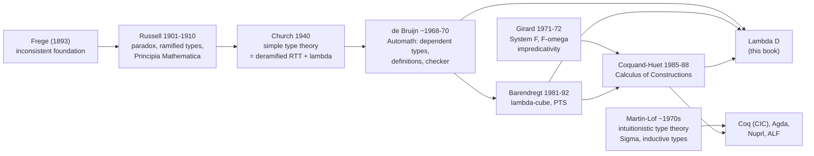

[[book-guidelines|↩ Back to guidelines]]

# Historical Context

> Untagged topic (no Focus Area), so the goals are applied in the ungated way and only where the history genuinely feeds the project. The book has **no history chapter**. This note is assembled from the foreword, the preface's "History" paragraph, and about ten "Further reading" sections. Those pages are thin: a paragraph or two per figure, with no derivations. Everything below that is not in the book is marked **(my addition)**.

## 0. The thread, in one picture



Barendregt's foreword compresses the first half into five sentences: Frege "did not get far" because "he used an inconsistent foundation"; in 1910 Whitehead and Russell "introduced types to remedy this" but substitution was still left to the reader; in 1940 Church "captured" the substitution mechanism "by lambda-terms and conversion"; around 1970 de Bruijn "extended the formalism of types by introducing dependent types with the explicit goal to formalise and verify mathematics"; by 2004 Gonthier formalised the Four Colour Theorem in Coq (foreword, pp. xiii-xiv).

The preface adds the second half (p. xvi): from about the 1980s "an explosion of work" on type theory "based on earlier work in the 1970s by J.-Y. Girard and P. Martin-Löf", and Barendregt's $\lambda$-cube and Pure Type Systems "by now a standard". The authors' stated design: "built on both Automath and the lambda-cube, which have been combined into a novel, concise system" ($\lambda D$).

## 1. Russell's ramified type theory

**The problem it solved.** Naive set theory lets you form "the set of all sets" and then ask whether it contains itself. The book dates Russell's paradox to 1901, noting Cantor's first set theory was already inconsistent (Burali-Forti noticed first), and says that since then "the question of creating a consistent foundation for mathematics has become a major topic of research" (Ch. 13.8, p. 297-298).

**The fix.** Russell's Ramified Type Theory (RTT) stratifies objects into levels so a collection can only be built from things of strictly lower level; self-reference is syntactically unwritable. He developed it in *The Principles of Mathematics* (1903) and the book credits Whitehead and Russell's three-volume *Principia Mathematica* (1910) with showing that "many essential parts of mathematics" can be formalised in it. For Russell this "shows the viability of the so-called logicist approach": mathematics reduces to logic (p. 298).

**What went wrong.** The ramification is "sometimes felt as awkward", and Whitehead and Russell "had to resort to an additional 'axiom of reducibility'" to make it work. F.P. Ramsey (1926) showed that adding that axiom makes the ramification superfluous. So RTT is "now seen as unnecessarily complicated" (pp. 298, 387).

**Impredicativity as the banned thing.** The book (3.8, pp. 80-81) states precisely what Russell and Whitehead refused: defining an element of $X$ by referring to $X$ itself. The example is $\mathcal{P}(\mathit{Set}) \in \mathit{Set}$. They treated impredicativity as a source of inconsistency and "banned" it. Keep this in mind for section 4; Girard's contribution is that the ban was too strict.

**What breaks without types at all.** Russell's paradox is the answer. In programming terms (my addition): a language with a type `Set` such that `Set : Set` is *Girard's paradox territory*, and the book makes the same point from the other side. In Ch. 13.8(3), Geuvers proves that copying van Benthem Jutting's Automath set formalisation into $\lambda D$ gives an inconsistent system "since we basically have $S \to \ast : \ast$. This is comparable to $\ast : \ast$, which is known to cause inconsistency" (p. 300).

**Note on a source slip.** The preface's history paragraph (p. xv) calls *Principia Mathematica* "The Principles of Mathematics". Those are two different works (1910 vs. 1903). I follow the 13.8 and 16.5 passages, which cite them separately.

## 2. Church's simple type theory

**The step.** Church (1940) is described three times, consistently, as a simplification of Russell: simple type theory is "a 'deramification' of Russell's type theory", RTT "removes the ramification" (2.14, p. 65; 13.8, p. 298). His goal "was to define higher order logic; simple type theory defines the language of higher order logic". The book calls Church's paper "still very accessible" and "still very readable".

**The second ingredient.** Church adds Church's own $\lambda$-notation (invented in the 1930s, cf. 1.3.1, with the Church-Rosser theorem and Church's thesis in the surrounding sections). Substitution, which Whitehead and Russell left to the reader, becomes $\beta$-conversion inside the language (foreword). The system the book calls $\lambda\to$ is this one, and the book uses *explicit* typing, typing "à la Church", where binders carry types: $\lambda x : \sigma . M$. With explicit types, decidability of typing is "almost immediate": look up free variables in the context, read bound-variable types off the binders, compute the unique type of the whole term (2.14, p. 65).

**Two lines Church did not take (but the book contrasts).** Church's proofs in his system are "external": higher-order logic's natural deduction rules are layered on top, so proofs are derivation trees outside the term language. $\lambda D$ "internalises derivations as typed $\lambda$-terms", adds type dependency, and adds definitions (13.8, p. 298). Church also introduced equality as Leibniz equality and a definite-description operator $\iota$ axiomatically; $\lambda D$'s Chapter 12 does the same thing as a primitive notion (12.9, p. 275). Russell had the idea of descriptions in 1905 (*On Denoting*).

**À la Curry, for contrast.** The implicit-typing variant (types inferred, not written) is due to H.B. Curry. The principal-type algorithm was found independently by Hindley (1969), Curry, and Milner (1978). Wand (1987) reduces it to a unification problem solved by Robinson's most general unifier (2.14, p. 65).

**What Church's system could not do.** Typed Church numerals live at type $(\alpha \to \alpha) \to \alpha \to \alpha$, but the definable functions on them are only the "generalised polynomials" (Schwichtenberg 1976): addition and multiplication, "but that's about it" (p. 65-66). Plotkin's PCF recovers Turing-completeness by adding a fixed-point constant $Y_\sigma : (\sigma \to \sigma) \to \sigma$.

[[Polymorphism-and-Higher-Order-Typed-Lambda-Calculi#Grounding|Grounding]] **(my addition)**: Church's $\lambda\to$ with explicit annotations is exactly the "checking, not inferring" end of bidirectional typing: the type of `\x : T. e` is read straight off the binder, which is why checking is easy. Curry-style typing is the end where metavariables and unification are needed. The project's elaborator lives between the two.

```rust
// Church-style: the binder carries the annotation, so type synthesis is a tree walk.
enum Ty { Base(&'static str), Arrow(Box<Ty>, Box<Ty>) }
enum Tm { Var(usize), Lam(Ty, Box<Tm>), App(Box<Tm>, Box<Tm>) }   // Lam has a type: à la Church
// Curry-style would be `Lam(Box<Tm>)` with no Ty, and inference would have to
// invent a metavariable for the binder and solve by unification.
```

## 3. Automath and de Bruijn

This is the strand the book cares about most; it is dedicated to de Bruijn (1918-2012), and one author is his student (Nederpelt) and the other Barendregt's (Geuvers) (Preface).

**What Automath was.** Designed from the end of the 1960s, "the first operative formal system for formalising and checking mathematics" (6.2.2, p. 126). The project translated "a broad corpus of mathematical texts" and verified them by program (Preface). The paradigm result is van Benthem Jutting's Automath translation of Landau's *Foundations of Analysis* (1977), cited in 12 and 13.8. In Ch. 16.2 (p. 382) the book says the basic idea was "develop a computer program that can check mathematics and mathematical proofs", and that $\lambda D$ "is a direct successor of the systems that were developed in the Automath project of the 1970s".

**Definitions as first-class.** De Bruijn "was the first to draw explicit attention to definitions and to make definitions part of the formal language itself, not just a 'meta-notion'" (9.11, p. 207). Automath's "books" are sequences of "lines", each a definition or a primitive notion (PN, a definition without body, i.e. an axiom or axiomatic notion). $\lambda D$ inherits both: definitions and axioms are "very much on a par" (10.7, pp. 221-222), and flag-style derivations (Ch. 11) follow Automath's convention of writing $c(x) := M : N$ (11.3.2).

**Where it sits on the cube.** Automath has all the features of $\lambda P$, plus aspects of $\lambda 2$ and $\lambda\omega$. The book's slogan: "Automath $\sim \lambda P + \tfrac12 \lambda 2 + \tfrac12 \lambda\omega +$ definitions" (6.2.2, pp. 126-127; the book credits Kamareddine et al. 2004).

**Two readings of propositions-as-types.** The book separates them (5.7, pp. 119-120):

| Name | Idea | Where |
|---|---|---|
| Logical Framework | $\lambda P$ as a meta-calculus: a logic $L$ is a context $\Gamma_L$ declaring its language and rules; the type theory handles binding and substitution (free-variable capture!) for you | early Automath (de Bruijn, late 1960s); revived as Edinburgh LF (Harper et al. 1987), whose successor is Twelf |
| Curry-Howard | proofs *are* terms; a proposition is the type of its proofs | Howard (1968, printed 1980); later Automath such as AUT-QE (1970) |

Hence the name "Curry-Howard-de Bruijn" embedding. See [[Propositions-as-Types-and-the-Curry-Howard-Isomorphism]].

**Typed lambda terms without names.** De Bruijn (1972) also invented the nameless representation of $\lambda$-terms (de Bruijn indices), so every term has a unique representation and one need not work modulo $\alpha$-conversion; substitution becomes index shifting (1.12, p. 27). See [[Untyped-Lambda-Calculus]] for the variable-capture problem this solves.

```rust
// de Bruijn indices: the name is the distance to the binder.
// \x. \y. x y  ==>  Lam(Lam(App(Var(1), Var(0))))
enum Term { Var(usize), Lam(Box<Term>), App(Box<Term>, Box<Term>) }
// What breaks without it: with names, substitution must rename binders to avoid capture
// (the book's Barendregt convention is the paper-and-pencil workaround).
```

**The checking procedure** (Fig. 16.1, p. 381-382). Formalise informal proof $p$ and statement $A$ (not mechanised, "no computer programs that can fully translate" yet); compute the type $T$ of $p$; check $A$ is well-formed; check $T$ and $A$ are $\beta\Delta$-convertible. If so, "$p$ has type $A$, $p$ proves $A$". This is the design behind every kernel in the project: the type checker is the proof checker.

## 4. Girard's System F and $F\omega$

**What it is.** The second-order typed $\lambda$-calculus, $\lambda 2$, "first defined by J.-Y. Girard in his PhD thesis (Girard, 1972), where it was called 'system F'", defined "for proof-theoretic reasons: to capture the functions that one can prove to be total in second order arithmetic" (3.8, p. 80). $F\omega$ adds types depending on types, in the same thesis, to capture the functions provably total in higher-order arithmetic: "this class coincides exactly with the functions that can be defined in $F\omega$" (4.10, p. 100). The book's $\lambda\omega$ is "basically only defined as a transition to $F\omega$ or the Calculus of Constructions".

**The punchline: impredicativity is harmless.** Recall section 1: Russell banned it. Here $\sigma := \Pi\alpha : \ast . \alpha \to \alpha$ itself has type $\ast$ while quantifying over all types, so it is impredicative. Girard showed this "seemingly 'vicious circle'" is consistent: read types as propositions, and there are empty types, i.e. $\sigma$ with no closed $M : \sigma$ (3.8, p. 81). His normalisation proof extends Tait's (1967) "in an ingenious way" to $\lambda 2$ (p. 82).

**What it buys.** Data types as closed second-order types: $\mathbb{N} := \Pi\alpha : \ast . (\alpha \to \alpha) \to \alpha \to \alpha$ with polymorphic Church numerals; Böhm-Berarducci give a general recipe for algebraic types (p. 80). In 16.5 (p. 388), Girard "introduced the concept of impredicativity into type theory, which enables various data types ... and logical connectives (like $\wedge$ and $\vee$) to be definable inside the type system", with *Proofs and Types* (Girard et al. 1989) as the reference. See [[Polymorphism-and-Higher-Order-Typed-Lambda-Calculi]].

**Reynolds, independently.** J.C. Reynolds (1974) invented essentially the same calculus to capture *parametricity*: $\Pi\alpha : \ast . \alpha \to \alpha$ can only be the identity (3.8, p. 81). He also proved $\lambda 2$ has no set-theoretic model: $\sigma \to \tau$ cannot be the full function space (1984). This is the polymorphic $\lambda$-calculus that influenced functional languages.

**Costs, per the book.** Type inference for the Curry-style version is undecidable (Wells 1994); practical languages use "weak" polymorphism in the Milner (Damas-Milner 1982) tradition to keep inference decidable (p. 82).

```lean
-- Impredicative Church encoding: exactly the book's  Πα:∗. (α→α)→α→α
def CNat := ∀ (α : Type), (α → α) → α → α
def two : CNat := fun _ f x => f (f x)
-- Lean's own `Nat` is *not* encoded this way: it is an inductive type.
-- That switch (encoded -> primitive) is the Coq history the book describes in section 5 below.
```

## 5. Martin-Löf type theory

**Aim and timing.** Martin-Löf introduced his intuitionistic type theory in the same period as Automath. His "primary aim was not to lay the basis for a system for formalising mathematics, but to develop a foundational system to capture the Brouwer-Heyting-Kolmogorov interpretation of proofs" (5.7, p. 120). It "can be seen as an extension of $\lambda P$ with specific features". It "turned out to serve as a logical framework that incorporates programming and proving" (16.5, p. 388).

**Intensional vs. extensional.** An important design fork the book names (5.7): in *extensional* type theory two types have the same inhabitants whenever provably equal, matching a set-theoretic view but making type checking undecidable. Martin-Löf abandoned it. Intensional theories (like $\lambda P$) only identify $\beta$-convertible terms. See [[Dependent-Types]].

**What it added.** $\Sigma$-types ($\Sigma x : A . B$, pairs $\langle a, b\rangle$ with $b : B[x := a]$) and primitive inductive types, "to make proofs by induction (and also functions defined by well-founded recursion) a primitive". $\Sigma$-types also appear as one way to formalise subsets in 13.8(4). The book notes the name for $\Pi$: "Martin-Löf calls a $\Pi$-type the Cartesian product of a family of types" (5.4, Martin-Löf terminology).

**Descendants.** Directly implemented as Nuprl (Constable et al. 1986), ALF (Magnusson & Nordström 1994) and Agda (Bove et al. 2009). Coq's Calculus of Inductive Constructions follows the same ideas on top of the Calculus of Constructions (5.7; 16.5).

**What breaks without primitives for induction.** The book says of Coquand-Huet's CC (6.5, p. 133): it used definable polymorphic data types "because there were no primitive inductive types. These were added later, because the polymorphic data types are a bit less expressive and don't yield an induction proof principle (which has to be added axiomatically)."

**Honest scope.** The book gives no rules for Martin-Löf type theory. It positions it and cites sources (Martin-Löf 1980; Nordström et al. 1990).

## 6. Barendregt's cube

**The idea.** Barendregt (1992) "investigated the common properties and differences of existing type-theoretic systems and their relation", then described eight of them "with only one set of derivation rules" (6.2.1, pp. 125-126). Three initialisation rules (sort, var, weak), one formation rule (form) for $\Pi$, conversion, application, abstraction. The system is chosen by *which pairs $(s_1, s_2)$* are allowed in (form):

| system | allowed $(s_1, s_2)$ |
|---|---|
| $\lambda\to$ | $(\ast,\ast)$ |
| $\lambda 2$ | $(\ast,\ast)$, $(\square,\ast)$ |
| $\lambda\omega$ | $(\ast,\ast)$, $(\square,\square)$ |
| $\lambda P$ | $(\ast,\ast)$, $(\ast,\square)$ |
| $\lambda C = \lambda P\omega$ | all four |

(the book's Fig. 6.2 lists all eight). So in 6.5 (p. 133): the Calculus of Constructions, "conceived as a type theory that unites ideas of A. Church, N.G. de Bruijn, P. Martin-Löf and J.-Y. Girard", is the union of $\lambda P$ and $\lambda\omega$, and the cube "made explicit how the typing rules correspond to the term/type dependencies". Barendregt's Pure Type Systems generalise the same scheme (Preface). Full treatment: [[The-Calculus-of-Constructions-and-the-Lambda-Cube]].

```rust
// (my addition) The cube as a parameter: one checker, eight languages.
#[derive(Clone, Copy, PartialEq)] enum Sort { Star, Box }
struct Pts { allowed: &'static [(Sort, Sort)] }
const LAMBDA_ARROW: Pts = Pts { allowed: &[(Sort::Star, Sort::Star)] };
const LAMBDA_C:     Pts = Pts { allowed: &[(Sort::Star, Sort::Star), (Sort::Box, Sort::Star),
                                           (Sort::Box, Sort::Box),  (Sort::Star, Sort::Box)] };
// (form): Γ ⊢ A : s1,  Γ, x:A ⊢ B : s2,  (s1,s2) ∈ allowed  ⟹  Γ ⊢ Πx:A.B : s2
```

## 7. After the 1980s, and what the book says is still open

From Ch. 16.5 (pp. 388-390), with no claim to being "a complete historic overview":

- **CC to Coq.** Coquand-Huet CC was implemented as a proof checker in the 1980s; extended with inductive types it became CIC in Coq (Bertot-Castéran 2004 is the recommended text). Lego (Pollack), built on Luo's Extended CC, also dates from the late 1980s. Edinburgh LF is the $\lambda P$ implementation.
- **A different lineage: LCF.** Milner's LCF approach (1972) uses an abstract data type `theorem` whose only constructors are inference rules; HOL and Isabelle descend from it (1980s). Mizar was a parallel, not type-theoretic, effort (Preface).
- **Types in programming.** Milner, Hindley, Reynolds in the 1970s "firmly based functional programming languages on typed $\lambda$-calculus".
- **Frontier.** Homotopy Type Theory / Univalent Foundations (Voevodsky): $a, b : A$ as points, $a =_A b$ as paths (p. 389-390).
- **Late example in Ch. 15.** The Bézout formalisation compares the same theorem across HOL Light, Mizar, Isabelle, Coq (15.10 and nearby, p. 373 ff.; see [[Large-Scale-Formalisation]]).
- **Obstacle.** Proof assistants "have not yet developed into a standard tool for mathematicians" (16.4); the learning curve remains steep (foreword).

```rust
// LCF's idea in Rust (my addition; the book states it in one sentence):
mod kernel {
    pub struct Thm { /* private: hyps, concl */ }
    // The ONLY way to obtain a Thm is through these rule functions.
    pub fn assume(/* ... */) -> Thm { todo!() }
    pub fn modus_ponens(_imp: &Thm, _ant: &Thm) -> Option<Thm> { todo!() }
}
```

## 8. Synthesis: how the strands meet

| Question | Russell | Church | de Bruijn | Girard | Martin-Löf | Barendregt |
|---|---|---|---|---|---|---|
| Consistency via | ramified levels | simple types | typing + checker | polymorphism, normalisation | intuitionistic meaning | one rule set |
| Substitution | informal | $\lambda$/$\beta$ | de Bruijn indices | $\lambda$ | $\lambda$ | $\lambda$ |
| Proofs | informal-ish | external trees | terms or LF | terms | terms | terms |
| Dependent types | no | no | yes | no | yes | $\lambda P$ axis |
| Impredicative | banned | n/a | partly | introduced | not at first | $(\square,\ast)$ |

$\lambda D$ = Barendregt's $\lambda C$ (itself a Church + de Bruijn + Martin-Löf + Girard union) + Automath's first-class definitions and books-of-lines.

## Where this leads

Within the book, this history justifies every design choice: $\lambda D$ takes explicit Church typing, Automath's definitions and flags, the cube's single rule scheme and Girard's impredicative $\ast$, and drops extensional equality for decidability (Ch. 16.4's seven design points). Later chapters pick up the same names: Ch. 6 for the cube, Ch. 9-10 for definitions, Ch. 12-13 for Church's $\iota$, equality and RTT's sets-as-predicates.

For the project, the Focus Area synthesis stays short (the topic is untagged and the pages are historical, so I do not force a connection). Three threads are worth keeping: (1) Church vs. Curry typing is the checking/inference split of a **bidirectional elaborator**, with Curry's side needing unification (Wand/Robinson, cited on p. 65); (2) the Logical Framework reading in Automath/LF/Twelf is the pattern for "a verifier whose logic is data" and shows why capture-avoiding substitution and de Bruijn indices belong inside the **trusted kernel**; (3) the LCF `Thm` abstraction and the Fig. 16.1 pipeline are the two historic designs for a **small trusted kernel with proof-producing front ends**. Lean's kernel is the CIC descendant of this line; the project's refinement layer would sit above it.
