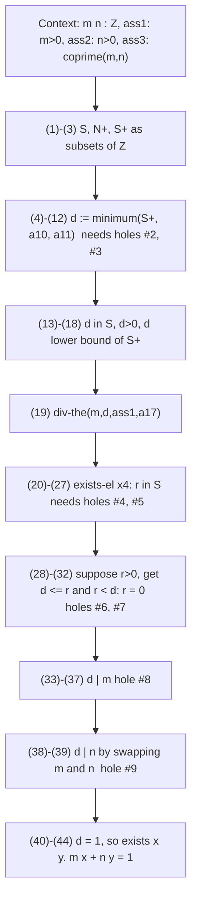
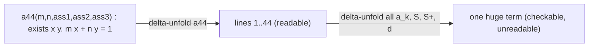
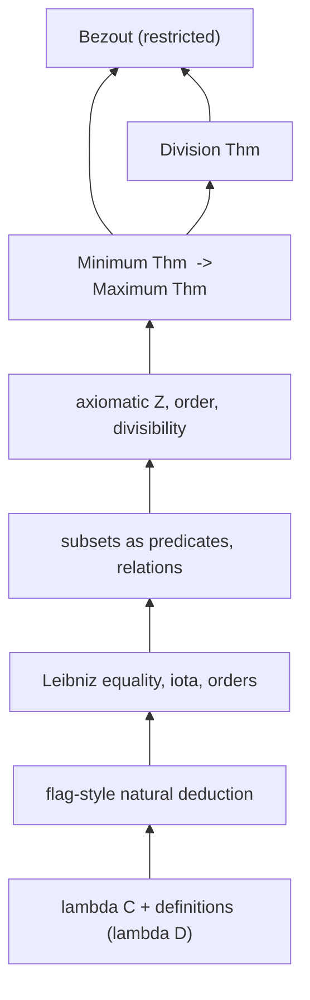

[[book-guidelines|↩ Back to guidelines]]

# Large-Scale Formalisation: Bézout, Minimum and Division in $\lambda D$

> Focus Area: `automated-reasoning` (per the book's `.learning-goals.md`), with strong `type-theory` content because the whole exercise is a stress test of $\lambda D$. Source: Chapter 15, re-read directly. Notation is the book's: $\Delta;\Gamma\vdash M:N$ judgements, $c(\vec x):=M:N$ definition lines, $\ast_s$ for sorts of sets, $\ast_p$ for propositions, $\mathsf{ps}(S)$ for the type of subsets of $S$ (predicates $S\to\ast_p$), $x\,\varepsilon\,P$ for membership. Where text extraction dropped a "not equal" sign, I restored it from context (for example $T\neq\emptyset_{\mathbb Z}$).

Prerequisites in this vault: [[Type-Theory-with-Definitions]] (environments, $\delta$-reduction, [[Polymorphism-and-Higher-Order-Typed-Lambda-Calculi#The rules|the rules]] (def) and (inst)), [[Natural-Deduction-and-Flag-Style-Proofs]] (flags, parameter-list convention, $\wedge$-in, $\exists$-el and friends), [[Definitions-and-Abbreviations]].

## 1. The problem: does the machinery scale?

Chapters 1 to 14 built a tool, $\lambda D$, and then used it on small things: a definition of equality, a lemma about orders, the Peano-style integers. Small examples hide the real questions. Does a *real* proof, written by a mathematician for other mathematicians, survive translation? What does the translation cost? What does it reveal about the informal text?

Chapter 15 is the book's answer. It takes one textbook proof, Bézout's Lemma in a restricted form, and formalises it end to end. The authors say it plainly: the chapter "acts as a final exercise", and the proof "is not very sizeable; but it involves a number of implicit notions that require a more explicit treatment". That is the thesis of this topic: the size of a formalisation is driven less by the proof you see than by the knowledge the proof silently uses.

What breaks without such a test: you would have a calculus that is elegant on paper and unproven as a vehicle for mathematics. The authors lean on history for confidence (Automath, de Bruijn, van Benthem Jutting's formalisation of a whole analysis text) but this chapter is the concrete, checkable demonstration inside the book.

## 2. The theorem and the informal proof (§15.1)

**Restricted Bézout's Lemma.** Let $m, n\in\mathbb N^+$ be coprime. Then $\exists x,y\in\mathbb Z\,(mx+ny=1)$.

"Coprime" means no common divisor other than 1. The original lemma says $mx+ny=\gcd(m,n)$ and follows from the restricted version (Exercise 15.1). The book also notes the constructive route, the Euclidean algorithm, but the proof it formalises is the non-constructive "least element" argument:

1. Let $S=\{mx+ny \mid x,y\in\mathbb Z\}$ and $S^+=S\cap\mathbb N^+$.
2. $S^+$ has a minimum $d$. So $d=mx_0+ny_0$ and $d>0$.
3. Divide $m$ by $d$: $m=qd+r$, $0\le r<d$.
4. Then $r=m(1-qx_0)-n(qy_0)\in S$. If $r>0$ then $r\in S^+$, so $r\ge d$, contradicting $r<d$. Hence $r=0$, so $d\mid m$.
5. "In a similar manner" $d\mid n$.
6. Coprimality forces $d=1$, so $1\in S$, giving the result.

This is a perfectly good proof. A mathematician would accept it as complete. A checker will not.

## 3. Gaps in informal proofs: what a formaliser sees

The book scans the proof "with a view to a $\lambda D$-formalisation" and lists what "catches the eye". This list is the real content of the topic called "gaps in informal proofs".

| Informal sentence | What it silently assumes | What $\lambda D$ forces you to supply |
|---|---|---|
| "$d$ is the minimum of $S^+$" | that a minimum *exists* and is *unique* | the **Minimum Theorem**, which needs $S^+$ non-empty and bounded below; neither is checked in the text |
| "Divide $m$ by $d$" | existence of quotient and remainder | the **Division Theorem** with hypotheses $m>0$, $d>0$ |
| "$\mathbb N^+$", "$S$", "$S^+$" | subsets live inside one ambient set | subsets as predicates on $\mathbb Z$ (the choice made in Chapter 13), hence $\cap$ as a defined operator |
| "$r=m(1-qx_0)-n(qy_0)$ follows" | associativity, commutativity, distributivity, ring identities | an actual chain of arithmetical lemmas (the book says about ten more steps than the four it displays) |
| "In a similar manner $d\mid n$" | symmetry of the argument | a way to *reuse* the first derivation, see §7 |
| the two number systems $\mathbb Z$, $\mathbb N^+$ | coercions are free | one basic type $\mathbb Z$, with $\mathbb N^+:=\{k:\mathbb Z\mid k>0\}$ |

Note the sharpest case. The informal proof says "this $S^+$ has a minimum" with no justification at all. Non-emptiness (witness $m=m\cdot1+n\cdot0$, positive by assumption) and a lower bound (namely $1$) are exactly what the Minimum Theorem demands. In the formal text they appear as proof arguments `?1 : S⁺ ≠ ∅` and `?2 : ∃x. lw-bnd(S⁺,x)` that must be provided or the term does not type-check. The type theory does not let you forget.

This is the learning-goals reading of "gaps": each hidden hypothesis becomes a *missing argument to a constant*, and the type checker reports it by simply refusing the application (rule (inst)).

## 4. Preparatory work: generalise before you use (§15.2)

### 4.1 Minimum of a subset of a partially ordered type

The Chapter 12 operator $\mathrm{Min}$ was global: it spoke about a whole ordered type $S$, not a subset. So the chapter first re-defines it for subsets. Under the context $S:\ast_s\mid R:S\to S\to\ast_p\mid T:\mathsf{ps}(S)\mid m:S$:

$$\mathrm{least}(S,R,T,m) := m\,\varepsilon\,T \wedge \mathrm{lw\text{-}bnd}(S,R,T,m) : \ast_p$$

A least element is a member of $T$ that is also a lower bound of $T$. Special case for $\mathbb Z$ and $\le$: $\mathrm{least}_{\mathbb Z}(T,m)$. Uniqueness (line 3 of Fig. 15.1, with $r$ a proof that $R$ is a partial order) gives $\exists_{\le1}$, and given existence $w$ you get $\exists_1$ and then name the minimum with Frege's descriptor:

$$\min(S,R,T,r,w) := \iota\bigl(S,\ \lambda m:S.\ \mathrm{least}(S,R,T,m),\ a_4(S,R,T,r,w)\bigr) : S.$$

Recall from Chapter 12 that $\iota$ takes the *proof of unique existence* as an argument. That is what makes "call it $d$" legitimate rather than a wave of the hand.

### 4.2 Stating the two theorems before proving them

Both theorems are *stated* in $\lambda D$ first, with proofs postponed. This is a standard large-scale technique: fix the interface, prove the client, discharge the dependencies later.

- **Minimum Theorem** (Fig. 15.2): in context $T:\mathsf{ps}(\mathbb Z)\mid u:T\neq\emptyset_{\mathbb Z}\mid v:\exists x{:}\mathbb Z.\ \mathrm{lw\text{-}bnd}_{\mathbb Z}(T,x)$,
  $$\textit{min-the}(T,u,v) : \exists m{:}\mathbb Z.\ \mathrm{least}_{\mathbb Z}(T,m).$$
  Uniqueness `min-uni-the`, the named element `minimum(T,u,v)`, and its characterising property `min-prop` follow immediately. The book warns that names like `min-the` are "somewhat deceiving, since they are inhabitants (proofs) of the two theorems, not the theorems themselves".
- **Division Theorem** (Fig. 15.3): in context $m,d:\mathbb Z\mid u:m>0\mid v:d>0$,
  $$\textit{div-the}(m,d,u,v):\exists q,r{:}\mathbb Z.\ (m=q\cdot d+r\ \wedge\ 0\le r<d).$$
  Remark 15.2.1: uniqueness of $q,r$ also holds but is not needed, so it is not proved. Existence alone is enough, and the book spends nothing on what the client does not use.

## 5. Proof size and readability: the main proof in parts (§15.3 to §15.5)

The proof is formalised in a **flag-style** text of 44 lines (plus 4 for a numeric instance). Each informal sentence maps to a small block.



Selected details that carry real lessons:

**Subsets are predicates, so set-builder is a $\lambda$.** $S:=\{k:\mathbb Z\mid\exists x,y{:}\mathbb Z.\ k=m\cdot x+n\cdot y\}:\mathsf{ps}(\mathbb Z)$. Membership "$m\,\varepsilon\,S$" is $\delta$-convertible to $\exists x,y.\ m=m\cdot x+n\cdot y$, which is why steps such as `a6 := a5 : m ε S` need no real proof, only a re-typing by the conversion rule. $S^+:=S\cap\mathbb N^+$ is shorthand for $\cap(\mathbb Z,S,\mathbb N^+)$, typed by (inst).

**The parameter-list convention hides a lot of weight.** Every constant defined after the flags $(m,n,\mathit{ass}_1,\mathit{ass}_2,\mathit{ass}_3)$ really carries those five parameters. Writing $S$ for $S(m,n,\mathit{ass}_1,\mathit{ass}_2,\mathit{ass}_3)$ is what makes the 44 lines readable. Without this, every line would repeat a five-element argument list, and the formal text would be several times longer. The book even chooses not to shrink contexts ("we have decided to follow the proof text as closely as possible").

**Existentials cost flags.** Line (16) $\exists x_0,y_0.\ d=m x_0+n y_0$ and line (19) $\exists q,r.\ \dots$ are *nested* quantifiers, so using them needs $\exists$-el four times, i.e. four extra flag pairs (Remark 15.4.1; the displayed Fig. 15.10 admits to omitting the flag for $v_0$). Proof by cases on a witness is bureaucratic in this format, and that is a very concrete reason formal proofs are longer than informal ones.

**Contradiction as negation-introduction.** "Suppose $r>0$ ... contradiction. Hence $r=0$" is lines (28) to (32): a flag $z:r>0$, a derivation of $\bot$ (hole #6), $\neg$-in giving $\neg(r>0)$, then hole #7 turning $0\le r$ and $\neg(r>0)$ into $r=0$. The flag nesting is the formal image of "suppose ... contradiction".

**Equality rewriting is explicit.** The step "inserting $d$ of (i) into (ii)" is `eq-subs(Z, λz:Z. m = q·z + r, d, m·x₀ + n·y₀, v, a20)` (line 23). In Rust or Lean terms this is rewriting along an equation, with the motive spelled out by hand.

## 6. The holes: where the proof tells you what it did not say (§15.6)

The book's technique, central to large-scale work, is to leave **holes**: named proof obligations with a stated type and no proof term, to be filled later. It records nine:

| # | Where | Statement | How it is discharged |
|---|---|---|---|
| 1 | Fig. 15.2 line 2 | $\le$ is a partial order on $\mathbb Z$ | reflexivity, transitivity (Lemma 14.10.1), antisymmetry (Ex. 14.29a) |
| 2 | line 4 | $m=m\cdot1+n\cdot0$ | $m\cdot 1=m$ (from $m\cdot s0=m\cdot0+m=0+m$), $n\cdot0=0$, $m+0=m$ |
| 3 | line 11 | $\exists x.\ \mathrm{lw\text{-}bnd}(S^+,x)$ | Exercise 15.3 (witness 1) |
| 4 | line 24 | $m=q(mx_0+ny_0)+r\Rightarrow r=m(1-qx_0)-n(qy_0)$ | ring computation, many steps |
| 5 | line 25 | $\dots-n(qy_0)$ vs $\dots+n(-(qy_0))$ | $x-y\cdot z=x+(y\cdot(-z))$ via Lemma 14.11.4 |
| 6 | line 30 | $r<d$ and $d\le r$ give $\bot$ | Ex. 15.4a |
| 7 | line 32 | $0\le r$ and $\neg(r>0)$ give $r=0$ | Ex. 15.4a |
| 8 | line 33 | $m=qd+r$ and $r=0$ give $d\cdot q=m$ | Ex. 15.4b |
| 9 | line 38 | $\mathrm{coprime}(m,n)\Rightarrow\mathrm{coprime}(n,m)$ | Ex. 14.43 |

Two things stand out. First, none is deep; the book calls them "mostly small" problems. Second, **the volume of arithmetic is the real cost**: hole #4 shows four intermediate equalities and the authors add that associativity and commutativity calls "would add about ten more steps" to the chain. That is the part a tactic (a ring normaliser, or an SMT/linear-arithmetic backend) would eat in one call.

The book is also honest about status: the formal proof "is not yet ready for computer verification" because (a) the "use ..." hints (for example "use $\wedge$-el$_1$ on $a_{13}$") still have to be expanded into actual terms, and (b) the holes remain. It is a *proof skeleton with obligations*, which is exactly what interactive provers represent with `sorry`, Coq's `admit`, or Agda's `?`.

### A holes ledger in Rust

The workflow "build the skeleton, list open obligations, close them later" is a data structure. A sketch (compiles as a standalone program):

```rust
use std::collections::BTreeMap;

#[derive(Debug, Clone)]
enum Proof {
    /// a fully elaborated proof term
    Term(String),
    /// the book's "hole #k": an obligation with a stated type but no term yet
    Hole { id: u32, goal: String },
}

struct Env {
    // constant name -> (type, body)
    defs: BTreeMap<String, (String, Proof)>,
}

impl Env {
    /// Holes in the environment, i.e. what blocks "ready for computer verification".
    fn open_holes(&self) -> Vec<(u32, &str)> {
        self.defs
            .values()
            .filter_map(|(_, p)| match p {
                Proof::Hole { id, goal } => Some((*id, goal.as_str())),
                _ => None,
            })
            .collect()
    }
}
```

A trusted kernel must refuse environments with `Hole` bodies when asked to certify a theorem; an elaborator may accept them in "draft" mode. That policy distinction is the same one Lean enforces with `sorry` warnings and `#print axioms`.

## 7. Reuse by parameter substitution: "in a similar manner"

Informal proofs say "similarly" and move on. In $\lambda D$ this is not a rhetorical shortcut; it is an *instance of a definition*. Line (37) defines $a_{37}(m,n,\mathit{ass}_1,\mathit{ass}_2,\mathit{ass}_3):d\mid m$. To obtain $d\mid n$ one just instantiates it with the roles swapped:

$$a_{39} := a_{37}(n,\,m,\,\mathit{ass}_2,\,\mathit{ass}_1,\,a_{38}) : d\mid n$$

Rule (inst) demands the argument types: $?_1:n>0$ (so $\mathit{ass}_2$), $?_2:m>0$ (so $\mathit{ass}_1$), $?_3:\mathrm{coprime}(n,m)$, the last being hole #9. The type checker has verified that "similarly" is true, down to the one missing symmetry lemma the human glossed over.

In Lean this is literally function application. A self-contained check (core Lean 4, compiled; the body of `a37` is a stand-in since only the call structure matters here):

```lean
def Coprime (m n : Int) : Prop := ∀ k : Int, k ∣ m → k ∣ n → 0 < k → k = 1

theorem a37 (m n : Int) (_ : 0 < m) (_ : 0 < n) (_ : Coprime m n) :
    ∃ d : Int, 0 < d ∧ d ∣ m := ⟨m, by omega, Int.dvd_refl m⟩   -- stand-in body

-- hole #9
theorem a38 (m n : Int) (h : Coprime m n) : Coprime n m :=
  fun k hn hm hk => h k hm hn hk

theorem a39 (m n : Int) (ass1 : 0 < m) (ass2 : 0 < n) (ass3 : Coprime m n) :
    ∃ d : Int, 0 < d ∧ d ∣ n :=
  a37 n m ass2 ass1 (a38 m n ass3)
```

Here the hole #9 proof is two lines; in the book it is Exercise 14.43. Also note the book's observation that $a_{44}(m,n,\mathit{ass}_1,\mathit{ass}_2,\mathit{ass}_3)$ is a one-line "proof of Bézout" in the right environment: unfold constants one at a time (that is $\delta$-reduction) and you recover Fig. 8.6; unfold all of them and you get one enormous term. Both extremes are "not very revealing"; the readable proof sits in between. Specialisation to $m=55$, $n=28$ (Fig. 15.15) is just a 48th line $a_{48}:=a_{44}(55,28,a_{45},a_{46},a_{47})$ with three numerical side proofs.

## 8. The Minimum Theorem for $\mathbb Z$ (§15.7)

### 8.1 Why it is not trivial

Intuitively a non-empty set of integers bounded below "obviously" has a least element. But $\lambda D$'s $\mathbb Z$ is the axiomatic integer type of Chapter 14: $0$, successor $s$, predecessor $p$, and a *symmetric induction* principle (Remark 14.2.1: if $P$ holds at a start value $a$ and $\forall x.\ (Px\Rightarrow P(sx)\wedge P(px))$, then $\forall x.\ Px$). The proof must be grounded in that.

### 8.2 The strategy: climb from a lower bound

Let $T$ be non-empty with element $n$ and lower bound $l$. The book chooses to demonstrate the flexibility of the format by *not* going by direct minimal-counterexample reasoning (that variant is Exercise 15.5) but by:

1. Prove (i): $\exists y.\ (\mathrm{lw\text{-}bnd}(T,y)\wedge\neg\mathrm{lw\text{-}bnd}(T,sy))$, a lower bound whose successor is not one.
2. By contradiction assume (ii): $\forall y.\ (\mathrm{lw\text{-}bnd}(T,y)\Rightarrow\mathrm{lw\text{-}bnd}(T,sy))$.
3. Let $P:=\lambda x{:}\mathbb Z.\ \mathrm{lw\text{-}bnd}_{\mathbb Z}(T,x)$. $P$ holds at $l$. Prove $\forall x.\ (Px\Rightarrow P(px))$ separately (if $x$ bounds $T$, so does a predecessor, via $px\le x$ and transitivity). With (ii) this gives the premise of symmetric induction, so $\forall x.\ Px$.
4. Then $P(sn)$, i.e. $sn\le n$, contradicting $n\,\varepsilon\,T$ ($sn>n$).
5. So take $z$ with $P z\wedge\neg P(sz)$. Show $z\,\varepsilon\,T$: otherwise $z<y$ for every $y\in T$, hence $sz\le y$ (Ex. 14.29b), so $sz$ is a lower bound, contradicting the choice of $z$.
6. Then $\mathrm{least}_{\mathbb Z}(T,z)=z\,\varepsilon\,T\wedge\mathrm{lw\text{-}bnd}(T,z)$; the second conjunct is $\delta$-equal to $\mathrm{lw\text{-}bnd}$. Finish with $\exists$-in and three uses of $\exists$-el to "descend" back to the original context (lines (26) to (29) of Fig. 15.18).

Note step 5 uses double-negation elimination ("$\neg\neg$-el" in line (24)). The proof is *classical*; this is where the constructive/classical split from the logic chapters becomes concrete.

### 8.3 Lean version

Here is the same strategy in core Lean 4 (compiled; `omega` replaces the arithmetic hints, `Classical.byContradiction` plays the role of $\neg\neg$-el). I use $\mathbb N$-induction from $l$ upward rather than the book's symmetric $\mathbb Z$ induction, because Lean's $\mathbb Z$ is an inductive type, not an axiomatic one:

```lean
def Least (T : Int → Prop) (m : Int) : Prop := T m ∧ ∀ t, T t → m ≤ t
def LwBnd (T : Int → Prop) (l : Int) : Prop := ∀ t, T t → l ≤ t

theorem min_thm (T : Int → Prop) (hne : ∃ n, T n) (hb : ∃ l, LwBnd T l) :
    ∃ m, Least T m := by
  have key : ∃ y, LwBnd T y ∧ ¬ LwBnd T (y + 1) := by
    apply Classical.byContradiction
    intro hno
    have step : ∀ y, LwBnd T y → LwBnd T (y + 1) := by
      intro y hy
      apply Classical.byContradiction
      intro h
      exact hno ⟨y, hy, h⟩
    obtain ⟨l, hl⟩ := hb
    obtain ⟨n, hn⟩ := hne
    have up : ∀ k : Nat, LwBnd T (l + k) := by
      intro k
      induction k with
      | zero => simpa using hl
      | succ k ih => simpa [Int.add_assoc] using step _ ih
    have h2 := up (n - l + 1).toNat n hn
    omega
  obtain ⟨z, hz, hz1⟩ := key
  refine ⟨z, ?_, hz⟩
  apply Classical.byContradiction
  intro hzT
  apply hz1
  intro y hy
  have h1 := hz y hy
  have hne : z ≠ y := fun e => hzT (e ▸ hy)
  omega
```

The correspondence is nearly line for line: `key` is the book's (i), `step` is assumption (ii), `up` is the induction, and the final block is lines (15) to (24). The difference worth noticing is `omega`: the book writes "use arithmetic on ..." and counts the steps; Lean's decision procedure for linear integer arithmetic discharges all of them. That is exactly the role the learning goals assign to the SMT/CSP side of the toolchain: the arithmetic holes #2 to #8 are quantifier-free linear (or ring) goals.

## 9. The Division Theorem by reuse (§15.8)

The textbook idea: look at $0\cdot d<1\cdot d<2\cdot d<\dots$ until $(k+1)d$ crosses $m$. This is *the same kind of argument* as the Minimum Theorem (search for a maximal element with a property). The book's observation: "it appears more profitable, and more in the line of type theory, to apply the results of the previous section" rather than redo them.

So it introduces the **Maximum Theorem** (non-empty, bounded above, has a maximum), obtained from the Minimum Theorem by reflecting: upper bound for $\le$ is lower bound for $\ge$, a greatest element for $\le$ is a least for $\ge$ (Fig. 15.19 literally defines $\mathrm{up\text{-}bnd}_{\mathbb Z}(T,l):=\mathrm{lw\text{-}bnd}(\mathbb Z,\ge,T,l)$ and $\mathrm{grtst}_{\mathbb Z}:=\mathrm{least}(\mathbb Z,\ge,\dots)$; Exercise 15.7 uses $T':=\{x\mid -x\,\varepsilon\,T\}$). This is why §4.1 generalised $\mathrm{least}$ over an arbitrary relation $R$: the generalisation pays for itself here.

The proof, in three parts:

1. $D:=\{x:\mathbb Z\mid(\exists k.\ x=k\cdot d)\wedge x\le m\}$. Non-empty ($0=0\cdot d\le m$), bounded above by $m$ (Fig. 15.20).
2. $l:=\mathrm{maximum}(D,\dots)$. It is a multiple of $d$, and the multiplier $k$ is unique because $k_1d=k_2d$ with $d\neq0$ gives $k_1=k_2$ (Lemma 14.11.7). So name it with $\iota$: $q:=\iota(\mathbb Z,\lambda x.\ l=x\cdot d,a_{21})$.
3. $r:=m-q\cdot d$. Then $m=q\cdot d+r$ and $r\ge0$ since $qd=l\le m$. For $r<d$, suppose $d\le r$: then $(q+1)d\le m$, so $(q+1)d\in D$, so $(q+1)d\le l=qd$, giving $d\le0$, contradicting $d>0$.

The book gives a "full sketch" with hints rather than a term-level proof (Exercise 15.8 and 15.9 ask the reader to finish). Lean's library has this theorem already; the point is the formal reduction:

```lean
theorem div_thm (m d : Int) (hd : 0 < d) :
    ∃ q r, m = q * d + r ∧ 0 ≤ r ∧ r < d :=
  ⟨m / d, m % d, by have := Int.mul_ediv_add_emod m d; rw [Int.mul_comm]; omega,
   Int.emod_nonneg _ (by omega), Int.emod_lt_of_pos _ hd⟩
```

(This compiles in core Lean 4. Here the quotient is *computed* by an algorithm, whereas the book's proof obtains it non-constructively from a maximum; the statement is identical, the witness is not. Note also the book needs $m>0$ only because that is all Bézout needs; the Lean version does not.)

## 10. Proof size and readability: what the numbers say

Collecting what Chapter 15 actually shows:

- **Informal proof:** about 15 lines of prose.
- **Formal proof of Bézout (flag-style):** 44 lines, nine holes, plus about 20 more lines of preparation (Figs. 15.1 to 15.3), plus the Minimum Theorem proof (29 lines, Figs. 15.16 to 15.18) and the Division Theorem (39 lines, Figs. 15.20 to 15.22), plus the arithmetic library of Chapters 12 to 14 it stands on. The authors do not give a single total, and I do not invent one.
- **The ratio is dominated by prerequisites, not by the proof.** The main proof body is only a few times the informal length; the large factor appears when you count the integer arithmetic, orders, subsets and divisibility it needs.
- **What keeps it readable:** (1) the parameter-list convention (suppress $(m,n,\mathit{ass}_1,\dots)$), (2) named intermediate constants $a_k$ that are *types you can read*, (3) hints "use $\wedge$-el$_1$ on $a_{13}$" instead of terms, (4) holes for non-essential computations, (5) flags that mirror "let", "suppose", "assume" in the prose.
- **The two extremes are useless.** A single judgement $a_{44}(m,n,\dots)$ is too compact; the fully $\delta$-unfolded term is too detailed. The useful object is the *structured middle*: a definitional DAG you can unfold to any chosen depth.



## 11. How other systems formalised the same theorem (§15.10)

The book cross-checks against Wiedijk's "Formalizing 100 Theorems" list (Bézout is item 60 as of November 2013): HOL Light, Mizar, Isabelle, Coq (standard library) and ProofPower. The *statements differ*, which is the interesting data:

| System | Shape of statement (the book's translation) | Notable choice |
|---|---|---|
| HOL Light | $\forall a,b\,\exists d\,(0\le d\wedge d\mid a\wedge d\mid b\wedge\exists x,y\ (d=ax+by))$ over $\mathbb Z$ | no explicit $\gcd$ |
| Mizar | $\forall m,n:\mathrm{nat}\,(m>0\vee n>0\Rightarrow\exists i,i_1:\mathbb Z\ (im+i_1n=\gcd'(m,n)))$ | uses $\gcd'$; hypothesis weaker than the book's |
| Isabelle | over $\mathbb N$ only: $\exists d,x,y\ (d\mid a\wedge d\mid b\wedge(ax-by=d\vee bx-ay=d))$ | avoids $\mathbb Z$ by case split |
| Coq | $\forall a,b,d:\mathbb Z\ (\text{gcd-prop}'(d,a,b)\Rightarrow\exists u,v\ (ua+vb=d))$ | via inductive types; uniqueness not proved |
| ProofPower | over $\mathbb N$, disjunction of two existential forms | same trick as Isabelle |

Two $\gcd$ notions are in play. The book's $\gcd$ is the unique $k$ with $k\mid m\wedge k\mid n\wedge\forall l.\ (l\mid m\wedge l\mid n\Rightarrow l\le k)$: greatest in the *usual order*. The alternative $\gcd'$ replaces $l\le k$ by $l\mid k$: greatest in the *divisibility order*, natural-number valued, and the only one that is uniquely defined at $m=n=0$ ($\gcd'(0,0)=0$). For $m,n>0$ they coincide. Moral: even "the same theorem" has many correct formalisations, and the choice shapes how painful the proof is. The book itself proves only the *coprime* case, because $\gcd(m,n)=1$ reduces gcd to a trivial constant.

## 12. What the chapter concludes

The authors' assessment (§15.9): $\lambda D$ "has sufficient power to formalise large amounts of mathematical content", provisionally, given the limited test; combined with the Automath record, formalisation is "not only theoretically possible, but also practically feasible". Three shortcuts were taken explicitly: the parameter-list convention, natural-deduction *hints* rather than full proof terms, and *holes*. The chapter's own list of what was learned: the formal text tracks the informal one closely, but exposes existence/uniqueness/bounds that the text left implicit; reuse comes from the definitional structure rather than copying; and "specialising" a theorem is just instantiating parameters.

## 13. Closing synthesis: dependencies, and what it means for your compiler

**Depends on:** the whole stack. $\lambda D$ with its definitions (Chapters 9 and 10: [[Type-Theory-with-Definitions]]), flag-style natural deduction (Chapter 11: [[Natural-Deduction-and-Flag-Style-Proofs]]), Leibniz equality and $\iota$ (Chapter 12), subsets as predicates (Chapter 13), and the axiomatic integers of Chapter 14. It also exercises the logic encoding of [[Encoding-Logic-in-the-Calculus-of-Constructions]] and the propositions-as-types reading of [[Propositions-as-Types-and-the-Curry-Howard-Isomorphism]].



**Goal-routed notes (Focus Area `automated-reasoning`, with `type-theory` and, for the arithmetic holes, `sat-smt-csp`):**

- **Proof certificates and trusted kernels.** The final artifact is a *term* $a_{44}(\dots)$ in an environment $\Delta$. A kernel need only check judgements of this form; everything else (hints, "use $\ldots$", tactics) is untrusted elaboration that must be expanded away. Chapter 15 openly notes that its text is not yet at that level, which is a perfect illustration of the elaborator-versus-kernel split in your design: the flag-style proof with hints is the *surface*, the $\delta$-unfoldable term is what you certify. Proof reconstruction is precisely turning "use $\wedge$-el$_1$ on $a_{13}$" into the explicit application.
- **Metavariables and holes.** The $?_1,?_2,?_3$ in $a_{37}(n,m,?_1,?_2,?_3)$ are the book's ad hoc metavariables. Their *types are determined by (inst)*; you fill them by reading the types. That is bidirectional behaviour: the expected type propagates inward from the constant's declaration, and the elaborator's job is either to find a term of that type (unification when types contain unknowns, otherwise lookup in the context, as with $\mathit{ass}_2$ for $n>0$) or leave a hole. The Rust `Hole` ledger above is the data structure an elaborator needs. Where the book fills by eye, Lean's elaborator would use unification.
- **Definitional equality at scale.** The step `a6 := a5 : m ε S` is a use of $\delta$-conversion inside the conversion rule: membership in a set-builder subset unfolds to its defining predicate. Your kernel's `isDefEq` must make exactly such unfoldings cheap, because a 44-line proof does dozens of them silently. This is a load-bearing point for the kernel.
- **Constraint solving.** Holes #2, #4 to #8 and the "use arithmetic" steps in Fig. 15.17 and 15.22 are verification conditions in linear or ring arithmetic. In your toolchain these go to the CSP/SMT backend; the book's "ten more steps" of associativity and commutativity vanish into one call, with a proof certificate if you want to keep the trusted base small.
- **Where search helps and where it cannot.** The *structure* of the argument (choose $S$, take its minimum, divide) is the part no solver finds for you; the *glue* is automatable. This is the practical boundary between "proof assistant" and "automated prover" that a verification compiler has to respect.
- **Hoare-style analogy.** The Minimum Theorem's "climb from a lower bound until the successor fails" is a loop with the invariant $\mathrm{lw\text{-}bnd}(T,y)$; its proof by induction is the loop-invariant argument. I mention it only as an analogy; the book does not make this connection.

## Where this leads

Chapter 16 (see [[book-guidelines]] for the summary) steps back from the example: it uses this experience to discuss what $\lambda D$-style systems are good for (formalising and checking mathematics, verifying software), proof assistants built on type theory (Automath, Coq, Agda and relatives; proof checking versus proof development), and the state and future of formalised mathematics. The practical lesson carried over is that scale is managed by definitional structure (parameters, named lemmas, holes), not by shrinking the proofs.
