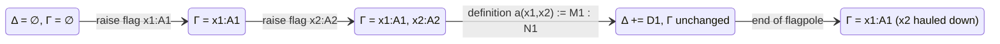
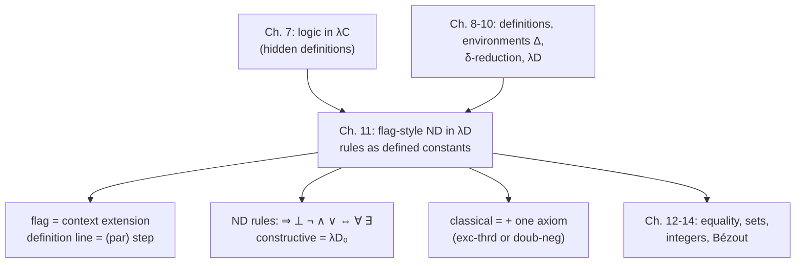

[[book-guidelines|↩ Back to guidelines]]

# Natural Deduction and Flag-Style Proofs in $\lambda D$

> Focus Areas: `type-theory` and `automated-reasoning`. Source: Chapter 11 of Nederpelt & Geuvers, re-read directly from the book. Notation follows the book: $\Delta ; \Gamma \vdash M : N$ is a judgement in environment $\Delta$ and context $\Gamma$; $c(\vec x) := M : N$ is a definition line; $\ast_p$ is the sort of propositions, $\ast_s$ the sort of sets; $\Rightarrow$ abbreviates $\to$, $\forall$ abbreviates $\Pi$.

## 1. The problem: two audiences, one derivation

Chapters 9 and 10 gave us $\lambda D$: the Calculus of Constructions $\lambda C$ plus an **environment** $\Delta$ of definitions. $\lambda C$ could already encode logic (Chapter 7), but the encoding was hidden. Take $\bot$. In $\lambda C$ it is a *shorthand* for $\Pi\alpha : \ast . \alpha$ that lives only in the reader's head; the system never records that the shorthand was introduced. A proof object such as $\lambda v : \neg A . v\,u$ then reveals nothing about which logical rule was applied at each step.

There are two distinct problems here.

1. **Machine side.** Formal $\lambda D$ derivations in the official tree/linear format are meticulous. Even the one-line definition of $\neg$ needs ten lines of $(\textit{sort})$, $(\textit{var})$, $(\textit{weak})$, $(\textit{form})$, $(\textit{par})$ steps (Figure 11.2). This is fine for a checker and miserable for a human.
2. **Human side.** A mathematician wants to see "$\wedge$-introduction here, $\vee$-elimination there", as in a textbook on natural deduction. The generic rules $(\textit{appl})$ and $(\textit{abst})$ hide that. In the book's first example (Figure 11.4), line (1) is really $\forall$-elimination and line (2) is $\Rightarrow$-elimination, but both are annotated just $(\textit{appl})$.

Chapter 11 fixes both by (a) fixing a compact **flag-style** presentation of $\lambda D$ derivations, with explicit conventions for what may be omitted, and (b) turning every natural-deduction rule into a **defined constant** (e.g. $\wedge\text{-in}$, $\vee\text{-el}$) so the derivation itself names the rule used.

What breaks without this: either you write the administrative derivation steps by hand (unreadable), or you drop them informally with no agreed meaning (unsound as a protocol). The chapter's work is making the abbreviation *principled*: each flag-style line has a precise meaning in terms of the official rules.

## 2. Flag-style linear derivations and context management

### 2.1 Reading a flag derivation as a stack machine

Start from intuition. When you write a proof on paper you say "let $x$ be an element of $S$" or "assume $P(x)$", and everything you write until the end of that scope depends on it. A **flag** is exactly that declaration: it is written as a line like $x : S$ on a small flag, and the **flagpole** hanging from it marks the scope in which $x$ is available. Nested flags give nested scopes.

In $\lambda D$ a flag $x : A$ is a variable declaration in the context $\Gamma$. A flag is also, by propositions-as-types, an *assumption*: if $A : \ast_p$, then $x : A$ means "suppose $A$ holds, and $x$ is the (unknown) proof of it". The book's first key question, how a flag with a context corresponds to a natural-deduction subproof with an assumption, thus has a one-line answer: **raising a flag opens a subproof; the flag's type is the assumption; the flagpole is the subproof's extent.**

The book makes this precise in Section 11.3 with an "operational semantics" on **states** $\{\Delta \mid \Gamma\}$ (environment, context):

$$
\{\emptyset \mid \emptyset\}
\xrightarrow{\ x_1 : A_1\ }
\{\emptyset \mid x_1:A_1\}
\xrightarrow{\ x_2 : A_2\ }
\{\emptyset \mid x_1:A_1,\,x_2:A_2\}
\xrightarrow{\ a(x_1,x_2) := M_1 : N_1\ }
\{D_1 \mid x_1:A_1,\,x_2:A_2\}
\xrightarrow{\ \text{haul down } x_2\ }
\{D_1 \mid x_1:A_1\}
$$

where $D_1 \equiv x_1 : A_1, x_2 : A_2 \vdash a(x_1,x_2) := M_1 : N_1$. The two rules of the machine:

- **Raising a flag** extends $\Gamma$; **hauling it down** (end of the flagpole) shrinks $\Gamma$. $\Gamma$ behaves like a stack.
- **A definition line** under context $\Gamma$ *appends* $D \equiv \Gamma \vdash c(\vec x) := M : N$ to $\Delta$. $\Delta$ is never shrunk.

Remark 11.3.1 states this explicitly: "context $\Gamma$ may grow and shrink from line to line, just like a stack in a computer, but the environment $\Delta$ only becomes bigger and bigger." No derivation rule deletes a definition. The book's justification: $\Delta$ is a **log-book** of achievements; once a lemma is stated and proved you can call it by name and instantiate its parameters. (Deleting superfluous definitions is possible via the Condensing Lemma 10.4.8(2), but is not a rule.)



### 2.2 The triple meaning of a definition line

A line $c(\vec x) := M : N$ in environment $\Delta$ and context $\Gamma$ (with $\vec x$ the subject variables of $\Gamma$) means three things at once (Section 11.3):

1. the statement $M : N$ is derivable: $\Delta ; \Gamma \vdash M : N$;
2. [[Polymorphism-and-Higher-Order-Typed-Lambda-Calculi#The definition|the definition]] $D \equiv \Gamma \vdash c(\vec x) := M : N$ is appended to $\Delta$;
3. the statement $c(\vec x) : N$ is derivable in the extended environment: $\Delta, D ; \Gamma \vdash c(\vec x) : N$.

Item 3 is $(\textit{par})$; item 2 is the definition-introduction bookkeeping. This is why the flag-style line is a faithful *compression* of the official derivation: it is one line standing for the $(\textit{par})$ step plus the derivations of $M : N$ it depends on.

### 2.3 From the ten-line derivation to three flag-style lines

Section 11.2 walks through the compression using the definition of $\neg$ from Figure 11.2.

| Stage | What remains |
|---|---|
| Full $\lambda D_0$ derivation (Fig. 11.2) | 10 lines, rules $(\textit{sort}), (\textit{var}), (\textit{weak}), (\textit{form}), (\textit{par}), (\textit{def})$ |
| Suppress "uninteresting" rules: $(\textit{sort}), (\textit{var}), (\textit{weak}), (\textit{form}), (\textit{def})$ | lines (1), (2), (5), (7) vanish |
| Flag copy with definitions $(D_1)$, $(D_2)$ | still has near-duplicates: $(D_1)$ repeats information in lines (3) and (4) |
| Condense $(3), (D_1), (4)$ into $(D_1)$ alone; drop $(6), (8)$ and the flag $y : A$ | two definition lines and one flag |

The final result is just

```
        ⊥( ) := Πα : ∗ . α : ∗          (form) and (par)
 (a)    A : ∗
        ¬(A) := A → ⊥( ) : ∗             (form) and (par)
```

That is exactly the informal presentation from the start of the chapter. The convention behind it: a single definition line *incorporates the derivability of the omitted statements* that its $(\textit{par})$ step needs.

### 2.4 The "everything is a definition" convention

Section 11.3 adopts one more convention that shapes every later proof, taken from de Bruijn's Automath (Remark 11.3.2):

> In a flag derivation, we turn every statement relative to a certain context, into a definition, by choosing a new defined name and appending that name in front of the statement.

So $\Gamma \vdash M : N$ is always written $\Gamma \vdash c(\vec x) := M : N$. Consequence: there are no bare "statements" in flag-style $\lambda D$, only definitions, plus flags. The price is *inessential* defined names that are never used again. The gain is a simpler system: one kind of line.

### 2.5 Grounding: the derivation state in Rust

This is checker-shaped, so Rust first. The `Derivation` below is the book's state $\{\Delta \mid \Gamma\}$. The point to notice: $\Gamma$ is a stack with `truncate`; $\Delta$ is an append-only log.

```rust
use std::rc::Rc;

type Name = String;

#[derive(Clone, Debug, PartialEq)]
enum Term {
    Sort(Sort),
    Var(Name),
    App(Rc<Term>, Rc<Term>),
    Lam(Name, Rc<Term>, Rc<Term>),
    Pi(Name, Rc<Term>, Rc<Term>),
    Const(Name, Vec<Term>),        // c(args): a defined constant instance
}

#[derive(Clone, Debug, PartialEq)]
enum Sort { Star, Box }            // ∗ and □ (∗p / ∗s are notation over ∗)

type Context = Vec<(Name, Term)>;  // Γ

/// D ≡ Γ ⊢ c(x⃗) := M : N
#[derive(Clone, Debug)]
struct Definition {
    ctx: Context,
    name: Name,
    body: Term,   // M
    ty: Term,     // N
}

struct Derivation {
    env: Vec<Definition>,  // Δ: append-only
    ctx: Context,          // Γ: stack
}

impl Derivation {
    /// Raise a flag: extend Γ, but only if the declared type is itself
    /// well-sorted in the current state (rule (var)/(weak) side conditions).
    fn raise_flag(&mut self, x: Name, a: Term) -> Result<(), String> {
        self.check_is_type(&a)?;               // Δ ; Γ ⊢ A : s
        self.ctx.push((x, a));
        Ok(())
    }

    /// Haul the flag down: Γ shrinks. Δ is untouched.
    fn lower_flag(&mut self) {
        self.ctx.pop();
    }

    /// c(x⃗) := M : N  — the (par) step. Params x⃗ are exactly the
    /// subject variables of the current Γ.
    fn define(&mut self, c: Name, m: Term, n: Term) -> Result<(), String> {
        self.check(&m, &n)?;                    // Δ ; Γ ⊢ M : N
        self.env.push(Definition {
            ctx: self.ctx.clone(), name: c, body: m, ty: n,
        });                                     // never removed
        Ok(())
    }

    fn check(&self, _m: &Term, _n: &Term) -> Result<(), String> { todo!("λD type checker") }
    fn check_is_type(&self, _a: &Term) -> Result<(), String> { todo!() }
}
```

Nothing here is deleted from `env`, which matches the book's "no rule for deleting a definition". The `define` method also makes the "triple meaning" concrete: it checks (1), pushes (2), and afterwards `Const(c, params)` has type `n` (3).

In Lean the same structure is the elaborator's local-context / environment split: `Lean.Environment` is the append-only log of declarations, and `LocalContext` is the stack of `fvar` binders that `intro` extends. A tactic proof block `intro x` / `intro h` is literally "raise a flag".

## 3. Introduction and elimination rules as defined constants

### 3.1 Why defined constants

Suppose you want the proof object to say which rule fired. In $\lambda C$ the connectives were *derived* from $\Pi$ (Section 7.2): $A \wedge B := \Pi C : \ast . (A \to B \to C) \to C$. The introduction and elimination rules are then just particular terms. In $\lambda D$ we can **name** each such term, with its own parameters and type. The rule is then a constant; using the rule is applying the constant. A derivation that uses $\wedge\text{-in}(A, B, u, v)$ announces its logical content in the proof term itself.

This answers key question 2: connectives are not built into $\lambda D$ at all. Each is a *descriptive definition* (a name for a $\Pi$-expression) and each rule is a descriptive definition of a proof term inhabiting a statement about it. The sole primitive assumptions are the two classical axioms (Section 5).

### 3.2 The rule catalogue (constructive)

All in context $A, B : \ast_p$ unless noted. The notation `u : A | v : B` is a **double flag**, i.e. two declarations side by side (Notation 11.5.1), which is only a space-saving device.

| Connective | Definition ($\ast_p$) | Introduction | Elimination |
|---|---|---|---|
| $\Rightarrow$ | $A \Rightarrow B := A \to B$ | $\Rightarrow\text{-in}(A,B,u) := u$ for $u : A \to B$ | $\Rightarrow\text{-el}(A,B,u,v) := u\,v : B$ |
| $\bot$ | $\bot := \Pi A : \ast_p . A$ | $\bot\text{-in}(A,u,v) := v\,u$ for $u:A$, $v : A\Rightarrow\bot$ | $\bot\text{-el}(A,u) := u\,A : A$ for $u : \bot$ |
| $\neg$ | $\neg A := A \Rightarrow \bot$ | $\neg\text{-in}(A,u) := u$ | $\neg\text{-el}(A,u,v) := u\,v : \bot$ |
| $\wedge$ | $\wedge(A,B) := \Pi C : \ast_p . (A \Rightarrow B \Rightarrow C) \Rightarrow C$ | $\wedge\text{-in} := \lambda C : \ast_p . \lambda w : A \Rightarrow B \Rightarrow C . w\,u\,v$ | $\wedge\text{-el}_1 := u\,A\,(\lambda v : A . \lambda w : B . v)$; $\wedge\text{-el}_2$ symmetric |
| $\vee$ | $\vee(A,B) := \Pi C : \ast_p . (A \Rightarrow C) \Rightarrow (B \Rightarrow C) \Rightarrow C$ | $\vee\text{-in}_1 := \lambda C . \lambda v . \lambda w . v\,u$; $\vee\text{-in}_2$ with $w\,u$ | $\vee\text{-el}(A,B,C,u,v,w) := u\,C\,v\,w : C$ |
| $\Leftrightarrow$ | $(A \Rightarrow B) \wedge (B \Rightarrow A)$ | $\Leftrightarrow\text{-in} := \wedge\text{-in}(A{\Rightarrow}B, B{\Rightarrow}A, u, v)$ | $\Leftrightarrow\text{-el}_{1,2} := \wedge\text{-el}_{1,2}(\dots)$ |

Three details worth noticing.

- $\bot\text{-in}$, $\neg\text{-in}$ and $\neg\text{-el}$ are *special cases* of $\Rightarrow\text{-in}$/$\Rightarrow\text{-el}$ (Remark after Fig. 11.7): the definition of $\neg$ as $A \Rightarrow \bot$ makes the negation rules instances of the [[Dependent-Types#Implication|implication]] rules. The book still lists them for readability.
- $\Leftrightarrow$ is defined as a conjunction of implications, so its rules are compositions of $\wedge$ rules.
- $\bot\text{-el}(A, u) := u\,A$ is ex falso: from a proof of $\Pi A : \ast_p . A$ you instantiate $A$ at any proposition you like.

### 3.3 Grounding the rules

**Rust.** [[Polymorphism-and-Higher-Order-Typed-Lambda-Calculi#The rules|The rules]] are *constructors and destructors of proof terms*. Here is a faithful-in-spirit shallow model using a trait-per-connective, with the second-order encoding replaced by a native type so the code is realizable (Rust has no impredicative $\Pi C : \ast$; the point is the *shape* of in/el):

```rust
// Proofs-as-values for propositional logic. A "proposition" is a type;
// a proof is a value of it. Rust's impredicativity gap is why we use
// native product/sum instead of ΠC.(A→B→C)→C.
struct And<A, B>(A, B);
enum Or<A, B> { Inl(A), Inr(B) }
enum Void {}                                    // ⊥: no constructors
type Not<A> = Box<dyn Fn(A) -> Void>;           // ¬A := A ⇒ ⊥

fn and_in<A, B>(u: A, v: B) -> And<A, B> { And(u, v) }
fn and_el1<A, B>(p: And<A, B>) -> A { p.0 }
fn and_el2<A, B>(p: And<A, B>) -> B { p.1 }

fn or_in1<A, B>(u: A) -> Or<A, B> { Or::Inl(u) }
fn or_in2<A, B>(u: B) -> Or<A, B>  { Or::Inr(u) } // pattern holds with A,B swapped
fn or_el<A, B, C>(u: Or<A, B>, v: impl FnOnce(A) -> C, w: impl FnOnce(B) -> C) -> C {
    match u { Or::Inl(a) => v(a), Or::Inr(b) => w(b) }
}

fn bot_el<A>(u: Void) -> A { match u {} }       // ⊥-el
fn not_el<A>(u: Not<A>, v: A) -> Void { u(v) }  // ¬-el  (u v : ⊥)

// Figure 11.14, commutativity of ∨: sym-∨ := λu. u (B∨A) a1 a2
fn sym_or<A: 'static, B: 'static>(u: Or<A, B>) -> Or<B, A> {
    or_el(u, |v| or_in2::<B, A>(v), |w| or_in1::<B, A>(w))
}
```

`or_el` has exactly the shape of $\vee\text{-el}(A,B,C,u,v,w) := u\,C\,v\,w$: in the book's encoding the disjunction *is* its own eliminator, applied to $C$ and two continuations. In Rust, `match` is that application, with the continuations inlined.

**Lean.** The book's definitions are literally definable in Lean's `Prop` (which, like $\ast_p$, is impredicative):

```lean
def And' (A B : Prop) : Prop := ∀ C : Prop, (A → B → C) → C
def Or'  (A B : Prop) : Prop := ∀ C : Prop, (A → C) → (B → C) → C

def and_in  {A B : Prop} (u : A) (v : B) : And' A B := fun C w => w u v
def and_el1 {A B : Prop} (u : And' A B) : A := u A (fun v _ => v)
def or_in1  {A B : Prop} (u : A) : Or' A B := fun C v _ => v u
def or_el   {A B C : Prop} (u : Or' A B) (v : A → C) (w : B → C) : C := u C v w
def sym_or  {A B : Prop} (u : Or' A B) : Or' B A :=
  u (Or' B A) (fun v => fun C f _ => f v) (fun w => fun C _ g => g w)
```

Real Lean differs in that `And` and `Or` are *inductive* in the standard library, with kernel-generated recursors, not Church encodings. The comparison is useful: Chapter 11's encoding gets the eliminators for free from $\Pi$, while Lean's inductive types get them from generated recursors and proof irrelevance of `Prop` for free.

## 4. Worked derivations: how a flag proof reads

### 4.1 Natural-deduction style versus type-theoretic style

The book gives the same proof in two styles, and the comparison is the lesson.

$A \Rightarrow \neg\neg A$ in **natural-deduction style** (Figure 11.8) uses the rule constants:

```
 (a)  A : ∗p
 (b)    u : A
 (c)      v : ¬A
 (1)        a1 := ¬-el(A, v, u) : ⊥
 (2)      a2 := ¬-in(¬A, λv : ¬A . a1) : ¬¬A
 (3)  a3 := ⇒-in(A, ¬¬A, λu : A . a2) : A ⇒ ¬¬A
```

and in **type-theoretic style** (Figure 11.9):

```
 (2)    a2 := λv : ¬A . v u : ¬¬A
 (3)  a3 := λu : A . a2 : A ⇒ ¬¬A
```

The logical content is identical. Natural-deduction style shows the rules; type-theoretic style gives shorter proof objects. For $\Rightarrow$, $\bot$, $\neg$ the unfolded term is *shorter* than the folded one (the rule wrappers add nothing). For $\wedge$, $\vee$, $\Leftrightarrow$ the definiendum ($\wedge(A,B)$) is shorter than the definiens, so naming the rule helps. The book's convention: use the type-theoretic style for $\Rightarrow$, $\bot$, $\neg$, $\forall$ and for $\vee\text{-el}$, $\exists\text{-el}$, and natural-deduction style when you want to emphasise the rule.

### 4.2 $(A \vee B) \Rightarrow (\neg A \Rightarrow B)$, rules explicit

Figure 11.13 shows one rule per line, which is the key advantage over $\lambda C$'s $(\textit{appl})$/$(\textit{abst})$:

```
 (a) A, B : ∗p
 (b)   x : A ∨ B
 (c)     y : ¬A
 (d)       u : A
 (1)         a1 := ¬-el(A, y, u) : ⊥
 (2)         a2 := ⊥-el(B, a1) : B
 (3)       a3 := ⇒-in(A, B, λu : A . a2) : A ⇒ B
 (4)       a4 := ⇒-in(B, B, λv : B . v) : B ⇒ B
 (5)       a5 := ∨-el(A, B, B, x, a3, a4) : B
 (6)     a6 := ⇒-in(¬A, B, λy : ¬A . a5) : ¬A ⇒ B
 (7) a7 := ⇒-in(A ∨ B, ¬A ⇒ B, λx : A ∨ B . a6) : (A ∨ B) ⇒ (¬A ⇒ B)
```

The flag nesting $x, y, u$ corresponds to the *assumptions* in the textbook proof: assume $A \vee B$, assume $\neg A$, and for the case $A$ assume $u : A$. Remark 11.6.1 warns that the constant names $a_1, a_2, a_3$ are reused from Figures 11.8 and 11.9, which "is not in agreement with the rules of $\lambda D$" (names must be fresh), tolerated only to save names.

### 4.3 Proofs are found bottom-up and read top-down

Remark 11.9.3 makes a point that applies to all of automated proof search: a finished flag proof can be *checked* top to bottom, but it was *found* from the goal backwards: set the goal, work out which assumption it induces, set a new goal, and so on, with failed attempts left unrecorded. For $\neg A \Rightarrow B$ style goals the induced flag structure is dictated by the shape of the goal. For the book's proof of $(\neg A \Rightarrow B) \Rightarrow (A \vee B)$, the goal in line (11) induces flag (b), and the new goal $A \vee B$ induces, by proof by contradiction, flag $v : \neg(A \vee B)$ and the goal $\bot$.

## 5. Suppressing unaltered parameter lists

### 5.1 The problem

In Figure 11.13 every constant carries a parameter list, but the lists are always *the entire context*: $a_1(A, B, x, y, u)$, and so on. They carry no information (each parameter is instantiated with itself). They bury the structure of the proof.

### 5.2 The convention

Notation 11.7.1 (Parameter list convention): *Parameter lists that literally reflect the context in which they have been introduced may be suppressed completely*, both in the definiendum and in the proof objects that use the constant. The result of rewriting Figure 11.13 (and using the type-theoretic style for $\Rightarrow$, $\bot$, $\neg$, $\vee\text{-el}$) is Figure 11.15:

```
 (a)  A, B : ∗p
 (b)    x : A ∨ B
 (c)      y : ¬A
 (d)        u : A
 (1)          a1 := y u : ⊥        † parameters suppressed
 (2)          a2 := a1 B : B
 (3)        a3 := λu : A . a2 : A ⇒ B
 (4)        a4 := λv : B . v : B ⇒ B
 (5)        a5 := x B a3 a4 : B
 (6)      a6 := λy : ¬A . a5 : ¬A ⇒ B
 (7)  a7 := λx : A ∨ B . a6 : (A ∨ B) ⇒ (¬A ⇒ B)
```

The book notes this contradicts its earlier insistence (Remark 8.3.2) on always showing parameter lists, but "the advantages ... are too important to neglect".

### 5.3 What breaks, and why it is safe

The cost: constants such as $a_1$ now *look like variables*, making the variable/constant distinction harder to see (the book says so explicitly). It is safe because the suppressed information is **recoverable**: the parameter list is determined by the context at the definition site. The convention is therefore a pure display layer on top of the formal system. It is used "mostly in examples, not in the derivations that are essential for the development of this course", and the first use is flagged in a footnote.

In the Rust model above this is exactly the difference between the stored form and the printed form: `Definition.ctx` always holds the full $\Gamma$, so a pretty-printer can elide `args == ctx.names()` at will.

```rust
impl Definition {
    /// The parameter list x⃗ is, by construction, the subject variables of ctx.
    fn params(&self) -> Vec<&Name> { self.ctx.iter().map(|(x, _)| x).collect() }
}

/// Pretty-printer for the parameter list convention (Notation 11.7.1):
/// print `c` instead of `c(x1,..,xn)` when args are exactly the context.
fn print_const(def: &Definition, args: &[Term], ctx_at_use: &Context) -> String {
    let same = args.len() == ctx_at_use.len()
        && args.iter().zip(ctx_at_use).all(|(a, (x, _))| *a == Term::Var(x.clone()));
    if same { def.name.clone() } else { format!("{}(…)", def.name) }
}
```

(Careful, the book's convention also needs the use-site context to equal the definition-site context for the elision to be unambiguous; the sketch just illustrates the idea.)

## 6. Classical logic: adding exactly one axiom

### 6.1 Why constructive logic is not enough

Everything above is constructive: the proof of $A \Rightarrow \neg\neg A$ works, but nothing in $\lambda D_0$ proves $\neg\neg A \Rightarrow A$ or $A \vee \neg A$. Constructively that is correct: a proof of $A \vee B$ must say *which* side holds. Mathematicians nevertheless use classical reasoning freely, and the book says it "respects this preference" (Section 11.4).

### 6.2 The axiom as a primitive definition

In $\lambda D$ an axiom is a **primitive definition**: a constant with a type but no body, written with $\bot$ in the body position (the book's notation for a primitive). Figure 11.16:

```
 (a)  A : ∗p
 (1)    exc-thrd(A) := ⊥ ⊥ : A ∨ ¬A          (primitive: an axiom)
 ...
 (7)  doub-neg(A) := λu : ¬¬A . a6 : ¬¬A ⇒ A
```

The point: the choice is between **ET** ($A \vee \neg A$) and **DN** ($\neg\neg A \Rightarrow A$). The book assumes ET and *derives* DN (Figure 11.16), and the proof is the one from Section 7.4. Interestingly, this axiom is stated per proposition in a context $A : \ast_p$, unlike Section 7.4's single $i_{ET} : \Pi A : \ast . A \vee \neg A$.

Two derived rules (Figure 11.17):

$$
\neg\neg\text{-in}(A,u) := \lambda v : \neg A . v\,u : \neg\neg A \qquad
\neg\neg\text{-el}(A,u) := \textit{doub-neg}(A)\,u : A
$$

The first is constructive (derived without the axiom, Figure 11.9). The second uses `doub-neg`, hence ET. **That is the exact line between constructive and classical in $\lambda D$:** a derivation is constructive precisely if it never unfolds a constant that depends on `exc-thrd`. Key question 3 therefore has a crisp answer: the constructive rule set is everything definable in $\lambda D_0$; the classical set adds one primitive constant and what it makes derivable, principally $\neg\neg\text{-el}$, plus the alternative rules of Section 7 below.

### 6.3 Proof by contradiction as a flag pattern

Remark 11.8.1 gives the pattern: to prove $A$, raise a flag $\neg A$, derive $\bot$ below it; then $\neg\text{-in}$ yields $\neg\neg A$ and $\neg\neg\text{-el}$ yields $A$.

```
   ¬A
    ⋮
    ⊥
```

Figure 11.18 uses it for $(\neg A \Rightarrow B) \Rightarrow (A \vee B)$, with the non-constructive step in line (10) `¬¬-el(A ∨ B, a9)`. The book adds a caution: use it "with considerable care", only when no direct proof is at hand, because careless contradiction proofs create unnecessary detours.

### 6.4 Grounding: classical axiom in Lean and Rust

In Lean the same split exists: `theorem` proofs that never mention `Classical` are constructive; `Classical.em`, `Classical.byContradiction` and `Classical.not_not` come from `Classical.choice`, the one axiom that plays ET's role.

```lean
theorem dn {A : Prop} (u : ¬¬A) : A :=
  (Classical.em A).elim id (fun v => (u v).elim)   -- doub-neg, from ET

#print axioms dn   -- reports: [Classical.choice, propext, Quot.sound]
```

`#print axioms` is the practical analogue of "which constants does this derivation unfold into": it is how you audit a proof for classical content. In the Rust model, this is a graph walk over `Derivation.env`: collect every primitive definition (`body == None`) reachable from a definition's body. A verifier that wants to report "this contract proof is constructive" would do precisely that.

## 7. Alternative rules for $\vee$

### 7.1 Why

The rule $\vee\text{-in}$ asks for a proof of $A$ or a proof of $B$, "such a proof is seldom at hand". Classically, $(A \vee B) \Leftrightarrow (\neg A \Rightarrow B)$: combine Figures 11.13 and 11.18. So to prove $A \vee B$ it suffices to prove $\neg A \Rightarrow B$, and to use $A \vee B$ it suffices to use $\neg A \Rightarrow B$. Both are common mathematical practice.

### 7.2 The rules

Figure 11.19. Since $\vee$ is commutative, the rules come in symmetric pairs:

| Rule | Premise | Conclusion |
|---|---|---|
| $\vee\text{-in-alt}_1(A,B,u)$ | $u : \neg A \Rightarrow B$ | $A \vee B$ |
| $\vee\text{-in-alt}_2(A,B,v)$ | $v : \neg B \Rightarrow A$ | $A \vee B$ |
| $\vee\text{-el-alt}_1(A,B,u,v)$ | $u : A \vee B$, $v : \neg A$ | $B$ |
| $\vee\text{-el-alt}_2(A,B,u,w)$ | $u : A \vee B$, $w : \neg B$ | $A$ |

They are defined by reusing earlier constants with subscripts naming the figure, e.g. $a_{10[\text{Fig. }11.18]}$ (Remark 11.9.1). Typical use (Remark 11.9.2): raise a flag $x : \neg A$, derive $B$ below it, then close with $\vee\text{-in-alt}_1(A, B, \lambda x : \neg A . \dots)$. The $\vee\text{-el-alt}$ rules are the logic behind "$A$ or $B$ holds, $A$ is false, hence $B$", i.e. disjunctive syllogism.

### 7.3 De Morgan as the worked example

Figures 11.20 and 11.21 prove $\neg(A \wedge B) \Leftrightarrow (\neg A \vee \neg B)$ with these rules. The direction $\neg(A \wedge B) \Rightarrow \neg A \vee \neg B$ is classical (it uses $\neg\neg\text{-el}$ and $\vee\text{-in-alt}_1$), while $\neg A \vee \neg B \Rightarrow \neg(A \wedge B)$ uses $\vee\text{-el-alt}_1$ and $\neg\neg\text{-in}$. The book advises reading them "from bottom to top", the order of construction.

## 8. Quantifiers: constructive and classical predicate logic

### 8.1 Rules for $\forall$ and $\exists$

With sets $S : \ast_s$ and predicates $P : S \to \ast_p$ (Figures 11.22, 11.23):

| | Definition | Introduction | Elimination |
|---|---|---|---|
| $\forall$ | $\forall(S,P) := \Pi x : S . P\,x : \ast_p$ | $\forall\text{-in}(S,P,u) := u$ | $\forall\text{-el}(S,P,u,v) := u\,v : P\,v$ |
| $\exists$ | $\exists(S,P) := \Pi A : \ast_p . ((\forall x : S . (P\,x \Rightarrow A)) \Rightarrow A)$ | $\exists\text{-in}(S,P,u,v) := \lambda A . \lambda w . w\,u\,v$ for $u : S$, $v : P\,u$ | $\exists\text{-el}(S,P,u,A,v) := u\,A\,v : A$ |

Remark 11.10.1: the book only states first-order rules ($x$ ranging over a set). Second-order versions are similar, as in the definition of $\bot$.

$\forall$ is just $\Pi$ over a set, so its introduction and elimination are $\lambda$-abstraction and application, which is why the book uses them in type-theoretic style. $\exists$ is the Church-style "any $A$ that follows from every witness" encoding, so $\exists\text{-el}$ is again the eliminator applied to its own result type.

### 8.2 The $\exists$-elimination strategy

Because $\exists\text{-el}$ asks for an inhabitant of $\forall x : S . (P\,x \Rightarrow A)$, the practical strategy (shown schematically on p. 248) is: with goal $A$ and a fact $\exists x : S . P\,x$, raise **two flags**, $x : S$ and $u : P\,x$ (a double flag), prove $A$ in that enlarged context, abstract back to $\forall x . (P\,x \Rightarrow A)$ and apply $\exists\text{-el}$. In textbook terms: "let $x$ be a witness, so $P(x)$". The side condition that $x$ not occur free in $A$ is enforced automatically by well-formedness of the context: the five assumptions in the rule's line "are a well-formed context". Remark 11.10.2 shows the failure mode: with $u : \exists x . P\,x$ and $v : \forall y . (P\,y \Rightarrow Q\,y)$ you cannot conclude $Q\,y$ by $\exists\text{-el}$, since $y$ would occur free in the goal.

Figure 11.24 proves $\exists x{:}S . P\,x \Rightarrow \forall y{:}S . (P\,y \Rightarrow Q\,y) \Rightarrow \exists z{:}S . Q\,z$ with exactly this pattern (flags $x : S \mid w : P\,x$) and $\exists\text{-in}$ at line (3). Figure 11.25 proves $\exists \Rightarrow \neg\forall\neg$ where $\exists\text{-el}$ applies directly, since $\neg P\,y$ is already $P\,y \Rightarrow \bot$.

**[[Polymorphism-and-Higher-Order-Typed-Lambda-Calculi#Grounding|Grounding]] in Lean.** The elimination strategy is `obtain ⟨x, hx⟩ := h` (or `cases h`):

```lean
example {S : Type} {P Q : S → Prop}
    (u : ∃ x, P x) (v : ∀ y, P y → Q y) : ∃ z, Q z := by
  obtain ⟨x, w⟩ := u      -- raise flags  x : S | w : P x
  exact ⟨x, v x w⟩        -- ∃-in(S, Q, x, v x w)
```

Lean's `Exists.elim` has the shape of $\exists\text{-el}$ (motive $A$ must not depend on the witness), and `obtain` is the flag raising. In Rust there is no native analogue of $\exists$ over propositions; a closest reading is an existential type or a pair `(S, P<S>)`, which is *not* a proof (it lacks proof-irrelevance), so this is a place where the analogy would be strained and is skipped.

### 8.3 Classical predicate logic

The missing tautology is $\neg\forall x{\in}S\,(\neg P(x)) \Rightarrow \exists x{\in}S\,(P(x))$: "if not all elements fail $P$, some element satisfies $P$". It is *not* derivable in constructive predicate logic (first or second order), because it does not give a witness. Adding DN/ET, it is (Figure 11.27). The proof uses contradiction: flag $v : \neg\exists y . P\,y$, and Figure 11.26's constructive lemma $\neg\exists \Rightarrow \forall\neg$ gives $\forall z . \neg P\,z$, contradicting $u$. Together: $\exists \Leftrightarrow \neg\forall\neg$ classically. The dual $\forall \Leftrightarrow \neg\exists\neg$ is left as Exercise 11.16.

As with $\vee$, alternative $\exists$ rules (Figure 11.28) capture the classical equivalence, because $\exists\text{-in}$ requires a *witness*:

$$
\exists\text{-in-alt}(S,P,u) : \exists x{:}S . P\,x \quad\text{for } u : \neg\forall x{:}S . \neg P\,x
$$
$$
\exists\text{-el-alt}(S,P,u) : \neg\forall x{:}S . \neg P\,x \quad\text{for } u : \exists x{:}S . P\,x
$$

Figure 11.29 proves $\neg\forall x . P\,x \Rightarrow \exists x . \neg P\,x$ using $\exists\text{-in-alt}$ at line (6) with predicate $\lambda y : S . \neg(P\,y)$: the natural bottom-up construction gives the goal $\exists y . \neg P\,y$, which is traded for $\neg\forall y . \neg\neg P\,y$ so the rule can apply. Remark 11.11.2: $\neg\exists \Rightarrow \forall\neg$ and $\neg\forall \Rightarrow \exists\neg$ are in fact biimplications (Exercise 11.15).

## 9. Natural deduction as the logic under mathematical reasoning

The chapter's closing argument (Section 11.12) is a claim about mathematics, not about $\lambda D$. A routine mathematical move such as rewriting $\neg(x > 0 \wedge x < 10)$ as $\neg(x > 0) \vee \neg(x < 10)$ is justified by the tautology $\neg(A \wedge B) \Leftrightarrow (\neg A \vee \neg B)$, which is *proved in natural deduction* (Figures 11.20 and 11.21). So natural deduction is "the essential logical framework underlying mathematical reasoning", with rewriting as "a secondary method, albeit a very useful one".

What the chapter shows is that this is not merely a slogan: with a definition mechanism, $\lambda D$ lets you **encapsulate** each rule as a named constant, so the proof object records where the logic happens, and flag-style presentation makes the derivation read like a textbook proof. The book's honest caveat: for $\Rightarrow$, $\bot$, $\neg$, $\forall$, $\vee\text{-el}$, $\exists\text{-el}$ the plain type-theoretic style is often better, because it gives shorter proof objects.

Further reading from the chapter: the rules are standard (van Dalen, *Logic and Structure*); flag style was popularised by Fitch (1952) and appears in Nederpelt & Kamareddine (2011); Section 7.8 discusses other proof systems; Appendix A summarises all the $\lambda D$ rules.

## 10. Synthesis



**What it depends on.** Chapter 7 (the second-order encodings of the connectives, which Chapter 11 re-presents as definitions), Chapters 8-10 ($\lambda D$: definitions, $\delta$-reduction, environments, legality, the lemmas used to justify "condensing"), and Chapter 4's flag-style conventions for $\lambda\to$.

**[[Simple-Types-and-the-Simply-Typed-Lambda-Calculus#How it bears on the project|How it bears on the project]] (Focus Areas `type-theory`, `automated-reasoning`).**

- *Type checker and proof checker are the same program.* A flag derivation is a typing derivation: raising a flag is extending the context, a definition line is a checked $(\textit{par})$ step, and the natural-deduction annotation is a *name for a proof-term constructor*. This is the clearest statement in the book of the "judgement forms are the shared ancestor of type checking and proof checking" thread. A verifier whose output is "a proof certificate" can emit exactly this: an environment-ordered list of $\Gamma \vdash c := M : N$ lines.
- *Context management and trusted kernel.* The state machine $\{\Delta \mid \Gamma\}$ (stack $\Gamma$, append-only $\Delta$) is the skeleton of a kernel's checking loop. The invariant to maintain is the book's: every line is checked against the current $\Delta$ and $\Gamma$, and the environment never loses a definition. Everything else (parameter-list suppression, notation lines, the choice of natural-deduction vs. type-theoretic style) is a printing layer outside the trusted core. This makes it a design guide for separating the kernel from the pretty-printer.
- *Proof certificates and reconstruction.* The "rules as named constants" idea suggests a proof-term format in which an SMT or CSP backend's reasoning steps are reconstructed as applications of $\wedge\text{-in}$, $\vee\text{-el}$, $\exists\text{-el}$ and so on, so that a human can audit which logical step each backend step became.
- *Classical vs. constructive as a reported property.* The classical axiom is one primitive constant; auditing it is a reachability question over the definition graph (compare `#print axioms`). For refinement-type contracts whose verification conditions are discharged by classical solvers, the closing proof will be non-constructive, and a checker should know and say so.
- *Elaboration flavour (Lean).* $\exists\text{-el}$'s strategy is `obtain`/`cases`: eliminate into a goal that must not mention the witness. The scope condition is enforced by context well-formedness, which is the same fact a Lean elaborator relies on when it refuses to let a local `fvar` escape its `intro`.
- *Not a direct hit:* this chapter does not itself treat unification, bidirectional typing or metavariables. The only hint is the bottom-up proof-finding discipline of Remark 11.9.3 (goal $\to$ induced flag $\to$ new goal), which is the manual form of backward proof search.

## Where this leads

Chapter 12 and later apply these rules to equality, Leibniz equality, orders, unique existence, sets, integers and finally Bézout's Lemma, always in this flag format with these named rules, and Chapter 14 relies on the parameter-list convention and the type-theoretic/natural-deduction style choice to keep large formalisations readable. Appendix A collects all the rules from this chapter in one place.
