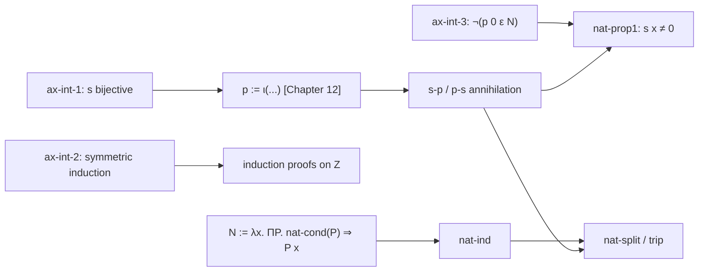

[[book-guidelines|↩ Back to guidelines]]

# Numbers and Arithmetic in $\lambda D$

> Focus Areas: `automated-reasoning` (tagged in the book's `.learning-goals.md`), with strong `type-theory` content. Source: Chapter 14 of Nederpelt & Geuvers, re-read directly. Notation follows the book. $=$ means $=_{\mathbb Z}$ from Section 14.5 on, and $x \neq y$ is $\neg(x = y)$ (the PDF text extraction drops the slash; it is restored from context). Primitive definitions have body $\bot$ (the book's "no definiens" marker), e.g. $0 := \bot : \mathbb N$. $x\,\varepsilon\,P$ is the book's alternative notation for $P\,x$ (the subset machinery is Chapter 13).

Related notes: [[Type-Theory-with-Definitions]] (the system $\lambda D$ and $\delta$-reduction), [[Definitions-and-Abbreviations]] (primitive vs descriptive definitions), [[Natural-Deduction-and-Flag-Style-Proofs]] (flags, $\wedge\text{-in}$, $\Rightarrow\text{-el}$ and so on, used in every figure below), [[Encoding-Logic-in-the-Calculus-of-Constructions]] (the second-order encodings that $\mathbb N$'s definition reuses), [[Propositions-as-Types-and-the-Curry-Howard-Isomorphism]].

## 1. The problem: build the most familiar object from nothing

Everyone "knows" that $2 + 3 = 5$. A proof checker does not. Chapter 14 is a deliberate exercise in pretending to know nothing: what is the smallest set of primitive commitments from which the integers, their order, addition, multiplication and divisibility can be derived inside $\lambda D$, so that the trusted part stays small?

Three constraints shape the answer.

1. $\lambda D$ has no built-in recursion and no inductive types. Whatever you want from "recursive definition" has to be derived.
2. $\lambda D$ separates types ($\ast_s$, decidable typing, unique types) from subsets (predicates, Chapter 13). So "$\mathbb N \subseteq \mathbb Z$" must be a predicate, not a type.
3. Every primitive definition (axiom) enlarges the **trusted base**. The more you add, the more you must justify by hand.

Remark 14.1.3 makes the third point sharp. Nothing in the type checker stops you declaring $0 =_{\mathbb N} s(0)$ as an axiom. The text would still be well-typed. It would also make all naturals equal. Likewise $\bot \equiv \neg\bot$ would collapse logic. The book's three lessons: justify every primitive definition separately; use them sparingly; and remember that a fully type-checked $\lambda D$ text can still be mathematical nonsense if its axioms are contradictory. Type checking certifies *derivation*, not *axioms*.

## 2. Why not Church numerals? (Section 14.1)

The book had already encoded numbers in the typed systems (Church numerals in $\lambda\to$, polymorphic Church numerals in $\lambda 2$). Since $\lambda 2 \subset \lambda D$, one could just write those definitions and let $\beta$-reduction do arithmetic. The book rejects this for four reasons:

| Objection | What goes wrong |
|---|---|
| Induction | It cannot be derived for polymorphic Church numerals, not in $\lambda 2$, $\lambda P2$ or $\lambda D$ (Geuvers 2001). An extra axiom is needed anyway. |
| Predecessor | Church numerals give *iteration*, not *primitive recursion*; the predecessor is inefficient and unnatural. |
| Integers | The encoding does not extend to $\mathbb Z$; integers would need a second, unrelated construction. |
| Mathematical practice | Mathematicians reason from Peano's axioms, including induction. |

So the book takes numbers axiomatically. The price is that $1 + 2 = 3$ is no longer a matter of reduction, but of a derivation (Section 5 below).

[[Polymorphism-and-Higher-Order-Typed-Lambda-Calculi#Grounding|Grounding]]: in Lean (the more literal analogue here), the kernel's $\mathbb N$ is an inductive type whose recursor *does* give induction for free, and `example : 2 + 3 = 5 := rfl` works by kernel computation. $\lambda D$ has neither feature, so it must derive equalities that Lean gets by reduction.

## 3. Peano's naturals in $\lambda D$ (Section 14.1)

### 3.1 First principles

Peano's idea: a set $\mathbb N$, a distinguished element $0$, and a map $s : \mathbb N \to \mathbb N$. Elements $0, s(0), s(s(0)), \dots$ are the numbers. Without further axioms the chain could loop (some $s^k(0) = 0$) or merge (two different elements with the same successor). Two axioms forbid that:

$$
ax\text{-}nat_1 : \forall x \in \mathbb N\ \neg(s(x) = 0),
\qquad
ax\text{-}nat_2 : \forall x,y \in \mathbb N\ (s(x) = s(y) \Rightarrow x = y).
$$

$ax\text{-}nat_2$ says $s$ is injective; $ax\text{-}nat_1$ then says it is not surjective (0 is not a successor). A third says the chain *is everything*:

$$
ax\text{-}nat_3(P) : (P\,0 \wedge \forall x \in \mathbb N\ (P\,x \Rightarrow P(s\,x))) \Rightarrow \forall x \in \mathbb N\ P\,x .
$$

What breaks without induction: the three-element description would have non-standard "ghost" elements outside the chain, and you could not prove anything about all numbers.

### 3.2 In $\lambda D$ (Figure 14.1)

Six primitive definitions:

```
(1) N := ⊥ : *s
(2) 0 := ⊥ : N
(3) s := ⊥ : N -> N
(4) ax-nat1 := ⊥ : ∀x:N. ¬(s x =_N 0)
(5) ax-nat2 := ⊥ : ∀x:N. ∀y:N. (s x =_N s y ⇒ x =_N y)
    P : N -> *p
(6) ax-nat3(P) := ⊥ : (P 0 ∧ ∀x:N.(P x ⇒ P(s x))) ⇒ ∀x:N. P x
```

(Shown in a plain fence only because it is a transcription of a $\lambda D$ text, not math to be rendered.) Remark 14.1.2: `ax-nat1` names an *inhabitant* of the axiom type, and `ax-nat3(P)` names an inhabitant of the induction statement for that $P$. Axioms are just assumed proof terms, the Curry-Howard reading of "postulate".

Note how much is already assumed in these six lines: $\neg$, $\Rightarrow$, $\forall$, $\wedge$ and $=$ (Remark 14.1.1). Arithmetic sits on top of logic ([[Encoding-Logic-in-the-Calculus-of-Constructions]]) and equality (Leibniz equality, Chapter 12).

### 3.3 The "are the axioms too weak?" lemma

**Lemma 14.1.4.** $\forall n \in \mathbb N\ (n = 0 \vee \exists m \in \mathbb N\ (n = s(m)))$.

This rules out stray elements. The proof is a model of economy: induction on $P \equiv \lambda n : \mathbb N\ .\ (n =_{\mathbb N} 0 \vee \exists m : \mathbb N\ .\ (n =_{\mathbb N} s\,m))$ (Figure 14.2). Step (i): $P\,0$ by $\vee\text{-in}$ and reflexivity. Step (ii): for $k$, $s(k) = s(k)$ by reflexivity, so $\exists m\,(s(k) = s(m))$ by $\exists\text{-in}$, so $P(s(k))$ by $\vee\text{-in}$. The induction hypothesis $P(k)$ is **never used**; the book flags this as exceptional but legitimate. This is a *case analysis* (every natural is $0$ or a successor) in disguise, proved via induction because induction is the only elimination principle available.

## 4. Integers the axiomatic way (Section 14.2)

### 4.1 Why integers, and why a predecessor

The book will end with Bézout's Lemma, which needs $mx + ny = 1$ with $x, y \in \mathbb Z$. So $\mathbb Z$ is the base type and $\mathbb N$ becomes a *subset* of it (using Chapter 13's predicates-as-subsets). The axiomatisation is adapted from Margaris (1961), with help from Visser and Iemhoff.

The idea: give $\mathbb Z$ both $s$ and its inverse $p$, so the number line extends in both directions, and make induction symmetric.

### 4.2 The first axiom and the derived predecessor (Figure 14.3)

Primitive: $\mathbb Z : \ast_s$, $0 : \mathbb Z$, $s : \mathbb Z \to \mathbb Z$, and

$$ax\text{-}int_1 : \text{bijective}(\mathbb Z, \mathbb Z, s).$$

Only *one* axiom here: $s$ is a bijection. Then the book derives rather than postulates $p$:

- `inj-suc` and `surj-suc` come from $\wedge\text{-el}$ on $ax\text{-}int_1$.
- Surjectivity gives $\exists_{\ge 1} x\,(s\,x = y)$; injectivity (via `eq-sym`, `eq-trans`) gives at most one such $x$; combined, $\forall y\,\exists^1 x\,(s\,x = y)$ (line 13).
- The descriptor $\iota$ from Chapter 12 turns this unique existence into a function:
$$p := \lambda y : \mathbb Z\ .\ \iota(\mathbb Z,\ \lambda x : \mathbb Z\ .\ (s\,x =_{\mathbb Z} y),\ a_{12}(y)) : \mathbb Z \to \mathbb Z .$$
- $\iota$-prop gives $s$-$p$-annihilation $s(p\,y) = y$; applying it at $s\,y$ and cancelling by injectivity gives $p$-$s$-annihilation $p(s\,y) = y$.

The "partial function from a relation" move is the same one used later for subtraction, $\gcd$ and $\mathrm{plus}(m)$: **prove unique existence, then name the witness with $\iota$**.

### 4.3 Symmetric induction (Figure 14.4)

$$ax\text{-}int_2(P) : [P\,0 \wedge \forall x : \mathbb Z\ (P\,x \Rightarrow (P(s\,x) \wedge P(p\,x)))] \Rightarrow \forall x : \mathbb Z\ P\,x .$$

Intuition: from $0$ the line grows both ways, so you must check the step in *both* directions. (Why only one direction would fail: you would only reach non-negative numbers.) Remark 14.2.1: the base point need not be $0$; Exercise 14.18 derives the variant with an arbitrary $\exists l\,P\,l$.

### 4.4 $\mathbb N$ as a subset (Figure 14.5)

$$nat\text{-}cond(P) := P\,0 \wedge \forall y : \mathbb Z\,(P\,y \Rightarrow P(s\,y)),
\qquad
\mathbb N := \lambda x : \mathbb Z\ .\ \Pi P : \mathbb Z \to \ast_p\ .\ (nat\text{-}cond(P) \Rightarrow P\,x).$$

Reading: $x$ is a natural iff **every** predicate that contains $0$ and is closed under $s$ also contains $x$. So $\mathbb N$ is the intersection of all $s$-closed predicates containing $0$ (Remark 14.2.2: each such $P$ is like an interval $[x, \infty)$ with $x \le 0$; $\mathbb N$ is their intersection). This is the classic impredicative encoding of "smallest closed set"; the quantifier $\Pi P : \mathbb Z \to \ast_p$ ranges over a collection that includes $\mathbb N$ itself.

Derived: `zero-prop : 0 ε N`, `clos-prop : ∀x:Z.(x ε N ⇒ s x ε N)` (Exercises 14.2), so `nat-cond(N)` holds (line 5) and `nat-smallest : ΠQ.(nat-cond(Q) ⇒ N ⊆ Q)` (Exercise 14.3).

### 4.5 Why the third integer axiom is necessary (Figure 14.6)

This is the book's Key Question 1, and the most instructive "what breaks" example in the chapter. Take $S = \{a,b,c,d\}$, $a = 0$, and $s$ rotating $a \to b \to c \to d \to a$. Then $s$ is a bijection, symmetric induction holds (everything is reachable from $0$), and $\mathbb N$ as defined coincides with the whole of $S$. So the axioms so far have a *finite model*; they do not pin down the integers.

The fix is one more axiom:

$$ax\text{-}int_3 : \neg(p\,0\ \varepsilon\ \mathbb N).$$

In the rotation model $p\,0 = d$ is in $\mathbb N$ (it is reachable by $s$ from $0$), so $ax\text{-}int_3$ fails there. Exercise 14.4: with $ax\text{-}int_3$, all models are infinite. Now there are three kinds of integer: naturals ($n\,\varepsilon\,\mathbb N$), and negatives ($\neg(n\,\varepsilon\,\mathbb N)$), with $-1 = p\,0$ the first negative.

A small executable check of the finite model (Rust, checks the axioms are satisfied and the new axiom is violated):

```rust
const MODULUS: u8 = 4;
fn s4(x: u8) -> u8 { (x + 1) % MODULUS }
fn p4(x: u8) -> u8 { (x + MODULUS - 1) % MODULUS }

fn main() {
    // ax-int-1 consequences: s and p cancel each other
    for x in 0..MODULUS {
        assert_eq!(s4(p4(x)), x);
        assert_eq!(p4(s4(x)), x);
    }
    // N = everything reachable from 0 by s
    let mut x = 0u8;
    let mut reach = vec![0u8];
    for _ in 0..MODULUS { x = s4(x); reach.push(x); }
    // ax-int-3 demands p 0 not in N; here it is, so ax-int-3 refutes this model
    assert!(reach.contains(&p4(0)));
}
```

This is exactly how a model-checker-flavoured mind should read axioms: as constraints a counter-model search can try to satisfy ([[#9. Connections to the verification project]]).

## 5. Peano's axioms become theorems (Section 14.3)

With $\mathbb N$ a subset of $\mathbb Z$ (no longer a type), $\Pi$-abstraction over $\mathbb N$ is unavailable. The Chapter 13 trick: quantify over $\mathbb Z$ and add the guard $x\,\varepsilon\,\mathbb N$. The three Peano axioms translate to:

- `nat-prop1 : ∀x:Z.(x ε N ⇒ ¬(s x = 0))`. Proof: if $s\,x = 0$ then $p(s\,x) = p\,0$, so $x = p\,0$ by $p$-$s$-annihilation, so $p\,0\,\varepsilon\,\mathbb N$, contradicting $ax\text{-}int_3$. **This is where $ax\text{-}int_3$ earns its keep.**
- `nat-prop2`: injectivity on $\mathbb N$ follows directly from $ax\text{-}int_1$.
- `nat-ind(P)` (Figure 14.8): $(P\,0 \wedge \forall x : \mathbb Z\,(x\,\varepsilon\,\mathbb N \Rightarrow (P\,x \Rightarrow P(s\,x)))) \Rightarrow \forall x : \mathbb Z\,(x\,\varepsilon\,\mathbb N \Rightarrow P\,x)$.

The proof of `nat-ind` has one real idea. [[Polymorphism-and-Higher-Order-Typed-Lambda-Calculi#The definition|The definition]] of $\mathbb N$ demands the step $\forall x : \mathbb Z\,(P\,x \Rightarrow P(s\,x))$, but the hypothesis only gives the *guarded* step (valid for $x\,\varepsilon\,\mathbb N$). The solution is to **strengthen the predicate**: $Q := \lambda z : \mathbb Z\,.\,(z\,\varepsilon\,\mathbb N \wedge P\,z)$. The guard is built into $Q$, so $Q$ satisfies `nat-cond`, and applying the definition of $\mathbb N$ at $Q$ ($a_{13} := w\,Q\,a_{12}$) gives $Q\,x$, hence $P\,x$. This is the usual "strengthen the induction hypothesis" move, here forced by the representation.

**Lemma 14.3.1 / `nat-split`.** $\forall x : \mathbb Z\,(x\,\varepsilon\,\mathbb N \Rightarrow (x = 0 \vee p\,x\,\varepsilon\,\mathbb N))$: the new form of Lemma 14.1.4, where "$\exists m\,(n = s\,m)$" is replaced by "$p\,n \in \mathbb N$". Define

$$pos(x) := p\,x\ \varepsilon\ \mathbb N,\qquad neg(x) := \neg(x\ \varepsilon\ \mathbb N).$$

Then the **tripartition property** (`trip`, Figure 14.9): $\forall x : \mathbb Z\,(neg(x) \vee x = 0 \vee pos(x))$. Lemmas 14.3.2 and 14.3.3 give $pos(s\,x) \Leftrightarrow x\,\varepsilon\,\mathbb N$, $pos(s\,x) \Leftrightarrow (x = 0 \vee pos(x))$, $neg(p\,x) \Leftrightarrow (x = 0 \vee neg(x))$, and that exactly one of the three cases holds.



## 6. Arithmetic by the Recursion Theorem (Sections 14.4 to 14.12)

### 6.1 Why recursion is a problem (Section 14.4)

Usual definition of addition, by recursion on the second argument:

$$(i)\ m + 0 = m, \qquad (ii)\ m + s(n) = s(m + n).$$

Example 14.4.1 unfolds $2 + 3$ to $s(s(s(s(s(0)))))$. Recursion means "walking back": evaluating $+_m(3)$ needs $+_m(2)$, and so on down to the base case. Remark 14.4.2: the definiendum appears on both sides, so the equation does not introduce a "new" symbol; it only defines a function if the recursion is well-founded (always reaching a base case).

Two issues for $\lambda D$:

1. **No recursive definitions.** A $\lambda D$ definition $c := M : N$ cannot mention $c$ in $M$.
2. **Integers have negatives.** Do we need a third clause $m + p(n) = p(m + n)$? No: it follows from (ii) and the annihilation laws. For all $n$, $m + s(p\,n) = s(m + p\,n)$; by $s$-$p$-ann, $m + n = s(m + p\,n)$; apply $p$ and $p$-$s$-ann to get $p(m + n) = m + p\,n$. (The same holds for multiplication, Exercise 14.30.)

### 6.2 The Recursion Theorem for $\mathbb Z$ (Theorem 14.4.3, Figure 14.10)

The substitute is a theorem, derivable in $\lambda D$ but with a proof "too complex for the book" (Geuvers 2014b).

> **Theorem 14.4.3.** Let $A$ be a type, $a : A$ and $f_1, f_2 : A \to A$. Then there exists exactly one $g : \mathbb Z \to A$ with $g\,0 =_A a$; $g(s\,x) =_A f_1(g\,x)$ if $pos(s\,x)$; $g(p\,x) =_A f_2(g\,x)$ if $neg(p\,x)$.

So $a$ is the value at $0$, $f_1$ steps upward through positives, $f_2$ steps downward through negatives; each integer is reached by exactly one chain, so $g$ is a function. Remark 14.4.4: this lets you define $abs$ with different clauses for positives and negatives (Exercise 14.21). Exercise 14.9 explains why the side conditions $pos(s\,x)$ and $neg(p\,x)$ are required: without them the "recursion" relation is not well-founded, since $s$ and $p$ would call each other forever.

When $f_1 = f$ is a bijection and $f_2 = f^{-1}$, the side conditions can be dropped (Theorem 14.4.5): there is exactly one $g$ with $g\,0 = a$ and $g(s\,x) = f(g\,x)$ for all $x : \mathbb Z$.

### 6.3 Defining $+$ (Figures 14.11, 14.12)

Fix $m$. Apply Theorem 14.4.5 with $A = \mathbb Z$, $a = m$, $f = s$ (a bijection by $ax\text{-}int_1$):

$$rec\text{-}add\text{-}prop(m) := \lambda g : \mathbb Z \to \mathbb Z\ .\ (g\,0 = m \wedge \forall x : \mathbb Z\ (g(s\,x) = s(g\,x))),$$
$$plus(m) := \iota(\mathbb Z \to \mathbb Z,\ rec\text{-}add\text{-}prop(m),\ rec\text{-}add\text{-}lem(m)) : \mathbb Z \to \mathbb Z,$$

written $+_m$, and $+ := \lambda x\,y : \mathbb Z\,.\,(+_x\,y)$. Again $\iota$: existence and uniqueness from the theorem, then name the witness. Derived equations: `plus-i : x + 0 = x`, `plus-ii : x + s y = s(x + y)`, `plus-iii : x + p y = p(x + y)`.

Multiplication (Figures 14.21, 14.22) is identical with $a = 0$ and $f := \lambda v : \mathbb Z\,.\,(v + m)$, a bijection with inverse $\lambda v\,.\,(v - m)$. Equations: `times-i : x · 0 = 0`, `times-ii : x · s y = (x · y) + x`, `times-iii : x · p y = (x · y) − x`.

Executable analogue of the theorem (Rust): a higher-order combinator that takes the base value and the two step functions. It is only a *specification-shaped* analogue (the book's version is a statement about existence and uniqueness, not code):

```rust
#[derive(Clone, Copy, Debug, PartialEq, Eq)]
struct Z(i64);
fn s(x: Z) -> Z { Z(x.0 + 1) }
fn p(x: Z) -> Z { Z(x.0 - 1) }

// g 0 = a;  g (s x) = f1 (g x) for positives;  g (p x) = f2 (g x) for negatives
fn rec_z<A: Clone>(a: A, f1: impl Fn(A) -> A, f2: impl Fn(A) -> A)
    -> impl Fn(Z) -> A
{
    move |x: Z| {
        let mut acc = a.clone();
        if x.0 >= 0 { for _ in 0..x.0 { acc = f1(acc); } }
        else        { for _ in 0..(-x.0) { acc = f2(acc); } }
        acc
    }
}

fn main() {
    // plus_m := rec_z(m, s, p)
    let plus_m = |m: i64| rec_z(Z(m), s, p);
    assert_eq!(plus_m(5)(Z(-3)), Z(2));
}
```

Note the split in the book between *computing* (a loop) and *existing uniquely* (what the theorem asserts). The kernel never runs this loop; it only checks the proof that such a $g$ exists.

For comparison, the book's Peano-style addition on unary naturals, which is what the unfolding of Example 14.4.1 does:

```rust
use std::rc::Rc;
#[derive(Clone, Debug, PartialEq)]
enum Nat { Zero, Succ(Rc<Nat>) }
fn succ(n: &Nat) -> Nat { Nat::Succ(Rc::new(n.clone())) }
// m + 0 = m ;  m + s(n) = s(m + n)   (structural recursion on the 2nd argument)
fn add(m: &Nat, n: &Nat) -> Nat {
    match n { Nat::Zero => m.clone(), Nat::Succ(k) => succ(&add(m, k)) }
}
```

Rust gets structural recursion from the compiler. $\lambda D$ gets it from a theorem and an $\iota$ term. In Lean, `def add : Nat → Nat → Nat` compiles to the inductive recursor `Nat.rec`, which is the kernel's built-in version of exactly the Recursion Theorem.

### 6.4 A basic computation (Section 14.5, Figure 14.13)

Even $1 + 2 = 3$ takes eleven derivation lines. The definitions $1 := s\,0$, $2 := s\,1$, $3 := s\,2$ and the condensed chain:

$$1 + 2 = 1 + s\,1 = s(1 + 1) = s(1 + s\,0) = s(s(1 + 0)) = s(s\,1) = 3 .$$

Only steps 2, 4, 5 are mathematical (`plus-ii` twice and `plus-i` once); the rest is "administration". Steps (1), (3), (6) use reflexivity plus the $(\mathit{conv})$ rule with $\delta$-unfolding of $1, 2, 3$ (the definitions are $\Delta$-equal to their bodies: $s\,1 \equiv_\delta 2$). Steps 7 to 11 are five `eq-trans` applications: a human infers $A = G$ from $A = B = \dots = G$ silently, but the formal text needs each step. Remark 14.5.2 suggests many-fold lemmas `eq-trans-4`, `eq-trans-5`, ..., so that lines 7 to 11 collapse into one `eq-trans-7`. (Lean's `calc` blocks and the `trans` tactic do exactly this.)

What this shows: the cost of a minimal trusted base is verbosity. The book says this is intentional (Section 14.14): "every single step must be accounted for in $\lambda D$."

### 6.5 Laws of addition (Section 14.6)

Preparation: the "reversals" of `plus-i/ii/iii` (Lemma 14.6.1: $0 + x = x$, $s\,x + y = s(x + y)$, $p\,x + y = p(x + y)$), proved by **symmetric induction**. A worked pattern (part (a)): take $P \equiv \lambda x\,.\,(0 + x = x)$. Base $P\,0$ by `plus-i`. Step for $s$: $0 + s\,x = s(0 + x) = s\,x$ by `plus-ii` and the hypothesis. Step for $p$: $0 + p\,x = p(0 + x) = p\,x$ by `plus-iii` and the hypothesis. Conclude with $ax\text{-}int_2$.

Since the *definition* recurses on the second argument, the reversals are the first non-trivial facts. Then follow, as Lemmas 14.6.2 to 14.6.5 and Figure 14.14: commutativity, associativity, $p\,x + s\,y = x + y$, $s\,x + p\,y = x + y$, and **Right/Left Cancellation**. Left Cancellation follows from Right plus commutativity. Converses follow from the congruence property of Chapter 12.

### 6.6 Closure of $\mathbb N$ and of negatives (Section 14.7)

**Lemma 14.7.1.** $\forall x, y : \mathbb Z\,((x\,\varepsilon\,\mathbb N \wedge y\,\varepsilon\,\mathbb N) \Rightarrow x + y\,\varepsilon\,\mathbb N)$. Proof by `nat-ind` on $y$ with $P := \lambda y\,.\,(x + y\,\varepsilon\,\mathbb N)$ (Figure 14.15; the full version without hints is in Appendix C.1). Base: $x + 0 = x \in \mathbb N$. Step: $x + y \in \mathbb N$ gives $s(x + y) \in \mathbb N$ by `clos-prop`, and $s(x + y) = x + s\,y$ by `plus-ii`.

**Lemma 14.7.2.** $neg(x) \Leftrightarrow \exists y\,(pos(y) \wedge x + y = 0)$, proved by symmetric induction with a case split on $x = 0$ or $neg(x)$; then **Lemma 14.7.3**, closure of negatives under $+$, using `pos(z1 + z2)` from closure of $\mathbb N$.

Note the use of `eq-subs` (Leibniz substitutivity) in Figure 14.15: rewriting under a predicate is the workhorse of every one of these proofs.

### 6.7 Subtraction and opposites (Sections 14.8 and 14.9)

Subtraction is easier on $\mathbb Z$ than on $\mathbb N$ (every pair has a difference). Definition by $\iota$ again:

$$x - y := \iota_{z : \mathbb Z}\,(z + y = x).$$

Needs **Lemma 14.8.1** $\forall x, y\,\exists^1 z\,(z + y = x)$: existence by symmetric induction on $y$ (witnesses $p\,z$ and $s\,z$ in the two directions), uniqueness by Right Cancellation. Then `subtr-prop1` $:(x - y) + y = x$ is just $\iota$-prop (Figure 14.16), and `subtr-prop2` $:(x + y) - y = x$ follows by Right Cancellation. Consequences: $x - x = 0$, $x - 0 = x$, $x - s\,y = p(x - y)$, $x - p\,y = s(x - y)$, $x + 1 = s\,x$, $x - 1 = p\,x$, associativity-with-subtraction variants (14.8.10), and $pos(x - y) \Leftrightarrow neg(y - x)$ (14.8.11, via $ax\text{-}int_3$ at $p\,0$).

Opposite: $-x := 0 - x$ (Figure 14.17, chosen over "the $y$ with $x + y = 0$" because it is easier in $\lambda D$). Lemmas 14.9.1 to 14.9.7: $(-x) + x = 0$, $x + (-y) = x - y$, $-(-x) = x$, $-(s\,x) = p(-x)$, $pos(x) \Leftrightarrow neg(-x)$, and finally $\forall x\,(x\,\varepsilon\,\mathbb N \vee -x\,\varepsilon\,\mathbb N)$, $(x \in \mathbb N \wedge -x \in \mathbb N) \Rightarrow x = 0$. So $\mathbb Z$ is exactly the naturals together with their opposites, with $-0 = 0$ the only overlap. This is the formal confirmation of the picture the axioms were designed for.

### 6.8 Order (Section 14.10)

$$x \le y := (y - x)\ \varepsilon\ \mathbb N,\qquad x < y := x \le y \wedge x \neq y.$$

(The more standard $\exists z\,(z\,\varepsilon\,\mathbb N \wedge x + z = y)$ is mentioned, but the quantifier-free version is easier; this is a design decision about the *shape* of a definition, not about its meaning.) Figure 14.18/14.19 also define $\ge$, $>$ as reversals. Lemma 14.10.1: reflexivity, transitivity (using closure of $\mathbb N$ and $(y - x) + (z - y) = z - x$), translation invariance $x + z \le y + z \Leftrightarrow x \le y$. Lemma 14.10.2: $pos(x) \Leftrightarrow x > 0$, $neg(x) \Leftrightarrow x < 0$, trichotomy. Lemma 14.10.3: $x < y \Leftrightarrow -y < -x$. So $\le$ is a partial order and $<$ a strict partial order on $\mathbb Z$ (left to the reader). Figure 14.20 uses the lower-bound definition $lw\text{-}bnd(S, R, T, l) := \forall t : S\,(t\,\varepsilon\,T \Rightarrow R\,l\,t)$ to show $0$ is a lower bound of any $T \subseteq \mathbb N$; this is the specialisation to $\mathbb Z$ that Chapter 15's Minimum Theorem will use.

### 6.9 Multiplication laws and divisibility (Sections 14.11 and 14.12)

Following the same recipe as addition: reversals (Lemma 14.11.1), distributivity (14.11.2; both over $+$ and $-$), commutativity and associativity (14.11.3), $x \cdot (-y) = -(x \cdot y)$ (14.11.4), closure of $\mathbb N$ under $\cdot$ and sign rules (14.11.5), $x \cdot y = 0 \Rightarrow x = 0 \vee y = 0$ (14.11.6), and Right Cancellation *with side condition* $z \neq 0$ (14.11.7). The difference from addition's cancellation: multiplication by $0$ is not injective.

Divisibility:

$$div(m, n) := \exists q : \mathbb Z\,(m \cdot q = n),\qquad m \mid n.$$

All integers divide $0$; $0$ divides only $0$ (14.12.1). $m \mid m$ and transitivity hold on $\mathbb Z$, antisymmetry holds on $\mathbb N$ (so $\mid$ is a partial order on $\mathbb N$), but on $\mathbb Z$ only $m = n \vee m = -n$ follows (Remark 14.12.4), so it is *not* a partial order on $\mathbb Z$. Then (Figure 14.23):

```
com-div(k,m,n) := k | m ∧ k | n
gcd-prop(k,m,n) := com-div(k,m,n) ∧ ∀l:Z.(com-div(l,m,n) ⇒ l ≤ k)
coprime(m,n)   := ∀k:Z.((com-div(k,m,n) ∧ k > 0) ⇒ k = 1)
    s : m > 0 | t : n > 0
gcd(m,n,s,t)   := ι(Z, λk.gcd-prop(k,m,n), gcd-unq(m,n,s,t)) : Z
```

Uniqueness of the maximal common divisor uses the (Chapter 15) fact that a non-empty subset of $\mathbb Z$ with an upper bound has a unique maximum. The set of common divisors is non-empty (contains $1$) and bounded above (by $m$, Exercise 14.44). This is a forward reference: the text uses a theorem proved in the next chapter ([[#11. Where this leads]]).

## 7. Irrelevance of proof (Section 14.13)

### 7.1 The problem

Proofs are first-class terms, so an object may take a proof as an argument. For $\gcd(m, n, s, t)$, $s : m > 0$ and $t : n > 0$ are proofs. The mathematically correct statement is that the *number* $\gcd(m, n)$ cannot depend on *which* proofs of positivity were supplied. Two proofs not $\beta\delta$-convertible must still give the same $\gcd$.

### 7.2 The book's answer

Remark 12.7.2: for any proofs $u_1, u_2$ of unique existence, $\iota(S, P, u_1) =_S \iota(S, P, u_2)$ is *provable*. So **every object defined through $\iota$ is automatically proof-irrelevant** (this is also why mathematical practice only speaks of "the $x$ with $P$" after proving uniqueness). Therefore the book does not add a general proof-irrelevance axiom to $\lambda D$: (a) other situations might want proof dependence, and (b) axioms enlarge the trusted base. If a future development needs irrelevance without $\iota$, it can be added as an explicit axiom. The terminology is de Bruijn's (1970s).

Contrast with Lean: proof irrelevance for `Prop` is **definitional** in the kernel (`example (p : Prop) (h1 h2 : p) : h1 = h2 := rfl`). This is a *kernel-level* choice, the opposite of $\lambda D$'s: Lean puts it in `isDefEq`, $\lambda D$ proves it per-construct. Practical consequence for an implementer: with definitional proof irrelevance the checker can skip comparing proof arguments during conversion, which is a significant saving.

## 8. Alternatives, discussion, and honest limits (Sections 14.14 and 14.15)

- **Style of the chapter.** From Section 14.7 on, most proofs are informal (symmetric-induction arguments in words) or sketches; the book explicitly declines the "overdose of formal information" and promises a return to formal $\lambda D$ proofs in Chapter 15. The reader should treat those as proof *obligations* not proof *objects*.
- **Integers as a quotient.** Define $\sim$ on $\mathbb N \times \mathbb N$ by $(k, l) \sim (m, n)$ iff $k + n = l + m$, and $\mathbb Z := (\mathbb N \times \mathbb N)/{\sim}$. Rejected here because it needs equivalence classes (Section 13.4) and every function on $\mathbb Z$ must be shown to respect $\sim$.
- **Computability perspective.** The book's recursion is not about computability but *well-definedness*: the Recursion Theorem is a simple instance of the primitive recursion scheme (Peano, Turing, Church, Gödel, $\mu$-recursive functions are cited). Section 14.15 notes that axiomatic Peano is about symbols satisfying equations, not about programs.

## 9. Connections to the verification project

*(Focus Areas: `automated-reasoning`, with `type-theory`; no strained links to the abstract-interpretation material.)*

**Trusted kernels.** Section 1 and Remark 14.1.3 state the trusted-computing-base principle in its purest form: the kernel certifies derivations, never axioms. In a Rust kernel, make "primitive definitions" a separate, auditable list (an `Axiom` variant in the environment $\Delta$, distinguished from `Def`), report the axiom set a theorem depends on (as Lean's `#print axioms` does), and consider consistency checks for any user-supplied axiom. The book's six Peano lines and three integer axioms are literally a test corpus for such a feature: a checker should accept $ax\text{-}nat_{1..3}$ and report them as assumptions.

**Proof certificates and reconstruction.** Figure 14.13 is a ready-made certificate: eleven lines, three of which carry mathematical content. A decision procedure for linear integer arithmetic (the SMT side, `sat-smt-csp`) would return "valid" for $1 + 2 = 3$ in microseconds. The proof-producing architecture the project wants is the reconstruction of such an answer into `plus-i`/`plus-ii`/`eq-trans` steps. The book shows how large the reconstruction is for the simplest fact, and Remark 14.5.2 (many-fold transitivity) is the book's version of proof compression. Lean's `omega` is the same idea in practice:

```lean
example (a b : Int) (h : 0 ≤ a) (h2 : 0 ≤ b) : 0 ≤ a + b := by omega
```

This is Lemma 14.7.1 (closure of $\mathbb N$ under $+$) discharged by a decision procedure that produces a kernel-checkable certificate, instead of a symmetric-induction proof. The proof checker (trusted) / proof finder (untrusted) split is the architecture to copy.

**Refinement types.** $\mathbb N$ as the predicate $\lambda x : \mathbb Z\,.\,\Pi P\dots$ on a base type $\mathbb Z$, with $\forall x : \mathbb Z\,(x\,\varepsilon\,\mathbb N \Rightarrow \dots)$ guards, is the refinement-type pattern $\{x : \mathbb Z \mid x \ge 0\}$ in encoded form. Key observations for a refinement-type design: (a) $pos(x)$, $neg(x)$, $x \le y$ are all just predicates over $\mathbb Z$, so their closure lemmas (14.7.1, 14.10.1, 14.11.5) are the *subtyping rules* a constraint-based inference would need; (b) the guards cannot be dropped, since `nat-ind` required the "strengthen $P$ to $Q = x\,\varepsilon\,\mathbb N \wedge P$" trick. A Rust encoding makes this visible as the difference between a `Nat(Z)` newtype with a smart constructor and a bare `Z`; in Lean it is the $\Sigma$-type `{ x : Zb // NatS x }`.

**$\Sigma$-types and inductive types.** The book's subset $\mathbb N \subseteq \mathbb Z$ is not a type (Chapter 13); the $\Sigma$-type alternative (`{x : Zb // NatS x}` above) is mentioned as alternative view in Section 13.7. And the whole of Section 3 can be read as "what an inductive type gives you for free": constructors ($0$, $s$), injectivity and disjointness ($ax\text{-}nat_{1,2}$ are Lean's `Nat.succ.inj` and `Nat.succ_ne_zero`), and the induction/recursion principles ($ax\text{-}nat_3$ and Theorem 14.4.3 are `Nat.rec`/`Nat.recOn`). The book's approach shows what the kernel would otherwise have to be told as axioms. For the project's elaborator, this is the justification for having a built-in inductive-type mechanism rather than axiomatising each datatype.

**Definitional equality and conversion.** The computation $1 + 2 = 3$ shows what breaks when $+$ is *not* definitionally computable: `plus-ii` is a *propositional* equation (a proof to be applied via `eq-cong`/`eq-trans`), not a $\delta\beta$ reduction. Only the unfolding of $1, 2, 3$ goes through $(\mathit{conv})$. In Lean, structural recursion makes `1 + 2 = 3` hold by `rfl` because `isDefEq` *computes*. The elaborator/kernel must decide where to put this line: unfolding definitions and recursors in `isDefEq` makes users' proofs short at the cost of a more complex (and trusted) conversion check.

**The descriptor $\iota$.** Used for $p$, $+_m$, $\times_m$, $-$, $\gcd$: each is "prove $\exists^1$, then name the witness". In Lean, `Classical.choose` plays this role (see the `pr` definition in the code block of Section 10); the book's $\iota$ is a primitive with the added benefit that irrelevance of the proof argument is provable (Section 7). This is a good example of a construct that is *proof-carrying data*: a term that embeds a proof, which an erasing compiler would drop at code generation time.

**Proof search flavour.** The lemma-library style (Figures 14.14, 14.16, 14.17, 14.22) is the shape of a rewrite system: cancellation laws, annihilation laws and $+/-$ interaction lemmas are directed or undirected equations that automation can use as rewrite rules. Many proofs here are "add $x + z$ to both sides, then use Right Cancellation": a canonical pattern for a congruence-closure plus cancellation tactic.

**Skip, deliberately.** The book does not touch unification, metavariables or bidirectional typing in this chapter, and no connection to abstract interpretation or CSP is supported by the text. A few lemma statements (e.g. $\gcd$ definedness) could later feed CSP counterexample search ("find $m, n$ violating Bézout"), but that is not in the source pages.

## 10. A runnable Lean rendition of the axioms

Checked against Lean 4 (no Mathlib). `axiom` plays the role of a primitive definition, `Classical.choose` plays $\iota$.

```lean
axiom Zb : Type
axiom z0 : Zb
axiom sc : Zb → Zb
axiom ax_int_1 : (∀ a b, sc a = sc b → a = b) ∧ (∀ y, ∃ x, sc x = y)

noncomputable def pr (y : Zb) : Zb := Classical.choose (ax_int_1.2 y)
theorem s_p_ann (y : Zb) : sc (pr y) = y := Classical.choose_spec (ax_int_1.2 y)
theorem p_s_ann (y : Zb) : pr (sc y) = y := ax_int_1.1 _ _ (by rw [s_p_ann])

axiom ax_int_2 (P : Zb → Prop) :
  (P z0 ∧ ∀ x, P x → (P (sc x) ∧ P (pr x))) → ∀ x, P x

def NatS (x : Zb) : Prop :=
  ∀ P : Zb → Prop, (P z0 ∧ ∀ y, P y → P (sc y)) → P x
axiom ax_int_3 : ¬ NatS (pr z0)

theorem nat_prop1 (x : Zb) (hx : NatS x) : sc x ≠ z0 := by
  intro h
  have : pr (sc x) = pr z0 := by rw [h]
  rw [p_s_ann] at this
  exact ax_int_3 (this ▸ hx)
```

This is the book's Section 14.2 and `nat-prop1` almost line for line. Note the correspondence: $p$ from unique existence (`Classical.choose` on the surjectivity witness, injectivity gives the uniqueness the book proves explicitly, which Lean's `choose` makes unnecessary but the book's $\iota$ requires), annihilation laws, impredicative $\mathbb N$ as a $\Pi$ over predicates, and the one-line use of $ax\text{-}int_3$ in the proof of $ax\text{-}nat_1$ (Section 5).

## 11. Where this leads

Chapter 15 uses this chapter as its library: Bézout's Lemma ($m, n$ coprime positive naturals give $\exists x, y\,(mx + ny = 1)$), the Minimum and Maximum Theorems (which the $\gcd$ definition above already relies on), and the Division Theorem all need `trip`, closure of $\mathbb N$, cancellation laws, the order lemmas, divisibility, $\gcd$, and $\iota$-proof-irrelevance. Chapter 16 returns to the questions the chapter ends on: verbosity, readability of $\lambda D$ proofs, and how much a human needs to see. See [[Type-Theory-with-Definitions]] for the underlying machinery and [[Natural-Deduction-and-Flag-Style-Proofs]] for the flag format used in each figure.
