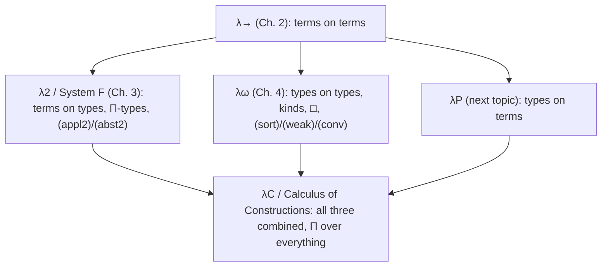

[[book-guidelines|↩ Back to guidelines]]

> Focus area: `type-theory` (Topic List entry 3). Secondary relevance to `automated-reasoning` through the judgment/proof-checker reading of the rules.

# Polymorphism and Higher-Order Typed Lambda Calculi

## 0. The problem, in one paragraph

In the simply typed calculus $\lambda\to$ you can write the identity on `nat`, the identity on `bool`, the identity on `nat → bool`, and so on, one function per type. You cannot write *the* identity. The best you can do is pick an "arbitrary" type variable $\alpha$ and write $\lambda x : \alpha . x$, but then $f\,M$ with $M : \mathsf{nat}$ is ill-typed, because $\alpha \not\equiv \mathsf{nat}$ and the (appl) rule rejects it. Chapter 3 fixes this by letting **terms depend on types**. Chapter 4 fixes a different gap: it lets **types depend on types**. Two independent extensions of $\lambda\to$, giving $\lambda 2$ and $\lambda\omega$. The book then (Chapter 6) merges them; this note stops at the point where they are still separate.

A useful way to hold the whole note in your head: the book is climbing a ladder of *what may depend on what*.

| System | Extra dependency | Slogan |
|---|---|---|
| $\lambda\to$ | terms on terms | $\lambda x : \sigma . M$ |
| $\lambda 2$ | terms on types | $\lambda\alpha : * . M$ (polymorphism) |
| $\lambda\omega$ | types on types | $\lambda\alpha : * . \alpha \to \alpha$ (type constructors) |

---

## 1. Terms depending on types (§3.1)

### First principles

Abstraction means: take a term $M$ in which $x$ occurs free, bind $x$, and get a new term depending on $x$. In $\lambda\to$ the abstracted thing is always a *term*, so the book calls this **first order abstraction**, and application $M\,N$ is its first order partner. The only dependency is *term on term*.

Polymorphism asks for the missing case: abstract over a *type*. That is **second order abstraction**, and its partner is **second order application** $M\,A$ where $A$ is a type. The book calls the result of abstracting over a type a **term depending on a type**.

### The formal version

The polymorphic identity:

$$\lambda\alpha : * . \lambda x : \alpha . x$$

The symbol $*$ is "the type of all types", so $\alpha : *$ declares $\alpha$ as a type variable. This term is not an identity function; it is an "identity-function-to-be". Applying it to a type and $\beta$-reducing yields a real one:

$$(\lambda\alpha : * . \lambda x : \alpha . x)\,\mathsf{nat} \to_\beta \lambda x : \mathsf{nat} . x$$

The book's other two motivating examples:

- **Iteration** (second iterate $F \circ F$): $D \equiv \lambda\alpha : * . \lambda f : \alpha \to \alpha . \lambda x : \alpha . f(f\,x)$. Then $D\,\mathsf{nat}\,s \twoheadrightarrow_\beta \lambda x : \mathsf{nat} . s(s\,x)$, the "add 2" function.
- **Composition**: $\circ \equiv \lambda\alpha : * . \lambda\beta : * . \lambda\gamma : * . \lambda f : \alpha \to \beta . \lambda g : \beta \to \gamma . \lambda x : \alpha . g(f\,x)$.

**What breaks without it:** you duplicate every generic function once per type, or you lose type safety by going untyped. Polymorphism is the middle path: one definition, checked once, usable at every type.

### Grounding

**Rust** (primary). Rust's generics are exactly "terms depending on types", with the type argument usually inferred rather than written:

```rust
fn id<T>(x: T) -> T { x }
fn twice<A>(f: impl Fn(A) -> A) -> impl Fn(A) -> A { move |x| f(f(x)) }
fn compose<A, B, C>(f: impl Fn(A) -> B, g: impl Fn(B) -> C) -> impl Fn(A) -> C {
    move |x| g(f(x))
}
```

`id::<u32>` is the second order application $\mathsf{id}\,\mathsf{nat}$. A caveat that matters later: in Rust the type parameter is erased by monomorphisation, and a *value* cannot itself be "of type $\Pi\alpha : * . \alpha \to \alpha$" without a trait trick (see §3).

**Lean** (secondary, promoted because the source is type-theoretic). Here the abstraction over the type is explicit and first class:

```lean
def pid  : (α : Type) → α → α := fun _ x => x
def D    : (α : Type) → (α → α) → α → α := fun _ f x => f (f x)
def comp : (α β γ : Type) → (α → β) → (β → γ) → α → γ := fun _ _ _ f g x => g (f x)
```

Lean's `(α : Type) → α → α` is the book's $\Pi\alpha : * . \alpha \to \alpha$, and `pid Nat` is the book's $(\lambda\alpha : * . \lambda x : \alpha . x)\,\mathsf{nat}$.

**Python** (tertiary). Type erasure makes the point obvious and unhelpful: `lambda x: x` is already "the" identity, with no type to abstract. That is the untyped picture the typed calculus is trying to keep *safe*.

---

## 2. $\Pi$-types (§3.2)

### First principles

Once $\lambda\alpha : * . \lambda x : \alpha . x$ is a term, it needs a type. A first guess from $\lambda\to$ is $* \to (\alpha \to \alpha)$. The book shows this guess is broken by $\alpha$-conversion. Terms are identified up to renaming of bound variables, so

$$\lambda\alpha : * . \lambda x : \alpha . x \;\equiv_\alpha\; \lambda\beta : * . \lambda x : \beta . x$$

but the guessed types $* \to (\alpha \to \alpha)$ and $* \to (\beta \to \beta)$ are different. In the guess, the right-hand $\alpha$ is *free*, yet on the left it was *bound*. The type must *also* bind the variable.

### The formal version

The new binder is $\Pi$ (the **$\Pi$-binder** or type-binder):

$$\lambda\alpha : * . \lambda x : \alpha . x \;:\; \Pi\alpha : * . \alpha \to \alpha$$

and $\alpha$-conversion is extended so that $\Pi\alpha : * . \alpha \to \alpha \equiv_\alpha \Pi\beta : * . \beta \to \beta$. Now both sides of the problem agree.

The types of the other two examples follow:

$$D : \Pi\alpha : * . (\alpha \to \alpha) \to \alpha \to \alpha$$
$$\circ : \Pi\alpha : * . \Pi\beta : * . \Pi\gamma : * . (\alpha \to \beta) \to (\beta \to \gamma) \to \alpha \to \gamma$$

A $\Pi$-type is "the type of functions sending a *type* to a *term*". The book flags (Remark 3.2.1) that $\Pi$ is called a product type; and, per the guidelines' reading, $A \to B$ will later be seen as the special case $\Pi x : A . B$ with $x \notin FV(B)$ (this specialisation is developed properly with [[Dependent-Types|dependent types]] in Chapter 5; in this chapter $\Pi$ ranges over $*$ only, so the arrow stays primitive).

**What breaks without it:** types stop respecting $\alpha$-equivalence of the terms they describe, so "same term, different types" can occur and Uniqueness of Types is lost.

### Grounding

**Lean.** `(α : Type) → α → α` is literally a $\Pi$-type, and Lean prints `∀ α : Type, α → α` as the same thing; the arrow `A → B` *is* `(_ : A) → B`, the non-dependent case. Renaming the binder gives the same type, which is exactly $\Pi\alpha : * . \alpha \to \alpha \equiv_\alpha \Pi\beta : * . \beta \to \beta$.

**Rust.** A value of $\Pi$-type is a *generic function*, but Rust cannot name that type for a function pointer. To pass a polymorphic function as an argument (rank-2 polymorphism), you encode it as a trait with a generic method:

```rust
trait PolyId { fn apply<T>(&self, x: T) -> T; }
struct Id;
impl PolyId for Id { fn apply<T>(&self, x: T) -> T { x } }

// The argument is used at two different types: that is the Pi-type in action.
fn use_twice(f: &impl PolyId) -> (u32, bool) { (f.apply(1u32), f.apply(true)) }
```

`PolyId` is the Rust spelling of $\Pi\alpha : * . \alpha \to \alpha$ as an *argument type*.

---

## 3. Second order abstraction and application rules (§3.3)

### First principles

The rule shapes are dictated by the examples. If $M$ has some type $A$ while $\alpha$ is a type variable in scope, then abstracting $\alpha$ should produce something whose type binds $\alpha$ too. If $M$ has type $\Pi\alpha : * . A$ and we hand it a *type* $B$, the result's type is $A$ with $B$ plugged in for $\alpha$. The only guard needed: $B$ really must be a type.

### The formal version

$$\frac{\Gamma, \alpha : * \vdash M : A}{\Gamma \vdash \lambda\alpha : * . M \;:\; \Pi\alpha : * . A}\;(\text{abst}_2)$$

$$\frac{\Gamma \vdash M : \Pi\alpha : * . A \qquad \Gamma \vdash B : *}{\Gamma \vdash M\,B \;:\; A[\alpha := B]}\;(\text{appl}_2)$$

The novelty is that a context can now contain a *type declaration* $\alpha : *$. For the polymorphic identity, if $M : \Pi\alpha : * . \alpha \to \alpha$, then $M\,B : B \to B$ for any type $B$.

**What breaks without it:** without $(\text{appl}_2)$ a polymorphic term can be built but never instantiated; without $(\text{abst}_2)$ you cannot build one.

### Grounding

These are the typing rules of a checker, and they are two arms of a Rust `match` (full sketch in §4). Note the shape that matters for a bidirectional reading: $(\text{abst}_2)$ *extends the context* and synthesises a body type, and $(\text{appl}_2)$ *synthesises* the function's type, then *checks* the argument is a well-formed type, then substitutes. Substitution on types, $A[\alpha := B]$, is where variable capture reappears (see the Rust note in §4).

---

## 4. The system $\lambda 2$ (System F) (§§3.4-3.6)

### The definition

**Types.** The abstract syntax of $\lambda 2$-types:

$$\mathbb{T}_2 = V \mid (\mathbb{T}_2 \to \mathbb{T}_2) \mid (\Pi V : * . \mathbb{T}_2)$$

with $V$ type variables $\alpha, \beta, \gamma, \ldots$. Note that type constants of $\lambda\to$ (like $\mathsf{nat}$) are now just type variables that must be declared in the context.

**Terms.** The pre-typed $\lambda 2$-terms:

$$\Lambda_{\mathbb{T}_2} = V \mid (\Lambda_{\mathbb{T}_2}\,\Lambda_{\mathbb{T}_2}) \mid (\Lambda_{\mathbb{T}_2}\,\mathbb{T}_2) \mid (\lambda V : \mathbb{T}_2 . \Lambda_{\mathbb{T}_2}) \mid (\lambda V : * . \Lambda_{\mathbb{T}_2})$$

Two classes of variables (object variables $x, y$ and type variables $\alpha, \beta$), two kinds of abstraction and two kinds of application.

**Contexts (Definition 3.4.4).** Declarations can now depend on earlier declarations, so a context is *ordered* and defined recursively:

1. $\emptyset$ is a $\lambda 2$-context.
2. If $\Gamma$ is a context and $\alpha \notin \mathrm{dom}(\Gamma)$, then $\Gamma, \alpha : *$ is a context.
3. If $\Gamma$ is a context, every free type variable of $\rho \in \mathbb{T}_2$ is in $\mathrm{dom}(\Gamma)$, and $x \notin \mathrm{dom}(\Gamma)$, then $\Gamma, x : \rho$ is a context.

For example $\alpha : *,\; x : \alpha \to \alpha,\; \beta : *,\; y : (\alpha \to \alpha) \to \beta$ is a context. Consequence stated by the book: the Permutation Lemma from Chapter 2 is the *only* property that needs adapting, because declarations can no longer be permuted arbitrarily; it survives if the permuted result is again a $\lambda 2$-context.

**The six rules (Figure 3.1):**

$$(\text{var})\;\; \Gamma \vdash x : \sigma \quad\text{if } \Gamma \text{ is a } \lambda 2\text{-context and } x : \sigma \in \Gamma$$

$$(\text{appl})\;\; \frac{\Gamma \vdash M : \sigma \to \tau \quad \Gamma \vdash N : \sigma}{\Gamma \vdash M N : \tau} \qquad (\text{abst})\;\; \frac{\Gamma, x : \sigma \vdash M : \tau}{\Gamma \vdash \lambda x : \sigma . M : \sigma \to \tau}$$

$$(\text{form})\;\; \Gamma \vdash B : * \quad\text{if } \Gamma \text{ is a } \lambda 2\text{-context, } B \in \mathbb{T}_2,\text{ and all free type variables of } B \text{ are declared in } \Gamma$$

together with $(\text{appl}_2)$ and $(\text{abst}_2)$ above. (Note that $\lambda 2$ as presented in Chapter 3 has no (sort) or (weak) rule; those arrive with $\lambda\omega$ in §7 below.)

**Why (form) exists.** The book makes a sharp observation: with only five rules, $(\text{appl}_2)$ could *never fire*, since its second premiss $\Gamma \vdash B : *$ has no rule that concludes "something has type $*$". $(\text{form})$ repairs that. It has side conditions but no premisses, so like $(\text{var})$ it only appears at leaves.

### A worked derivation (§3.5)

The book derives $\emptyset \vdash \lambda\alpha : * . \lambda f : \alpha \to \alpha . \lambda x : \alpha . f(f\,x) : \Pi\alpha : * . (\alpha \to \alpha) \to \alpha \to \alpha$ goal-directed, bottom to top: $(\text{abst}_2)$ for the outer $\lambda$, $(\text{abst})$ twice for the other two, and what is left is a plain $\lambda\to$ problem. Instantiated:

$$\Gamma \vdash (\lambda\alpha : * . \lambda f : \alpha \to \alpha . \lambda x : \alpha . f(f\,x))\,\mathsf{nat}\,\mathsf{suc}\,\mathsf{two} : \mathsf{nat}$$

derived in the book by $(\text{appl}_2)$ with $\Gamma \vdash \mathsf{nat} : *$, then $(\text{appl})$ twice. By Subject Reduction every term in the reduction chain ending in $\mathsf{suc}(\mathsf{suc}\,\mathsf{two})$ also has type $\mathsf{nat}$, which is the cheap route versus re-deriving each one.

### Properties (§3.6)

$\beta$-reduction gains a second basis step: $(\lambda\alpha : * . M)\,T \to_\beta M[\alpha := T]$. The book states (without proof) that these hold for $\lambda 2$: Free Variables, Thinning, Condensing, Generation, Subterm, Uniqueness of Types, Substitution, Church-Rosser, **Subject Reduction** and **Strong Normalisation**. The pointer in §3.8: Girard proved strong normalisation by extending Tait's argument "in an ingenious way". The guidelines mention "reducibility candidates"; the pages themselves only name Girard's extension of Tait. Decidability of type checking is not discussed in these pages (the guidelines list it for $\lambda 2$; it is not among the properties stated in §3.6).

### Grounding

A tiny type-checker for the $\lambda 2$ fragment, in Rust. This is the material that eventually becomes a kernel, so the structure mirrors the rules: one `match` arm per rule, a context as an ordered list of declarations.

```rust
use std::collections::HashSet;
use std::rc::Rc;

#[derive(Clone, Debug, PartialEq)]
enum Ty {
    Var(String),
    Arrow(Rc<Ty>, Rc<Ty>),
    Pi(String, Rc<Ty>), // Pi alpha : * . body
}

#[derive(Clone, Debug)]
enum Tm {
    Var(String),
    Lam(String, Ty, Rc<Tm>),  // first order abstraction
    App(Rc<Tm>, Rc<Tm>),      // first order application
    TLam(String, Rc<Tm>),     // second order abstraction
    TApp(Rc<Tm>, Ty),         // second order application
}

#[derive(Clone)]
enum Decl {
    TyVar(String),        // alpha : *
    TmVar(String, Ty),    // x : rho
}
type Ctx = Vec<Decl>;

fn ftv(t: &Ty, out: &mut HashSet<String>) {
    match t {
        Ty::Var(a) => { out.insert(a.clone()); }
        Ty::Arrow(a, b) => { ftv(a, out); ftv(b, out); }
        Ty::Pi(a, b) => {
            let mut inner = HashSet::new();
            ftv(b, &mut inner);
            inner.remove(a);
            out.extend(inner);
        }
    }
}

// A[alpha := B]. This assumes bound names never clash with free names of B;
// a real implementation renames (alpha-conversion) or uses de Bruijn indices.
fn subst(t: &Ty, alpha: &str, b: &Ty) -> Ty {
    match t {
        Ty::Var(x) if x == alpha => b.clone(),
        Ty::Var(_) => t.clone(),
        Ty::Arrow(l, r) => Ty::Arrow(Rc::new(subst(l, alpha, b)), Rc::new(subst(r, alpha, b))),
        Ty::Pi(x, body) if x == alpha => Ty::Pi(x.clone(), body.clone()),
        Ty::Pi(x, body) => Ty::Pi(x.clone(), Rc::new(subst(body, alpha, b))),
    }
}

// (form): Gamma |- B : *  iff every free type variable of B is declared.
fn well_formed(ctx: &Ctx, t: &Ty) -> bool {
    let mut fv = HashSet::new();
    ftv(t, &mut fv);
    fv.iter().all(|a| ctx.iter().any(|d| matches!(d, Decl::TyVar(n) if n == a)))
}

// Types are compared structurally (alpha-equivalence is assumed canonicalised).
fn infer(ctx: &mut Ctx, m: &Tm) -> Result<Ty, String> {
    match m {
        // (var)
        Tm::Var(x) => ctx.iter().rev().find_map(|d| match d {
            Decl::TmVar(n, t) if n == x => Some(t.clone()),
            _ => None,
        }).ok_or(format!("unbound {x}")),
        // (abst), with the side condition that the binder type is well formed
        Tm::Lam(x, a, body) => {
            if !well_formed(ctx, a) { return Err("ill-formed binder type".into()); }
            ctx.push(Decl::TmVar(x.clone(), a.clone()));
            let b = infer(ctx, body);
            ctx.pop();
            Ok(Ty::Arrow(Rc::new(a.clone()), Rc::new(b?)))
        }
        // (appl)
        Tm::App(f, n) => match infer(ctx, f)? {
            Ty::Arrow(a, b) if *a == infer(ctx, n)? => Ok((*b).clone()),
            other => Err(format!("bad application at {other:?}")),
        },
        // (abst_2): extend the context with alpha : *
        Tm::TLam(al, body) => {
            ctx.push(Decl::TyVar(al.clone()));
            let a = infer(ctx, body);
            ctx.pop();
            Ok(Ty::Pi(al.clone(), Rc::new(a?)))
        }
        // (appl_2): the (form) check on B is the second premiss
        Tm::TApp(f, b) => match infer(ctx, f)? {
            Ty::Pi(al, a) if well_formed(ctx, b) => Ok(subst(&a, &al, b)),
            _ => Err("bad type application".into()),
        },
    }
}
```

Running `infer` on `TLam("a", Lam("x", Var a, x))` gives `Pi("a", Arrow(a, a))`. Two things to notice for an implementer:

1. $\lambda 2$ is *Church-style*: every binder carries its type, so inference is syntax-directed and decidable. The book's §3.8 states that *implicit* ("Curry-style") $\lambda 2$, where you drop the annotations, has *undecidable* type inference (Wells 1994). This is why practical languages use weaker polymorphism.
2. `subst` on $\Pi$ is where capture-avoidance lives. In the book this is hidden inside "$\alpha$-conversion is extended to $\Pi$" (Definition 3.6.1).

**Lean** shows the same system with Church numerals as the type $\Pi\alpha : * . (\alpha \to \alpha) \to \alpha \to \alpha$ (§3.8):

```lean
def CNat := (α : Type) → (α → α) → α → α
def two : CNat := fun _ f x => f (f x)
def csuc (n : CNat) : CNat := fun β f x => f (n β f x)   -- exercise 3.12's Suc
```

**Rust.** The same numeral is the rank-2 trait pattern:

```rust
trait Nat { fn fold<A>(&self, f: &dyn Fn(A) -> A, x: A) -> A; }
struct N(u32);
impl Nat for N {
    fn fold<A>(&self, f: &dyn Fn(A) -> A, mut x: A) -> A {
        for _ in 0..self.0 { x = f(x); }
        x
    }
}
```

A `Nat` is "something that can iterate any $A \to A$ function $n$ times", which is the polymorphic Church numeral read as a *fold*. That is the Böhm-Berarducci point the book cites: algebraic data types are definable as closed second order types.

**Type inhabitation and parametricity (§3.8).** The type $\Pi\alpha : * . \alpha \to \alpha$ has, up to $\beta$, exactly one closed inhabitant, the polymorphic identity. The book's explanation is *parametricity*: a function of this type sees $\alpha$ as an opaque parameter, so it cannot inspect it. An "overloaded" $F$ with $F\,\mathsf{nat}\,n = n + 1$ and $F\,\mathsf{real}\,x = |x|$ is not definable. This is the same intuition behind "theorems for free", but the book itself stays at this informal level. Also from the exercises: $\bot \equiv \Pi\alpha : * . \alpha$ has *no* closed inhabitant, which is what makes $\lambda 2$ logically consistent (§3.8, next section).

---

## 5. Impredicativity (§3.8)

### First principles

Define an object by quantifying over a collection that contains the object itself, and you have an **impredicative** definition. Naive set theory: take the powerset $\mathcal{P}(X)$, then "the set of all sets" $\mathit{Set}$, then $\mathcal{P}(\mathit{Set})$, which must be a member of $\mathit{Set}$. We identify $\mathcal{P}(\mathit{Set})$ by referring to the very set it belongs to. Russell and Whitehead considered such circularity a source of inconsistency and banned it from *Principia Mathematica*.

### The formal version

In $\lambda 2$, $\sigma := \Pi\alpha : * . \alpha \to \alpha$ is itself of type $*$, yet it quantifies over *all* $\alpha : *$, including $\sigma$ itself. Hence polymorphic types are **impredicative**. The book states the reassuring result: Girard proved the circle is harmless: the system is consistent. "Consistent" is meant concretely: read types as propositions (propositions-as-types), and show some types are *empty* (no closed term inhabits them).

Impredicativity is not abstract: **it buys self-application.** $\lambda x . x\,x$ cannot be typed in $\lambda\to$, but in $\lambda 2$ it can be annotated:

$$\lambda x : (\Pi\alpha : * . \alpha \to \alpha) . x\,(\sigma \to \sigma)\,(x\,\sigma)$$

because $x$, which is polymorphic, may be applied to the type $\sigma \to \sigma$ (and to $\sigma$ itself). By contrast $(\lambda x . x\,x)(\lambda x . x\,x)$ is not typable, "but that is far from obvious".

**What breaks without it (i.e. in a predicative system):** you lose self-application and, with it, a lot of definability: the quantifier over $*$ cannot be instantiated with types built from itself.

### Grounding

**Lean** is the instructive contrast. Lean's `Type` is *predicative*: `(α : Type) → α → α` has type `Type 1`, not `Type`, so you cannot instantiate the type argument with itself:

```lean
-- Does NOT typecheck: (α : Type) → α → α : Type 1, but x expects an argument in Type.
def selfApp : ((α : Type) → α → α) → ((α : Type) → α → α) :=
  fun x => x ((α : Type) → α → α) x
```

Lean *does* have an impredicative sort, `Prop`: `∀ α : Prop, α → α` has type `Prop`. That is the exact analogue of the book's $\Pi\alpha : * . \ldots : *$ (Lean recovers $\lambda 2$-style encodings in `Prop`). Choosing which universe is impredicative is a deliberate design decision.

**Rust** has no analogue: its type system is deliberately predicative (no `forall` quantification over types inside types except via the trait-method encoding of §2).

---

## 6. Types depending on types: type constructors and kinds (§§4.1)

### First principles

$\lambda 2$ generalises *terms* over types. The mirror image is generalising *types* over types. The types $\beta \to \beta$, $\gamma \to \gamma$, $(\gamma \to \beta) \to (\gamma \to \beta)$ all have the shape $\Diamond \to \Diamond$. Abstract the $\Diamond$ and you get a function *from types to types*:

$$\lambda\alpha : * . \alpha \to \alpha$$

This is not a type (nothing inhabits it); it is a **type constructor**. Feed it a type and a type comes out:

$$(\lambda\alpha : * . \alpha \to \alpha)\,\beta \to_\beta \beta \to \beta$$

What breaks without it: you cannot even *write* "list of $\sigma$" as a single parametrised thing; you would have to write each instance by hand.

### The formal version

Since $\alpha : *$ and $\alpha \to \alpha : *$, the constructor has the "type of type-functions":

$$\lambda\alpha : * . \alpha \to \alpha \;:\; * \to *$$
$$\lambda\alpha : * . \lambda\beta : * . \alpha \to \beta \;:\; * \to (* \to *)$$

Those new "super-types" are **kinds**. Their abstract syntax:

$$K = * \mid (K \to K)$$

with arrows right-associative. Examples: $*,\; * \to *,\; (* \to *) \to *,\; * \to (* \to *) \to *$. A variable may have a kind as its type: given $\alpha : * \to *$ and $\gamma : *$, then $\alpha\,\gamma : *$ and $\lambda\alpha : * \to * . \alpha\,\gamma : (* \to *) \to *$.

The kinds themselves need a type, written $\square$ (the "super-super-type"). The book introduces the vocabulary:

- If $\kappa : \square$ and $M : \kappa$ then $M$ is a **constructor**. If $\kappa \equiv *$, it is a **type**; otherwise a **proper constructor**.
- The **sorts** are $\{*, \square\}$ (metavariable $s$).
- Four **levels**: (1) terms; (2) constructors, i.e. types plus proper constructors; (3) kinds; (4) $\square$ alone.

Judgement chains such as $t : \sigma : * \to * : \square$ run through the levels. The roles "subject" and "type" of $A : B$ now slide across levels, which "become increasingly interwoven": the characteristic feature of everything from here to the Calculus of Constructions.

<svg xmlns="http://www.w3.org/2000/svg" viewBox="0 0 560 260" width="560" height="260" role="img" aria-label="The four syntactic levels">
  <g font-family="sans-serif" font-size="14" fill="#888888">
    <rect x="20" y="15" width="520" height="40" rx="6" fill="none" stroke="#888888"/>
    <text x="36" y="40">Level 4:  &#9633;   (the only inhabitant)</text>
    <rect x="20" y="75" width="520" height="40" rx="6" fill="none" stroke="#888888"/>
    <text x="36" y="100">Level 3:  kinds   *,  * &#8594; *,  (* &#8594; *) &#8594; *</text>
    <rect x="20" y="135" width="520" height="40" rx="6" fill="none" stroke="#888888"/>
    <text x="36" y="160">Level 2:  constructors   &#945;,  &#945;&#8594;&#945;,  &#955;&#945;:*.&#945;&#8594;&#945;</text>
    <rect x="20" y="195" width="520" height="40" rx="6" fill="none" stroke="#888888"/>
    <text x="36" y="220">Level 1:  terms   x,  &#955;x:&#945;.x,  M N</text>
    <g stroke="#888888" stroke-width="1.5" fill="none">
      <path d="M280 195 L280 177"/><path d="M280 135 L280 117"/><path d="M280 75 L280 57"/>
    </g>
    <g font-size="12"><text x="290" y="190">: (is typed by)</text><text x="290" y="130">: </text><text x="290" y="70">: </text></g>
  </g>
</svg>

### Grounding

**Rust.** Rust has no first-class $\lambda\alpha : * . \alpha \to \alpha$ at the type level, but it simulates "type constructor of kind $* \to *$" with generic associated types:

```rust
trait TyCon { type Of<A>; }            // a constructor of kind * -> *
struct ListC;   struct OptionC;
impl TyCon for ListC   { type Of<A> = Vec<A>; }
impl TyCon for OptionC { type Of<A> = Option<A>; }

fn singleton<F: TyCon>(x: F::Of<u8>) -> F::Of<u8> { x }   // abstracting over alpha : * -> *
```

`F: TyCon` is the book's variable $\alpha : * \to *$, and `F::Of<u8>` is the application $\alpha\,\gamma$. Without GATs/traits, Rust cannot abstract over `Vec` itself. Haskell's `List :: * -> *` is the direct counterpart (the book's own pointer in §4.10: $\mathit{List} : * \to *$, with $\mathit{length} : \Pi\alpha : * . \mathit{List}\,\alpha \to \mathsf{nat}$ "borrowed" from $\lambda 2$).

**Lean.** A type constructor is a function into `Type`, and kinds are just types of such functions:

```lean
#check List                         -- Type u -> Type u
def F : Type → Type := fun α => α → α
```

---

## 7. The system $\lambda\omega$ (§§4.2-4.5)

### First principles

Once types can be non-trivial expressions (applications, abstractions), "$A$ is a well-formed type" is no longer a membership test on a fixed set $\mathbb{T}_2$. It must be *derived*. That has three consequences, each motivating a rule:

1. A context may only be extended by $x : A$ if $A$ itself is already derivably a type or kind. So variable introduction and context formation get *merged*.
2. The old trick of declaring $\alpha : *$ without checking $*$ itself is gone; so we need a rule saying $* : \square$.
3. Because $\mathsf{var}$ now only produces the *last* declaration of a context, you need a way to carry earlier judgements into larger contexts.

### The rules

The system is $\lambda 2$'s sibling: $\lambda 2 = \lambda\to$ + terms depending on types; $\lambda\omega = \lambda\to$ + types depending on types. All seven rules (Figure 4.1):

$$(\text{sort})\;\; \emptyset \vdash * : \square$$

$$(\text{var})\;\; \frac{\Gamma \vdash A : s}{\Gamma, x : A \vdash x : A}\;\; x \notin \Gamma \qquad (\text{weak})\;\; \frac{\Gamma \vdash A : B \quad \Gamma \vdash C : s}{\Gamma, x : C \vdash A : B}\;\; x \notin \Gamma$$

$$(\text{form})\;\; \frac{\Gamma \vdash A : s \quad \Gamma \vdash B : s}{\Gamma \vdash A \to B : s}$$

$$(\text{appl})\;\; \frac{\Gamma \vdash M : A \to B \quad \Gamma \vdash N : A}{\Gamma \vdash M N : B} \qquad (\text{abst})\;\; \frac{\Gamma, x : A \vdash M : B \quad \Gamma \vdash A \to B : s}{\Gamma \vdash \lambda x : A . M : A \to B}$$

$$(\text{conv})\;\; \frac{\Gamma \vdash A : B \quad \Gamma \vdash B' : s}{\Gamma \vdash A : B'}\;\; B =_\beta B'$$

Observations from the text:

- **Double roles.** $s$ ranges over $*$ and $\square$, so $(\text{var})$, $(\text{weak})$, $(\text{form})$, $(\text{appl})$ and $(\text{abst})$ each work at two levels at once. $(\text{var})$ with $s \equiv \square$ declares a *type variable* ($\alpha : *$); with $s \equiv *$ it declares a *term variable* ($x : \alpha$). This is why $\lambda\omega$ needs only *one* $(\text{appl})$ and *one* $(\text{abst})$, while $\lambda 2$ needs two of each (the third Key Question).
- **No $\Pi$-types in $\lambda\omega$.** Terms do not depend on types here, so the arrow suffices.
- **(var)'s regime change.** It now derives only the *last* declaration. Hence the examples the book flags as underivable without weakening: $\alpha : *, x : \alpha \vdash \alpha : *$ and $\alpha : *, \beta : * \vdash \alpha : *$, even $\alpha : * \vdash * : \square$. $(\text{weak})$ repairs that. (The book: "thinning" is insertion anywhere, "weakening" is only at the end; $\lambda\omega$ still satisfies full Thinning as a lemma.)
- **(form) as a real rule.** In $\lambda 2$ (form) was a side-condition on a set; here it is a derivation rule that works for types ($s \equiv *$) *and* kinds ($s \equiv \square$): $\alpha : * \vdash * \to * : \square$.

### A derivation (§§4.2-4.5)

Flag derivation for $\beta : * \vdash (\lambda\alpha : * . \alpha \to \alpha)\,\beta : *$, shortened (§4.6) by dropping the routine (sort)/(var)/(weak) steps:

$$\begin{array}{l}
\beta : * \\
\quad \alpha : * \\
\quad\quad (12)\;\; \alpha \to \alpha : * \quad \text{(form)}\\
\quad (14)\;\; \lambda\alpha : * . \alpha \to \alpha : * \to * \quad \text{(abst) on (12)}\\
\quad (16)\;\; (\lambda\alpha : * . \alpha \to \alpha)\,\beta : * \quad \text{(appl) on (14) and } \beta
\end{array}$$

The book's convention (§4.6): omit steps that are routine, or only exist to show something is a well-formed type, and allow (abst) to cite only its first premiss. It admits this is "debatable" since it weakens strictness, but justifies it: the system is fully formal, so "the final check" can be left to a program that fills in the omitted judgements.

**What breaks without (weak):** you cannot derive $\alpha : *, \beta : * \vdash \alpha : *$, so even simple two-variable contexts can't talk about their own earlier variables.

---

## 8. The conversion rule (§4.7)

### First principles

$(\lambda\alpha : * . \alpha \to \alpha)\,\beta$ and $\beta \to \beta$ are, as types, "the same" because one $\beta$-reduces to the other. But in a system with only the rules so far, if $x : (\lambda\alpha : * . \alpha \to \alpha)\,\beta$ you *cannot* derive $x : \beta \to \beta$. The rules don't know that reduction preserves meaning of *types*. The previous theorem, Subject Reduction, only lets you reduce the *subject* ($A$ in $A : B$).

### The formal version

$$(\text{conv})\;\; \frac{\Gamma \vdash A : B \quad \Gamma \vdash B' : s}{\Gamma \vdash A : B'} \quad B =_\beta B'$$

The second premiss is not decoration. Remark 4.7.2: $\beta \to \gamma =_\beta (\lambda\alpha : * . \beta \to \gamma)\,M$ for any $M$, and the right side may be ill-formed if $M$ is not of type $*$. So well-formedness of $B$ does *not* transfer to a convertible $B'$ and must be checked separately. In a shortened derivation the book lets you suppress it when obviously fine.

The book separates three notions cleanly:

| Name | Schema | Status |
|---|---|---|
| Subject Reduction | $A : B$, $A \to_\beta A'$ gives $A' : B$ | theorem, provable *without* (conv) |
| Type Reduction | $A : B$, $B \to_\beta B'$, $B' : s$ gives $A : B'$ | not provable without (conv); a special case of it |
| Conversion | $A : B$, $B =_\beta B'$, $B' : s$ gives $A : B'$ | the rule (conv) |

**Consequence for metatheory (§4.8, Lemma 4.8.1).** $\lambda\omega$ satisfies "the majority of the nice properties" of $\lambda\to$ and $\lambda 2$ (Subject Reduction, Strong Normalisation, Church-Rosser), but Uniqueness of Types weakens to *uniqueness up to conversion*: if $\Gamma \vdash A : B_1$ and $\Gamma \vdash A : B_2$ then $B_1 =_\beta B_2$.

**What breaks without it:** types stop being first-class computable things. $\beta$-redexes in types would be "stuck" and could never be used where their reduct is expected.

### Grounding

**Lean** (promoted: this is definitional equality, treated explicitly). The conversion rule *is* what Lean's kernel does when it checks an application's argument: it asks `isDefEq` on types.

```lean
def F : Type → Type := fun α => α → α
example (x : F Nat) : Nat → Nat := x       -- accepted: F Nat is definitionally Nat → Nat (delta + beta)
```

Lean's definitional equality is larger ($\delta$, $\eta$, proof irrelevance, ...), but the shape is exactly (conv): same term, convertible type. In the book, $\delta$-conversion arrives only later with $\lambda D$.

**Rust.** Rust's type checker normalises associated types (`<ListC as TyCon>::Of<u8>` reduces to `Vec<u8>`) and treats the two as the same type: a limited, decidable instance of conversion. Hand-written $\beta$-reduction on type-level expressions, as in $\lambda\omega$, is not available.

---

## 9. Bidirectional reading, and what to take from the two chapters

The rules in this chapter are naturally read in two modes, even though the book does not use that framing:

- **Synthesis** ($\Rightarrow$): $(\text{var})$, $(\text{appl})$, $(\text{appl}_2)$, $(\text{abst})$ and $(\text{abst}_2)$ when binders are annotated (Church style): the type is *computed* from the term. This is the `infer` function above.
- **Checking** ($\Leftarrow$): $(\text{conv})$ is the point where a checker compares an *expected* type against a *synthesised* one up to $=_\beta$. That is the textbook place where bidirectional checkers insert their subsumption/definitional-equality test.

Dropping annotations leads into territory the book mentions only in passing (§3.8): inference for implicit $\lambda 2$ is undecidable (Wells), and practical languages use Milner/Damas-style rank-1 polymorphism instead. This is *editorial context* connecting to the project, not claims the pages prove.

---

## Closing synthesis

### What depends on what



### Where this leads

The next topic adds the third dependency (types on terms, $\lambda P$), and the Barendregt cube combines all three into $\lambda C$. The doubled rules of $\lambda 2$ and the single, sort-parametrised rules of $\lambda\omega$ are what get unified there into one rule set over sorts $*$ and $\square$ (the book points to the Calculus of Constructions in §4.10), with $\Pi$ generalising $\to$; $\lambda D$ later extends $\lambda C$ with definitions. The $(\text{conv})$ rule from §8 is the one that later gets extended with $\delta$-reduction for definitions, and is the ancestor of the kernel's definitional equality check.

### Bearing on the project (Focus Area: `type-theory`, with a touch of `automated-reasoning`)

- **Judgments and contexts.** This topic is where contexts become *ordered, dependent* structures: later declarations may mention earlier ones, and well-formedness of a context is itself a derivation (the $(\text{var})$/$(\text{weak})$ regime of $\lambda\omega$). That is the data structure your kernel's `Ctx` must be, and it is the checker-and-proof-checker identity in action: a typing derivation *is* a proof of a statement $\Gamma \vdash M : A$, and checking it is what the Rust `infer` function above does.
- **$\Pi$-types.** First appearance of the binder that later covers both $\to$ and $\forall$. Substitution $A[\alpha := B]$ in `appl_2` is the same plumbing (capture-avoiding substitution) that Hoare-logic soundness and elaboration both depend on; a de Bruijn or locally-nameless representation is the usual implementation answer.
- **Definitional equality.** The $(\text{conv})$ rule is the precise spot where an elaborator's/kernel's `isDefEq` must be invoked. In Lean's elaborator this is also where unification kicks in: with explicit annotations (Church style) the kernel only *checks* convertibility; once type arguments are implicit, finding them requires (higher-order) unification, which is why Miller's pattern fragment matters. The book does not discuss that; it is the link from this material to your metavariable unifier, and Wells' undecidability result is the book's own reason to expect trouble.
- **Impredicativity.** A design decision for your target language: which universe, if any, is impredicative (Lean: `Prop`; the book's $*$). Relevant to how refinement predicates and specifications are encoded.
- Not forced: Rust's generics, GATs and trait-method encodings of rank-2 types are useful *implementation analogues* for the surface language, but the abstract-interpretation and CSP threads do not bear on this topic.

### Checklist against the Topic List

- Terms depending on types: §1.
- Second order abstraction and application: §3.
- $\Pi$-types: §2.
- The system $\lambda 2$ and System F: §4.
- Types depending on types: §6.
- Type constructors and kinds: §6.
- The system $\lambda\omega$ and the conversion rule: §§7-8.
- Impredicativity: §5.
