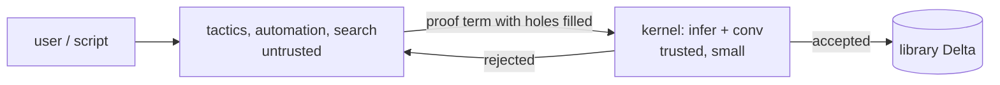
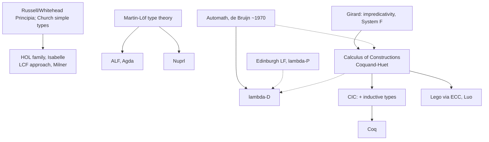

[[book-guidelines|↩ Back to guidelines]]

# Proof Assistants and Applications of Type Theory

> Focus Areas: `type-theory` and `automated-reasoning` (per this book's `.learning-goals.md`). Source: Chapter 16 re-read directly from the PDF. Notation is the book's: $\Delta;\Gamma\vdash p:A$ for typing in environment $\Delta$ (definitions) and context $\Gamma$ (declarations), $\beta\Delta$-convertibility for equality of types. Chapter 16 is a survey chapter: it has almost no new formal rules, so this note spends its depth on the *mechanism* the chapter relies on (decidable type checking as proof checking) and on how that mechanism turns into the architecture of a real tool.

Related notes: [[Type-Theory-with-Definitions]] (the system $\lambda D$ itself), [[Natural-Deduction-and-Flag-Style-Proofs]] (flags, which Section 16.1 praises), [[Large-Scale-Formalisation]] (Chapter 15, the "how big does this get" experiment), [[Propositions-as-Types-and-the-Curry-Howard-Isomorphism]], [[The-Calculus-of-Constructions-and-the-Lambda-Cube]].

## 1. The problem: how do you trust a proof?

A paper proof is checked by people, and people skip steps, misread, and get bored. The authors' observation is that if a proof is a *term* $p$ and the statement is a *type* $A$, then "is $p$ a proof of $A$?" becomes the question "does $p$ have type $A$?". That is a question a program can answer. What breaks without this: you either trust a referee's attention span or you trust a large, hand-written prover whose bugs you cannot audit. Type theory offers a third route, a small checker that everything else must satisfy.

## 2. Section 16.1: what $\lambda D$ buys you (applications)

The chapter groups the benefits of formalising in a $\lambda D$-like theory under five headings. I keep the book's labels.

**Formalisation of mathematics.** A definition can be spelled out with full precision and then reasoned about soundly. The authors stress that this is still close to ordinary mathematical practice (the syntax is $\lambda$-calculus, the types play the role of sets, see [[Sets-Subsets-Relations-and-Maps]]).

**Checking of mathematics.** Incomplete proofs, illegal logical steps and syntactically bad definitions are rejected. Two caveats the book states explicitly:

- Soundness is relative to the axioms you assumed. Inconsistent or wrongly chosen axioms make the results useless. Hence: use axioms sparingly.
- *Relevance* is not checked. Does the formal definition capture the notion you meant? That stays with the human. The book's slogan: type theory shifts attention from correctness (handled by the system) to relevance.

**Proof development.** The context, drawn as flags, shows which variables and hypotheses are in scope, which definitions exist, and (via open goals) what is left. A flag-style partial proof is "ready to be completed in a step-wise process". This is exactly the pedagogical story of [[Natural-Deduction-and-Flag-Style-Proofs]].

**Libraries.** Proving and defining are "very much the same type of activity": a proof is a term of some type, and then you *name* it. Later uses refer to the name with a parameter list instantiated for the situation. One difference the book notes: you usually want to unfold [[Polymorphism-and-Higher-Order-Typed-Lambda-Calculi#The definition|the definition]] of a mathematical notion, but almost never want to unfold a proof. Names give you dependency tracking for free (which result uses which notion), and the accumulated environment $\Delta$ is the library.

**Archiving of knowledge** is the guidelines' third application heading; in the text it appears through the libraries paragraph and the Section 16.3 discussion of "standard libraries" and Mizar's very large one.

The software and hardware verification application appears in 16.3: the highest level of correctness for a program or chip is a formal proof checked by a proof assistant, and the authors report "a strong increase" of such proofs of computer-science artefacts.

### Grounding: a library is an environment $\Delta$

In Rust terms, $\Delta$ is an append-only map from names to (parameter context, body, type). Proofs and definitions share the entry type; the only difference is a transparency flag.

```rust
use std::collections::HashMap;

type Name = String;

#[derive(Clone, Debug)]
enum Term {
    Var(Name),
    Sort(Sort),
    App(Box<Term>, Box<Term>),
    Lam(Name, Box<Term>, Box<Term>),
    Pi(Name, Box<Term>, Box<Term>),
    /// c(args): instance of a definition from the environment
    Inst(Name, Vec<Term>),
}

#[derive(Clone, Copy, Debug, PartialEq)]
enum Sort { Star, Box }

struct DefEntry {
    params: Vec<(Name, Term)>, // the parameter context Gamma' of the definition
    body: Option<Term>,        // None = primitive/axiom (no delta-rule)
    ty: Term,
    unfoldable: bool,          // notion: true; theorem: usually false
}

/// The "library" of Section 16.1.
struct Env { defs: HashMap<Name, DefEntry> }
```

The `body: None` case is an axiom, which is where the "use axioms sparingly" warning bites: it is the only place where trust enters the library without a checked term.

## 3. Section 16.2: proof checking is type inference plus one comparison

### 3.1 Why decidability of typing gives decidability of proof checking

This is Key Question 1 of the guidelines. Let me build it from scratch.

Suppose someone hands you a term $p$ and claims it proves $A$. You do not have to search for anything. The book says there is a "not too difficult" algorithm that, given $p$, an environment $\Delta$ and a context $\Gamma$, *computes* the type of $p$ in $\Gamma$ if one exists, and otherwise decides that $p$ is not typable. This works because $\lambda D$ has unique types up to convertibility, so there is one answer to compute, not a family to guess among.

The procedure of Figure 16.1, in order:

1. Translate the informal proof $p$ and statement $A$ to formal $p$ and $A$. **This step is not done by the machine.** The book says no program currently translates natural-language proofs into formal terms fully.
2. Compute the type $T$ of $p$ (fail: $p$ is ill-formed).
3. Compute the type of $A$ (fail: $A$ is not a well-formed statement).
4. Check whether $T$ and $A$ are equal, meaning $\beta\Delta$-convertible. If yes, $p$ has type $A$, so $p$ proves $A$.

Every step is terminating: typing is decidable, and convertibility is decidable because $\beta\delta$-reduction is strongly normalising and confluent in $\lambda D$ (this is established in the book's earlier chapters; see [[Type-Theory-with-Definitions]]). Hence proof checking, a seemingly semantic question, is a terminating syntactic computation. Note what is *not* decidable: finding $p$. That is why the rest of the chapter is about interactive construction.

What breaks without decidability of conversion: step 4 might not terminate, and "proof accepted" would have no meaning as a verdict.

### 3.2 As a bidirectional-flavoured algorithm

In the book's presentation the algorithm is a type *synthesis* ($p\Rightarrow T$) followed by an equality check; it does not mention modes. You can read it in the bidirectional style the project cares about: synthesise $T$ for $p$, then *check* $T\equiv_{\beta\Delta}A$. The step in the middle is what a modern kernel calls `isDefEq`. The "judgment form as ancestor of both type checker and proof checker" connection is literal here: the same function is a type checker when you read $p$ as a program and a proof checker when you read $A$ as a proposition.

```rust
enum TypeError { Unbound(Name), NotAFunction, Mismatch, /* ... */ }

struct Ctx(Vec<(Name, Term)>); // Gamma, in order (the flags)

impl Env {
    /// infer: Delta; Gamma |- p : ?T   (synthesis)
    fn infer(&self, g: &Ctx, p: &Term) -> Result<Term, TypeError> { todo!() }

    /// conv: beta-delta convertibility of two (well-typed) terms
    fn conv(&self, a: &Term, b: &Term) -> bool { todo!() }

    /// The whole of Figure 16.1, steps 2-4.
    fn check_proof(&self, g: &Ctx, p: &Term, stmt: &Term) -> Result<(), TypeError> {
        let t = self.infer(g, p)?;          // find type of p
        self.infer(g, stmt)?;               // A is well-formed (a sort or a type)
        if self.conv(&t, stmt) { Ok(()) } else { Err(TypeError::Mismatch) }
    }
}
```

The same check in Lean is literally the kernel's acceptance of a declaration: `theorem foo : A := p` elaborates `p`, then the kernel infers its type and tests definitional equality with `A`. Lean's `isDefEq` plays the role of $\beta\Delta$-convertibility, with extra rules (η, proof irrelevance, ι for inductives) the book's $\lambda D$ does not have.

```lean
-- the kernel's job, as the book describes it:
-- infer (p) = T ; infer (A) = Type/Prop ; isDefEq T A
theorem and_swap (A B : Prop) : A ∧ B → B ∧ A :=
  fun h => ⟨h.2, h.1⟩
```

### 3.3 Automath: the ancestor

The book credits the Automath project of N.G. de Bruijn, begun around 1970, with exactly this idea: a program that checks that an expression is well-formed and has a given type, and that a proof is a well-formed proof of a given formula. $\lambda D$ is described as "a direct successor" of the Automath systems. (The Section 16.5 reading list points to Nederpelt et al. 1994 and the Automath Archive.)

## 4. Interactive proving: from checking to construction

Once checking is cheap, you can let the machine help *build* the term. The basic concept the book names is **term refinement**: start with a goal type $A$ in context $\Gamma$ and a hole where a term of type $A$ is required; refinement steps fill the hole, possibly introducing smaller holes, until none remain. The computer does the administration (which assumptions and variables are available, which goals are open); the user decides the next step.

This is the same step-wise proof building the earlier chapters did on paper with flags. A hole is, in elaborator vocabulary, a **metavariable** $?m : A$ with context $\Gamma$.

Two user-interface philosophies, as the book describes them:

| System | What the user manipulates |
|---|---|
| Agda | edits the *term* directly; holes are replaced by partial terms with fewer holes; the system suggests what may fill a hole based on its type and typechecks the unfinished term along the way |
| Coq | sees only the *holes* (goals with their contexts) and issues refinement steps (tactics); the term is built in the background and not displayed |

The book names Coq, Nuprl and Agda as the well-known proof assistants based on type theory, "different variations of $\lambda D$".

```rust
/// A proof state in a refinement-style assistant.
struct Goal { id: usize, ctx: Ctx, ty: Term }

enum Partial {
    Done(Term),
    Hole(usize),                       // ?m, to be filled
    App(Box<Partial>, Box<Partial>),
    Lam(Name, Term, Box<Partial>),
}

struct ProofState { goals: Vec<Goal>, root: Partial }

impl ProofState {
    /// One refinement step: fill goal `id` with a partial term whose
    /// own holes become new goals. The new goals' types are determined
    /// by the type of the partial term; this is where unification enters.
    fn refine(&mut self, id: usize, step: Partial) -> Result<(), TypeError> { todo!() }
}
```

In Lean 4 this is the `Lean.Elab.Tactic` machinery: `?_` and `sorry` as holes, `refine`, `exact`, `intro` as refinement steps, and the goal list as the proof state.

```lean
example (A B : Prop) : A ∧ B → B ∧ A := by
  intro h          -- refine goal with  fun h => ?body
  refine ⟨?_, ?_⟩  -- two new holes, each with context h : A ∧ B
  · exact h.2
  · exact h.1
```

### 4.1 Automation, tactics and the de Bruijn criterion

Proof assistants also use the computer to *construct* terms. Coq has strong tactics and a tactic language (or one can write tactics in the implementation language). The crucial design point the book gives, and which I consider the most important sentence of the chapter:

> No matter what smart tactic one writes to create proof terms, in the end the completed term has to be typable in the type theory, with as type the formula one claims to prove. So everything is checked by the kernel, which is just the type-checking algorithm.

This was named the **de Bruijn criterion** by H.P. Barendregt (Barendregt & Geuvers, 2001), after Automath, whose systems all satisfy it: a proof assistant generates proof terms that a *small* kernel can check. In the vocabulary of the project: the tactic layer is untrusted proof search and proof-term reconstruction; the kernel is the trusted computing base. Soundness bugs in a tactic produce failed checks, not false theorems.

What breaks without it: if a decision procedure just returned "true", you would have to trust its implementation. With the criterion, the procedure must hand back a *certificate* (a term) and the kernel validates it.



A related approach the book mentions in Section 16.5 is Milner's **LCF** architecture: an abstract data type `theorem` whose only constructors are [[Polymorphism-and-Higher-Order-Typed-Lambda-Calculi#The rules|the rules]] of the logic. The HOL family and Isabelle follow it. It reaches the same goal, a small trusted core, by information hiding rather than by producing an explicit term to be re-checked. In Rust this is the typestate or newtype idiom:

```rust
mod kernel {
    pub struct Thm { concl: super::Term }            // private field: cannot be forged
    impl Thm {
        pub fn concl(&self) -> &super::Term { &self.concl }
        // The only way to obtain a Thm is through inference rules:
        pub fn modus_ponens(imp: &Thm, a: &Thm) -> Option<Thm> { todo!() }
        pub fn assume(t: super::Term) -> Thm { Thm { concl: t } }
    }
}
```

### 4.2 Technical assistance

The chapter lists features that are interface-only and do not change the underlying type theory: sugared (infix) notation for defined operators and relations, shorthand to invoke standard definition or proof techniques, menus of applicable tactics, queries for the type of a term and for the definiens of a defined notion (these use the kernel's type checking and definition lookup), and search for lemmas by relation or by shape. Notation and search live outside the trusted base.

### 4.3 Additional type-theoretic features: what $\lambda D$ lacks relative to Coq

The book is explicit that $\lambda D$ is simpler than Coq's calculus:

- Coq has a scheme for **inductive types** (Bertot & Castéran 2004). These are important for data types from computer science and for notions like closures or "the smallest set satisfying $\Phi$".
- In $\lambda D$ you can still define closure and least sets using the included higher-order predicate logic, and encode data types in higher-order logic (the Church-numeral route of [[Encoding-Logic-in-the-Calculus-of-Constructions]] and [[Polymorphism-and-Higher-Order-Typed-Lambda-Calculi]]), but you do **not** get the computation rules of those types as part of term conversion.
- With an inductive type of naturals and structural recursion, you have a small programming language, and running programs is part of reduction, as $\beta$-reduction is in $\lambda D$. In $\lambda D$, recursive functions can be specified by equations, but they do not *compute* in the system; computation is done by equational reasoning. The authors, focused on mathematics, do not consider this serious.

For the project, this is the sharp distinction: $\lambda D$ has $\beta\delta$ in its conversion, Lean/Coq add $\iota$ (recursor reduction) and, for Lean, $\eta$ and proof irrelevance. A kernel for a verification-oriented language will need $\iota$ if programs are to be evaluated during checking (for example to decide refinement predicates by computation).

```lean
-- Computation inside conversion: this is true by `rfl` in Lean (iota-reduction),
-- but in lambda-D with equational specification you would have to prove it.
def double : Nat → Nat
  | 0 => 0
  | n+1 => double n + 2

example : double 3 = 6 := rfl
```

### 4.4 State of the art (as of 2014)

Proof assistants have matured; formalisations range from pure mathematics to software and operating-system correctness, and are now parts of building large libraries rather than isolated efforts. The book also notes the two-way feedback between implementation work, foundational studies of the underlying theory, and programming-language research on the variety of type notions.

## 5. Section 16.3: future of the field, and its challenges

**Existing large formalisations** named in the text:

- Four Colour Theorem in Coq (G. Gonthier, 2005, 2008).
- Feit–Thompson (Odd-Order) Theorem in Coq, a team led by Gonthier (2013): every finite group of odd order is solvable.
- Flyspeck (T.C. Hales), a formalisation of a proof of the Kepler Conjecture in HOL Light.
- Mizar has the largest library of formalised mathematics. All older systems have a standard library plus a number of deep results on top.

**Vision.** Formalising a proof could become as easy as writing in LaTeX; a proof would be accepted for publication only after formal checking; all journal results would come with formal proof code, available to inspect, experiment with and reuse.

**Challenges** (Key Question 3 of the guidelines):

1. *Automation.* Basic automation is not enough; steps a mathematician would skip must be elaborated for the machine, and the system rarely proposes useful lemmas from the library. The authors expect a combination of automated theorem proving (symbolic techniques) and machine learning (statistical inference), so that a considerable part of undergraduate mathematics is "known" to the assistant.
2. *High-level explanation of formal proofs.* Formal code and informal text differ widely, and full detail hides the message of a proof. The need: relate formal to informal, and fold and unfold sub-parts on demand.
3. *Step-wise proof development.* Mathematicians start from a high-level argument and fill in details over iterations, like step-wise refinement in programming. In type theory this is a term with holes. The community name: **formal proof sketch**, an outline whose statements and definitions are checked for syntax while the unfilled parts are clearly marked. It also eases the steep learning curve.
4. *Export between proof assistants.* Libraries are not reusable across systems. The deeper reason is different foundations (set theory, higher-order logic, type theory) and different computer representations; a theorem proven in one system may even be inconsistent to import into another. (This is the problem that the logical-framework line of work, for example $\lambda\Pi$-modulo / Dedukti, takes on in other books of this vault.)
5. *Didactics.* The learning curve is very steep; the ideal is a system that is easy to start with and helps teach logic and mathematics.

## 6. Section 16.4: the design points, as a checklist

The book's summary of why $\lambda D$ is suitable, each with what it buys:

| Design point | What it buys |
|---|---|
| Syntax built on the $\lambda$-calculus | fits the function-based approach of much mathematics; small term language |
| Types for the set-and-element view | natural translation of mathematics ([[Sets-Subsets-Relations-and-Maps]]) |
| Propositions-as-types, proofs-as-terms | theorems and proofs are first-class citizens |
| Decidable type checking, hence decidable proof checking | every well-typed term has a unique computable type; a trusted kernel is feasible |
| Formal definitions | definitions are first-class too ([[Definitions-and-Abbreviations]]) |
| Explicit contexts | assumptions and free variables recorded precisely |
| Flags | economic display of contexts; close to natural deduction practice |

## 7. Section 16.5: the genealogy of proof assistants (further reading)

The chapter's reading list is also a family tree. I reproduce it as the book tells it.



Points worth noting:

- Automath was the first to use type theory for formalising mathematics.
- Martin-Löf's intuitionistic type theory (early 1970s) was meant as a constructive foundation but also serves as a framework unifying programming and proving; implementations: ALF/Agda (Göteborg), Nuprl (Ithaca, Constable).
- Girard introduced impredicativity, enabling data types (Church numerals) and connectives ($\wedge,\vee$) to be defined inside the type system. See [[Polymorphism-and-Higher-Order-Typed-Lambda-Calculi]].
- $\lambda D$ is closest to the Calculus of Constructions, first implemented by Coquand and Huet; extended with inductive types it gives CIC, implemented in Coq. Lego (Pollack) is based on Luo's Extended Calculus of Constructions. Coq and Lego date from the late 1980s.
- The Edinburgh Logical Framework is based on $\lambda P$.
- LCF/HOL/Isabelle are based on higher-order logic or set theory, using type theory only as a language. Closest to $\lambda D$ are Coq, Agda, Matita and Nuprl. Wiedijk (2006) compares 17 systems by proving the irrationality of $\sqrt2$ in each.
- Newest direction: Homotopy Type Theory / Univalent Foundations (Voevodsky), reading $a,b:A$ as points of a space and a proof of $a=_A b$ as a path. (See the HoTT book in this workbench.)

## 8. Closing synthesis: how this connects

```
 lambda-calculus --(types)--> lambda-cube --> lambda-C --(definitions)--> lambda-D
                                                                     |
                                           decidable typing + convertibility
                                                                     |
                                      proof checking (Fig. 16.1)  ==  small kernel
                                                                     |
                      tactics / automation / holes  ---->  proof assistants (Coq, Agda, Lean)
                                                                     |
                                 libraries (Delta)  --->  large formalisations (Ch. 15, 16.3)
```

**Dependency.** Everything in Chapter 16 rests on the earlier results: decidability of typing and convertibility in $\lambda D$, the definition mechanism ($\Delta$), and the flag representation. Conversely, nothing in the book depends on Chapter 16.

**For the project (type-theory, automated-reasoning).**

- *Trusted kernel and proof certificates.* The de Bruijn criterion is the architectural contract for the Rust compiler's prover: automation (clause search, SMT/CSP output, abstract interpretation invariants) is untrusted and must emit *terms*; a small Rust kernel implementing `infer` plus `conv` checks them. The "proof reconstruction" connection is exactly this: external solver answers must be turned into $\lambda$-terms (or equivalent certificates) before they count.
- *Judgments to checker.* `check_proof` above is a judgment $\Delta;\Gamma\vdash p:A$ turned into an algorithm; the same code is the type checker of the surface language.
- *Holes are metavariables.* Term refinement, Coq goals and Agda holes are what the elaborator's metavariable store implements, with unification (Miller-pattern fragment) deciding what fills an implicit hole. The chapter does not describe unification; this is the project-side reading, not a claim of the book.
- *$\iota$-reduction gap.* The book's honest remark that $\lambda D$ lacks computation for data types marks what a verification kernel must add if refinement predicates are to be evaluated during conversion.
- *Libraries and relevance.* A dependency-tracked environment with named theorems is the model for storing verified lemmas; and the "relevance, not correctness" caveat is the same issue as writing the *right* Hoare specification: the kernel guarantees the contract, not that the contract was the one you wanted.

## Where this leads

Chapter 16 closes the book: its Section 16.5 hands the reader to Coq/CIC, Agda and Lean-style systems, to HOL/Isabelle's LCF architecture, and to HoTT. In the project, the same ideas return as the kernel/elaborator split: a small checker implementing `infer` and `conv`, and an untrusted layer of tactics and solvers that must justify every answer with a checkable term.
