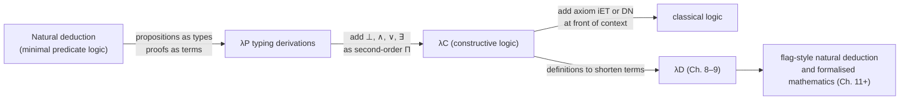

[[book-guidelines|↩ Back to guidelines]]

# Propositions as Types and the Curry–Howard Isomorphism

> Focus Areas: `type-theory`, `automated-reasoning`. Notation follows the book: $\ast$ is the sort of types/propositions, $\square$ the sort of kinds, $\Gamma \vdash M : A$ a judgement, $B[x := N]$ substitution, $A \to B$ is shorthand for $\Pi x : A\,.\,B$ when $x$ is not free in $B$. Section 7 of this note extends the topic past minimal logic into Chapter 7, because that chapter is where PAT is pushed to full propositional and predicate logic.

## 1. The problem this idea solves

A proof is a finite object that a skeptical machine can check. A program is a finite object that a machine can run. A type checker is a finite procedure that decides a judgement $\Gamma \vdash M : A$. The question the book answers in this topic: **can one machine, one judgement form, and one set of rules serve as both the proof checker and the type checker?**

If yes, you get something rare. Correctness of a mathematical text reduces to *well-typedness* of a formal term, and well-typedness is decidable (Chapter 6). The checker never has to "understand" the mathematics. It only has to run a typing algorithm.

What breaks without it? Ordinary logic gives you proof *trees* whose justifications ("by $\Rightarrow$-elimination") live in the meta-language, as prose. A checker built that way needs a separate parser for proof scripts, a separate notion of scope for assumptions, and a separate argument for why substitution inside quantifiers is done correctly. PAT collapses all of that into one machinery you already have: contexts, abstraction, application, substitution.

## 2. The two readings of PAT

The book (Section 5.4, with forward references from Sections 2.4 and 2.9) names two readings under one abbreviation:

1. **Propositions-as-types.** A proposition $A$ is coded as a type, $A : \ast$.
2. **Proofs-as-terms.** A *proof* of $A$ is a term $p$ with $p : A$. Such a term is called a **proof object**.

The truth condition is therefore *inhabitation*:

$$\text{proposition } B \text{ is true} \iff B \text{ is inhabited}, \qquad B \text{ is false} \iff B \text{ is not inhabited}.$$

The book is careful on one point. "Inhabited" is only meaningful relative to a context: you must exhibit $\Gamma$ and $b$ with $\Gamma \vdash b : B$. A bare "there exists some term" is not the criterion. This is exactly the *Term Finding* problem of Section 2.6 (find $?$ with $\Gamma \vdash\, ? : \sigma$), and the book notes that with $\Gamma = \emptyset$ in $\lambda\to$, term finding is equivalent to *provability*.

Sets get the same treatment as propositions (that is why the book calls the approach "double PAT"). The coding dictionary from Section 5.4, parts I to III:

| Logic / mathematics | Type theory ($\lambda P$) |
|---|---|
| $S$ is a set | $S : \ast$ |
| $a \in S$ | $a : S$ |
| $A$ is a proposition | $A : \ast$ |
| $p$ proves $A$ | $p : A$ |
| $P$ is a predicate on $S$ | $P : S \to \ast$ |

Sets and propositions are both types; elements and proofs are both terms. Examples from the book: $\mathsf{nat} : \ast$, $3 : \mathsf{nat}$, $\lambda n : \mathsf{nat}\,.\,n : \mathsf{nat} \to \mathsf{nat}$. For a predicate $P : S \to \ast$ and $a : S$, we have $P\,a : \ast$, a proposition. If $t : P\,a$ then $P$ holds at $a$. If $P\,b$ has no inhabitant then it does not hold at $b$.

Why a predicate is a *type-valued function*: a predicate is, by definition, something that returns a proposition for each element. Propositions are types. So a predicate returns a type for each term, which is precisely a type depending on a term. That is why PAT needs $\lambda P$ (see [[Dependent-Types]]): $\lambda\to$ can host propositional logic with [[Dependent-Types#Implication|implication]] only, but predicates require dependency.

## 3. Implication is the function type

**Intuition first.** What does it mean to *know* $A \Rightarrow B$? It means: whenever you hand me evidence for $A$, I can hand you evidence for $B$. That is a function from evidence-of-$A$ to evidence-of-$B$. The book writes this as a chain of equivalences:

- $A \Rightarrow B$ is true;
- if $A$ is true, then so is $B$;
- if $A$ is inhabited, then so is $B$;
- there is a function mapping inhabitants of $A$ to inhabitants of $B$;
- there is an $f$ with $f : A \to B$;
- $A \to B$ is inhabited.

So the book codes $A \Rightarrow B$ as $A \to B$. Remark 5.4.1: since $A$ and $B$ are independent, $x$ cannot occur free in $B$ in $\Pi x : A\,.\,B$, so the arrow notation is faithful.

**[[Polymorphism-and-Higher-Order-Typed-Lambda-Calculi#The rules|The rules]] come for free.** The natural deduction rules for $\Rightarrow$ (Example 2.4.9):

$$\frac{A \Rightarrow B \quad A}{B}\;(\Rightarrow\text{-elim, modus ponens}) \qquad \frac{\begin{array}{c}[\text{Assume} : A]\\ \vdots\\ B\end{array}}{A \Rightarrow B}\;(\Rightarrow\text{-intro})$$

are literally the two typing rules for application and abstraction, restricted to arrows:

$$\frac{\Gamma \vdash M : A \to B \quad \Gamma \vdash N : A}{\Gamma \vdash M\,N : B}\;(\textit{appl}) \qquad \frac{\Gamma, x : A \vdash M : B \quad \Gamma \vdash A \to B : s}{\Gamma \vdash \lambda x : A\,.\,M : A \to B}\;(\textit{abst})$$

The assumption flag of $(\Rightarrow\text{-intro})$ is the context extension $x : A$ of $(\textit{abst})$. The flagpole delimits scope, exactly as dropping $x : A$ from the context does when you leave the lambda body.

**Worked example (Section 2.9):** proving $A \to B \to A$.

1. Assume $x$ is a proof of $A$.
2. Assume $y$ is a proof of $B$.
3. Then $x$ is still a proof of $A$, so $\lambda y : B\,.\,x$ proves $B \to A$.
4. So $\lambda x : A\,.\,\lambda y : B\,.\,x$ proves $A \to B \to A$.

Remark 2.9.1 matters: you can store only the final term. The derivation can be reconstructed from it, and its type (computable by decidability of well-typedness) *is* the proposition it proves. The proof is a self-describing certificate.

**What breaks without it.** If implication were primitive rather than the arrow, you would need an extra rule schema and extra scope handling for hypothetical reasoning. Here the function type buys hypothetical reasoning from the lambda binder.

## 4. Universal quantification is $\Pi$

**Intuition first.** What does it mean to know $\forall x \in S\,.\,P(x)$? Not one piece of evidence, but a *uniform method*: for every $x$ in $S$ you can produce evidence for $P(x)$. The *type* of the evidence changes with $x$, since $P\,x$ is a different proposition for each $x$. This is a dependent function, which is what $\Pi$ names.

The book's equivalences: $\forall x \in S\,(P(x))$ is true; for each $x \in S$ the type $P\,x$ is inhabited; there is a function mapping each $x \in S$ to an inhabitant of $P\,x$ (type $\Pi x : S\,.\,P\,x$); so $\Pi x : S\,.\,P\,x$ is inhabited.

$$\forall x \in S\,(P(x)) \;\;\leadsto\;\; \Pi x : S\,.\,P\,x.$$

Note the double coding in Remark 5.4.2: the logical $P(x)$ becomes the type-theoretic *term* $P\,x$ (application of predicate to element), and $\Pi x : S\,.\,P\,x$ is a type constructor whose bound variable actually occurs in its body. When it does not occur, it degenerates to $\to$. So $\to$ is the non-dependent special case of $\Pi$, which is the sense in which implication is "a quantifier that ignores its variable".

### $\forall$-elimination is application

$$\frac{\forall x \in S\,(P(x)) \quad N \in S}{P(N)}\;(\forall\text{-elim}) \qquad\text{vs.}\qquad \frac{\Gamma \vdash M : \Pi x : A\,.\,B \quad \Gamma \vdash N : A}{\Gamma \vdash M\,N : B[x := N]}\;(\textit{appl})$$

The book's dictionary: $\forall \mapsto \Pi$; $S \mapsto A$; $P(x) \mapsto B$ so $P(N) \mapsto B[x := N]$; the context, implicit in the logical rule, is explicit; and **proof objects are added**: $M$ proves $\forall x : A\,.\,B$ and $M\,N$ proves $B[x := N]$. Reading: "if $M$ proves $\forall x : A\,.\,B$ and $N : A$, then $M\,N$ proves $B[x:=N]$."

### $\forall$-introduction is abstraction

In flag style the logical rule is: *Let $x \in S$*, derive $P(x)$, conclude $\forall x \in S\,(P(x))$. The flag expresses the "arbitrariness" of $x$. The type-theoretic rule:

$$\frac{\Gamma, x : A \vdash M : B \quad \Gamma \vdash \Pi x : A\,.\,B : s}{\Gamma \vdash \lambda x : A\,.\,M : \Pi x : A\,.\,B}\;(\textit{abst})$$

The differences the book lists: the second premiss (well-formedness of $\Pi x : A\,.\,B$) is absent in the logical rule, where it is assumed that $\forall x \in A\,P(x)$ is an acceptable expression; the context is implicit in logic; and $M$ and $\lambda x : A\,.\,M$ are added as proof objects.

### What breaks without the substitution in the rule

The result type $B[x := N]$ is where dependency lives. In $\lambda\to$ the codomain does not mention the argument. In $\lambda P$ it does. The *type checker* must therefore perform substitution on types. A proof checker for first-order logic must also perform substitution for $\forall$-elimination, and Remark 5.4.2 shows these are the same operation. This is the plumbing the project cares about (variable capture, Section 8 below).

## 5. Summary table: minimal predicate logic inside $\lambda P$ (Figure 5.2)

| Minimal predicate logic | $\lambda P$ |
|---|---|
| $A \Rightarrow B$ | $A \to B$ $(= \Pi x : A\,.\,B)$ |
| $\forall x \in S\,(P(x))$ | $\Pi x : S\,.\,P\,x$ |
| $(\Rightarrow\text{-elim})$ | $(\textit{appl})$ |
| $(\Rightarrow\text{-intro})$ | $(\textit{abst})$ |
| $(\forall\text{-elim})$ | $(\textit{appl})$ |
| $(\forall\text{-intro})$ | $(\textit{abst})$ |

Two logical connectives, four natural-deduction rules, two typing rules. This is what "isomorphism" means here: the book says the rules are "comparable to a high degree". Be precise about the claim. The correspondence is between derivations of minimal predicate logic and *typing derivations* in $\lambda P$, with $\lambda P$ adding proof objects (more information, Section 5.5: "the derivation contains more information").

Remark 5.4.3 reads the earlier derivation of Section 5.3 logically. With $\Gamma \equiv A : \ast,\, P : A \to \ast$:

- $\Gamma \vdash \Pi x : A\,.\,P\,x : \ast$ says "$\forall x \in A\,(P(x))$ is a proposition";
- $\Gamma \vdash \lambda x : A\,.\,\lambda y : P\,x\,.\,y : \Pi x : A\,.\,P\,x \to P\,x$ says the tautology $\forall x \in A\,(P(x) \Rightarrow P(x))$ has that proof object;
- $\forall x \in A\,(P(x))$ alone is **not** a tautology, and indeed no inhabitant of $\Pi x : A\,.\,P\,x$ can be found.

The last bullet is the "false = uninhabited" side of PAT in action.

## 6. A complete worked proof object (Section 5.5)

Goal: for a set $S$ and a binary predicate $Q$ on $S$,

$$\forall x \in S\,\forall y \in S\,(Q(x,y)) \;\Rightarrow\; \forall u \in S\,(Q(u,u)).$$

**Natural deduction (flag style):**

```text
(a)   Assume : ∀x∈S ∀y∈S (Q(x,y))
(b)      Let u ∈ S
(1)        ∀y∈S (Q(u,y))             (∀-elim) on (a) and (b)
(2)        Q(u,u)                    (∀-elim) on (1) and (b)
(3)      ∀u∈S (Q(u,u))               (∀-intro) on (2)
(4)   ∀x∈S ∀y∈S (Q(x,y)) ⇒ ∀u∈S (Q(u,u))    (⇒-intro) on (3)
```

**Coding.** The book curries the binary predicate: $Q : S \to S \to \ast$, so $Q\,a\,b \equiv (Q\,a)\,b$. The proposition becomes the type

$$\Pi x : S\,.\,\Pi y : S\,.\,Q\,x\,y \;\to\; \Pi u : S\,.\,Q\,u\,u.$$

$S$ and $Q$ are free variables, which a derivation system cannot tolerate, so they go in the context as flags: $S : \ast$, $Q : S \to S \to \ast$.

**Building bottom-up.** The goal is an arrow type, so the arrow version of $(\textit{abst})$ applies (the logical step was $\Rightarrow$-intro). Then the goal is a real $\Pi$-type, so $(\textit{abst})$ again (the logical step was $\forall$-intro). The book notes you cannot use the arrow version of the rule there. Then apply the hypothesis twice:

```text
(a)  S : *
(b)    Q : S → S → *
(c)      z : (Πx:S. Πy:S. Q x y)
(d)        u : S
(1)          z u : Πy:S. Q u y                 (appl) on (c), (d)
(2)          z u u : Q u u                     (appl) on (1), (d)
(3)        λu:S. z u u : Πu:S. Q u u           (abst) on (2)
(4)      λz:(Πx:S. Πy:S. Q x y). λu:S. z u u :
           Πx:S. Πy:S. Q x y → Πu:S. Q u u     (abst) on (3)
```

The proof object is $\lambda z : (\Pi x : S\,.\,\Pi y : S\,.\,Q\,x\,y)\,.\,\lambda u : S\,.\,z\,u\,u$. Line (1) is the book's Remark 5.5.1: instantiating $x := u$ in the hypothesis.

Two remarks from the book that deserve emphasis:

- **The proof object contains the whole proof.** From it alone the full derivation can be reconstructed; the derivation therefore "contains, in a sense, too much information". Humans prefer the derivation; the checker needs only the term.
- **Remark 5.5.2:** computing the type of a proof object gives *a* coding of what it proves, but possibly modulo $\beta$. If the direct type is $N$ and the target proposition is $N'$ with $N =_\beta N'$, the $(\textit{conv})$ rule says the object proves $N'$ too. In the book's final systems the conversion rule is what makes definitions unfoldable.

## 7. Grounding in Rust, Lean and Python

### 7.1 Lean: the book's formalism is nearly literal

Lean's kernel is a dependent type theory where `Prop` plays the role of $\ast$ restricted to propositions, and $\forall$ is literally $\Pi$. Every proof object from the book typechecks, verbatim, after trivial renaming. (Verified by running Lean on these.)

```lean
-- A → B → A : λx:A. λy:B. x
theorem k {A B : Prop} : A → B → A := fun x _ => x

-- Section 5.5: ∀x y, Q x y  →  ∀u, Q u u    : λz. λu. z u u
theorem diag {S : Type} (Q : S → S → Prop) :
    (∀ x y, Q x y) → ∀ u, Q u u :=
  fun z u => z u u
```

Remark 5.4.3's point that "$\Pi x : A . P\,x$ is uninhabited in general" has the Lean analogue: you cannot prove `∀ x, P x` for an arbitrary `P`; Lean will report an unsolved goal.

One honest difference. In $\lambda P$ both sets and propositions live in $\ast$ with no distinction ("double PAT"). Lean separates `Prop` (proof-irrelevant, impredicative) from `Type`. The book's treatment of proofs as ordinary terms is closer to the `Type`-valued reading used in Agda or Lean's `Type`-level proofs. When the book later mentions proof irrelevance (Chapter 14), that is where Lean's design choice shows.

### 7.2 Rust: a proof checker is a type checker

Rust's own type system can show the non-dependent fragment (functions as implications, generics as quantification over types), but it cannot express $\Pi x : S\,.\,P\,x$ over *values*, so it is not a $\lambda P$. What *is* worth writing in Rust is the thing the book promises, that **proof checking = type checking**: a small $\lambda P$ checker. This compiled and ran, and it accepts the Section 5.5 proof object.

```rust
use std::rc::Rc;

#[derive(Clone, Debug, PartialEq)]
enum Term {
    Star,
    Sq, // □
    Var(String),
    App(Rc<Term>, Rc<Term>),
    Lam(String, Rc<Term>, Rc<Term>), // λx:A. M
    Pi(String, Rc<Term>, Rc<Term>),  // Πx:A. B   (A -> B when x not free in B)
}
use Term::*;
type Ctx = Vec<(String, Term)>;

fn subst(t: &Term, x: &str, n: &Term) -> Term {
    // NOTE: assumes binder names are distinct from free vars of `n`
    // (no capture-avoidance: the book's "variable capture" problem).
    match t {
        Var(y) if y == x => n.clone(),
        App(f, a) => App(Rc::new(subst(f, x, n)), Rc::new(subst(a, x, n))),
        Lam(y, a, b) | Pi(y, a, b) => {
            let a2 = Rc::new(subst(a, x, n));
            let b2 = if y == x { b.clone() } else { Rc::new(subst(b, x, n)) };
            if matches!(t, Lam(..)) { Lam(y.clone(), a2, b2) } else { Pi(y.clone(), a2, b2) }
        }
        _ => t.clone(),
    }
}

fn whnf(t: &Term) -> Term {
    match t {
        App(f, a) => match whnf(f) {
            Lam(x, _, m) => whnf(&subst(&m, &x, a)),
            f2 => App(Rc::new(f2), a.clone()),
        },
        _ => t.clone(),
    }
}

// β-equality: enough for (conv)
fn conv(a: &Term, b: &Term) -> bool {
    match (whnf(a), whnf(b)) {
        (App(f, x), App(g, y)) => conv(&f, &g) && conv(&x, &y),
        (Lam(x, a1, m), Lam(y, a2, n)) | (Pi(x, a1, m), Pi(y, a2, n)) =>
            conv(&a1, &a2) && conv(&m, &subst(&n, &y, &Var(x))),
        (p, q) => p == q,
    }
}

// Γ ⊢ M : ?   -- the whole "proof checker"
fn infer(g: &Ctx, m: &Term) -> Result<Term, String> {
    match m {
        Star => Ok(Sq),
        Sq => Err("□ has no type".into()),
        Var(x) => g.iter().rev().find(|(y, _)| y == x).map(|(_, a)| a.clone())
            .ok_or(format!("unbound {x}")),
        App(f, n) => match whnf(&infer(g, f)?) {          // (appl)
            Pi(x, a, b) => {
                let an = infer(g, n)?;
                if conv(&an, &a) { Ok(subst(&b, &x, n)) }  // B[x := N]
                else { Err("argument mismatch".into()) }
            }
            _ => Err("not a function / proof of ∀".into()),
        },
        Lam(x, a, body) => {                               // (abst)
            let mut g2 = g.clone();
            g2.push((x.clone(), (**a).clone()));           // the "flag"
            let b = infer(&g2, body)?;
            let pi = Pi(x.clone(), a.clone(), Rc::new(b));
            infer(g, &pi)?;                                // second premiss
            Ok(pi)
        }
        Pi(x, a, b) => {                                   // (form) of λP
            let s1 = whnf(&infer(g, a)?);
            let mut g2 = g.clone();
            g2.push((x.clone(), (**a).clone()));
            let s2 = whnf(&infer(&g2, b)?);
            if s1 == Star && (s2 == Star || s2 == Sq) { Ok(s2) } else { Err("bad (form)".into()) }
        }
    }
}
```

The correspondences are structural: `Lam` pushes onto the context (the flag), `Pi` carries the dependency, `App` substitutes into the codomain. The `// NOTE` in `subst` is the project-relevant point: the book's "variable capture" problem is not an academic aside. Naive substitution here is a soundness bug (a capture could make an invalid proof pass). A production kernel uses de Bruijn indices or fresh renaming.

Note also that `infer` for `Lam` is synthesis mode and `conv` is invoked at `App` in checking mode, so the rules of $\lambda P$ can be read bidirectionally (term in, type out) even though the book presents them declaratively. That decidable, syntax-directed reading is what the book's Generation Lemma justifies (Chapter 6).

### 7.3 Rust and Python for the non-dependent fragment

In Rust's own type system, $A \Rightarrow B$ is `fn(A) -> B` and a proof of $A \to B \to A$ is `fn k<A, B>(a: A, _b: B) -> A { a }`. This is the "proofs as programs" slogan at its cheapest. Since Rust values are not types, there is no `Π` over values, and `enum Void {}` is the closest thing to $\bot$ (uninhabited, so a `match` on it needs no arms). That is the same "false = uninhabited" criterion.

In Python, a typed sketch of the same ideas:

```python
from typing import Callable, TypeVar
A = TypeVar("A"); B = TypeVar("B")

def k(x: A) -> Callable[[B], A]:          # λx:A. λy:B. x  : A → B → A
    return lambda y: x
```

Type annotations here are only hints; nothing checks this unless you run a type checker (e.g. mypy), which makes the "checker" an external tool. That contrast is itself instructive: in type theory the checker is the semantics.

## 8. Pushing PAT to full logic: Chapter 7

$\lambda P$ has only $\Rightarrow$ and $\forall$. The book says plainly: no negation, conjunction, disjunction or $\exists$. Chapter 7 gets them in $\lambda C$ with the **second-order encoding**: quantify over all propositions $\alpha : \ast$ and describe the connective by what it lets you conclude.

### 8.1 Absurdity and negation

**Intuition.** $\bot$ is the proposition from which everything follows. Type-theoretically, a function that for any proposition $\alpha$ produces an inhabitant of $\alpha$:

$$\bot \;\equiv\; \Pi\alpha : \ast\,.\,\alpha, \qquad \neg A \;\equiv\; A \to \bot.$$

Then $\bot$-elimination is free: if $f : \Pi\alpha : \ast\,.\,\alpha$ then by $(\textit{appl})$, $f\,A : A$. Also $\bot$-intro, $\neg$-intro and $\neg$-elim are special cases of $\Rightarrow$-intro/elim (Remarks 7.1.1 and 7.1.2). The universe consequence: $\Pi\alpha : \ast\,.\,\alpha$ has $(s_1, s_2) = (\square, \ast)$, so $\bot$ already needs $\lambda 2$.

### 8.2 Conjunction and disjunction

$$A \wedge B \equiv \Pi C : \ast\,.\,(A \to B \to C) \to C, \qquad A \vee B \equiv \Pi C : \ast\,.\,(A \to C) \to (B \to C) \to C.$$

Read the first as: for every $C$, if $A$ and $B$ together suffice for $C$ then $C$ holds. That is only unconditionally true if both $A$ and $B$ hold. The proof object for $\wedge$-intro is $\lambda C : \ast\,.\,\lambda z : A \to B \to C\,.\,z\,x\,y$ (the "pair" $\langle x, y\rangle$), and $\wedge$-elim is application to a motive. The $\vee$ encoding is a case-analysis record: give me a continuation for each branch. This is exactly the Church/Böhm–Berarducci encoding of sums and pairs, which a Rust programmer will recognise as CPS: `Or<A,B>` as `fn<C>(impl FnOnce(A)->C, impl FnOnce(B)->C) -> C` (a rank-2 type that Rust cannot write as a value type, which is why `enum Either<A,B>` is used in practice).

Why prefer this to the first-order encodings $\neg(A \to \neg B)$ and $\neg A \to B$? Those work only in classical logic. The second-order ones are valid constructively. Remark 7.2.1 also gives the more abstract definitions, e.g. $\wedge \equiv \lambda\alpha : \ast\,.\,\lambda\beta : \ast\,.\,\Pi\gamma : \ast\,.\,(\alpha \to \beta \to \gamma) \to \gamma$, which needs $\lambda\omega$, with the usage $\wedge\,A\,B \to_\beta \dots$.

In Lean (executed):

```lean
def Bot2 : Prop := ∀ α : Prop, α
def Neg2 (A : Prop) : Prop := A → Bot2
def And2 (A B : Prop) : Prop := ∀ C : Prop, (A → B → C) → C
def Or2  (A B : Prop) : Prop := ∀ C : Prop, (A → C) → (B → C) → C

theorem andIntro {A B : Prop} (a : A) (b : B) : And2 A B := fun _ z => z a b

-- Figure 7.1: (A ∨ B) ⇒ (¬A ⇒ B)
theorem orNegB {A B : Prop} : Or2 A B → Neg2 A → B :=
  fun x y => x B (fun u => y u B) (fun v => v)
```

The term in `orNegB` is the book's line (10): $\lambda x\,.\,\lambda y\,.\,x\,B\,(\lambda u : A\,.\,y\,u\,B)\,(\lambda v : B\,.\,v)$. Lean's own `And` and `Or` are inductive types, not impredicative encodings. That is the book's contrast with Martin-Löf style systems (Section 5.7): inductive types make induction and primitive eliminators available.

### 8.3 Existential quantifier

$$\exists x \in S\,(P(x)) \;\equiv\; \Pi\alpha : \ast\,.\,\big((\Pi x : S\,.\,(P\,x \to \alpha)) \to \alpha\big).$$

Intuition from the logical $\exists$-elimination rule: "if $\exists x\,P(x)$ and for all $x$, $P(x) \Rightarrow A$, then $A$." The encoding *is* that rule, quantified over $A$. Then $\exists$-elim is two applications, $y\,A\,z : A$, and $\exists$-intro has proof object $\lambda\alpha : \ast\,.\,\lambda v : (\Pi x : S\,.\,(P\,x \to \alpha))\,.\,v\,a\,u$, where $a : S$ and $u : P\,a$. The section on $\exists$-elim (Remark 7.5.1) also criticises the common mathematical habit of "let $x$ be such that $P(x)$" and insists that only the formal rule is acceptable, because the scope of $x$ is silently wrong in the informal version. Remark 7.5.2: $x \notin FV(A)$ is essential for line (2) to be a legal application.

```lean
def Ex2 {S : Type} (P : S → Prop) : Prop := ∀ α : Prop, (∀ x, P x → α) → α

theorem exIntro {S : Type} {P : S → Prop} (a : S) (u : P a) : Ex2 P :=
  fun _ v => v a u
theorem exElim {S : Type} {P : S → Prop} {A : Prop}
    (y : Ex2 P) (z : ∀ x, P x → A) : A := y A z

-- Section 7.6: ¬∃x.P x ⇒ ∀y.¬P y
theorem notEx {S : Type} (P : S → Prop) : Neg2 (Ex2 P) → ∀ y, Neg2 (P y) :=
  fun u y v => u (fun α w => w y v)
```

All of these passed `lean`. The last is the book's proof term `λu. λy. λv. u (λα. λw. w y v)`.

### 8.4 Constructive vs. classical: an axiom at the front of the context

Everything so far is **constructive** logic. Excluded third (ET: $A \vee \neg A$) and double negation (DN: $\neg\neg A \Rightarrow A$) are not derivable. Adding either gives classical logic, and each yields the other. The book adds it as an *axiom*, a declaration at the front of the context:

$$i_{ET} : \Pi\alpha : \ast\,.\,\alpha \vee \neg\alpha.$$

Then DN is derived under that assumption (the book derives it step by step; the final proof object is $\lambda\beta : \ast\,.\,\lambda x : \neg\neg\beta\,.\,i_{ET}\,\beta\,\beta\,(\lambda y : \beta\,.\,y)\,(\lambda z : \neg\beta\,.\,x\,z\,\beta)$). The Lean check, with `et` as a hypothesis, `#print axioms dn` reporting none, shows the assumption's footprint is entirely in the context:

```lean
theorem dn (et : ∀ α : Prop, Or2 α (Neg2 α)) (β : Prop) : Neg2 (Neg2 β) → β :=
  fun x => et β β (fun y => y) (fun z => x z β)
```

This makes the trusted base explicit and checkable: the classical axiom appears as a visible hypothesis, not a hidden rule. For a trusted-kernel design that is the right shape.

## 9. What the correspondence does and does not give

- **The mapping is derivations to typing derivations, and proofs to terms.** The book relates normal forms and proof structure only lightly in these pages; the proof-theoretic reading of $\beta$-reduction as proof normalisation is not its emphasis here.
- **Decidability is system-dependent.** Type checking is decidable in $\lambda P$ and $\lambda C$, but Term Finding is the real problem: in the richer systems it is undecidable (Section 2.6). PAT does not give you proof *search*, only proof *checking*.
- **Intensional equality.** $\lambda P$'s conversion is $\beta$, not provable equality. The book notes that extensional type theory makes type checking undecidable, which is why Martin-Löf abandoned it (Section 5.7).
- **Proof objects blow up.** Chapter 7 closes with this: proof terms get long and the natural deduction rules become invisible (the hidden $\exists$-intro in line (1) of Section 7.6). The remedy is definitions, which is the topic of Chapters 8 and 9.
- **Two interpretations of PAT** (Section 5.7). The *Curry–Howard* interpretation described above (propositions are types in $\lambda P$, with proofs as terms), versus the *Logical Framework* interpretation (de Bruijn's earlier idea), where $\lambda P$ is a meta-calculus and a logic $L$ is *declared* in a context $\Gamma_L$. In the latter, binding and substitution (including the avoidance of free-variable capture) are handled by $\lambda P$ itself rather than by the logic. This lineage runs through Edinburgh LF and Twelf, and it is the style the book's $\lambda D$ chapters later adopt (axioms and constants declared in a context). Historical note from the book: Howard wrote the correspondence up in 1968 (published 1980); it is also called Curry–Howard–de Bruijn.

## 10. How the pieces fit



**[[Definitions-and-Abbreviations#Where this leads|Where this leads]].** Chapters 8 and 9 add definitions precisely because the proof objects of Section 6 and Section 8 grow unmanageable; Chapter 11 turns each natural-deduction rule into a defined constant of $\lambda D$ and revisits the constructive/classical split; Chapters 12 to 15 apply the same coding to equality, sets and arithmetic.

## 11. Bearing on the project goals

Tags: `type-theory` and `automated-reasoning`.

- **Judgments as the shared ancestor of type checker and proof checker.** This topic is the first place in the book that makes the equality "type checking $=$ proof checking" explicit. The Rust sketch in 7.2 is that statement in code: `infer` is one function that is both. It is the starting shape of the kernel in the target compiler (trusted kernels, `type-theory` and `automated-reasoning`).
- **Contexts and substitution.** $(\textit{abst})$ pushes onto $\Gamma$; $(\textit{appl})$ computes $B[x := N]$. Those two operations are the plumbing for Hoare-triple soundness (substitution into postconditions for assignment) and for the elaborator. The capture caveat in `subst` is a real design decision: pick de Bruijn indices in the Rust implementation.
- **Dependent types and refinement types.** A refinement type is a $\Sigma$-type or a $\Pi$ whose codomain is a predicate $P : S \to \ast$. Predicates as type-valued functions (Section 2 above) are the substrate. Section 5.7 of the book introduces $\Sigma$-types as Martin-Löf's extension (pairs $\langle a, b\rangle$ with $b : B[x := a]$); the book defers the details to later chapters.
- **Proof certificates and proof reconstruction.** Remark 2.9.1 and Section 5.5 say it directly: the proof term suffices, and the derivation (and the statement) can be reconstructed from it by deciding well-typedness. An external prover (SAT/SMT/CSP, an embedded clause-resolution engine) can emit a term; the kernel re-checks it. That is the proof-producing architecture the project wants.
- **Classical axiom as a context entry.** The ET/DN treatment (8.4) models how a verifier would keep classical reasoning, which SMT-style verification conditions generally assume, out of the trusted core: as an explicit hypothesis rather than a built-in rule.
- **Not covered here, and not forced:** the book's treatment of PAT does not touch unification, metavariables or bidirectional inference explicitly. The `infer`/`conv` split is only suggestive of bidirectionality, and nothing in these pages concerns pattern unification.

### Source notes

The Chapter 5 sections (5.4 to 5.7) were read directly, together with Chapter 2 (Example 2.4.9, the Term Finding discussion in 2.6, and the $A \to B \to A$ example in 2.9) and Chapter 7 (7.1 to 7.7). Code in Section 7 and Section 8 is original illustration, executed with `rustc` and `lean`; the book itself contains no code. The Python sketch was not executed.
