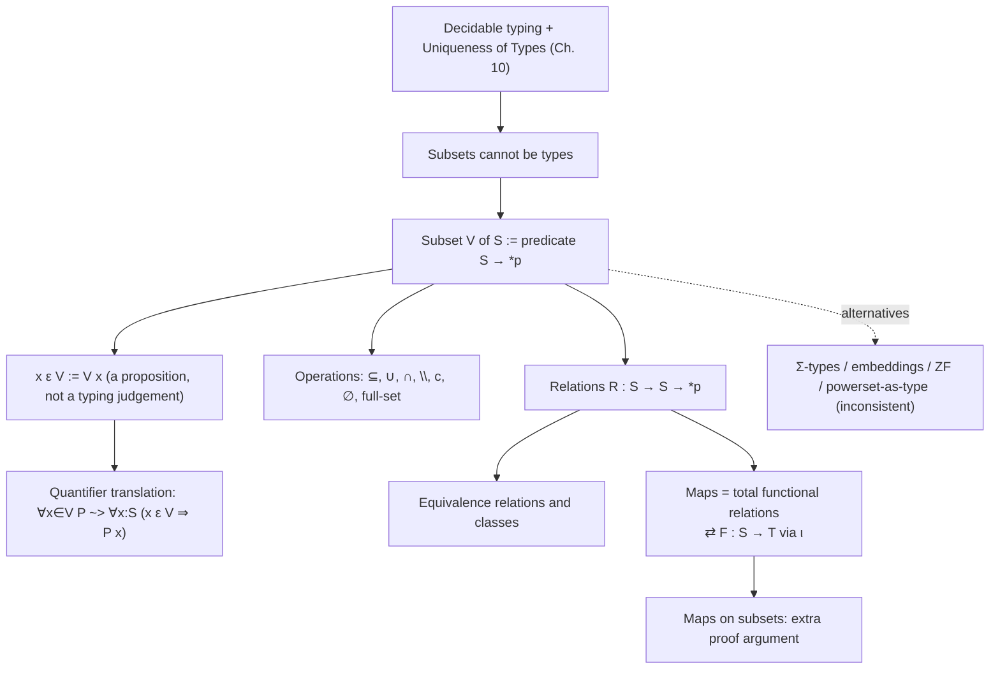

[[book-guidelines|↩ Back to guidelines]]

# Sets, Subsets, Relations and Maps

> Focus Areas: `type-theory`, `automated-reasoning`. Source: Chapter 13 of Nederpelt & Geuvers, re-read directly from the book. Notation follows the book: $\ast_s$ is the sort of "set-like" types, $\ast_p$ the sort of propositions, $\square$ the sort of kinds; $\Gamma \vdash M : N$ is a judgement; $B[x := M]$ is substitution; $:=$ introduces a definition in a $\lambda D$ block. Related notes: [[Type-Theory-with-Definitions]], [[Definitions-and-Abbreviations]], [[Encoding-Logic-in-the-Calculus-of-Constructions]], [[Dependent-Types]], [[Propositions-as-Types-and-the-Curry-Howard-Isomorphism]].

## 1. The clash: mathematicians' sets versus a decidable type checker (§13.1)

Up to now the book has treated sets as types, writing $\ast_s$ instead of $\ast$ for "types that play the role of sets". That worked fine for whole sets such as $\mathbb{N}$ or $\mathbb{R}$. It breaks on **subsets**, and the book pins down two distinct failures.

**Failure 1: Uniqueness of Types.** Let $T \subsetneq S$ and $c : S$. A mathematician says "$c$ is also in $T$". Written as $c : T$, that gives $c$ two different types $S$ and $T$. But $\lambda D$ has Uniqueness of Types (Lemma 10.4.10): a term has one type up to $\beta\delta$-equality.

**Failure 2: decidability of typing.** Take the set $\{x \in S \mid P\,x\}$. To type-check $c : \{x \in S \mid P\,x\}$ the checker would have to decide $P\,c$, which is provability in general, hence undecidable (Church, Turing). The book's concrete example: $F : \{x \in \mathbb{R} \mid x \ge 0\} \to \mathbb{R}$ is the square root. To type-check $F\,M$ with $M : \mathbb{R}$, the checker must find a proof of $M \ge 0$. Type checking would silently contain theorem proving.

**What breaks if you give in:** you could drop Uniqueness of Types and let $3$ inhabit $\mathbb{N}$, $\mathbb{Z}$, $\mathbb{R}$, "odd naturals", etc. That is the mathematician's freedom, and it is tempting. But then, given a pre-term $p$, it is no longer decidable whether $p$ is a well-formed proof and of what proposition. The whole point of $\lambda D$ is that proof checking is type checking, which is decidable, yielding "ok" or "not ok" but never "we don't know". The book therefore makes the decision explicitly:

> We declare to maintain decidability of typing, and consequently accept all the consequences, in particular for subsets.

This is the design axis of the whole chapter. Everything below is the price list.

## 2. The chosen representation: a subset is a predicate (§13.1)

First-principles idea: what do you *use* a subset $V \subseteq S$ for? You ask "is $x$ in it?". A yes/no question about elements of $S$ is exactly a predicate $P = \lambda x : S\,.\,(x \in V)$ of type $S \to \ast_p$. And $\lambda D$ already has predicates. So **identify the subset with its predicate** and add no new machinery.

Figure 13.1 gives the first definitions (each a $\lambda D$ block with context $S : \ast_s$):

$$ps(S) := S \to \ast_p \;:\; \square \qquad\text{(1) powerset}$$
$$element(S,x,V) := V\,x \;:\; \ast_p \qquad\text{(2)}\quad x\ \varepsilon_S\ V \text{ for } element(S,x,V)$$
$$\subseteq(S,V,W) := \forall x : S\,.\,(x\ \varepsilon\ V \Rightarrow x\ \varepsilon\ W) \;:\; \ast_p \qquad\text{(3)}$$
$$\cup(S,V,W) := \lambda x : S\,.\,(x\ \varepsilon\ V \vee x\ \varepsilon\ W) \;:\; ps(S) \qquad\text{(4)}$$

Points worth underlining:

- The new symbol $\varepsilon$ resembles $\in$ but is deliberately different. "$x \in V$" is **not** the typing judgement $x : V$. It is a *type* ($V\,x : \ast_p$), and to establish it you must build a proof term $p : x\ \varepsilon\ V$. Membership is a proposition you prove; it is not a typing fact the checker decides. That is how both failures of section 1 are avoided: the judgement $c : S$ stays unique and decidable, and the undecidable question $P\,c$ is demoted to a proof obligation.
- Note the sort levels: $S : \ast_s$ but $ps(S) = S \to \ast_p : \square$. The powerset of $S$ lives in $\square$, not $\ast$. This matters (see section 8 and the exercise on $S : ps(S)$).

### Grounding: subset as predicate, in Rust and Lean

In Rust the closest honest picture is a closure over $S$. Membership is a function call you *run*; the difference from $\lambda D$ is that Rust's `bool` is decidable, whereas $\lambda D$'s `Prop`-like $\ast_p$ is not.

```rust
// A "subset of S" is a predicate on S. (Decidable here, unlike *_p.)
struct Subset<S>(Box<dyn Fn(&S) -> bool>);

impl<S: 'static> Subset<S> {
    fn contains(&self, x: &S) -> bool { (self.0)(x) }            // x ε V   :=  V x
    fn union(self, w: Subset<S>) -> Subset<S> {                  // ∪(S,V,W)
        Subset(Box::new(move |x| (self.0)(x) || (w.0)(x)))
    }
    fn complement(self) -> Subset<S> {                           // V^c
        Subset(Box::new(move |x| !(self.0)(x)))
    }
}
```

Lean makes the same choice, and nearly literally:

```lean
-- Mathlib: Set α := α → Prop ; membership is application
def MySet (α : Type) := α → Prop
def MySet.mem {α} (x : α) (V : MySet α) : Prop := V x          -- x ε V
def MySet.subset {α} (V W : MySet α) : Prop := ∀ x, V x → W x  -- ⊆
def MySet.union {α} (V W : MySet α) : MySet α := fun x => V x ∨ W x
```

Python adds nothing beyond `lambda x: ...`, so it is skipped here.

## 3. Quantifying over a subset and the basic operations (§13.2)

**The quantifier problem.** $\forall x \in V\,(P\,x)$ cannot be written $\forall x : V\,.\,P\,x$ because $V$ is a predicate, not a type, and the $(\textbf{form})$ rule only lets $\Pi$ range over types. The fix is the **translation convention**:

$$\forall x \in V\,(P(x)) \;\leadsto\; \forall x : S\,.\,(x\ \varepsilon\ V \Rightarrow P\,x)$$
$$\exists x \in V\,(P(x)) \;\leadsto\; \exists x : S\,.\,(x\ \varepsilon\ V \wedge P\,x)$$

So every quantifier ranges over a type. The book asks the reader to "examine why" $\exists$ uses $\wedge$. Reason: $\exists x : S\,.\,(x\ \varepsilon\ V \Rightarrow P\,x)$ is satisfied by any $x$ outside $V$ (the [[Dependent-Types#Implication|implication]] is vacuously true), so it would not assert that an element of $V$ with $P$ exists. Dually, $\forall$ with $\wedge$ would claim every $x : S$ lies in $V$.

(Bug-for-bug connection to refinement types: this relativisation is exactly how a refinement/contract $\{x : S \mid P\,x\}$ gets expanded into a verification condition. The *guard* $x\ \varepsilon\ V$ appears as a hypothesis in universal goals and as a conjunct in existential ones.)

**Comprehension notation.** $\{x : S \mid x\ \varepsilon\ V\}$ is sugar for $\lambda x : S\,.\,V\,x$. Figure 13.2 then defines, all in $ps(S)$ or $\ast_p$:

| operation | definition |
|---|---|
| inclusion $V \subseteq W$ | $\forall x : S\,.\,(x\ \varepsilon\ V \Rightarrow x\ \varepsilon\ W)$ |
| equality of subsets $V = W$ | $IS(S,V,W) := V \subseteq W \wedge W \subseteq V$ |
| union $V \cup W$ | $\{x : S \mid x\ \varepsilon\ V \vee x\ \varepsilon\ W\}$ |
| intersection $V \cap W$ | $\{x : S \mid x\ \varepsilon\ V \wedge x\ \varepsilon\ W\}$ |
| difference $V \setminus W$ | $\{x : S \mid x\ \varepsilon\ V \wedge \neg(x\ \varepsilon\ W)\}$ |
| complement $V^c$ (w.r.t. $S$) | $\{x : S \mid \neg(x\ \varepsilon\ V)\}$ |

Complement is a *relative* notion, so it needs $S$ as a parameter. The symbol "$=$" is overloaded (elements and subsets); the sugar hides $S$.

### ε-introduction and ε-elimination (Figure 13.3)

Since $y\ \varepsilon\ \{x : S \mid P\,x\}$ unfolds to $(\lambda x : S\,.\,P\,x)\,y$, which is $\beta$-equal to $P\,y$:

$$\varepsilon\text{-in}(S,P,y,u) := u : y\ \varepsilon\ \{x : S \mid P\,x\} \quad\text{for } u : P\,y$$
$$\varepsilon\text{-el}(S,P,y,v) := v : P\,y \quad\text{for } v : y\ \varepsilon\ \{x : S \mid P\,x\}$$

Both rules are the *identity on proof terms*. They are not real inferences; they record that the checker's conversion rule ($\beta$, plus $\delta$ for the defined $\varepsilon$) already treats the two types as the same. This is **definitional equality doing the work of a logical rule**. Anyone writing an elaborator should notice: the proofs `ε-in`/`ε-el` cost nothing at runtime because `isDefEq` unfolds `element` and beta-reduces.

```lean
-- In Lean this is literally `Iff.rfl`-by-defeq: membership in setOf unfolds by rfl
example {α} (P : α → Prop) (y : α) (u : P y) : y ∈ {x | P x} := u
example {α} (P : α → Prop) (y : α) (v : y ∈ {x | P x}) : P y := v
```

### Worked example: $V \subseteq W^c \Rightarrow V \setminus W = V$ (Figure 13.4)

Two directions.

1. $V \setminus W \subseteq V$ (always true). Take $x$ and $v : x\ \varepsilon\ V \setminus W$. By $\delta$/$\beta$ this *is* $x\ \varepsilon\ V \wedge \neg(x\ \varepsilon\ W)$, so $\wedge$-el 1 gives $x\ \varepsilon\ V$. Then $\Rightarrow$-in and $\forall$-in close it (lines 1 to 4).
2. $V \subseteq V \setminus W$ (needs $u : V \subseteq W^c$). Take $x$ and $v : x\ \varepsilon\ V$. Then $a_5 := u\,x\,v : x\ \varepsilon\ W^c$, which is $\neg(x\ \varepsilon\ W)$ by $\delta\beta$; $\wedge$-in on $v$ and $a_5$ yields $x\ \varepsilon\ V \setminus W$ (lines 5 to 10).

Lines 11 and 12 combine with $\wedge$-in and $\Rightarrow$-in. Remark 13.2.2 notes something that only a *dependency-tracking* presentation shows: $a_4(S,V,W)$ has a shorter parameter list than $a_{10}(S,V,W,u)$, because the first inclusion never uses the hypothesis $V \subseteq W^c$.

Note the proof term $u\,x\,v$: because $\forall$ and $\Rightarrow$ are both $\Pi$, applying the hypothesis $u : V \subseteq W^c$ to $x$ and then to $v$ is just function application. The book mentions the "more logical" route ($\forall$-el then $\Rightarrow$-el) gives the same term shape.

### Two notions of equality for subsets (Figure 13.5)

Subset equality $V = W := V \subseteq W \wedge W \subseteq V$ is *extensional* (same elements). Chapter 12's Leibniz equality $x =_S y := \Pi K : S \to \ast_p\,.\,(K\,x \Leftrightarrow K\,y)$ cannot be applied to $V, W : ps(S)$, because $ps(S) : \square$, not $\ast_s$. The book defines a Leibniz-style equality on the powerset:

$$V =_{ps(S)} W := \Pi K : ps(S) \to \ast_p\,.\,(K\,V \Leftrightarrow K\,W).$$

Leibniz-equal implies subset-equal (Exercise 13.1: choose $K := \lambda X.\; V \subseteq X$). The converse **cannot be derived** from what $\lambda D$ has, so the book adds a primitive definition (the $\perp\!\!\!\perp$ body) `IS-prop`: from $u : V = W$ conclude $V =_{ps(S)} W$. This is a genuine *axiom*: an extensionality principle for subsets.

**Lean parallel:** Lean has the same pair, `Set.ext` and, at the propositional level, the axiom `propext`; Lean's `funext` is likewise a theorem derived from the quotient axiom, not from the kernel rules.

## 4. Special subsets (§13.3)

For each type $S : \ast_s$, the empty set is relative to $S$ ("we cannot suffice with one empty set relative to a universe"):

$$\emptyset(S) := \{x : S \mid \bot\} : ps(S), \qquad full\text{-}set(S) := \{x : S \mid \neg\bot\} : ps(S).$$

(The book also notes $full\text{-}set(S) = (\emptyset_S)^c$, Exercise 13.6a.) Lemma (Figure 13.7): $\emptyset_S \subseteq V \subseteq full\text{-}set(S)$. Proof ingredients: $x\ \varepsilon\ \emptyset_S$ is $\beta$-equal to $\bot$, so $\bot$-el gives $x\ \varepsilon\ V$; and $x\ \varepsilon\ full\text{-}set(S)$ is $\beta$-equal to $\neg\bot$, proved by $\lambda y : \bot\,.\,y$.

Figure 13.8: $(V \neq \emptyset_S) \Leftrightarrow \exists x : S\,.\,(x\ \varepsilon\ V)$. The forward direction passes through $\neg\forall x : S\,.\,\neg(x\ \varepsilon\ V)$ and uses `∃-in-alt` (Figure 11.28), i.e. **classical** logic. The book flags this, consistent with its decision (§11.4) to use classical logic as its base. Constructively you can only get "not empty implies not-not-inhabited".

Exercise-level facts the book leaves open: $S$ itself is not a subset of $S$ ($S : \ast_s$, not $S : ps(S)$), $S\ \varepsilon\ ps(S)$ is not derivable, and $ps(ps(S))$ is **ill-formed** since $ps(S) : \square$ is not a type. For the third powerset one defines a new operation $PS(T) := T \to \ast_p$ for $T : \square$ (Exercise 13.3). So the powerset hierarchy is *stratified by sorts*, not iterated freely, which is how $\lambda D$ dodges Russell's paradox.

## 5. Relations (§13.4)

A relation on $S$ is a binary predicate. With Currying, $R : S \to S \to \ast_p$. A relation *between* $S$ and $T$ is $R : S \to T \to \ast_p$. Example 13.4.4: $R := \lambda n : \mathbb{N}\,.\,\lambda x : \mathbb{Z}\,.\,(n = x^2 + 1)$, so $R\,5\,2$ and $R\,5\,(-2)$ hold.

Figure 13.9 defines the standard properties, each a single $\Pi$-formula:

$$reflexive(S,R) := \forall x : S\,.\,R\,x\,x$$
$$symmetric(S,R) := \forall x,y : S\,.\,(R\,x\,y \Rightarrow R\,y\,x)$$
$$transitive(S,R) := \forall x,y,z : S\,.\,(R\,x\,y \Rightarrow R\,y\,z \Rightarrow R\,x\,z)$$
$$equivalence\text{-}relation(S,R) := reflexive \wedge symmetric \wedge transitive$$

(Remark 13.4.1: $\rho \wedge \sigma \wedge \tau$ is read $(\rho \wedge \sigma) \wedge \tau$. Remark 13.4.2: restricting to a subset $V$ adds the guard, e.g. $refl\text{-}subset(S,V,R) := \forall x : S\,.\,(x\ \varepsilon\ V \Rightarrow R\,x\,x)$.)

### Equivalence classes (Figure 13.10)

$$class(S,R,u,x) := \{y : S \mid R\,x\,y\} : ps(S), \qquad [x]_R \text{ for short}$$

with $u : equivalence\text{-}relation(S,R)$ in the context (hidden parameters). Three characteristics: (1) no class is empty, (2) two classes either coincide or are disjoint, (3) every element lies in some class (the union of the classes is $S$). Together, (2) and (3) give "each $x$ in exactly one class".

The book proves the equivalent form of (2) (Figure 13.11):

$$\forall x,y,z : S\,.\,(z\ \varepsilon\ [x]_R \Rightarrow z\ \varepsilon\ [y]_R \Rightarrow [x]_R = [y]_R).$$

Proof outline, read bottom-up (the book's own advice): to show $[x]_R \subseteq [y]_R$ pick $m$ with $R\,x\,m$ and derive $R\,y\,m$ from $R\,x\,z$, $R\,y\,z$, $R\,x\,m$ by symmetry and transitivity; reflexivity is not needed. The mirror inclusion $[y]_R \subseteq [x]_R$ is *the same proof term with two pairs of parameters swapped*: $a_{10} := a_9(S,R,u,y,x,z,v,u)$. Lemma-as-function, once more.

### Grounding: relations as typed predicates

```lean
def Reflexive' {S} (R : S → S → Prop) : Prop := ∀ x, R x x
def Symmetric' {S} (R : S → S → Prop) : Prop := ∀ x y, R x y → R y x
def Transitive' {S} (R : S → S → Prop) : Prop := ∀ x y z, R x y → R y z → R x z

-- Figure 13.11 in tactic form: symmetry + transitivity give class overlap = equality
example {S} (R : S → S → Prop) (sym : Symmetric' R) (tr : Transitive' R)
    (x y z : S) (hx : R x z) (hy : R y z) : ∀ m, R x m → R y m :=
  fun m hxm => tr y x m (tr y z x hy (sym x z hx)) hxm
```

```rust
// Rust has no Prop, so a relation is only a *decidable* approximation.
trait Relation<S> { fn rel(&self, x: &S, y: &S) -> bool; }

// The book's "proof obligations" become test/property obligations, not types.
fn check_symmetric<S, R: Relation<S>>(r: &R, sample: &[S]) -> bool {
    sample.iter().all(|x| sample.iter().all(|y| !r.rel(x, y) || r.rel(y, x)))
}
```

Rust cannot carry the proof as a value; that gap (a decidable `bool` versus a proof-carrying `*_p`) is the exact distinction the chapter is about.

## 6. Maps (§13.5)

A **map** $S \to T$ can be viewed two ways, and the chapter connects them.

- **Functional relation:** $F : S \to T \to \ast_p$ with $\forall x : S\,.\,\exists! y : T\,.\,F\,x\,y$ (exactly one related $y$ for each $x$). This is a *total* map. Remark 13.5.1 notes that "at most one $y$" is a *partial map*, which the book does not use.
- **Type-theoretic function:** $F : S \to T$, i.e. $\Pi x : S\,.\,T$ with $T$ not depending on $x$.

Figure 13.12 translates between the two:

$$R(S,T,F) := \lambda x : S\,.\,\lambda y : T\,.\,(y =_T F\,x) \;:\; S \to T \to \ast_p$$
$$F(S,T,R,u) := \lambda x : S\,.\,\iota^{u\,x}_{y:T}(R\,x\,y) \;:\; S \to T, \quad u : \forall x : S\,.\,\exists!y : T\,.\,R\,x\,y$$

The second direction is where the **definite description operator** $\iota$ (Figure 12.16) is used: from a *proof* that exactly one $y$ exists, $\iota$ extracts the $y$ as a term. The proof $u\,x$ is a parameter of $\iota$, which is why the result is a legitimate function (the "extraction" is paid for with a proof). The book stays with the type-theoretic format ($F : S \to T$) as the more basic one (Remark 13.5.2).

Properties (Figure 13.13):

$$injective(S,T,F) := \forall x_1,x_2 : S\,.\,(F\,x_1 =_T F\,x_2 \Rightarrow x_1 =_S x_2)$$
$$surjective(S,T,F) := \forall y : T\,.\,\exists x : S\,.\,(F\,x =_T y)$$
$$bijective(S,T,F) := injective \wedge surjective$$

For $u : bijective(S,T,F)$, one derives $a_4 : \forall y : T\,.\,\exists!x : S\,.\,(F\,x =_T y)$ and then defines the inverse as $inv(S,T,F,u) := \lambda y : T\,.\,\iota^{a_4(S,T,F,u)\,y}_{x:S}(F\,x =_T y) : T \to S$. A bijection *plus its proof* gives an inverse *function*.

### Maps on a subset: the "extra argument"

If the domain is a subset $V$ of $S$, the type of $F$ becomes
$$F : \Pi x : S\,.\,((x\ \varepsilon\ V) \to T),$$
so every application needs a membership proof: $F\,x\,p$ with $p : x\ \varepsilon\ V$. Injectivity (Figure 13.14) then has to quantify over proofs too:
$$inj\text{-}subset(S,T,V,F) := \forall x_1,x_2 : S\,.\,\Pi p : (x_1\ \varepsilon\ V)\,.\,\Pi q : (x_2\ \varepsilon\ V)\,.\,(F\,x_1\,p =_T F\,x_2\,q \Rightarrow x_1 =_S x_2).$$
This is the concrete, visible price of keeping typing decidable. Notice also that nothing in the statement says $p$ and $q$ are equal; **proof irrelevance** is implicit, and Chapter 14 returns to it.

### Image and origin (Figures 13.15, 13.16)

$$image(S,T,F,V) := \{y : T \mid \exists x : S\,.\,(x\ \varepsilon\ V \wedge F\,x =_T y)\} : ps(T)$$
$$origin(S,T,F,W) := \{x : S \mid F\,x\ \varepsilon\ W\} : ps(S)$$

Lemma: $V \subseteq origin(image(V))$. Proof: for $s\ \varepsilon\ V$, `eq-refl` gives $F\,s = F\,s$; $\wedge$-in then $\exists$-in give $F\,s\ \varepsilon\ image(V)$, which by $\delta\beta$ is $s\ \varepsilon\ origin(image(V))$.

```lean
-- Same lemma in Lean/Mathlib vocabulary (image = F '' V, origin = F ⁻¹' W)
example {S T} (F : S → T) (V : Set S) : V ⊆ F ⁻¹' (F '' V) :=
  fun s hs => ⟨s, hs, rfl⟩
```

```lean
-- Figure 13.13 in Lean
#check @Function.Injective   -- ∀ a₁ a₂, f a₁ = f a₂ → a₁ = a₂   (same as inj)
#check @Function.Surjective  -- ∀ b, ∃ a, f a = b
```

## 7. Many-to-one coding of mathematics (§13.6)

Figure 13.17 lists notions mathematicians keep distinct but $\lambda D$ codes identically:

| mathematics | $\lambda D$ | sorts |
|---|---|---|
| function space $A \to B$, implication $A \Rightarrow B$, universal statement $\forall x \in A\,(B(x))$ | $\Pi x : A\,.\,B$ | $\ast_s,\ast_s$ / $\ast_p,\ast_p$ / $\ast_s,\ast_p$ |
| function, predicate, subset | $\lambda x : A\,.\,t$ | $t : B : \ast_s$ / $t : \ast_p$ / $t : \ast_p$ |
| two-valued function, binary relation | $\lambda x : A\,.\,\lambda y : B\,.\,t$ | $\ldots : C : \ast_s$ / $\ldots : \ast_p$ |

Benefit: one small calculus; similar calculation patterns coincide. Cost: a bare $\lambda x : A\,.\,t$ is ambiguous. Splitting $\ast$ into $\ast_s$ and $\ast_p$ (Notation 8.7.1, sugar and not official syntax) recovers nearly all distinctions. **The one irrecoverable ambiguity:** a predicate over $A$ and a subset of $A$ are the same thing, by the choice of section 2.

Think of it as an elaborator's *erased* representation: the surface language (sets, maps, relations) lowers into a single core term language, and the sort annotations are the hints you would keep to resurrect the intended reading when pretty-printing or error-reporting.

## 8. Alternatives and their costs (§13.7-13.8)

The conclusion (§13.7) frames the choice as two world-views. Mathematicians accept undecidable set-membership and multi-set membership, because a trained human can find the path. Type theory targets *all* imaginable proofs, including huge or tedious ones, where automatic verification (hence decidability, and feasibility) is the crucial property. The book reports that the price of this choice "appears not to be too high".

Section 13.8 surveys five other routes, each tied to a precise trade-off. I include them as a decision table because this is the part most reusable when designing a refinement type system:

| approach | idea | why the book does not use it |
|---|---|---|
| (1) Ramified type theory (Russell, Whitehead) | sets as predicates in a ramified hierarchy | Ramsey and Church showed ramification is unnecessary; the simple theory of types is a "deramification" |
| (2) ZF in type theory | a type $V : \ast$ of all sets, $\in : V \to V \to \ast$ | untyped behaviour does not reflect everyday maths; numbers, functions, relations all need coding as sets |
| (3) Powersets as types | let $ps(S) = S \to \ast$ itself have type $\ast$ | $S \to \ast : \ast$ is comparable to $\ast : \ast$; **Geuvers (2013) proved that copying van Benthem Jutting's Automath primitives into $\lambda D$/$\lambda C$ is inconsistent** (works in Automath, whose strength is only $\lambda P$) |
| (4) $\Sigma$-types | $\Sigma x : S\,.\,B$ = pairs $\langle a, q\rangle$ with $q : P\,a$ | needs four new rules; kept out to keep $\lambda D$ minimal. PVS goes the other way (typing $M : \{x : S \mid B\}$ directly) and loses decidability and Uniqueness of Types |
| (5) Subsets via embeddings | a type $V$ with an injection $in : V \to S$, inverse $out$ | many extra primitives |

The $\Sigma$-rules in the book's $\lambda D$ judgement format ($\Delta;\Gamma \vdash$ is the book's judgement; $\pi_1,\pi_2$ projections):

$$\frac{\Delta;\Gamma \vdash S : \ast_s \qquad \Delta;\Gamma, x : S \vdash B : \ast_p}{\Delta;\Gamma \vdash \Sigma x : S\,.\,B : \ast_s}\ (\Sigma\text{-form})$$

$$\frac{\Delta;\Gamma \vdash M : S \quad \Delta;\Gamma \vdash N : B[x := M] \quad \Delta;\Gamma \vdash \Sigma x : S\,.\,B : \ast_s}{\Delta;\Gamma \vdash \langle M, N\rangle : \Sigma x : S\,.\,B}\ (\Sigma\text{-pair})$$

$$\frac{\Delta;\Gamma \vdash K : \Sigma x : S\,.\,B}{\Delta;\Gamma \vdash \pi_1 K : S}\ (\Sigma\text{-proj}_1) \qquad \frac{\Delta;\Gamma \vdash K : \Sigma x : S\,.\,B}{\Delta;\Gamma \vdash \pi_2 K : B[x := \pi_1 K]}\ (\Sigma\text{-proj}_2)$$

The $\Sigma$-type view is the **one that keeps both properties**: the proof is *attached* to the element, so $\langle a, q\rangle : \Sigma x : S\,.\,P\,x$ has one type and checking it needs only checking $q : P\,a$. This is Coq's `{x : S | P x}` (as an inductive type) and Lean's `Subtype`. The book prefers the predicate approach purely because it adds no rules.

```lean
-- Lean's answer to the same design question: Σ-like subtype, proof attached.
def Pos := { n : Nat // n > 0 }
def one : Pos := ⟨1, by decide⟩
#check one.val        -- π₁ : Nat
#check one.property   -- π₂ : one.val > 0
-- vs. predicate-style: a bare function  Nat → Prop,   `1 ∈ {n | n > 0}` is just `1 > 0`.
```

```rust
// Rust typestate/newtype refinement: "Σ-type by smart constructor".
struct Pos(u32);                       // invariant: > 0, enforced at construction
impl Pos {
    fn new(n: u32) -> Option<Pos> { if n > 0 { Some(Pos(n)) } else { None } }
    fn get(&self) -> u32 { self.0 }    // "π₁"; the proof is implicit (private field)
}
```

The Rust version shows the cost differently: the "proof" is a runtime check at `new` and a trust boundary at the module edge, not a term the kernel verifies.

## 9. Synthesis: structure, dependencies, and what it means for the compiler project



**What it depends on:** the $\lambda D$ machinery (definitions with parameter lists and $\delta$-reduction, see [[Type-Theory-with-Definitions]] and [[Definitions-and-Abbreviations]]), the logic encoded in $\lambda C$ ([[Encoding-Logic-in-the-Calculus-of-Constructions]]), and Chapter 12's Leibniz equality and $\iota$ (these are in the book but not in a sibling note here), plus Uniqueness of Types and decidability from the metatheory.

**What it feeds:** Chapter 14's integers and naturals (the naturals are *defined as a subset* of the integers, and proof irrelevance becomes pressing precisely because of the extra membership-proof arguments of section 6), and all later formalisation (Bezout, etc.).

### Goal-routing: `type-theory` and `automated-reasoning`

- **Refinement types (`type-theory`).** $\{x : S \mid P\,x\}$ with $P$ undecidable is the problem of refinement typing in miniature. The book's answer is the architecture a refinement-type compiler needs: keep the *core judgement* decidable ($c : S$), and push $P\,c$ into a **proof obligation / verification condition** (a term $p : c\ \varepsilon\ V$). The two designs the book contrasts are PVS-style (membership a typing fact, undecidable) and the $\lambda D$/Coq/Lean style (membership a proposition, or a $\Sigma$-pair). For the Rust compiler, this suggests a two-phase design: the *kernel* checks $\Sigma$-pairs or predicate applications structurally, and a separate *elaborator + solver* tries to synthesize $p$; failure to find $p$ yields "unproved", not "ill-typed".
- **Constraint generation (`automated-reasoning`, `sat-smt-csp`).** The relativisation $\forall x \in V$ to $\forall x : S\,.\,(x\ \varepsilon\ V \Rightarrow \ldots)$ and $\exists$ to $\wedge$ is the exact shape of verification conditions emitted for refined binders: guards become hypotheses (assumptions in the Horn clause body) in $\forall$ goals and conjuncts in $\exists$ goals. Classical reasoning (`∃-in-alt`, Figure 13.8) is what SMT-style counterexample search implicitly assumes; the constructive/classical split shows up concretely here.
- **Definitional equality (`type-theory`).** $\varepsilon$-in/el, $x\ \varepsilon\ \emptyset_S \equiv_{\beta\delta} \bot$, $x\ \varepsilon\ full\text{-}set(S) \equiv \neg\bot$ are all **zero-cost proofs by conversion**. They are where the kernel's `isDefEq` (delta-unfold [[Polymorphism-and-Higher-Order-Typed-Lambda-Calculi#The definition|the definition]] of `element`/`∅`/`class`, then beta) carries real proof weight. An implementation that does not unfold defined constants lazily and with the right strategy will make these proofs non-trivial or fail them.
- **$\Pi$-types and $\Sigma$-types (`type-theory`).** Figure 13.17 is a table of $\Pi$ doing at least three jobs; sections 6 and 8 are $\Pi$ and $\Sigma$ in the role of "subset with proofs". The $\Sigma$ rules above are a ready spec for a kernel extension.
- **Proof certificates and trusted kernel (`automated-reasoning`).** The book's "skeleton proof" idea (only the types of lines, hints in place of proof terms) is exactly the interface between a proof-search front end and a small trusted checker: search produces hints, reconstruction fills in terms, the kernel validates.
- **Unification (`type-theory`, `automated-reasoning`).** Not treated in this chapter. The ambiguity noted in section 7 ($\lambda x : A\,.\,t$ may be a function, predicate or subset) is, for an elaborator, a place where *expected type* (bidirectional checking mode) disambiguates what inference alone cannot.

This chapter is mostly encoding rather than mechanism, so I have not forced connections to abstract interpretation or CSP.

## Where this leads

Chapter 14 uses subsets-as-predicates to define the naturals inside the axiomatic integers, and every later formalisation (arithmetic, divisibility, Bezout's Lemma) leans on the $\varepsilon$ idiom, the quantifier translation, and the maps-as-$\Pi$ plus $\iota$ pattern; the *unchosen* routes of section 8 are where modern proof assistants (Lean's `Subtype`, Coq's `sig`) went.
