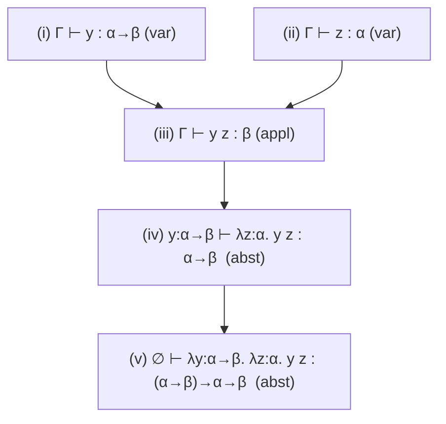
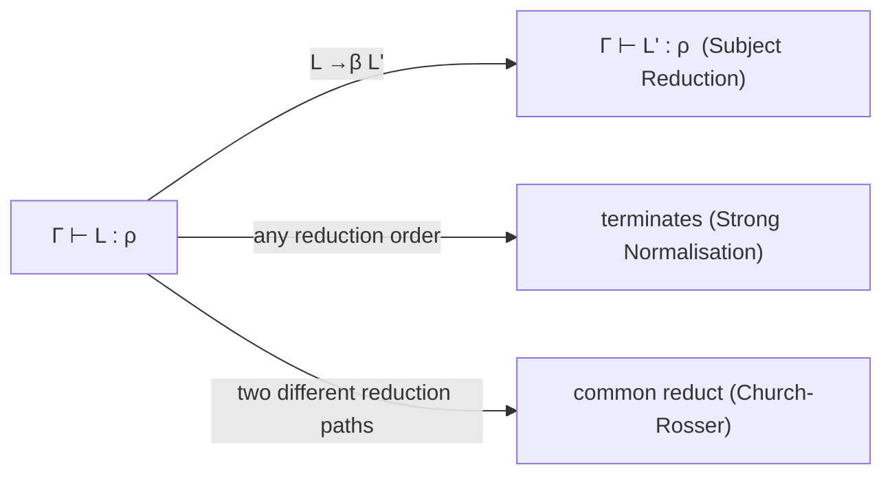
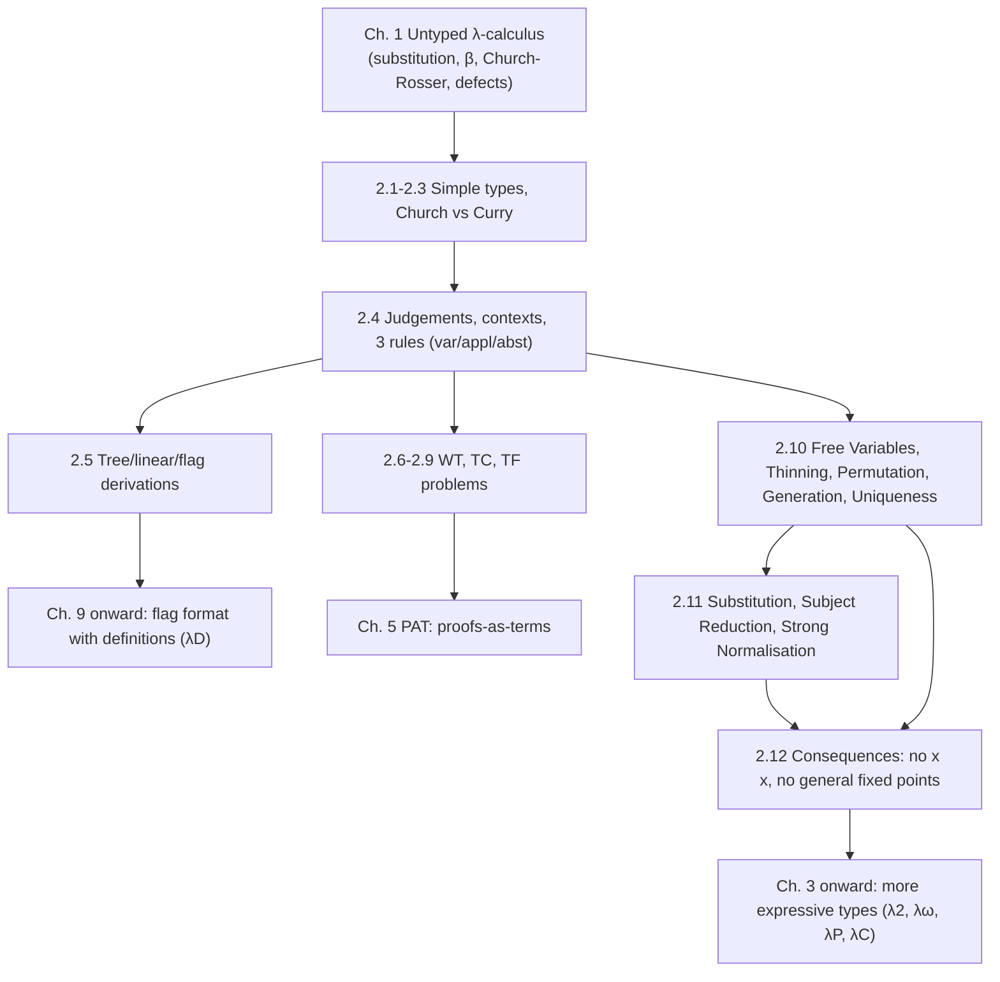

[[book-guidelines|↩ Back to guidelines]]

# Simple Types and the Simply Typed Lambda Calculus ($\lambda\to$)

> Focus Areas: `type-theory` (primary), `automated-reasoning` (type checking as proof checking; term finding as proof search; unification in Curry typing).

## 0. The problem this chapter solves

Untyped $\lambda$-calculus is a beautiful, tiny model of computation, and it is *too liberal*. The book's Chapter 1 ended with a list of defects (Section 1.11):

- you can apply a term to itself, $x\,x$;
- reduction need not terminate, e.g. $(\lambda x.\,x\,x)(\lambda x.\,x\,x)$;
- every term has a fixed point (the Fixed Point Theorem), which is wonderful for computation and fatal for logic.

The book's intuition for the cure is ordinary mathematics: functions live on a *domain*. "Square" on $\mathbb{N}$ accepts $3$ and rejects $3\tfrac12$. Restricting inputs is what a type does. Nederpelt and Geuvers say up front that simple types are a first step and are "in several senses too restrictive". We trade expressive power for good behaviour, and the rest of the book (Chapters 3 onward) buys power back in controlled steps.

Think of it as the type checker you already know: a function has a declared input type and output type, and a call is legal only if the argument matches. $\lambda\to$ is that, with nothing else.

## 1. Simple types (book 2.2)

**What problem does the syntax solve?** We need a language of "shapes of values" that is just rich enough to describe functions of functions. Start with a pool of atomic types and one way to combine types.

Fix an infinite set of **type variables** $V = \{\alpha, \beta, \gamma, \dots\}$. They stand for basic types like `nat` or `list`.

**Definition 2.2.1 (the set $\mathbb{T}$ of simple types).**

1. (type variable) if $\alpha \in V$ then $\alpha \in \mathbb{T}$;
2. (arrow type) if $\sigma, \tau \in \mathbb{T}$ then $(\sigma \to \tau) \in \mathbb{T}$.

Abstract syntax: $\mathbb{T} = V \mid \mathbb{T} \to \mathbb{T}$. Examples from the book: $\gamma$, $(\beta\to\gamma)$, $((\gamma\to\alpha)\to(\alpha\to(\beta\to\gamma)))$.

Conventions (Notation 2.2.2): $\sigma,\tau$ range over types; outermost parentheses are dropped; **the arrow is right-associative**, so $\alpha_1\to\alpha_2\to\alpha_3\to\alpha_4$ means $\alpha_1\to(\alpha_2\to(\alpha_3\to\alpha_4))$. Application is *left*-associative: $x_1x_2x_3x_4 = (((x_1x_2)x_3)x_4)$. These two conventions are not an accident (Remark 2.2.8). If $f : \rho\to\sigma\to\tau$, $x:\rho$, $y:\sigma$, then $f\,x : \sigma\to\tau$ and $(f\,x)\,y : \tau$, so $f\,x\,y : \tau$ reads with no parentheses at all. Currying is baked into the notation.

Meaning of arrow types: $\mathtt{nat}\to\mathtt{real}$ is "all functions from naturals to reals". The book also draws a distinction worth keeping: the *set* $\mathbb{N}$ belongs to the real world of mathematics, the *type* `nat` is its coding in the virtual world of programming (Remark 2.2.4). "Sets versus types" recurs through the whole book.

**Statements.** To say "term $M$ has type $\sigma$" we add the form $M : \sigma$. Each variable gets one type, $x:\sigma$ and $x:\tau$ forces $\sigma\equiv\tau$.

### Where the typing rules come from

The book derives [[Polymorphism-and-Higher-Order-Typed-Lambda-Calculi#The rules|the rules]] from two obvious demands, before it writes any inference-rule notation. Do the same.

- **Application** $M\,N$: $M$ must be a function, say $M:\sigma\to\tau$. $N$ must be a valid input, $N:\sigma$. Then $M\,N:\tau$. Two side conditions (Remark 2.2.5): the left side has an arrow type, and the right side matches that arrow's domain.
- **Abstraction** $\lambda x.\,M$: if $x:\sigma$ and $M:\tau$ then $\lambda x.\,M:\sigma\to\tau$.

So *it suffices to give types to variables*; the types of everything else are then computed (if they exist).

**What breaks without the side conditions?** Self-application. If $x\,x$ were typable, the first $x$ would need type $\sigma\to\tau$ and the second $\sigma$. Since a variable has one type, $\sigma\to\tau\equiv\sigma$, which is impossible (Example 2.2.6(3)). That is the first untyped defect gone, by a two-line argument. A term with some type is called **typable** (Def. 2.2.7).

### Grounding: types as a Rust enum

The type grammar is literally an `enum`. Note the right-associativity is only a parsing convention, so the AST has no associativity at all, just nesting.

```rust
#[derive(Clone, PartialEq, Eq, Debug)]
enum Ty {
    Var(String),            // alpha, beta, ... (basic types)
    Arrow(Box<Ty>, Box<Ty>) // sigma -> tau
}

// alpha -> beta -> gamma  ==  alpha -> (beta -> gamma)
fn curried(a: Ty, b: Ty, c: Ty) -> Ty {
    Ty::Arrow(Box::new(a), Box::new(Ty::Arrow(Box::new(b), Box::new(c))))
}
```

The same shape in Lean is `α → β → γ`, which also parses right-associatively. Lean's arrow is a special case of its $\Pi$-type, which the book reaches in Chapter 3.

## 2. Church typing versus Curry typing (book 2.3)

**What problem?** Types have to come from somewhere. There are two answers.

1. **Church (explicit) typing.** Every variable is declared with its type when it is introduced: $\lambda x:\sigma.\,M$. The type of a bigger term then follows by calculation.
2. **Curry (implicit) typing.** Terms stay untyped. Types are *found by search*, with guesses for variable types.

Book example 2.3.1. Church style: take $x:\alpha\to\alpha$, $y:(\alpha\to\alpha)\to\beta$, $z:\beta$, $u:\gamma$. Then $y\,x:\beta$, $\lambda zu.\,z:\beta\to\gamma\to\beta$, and $(\lambda zu.\,z)(y\,x):\gamma\to\beta$.

Curry style, same untyped term $M\equiv(\lambda zu.\,z)(y\,x)$ with no types given. Walk through it as constraint collection:

- $M$ is an application, so $\lambda zu.\,z : A\to B$ and $y\,x : A$, giving $M : B$;
- $\lambda zu.\,z : A\to B$ means $z:A$ and $\lambda u.\,z : B$, so $B\equiv C\to D$ with $u:C$, $z:D$;
- $y\,x$ is an application: $y:E\to F$, $x:E$, $y\,x:F$;
- equalities collected: $A\equiv D$ (both types of $z$) and $A\equiv F$.

Result: the general scheme $(*)$ $x:E,\ y:E\to A,\ z:A,\ u:C$ with $M:C\to A$. Every instance of it is a valid typing, so there is a *family* of types (the book lists three). **Under Curry typing a term does not have a unique type.** This is exactly the constraint-generation-then-solve pattern you will build in the compiler: generate equations between type metavariables ($A,B,C,D,E,F$ above are metavariables), then solve them.

The book then states its decision: **the main text uses Church typing**, "because in real-life situations from mathematics and logic, types are usually fixed and given beforehand". Curry typing is revisited only in the Further Reading section (Section 2.14, below).

**What breaks without explicit annotations?** Decidability stays, but you have to run unification. And in the richer systems of later chapters ([[Dependent-Types|dependent types]]) inference without annotations is undecidable in general; that is why this book commits to Church style.

**Pre-typed terms (Def. 2.4.1).** Since bound variables now carry types, the term set changes:

$$\Lambda_{\mathbb{T}} = V \mid (\Lambda_{\mathbb{T}}\,\Lambda_{\mathbb{T}}) \mid (\lambda V:\mathbb{T}.\,\Lambda_{\mathbb{T}}).$$

They are "pre-typed" because *syntactically valid does not mean typable*: $\lambda x:\alpha.\,x\,x$ is in $\Lambda_{\mathbb{T}}$ and is not legal.

```rust
enum Term {
    Var(String),
    App(Box<Term>, Box<Term>),
    Abs(String, Ty, Box<Term>), // lambda x : sigma . M
}
```

## 3. Judgements, statements, contexts (book 2.3-2.4)

**Why contexts?** A term can have free variables. "What is the type of $y\,x$?" has no answer until you know the types of $y$ and $x$. A bound variable gets its type at its binder, but a free one needs it from the environment. The book solves this by splitting "who tells you the type" into *binders* (inside the term) and a *context* (outside the term).

**Definition 2.4.2.**

1. A **statement** is $M:\sigma$ with $M\in\Lambda_{\mathbb{T}}$, $\sigma\in\mathbb{T}$. $M$ is the **subject**, $\sigma$ the **type**.
2. A **declaration** is a statement whose subject is a variable.
3. A **context** is a *list* of declarations with *different* subjects.
4. A **judgement** has the form $\Gamma\vdash M:\sigma$ ("in context $\Gamma$, $M$ has type $\sigma$").

Example context: $x_1:\alpha,\ x_2:\alpha\to\beta,\ x_3:(\beta\to\alpha)\to\beta$. It may be empty, written $\emptyset$.

Two design points that matter later:

- The subject variables in a context act as *binders* for the free variables of the term, and the Barendregt convention (all bound and binding variables distinct) is kept. This is the book's answer to variable capture.
- **Contexts are ordered lists, not sets.** Remark 2.10.6 says the classical treatment uses unordered *bases*, but the book prefers lists "because richer systems have dependent declarations, so there the order is important". In $\lambda\to$ order is irrelevant (Permutation, below); in a dependent system $x:A,\ y:B(x)$ is not the same as $y:B(x),\ x:A$. Your elaborator's context will be a list for this reason.

```rust
type Ctx = Vec<(String, Ty)>; // ordered; subjects distinct in the book's setup
```

## 4. The derivation rules for $\lambda\to$ (book 2.4)

The three rules are the formalisation of Section 1's discussion. A rule has premisses above a line and a conclusion below. A rule with no premisses is just written as its conclusion.

**Definition 2.4.5.**

$$\textbf{(var)}\quad \Gamma \vdash x:\sigma \quad\text{if } (x:\sigma)\in\Gamma$$

$$\textbf{(appl)}\quad \frac{\Gamma\vdash M:\sigma\to\tau\qquad \Gamma\vdash N:\sigma}{\Gamma\vdash M\,N:\tau}$$

$$\textbf{(abst)}\quad \frac{\Gamma,\ x:\sigma\vdash M:\tau}{\Gamma\vdash \lambda x:\sigma.\,M:\sigma\to\tau}$$

The rules are *schemes*: they hold for arbitrary $\Gamma,\sigma,\tau,x,M,N$, and using one means exhibiting actual instances.

Reading each rule:

- **(var)** reads a declaration out of the context. No premisses, so every derivation starts here.
- **(appl)** is the earlier application discussion, with the same $\Gamma$ in both premisses.
- **(abst)** is the interesting one. The *context gets smaller* going down: the premiss has $\Gamma,x:\sigma$, the conclusion only $\Gamma$. Why? In the premiss, $M$ stands alone, and $x$ may occur free in it, so we need $x$'s type in the context. In the conclusion, $x$ is bound by the $\lambda$ and its type lives inside the term.

**What breaks without the context shrinking?** If $x:\sigma$ stayed in the context after being bound, "the context" would stop describing only free variables, and the Free Variables Lemma below ($\mathrm{FV}(L)\subseteq\mathrm{dom}(\Gamma)$ with the right direction of use) would lose its meaning.

### Worked derivation (Example 2.4.6)

Type of $\lambda y:\alpha\to\beta.\ \lambda z:\alpha.\ y\,z$:

1. $y:\alpha\to\beta,\ z:\alpha \vdash y : \alpha\to\beta$ (var)
2. $y:\alpha\to\beta,\ z:\alpha \vdash z : \alpha$ (var)
3. $y:\alpha\to\beta,\ z:\alpha \vdash y\,z : \beta$ (appl on 1, 2)
4. $y:\alpha\to\beta \vdash \lambda z:\alpha.\,y\,z : \alpha\to\beta$ (abst on 3)
5. $\emptyset \vdash \lambda y:\alpha\to\beta.\ \lambda z:\alpha.\ y\,z : (\alpha\to\beta)\to\alpha\to\beta$ (abst on 4)

The tree has the shape of the term. There is "a strong parallel": three kinds of term (variable, application, abstraction), three rules.



Here $\Gamma = y:\alpha\to\beta,\ z:\alpha$. Book Figure 2.1 draws exactly this tree.

**Two readings of a rule (Remark 2.4.7).** *Top to bottom*: from known judgements derive new ones. This makes derivable judgements an *inductively defined set*. *Bottom to top*: use a rule as a recipe to *find* a derivation of a goal. Hold on to this duality. The first is checking, the second is search, and your tooling will need both.

**Legal terms (Def. 2.4.10).** $M\in\Lambda_{\mathbb{T}}$ is *legal* if there exist $\Gamma,\rho$ with $\Gamma\vdash M:\rho$. Legal is the typed analogue of "well-formed".

### The same rules, three times: maths, logic, programs (Examples 2.4.8, 2.4.9)

- **Mathematics.** Read $A\to B$ as the set of functions. (func-appl): $f\in A\to B,\ c\in A\Rightarrow f(c)\in B$. (func-abst): if for arbitrary $x\in A$, $f(x)\in B$, then $f\in A\to B$. Same shape as (appl) and (abst), with $\Gamma = x:A$ for the "arbitrary $x$".
- **Logic.** Read $A\to B$ as [[Dependent-Types#Implication|implication]] $A\Rightarrow B$. Then (appl) is $\Rightarrow$-elimination (Modus Ponens), and (abst) is $\Rightarrow$-introduction: *assume $A$, derive $B$, conclude $A\Rightarrow B$*. The extension of the context with $x:\sigma$ in (abst)'s premiss matches the **flag** that marks an assumption in natural deduction, and the **flagpole** delimits the assumption's scope.

This is the first appearance of the idea the book names PAT (propositions-as-types, proofs-as-terms; developed in Section 5.4). Types are propositions and terms are proofs. The point to absorb for your project: **a type checker for $\lambda\to$ is already a proof checker for implicational logic.** Same rules, same data structure.

## 5. Derivation formats: tree, linear, flag (book 2.5)

**What problem?** Trees sprawl across the page; and contexts get copied on every line.

1. **Tree format**: follows the rules directly. Good for seeing build-up, bad for large derivations.
2. **Linear format**: number the judgements $(i),(ii),\dots$ and annotate with the rule and the lines used. The dependency between judgements is a strict partial order (irreflexive, asymmetric, transitive), so lines may be reordered as long as premisses precede conclusions.
3. **Flag format**: remove the repeated contexts by drawing each declaration as a *flag*; its scope is the flagpole. The derivation above in flag notation:

```text
(a)   | y : α → β
(b)   |   | z : α
(1)   |   |   y : α → β                          (var) on (a)
(2)   |   |   z : α                              (var) on (b)
(3)   |   |   y z : β                            (appl) on (1) and (2)
(4)   |   λz : α . y z : α → β                   (abst) on (3)
(5)   λy : α → β . λz : α . y z : (α→β)→α→β      (abst) on (4)
```

The book also allows the **shortened** flag form where (var) steps are silent (line (3) becomes "(appl) on (a) and (b)"). It will use the flag format almost everywhere from here on, especially once definitions arrive in Chapter 9.

Engineering reading: a flag derivation is a *scoped* proof script. Each flag is a `push` onto the context stack, each flagpole's end is a `pop`. That is precisely how the (abst) rule's context handling is implemented in a checker (see the Rust below).

## 6. Three problems: WT, TC, TF (book 2.6-2.9)

**What problem?** Once you have judgements $\Gamma\vdash M:\sigma$, there are three "holes" you can leave in one.

| Problem | Shape | Given | Find / decide |
|---|---|---|---|
| **Well-typedness** (typability) (WT) | $?\vdash M : ?$ | term | a context and type, or why none |
| variant: **Type Assignment** | $\Gamma\vdash M : ?$ | context, term | the type |
| **Type Checking** (TC) | $\Gamma\vdash M : \sigma\ ?$ | all three | yes/no |
| **Term Finding / Inhabitation** (TF) | $\Gamma\vdash\ ? : \sigma$ | context, type | a term, or none |

When $\Gamma=\emptyset$, TF asks: does a closed term of type $\sigma$ exist? Reading $\sigma$ as a proposition (Section 4), this is **provability of $\sigma$**.

**All three are decidable in $\lambda\to$** (Theorem 2.10.10, proofs delegated to Barendregt 1992, Propositions 4.4.11 and 4.4.12). The book stresses that in the richer systems later in the book, **Term Finding is the real problem and is undecidable in many cases**.

### 6.1 Well-typedness: solve backwards (Section 2.7)

Goal: show $M\equiv\lambda y:\alpha\to\beta.\ \lambda z:\alpha.\ y\,z$ legal. Guess $\Gamma\equiv\emptyset$ (no free variables), leave the type as a hole $?$. Then work **bottom-up using the rules as recipes**:

1. Outermost is a $\lambda$, only (abst) concludes an abstraction. New goal: type of $\lambda z:\alpha.\,y\,z$ with $y:\alpha\to\beta$ in context.
2. Again a $\lambda$: (abst). New goal: type of $y\,z$, with $z:\alpha$ also in context.
3. An application, only (appl). Two sub-goals, $y:?_1$ and $z:?_2$. Both by (var). Check the side condition: $?_1=\alpha\to\beta$ must be an arrow whose domain $\alpha$ matches $?_2=\alpha$. Result $\beta$.
4. Unwind: types $\alpha\to\beta$, then $(\alpha\to\beta)\to\alpha\to\beta$.

Failure (Remark 2.7.1): if $z$ had been declared $\beta$ instead of $\alpha$, step 3's match fails and the term is **not typable**. Remark 2.7.2: derivations are not unique (any $\Gamma$ will do for the start, line order can swap, detours exist), but for a given term the *type* in a given context will be unique (Section 8).

**Why this works.** The term's top constructor determines which rule can be last. That is the *syntax-directedness* the Generation Lemma makes precise (Section 8).

### 6.2 Type checking (Section 2.8)

Check $x:\alpha\to\alpha,\ y:(\alpha\to\alpha)\to\beta\vdash(\lambda z:\beta.\lambda u:\gamma.z)(y\,x):\gamma\to\beta$. Apply (appl) with two holes $?_1$ (for the function) and $?_2$ (for the argument). Solve $?_2$: $y\,x:\beta$. Solve $?_1$ with two (abst): $\lambda z:\beta.\lambda u:\gamma.z:\beta\to\gamma\to\beta$. Then the pending side condition (marked $(?)$ in the book) is checked: argument type $\beta$ matches domain $\beta$. Done. The book notes one subtlety: some (var) uses can be silent, but the (var) in line (1) cannot be suppressed since line (2) needs it.

### 6.3 Term finding as proof search (Section 2.9)

Find an inhabitant of $A\to B\to A$ in the empty context. Goal is an arrow type, so **(abst) is the first try**:

```text
(a)   | x : A
(b)   |   | y : B
(1)   |   |   x : A                         (var) on (a)
(2)   |   λy : B . x : B → A                (abst) on (1)
(3)   λx : A . λy : B . x : A → B → A       (abst) on (2)
```

In words: assume $x$ proves $A$; assume $y$ proves $B$; $x$ still proves $A$; so $\lambda y:B.\,x$ proves $B\to A$; so $\lambda x:A.\lambda y:B.\,x$ proves $A\to B\to A$. This is PAT in action. Observations (Remarks 2.9.1, 2.9.2):

- The final term **codes the entire proof**: the derivation can be reconstructed from it, and the proposition proved is its type, computable by decidability of WT. That is a *proof certificate*.
- WT and TC proceed *from term to type*: simplify the term until you can type it, then compute types back up. TF proceeds *from type to term*: simplify the type (strip arrows via (abst)) until you can find an inhabitant, then build terms back up (Figure 2.2).

Grounded in Lean, the *same* thing is just a term:

```lean
-- Church-style: binder types written out
example (A B : Prop) : A → B → A := fun (x : A) (y : B) => x

-- Same, with the types as plain Type (programs, not proofs)
def K {α β : Type} : α → β → α := fun x _ => x
```

(Outside the book: for the implicational fragment, term finding is PSPACE-complete; decidable but not cheap. Statman, 1979.)

Rust sketch of backward search for the arrow-only fragment (a deliberately naive illustration of "bottom-to-top reading"; it terminates only because it limits depth, as plain backward chaining can loop):

```rust
// Goal: find M with  ctx |- M : goal.  Returns a closed-over term if found.
fn find(ctx: &mut Ctx, goal: &Ty, depth: u32, fresh: &mut u32) -> Option<Term> {
    if depth == 0 { return None; }
    if let Ty::Arrow(dom, cod) = goal {
        // (abst) read bottom-to-top: assume x : dom, prove cod
        let x = format!("x{}", { *fresh += 1; *fresh });
        ctx.push((x.clone(), (**dom).clone()));
        let body = find(ctx, cod, depth - 1, fresh);
        ctx.pop();
        return body.map(|b| Term::Abs(x, (**dom).clone(), Box::new(b)));
    }
    // goal is a type variable: try each hypothesis whose result type ends in goal
    for (name, ty) in ctx.clone() {
        // collect argument types of ty = a1 -> ... -> an -> r
        let (args, res) = spine(&ty);
        if &res != goal { continue; }
        let mut t = Term::Var(name);
        let mut ok = true;
        for a in args {
            match find(ctx, &a, depth - 1, fresh) {
                Some(arg) => t = Term::App(Box::new(t), Box::new(arg)),
                None => { ok = false; break; }
            }
        }
        if ok { return Some(t); }
    }
    None
}

fn spine(t: &Ty) -> (Vec<Ty>, Ty) {
    let mut args = vec![];
    let mut cur = t.clone();
    while let Ty::Arrow(a, r) = cur { args.push(*a); cur = *r; }
    (args, cur)
}
```

This is exactly the "uses hypotheses (var)/(appl), introduces assumptions (abst)" loop of a natural-deduction prover. A real prover needs loop checking or the usual sequent-calculus refinements; that is outside this chapter, but it is where this very idea leads.

## 7. Induction on derivations (book 2.10, "structural induction")

The book takes a moment to teach the proof method used for *every* lemma in this chapter, because it will be used for the rest of the book. Derivations are inductively defined, so to prove a property $P$ for every derivable judgement:

- assume $P$ holds for the premisses (the *induction hypothesis*);
- show $P$ holds for the conclusion, **for each rule** (three cases here: var, appl, abst).

The (var) case has no premisses, so there is no hypothesis; it must hold outright. Remark 2.10.4: though it looks backwards, it is a forward flow: $P$ is handed down from premisses to conclusion through the derivation.

Compare with writing a recursive function over the `Term` enum: induction on derivations is *structural recursion* with three match arms, and the proof is a program whose arms correspond to the rules.

## 8. General properties of $\lambda\to$ (book 2.10)

**Context vocabulary (Def. 2.10.1).** $\mathrm{dom}(\Gamma)$ is the list of subjects. $\Gamma'\subseteq\Gamma$ (subcontext: all declarations of $\Gamma'$ occur in $\Gamma$ in the same order). A *permutation* has the same declarations in any order. The *projection* $\Gamma\upharpoonright\Phi$ keeps declarations whose subject is in the variable set $\Phi$.

**Lemma 2.10.3 (Free Variables Lemma).** If $\Gamma\vdash L:\sigma$ then $\mathrm{FV}(L)\subseteq\mathrm{dom}(\Gamma)$. Proof by induction on the derivation: (var) is immediate from $x:\sigma\in\Gamma$; (appl) uses $\mathrm{FV}(MN)=\mathrm{FV}(M)\cup\mathrm{FV}(N)$; (abst) uses $\mathrm{FV}(\lambda x:\sigma.M)=\mathrm{FV}(M)\setminus\{x\}$ and the hypothesis $\mathrm{FV}(M)\subseteq\mathrm{dom}(\Gamma)\cup\{x\}$. So every free variable has a declared type; no confusion is possible.

**Lemma 2.10.5 (Thinning, Condensing, Permutation).**

1. *Thinning*: $\Gamma'\subseteq\Gamma''$ and $\Gamma'\vdash M:\sigma$ imply $\Gamma''\vdash M:\sigma$. (Adding unused declarations is harmless.)
2. *Condensing*: $\Gamma\vdash M:\sigma$ implies $\Gamma\upharpoonright\mathrm{FV}(M)\vdash M:\sigma$. (Removing unused declarations is harmless.)
3. *Permutation*: if $\Gamma'$ is a permutation of $\Gamma$ and $\Gamma\vdash M:\sigma$ then $\Gamma'\vdash M:\sigma$. (Order is irrelevant in $\lambda\to$.)

The book informally summarises 1+2 as "add or remove junk" (declarations of variables that do not occur free). The proof of Thinning's (abst) case needs the fresh-variable side condition $x\notin\mathrm{dom}(\Gamma'')$, which is solved by renaming $x$ (the Barendregt convention at work).

**Lemma 2.10.7 (Generation Lemma).** Inversion of the rules:

1. $\Gamma\vdash x:\sigma$ implies $x:\sigma\in\Gamma$.
2. $\Gamma\vdash M\,N:\tau$ implies there is $\sigma$ with $\Gamma\vdash M:\sigma\to\tau$ and $\Gamma\vdash N:\sigma$.
3. $\Gamma\vdash\lambda x:\sigma.M:\rho$ implies there is $\tau$ with $\Gamma,x:\sigma\vdash M:\tau$ and $\rho\equiv\sigma\to\tau$.

Proof: inspect the rules. The book calls this **syntax-directedness**: for each term shape only one rule can conclude it. It is why a type checker can be a plain recursive function (no search), and why decidability is cheap here.

**Lemma 2.10.8 (Subterm Lemma).** Every subterm of a legal term is legal (Exercise 2.16). Note it may be legal in a *different* context and type.

**Lemma 2.10.9 (Uniqueness of Types).** $\Gamma\vdash M:\sigma$ and $\Gamma\vdash M:\tau$ imply $\sigma\equiv\tau$. Proved by induction on $M$ using Generation (Exercise 2.17). It fails in Curry's system, as the $(\lambda zu.z)(y x)$ example showed.

**Theorem 2.10.10 (Decidability).** WT, Type Assignment, TC and TF are all decidable in $\lambda\to$.

### Grounding: a Rust type checker, rule for rule

Generation + Uniqueness are the license to write a *function* `infer` instead of a relation. One match arm per rule:

```rust
#[derive(Debug)]
enum TypeError {
    Unbound(String),
    NotAFunction(Ty),
    Mismatch { expected: Ty, found: Ty },
}

fn infer(ctx: &mut Ctx, t: &Term) -> Result<Ty, TypeError> {
    match t {
        // (var): look the declaration up. Searching from the end makes the
        // most recent binding win, which is the usual way to implement
        // "rename to keep subjects distinct" without explicit renaming.
        Term::Var(x) => ctx.iter().rev()
            .find(|(n, _)| n == x)
            .map(|(_, ty)| ty.clone())
            .ok_or_else(|| TypeError::Unbound(x.clone())),

        // (appl): M : sigma -> tau   and   N : sigma   ==>   M N : tau
        Term::App(m, n) => {
            let tm = infer(ctx, m)?;
            let tn = infer(ctx, n)?;
            match tm {
                Ty::Arrow(dom, cod) if *dom == tn => Ok(*cod),
                Ty::Arrow(dom, _) => Err(TypeError::Mismatch { expected: *dom, found: tn }),
                other => Err(TypeError::NotAFunction(other)),
            }
        }

        // (abst): push the flag, type the body, pop the flag
        Term::Abs(x, sigma, body) => {
            ctx.push((x.clone(), sigma.clone()));
            let tau = infer(ctx, body);
            ctx.pop();
            Ok(Ty::Arrow(Box::new(sigma.clone()), Box::new(tau?)))
        }
    }
}
```

Mapping: the three arms are the three rules; the two `Err` arms of `App` are Remark 2.2.5's two side conditions; `push`/`pop` is the flag and flagpole; the recursion is the induction of Section 7. Type equality `*dom == tn` is **structural equality on types**, which is all that "definitional equality" is in this system. Later chapters (Chapter 8 onward, conversion rule) make that comparison do real work.

Because $\lambda\to$ is Church-style, this procedure only *infers*. A **bidirectional** checker would add `check(ctx, term, ty)`, using the expected type to avoid writing the annotation on a $\lambda$, and `infer` for variables and applications. The book does not frame it that way, but the rules already read that way: (var) and (appl) synthesise a type, (abst) is naturally "checking mode" against an arrow type (its premiss's $\sigma$ comes from the expected domain), and the explicit $\sigma$ in $\lambda x:\sigma.M$ is exactly what lets (abst) run in inference mode. Lean's elaborator makes this trade: `fun x => x` elaborates only when an expected type is known, so it can supply $x$'s type.

```lean
-- the three failure modes of the Rust checker, as Lean errors:
-- #check fun (x : Nat) => x x      -- application type mismatch / not a function
-- #check fun (x : Nat) => y        -- unknown identifier   (Unbound)
#check fun (x : Nat) (f : Nat → Nat) => f x   -- : Nat → (Nat → Nat) → Nat
```

## 9. Reduction and $\lambda\to$ (book 2.11)

**Typed substitution.** The abstraction clause now carries a type:

$$(\lambda y:\sigma.\,P)[x:=N]\equiv\lambda z:\sigma.\,(P^{y\to z}[x:=N])$$

where $\lambda z:\sigma.P^{y\to z}$ is an $\alpha$-variant of $\lambda y:\sigma.P$ with $z\notin\mathrm{FV}(N)$. Capture-avoidance by renaming, as in Chapter 1.

**Lemma 2.11.1 (Substitution Lemma).** If $\Gamma',x:\sigma,\Gamma''\vdash M:\tau$ and $\Gamma'\vdash N:\sigma$ then $\Gamma',\Gamma''\vdash M[x:=N]:\tau$. Substituting a term of the same type for a context variable preserves the type. Note that the second premiss ($\Gamma'\vdash N:\sigma$ without $x$ in the context) forces $x\notin\mathrm{FV}(N)$ by the Free Variables Lemma, which is why $x:\sigma$ is gone in the conclusion. The proof is by induction on the derivation; the book spells out the (abst) case. The extra $\Gamma''$ is there *to make the (abst) case go through* (the induction hypothesis needs the context extended by $u:\rho$ after $x$), and Permutation lets you shuffle $x:\sigma$ anyway.

**One-step $\beta$-reduction for $\Lambda_{\mathbb{T}}$ (Def. 2.11.2).** Basis: $(\lambda x:\sigma.M)N\to_\beta M[x:=N]$. Compatibility rules as in Chapter 1 (with annotations). *Types play no role in reduction*: the Basis rule does not even require that $x$ and $N$ have the same type.

**Church-Rosser for $\lambda\to$ (Theorem 2.11.3, Corollary 2.11.4).** Since reduction ignores types, the untyped confluence theorem carries over: $M=_\beta N$ implies a common reduct.

**Lemma 2.11.5 (Subject Reduction).** If $\Gamma\vdash L:\rho$ and $L\twoheadrightarrow_\beta L'$ then $\Gamma\vdash L':\rho$. Computation does not change type or typability: "$3+5$ is a natural number, and it remains so after evaluation to $8$". Proof: reduce to a single step and induct on the generation of $L\to_\beta L'$. The Basis case is the interesting one:

1. $\Gamma\vdash(\lambda x:\sigma.M)N:\rho$.
2. Generation (2): $\Gamma\vdash\lambda x:\sigma.M:\tau\to\rho$ and $\Gamma\vdash N:\tau$.
3. Generation (3) on the first: $\Gamma,x:\sigma\vdash M:\varphi$ with $\tau\to\rho\equiv\sigma\to\varphi$, hence $\tau\equiv\sigma$ and $\rho\equiv\varphi$.
4. So $\Gamma,x:\sigma\vdash M:\rho$ and $\Gamma\vdash N:\sigma$.
5. Substitution Lemma: $\Gamma\vdash M[x:=N]:\rho$.

Compatibility cases are Exercise 2.18. Use: from Remark 2.8.1, $(\lambda z:\beta.\lambda u:\gamma.z)(y\,x)\to_\beta\lambda u:\gamma.\,y\,x$, so Subject Reduction immediately gives $x:\alpha\to\alpha,\ y:(\alpha\to\alpha)\to\beta\vdash\lambda u:\gamma.\,y\,x:\gamma\to\beta$ without a new derivation.

**Theorem 2.11.6 (Strong Normalisation / Termination).** Every legal $M$ is strongly normalising: *all* reduction sequences are finite. The book only sketches the idea (a positive measure on legal terms that decreases at each step) and cites Geuvers & Nederpelt 1994, Barendregt 1992 Thm 5.3.33. Remark 2.11.7: a programming-language reading, and a caveat. SN guarantees termination in finite time, but gives no bound on how long; and any programming language powerful enough has non-terminating programs.

Typed vs untyped, a small summary:



```python
# Python sketch: why SN matters for a checker. In a language with SN,
# "evaluate both sides to normal form and compare" always halts,
# so definitional equality is decidable by normalisation.
def normalise(t):
    while (r := step(t)) is not None:   # step() = one beta-reduction, or None
        t = r
    return t                            # guaranteed to terminate for legal terms
```

## 10. Consequences: what was fixed, what was lost (book 2.12-2.13)

Mapping back to the defects of untyped $\lambda$-calculus (Section 1.11):

1. **No self-application.** Suppose $M\,M$ is legal. Generation (2) gives $\Gamma\vdash M:\sigma\to\tau$ and $\Gamma\vdash M:\sigma$. By Uniqueness, $\sigma\to\tau\equiv\sigma$. Impossible: no function type equals its own domain.
2. **Existence of $\beta$-normal forms.** Immediate from Strong Normalisation.
3. **Not every legal term has a fixed point.** The Chapter 1 proof used $(\lambda x.L(x\,x))(\lambda x.L(x\,x))$, which needs self-application, so it no longer works. That alone does not prove some term lacks a fixed point, so the book gives a counterexample. Take $F:\sigma\to\tau$ with $\sigma\neq\tau$, and suppose $F\,M=_\beta M$ with $F\,M$, $M$ legal. Then $M:\sigma$ (Generation + Uniqueness), so $F\,M:\tau$. By Church-Rosser there is $N$ with $F\,M\twoheadrightarrow_\beta N$ and $M\twoheadrightarrow_\beta N$. Subject Reduction twice gives $\Gamma\vdash N:\tau$ and $\Gamma\vdash N:\sigma$, contradicting Uniqueness.

Notice that this last proof uses *four* previously proved results: Generation, Uniqueness, Church-Rosser, Subject Reduction. This is how the lemmas of Section 8 and 9 pay off.

**The price (Section 2.13).** Positives of untyped $\lambda$-calculus survive, but "$\lambda\to$ is much too weak to encapsulate all computable functions and is hence not useable for the formalisation of mathematics". The book states this without proof. (Section 2.14 gives the details; see next section.)

**What breaks without all this?** Compare: drop Uniqueness and you lose the "no fixed point" argument; drop Subject Reduction and a proof that "computes" could silently change which proposition it proves; drop SN and a checker that normalises terms to compare them can loop forever.

## 11. Further reading content (book 2.14)

Items from the chapter's closing section that are directly relevant to your project:

- **History.** Russell's Ramified Theory of Types came first (no $\lambda$-notation). Church simplified it (removed the ramification) to get simple type theory, the language of higher-order logic (Church, 1940).
- **Curry-style inference and unification.** For functional languages, typing à la Curry is the relevant one, since programmers want the compiler to compute types. Hindley, Curry and Milner independently developed the **principal type algorithm**: for a closed untyped $M$, compute a type $\sigma$ or fail; all other types of $M$ are substitution instances of $\sigma$. Wand's exposition reduces type checking to a **unification problem over type expressions**, solved with the most general unifier of Robinson's algorithm.
- **Expressivity.** Natural numbers are the closed terms of type $(\alpha\to\alpha)\to\alpha\to\alpha$, the typed Church numerals $\lambda f:\alpha\to\alpha.\ \lambda x:\alpha.\ f(\dots(f\,x)\dots)$. On them you can define addition and multiplication, "but that's about it": the definable functions are the generalised polynomials (Schwichtenberg, 1976).
- **PCF.** Adding a constant $Y_\sigma:(\sigma\to\sigma)\to\sigma$ for every type with $Y_\sigma f\to f(Y_\sigma f)$ restores Turing-completeness (Plotkin, 1977). It is the usual theoretical basis for functional languages and for studying evaluation strategies (call-by-value versus call-by-name).
- **Normalisation history.** Weak normalisation: Turing (1940s), written up by Gandy. Strong normalisation: Sanchis (1965, publ. 1967). The best-known proof is Tait's semantic one.

A Python sketch of the Curry/Wand idea (constraints + unification), because Rust's ceremony would hide the 20 lines that matter:

```python
import itertools
fresh = (f"t{i}" for i in itertools.count())

def infer(t, env, cs):
    # t: ("var", x) | ("app", m, n) | ("lam", x, body)   -- NO type annotations (Curry)
    if t[0] == "var":
        return env[t[1]]
    if t[0] == "lam":
        a = next(fresh)                              # a fresh type metavariable
        b = infer(t[2], {**env, t[1]: a}, cs)
        return ("->", a, b)
    f = infer(t[1], env, cs); x = infer(t[2], env, cs)
    r = next(fresh)
    cs.append((f, ("->", x, r)))                     # constraint: f must be x -> r
    return r

def unify(a, b, s):
    a, b = walk(a, s), walk(b, s)
    if a == b: return s
    if isinstance(a, str): return occurs_bind(a, b, s)
    if isinstance(b, str): return occurs_bind(b, a, s)
    s = unify(a[1], b[1], s)
    return unify(a[2], b[2], s)
# walk() follows substitutions; occurs_bind() rejects a := ... a ... (the occurs check),
# which is exactly why x x has no simple type (a = a -> r fails).
```

## 12. Synthesis

### Dependency picture



### How it bears on the project

- **Judgements and typing rules as the shared ancestor of a type checker and a proof checker** (`type-theory`, `automated-reasoning`). This chapter is the cleanest place to see it: (appl) is Modus Ponens, (abst) is $\Rightarrow$-introduction, a term is a proof certificate, and `infer` above is a proof checker for implicational logic. The flag format is the pretty-printed proof script.
- **Contexts and substitution plumbing** (`type-theory`). The Substitution Lemma and the Free Variables Lemma are the minimal versions of what Hoare-style soundness and elaboration both need: variable capture is handled by the Barendregt convention here, and by de Bruijn indices or fresh names in your Rust representation. Lists rather than sets for contexts is the decision to carry forward, since dependent types will make order matter.
- **Generation / syntax-directedness = the shape of a checker** (load-bearing for your kernel). Because exactly one rule applies per term constructor, kernel `infer` is a plain recursive function over the AST, and it is small enough to trust. This is the trusted-computing-base argument in miniature.
- **Subject Reduction + Strong Normalisation + Church-Rosser = why definitional equality is decidable** (load-bearing for `isDefEq`). Once your kernel compares types by reducing to normal form, termination (SN) makes the comparison total, confluence makes it order-independent, and subject reduction makes it type-safe. In $\lambda\to$ the type comparison is plain syntactic equality (types do not compute); from Chapter 3/8 on, types contain terms and `isDefEq` must run reduction. This chapter proves the guarantees you will have to re-prove (or inherit) there.
- **Bidirectional typing.** The `infer` function above is the synthesis half; the annotation on $\lambda$ is what makes it work without a `check` mode. Removing the annotation (Curry) forces you into metavariables.
- **Metavariables and unification (Curry typing, Wand/Robinson)** (`type-theory`, `automated-reasoning`). The $E,F,A,B,C,D$ unknowns in Examples 2.3.1(2) are metavariables, and solving $A\equiv D$, $A\equiv F$ is first-order unification on types. This is the first-order ancestor of the elaborator's metavariable unification; Miller pattern unification is the extension for when metavariables stand for functions applied to bound variables. Lean's elaborator uses the expected-type direction to avoid most of this, and unifies the rest.
- **Term finding = proof search** (`automated-reasoning`). The backward use of (abst) and (var)/(appl) in Section 6.3 is the skeleton of proof search for implicational logic. Decidable here; in the richer systems of later chapters it is the undecidable "real problem" the book warns about, which is why your prover will need heuristics, clause simplification and unification on top.
- **Refinement types / constraint generation.** Not in this chapter's source pages; it connects only by the shape: `infer` generates a type, and in your language it will additionally emit verification-condition constraints for the CSP/SMT back end. That is an extension of the idea, not something the book says.

## Where this leads

Chapter 3 extends the type language with $\Pi$-types and polymorphism (terms depending on types, then types depending on types) to regain the expressivity $\lambda\to$ lacks, keeping the same judgement-and-rules machinery. Chapter 5 turns the informal "implication = arrow" of Section 4 into the full propositions-as-types correspondence, and Chapter 9 onward reuses the flag format of Section 5 for definitions in $\lambda D$.
