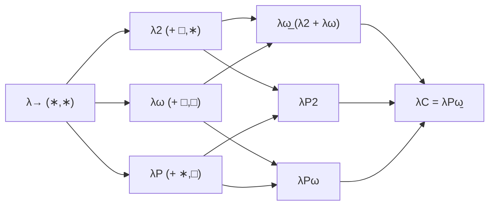
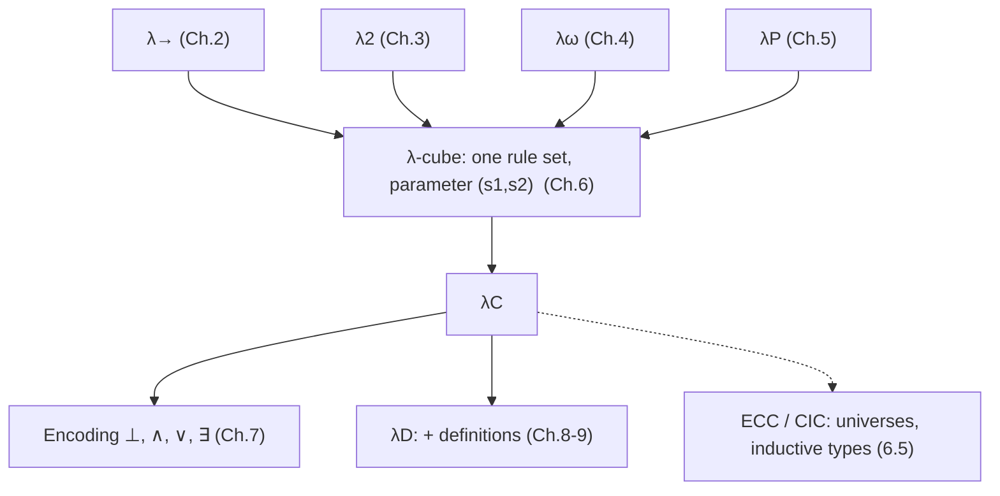

[[book-guidelines|↩ Back to guidelines]]

# The Calculus of Constructions and the Lambda Cube

> Focus Areas: `type-theory`, `automated-reasoning` (per the book-level goals file). Source: Chapter 6 of Nederpelt & Geuvers, re-read from the book. Notation as in the book: $\ast$ is the sort of types, $\square$ the sort of kinds, $\Gamma \vdash A : B$ a judgement, $B[x := N]$ substitution, $=_\beta$ beta conversion.

## 1. The problem: four kinds of dependency, four systems, one more step

Chapters 2-5 built four systems, each adding one way for an expression to depend on another:

| System | Dependency | Programmer's name for it |
|---|---|---|
| $\lambda\to$ | terms on terms | ordinary functions |
| $\lambda 2$ | terms on types | generics / parametric polymorphism |
| $\lambda\omega$ | types on types | type constructors, type-level functions |
| $\lambda P$ | types on terms | [[Dependent-Types|dependent types]] (`Vec n`) |

Each system came with its own rule set, assembled slightly differently. Two questions follow. Can we have all four at once? And can the whole family be described by one set of rules, so that "which system am I in?" becomes a parameter rather than a different logic?

The book's answer is yes to both. The system with everything is $\lambda C$, the Calculus of Constructions (also $\lambda$-Coquand, after Th. Coquand; Coquand & Huet 1988). The family of all eight combinations is the $\lambda$-cube. What breaks without the unification: every property proof (Church-Rosser, subject reduction, ...) would be redone eight times, and nobody could see that a proof assistant's kernel is just one parameter choice away from a polymorphic programming language.

## 2. Sorts and the single formation rule

### 2.1 The rule that changes

$\lambda P$ and $\lambda C$ differ in exactly one rule. In $\lambda P$ the formation rule is

$$\frac{\Gamma \vdash A : \ast \qquad \Gamma, x{:}A \vdash B : s}{\Gamma \vdash \Pi x{:}A.\,B : s}\;(\text{form}_{\lambda P})$$

The premise $A : \ast$ says the bound variable $x$ is a term (level 1), so $\Pi x{:}A.B$ only describes things depending on terms. Compare $\lambda\omega$, which has one sort $s$ in both premises and so allows only term-on-term and type-on-type, never the "cross-overs":

$$\frac{\Gamma \vdash A : s \qquad \Gamma \vdash B : s}{\Gamma \vdash A \to B : s}\;(\text{form}_{\lambda\omega})$$

Replacing $A : \ast$ by $A : s$ is not enough, because $B : s$ already uses the letter $s$ and we want the two choices to be independent. So use two sorts:

$$\frac{\Gamma \vdash A : s_1 \qquad \Gamma, x{:}A \vdash B : s_2}{\Gamma \vdash \Pi x{:}A.\,B : s_2}\;(\text{form}_{\lambda C})$$

with $s_1, s_2 \in \{\ast, \square\}$ chosen independently: four combinations. The result sort is $s_2$, inherited from the body. Two justifications from the book: intuitively, a $\Pi$ over a type should be a type and a $\Pi$ over a kind should be a kind; technically, this copies what (form$_{\lambda P}$) and (form$_{\lambda\omega}$) already do, since there the type of $B$ and of the $\Pi$ coincide. The book flags this as a choice, not a necessity: Berardi and Terlouw's *pure type systems* let the conclusion sort be a separate $s_3$ (section 5 below).

### 2.2 Reading the pair $(s_1, s_2)$

Suppose $\lambda x{:}A.\,b : \Pi x{:}A.B$. Then $A : s_1$ and $B : s_2$, and the pair tells you what kind of dependency the abstraction expresses:

| $x : A : s_1$ | $b : B : s_2$ | $(s_1,s_2)$ | $\lambda x{:}A.b$ is a | from |
|---|---|---|---|---|
| $A : \ast$ | $B : \ast$ | $(\ast,\ast)$ | term depending on a term | $\lambda\to$ |
| $A : \square$ | $B : \ast$ | $(\square,\ast)$ | term depending on a type | $\lambda 2$ |
| $A : \square$ | $B : \square$ | $(\square,\square)$ | type depending on a type | $\lambda\omega$ |
| $A : \ast$ | $B : \square$ | $(\ast,\square)$ | type depending on a term | $\lambda P$ |

Levels check out: for $(\square,\ast)$, $x$ has level 2, $A$ level 3 (it is a kind), $b$ level 1. To classify an abstraction, compute the type $s_1$ of $A$ and the type $s_2$ of the type of $b$; for a $\Pi$, compute the types of $A$ and $B$.

### 2.3 Grounding: the pair as a table lookup

Rust (primary; this is the algorithm shape a checker will take). A pure-type-system checker is parametrised by the set of allowed pairs:

```rust
#[derive(Clone, Copy, PartialEq, Eq)]
enum Sort { Star, Box }              // * and the book's square

#[derive(Clone, PartialEq)]
enum Term {
    Var(String),
    Sort(Sort),
    App(Box<Term>, Box<Term>),
    Lam(String, Box<Term>, Box<Term>),   // \x:A. M
    Pi(String, Box<Term>, Box<Term>),    // Pi x:A. B  (A -> B when x not free in B)
}

struct Pts { rules: Vec<(Sort, Sort)> }  // the only per-system parameter

impl Pts {
    fn lambda_arrow() -> Self { Pts { rules: vec![(Sort::Star, Sort::Star)] } }
    fn lambda_c() -> Self {
        use Sort::*;
        Pts { rules: vec![(Star, Star), (Box, Star), (Box, Box), (Star, Box)] }
    }
}
```

The (form) rule is then a membership test, and the other rules are the same for every system:

```rust
// Sketch: infer Gamma |- t : ?  (names assumed distinct, Barendregt-style;
// a real implementation needs capture-avoiding substitution or de Bruijn indices)
fn infer(&self, ctx: &Ctx, t: &Term) -> Result<Term, Err> {
    match t {
        Term::Sort(Sort::Star) => Ok(Term::Sort(Sort::Box)),      // (sort)  * : []
        Term::Sort(Sort::Box)  => Err(Err::BoxHasNoType),         // [] is the top
        Term::Var(x) => ctx.lookup(x).cloned().ok_or(Err::Unbound), // (var)/(weak)
        Term::Pi(x, a, b) => {                                     // (form)
            let s1 = self.whnf(&self.infer(ctx, a)?).expect_sort()?;
            let s2 = self.whnf(&self.infer(&ctx.extend(x, a), b)?).expect_sort()?;
            if self.rules.contains(&(s1, s2)) { Ok(Term::Sort(s2)) } else { Err(Err::RuleNotAllowed(s1, s2)) }
        }
        Term::App(m, n) => {                                       // (appl)
            let Term::Pi(x, a, b) = self.whnf(&self.infer(ctx, m)?) else { return Err(Err::NotAFunction) };
            let tn = self.infer(ctx, n)?;
            if !self.beta_eq(&tn, &a) { return Err(Err::Mismatch) }  // (conv) lives here
            Ok(subst(&b, &x, n))                                    // B[x := N]
        }
        Term::Lam(x, a, m) => {                                    // (abst)
            let b = self.infer(&ctx.extend(x, a), m)?;
            let pi = Term::Pi(x.clone(), a.clone(), Box::new(b));
            self.infer(ctx, &pi)?;                                  // premise: Pi x:A.B : s
            Ok(pi)
        }
    }
}
```

This is bidirectional typing in its inference mode: the (conv) rule is not a separate step but the `beta_eq` call where an inferred type meets an expected one. It terminates because of strong normalisation, and is sound-and-complete for the declarative rules because of the Generation and Uniqueness lemmas (section 6). The "what breaks" case: delete the `rules.contains` check and every $\Pi$ is formable, including the ones that would make $\ast : \ast$-style paradoxes expressible if you also loosened (sort).

Lean (secondary, but this chapter is itself type-theoretic, so it is the most literal match). Lean's kernel has the same $\Pi$-formation shape with an explicit function on the sorts: for $A : \mathsf{Sort}\,u$ and $B : \mathsf{Sort}\,v$ the type $\Pi x{:}A.B$ lives in $\mathsf{Sort}\,(\mathsf{imax}\;u\;v)$, where $\mathsf{imax}\,u\,0 = 0$ (so quantifying into `Prop` stays in `Prop`, the impredicative case) and otherwise $\max(u,v)$. Compare the book's pairs: $s_2 = \ast$ with any $s_1$ is the impredicative corner ($\lambda 2$ and $\lambda C$ both allow $(\square,\ast)$), which Lean treats as `Prop` (roughly $\ast$) closed under quantification over anything.

Python is not needed here; the Rust table already is the five-line version.

## 3. The Barendregt cube: eight systems from one parameter

The three extensions of $\lambda\to$ (terms on types, types on types, types on terms) are mutually independent, so they form three perpendicular axes (book Figure 6.1). Any subset of them can be added. The only thing that varies is which pairs $(s_1,s_2)$ the (form) rule accepts (book Figure 6.2); $(\ast,\ast)$ is always present.

| System | Allowed $(s_1, s_2)$ |
|---|---|
| $\lambda\to$ | $(\ast,\ast)$ |
| $\lambda 2$ | $(\ast,\ast)$, $(\square,\ast)$ |
| $\lambda\omega$ | $(\ast,\ast)$, $(\square,\square)$ |
| $\lambda P$ | $(\ast,\ast)$, $(\ast,\square)$ |
| $\lambda\underline{\omega}$ | $(\ast,\ast)$, $(\square,\ast)$, $(\square,\square)$ |
| $\lambda P2$ | $(\ast,\ast)$, $(\square,\ast)$, $(\ast,\square)$ |
| $\lambda P\omega$ | $(\ast,\ast)$, $(\square,\square)$, $(\ast,\square)$ |
| $\lambda P\underline{\omega} = \lambda C$ | all four |

(The underline in the book distinguishes $\lambda\underline{\omega} = \lambda 2 + \lambda\omega$ from the plain $\lambda\omega$ of Chapter 4; the PDF text extraction loses it, so I restored it from the surrounding text.)



Each edge adds one allowed pair. Barendregt (1992) found this unifying picture by comparing existing systems: some turned out to be essentially $\lambda 2$, $\lambda\omega$, $\lambda P$, others $\lambda P2$, $\lambda\underline\omega$, $\lambda C$.

**Automath and the cube.** De Bruijn's Automath has all the relevant features of $\lambda P$ and incorporates parts of $\lambda 2$ and $\lambda\omega$; the book places it in the centre of the right-hand lateral face, summarised as Automath $\sim \lambda P + \tfrac12\lambda 2 + \tfrac12\lambda\omega +$ definitions. Definitions are the extra that Chapter 8 argues is indispensable.

**Historical note from section 6.5.** $\mathrm{CC}$ was implemented as a proof checker in the 1980s and combines $\lambda P$ and $\lambda\underline\omega$; it unites ideas of Church, de Bruijn, Martin-Löf and Girard, with higher-order predicate logic and polymorphic data types. The cube was built to make explicit how typing rules correspond to term/type dependencies.

## 4. One rule set for eight systems

The complete rule set (book Figure 6.4). Which system you are in depends only on the pairs permitted in (form):

$$\frac{}{\emptyset \vdash \ast : \square}\;(\text{sort})$$

$$\frac{\Gamma \vdash A : s}{\Gamma, x{:}A \vdash x : A}\;(\text{var}),\; x \notin \Gamma \qquad\quad \frac{\Gamma \vdash A : B \quad \Gamma \vdash C : s}{\Gamma, x{:}C \vdash A : B}\;(\text{weak}),\; x \notin \Gamma$$

$$\frac{\Gamma \vdash A : s_1 \quad \Gamma, x{:}A \vdash B : s_2}{\Gamma \vdash \Pi x{:}A.B : s_2}\;(\text{form})$$

$$\frac{\Gamma \vdash M : \Pi x{:}A.B \quad \Gamma \vdash N : A}{\Gamma \vdash M\,N : B[x := N]}\;(\text{appl}) \qquad \frac{\Gamma, x{:}A \vdash M : B \quad \Gamma \vdash \Pi x{:}A.B : s}{\Gamma \vdash \lambda x{:}A.M : \Pi x{:}A.B}\;(\text{abst})$$

$$\frac{\Gamma \vdash A : B \quad \Gamma \vdash B' : s \quad B =_\beta B'}{\Gamma \vdash A : B'}\;(\text{conv})$$

Three are initialisation rules ((sort), (var), (weak)); the other four are formation, the two basic lambda-calculus rules, and conversion. The $\lambda\omega$ rules of Figure 4.1 are recovered by reading $A \to B$ as an abbreviation of $\Pi x{:}A.B$ and noting $s_1 = s_2 = s$ there. The $\lambda P$ rules of Figure 5.1 are recovered by restricting $s_1 = \ast$. For $\lambda\to$ and $\lambda 2$ a little more work is needed: originally their types were a fixed given set, while in the cube they are built by (sort), (weak), (form); and (conv) is superfluous there since $B =_\beta B'$ implies $B \equiv B'$. The book states that restricting to $\{(\ast,\ast)\}$ and $\{(\ast,\ast),(\square,\ast)\}$ covers the originals precisely.

Pseudo-expressions (Definition 6.3.1):

$$\mathbb{E} ::= V \mid \ast \mid \square \mid (\mathbb{E}\,\mathbb{E}) \mid (\lambda V : \mathbb{E}.\mathbb{E}) \mid (\Pi V : \mathbb{E}.\mathbb{E}).$$

Notation conventions are inherited, including $A \to B$ for $\Pi x{:}A.B$ when $x \notin FV(B)$. This is the "judgment forms and typing rules as ancestor of both type checker and proof checker" thread made concrete: there is one judgement form $\Gamma \vdash A : B$, and "type checker" versus "proof checker" is only a matter of whether you read $B$ as a type or a proposition.

## 5. Pure Type Systems

Section 6.1 and the remark on Berardi and Terlouw mention the generalisation. In a *pure type system* (PTS) the conclusion sort of (form) is a third, independent $s_3$:

$$\frac{\Gamma \vdash A : s_1 \quad \Gamma, x{:}A \vdash B : s_2}{\Gamma \vdash \Pi x{:}A.B : s_3}$$

With two sorts this gives eight possible triples $(s_1,s_2,s_3)$; the cube is the special case $s_3 = s_2$. The book only mentions PTSs in passing and develops nothing beyond this point, so treat the following as pointer rather than content: the same implementation shape as the Rust `Pts` above would carry triples instead of pairs, which is exactly the generalisation proof-assistant kernels exploit when they add more sorts.

Section 6.5 gives two real extensions that live in this territory:

- **Universes / ECC** (Luo 1994). Add super-kinds $\square_i$ ($i \in \mathbb{N}$, identifying $0$ with the old sort $\ast$), $\square_i : \square_{i+1}$, and
$$\frac{\Gamma \vdash A : \square_i \quad \Gamma, x{:}A \vdash B : \square_j}{\Gamma \vdash \Pi x{:}A.B : \square_{\max(i,j)}}$$
The conclusion is $\max(i,j)$, not $j$, because if $j < i$ one can construct a term of type $\bot$. The hierarchy is cumulative: [[Polymorphism-and-Higher-Order-Typed-Lambda-Calculi#The rules|the rules]] $A : \ast \Rightarrow A : \square_0$ and $A : \square_i \Rightarrow A : \square_{i+1}$. $\Sigma$-types in ECC get formation rules at $\ast$ (for $A, B : \ast$) and at $\square_{\max(i,j)}$; "impredicative" $\Sigma$-types such as $\Sigma\alpha{:}\ast.\alpha\to\alpha : \ast$ are disallowed, as they lose consistency.
- **CIC.** $\mathrm{CC}$ had only definable (polymorphic, impredicative) data types, which are less expressive and give no induction principle (it must be added axiomatically). Adding primitive inductive types gives the Calculus of Inductive Constructions (Bertot & Castéran 2004). Coq and similar assistants descend from this, not only from $\lambda P$.

Lean [[Polymorphism-and-Higher-Order-Typed-Lambda-Calculi#Grounding|grounding]]: this is where Lean's design shows through. Lean has a universe hierarchy `Sort u` with level `imax` for the $\Pi$ rule, `Prop` as the impredicative bottom sort, and primitive inductive types in the kernel; in the book's vocabulary Lean is a PTS of the ECC/CIC family, not a plain $\lambda C$.

## 6. Properties of $\lambda C$

The book states the lemmas without proof (the Strong Normalisation proof is four pages in Geuvers 1995 and almost 19 in Barendregt 1992), referring back to Sections 2.10, 2.11 and 4.8 for intuition. Each lemma exists to support one engineering concern.

**Structural lemmas (the plumbing).**

- *Free Variables* (6.3.3): $\Gamma \vdash A : B \Rightarrow FV(A), FV(B) \subseteq \mathrm{dom}(\Gamma)$.
- A context is *well-formed* if it occurs in some derivable judgement (6.3.4).
- *Thinning, Permutation, Condensing* (6.3.5): a derivable judgement stays derivable under a well-formed larger context, under a well-formed permutation, and when a superfluous declaration is removed (here one declaration at a time, unlike the one-sweep projection in $\lambda\to$).
- *Substitution* (6.3.10): from $\Gamma, x{:}A, \Gamma' \vdash B : C$ and $\Gamma \vdash D : A$ conclude $\Gamma, \Gamma'[x := D] \vdash B[x := D] : C[x := D]$. Substitution must reach the later context $\Gamma'$ too.
- *Subexpression* (6.3.8): legal means $\exists \Gamma, N$ with $\Gamma \vdash M : N$ or $\Gamma \vdash N : M$ (typable or inhabited); subexpressions of legal expressions are legal.

**Generation Lemma (6.3.6), the inversion principle.** Four cases, one per syntactic form:

1. $\Gamma \vdash x : C$ gives a sort $s$ and $B$ with $B =_\beta C$, $\Gamma \vdash B : s$, $x{:}B \in \Gamma$.
2. $\Gamma \vdash M N : C$ gives $\Gamma \vdash M : \Pi x{:}A.B$, $\Gamma \vdash N : A$, $C =_\beta B[x := N]$.
3. $\Gamma \vdash \lambda x{:}A.b : C$ gives $s, B$ with $C =_\beta \Pi x{:}A.B$, $\Gamma \vdash \Pi x{:}A.B : s$, $\Gamma, x{:}A \vdash b : B$.
4. $\Gamma \vdash \Pi x{:}A.B : C$ gives $s_1, s_2$ with $C \equiv s_2$, $\Gamma \vdash A : s_1$, $\Gamma, x{:}A \vdash B : s_2$.

Case (4) is new relative to $\lambda\to$ because $\Pi$ is now a term former. The $=_\beta$ in cases 1-3 is the price of (conv). This lemma is what justifies the `infer` function in section 2.3: it says every judgement has a derivation whose last step is the one dictated by the syntax, up to conversion. That is the syntax-directedness that makes type checking an algorithm rather than a proof search.

**Reduction lemmas.**

- *Church-Rosser* (6.3.11): $M \twoheadrightarrow_\beta N_1$ and $M \twoheadrightarrow_\beta N_2$ give $N_3$ with $N_1, N_2 \twoheadrightarrow_\beta N_3$. Corollary 6.3.12: $M =_\beta N$ implies a common reduct $L$. This is what makes $=_\beta$ decidable-by-normalising and (conv) well-behaved.
- *Subject Reduction* (6.3.13): $\Gamma \vdash A : B$ and $A \twoheadrightarrow_\beta A'$ imply $\Gamma \vdash A' : B$. Evaluation does not break typing.
- *Strong Normalisation* (6.3.14): every legal $M$ is strongly normalising. Every reduction sequence from a typable term terminates.
- *Uniqueness of Types up to Conversion* (6.3.9): $\Gamma \vdash A : B_1$ and $\Gamma \vdash A : B_2$ imply $B_1 =_\beta B_2$.

What each buys, in engineer terms: Church-Rosser plus Strong Normalisation means normal forms exist and are unique, so definitional equality is "normalise both sides and compare". Subject Reduction means the normaliser is type-safe. Uniqueness means `infer` need not guess.

**Correctness of Types.** The checklist from the guidelines includes it, but I need to be honest about the source here: in the pages 123-136 the lemma list (6.3.3-6.3.15) does not contain a lemma labelled Correctness of Types. The nearest statements in these pages are the Generation Lemma, case (4) ($C \equiv s_2$ for a $\Pi$-typed claim) and the sentence in the conclusions. The well-known statement is that $\Gamma \vdash A : B$ implies $B \equiv \square$ or $\Gamma \vdash B : s$ for some sort $s$, which is Barendregt 1992 and which the Chapter 2/4 lemmas cover; it is what the (conv) side condition $\Gamma \vdash B' : s$ relies on. I include it here as a recalled standard fact, not as a claim from these pages.

## 7. Decidability, and what stays undecidable

**Theorem 6.3.15.** In $\lambda C$ and its subsystems, *Well-typedness* and *Type Checking* are decidable (van Benthem Jutting 1993). Given a term, or a term plus a type, with or without a context, a program can determine whether a derivation exists and produce it.

The book uses three questions (cf. Section 2.6):

| Question | Input | Decidable? |
|---|---|---|
| Well-typedness | $M$ (and context): is there $A$ with $\Gamma \vdash M : A$? | yes |
| Type checking | $M, A$: does $\Gamma \vdash M : A$ hold? | yes |
| Term finding | $A$: is there $M$ with $\Gamma \vdash M : A$? | decidable in $\lambda\to$ and $\lambda\omega$; **undecidable in all the other systems** |

The argument for undecidability is the Church-Turing one: by propositions-as-types, finding a term of type $M$ is proving the proposition $M$, so a general decision procedure for term finding would decide every mathematical proposition. Hence "humans formulate the types and human intervention is also required to find the inhabitants". Computers still help: they administer the derivation, list open goals, and check that each step follows the rules. That is the specification of a proof assistant, and the book adds that such tools are used for proving programs correct and for developing provably correct programs.

Why the first two being decidable matters for a checker: the trusted kernel only has to *check*, never search. The undecidable part (term finding) is exactly the part you move out of the kernel into tactics and automation, which emit terms the kernel re-checks.

Lean:

```lean
-- Type checking: kernel checks a given term against a given type. Decidable.
theorem k (S : Type) (P : S → Prop) (A : Prop)
    (h : ∀ x, A → P x) : A → ∀ y, P y :=
  fun a y => h y a
-- Term finding: `by` blocks search for such a term. Not decidable in general,
-- so `decide`, `simp`, `omega` etc. are heuristics/fragments that emit terms
-- the kernel re-checks.
```

The term here is the inhabitant of exercise 6.2's type, $(\Pi x{:}S.(A \to P x)) \to A \to \Pi y{:}S.P y$, in context $S{:}\ast, P{:}S\to\ast, A{:}\ast$.

## 8. Worked reading: which corner is a given $\Pi$?

Take the exercise judgement $S{:}\ast,\, P{:}S\to\ast \vdash \lambda x{:}S.\,(P\,x \to \bot) : S \to \ast$ (exercise 6.3), with $\bot \equiv \Pi\alpha{:}\ast.\alpha$ (exercise 6.1).

- $S \to \ast$ is $\Pi x{:}S.\ast$: $S : \ast$ and $\ast : \square$, so pair $(\ast,\square)$, a $\lambda P$ feature (a type family indexed by a term).
- $P\,x \to \bot$: $P\,x : \ast$ and $\bot : \ast$, pair $(\ast,\ast)$.
- $\bot = \Pi\alpha{:}\ast.\alpha$: $\ast : \square$ and $\alpha : \ast$, pair $(\square,\ast)$, a $\lambda 2$ feature (quantifying over all types, impredicatively).

So the judgement needs $\lambda P2$ at least. That mechanical procedure is exactly what the table in section 2.2 summarises, and it is what Rust's `RuleNotAllowed(s1, s2)` error reports when you run the same term in a poorer system. (I derived this reading from the exercise statements; the book leaves the derivation to the reader.)

## 9. Synthesis



What this topic depends on: all four basic systems (Chapters 2-5) and the notions of beta conversion and Church-Rosser from Chapter 1.

How it bears on the goals.

- **`type-theory`, judgments and contexts.** One judgement form, one rule set. The contexts the book requires to be well-formed are exactly the invariant your elaborator's environment type should carry. Substitution and context management are the Substitution and Thinning lemmas; the Rust sketch's naive `subst` shows where variable capture bites.
- **Definitional equality / trusted kernel (load-bearing).** The (conv) rule is the book's definitional equality: $=_\beta$ made decidable by Church-Rosser plus Strong Normalisation. In Lean's kernel this is `isDefEq`; here it is the `beta_eq` call in (appl). Note the book's $\lambda C$ has only $\beta$; Lean adds $\delta$, $\iota$, $\eta$ and proof irrelevance on top. A small kernel that implements section 4 and checks terms is the trusted computing base, and its soundness story is Subject Reduction and Strong Normalisation.
- **`automated-reasoning`, proof certificates.** Decidable type checking but undecidable term finding is the architectural split: a prover or automation searches, emits a $\lambda C$ term, the kernel checks it. The checker never needs to trust the search.
- **Bidirectional typing.** (appl) infers the function's type and checks the argument against the domain; (abst) checks the body once the domain annotation is in the context. The sketch in section 2.3 uses inference mode throughout, and (conv) is where the checking mode meets it.
- **Metavariables and unification.** The book does not treat them here. $\lambda C$'s (appl) needs explicit arguments and has no holes; implicit-argument resolution is an elaborator layer above this kernel, and it will have to solve equations modulo exactly the $=_\beta$ of this chapter. Higher-order unification is where the undecidable term-finding question resurfaces in restricted form (Miller's pattern fragment), but that is outside the pages used.
- **Refinement types, dependent types, $\Pi$-types.** $(\ast,\square)$ and $(\ast,\ast)$ with $\Pi$ cover dependent function types; $(\square,\ast)$ gives the impredicative quantification used to encode logic in the next chapter. Choosing which cube corner (or PTS) your refinement language targets is the choice of which pairs your kernel accepts; keeping $(\square,\ast)$ out buys predicativity at the cost of the encodings of Chapter 7.

Do not force $\Sigma$-types or abstract interpretation onto this chapter; the book mentions $\Sigma$ only in the ECC remark.

## Where this leads

Chapter 7 uses $\lambda C$ to encode $\bot$, negation, $\wedge$, $\vee$ and $\exists$ through second-order quantification, which needs the $(\square,\ast)$ corner added here. Chapters 8-9 extend $\lambda C$ with definitions and $\delta$-reduction to obtain $\lambda D$, the system used for all the formalised mathematics through Bezout's Lemma.

## Checklist against the Topic List entry

- The Barendregt cube: sections 3, 4.
- Sorts and the formation rule: sections 2.1, 2.2, 4.
- A single rule set for eight systems: section 4.
- Pure Type Systems: section 5 (book coverage is a short remark plus ECC/CIC in 6.5).
- Properties of $\lambda C$: section 6.
- Decidability of type checking: section 7.
