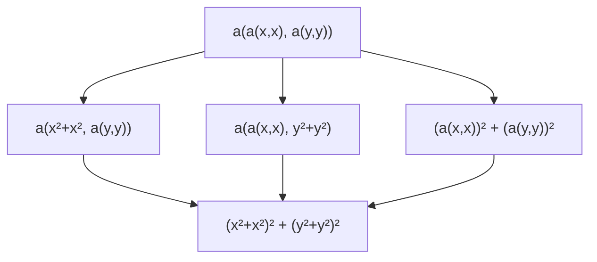
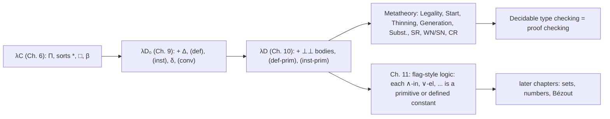

[[book-guidelines|↩ Back to guidelines]]

# Type Theory with Definitions (λD₀ and λD)

> Focus Areas: `type-theory`, `automated-reasoning`. Source: Chapters 9 and 10 of Nederpelt & Geuvers, re-read directly from the book. Notation follows the book: $\ast$ and $\square$ are the two sorts, $\Gamma \vdash M : N$ is a judgement, $B[\vec{x} := \vec{U}]$ is simultaneous substitution, $\overline{x}$ is a list. The book's $\perp\!\!\!\perp$ ("PN", primitive notion) is the missing body of a primitive definition.

## 1. Why definitions have to be part of the *formal* language

By the end of the previous chapters we have $\lambda C$: a small, decidable, strongly normalising dependent type theory in which propositions are types and proofs are terms. It is enough to *encode* mathematics, but nobody can write mathematics in it. Consider what happens without names:

- Every use of "total order" would have to be spelled out as its full $\forall x,y\,(xRy \vee yRx)$ body, and every use of *that* inside a larger statement would be spelled out too. Texts grow exponentially in the depth of [[Polymorphism-and-Higher-Order-Typed-Lambda-Calculi#The definition|the definition]] tree.
- If we only have a *meta-level* abbreviation ("let $T$ stand for ..."), the type checker never sees the name. It cannot check that the name is used with arguments of the right type, and it cannot tell that "`total(ℕ, ≤)`" and "$\forall x,y \in \mathbb{N}\,(x \le y \vee y \le x)$" are the same statement.

The book follows de Bruijn's Automath: make definitions **first-class citizens** of the judgement itself. Chapter 9 does this for *descriptive* definitions (a name with a body), giving the system $\lambda D_0$. Chapter 10 adds *primitive* definitions (a name with only a type, i.e. axioms and primitive notions), giving the final system $\lambda D$ that carries the rest of the book.

Three design questions drive the two chapters. They are worth holding on to, because they are exactly the questions an implementer of a kernel has to answer:

1. **Where do definitions live?** (A new component of the judgement: the environment $\Delta$.)
2. **How are they used?** (An instantiation rule that type-checks the arguments against the parameter list, plus an unfolding relation, $\delta$-reduction, that connects the name to its body.)
3. **Does the extension break the good properties of $\lambda C$?** (Chapter 10: no. Normalisation, confluence, and so on survive.)

## 2. Expressions: constants applied to parameter lists (§9.1)

Start with the grammar. $\lambda D_0$ and $\lambda D$ share one expression set. Besides variables $V$ there is now an infinite, *disjoint* set of constants $C$ (names $a, b, a_1, \ldots$):

$$
E_{\lambda D} = V \mid \square \mid \ast \mid (E_{\lambda D}\,E_{\lambda D}) \mid (\lambda V{:}E_{\lambda D}.\,E_{\lambda D}) \mid (\Pi V{:}E_{\lambda D}.\,E_{\lambda D}) \mid C(\overline{E_{\lambda D}})
$$

The new form is $a(U_1, \ldots, U_n)$: a constant *always* applied to a (possibly empty) list of arguments. In Rust terms this is one new `enum` variant, `Const(Name, Vec<Term>)`, and it is a *node with its own argument list*, not a curried application. That choice (the book calls it the *parameter-list style*) matters later: it is what lets us unfold one occurrence at a time (see §6).

A definition itself is not an expression, it is a **statement about a constant** (Def. 9.1.2):

$$
\overline{x} : \overline{A} \;\vartriangleright\; a(\overline{x}) := M : N
$$

(The book writes the separator $\vartriangleright$ as a turnstile-like symbol; the PDF text extraction drops it, and I restore it from context.) Its parts, with the book's names (Def. 9.1.3):

| Part | Book's name | Role |
|---|---|---|
| $\overline{x} : \overline{A}$ | context of $D$ | the parameters and their types (a telescope: $A_i$ may mention $x_1..x_{i-1}$) |
| $a$ | defined constant | the new name |
| $a(\overline{x})$ | definiendum | the name applied to its own parameters |
| $M$ | definiens / body | what the name stands for |
| $N$ | type of $D$ | the type of both $a(\overline{x})$ and $M$ |
| $M : N$ | statement of $D$ | |

An **environment** $\Delta \equiv D_1, \ldots, D_k$ is a finite list of definitions. Lists, not sets: order is semantically meaningful.

Remark 9.2.4: no recursive definitions. In $D \equiv \overline{x}:\overline{A} \vartriangleright a(\overline{x}) := M : N$ the constant $a$ does not occur in $M$, in any $A_i$, or in $N$. The book defers recursion (Section 14.4 / 14.15). This single restriction is what keeps $\delta$-unfolding terminating.

**What breaks without it:** if bodies could mention their own constant, $a := a$ would be a legal definition and unfolding would loop forever, losing the normalisation result of §9 below.

## 3. Extended judgements: environment $\Delta$ versus context $\Gamma$ (§9.2)

Judgements acquire a prefix (Def. 9.2.1):

$$
\Delta \,;\, \Gamma \vdash M : N
$$

read "$M$ has type $N$ in environment $\Delta$ and context $\Gamma$." Written out: $D_1, \ldots, D_k \,;\, x_1{:}A_1, \ldots, x_n{:}A_n \vdash M : N$.

**Why two separate lists?** (Key Question 1.) They bind different things and have different scoping:

- $\Gamma$ binds the **free variables** of $M$ and $N$.
- $\Delta$ binds the **constants** of $M$, $N$ and of $\Gamma$'s types.

Remark 9.2.2 gives the precise accumulated-[[Simple-Types-and-the-Simply-Typed-Lambda-Calculus#Dependency picture|dependency picture]]:

- A defined constant $a_i$ of $D_i$ may occur in $D_{i+1}, \ldots, D_k$, in the types $A_1..A_n$, in $M$ and in $N$, but **not** in $D_1, \ldots, D_{i-1}$.
- A context variable $x_j$ may occur in later types $A_{j+1}..A_n$, in $M$, in $N$, but **not** in any $D_i$, not in earlier types, and not in its own type $A_j$.

So definitions are *global and closed*: a definition's body may only talk about its own parameters and about earlier constants. A context variable can never leak into the environment. This is the type-theoretic version of "a top-level `def` cannot capture local variables of the proof you happen to be in the middle of."

Rust [[Polymorphism-and-Higher-Order-Typed-Lambda-Calculi#Grounding|grounding]]: this is two stacks passed to every typing function, one global and append-only, one local and scoped.

```rust
struct Judgement<'a> {
    env: &'a Env,                 // Delta: constants, global, append-only
    ctx: &'a [(Name, Term)],      // Gamma: variables, local, scoped
}
```

Lean [[Dependent-Types#Grounding: Lean|grounding: Lean]]'s kernel `Environment` is $\Delta$ (a map from constant names to declarations) and the local context (`LocalContext`, with `fvar`s) is $\Gamma$. The book's separation is the same split.

## 4. Adding a definition: rule (def) (§9.3)

Intuition first. A definition may be added to a derivable judgement only if the definition itself is *good*: its body must really have the claimed type, in the context of its own parameters, and *relative to the environment so far* (since it may use earlier constants). And its name must be fresh.

$$
\frac{\Delta \,;\, \Gamma \vdash K : L \qquad \Delta \,;\, \overline{x}{:}\overline{A} \vdash M : N}{\Delta,\, \overline{x}{:}\overline{A} \vartriangleright a(\overline{x}) := M : N \,;\, \Gamma \vdash K : L}\;\textsf{(def)} \qquad a \notin \Delta
$$

Two premises, two jobs:

- The left premise is the "carrier": the judgement we are *weakening* by a new definition. It ensures $\Delta$ and $\Gamma$ are already healthy.
- The right premise is the actual well-formedness check of the new definition: $M : N$ in the context $\overline{x}{:}\overline{A}$ and the *old* $\Delta$ (this is why recursion is excluded: $a \notin \Delta$ means $a$ cannot be used while checking $M$).

**What breaks without the freshness side-condition:** with $a$ already defined, "which $a$" is ambiguous and $a(U)$ could unfold to two different bodies; $\delta$-reduction would stop being a function-like relation and confluence (§10 below) would fail.

Algorithmic reading (this is what a kernel's "add declaration" function does): check freshness, check that the telescope $\overline{A}$ is well-formed, infer the type of $M$ in that telescope, check it is convertible to $N$. In code:

```rust
use std::rc::Rc;
type Name = String;

#[derive(Clone, Debug, PartialEq)]
enum Term {
    Star,
    Sq,
    Var(Name),
    App(Rc<Term>, Rc<Term>),
    Lam(Name, Rc<Term>, Rc<Term>),
    Pi(Name, Rc<Term>, Rc<Term>),
    Const(Name, Vec<Term>), // a(U1, ..., Un)
}

enum Body {
    Descriptive(Term), // M   (lambda D_0 and lambda D)
    Primitive,         // the "bottom-bottom" body (lambda D only)
}

struct Def {
    ctx: Vec<(Name, Term)>, // x : A
    name: Name,             // a
    body: Body,
    ty: Term,               // N
}

struct Env(Vec<Def>);

#[derive(Debug)]
enum TypeError { NotFresh(Name), Unknown(Name), Arity, Mismatch }

impl Env {
    fn lookup(&self, a: &str) -> Option<&Def> { self.0.iter().find(|d| d.name == a) }

    // rules (def) and (def-prim), read as an algorithm
    fn push(&mut self, d: Def) -> Result<(), TypeError> {
        if self.lookup(&d.name).is_some() { return Err(TypeError::NotFresh(d.name)); }
        match &d.body {
            Body::Descriptive(m) => {
                // Delta ; x:A |- M : N   (old Delta only: no recursion)
                let t = infer(self, &d.ctx, m)?;
                if !conv(self, &t, &d.ty) { return Err(TypeError::Mismatch); }
            }
            Body::Primitive => {
                // Delta ; x:A |- N : s
                infer(self, &d.ctx, &d.ty)?;
            }
        }
        self.0.push(d);
        Ok(())
    }
}
# fn infer(_: &Env, _: &[(Name, Term)], _: &Term) -> Result<Term, TypeError> { todo!() }
# fn conv(_: &Env, _: &Term, _: &Term) -> bool { todo!() }
```

(The two `fn`s at the bottom are placeholders for the rest of the checker; everything else was compile-checked.)

Lean grounding: `def`, `theorem`, `axiom` all end up as `Declaration`s that the kernel's `addDecl` checks: fresh name, then (for a `defnDecl`) type-check the value against the declared type, (for an `axiomDecl`) check that the type is a type. That is (def) and (def-prim) almost literally. One difference: Lean stores the parameters as a $\lambda$ in the body and a $\Pi$ in the type, whereas the book keeps a separate parameter list (see §6 for why the book cares).

## 5. Using a definition: rule (inst) (§9.4)

Intuition: a definition is a *function-like* thing; you use it by supplying arguments. The question is what the arguments must satisfy. The book builds this up in three steps, and the middle step is the subtle one.

**Step 1: arguments are checked against a *telescope*, not a list of independent types.** For $D \equiv x_1{:}A_1, \ldots, x_n{:}A_n \vartriangleright a(\overline{x}) := M : N$ and actual arguments $U_1, \ldots, U_n$:

- $U_1$ must have type $A_1$.
- $U_2$ must have type $A_2[x_1 := U_1]$, because $A_2$ may mention $x_1$ and $x_1$ is being instantiated.
- In general $U_i : A_i[x_1 := U_1, \ldots, x_{i-1} := U_{i-1}]$.

The book's own motivating example (from Section 8.4) is a relation $R$ on a set $S$: instantiating $S$ with a concrete set changes the type required of $R$ from $(S \times S) \to \ast$ to $(\text{that set}\times\text{that set}) \to \ast$. This is the same dependency structure as a dependent record or a Lean structure with fields whose types depend on earlier fields.

**Step 2: tidy the substitution.** Since $x_i, \ldots, x_n$ do not occur in $A_i$, extra "void" substitutions are harmless, and no $x_j$ can occur in any $U_k$ (the $x_j$ are bound inside $D$ and unknown outside). So simultaneous and sequential substitution agree (Remark 9.4.1), and we may write uniformly (Notation 9.4.2) $U_i : A_i[\overline{x} := \overline{U}]$ for all $1 \le i \le n$.

**Step 3: the result type.** $a(\overline{x})$ has type $N$, which may mention the $x_i$, so $a(\overline{U})$ has type $N[\overline{x} := \overline{U}]$. First version (Def. 9.4.4), for a non-empty parameter list:

$$
\frac{\Delta \,;\, \Gamma \vdash \overline{U} : \overline{A}[\overline{x} := \overline{U}]}{\Delta \,;\, \Gamma \vdash a(\overline{U}) : N[\overline{x} := \overline{U}]}\;\textsf{(inst-pos)}
$$

(The numerator is shorthand for $n$ judgements, Notation 9.4.3.)

**The empty-parameter-list trap.** What if $n = 0$? Then there are no premises at all, and the rule would let us derive $\Delta \,;\, \Gamma \vdash a : N$ for *any* $\Delta$ and $\Gamma$, including ill-formed ones. In the non-empty case, the premises vouch indirectly for $\Delta$ and $\Gamma$ (a derivable judgement implies a legal $\Delta;\Gamma$). With no premises, nothing vouches for them.

The fix (Def. 9.4.6, *inst-zero*) is a clever trick: add the cheapest possible judgement that is derivable exactly when $\Delta;\Gamma$ is legal, namely $\Delta \,;\, \Gamma \vdash \ast : \square$. Merging both cases gives the single rule (Def. 9.4.7):

$$
\frac{\Delta \,;\, \Gamma \vdash \ast : \square \qquad \Delta \,;\, \Gamma \vdash \overline{U} : \overline{A}[\overline{x} := \overline{U}]}{\Delta \,;\, \Gamma \vdash a(\overline{U}) : N[\overline{x} := \overline{U}]}\;\textsf{(inst)} \qquad \text{if } \overline{x}{:}\overline{A} \vartriangleright a(\overline{x}) := M : N \in \Delta
$$

This answers Key Question 2. The $\ast : \square$ premise is the "is the context legal?" check. When the list is non-empty it is redundant (a consequence of the other premises), so the book keeps it only for uniformity and for the zero-parameter case.

**What breaks without the $\ast : \square$ premise:** constants with no parameters (like `ℕ`, `0`, `iET`) would be derivable in garbage contexts, and the whole metatheory built on "every judgement has a legal $\Delta;\Gamma$" (Legality Lemma, §8) would fail.

Remark 9.4.5: the constant itself may occur in its arguments, as in $a(a(5))$ or $a(\mathrm{plus}(a(k), a(l)))$. This is nesting, not recursion; the body of $a$ still never mentions $a$.

Rust grounding, the instantiation check as an algorithm over the telescope (the telescope substitution is built once, then each argument is checked against the substituted type):

```rust
fn subst(t: &Term, s: &[(Name, Term)]) -> Term {
    use Term::*;
    match t {
        Star | Sq => t.clone(),
        Var(x) => s.iter().find(|(y, _)| y == x).map_or(t.clone(), |(_, u)| u.clone()),
        App(f, a) => App(Rc::new(subst(f, s)), Rc::new(subst(a, s))),
        Lam(x, a, b) => Lam(x.clone(), Rc::new(subst(a, s)), Rc::new(subst(b, s))),
        Pi(x, a, b) => Pi(x.clone(), Rc::new(subst(a, s)), Rc::new(subst(b, s))),
        Const(a, us) => Const(a.clone(), us.iter().map(|u| subst(u, s)).collect()),
    }
}
// (subst ignores capture: it relies on the book's variable convention that
// bound names are kept distinct. A real kernel would use de Bruijn indices.)

impl Env {
    // rules (inst) and (inst-prim): identical, because only N is used
    fn infer_inst(&self, gamma: &[(Name, Term)], a: &str, us: &[Term])
        -> Result<Term, TypeError>
    {
        let d = self.lookup(a).ok_or_else(|| TypeError::Unknown(a.into()))?;
        if us.len() != d.ctx.len() { return Err(TypeError::Arity); }
        // [x := U], simultaneous
        let s: Vec<_> = d.ctx.iter().map(|(x, _)| x.clone())
            .zip(us.iter().cloned()).collect();
        for (u, (_, a_i)) in us.iter().zip(&d.ctx) {
            let want = subst(a_i, &s);                  // A_i[x := U]
            let got = infer(self, gamma, u)?;
            if !conv(self, &got, &want) { return Err(TypeError::Mismatch); }
        }
        if us.is_empty() {
            infer(self, gamma, &Term::Star)?;           // the  * : []  premise
        }
        Ok(subst(&d.ty, &s))                            // N[x := U]
    }
}
```

Note the shape: this is a **synthesis** (inference) rule for a constant, with the arguments in **checking** mode against types computed from the definition. That is exactly bidirectional typing, even though the book does not use that vocabulary: the head $a$ determines everything, and the arguments are checked, never guessed.

## 6. Unfolding: $\delta$-reduction and $\delta$-conversion (§9.5)

Typing the *use* of a name is not enough. We want the name to **mean** its body. The book's example: $D(n) :=$ "the set of all positive integer divisors of $n$", so $D(15) = \{d \in \mathbb{N}^+ \mid d \mid 15\} = \{1,3,5,15\}$. Or: $\mathrm{total}(S, R)$ is defined as $\forall x,y \in S\,(xRy \vee yRx)$. Suppose we prove

$$
\Delta \,;\, \emptyset \vdash \mathit{formalproof} : \forall x,y \in \mathbb{N}\,(x \le y \vee y \le x).
$$

We cannot conclude $\Delta \,;\, \emptyset \vdash \mathit{formalproof} : \mathrm{total}(\mathbb{N}, \le)$, because the two types are syntactically different. Without unfolding, a defined name is just an opaque label, and the definition buys us nothing except typing of arguments.

**One-step unfolding** (Def. 9.5.1), written $\to_\delta$ relative to $\Delta$ (the book writes $\to$ with $\Delta$ over the arrow, "$\xrightarrow{\Delta}$", dropping the subscript $\delta$, Remark 9.5.2):

1. (Basis) if $\overline{x}{:}\overline{A} \vartriangleright a(\overline{x}) := M : N \in \Delta$ then $a(\overline{U}) \to_\delta M[\overline{x} := \overline{U}]$.
2. (Compatibility) it can be applied inside subexpressions: under application on either side, under $\lambda$, and inside the argument list of any constant $b(\ldots, M, \ldots)$.

Then, exactly like $\beta$ (Sections 1.8 and 1.9):

- $\twoheadrightarrow_\delta$: zero-or-more-step unfolding (Def. 9.5.4),
- $=_\delta$: **$\delta$-conversion**, the symmetric/transitive closure, i.e. a chain of folds and unfolds (Def. 9.5.5). It is an equivalence relation (Remark 9.5.6).

**Unfolding is per-occurrence, unlike $\beta$** (Remark 9.5.3). A $\beta$-step replaces *all* bound occurrences of a variable by the argument. A $\delta$-step unfolds *one* occurrence of one constant and leaves other occurrences alone. This is intended: when reading mathematics we are usually interested in what one particular occurrence of a name stands for. And this is the payoff of the parameter-list style over encoding definitions as $(\lambda x{:}A.\,M)\,U$ (Section 8.11): a $\lambda$-encoding is consumed globally by $\beta$, while a constant node can be opened locally. The inverse direction is **folding**.

**$\delta$-normal form** (Def. 9.5.7): a constant is *unfoldable* when it is bound to a descriptive definition in $\Delta$; an expression is in $\delta$-nf iff it contains no unfoldable constant. In $\lambda D$ that means: no *proper* constants remain, only primitive ones (Corollary 10.5.4's note).

### Worked example (§9.6)

An environment with four definitions in integers:

| | context | definition | type |
|---|---|---|---|
| $D_1$ | $x{:}\mathbb{Z}, y{:}\mathbb{Z}$ | $a(x,y) := x^2 + y^2$ | $\mathbb{Z}$ |
| $D_2$ | $x{:}\mathbb{Z}, y{:}\mathbb{Z}$ | $b(x,y) := 2\cdot(x\cdot y)$ | $\mathbb{Z}$ |
| $D_3$ | $x{:}\mathbb{Z}, y{:}\mathbb{Z}$ | $c(x,y) := a(x,y) + b(x,y)$ | $\mathbb{Z}$ |
| $D_4$ | $x{:}\mathbb{Z}, y{:}\mathbb{Z}$ | $\mathit{lemma}(x,y) := c(x,y) = (x+y)^2$ | $\ast^p$ |

($\ast^p$ is the book's sort of propositions, $\ast^s$ that of sets/types; both are $\ast$ with a naming convention.)

Take $E \equiv a(a(x,x),\,a(y,y))$ in $\Gamma \equiv x{:}\mathbb{Z}, y{:}\mathbb{Z}$. It is well formed: each of the three $a$s has two arguments of type $\mathbb{Z}$. A subtlety the book calls out: in the instantiation $[x := x]$ for the subterm $a(x,x)$, the first $x$ is the one bound in $D_1$'s context and the second is the one bound in $\Gamma$. They are different variables that happen to share a name.

There are three possible first unfolding steps (Figure 9.1): unfold the outer $a$, giving $(a(x,x))^2 + (a(y,y))^2$; or the first inner one, giving $a(x^2 + x^2,\, a(y,y))$; or the second inner one. Continuing all paths, they meet at the single $\delta$-normal form $(x^2 + x^2)^2 + (y^2 + y^2)^2$. Likewise $\mathit{lemma}(u,v)$ unfolds along (Figure 9.2):

$$
\mathit{lemma}(u,v) \to c(u,v) = (u+v)^2 \to a(u,v) + b(u,v) = (u+v)^2 \to (u^2+v^2) + b(u,v) = (u+v)^2 \to (u^2+v^2) + 2\cdot(u\cdot v) = (u+v)^2
$$

The diagram below captures the diamond-shaped confluence picture for the first example:



(The book's Figure 9.1 only draws the three first steps and invites the reader to finish the diagram, Exercise 9.4. The merge into one normal form is what Corollary 10.5.4 later guarantees, so the arrows from the three nodes into $N$ are condensed multi-step paths, not single steps.)

Lean grounding: this is `whnf`'s delta step. `unfoldDefinition?` replaces a constant by its value with universe parameters instantiated, and `isDefEq` calls it lazily, guided by `ReducibilityHints` (regular definitions carry a *height*, so the checker unfolds the one defined later first). The book's "fold or unfold in any order" is the mathematical specification; Lean's lazy delta reduction is the strategy that makes it fast. In Lean:

```lean
def sq (x : Int) : Int := x * x          -- descriptive: has a body, unfoldable
example : sq 3 = 3 * 3 := rfl            -- a delta step, then reflexivity
example (n : Int) : sq n = n * n := rfl  -- also fine: delta with parameter n
```

## 7. The conversion rule absorbs $\delta$ (§9.7)

The $\lambda C$ conversion rule says: if $A : B$ and $B =_\beta B'$ with $B'$ itself legal, then $A : B'$. Intuition: "change the type to an equal one," where "equal" now also includes unfolding. The side premise $\Delta;\Gamma \vdash B' : s$ is still needed, because legality of $B$ does not imply legality of $B'$.

First the $\beta$-reduction relation has to be lifted to $\lambda D_0$ (Def. 9.7.1): same basis, and a new compatibility clause $a(\overline{U}, M, \overline{V}) \to_\beta a(\overline{U}, N, \overline{V})$ for reducing inside a constant's argument list. Then the combined relation (Def. 9.7.2), **$\beta\delta$-conversion** $=_\beta^\Delta$: a chain of $\to_\beta$, $\to_\delta$ steps, each forward or backward. The rule (Def. 9.7.3, renamed (conv) in the full system):

$$
\frac{\Delta \,;\, \Gamma \vdash A : B \qquad \Delta \,;\, \Gamma \vdash B' : s}{\Delta \,;\, \Gamma \vdash A : B'}\;\textsf{(conv)} \qquad \text{if } B =_{\beta}^{\Delta} B'
$$

This answers Key Question 3: **definitional equality in $\lambda D$ is exactly $\beta\delta$-convertibility relative to $\Delta$**. There is no separate "definitional equality judgement"; the equality is a relation on expressions defined by reduction, and the only place it enters typing is this single rule.

Back to the example: from $\Delta;\emptyset \vdash \mathit{formalproof} : \forall x,y \in \mathbb{N}(\ldots)$ and $\mathrm{total}(\mathbb{N},\le) =_\delta \forall x,y\in\mathbb{N}(\ldots)$, with the $\mathrm{total}(\mathbb{N},\le)$ legal as a type, (conv) gives $\Delta;\emptyset \vdash \mathit{formalproof} : \mathrm{total}(\mathbb{N},\le)$.

**What breaks without $\delta$ in (conv):** definitions become pure documentation; every proof of a defined proposition would have to be given in terms of the *syntactically unfolded* proposition. That is fine for a toy, unusable for the Bézout-sized developments of later chapters.

## 8. The full system $\lambda D_0$ (§9.8, §9.9)

Figure 9.3 collects [[Polymorphism-and-Higher-Order-Typed-Lambda-Calculi#The rules|the rules]]. Every $\lambda C$ rule is lifted with a $\Delta$ in front; two new rules appear, and (conv) is upgraded:

$$
\begin{array}{ll}
\textsf{(sort)} & \emptyset \,;\, \emptyset \vdash \ast : \square \\[4pt]
\textsf{(var)} & \dfrac{\Delta;\Gamma \vdash A : s}{\Delta;\Gamma, x{:}A \vdash x : A}\quad x \notin \Gamma \\[10pt]
\textsf{(weak)} & \dfrac{\Delta;\Gamma \vdash A : B \quad \Delta;\Gamma \vdash C : s}{\Delta;\Gamma, x{:}C \vdash A : B}\quad x \notin \Gamma \\[10pt]
\textsf{(form)} & \dfrac{\Delta;\Gamma \vdash A : s_1 \quad \Delta;\Gamma, x{:}A \vdash B : s_2}{\Delta;\Gamma \vdash \Pi x{:}A.\,B : s_2} \\[10pt]
\textsf{(appl)} & \dfrac{\Delta;\Gamma \vdash M : \Pi x{:}A.\,B \quad \Delta;\Gamma \vdash N : A}{\Delta;\Gamma \vdash M\,N : B[x := N]} \\[10pt]
\textsf{(abst)} & \dfrac{\Delta;\Gamma, x{:}A \vdash M : B \quad \Delta;\Gamma \vdash \Pi x{:}A.\,B : s}{\Delta;\Gamma \vdash \lambda x{:}A.\,M : \Pi x{:}A.\,B} \\[10pt]
\textsf{(conv)} & \dfrac{\Delta;\Gamma \vdash A : B \quad \Delta;\Gamma \vdash B' : s}{\Delta;\Gamma \vdash A : B'}\quad B =_\beta^\Delta B' \\[10pt]
\textsf{(def)} & \text{as in §4} \\
\textsf{(inst)} & \text{as in §5}
\end{array}
$$

with $s, s_1, s_2 \in \{\ast, \square\}$ and $(s_1, s_2)$ any of the four pairs $(\ast,\ast), (\square,\ast), (\square,\square), (\ast,\square)$ (that is what makes it $\lambda C$ and not a weaker corner of the $\lambda$-cube). Note the (sort) rule begins every derivation with *both* $\Delta$ and $\Gamma$ empty.

### A closer look (§9.9): structural analogies between the rules

The book spots two parallels worth internalising, because they explain the design:

- **(weak) and (def) are both weakening rules.** (weak) extends the *context* by a declaration $x : C$ (checking $C$ is a type); (def) extends the *environment* by a definition (checking it is well-formed). One for $\Gamma$, one for $\Delta$.
- **(var) and (inst) are both "basic typing" rules.** (var) gives the type of a variable from the last declaration of $\Gamma$; (inst) gives the type of an instantiated constant from a definition in $\Delta$. They produce the types of the two kinds of atomic expressions (variables and constant-headed expressions); (appl), (abst), (form) build the rest.

A gap too: (var) can be read as "the last declaration of $\Gamma$ is derivable." There is no counterpart for the last definition of $\Delta$, since a definition $D$ is not a *statement* and cannot sit after the turnstile. But two statements can be extracted from $D$: $M : N$ and $a(\overline{x}) : N$ (both in context $\overline{x}{:}\overline{A}$).

**Lemma 9.9.1.** If $\Delta;\overline{x}{:}\overline{A} \vdash M : N$ and $D \equiv \overline{x}{:}\overline{A} \vartriangleright a(\overline{x}) := M : N$, then (1) $\Delta, D;\overline{x}{:}\overline{A} \vdash M : N$ and (2) $\Delta, D;\overline{x}{:}\overline{A} \vdash a(\overline{x}) : N$. Proof of (1): (def) with $K:L$ taken to be $M:N$, both premises being the assumption. Proof of (2): by the Start Lemma (Lemma 10.4.7 (1b)); Exercise 10.6 asks for it.

(2) is promoted to the **derived rule (par)** (Figure 9.4), the typing of a constant applied to its own parameter variables. It is derived, not basic: it can be used freely but the metatheory need not treat it.

## 9. Primitive definitions: axioms and axiomatic notions (§10.1–§10.3)

### Descriptive versus primitive (§10.1)

So far every constant has a body. Mathematics also needs things that are *assumed*, not constructed:

- primitive objects: the set $\mathbb{N}$, the element $0$, the successor $s : \mathbb{N}\to\mathbb{N}$;
- primitive propositions (axioms): induction for Peano arithmetic, the ZF Extensionality and Empty Set axioms, and, for classical logic, excluded third (ET) and double negation (DN) from Section 7.4.

The earlier workaround (Section 7.4) was to put such assumptions into a *pre-context* in front of $\Gamma$. The book rejects it for two reasons (§10.2): (a) every derivation must drag the whole pre-context along, and (b) it is unclear how to handle a primitive entity that is itself *parametrised* (induction "for any predicate $P$").

The decision: treat a primitive entity as a **definition with no body**. Same format, with the book's $\perp\!\!\!\perp$ in place of $M$ (Def. 10.2.1):

$$
\overline{x}{:}\overline{A} \vartriangleright a(\overline{x}) := \perp\!\!\!\perp : N
$$

A definition is now either **descriptive (proper)** or **primitive**; an environment may mix both. Key Question 1 of Chapter 10: they behave identically with respect to instantiation (the rule only uses $\overline{A}$ and $N$), but a primitive constant **cannot be unfolded**: there is nothing to unfold to. The $\delta$-step simply has no clause for it.

Examples in this format (Example 10.2.2; empty parameter lists suppressed):

| context | constant | type |
|---|---|---|
| $\emptyset$ | $\mathbb{N} := \perp\!\!\!\perp$ | $\ast^s$ |
| $\emptyset$ | $0 := \perp\!\!\!\perp$ | $\mathbb{N}$ |
| $\emptyset$ | $s := \perp\!\!\!\perp$ | $\mathbb{N}\to\mathbb{N}$ |
| $P : \mathbb{N}\to\ast^p$ | $\mathrm{ind}(P) := \perp\!\!\!\perp$ | $P\,0 \Rightarrow (\forall n{:}\mathbb{N}.(P\,n \Rightarrow P(s\,n))) \Rightarrow \forall n{:}\mathbb{N}.\,P\,n$ |
| $\emptyset$ | $\mathrm{iET} := \perp\!\!\!\perp$ | $\Pi\alpha{:}\ast.\,(\alpha \vee \neg\alpha)$ |

A parametrised axiom, `ind(P)`, is exactly what the pre-context could not express. Its use: to prove $\forall n{\in}\mathbb{N}.\,9 \mid n^3 + (n+1)^3 + (n+2)^3$, define $Q := \lambda n{:}\mathbb{N}.\,(9 \mid n^3+(n+1)^3+(n+2)^3)$ of type $\mathbb{N}\to\ast^p$; by (inst), $\mathrm{ind}(Q) : Q\,0 \Rightarrow (\forall n.(Q\,n \Rightarrow Q(s\,n))) \Rightarrow \forall n.\,Q\,n$; given inhabitants $r : Q\,0$ and $t$ of the step, (appl) twice gives $\mathrm{ind}(Q)\,r\,t : \forall n{:}\mathbb{N}.\,Q\,n$, and (conv) ($\beta$-unfolding of $Q$) turns the conclusion into the concrete statement.

### The two new rules (§10.3)

Because there is no $M$, (def-prim) replaces the second premise of (def) by a check that the *type* is well-formed, and (inst-prim) is (inst) read for a primitive definition:

$$
\frac{\Delta;\Gamma \vdash K:L \qquad \Delta;\overline{x}{:}\overline{A} \vdash N : s}{\Delta,\,\overline{x}{:}\overline{A} \vartriangleright a(\overline{x}) := \perp\!\!\!\perp : N \,;\, \Gamma \vdash K : L}\;\textsf{(def-prim)} \quad a \notin \Delta
$$

$$
\frac{\Delta;\Gamma \vdash \ast : \square \qquad \Delta;\Gamma \vdash \overline{U} : \overline{A}[\overline{x} := \overline{U}]}{\Delta;\Gamma \vdash a(\overline{U}) : N[\overline{x} := \overline{U}]}\;\textsf{(inst-prim)} \quad \text{if } \overline{x}{:}\overline{A} \vartriangleright a(\overline{x}) := \perp\!\!\!\perp : N \in \Delta
$$

$\lambda D_0$ extended with these two rules is **$\lambda D$** (the full rule list is Appendix D). Figure 10.1 puts the four rules side by side with the differing statements boxed. In the Rust sketch of §4 this is why `Body::Primitive` needs no extra branch in `infer_inst`: only `ctx` and `ty` are used.

A caution, and it is the book's own (Exercise 10.2): **axioms are the part of the trusted computing base that the kernel cannot check.** The book asks you to show that the following primitive definitions make $\lambda D$ *inconsistent* (i.e. give an inhabitant of $\perp$): $A,B{:}\ast^p \vartriangleright k(A,B) := \perp\!\!\!\perp : (A\Rightarrow B)\Rightarrow A$; or the pair $\mathrm{iDN} : \forall A.\,(\neg\neg A \Rightarrow A)$ together with $\mathrm{neg\text{-}imp} : \forall A.\,(A \Rightarrow \neg A)$; or the *descriptive* look-alike of induction that drops the base case. Adding a primitive definition is a trusted act: the kernel checks that the *type* is well-formed, not that it is true.

Lean grounding:

```lean
axiom iET : ∀ (α : Prop), α ∨ ¬α          -- primitive: a type, no body
def  sq (x : Int) : Int := x * x          -- descriptive: type + body
theorem t (A : Prop) : A ∨ ¬A := iET A    -- (inst-prim) then use
#print axioms t                           -- reports: iET
```

`#print axioms` is the practical counterpart of the book's observation that primitive constants survive in $\delta$-normal forms: it lists exactly the primitive definitions a proof depends on, which is how you audit the part of the trust base that sits outside the kernel.

## 10. Metatheory of $\lambda D$ (§10.4)

Most statements are direct extensions of $\lambda C$'s (Section 6.3); proofs are like Severi & Poll (1994), and the full proofs are in Geuvers (2014a), not in the book. The structure (the order matters, since later ones use earlier ones):

1. **Inclusion** (Lemma 10.4.1): $\lambda C \subseteq \lambda D_0 \subseteq \lambda D$. If $\Gamma \vdash K : L$ in $\lambda C$ then $\emptyset;\Gamma \vdash K : L$ in $\lambda D_0$, and derivable in $\lambda D_0$ implies derivable in $\lambda D$. The extension is conservative in the weak sense that nothing is lost.
2. **Elements of a definition in $\lambda D$** (Def. 10.4.2): the earlier vocabulary, now written with $K/\perp\!\!\!\perp$ for "body or no body." A definition with a body is *descriptive/proper* and its constant is a *proper constant*; one without is *primitive*.
3. **Free Variables and Constants Lemma** (10.4.3): for $\Delta \equiv \Delta_1, D, \Delta_2$ with $D \equiv \overline{x}{:}\overline{A} \vartriangleright a(\overline{x}) := K/\perp\!\!\!\perp : L$: $FV(A_i) \subseteq \{x_1..x_{i-1}\}$, $FV(K), FV(L) \subseteq \{\overline{x}\}$ (and the same for $\Gamma$, $M$, $N$ with $\overline{y}$); $a$ does not occur in $\Delta_1$; any constant in $A$, $K$ or $L$ is the defined constant of a definition in $\Delta_1$. This formalises Remark 9.2.2: definitions are closed and ordered.
4. **Legality** (Def. 10.4.4, Lemma 10.4.5): an expression, environment, context, or environment-context pair is *legal* if it appears in some derivable judgement. Subparts of legal things are legal: a prefix $\Delta_1$ of a legal $\Delta$ is legal, a prefix of a legal $\Gamma$ is legal, subexpressions of legal expressions are legal. **Legal Environment Lemma** (10.4.6): in a legal $\Delta_1, D, \Delta_2$, each $A_i$ is legal w.r.t. $\Delta_1$ and the preceding part of the telescope, and $M$, $N$ are legal w.r.t. $\Delta_1$ and $\overline{x}{:}\overline{A}$.
5. **Start Lemma** (10.4.7): (1) for contexts, if $\Delta;\Gamma$ is a legal combination and $(x : A) \in \Gamma$ then $\Delta;\Gamma \vdash x : A$; (2) for environments, if $\Delta$ is legal and $D \in \Delta$ then both (1a) $\Delta;\overline{x}{:}\overline{A} \vdash M : N$ and (1b) $\Delta;\overline{x}{:}\overline{A} \vdash a(\overline{x}) : N$ (the latter is (par)).
6. **Thinning and Condensing** (10.4.8): (Thinning) if $\Delta_1 \subseteq \Delta_2$, $\Gamma_1 \subseteq \Gamma_2$, and $\Delta_2;\Gamma_2$ is legal, then $\Delta_1;\Gamma_1 \vdash M:N$ implies $\Delta_2;\Gamma_2 \vdash M:N$. (Condensing) you can drop an unused definition from $\Delta$ (a constant not occurring in later definitions, $\Gamma$, $M$, $N$), and an unused declaration from $\Gamma$.
7. **Generation Lemma** (10.4.9), see below.
8. **Uniqueness of Types up to $\beta\delta$-conversion** (10.4.10): $\Delta;\Gamma \vdash K : L_1$ and $\Delta;\Gamma \vdash K : L_2$ imply $L_1 =_\beta^\Delta L_2$.
9. **Substitution Lemma** (10.4.11): $\Delta;\Gamma_1, x{:}A, \Gamma_2 \vdash M : N$ and $\Delta;\Gamma_1 \vdash L : A$ imply $\Delta;\Gamma_1, \Gamma_2[x := L] \vdash M[x:=L] : N[x:=L]$.
10. **Subject Reduction** (10.4.12): if $\Delta;\Gamma \vdash M : N$ and $M \twoheadrightarrow_\delta M'$ or $M \twoheadrightarrow_\beta M'$ then $\Delta;\Gamma \vdash M' : N$; hence also for any mixture of $\beta$ and $\delta$ steps.

### The Generation Lemma (answers Key Question 3 of Chapter 10)

Generation ("inversion", "backtracking a derivation") says: given a judgement about a term of a given *shape*, there is only one rule that could have produced it, and it tells you the premises. Parts (1)-(4) are the $\lambda C$ clauses with $=_\beta$ upgraded to $=_\beta^\Delta$:

- $\Delta;\Gamma \vdash x : C$ implies there are $s$, $B$ with $B =_\beta^\Delta C$, $\Delta;\Gamma \vdash B : s$ and $(x : B) \in \Gamma$.
- $\Delta;\Gamma \vdash M\,N : C$ implies $\Delta;\Gamma \vdash M : \Pi x{:}A.B$, $\Delta;\Gamma \vdash N : A$ and $C =_\beta^\Delta B[x:=N]$.
- (and the $\lambda$ and $\Pi$ clauses, similarly).

Part (5) is **new**, for a constant instantiation: if $\Delta;\Gamma \vdash a(\overline{U}) : C$, then $a$ is the defined constant of some $D \equiv \overline{x}{:}\overline{A} \vartriangleright a(\overline{x}) := M/\perp\!\!\!\perp : N$ in $\Delta$, and $C =_\beta^\Delta N[\overline{x}:=\overline{U}]$; moreover:

- if the parameter list is non-empty ($|\overline{x}| = n > 0$), there are $\overline{B}$ with $\Delta;\Gamma \vdash \overline{U} : \overline{B}$ and $B_i =_\beta^\Delta A_i[\overline{x}:=\overline{U}]$ for all $i$;
- if empty and $D$ is descriptive, there is $N'$ with $N =_\beta^\Delta N'$ and $\Delta;\Gamma \vdash M : N'$;
- if empty and $D$ is primitive, $\Delta;\Gamma \vdash N : s$ for some sort $s$.

Why it matters: it makes type checking syntax-directed. When the checker sees a constant-headed term it knows which definition to look up, what to check, and what the result type is, with no search. This is the lemma that turns the declarative rules into an algorithm.

## 11. Normalisation and confluence (§10.5)

The book gives these without proofs (referring to Geuvers 2014a) but states them in the right order:

| Property | Statement | Reference |
|---|---|---|
| Weak normalisation of $\to_\delta$ | for legal $\Delta$, every legal term has a terminating $\delta$-path; proof idea: unfold constants in a clever order, eliminating them one by one | Thm 10.5.1 |
| Strong normalisation of $\to_\delta$ | no infinite $\delta$-sequences | Thm 10.5.2 |
| $\delta$-confluence | $M \twoheadrightarrow_\delta N_1$, $M \twoheadrightarrow_\delta N_2$ imply a common $N_3$ | Thm 10.5.3 |
| Unique $\delta$-nf | every legal $L$ has a unique $\delta$-normal form (no proper constants; *primitive constants may remain*) | Cor 10.5.4 |
| Church-Rosser for $\beta\delta$ | confluence of the combined relation | Thm 10.5.5 |
| Unique $\beta\delta$-nf | | Cor 10.5.6 |
| WN for $\beta\delta$ | follows from WN of $\lambda C$ | Thm 10.5.7 |
| SN for $\beta\delta$ | follows from SN of $\lambda C$, but "the proof is more complicated" | Thm 10.5.8 |

A cautionary point from the text: even though $\to_\beta$ and $\to_\delta$ are separately WN and SN, **that does not automatically imply the combination is**: a path like $L_0 \to_\delta L_1 \to_\beta L_2 \to_\beta L_3 \to_\delta L_4 \to_\beta \ldots$ might in principle not end. So the combined theorems 10.5.7 and 10.5.8 are genuinely separate statements. (Why the extension is safe is, informally, because $\delta$-steps can be seen as an abbreviation that translates away; the book leaves the argument to Geuvers 2014a.)

### Why this makes type checking decidable (§10.7, "Further reading")

The book's own outline of a type-checking algorithm for $F\,M$ is the best summary of why these properties are not decoration:

1. compute the type of $M$, say $A$;
2. compute the type of $F$, say $B$;
3. check whether $B$ can be $\beta\delta$-reduced to some $\Pi x{:}C.D$ (reduce the outermost redex; **weak normalisation guarantees this loop terminates**);
4. if so, check $C =_\beta^\Delta A$ (**normalise both sides and compare: decidable because of WN plus confluence/uniqueness of normal forms**);
5. the type of $F\,M$ is $D[x := M]$.

Only *weak* normalisation is needed for this algorithm (it gives a strategy to find the normal form). *Strong* normalisation matters for a different reason: it lets a real checker choose *any* reduction order, and a clever one can be much faster. And the book cautions that real proof checkers do not literally normalise both sides: an "equality checker" tries to decide convertibility with as few reductions as possible (too expensive in time and space otherwise).

**Consistency** (§10.7): suppose $\vdash M : \perp$ in the empty context; by normalisation and subject reduction, there is such an $M$ in normal form, and a term of type $\perp$ in the empty context cannot be in normal form (Barendregt 1992, Prop. 5.2.31). For $\lambda D$ the argument works. For a *specific environment* with primitive notions, run the same argument: e.g. the environment introducing classical logic by ET/DN is consistent because no normal term of type $\perp$ exists in it.

Summary of what Chapter 10 buys: *adding axioms does not break normalisation or decidability* (Key Question 2), because primitive constants are inert (no reduction rule fires on them), so $\to_\delta$ never touches them; but it **does** cost you *consistency of the environment*, which is no longer automatic and must be argued per axiom set.

## 12. Synthesis: where this sits and what depends on it



**Depends on:** $\lambda C$'s rules and metatheory (Chapter 6); the informal definition discipline of Chapter 8 (parameter lists, instantiation, Section 8.4/8.5); $\beta$-reduction and confluence from Chapter 1; propositions-as-types (Chapters 5 and 7) for why "body of type $\ast^p$" is a statement and "body is a proof" is a theorem.

**Learning-goal connections.**

- `type-theory` / `automated-reasoning`, **judgments and contexts.** $\Delta;\Gamma \vdash M : N$ is the book's version of Lean's kernel state: a global environment plus a local context. If you build a kernel in Rust, `Env` (append-only, ordered, names checked fresh) and `Ctx` (a scoped telescope) are your two core data structures, and the (def)/(inst) discussion tells you what invariants `Env::push` must enforce.
- **Definitional equality and `isDefEq`.** The book's $=_\beta^\Delta$ is the specification of definitional equality; its normalise-and-compare method is the naive algorithm, and its remark about "equality checkers" is the place where a real `isDefEq` (lazy delta, hints, caching) diverges. The explicit "$\delta$ is per-occurrence" remark is the property that a lazy unfolding strategy depends on. Because the book's relation is symmetric closure of reductions, a checker only needs to *search* for a common reduct, and the confluence theorems say that search terminates with a well-defined answer.
- **Trusted kernel and proof certificates (`automated-reasoning`).** $\lambda D$'s rule set is small and decidable; the kernel is: (sort), (var), (weak), (form), (appl), (abst), (conv), (def), (inst), (def-prim), (inst-prim). A proof produced by any untrusted prover is a term that must pass only these rules. The primitive definitions are *outside* what the kernel checks, so the axiom list is part of the trusted computing base (Exercise 10.2 shows how easily an unsound axiom slips in). A design with `#print axioms`-style auditing built in is the engineering answer.
- **Elaboration and bidirectional typing.** (inst) is naturally bidirectional: synthesise from the constant, check arguments against the telescope $\overline{A}[\overline{x}:=\overline{U}]$. In an elaborator with implicit arguments, the arguments the user omits would become metavariables to be solved by unification, with exactly these telescope types as the expected types; the Generation Lemma (5) is what justifies that the telescope drives everything. The book does not discuss implicit arguments or unification itself; this is an observation about how the rule would be reused, not a claim from the text.
- **Refinement types** do not appear in these chapters. If the refinement-type surface language is to desugar into a core like $\lambda D$, definitions (a named predicate $\mathrm{pos}(n) := n > 0$) are the mechanism for naming refinements, and the $\delta$-rule is what makes `{n : Int | pos(n)}` and `{n : Int | n > 0}` interchangeable. Again an inference from the structure, not stated by the book.
- **Substitution and variable capture.** The telescope substitution $[\overline{x}:=\overline{U}]$ and the "the $x$ in $\Gamma$ is not the $x$ in $D$" subtlety (§9.6) are the plumbing that Hoare-logic soundness and elaboration also rest on. Rust implementations should use de Bruijn indices (or locally nameless) rather than the book's named variables.

## Where this leads

Chapter 11 uses $\lambda D$ to encode natural deduction: each introduction and elimination rule becomes a primitive constant (e.g. $\wedge\text{-in}$, $\wedge\text{-el}$, with excluded third as a further primitive), and every derived lemma becomes a descriptive definition whose body is a proof term. The later formalisation chapters (sets, numbers, Bézout's Lemma) are then literally a long environment $\Delta$ of definitions and a handful of axioms checked by the rules above, and the normalisation and confluence theorems are what make that checking a terminating algorithm.
