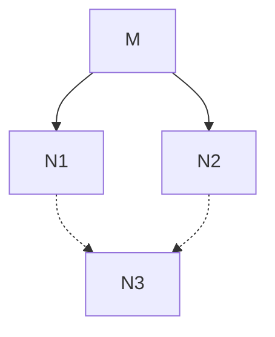
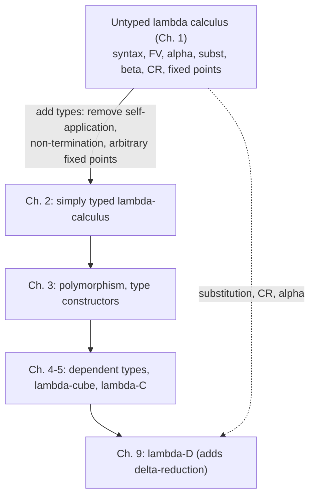

[[book-guidelines|↩ Back to guidelines]]

# Untyped Lambda Calculus

Focus areas: `type-theory` (primary), `automated-reasoning` (substitution, context plumbing, rewriting and confluence).

## 0. Why this chapter exists

The whole book builds toward a system where a type checker doubles as a proof checker. Before you can type anything, you need the thing being typed: a minimal language of *functions*, with a precise account of how they are built, how names are bound, and how they compute. That is the untyped $\lambda$-calculus. Every later system ($\lambda\to$, $\lambda 2$, $\lambda P$, $\lambda C$, $\lambda D$) is this calculus plus a layer of classification. The *plumbing* (binders, substitution, $\beta$-reduction, confluence) is inherited unchanged.

The chapter also ends on a deliberate negative note (Section 1.11): the untyped calculus allows self-application, non-terminating terms and a fixed point for every term. All three are fatal for a logical foundation, and removing them is the motivation for types in Chapter 2.

Roadmap of this note, following the Topic List checklist:


---

## 1. Abstraction and application (book 1.1–1.3)

**The problem.** A mathematical expression such as $x^2+1$ mixes two things: a *recipe* (square, then add one) and a *placeholder* $x$ standing for an input. Writing $x^2+1$ alone does not say whether $x$ is a fixed unknown or an input slot. The symbol $\lambda$ makes the slot explicit: $\lambda x . x^2+1$ is "the function mapping $x$ to $x^2+1$". The book stresses the distinction in Remark 1.2.2(2): $\lambda x . x^2$ is a function on $\mathbb{N}$, while $x^2$ is a natural number (the square of some fixed unknown $x$).

Only two construction principles are needed for functions:

- **Abstraction:** from an expression $M$ and a variable $x$, build $\lambda x . M$.
- **Application:** from $M$ and $N$, build $M N$.

plus one evaluation rule, $\beta$-reduction (Section 6 below). The book's Remark 1.2.5 makes a point worth keeping: *application* only constructs the term $M N$. It is not the act of applying. Computation happens only when reduction is performed. That is exactly the difference between building an AST node `Call(f, a)` and running it.

**Currying (Remark 1.2.6).** Only one-argument functions are primitive. A two-argument function $\lambda(x,y).(x^2+y)$ is replaced by its Curried version $\lambda x . (\lambda y . (x^2+y))$. This is not a restriction, and it buys partial application: $g(3)$ is meaningful and reduces to $\lambda y . (3^2+y)$.

### The formal syntax (Definition 1.3.2)

Fix an infinite set $V$ of variables. The set $\Lambda$ of $\lambda$-terms is the least set with:

1. (Variable) $u \in V \Rightarrow u \in \Lambda$,
2. (Application) $M, N \in \Lambda \Rightarrow (M N) \in \Lambda$,
3. (Abstraction) $u \in V,\ M \in \Lambda \Rightarrow (\lambda u . M) \in \Lambda$.

In grammar form: $\Lambda = V \mid (\Lambda\Lambda) \mid (\lambda V . \Lambda)$.

**[[Polymorphism-and-Higher-Order-Typed-Lambda-Calculi#Grounding|Grounding]] (Rust, primary).** This is literally an `enum`. The grammar is a three-variant algebraic data type; "inductive definition: these are the only ways to build a term" is what `match` exhaustiveness checks.

```rust
#[derive(Clone, Debug, PartialEq, Eq)]
enum Term {
    Var(String),
    App(Box<Term>, Box<Term>),
    Lam(String, Box<Term>),
}
```

**Notation.** The book writes $\equiv$ for syntactic identity ($(x\,z) \equiv (x\,z)$ but $(x\,z) \not\equiv (x\,y)$), and uses $L,M,N,P,Q,R$ for terms. Conventions (Notation 1.3.10) that save parentheses:

- outermost parentheses are dropped;
- application is left-associative: $M N L$ means $((M N) L)$;
- application binds tighter than abstraction: $\lambda x . M N$ means $\lambda x . (M N)$;
- consecutive abstractions combine: $\lambda x y . M$ means $\lambda x . (\lambda y . M)$.

The book warns that these are "treacherous": $\lambda y . y (x y)$ is $\lambda y . (y(x y))$, *not* $(\lambda y . y)(x y)$. Anyone who has written a parser knows this: "abstraction extends as far right as possible".

**Subterms (Definitions 1.3.5, 1.3.8).** $\mathrm{Sub}$ is a *multiset*, defined by recursion: $\mathrm{Sub}(x)=\{x\}$; $\mathrm{Sub}(MN)=\mathrm{Sub}(M)\cup\mathrm{Sub}(N)\cup\{MN\}$; $\mathrm{Sub}(\lambda x . M)=\mathrm{Sub}(M)\cup\{\lambda x . M\}$. Note that the binding occurrence of $x$ right after the $\lambda$ is *not* a subterm. Subterms correspond to subtrees of the term's tree (Figure 1.1 in the book, where application nodes are labelled "a"), and the leaves of that tree are always variables. A *proper* subterm is a subterm $L \not\equiv M$. Lemma 1.3.6: $\mathrm{Sub}$ is reflexive and transitive.

**What breaks without this.** If you only had named, anonymous expressions like $x^2$, there would be no way to say which variable is the input, and no way to pass a function as an argument. Because $\Lambda$ puts no restriction on what may be applied to what, terms like $x x$ and $y(\lambda u . u)$ are legal (Remark 1.2.2(1)). That freedom is what later gets cut down by types.

---

## 2. Free and bound variables (book 1.4)

**The problem.** In $\lambda x . x\,y$, the name $x$ is a throwaway label for the input, but $y$ refers to something defined outside. Any correct notion of substitution, equality or reduction must distinguish "a name that is local" from "a name that points outward".

Each variable occurrence is exactly one of: **binding** (immediately after a $\lambda$), **bound** (in the scope of a matching binder), or **free**. The set of free variables is defined by recursion (Definition 1.4.1):

$$FV(x)=\{x\},\qquad FV(M N)=FV(M)\cup FV(N),\qquad FV(\lambda x . M)=FV(M)\setminus\{x\}.$$

Worked examples from the book: $FV(\lambda x . x\,y)=\{y\}$; $FV(x(\lambda x . x y))=\{x,y\}$. The second one shows that $FV$ collects variables free *somewhere*. Here the first $x$ is free and the $x$ before $y$ is bound. In the tree picture: walk from a leaf towards the root. If you pass a $\lambda x$ node, the leaf is bound; otherwise free.

A term is **closed** if $FV(M)=\emptyset$; closed terms are also called **combinators**, and the set of them is $\Lambda_0$. For example $\lambda xyz . xxy$ is closed; $\lambda x . xxy$ is not.

```rust
fn fv(t: &Term) -> std::collections::HashSet<String> {
    use Term::*;
    match t {
        Var(x) => [x.clone()].into_iter().collect(),
        App(m, n) => &fv(m) | &fv(n),
        Lam(x, m) => { let mut s = fv(m); s.remove(x); s }
    }
}
```

This is the same function a compiler uses to compute free variables for closure conversion (what must a closure capture?), and the same function a type checker uses to check "is this term well-scoped in context $\Gamma$": a term is well-scoped in $\Gamma$ iff $FV(M)\subseteq \mathrm{dom}(\Gamma)$. A "closed term" is the untyped ancestor of "a term typable in the empty context".

---

## 3. Alpha conversion (book 1.5)

**The problem.** The name of the binder is not part of the meaning: $\lambda x . x^2$ and $\lambda u . u^2$ are the same function. But you cannot rename carelessly. The book gives two failure modes (this is the "what breaks" content):

1. **Renaming onto a free variable.** Renaming $x$ to $y$ in $\lambda x . y$ gives $\lambda y . y$. The first is the constant function returning $y$, the second is the identity. A free $y$ was captured.
2. **Renaming onto an inner binder.** Renaming $x$ to $y$ in $\lambda x . \lambda y . x$ gives $\lambda y . \lambda y . y$. The first returns its *first* argument; the second returns its *second*.

**Definition 1.5.1 (renaming).** Write $M^{x\to y}$ for "replace every free occurrence of $x$ in $M$ by $y$". Then

$$\lambda x . M =_\alpha \lambda y . M^{x\to y}\quad\text{provided } y\notin FV(M)\text{ and } y \text{ is not a binding variable in } M.$$

The two side conditions are precisely the two failure modes above.

**Definition 1.5.2 ($\alpha$-conversion / $\alpha$-equivalence).** $=_\alpha$ is the smallest relation containing renaming, closed under compatibility (if $M=_\alpha N$ then $ML=_\alpha NL$, $LM=_\alpha LN$, $\lambda z . M=_\alpha\lambda z . N$), and which is reflexive, symmetric and transitive. So it is an equivalence relation and a congruence: you may rename inside any subterm.

The book's Examples 1.5.3 are valuable because the interesting ones are the *failures*. For $(\lambda x . x(\lambda z . x y))z$:

- renaming $x \to y$ fails ($y\in FV(x(\lambda z . x y))$, condition 1);
- renaming $x \to z$ fails ($z$ is a binding variable inside, condition 2);
- renaming a *free* variable ($z\to v$) is never allowed: it changes meaning.

Also $\lambda xy . x z y =_\alpha \lambda vu . v z u$ but not $\lambda y y . y z y$ (condition 2).

**Where this shows up.** This is the quotient that every implementation has to decide how to handle: named terms with explicit renaming, or a canonical representation (de Bruijn, Section 10). Lean's kernel uses de Bruijn indices for bound variables precisely so that $\alpha$-equivalence is syntactic equality on the nose.

---

## 4. Substitution and variable capture (book 1.6)

**The problem.** $\beta$-reduction needs "replace the parameter by the argument", written $M[x:=N]$. The naive textual replacement is wrong exactly when it pushes a term with free variables under a binder of the same name.

Book example 1.6.4(1): $(\lambda y . y x)[x := x y]$. Naive replacement gives $\lambda y . y (x y)$ — but the $y$ inside the argument $x y$ was free and is now bound by the outer $\lambda y$. This is **variable capture**. The correct answer renames first:

$$(\lambda y . y x)[x := x y] \equiv \lambda z . ((z x)[x := x y]) \equiv \lambda z . z(x y).$$

**Definition 1.6.1.** Substitution is defined by recursion on the term:

- (1a) $x[x:=N]\equiv N$
- (1b) $y[x:=N]\equiv y$ if $x\not\equiv y$
- (2) $(P Q)[x:=N]\equiv (P[x:=N])(Q[x:=N])$
- (3) $(\lambda y . P)[x:=N]\equiv\lambda z . (P^{y\to z}[x:=N])$, where $\lambda z . P^{y\to z}$ is an $\alpha$-variant of $\lambda y . P$ with $z\notin FV(N)$.

Remarks the book makes (1.6.2–1.6.3):

- $P[x:=N]$ is **meta-notation**: it is not itself a $\lambda$-term. It stands for the proper term you get by running [[Polymorphism-and-Higher-Order-Typed-Lambda-Calculi#The definition|the definition]] to completion. (Compare: an *explicit-substitution* calculus makes it a real constructor.)
- If $y\notin FV(N)$, clause (3) lets the binder stay as is: $(\lambda y . P)[x:=N]\equiv\lambda y . (P[x:=N])$. The same holds if $x\notin FV(P)$.
- Renaming is a special case of substitution: $M^{x\to u}=_\alpha M[x:=u]$ when the renaming conditions hold.

Further examples: $(\lambda x . y x)[x := x y]\equiv\lambda z . y z$ (nothing to substitute, since $x$ is bound), and $(\lambda xy . z z x)[z:=y]\equiv\lambda uv . y y u$ (the binder $y$ had to be renamed since the argument $y$ is free).

**Order of substitutions (Lemma 1.6.5).** Sequential substitution does not commute in general: $x[x:=y][y:=x]\equiv x$ but $x[y:=x][x:=y]\equiv y$. The correct commutation law, for $x\not\equiv y$ and $x\notin FV(L)$, is

$$M[x:=N][y:=L]\equiv M[y:=L][x:=N[y:=L]].$$

Both side conditions matter: $N[y:=L]$ compensates for free $y$ in $N$, and $x\notin FV(L)$ stops $L$'s $x$ from being hit by the second substitution. (Exercise 1.6 asks you to show that sequential and simultaneous substitution differ.) This lemma is the prototype of the "substitution lemma" that reappears in every typing metatheory in the book.

### Grounding: capture-avoiding substitution in Rust

The following is a direct transliteration of Definition 1.6.1 plus a leftmost-outermost $\beta$-step. (It compiles and was run against the book's example $(\lambda y . y x)[x := x y]$, producing $\lambda y' . y' (x y)$, which is $\alpha$-equal to the book's $\lambda z . z(x y)$.)

```rust
use std::collections::HashSet;
use Term::*;

fn fresh(base: &str, avoid: &HashSet<String>) -> String {
    let mut z = base.to_string();
    while avoid.contains(&z) { z.push('\''); }
    z
}

/// M[x := N], Definition 1.6.1
fn subst(m: &Term, x: &str, n: &Term) -> Term {
    match m {
        Var(y) if y == x => n.clone(),                       // (1a)
        Var(_) => m.clone(),                                 // (1b)
        App(p, q) => App(Box::new(subst(p, x, n)),           // (2)
                         Box::new(subst(q, x, n))),
        Lam(y, _) if y == x => m.clone(),                    // x not free here
        Lam(y, p) if fv(n).contains(y) => {                  // (3): capture danger
            let mut avoid = &fv(n) | &fv(p);
            avoid.insert(x.to_string());
            let z = fresh(y, &avoid);                        // z not in FV(N)
            let p2 = subst(p, y, &Var(z.clone()));           // the renaming P^{y->z}
            Lam(z, Box::new(subst(&p2, x, n)))
        }
        Lam(y, p) => Lam(y.clone(), Box::new(subst(p, x, n))), // Remark 1.6.3(1)
    }
}
```

Every arm lines up with a clause of the definition, and the guard `fv(n).contains(y)` is exactly the side condition $z\notin FV(N)$ from clause (3), only renaming when needed (Remark 1.6.3). Note the cost: `fv` is recomputed at each binder, so this is quadratic in the worst case. A production implementation caches free-variable sets, or avoids names altogether.

**Barendregt variable convention (Convention 1.7.4)** is the book's way to *not* need clause (3)'s renaming in practice on paper: choose all binder names distinct from each other and from every free variable. Then capture can never occur, because no argument's free variable shares a name with an inner binder. So one writes $(\lambda xy . xz)(\lambda uv . v)$ rather than $(\lambda xy . xz)(\lambda xz . z)$. The book extends the convention to intermediate expressions with pending substitutions: write $(\lambda x . x y z)[y := \lambda u . u]$, not $[y := \lambda y . y]$. It is a *discipline on the writer*; a program that generates terms cannot rely on it without a renaming pass that restores it.

---

## 5. Lambda-terms modulo alpha (book 1.7)

**Lemma 1.7.1.** $\alpha$-equivalence is preserved by the term constructors and by substitution: if $M_1=_\alpha N_1$ and $M_2=_\alpha N_2$ then $M_1M_2=_\alpha N_1N_2$, $\lambda x . M_1=_\alpha\lambda x . M_2$, and $M_1[x:=N_1]=_\alpha M_2[x:=N_2]$.

**Convention 1.7.2.** Consequently we identify $\alpha$-convertible terms, and $\equiv$ from now on means syntactic identity *modulo* $\alpha$ (Notation 1.7.3): we write $\lambda x . x \equiv \lambda y . y$. Terms are thus really $\alpha$-classes; we compute with convenient representatives. The Barendregt convention picks a good representative.

**What breaks without Lemma 1.7.1.** If $\alpha$-equivalence did not commute with substitution, then "work with any representative" would be unsound: different representatives would give inequivalent answers. The lemma is the licence for that identification.

---

## 6. Beta reduction and beta conversion (book 1.8)

**The problem.** We want a formal version of "apply a function to an argument and compute". A function $\lambda x . M$ applied to $N$ should yield $M$ with $N$ in place of $x$.

**Definition 1.8.1 (one-step $\beta$-reduction, $\to_\beta$).**

1. (Basis) $(\lambda x . M)N \to_\beta M[x:=N]$,
2. (Compatibility) if $M\to_\beta N$ then $ML\to_\beta NL$, $LM\to_\beta LN$, and $\lambda x . M\to_\beta\lambda x . N$.

Terminology: a **redex** (reducible expression) is a subterm $(\lambda x . M)N$; its **contractum** is $M[x:=N]$; $M$ is the **body**. Reduction can take place anywhere in the term thanks to compatibility, including under a $\lambda$.

$$\frac{}{(\lambda x . M)N \to_\beta M[x:=N]}\qquad
\frac{M\to_\beta N}{ML\to_\beta NL}\qquad
\frac{M\to_\beta N}{LM\to_\beta LN}\qquad
\frac{M\to_\beta N}{\lambda x . M\to_\beta\lambda x . N}$$

This is a small-step operational semantics: one axiom plus congruence rules. That is the textbook shape of every operational semantics you will write for the target language.

**Multi-step and conversion.**

- $M\twoheadrightarrow_\beta N$ (Definition 1.8.3): there is a chain $M\equiv M_0\to_\beta M_1\to_\beta\cdots\to_\beta M_n\equiv N$ with $n\ge 0$. It is the reflexive-transitive closure of $\to_\beta$ (Lemma 1.8.4).
- $M=_\beta N$ (Definition 1.8.5): there is a chain $M_0,\dots,M_n$ where each adjacent pair is related by $\to_\beta$ in *either* direction. It is the equivalence closure (Lemma 1.8.6): reflexive, symmetric, transitive. Also, if $M\twoheadrightarrow_\beta L_1$ and $M\twoheadrightarrow_\beta L_2$ then $L_1=_\beta L_2$ (and likewise for common reducts from below).

Why allow "calculating backwards"? The book points out this is ordinary mathematical practice (completing the square for $ax^2+bx+c$ runs several steps in the "wrong" direction).

**Examples (1.8.2).**

- $(\lambda x . x(x y))N\to_\beta N(N y)$.
- $(\lambda x . (\lambda y . y x)z)v$ has *two* redexes: the whole term and the subterm $(\lambda y . y x)z$. Reducing either gives $(\lambda y . y v)z$ or $(\lambda x . z x)v$ respectively, which are not $\alpha$-equivalent. But both reduce on to $z v$. All four of these terms are $=_\beta$.
- $(\lambda x . x x)(\lambda x . x x)\to_\beta(\lambda x . x x)(\lambda x . x x)$: the term reduces to itself, duplicating the argument.

**Grounding (Rust):** the `step` function (leftmost-outermost redex search, one `match` arm per rule above).

```rust
fn step(t: &Term) -> Option<Term> {
    match t {
        App(f, a) => match &**f {
            Lam(x, m) => Some(subst(m, x, a)),               // basis
            _ => step(f).map(|f2| App(Box::new(f2), a.clone()))
                .or_else(|| step(a).map(|a2| App(f.clone(), Box::new(a2)))),
        },
        Lam(x, m) => step(m).map(|m2| Lam(x.clone(), Box::new(m2))),
        Var(_) => None,
    }
}

fn normalize(mut t: Term, fuel: usize) -> Option<Term> {
    for _ in 0..fuel {
        match step(&t) { Some(u) => t = u, None => return Some(t) }
    }
    None   // out of fuel: may or may not have a normal form
}
```

The `fuel` parameter is not a hack here: in the untyped calculus, termination is undecidable (see Section 10), so any total implementation must bound the work. Typed calculi will later remove the need.

**Lean grounding.** Lean has nothing to say about untyped $\Omega$ directly (its type theory rejects self-application, see Section 9). But Lean's kernel does implement $\beta$-reduction as part of definitional equality. The expression `(fun x => x + 1) 3` and `3 + 1` are definitionally equal, and `example : (fun x : Nat => x + 1) 3 = 4 := rfl` is checked by the kernel's `isDefEq` reducing the $\beta$-redex. Book $=_\beta$ is the core of that "definitional equality" which will return in $\lambda\to$ and later as the conversion rule.

---

## 7. Normal forms (book 1.9)

**The problem.** Reduction is meant to mimic calculation. A calculation should end with an *outcome*. What is the outcome of a term?

**Definition 1.9.1.** $M$ is in **$\beta$-normal form** ($\beta$-nf) if it contains no redex. $M$ *has* a $\beta$-nf (is $\beta$-normalising) if $M=_\beta N$ for some $N$ in $\beta$-nf. Lemma 1.9.2: if $M$ is in $\beta$-nf and $M\twoheadrightarrow_\beta N$ then $M\equiv N$ (a zero-step reduction). The converse fails: $\Omega\twoheadrightarrow_\beta\Omega$ only, but $\Omega$ is not in nf (Remark 1.9.4).

**The terms with no outcome.**

- $\Omega := (\lambda x . x x)(\lambda x . x x)$ is itself a redex and only ever reduces to itself, so it has no $\beta$-nf.
- $\Delta := \lambda x . x x x$: $\Delta\Delta\to_\beta\Delta\Delta\Delta\to_\beta\Delta\Delta\Delta\Delta\to_\beta\cdots$ grows forever. No nf either. (Examples 1.9.3.)
- The path matters: $(\lambda u . v)\Omega$ has two redexes. Contracting the outer one gives $v$ (a nf). Contracting $\Omega$ forever never terminates. (Examples 1.9.3(4).)

**Reduction paths and normalisation (Definitions 1.9.5–1.9.6).**

- A *reduction path* from $M$ is a finite or infinite sequence $M\equiv N_0\to_\beta N_1\to_\beta\cdots$.
- $M$ is **weakly normalising** if *some* path reaches a nf.
- $M$ is **strongly normalising** if *no* path is infinite.

Strong implies weak. Examples: $(\lambda x . (\lambda y . y x)z)v$ is strongly normalising; $(\lambda u . v)\Omega$ is weakly but not strongly normalising; $\Omega$ and $\Delta\Delta$ are neither.

Note in particular Section 1.12's remark on strategies: choosing the leftmost redex always finds the nf if one exists (a known theorem the book cites, with a reference to Barendregt 1981), while choosing badly may loop. The `step` function above is leftmost-outermost, which is why `normalize((λu.v)Ω)` returns `v` (I ran it) while `normalize(Ω)` runs out of fuel.

**Rust-side reading.** Call-by-value would evaluate the argument $\Omega$ first and loop on $(\lambda u . v)\Omega$; call-by-name/normal order would not. The *result* is the same when both terminate (next section), but termination behaviour differs.

**What strong normalisation is for.** Strong normalisation is the property types will restore (Chapter 2, simply typed $\lambda$-calculus is strongly normalising). It is what makes a type checker decidable once conversion of terms is part of the typing rules: to compare types, you may need to normalise them, and normalisation must terminate.

---

## 8. Confluence and the Church–Rosser theorem (book 1.9, continued)

**The problem.** Section 7 showed a term can have several redexes and so several reduction paths. If different paths led to different outcomes, "the outcome of a calculation" would be meaningless. In arithmetic, $(3+5)\cdot(7-3)$ gives $32$ whichever redex you contract first. We want the same for $\lambda$-terms.

**Theorem 1.9.8 (Church–Rosser; CR; confluence).** If $M\twoheadrightarrow_\beta N_1$ and $M\twoheadrightarrow_\beta N_2$, then there is $N_3$ with $N_1\twoheadrightarrow_\beta N_3$ and $N_2\twoheadrightarrow_\beta N_3$.



Solid arrows are the hypothesis, dotted arrows are the conclusion ("the reduction paths flow together again": the diamond property for $\twoheadrightarrow_\beta$). The book does not prove it ("much more complex than one would expect"), and refers to Barendregt (1981, p. 62), Barendregt (1992, pp. 136–141, a little over four pages) and Takahashi (1995) for a short proof.

**Corollary 1.9.9.** If $M=_\beta N$ then there is $L$ with $M\twoheadrightarrow_\beta L$ and $N\twoheadrightarrow_\beta L$. *Proof* (the book proves this one): by induction on the length $n$ of the zig-zag chain $M\equiv M_0 \leftrightarrow_\beta\cdots\leftrightarrow_\beta M_n\equiv N$. For $n=0$ take $L\equiv M$. For $n=k>0$, the induction hypothesis gives $L'$ with $M_0\twoheadrightarrow_\beta L'$ and $M_{k-1}\twoheadrightarrow_\beta L'$. If the last step is $M_{k-1}\to_\beta M_k$, apply CR to $M_{k-1}\twoheadrightarrow_\beta L'$ and $M_{k-1}\twoheadrightarrow_\beta M_k$ to get $L$ with $L'\twoheadrightarrow_\beta L$ and $M_k\twoheadrightarrow_\beta L$. If instead $M_k\to_\beta M_{k-1}$, then $M_k\to_\beta M_{k-1}\twoheadrightarrow_\beta L'$, so $L:=L'$ works.

**Lemma 1.9.10.** (1) If $M$ has $N$ as $\beta$-nf then $M\twoheadrightarrow_\beta N$: the nf can be reached by forward calculation alone. (2) A term has *at most one* $\beta$-nf. *Proof of (2):* two nfs $N_1,N_2$ of $M$ are both reached by $\twoheadrightarrow_\beta$ from $M$, so CR gives a common reduct $L$; since both are normal, Lemma 1.9.2 forces $N_1\equiv L\equiv N_2$.

**What CR does and does not give (Key Question 2).**

- It gives: *uniqueness* of outcomes. Whatever order you reduce in, if you reach a normal form it is *the* normal form. It also gives a **decision-flavoured test for equality**: if $M=_\beta N$ then they share a common reduct, so you can search for one.
- It does not give: *existence*. $\Omega$ has none. CR is about "if you can, then there is only one place to land", not "you can".

**Connection to the project (`automated-reasoning`).** Confluence is the central property of a well-behaved rewriting system. A confluent, terminating system gives a *decision procedure* for the equational theory: normalise both sides and compare. This is exactly what an $\alpha\beta$-normalising conversion checker does, and it is the reason the later systems in the book need both CR and strong normalisation to make type checking decidable. When your own verifier compares two types for equality ("definitional equality"), you are relying on this pair of facts, even if you implement it via lazy weak-head reduction rather than full normalisation.

---

## 9. Fixed point theorem and recursion (book 1.10)

**The problem.** The calculus has no loops, no names for definitions and no recursion. Yet we would like to define functions such as factorial by an equation that mentions the function itself. Is that even meaningful?

**Fixed points, via analogy.** In analysis, $a$ is a fixed point of $f$ when $f(a)=a$. Squaring on $\mathbb{N}$ has fixed points $0$ and $1$; successor has none. In the $\lambda$-calculus the situation is startlingly different:

**Theorem 1.10.1 (Fixed Point Theorem).** For all $L\in\Lambda$ there is $M\in\Lambda$ with $L M=_\beta M$.

*Proof.* Take $M := (\lambda x . L(xx))(\lambda x . L(xx))$. This $M$ is a redex, and
$$M\equiv(\lambda x . L(xx))(\lambda x . L(xx))\to_\beta L\big((\lambda x . L(xx))(\lambda x . L(xx))\big)\equiv LM.\ \square$$

The intuition: $M$ is a self-replicating term. The argument is $\lambda x . L(xx)$, which applied to itself ($xx$, self-application!) produces "$L$ applied to a fresh copy of the whole thing". Self-application is the whole trick, and it is what the simple type system will forbid.

**Fixed point combinator.** The construction is uniform in $L$, so there is a closed term (Curry's)
$$Y \equiv \lambda f . (\lambda x . f(xx))(\lambda x . f(xx)),$$
with $Y L\to_\beta(\lambda x . L(xx))(\lambda x . L(xx))\to_\beta L((\lambda x . L(xx))(\lambda x . L(xx)))=_\beta L(Y L)$. Exercise 1.19 introduces Turing's variant $Z := UU$ with $U:=\lambda zx . x(zzx)$, for which even $ZM\twoheadrightarrow_\beta M(ZM)$ holds.

**Recursive equations (the payoff).** Any equation $M=_\beta\cdots M\cdots$ can be solved: let $L := \lambda z . \cdots z\cdots$, so $LM\to_\beta\cdots M\cdots$. Then $M=_\beta LM$ means $M$ is a fixed point of $L$, which exists by the theorem. Worked examples in the book:

- Find $M$ with $Mx=_\beta xMx$: set $L := \lambda y . (\lambda x . x y x)$ and take $M := YL$.
- Factorial, via Church numerals ($\mathrm{nat}$, $\mathrm{add}$, $\mathrm{mult}$, $\mathrm{suc}$, $\mathrm{true}$, $\mathrm{false}$, $\mathrm{iszero}$, $\mathrm{if\text{-}then\text{-}else}$ as in Exercises 1.10–1.14, plus a harder $\mathrm{pred}$):
  $$\mathrm{fac}\,x=_\beta \mathrm{if}\ (\mathrm{iszero}\ x)\ \mathrm{then}\ 1\ \mathrm{else}\ \mathrm{mult}\ x\ (\mathrm{fac}\,(\mathrm{pred}\ x)),$$
  which is solved by $\mathrm{fac} := Y\,(\lambda f x . \mathrm{if}\ (\mathrm{iszero}\ x)\ \mathrm{then}\ 1\ \mathrm{else}\ \mathrm{mult}\ x\ (f\,(\mathrm{pred}\ x)))$ (the book states the equation and says "use a fixed point combinator"; the explicit abstraction over `f` is the same recipe as the $M x=_\beta xMx$ example).

**Church numerals and Booleans (Exercises 1.10–1.14)**, used above: $\mathrm{zero}:=\lambda fx . x$, $\mathrm{one}:=\lambda fx . fx$, $\mathrm{two}:=\lambda fx . f(fx)$, $\mathrm{add}:=\lambda mnfx . mf(nfx)$, $\mathrm{mult}:=\lambda mnfx . m(nf)x$, $\mathrm{suc}:=\lambda mfx . f(mfx)$, $\mathrm{true}:=\lambda xy . x$, $\mathrm{false}:=\lambda xy . y$, $\mathrm{iszero}:=\lambda z . z(\lambda x . \mathrm{false})\mathrm{true}$, and "if $x$ then $u$ else $v$" is $\lambda x . x\,u\,v$. Data is encoded as its own eliminator.

**Python sketch (tertiary).** Python is a strict language, so $Y$ as written loops forever (it evaluates $x(x)$ eagerly). The standard fix is to eta-expand the self-application, which delays it until needed (the "$Z$" combinator of strict languages, not the same as the book's Turing $Z$):

```python
Z = lambda f: (lambda x: f(lambda v: x(x)(v)))(lambda x: f(lambda v: x(x)(v)))
fac = Z(lambda self: lambda n: 1 if n == 0 else n * self(n - 1))
assert fac(5) == 120
```

This is a concrete case of "choice of reduction strategy matters for termination" (Section 7).

**What breaks, and why this is a drawback (Key Question 3).** Remark 1.10.2: the $\lambda$-version of successor, $\lambda x . (x+1)$, has a fixed point by the theorem, but that fixed point does not represent a natural number. In a logic, "every function has a fixed point" lets you build $M=_\beta \lambda p . \neg(M\,p)$-style paradoxes (the book does not say this here; it only flags the property as "not in accordance with what we know to be the usual behaviour of functions" in 1.11). This is the same shape as Russell-style paradox that motivated types historically.

**Lean grounding.** Lean *does not allow* the $Y$ combinator, because `fun x => x x` does not type-check and, more fundamentally, because general recursion would make the logic inconsistent. Lean offers structural recursion, well-founded recursion (termination proofs), and `partial def`/`unsafe` escape hatches for non-terminating programs (which are excluded from the logic). The fixed point theorem is why "recursion has to be disciplined": in the untyped calculus it comes for free precisely because the calculus has no notion of logical consistency.

---

## 10. Turing completeness (book 1.10–1.12)

The book states, rather than proves, the equivalence of the untyped $\lambda$-calculus with other models of computation (Section 1.12):

- Church invented $\lambda$-calculus in the 1930s (Church, 1933) to formalise "computable functions" ($\lambda$-definability, Church 1936).
- It turned out to be equivalent to **Turing-computability** (Turing machines), **Herbrand–Gödel computability** and **general recursive functions**. Hence $\lambda$-calculus is **Turing-complete**. The coincidence of these independently defined notions is the evidence for the **Church–Turing thesis**: anything mechanically computable is computable by a Turing machine, equivalently a $\lambda$-term.
- The ingredients visible in Chapter 1 are Church numerals + Booleans + conditional + fixed points (recursion), as in the factorial example. The full proof is in Barendregt (1981), not reproduced.

**Consequences worth stating plainly.** Turing-completeness means termination of terms is undecidable (so: no total `normalize` without fuel), and this is the *price* of the untyped system's expressiveness. A logical foundation wants the opposite trade: a calculus where every term terminates (strong normalisation) and therefore type checking is decidable, at the cost of not being Turing-complete.

**Further notes from 1.12 relevant to implementation.**

- **Combinatory logic** (Schönfinkel 1924; Curry 1930) is the $\lambda$-calculus restricted to $K:=\lambda xy . x$ and $S:=\lambda xyz . xz(yz)$ with $KPQ=P$ and $SPQR=PR(QR)$. It is simpler, also Turing-complete, but binding and abstraction are no longer primitive (Exercise 1.9: $SKK\twoheadrightarrow_\beta I$).
- **de Bruijn indices** (de Bruijn 1972) represent terms with no names: every term has a unique representation, so no quotient by $\alpha$ is needed, and substitution becomes index updating "that can rather easily be programmed". The book notes there is work on combining a nameless core with a named user-facing layer.
- **Lisp** (McCarthy, 1958) is an implementation of untyped $\lambda$-calculus as a programming language; most newer functional languages are typed.
- **Evaluation strategies**: as seen above, the choice of redex does not change the end result (CR) but can change cost, or whether you find the nf at all. Leftmost reduction finds a nf whenever one exists.
- Further reading cited: Barendregt (1981, standard reference), Hindley & Seldin (2008, introductory, with combinators and models).

---

## 11. Representation in practice: de Bruijn indices (Lean grounding)

The book mentions de Bruijn indices only in Further Reading. For a project that will build a kernel it is worth showing what they buy. In a nameless term, a variable is a number counting how many binders up you must go.

$$\lambda x . \lambda y . x\ \ \leadsto\ \ \lambda\,\lambda\,1,\qquad \lambda x . x\,x\ \ \leadsto\ \ \lambda\,(0\ 0).$$

$\alpha$-equivalent terms become *identical*, so Convention 1.7.2 is enforced by the data structure. The price: substitution must *shift* indices when passing under binders.

```lean
inductive Tm where
  | var : Nat → Tm
  | app : Tm → Tm → Tm
  | lam : Tm → Tm
  deriving Repr, DecidableEq

/-- shift free indices (>= cutoff c) by d -/
def Tm.shift (d : Int) (c : Nat) : Tm → Tm
  | .var k   => if k < c then .var k else .var (Int.toNat ((k : Int) + d))
  | .app f a => .app (f.shift d c) (a.shift d c)
  | .lam b   => .lam (b.shift d (c + 1))

/-- b[j := s] -/
def Tm.subst (j : Nat) (s : Tm) : Tm → Tm
  | .var k   => if k == j then s else .var k
  | .app f a => .app (f.subst j s) (a.subst j s)
  | .lam b   => .lam (b.subst (j + 1) (s.shift 1 0))

/-- (λ. b) a  ⟶β  shift(-1)(b[0 := shift 1 a]) -/
def Tm.beta (b a : Tm) : Tm := (b.subst 0 (a.shift 1 0)).shift (-1) 0
```

(I did not compile this Lean snippet; it is a standard textbook construction in Lean 4 syntax, so treat it as a sketch to be checked.) Note how the capture problem has disappeared from the code and been replaced by index arithmetic: `s.shift 1 0` when going under a binder is the nameless counterpart of "rename the binder away from $FV(N)$". This is the same trade made in Lean's kernel (`Expr.bvar`, `instantiate`, `lift`/`lower` loose bound variables).

---

## 12. Synthesis

### What Chapter 1 depends on, what depends on it



The book's own framing (Section 1.11) is explicit: keep the positives (clean binding, substitution, conversion, confluence, unique normal forms, recursion as fixed points) and suppress the negatives (self-application, possible non-termination, every term has a fixed point) by typing.

### Positives and negatives at a glance (book 1.11)

| Positive (kept later) | Negative (removed by types) |
|---|---|
| Abstraction + application + $\beta$ describe functions | Self-application $xx$ is allowed |
| Substitution is rigorous | Normal forms may not exist ($\Omega$) |
| Conversion $=_\beta$ captures "equal by calculation" | Every term has a fixed point |
| Confluence gives unique nfs | |
| Fixed points solve recursive equations | |

### Bearing on the project

Flagged load-bearing for the verifier / elaborator targets (`type-theory`, `automated-reasoning`):

- **Substitution, context management and variable capture.** This section's `subst` is the same plumbing under (a) the $\beta$-rule your kernel uses in definitional equality, (b) the $\Pi$-type instantiation rule $B[x:=N]$ in dependent typing (appears in later chapters), and (c) substitution of an expression for a program variable in Hoare's assignment axiom $\{P[x:=E]\}\ x:=E\ \{P\}$. A bug here (capture) is a soundness bug in all three. Decide the representation early (de Bruijn / locally nameless in the kernel; names only at the surface).
- **Definitional equality and `isDefEq`.** $=_\beta$ is the seed of definitional equality. CR plus (later) strong normalisation is what makes "normalise and compare" correct. In Lean's kernel the comparison is not full normalisation but a lazy, heuristic `isDefEq` (weak-head reduction, unfolding by hints, eta); its correctness argument still rests on confluence.
- **Metavariables and unification (looking ahead, not in this chapter).** Chapter 1 has no unknowns. But "solving $M x=_\beta x M x$ for $M$" (Example 1.10.3) is already a higher-order equation-solving problem, solved here by a fixed-point trick rather than unification. Miller's pattern unification handles the tractable fragment of such equations in a typed setting; keep the contrast in mind when Chapter 2 introduces typing, since unification algorithms are significantly more constrained than the free-for-all solution via $Y$.
- **Rewriting and confluence.** $\to_\beta$ is the canonical confluent rewrite system. Termination/confluence analysis (critical pairs, Newman's lemma) is the generic toolbox for the theorem prover's rewriting engine. The chapter proves only the $\beta$ case, and points to Barendregt for CR.
- **Operational semantics.** The three rules of Definition 1.8.1 are the template for the small-step semantics of the surface language, with the strategy fixed (call-by-value or normal order) to make evaluation deterministic.

Topics in this chapter that do **not** bear directly on the project (history of the letters $\lambda$, $\alpha$, $\beta$; Lisp lineage; combinatory logic) are mentioned above only because the book does.

---

## Where this leads

Chapter 2 attaches types to these terms to rule out $xx$, $\Omega$ and arbitrary fixed points, while reusing this chapter's substitution, $\alpha$-equivalence, $\beta$-conversion and confluence machinery verbatim. The substitution lemma, the Church–Rosser theorem and normal forms return throughout $\lambda\to$, $\lambda C$ and $\lambda D$, where $\beta$-conversion (extended with $\delta$-reduction) is the conversion rule that decides when two types are "the same".

## Exercise pointers (book pp. 29–31)

Exercises 1.1–1.20 cover parenthesis removal, $\alpha$-equivalence, subterms and trees, substitution, redexes, the combinators $K$, $S$, $I$, $B$, Church numerals and Booleans, strong/weak normalisation, and the Turing fixed point combinator $Z$. Exercises 1.9–1.14 and 1.19 are the ones the discussion above leans on.
