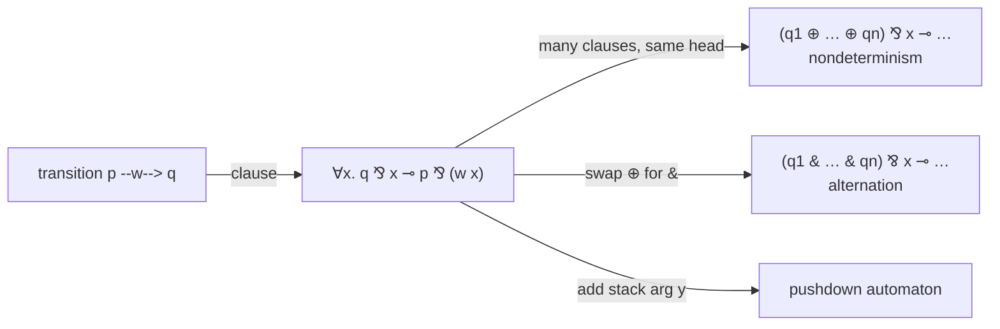

[[book-guidelines|↩ Back to guidelines]]

# Automata Encoded as Multisets

## 1. The problem this chapter solves

Earlier chapters built a machine: higher-order [[Linear-Logic|linear logic]] $\mathcal L_2^\omega$ with focused proofs ($\Downarrow\mathcal L_2^\omega$), where a sequent is a state and proof search is computation. Chapter 10 is the stress test. Can this machinery specify *classical* models of computation, with a theorem that says [[Process-Calculi-and-Security-Protocols#The encoding|the encoding]] is faithful?

Everything rests on **multiset rewriting** (Sections 8.4 and 8.6). Data lives as a multiset of atoms in the left zone; a clause $\forall \bar x.[\,B \multimap H\,]$ rewrites the atoms $H$ into $B$ when read bottom-up. The chapter does four things:

1. Warm up with numerals as multisets, including Fibonacci.
2. Encode *words* as functions of type $o\to o$.
3. Encode **finite automata** as linear logic theories and prove the encoding correct (Prop. 10.4).
4. Extend to **pushdown automata**, and read nondeterminism and alternation off the additive connectives.

The constraint that makes it interesting: no primitive type other than $o$ is used. States are $o$, letters are $o\to o$, stack symbols are $o\to o$.

## 2. Numerals as multisets (10.1)

Two ways to write naturals as logic programs.

**As terms** (Fig. 5.3): `nat z.` and `nat (s X) :- nat X.` The number is a *term* $s^n z$ of type `nat`.

**As atoms:** `zero.` and `succ X :- X.` with `succ : o -> o`. Now $n$ is a *formula* $\mathrm{succ}^n(\mathsf{zero})$, and it is provable from the program for every $n$.

The linear version moves the number into the *left-bounded zone*: $\cdot :: \forall x.(x \multimap \mathrm{succ}\,x);\ \mathsf{zero} \vdash \mathrm{succ}^n(\mathsf{zero});\ \cdot$. The key trick is then to **reinterpret constants as eigenvariables** and substitute:

$$\mathsf{zero}\mapsto \bot \qquad \mathrm{succ}\mapsto \lambda w.\ \star \parr w$$

By Prop. 9.12 (substitution into proofs), the proof above becomes a proof of $\cdot :: \bot\multimap\star;\ \bot \vdash \star\parr\cdots\parr\star\parr\bot;\ \cdot$ with $n$ stars. The multiset $\star^n$ (token $\star$ with multiplicity $n$) *is* the number $n$. The book states the characterization: for a multiset $\Delta$ of atoms, that sequent is provable iff $\Delta=\star^n$ for some $n$.

**Why this matters:** one proof in a rich logic, pushed through a substitution, yields a proof in a poorer multiset setting. This same move reappears for homomorphisms (section 5 below).

Two examples ride on top:

- **Fibonacci.** With $f:\mathrm{nat}\to o$ and the program
  $$f\,z.\qquad f(s\,z)\parr\star.\qquad \forall x.(f\,x\multimap f(s\,x)\multimap f(s(s\,x)))$$
  the sequent $\cdot :: P;\cdot\vdash f(s^n z),\Delta;\cdot$ is provable iff $\Delta=\star^m$ with $m$ the $n$-th Fibonacci number. The third clause *consumes* $f\,x$ and $f(s\,x)$ and emits $f(s(s\,x))$ with the stars they carry combined. Addition of multiplicities is just multiset union.
- **Arithmetic** (Fig. 10.1) with `one`, `two`, `plus P Q`, `suc P`. Exercise 10.2: `plus (plus (suc three) two) three` leaves exactly nine stars.

Rust [[Computation-as-Proof-Search#Grounding|grounding]] for the intuition: a multiset is a `HashMap<Token, usize>`, and "adding" is merging counts.

```rust
use std::collections::HashMap;

type Multiset = HashMap<&'static str, usize>;

fn union(mut a: Multiset, b: &Multiset) -> Multiset {
    for (k, n) in b {
        *a.entry(k).or_insert(0) += n;
    }
    a
}

fn fib_stars(n: u32) -> usize {
    // f(z) = {} ; f(s z) = {*} ; f(s(s x)) = f(x) ∪ f(s x)
    let (mut a, mut b) = (Multiset::new(), Multiset::from([("*", 1)]));
    for _ in 0..n {
        let c = union(a.clone(), &b);
        a = b;
        b = c;
    }
    a.get("*").copied().unwrap_or(0)
}
```

## 3. Letters and words (10.2)

A word over alphabet $\Lambda$ is a term of type $o\to o$:

$$uvu \;\leftrightarrow\; \lambda x.(u\,(v\,(u\,x))),\qquad \epsilon \;\leftrightarrow\; \lambda x.x$$

Letters are constants of type $o\to o$. **Concatenation is function composition**: $w\cdot w' = \lambda x.\,w(w'\,x)$.

First principles: a word is a *difference list*. Instead of storing a list and appending in $O(n)$, store "a function that prepends me to whatever comes next." The hole $x$ is where the rest of the input will go.

```python
# a word is a function from "rest of input" to "input with this word prepended"
u = lambda rest: ("u", rest)
v = lambda rest: ("v", rest)
word_uvu = lambda x: u(v(u(x)))
epsilon = lambda x: x
concat = lambda w, w2: (lambda x: w(w2(x)))
```

The book notes (10.6) this encoding goes back to Huet's 1973 proof that third-order unification is undecidable, which reduces Post correspondence to unification of exactly such terms.

## 4. Finite automata as linear logic theories (10.3)

### The usual definition

A finite automaton is $F=\langle Q,\Lambda,\delta,s,F\rangle$: states, alphabet, transitions $\delta\subseteq Q\times\Lambda^*\times Q$, initial state $s$, final states. Note transitions are labeled by *words*, not single letters, and $\epsilon$-transitions are allowed. Write $p\xrightarrow{w}q$ for $\langle p,w,q\rangle\in\delta$ and $p\xrightarrow{w}{}^*q$ for its reflexive-transitive closure on concatenated labels. $w$ is accepted if $s\xrightarrow{w}{}^* f$ for some $f\in F$.

### The encoding

States are constants of type $o$. Each transition $\langle p,w,q\rangle$ becomes one clause:

$$T(\delta)\ni\ \forall x.\,[\,q\parr x\ \multimap\ p\parr(w\,x)\,]$$

Reading: "to have $p$ together with the word $w$ followed by the rest $x$, it suffices to have $q$ together with $x$." Bottom-up, a clause *consumes* $p\parr (w\,x)$ and *replaces* it with $q\parr x$. The state token $q$ is a single resource; the input word is a function being peeled apart. Because $x$ is universally quantified, the clause works for any remaining input.

An $\epsilon$-transition has $w=\lambda x.x$, so the clause is $\forall x.[q\parr x\multimap p\parr x]$, logically equivalent to $q\multimap p$ (Exercise 10.3). Call that cleaned-up theory $T'(\delta)$. Its proofs have two kinds of synthetic inference rule:

$$\frac{\Gamma\vdash q,\Delta}{\Gamma\vdash p,\Delta}\ \langle p,\epsilon,q\rangle \qquad\qquad \frac{\Gamma\vdash q,t,\Delta}{\Gamma\vdash p,(w\,t),\Delta}\ \langle p,w,q\rangle$$

The book derives the second from focusing on the clause: a $\multimap$-left, then a $\parr$-left, then two initial rules, closed by `decide !`. A focused phase equals one automaton step. This is the payoff of focusing: the chaos of unfocused sequent proofs collapses to an exact step-by-step simulation.

### Proposition 10.4 (faithfulness)

1. $p\xrightarrow{w}{}^*q$ iff $\cdot::T(\delta);\cdot\vdash\forall x.[\,q\parr x\multimap p\parr(w\,x)\,];\cdot$ is provable.
2. $w\in L(F)$ iff $\cdot::T(\delta);\cdot\vdash\forall x.[\,(f_1\mathbin{\&}\cdots\mathbin{\&}f_n)\parr x\multimap s\parr(w\,x)\,];\cdot$ is provable.

The proof is a model of how proof-theoretic arguments run in this book:

- ($\Rightarrow$) Induction on the definition of $\xrightarrow{w}{}^*$. Base: $\forall x.[p\parr x\multimap p\parr x]$ is trivial. Step: $w=uv$, $p\xrightarrow{u}r$, $r\xrightarrow{v}{}^*q$. By the inductive hypothesis and [[Sequent-Calculus-Proof-Systems#Invertibility|invertibility]] of right rules, $x{:}o::T(\delta);\ q\parr x\vdash r,(v\,x)$. Add one synthetic rule for $\langle p,u,r\rangle$ and re-introduce $\forall,\multimap$.
- ($\Leftarrow$) Invert to get $x{:}o::T'(\delta);\ q\parr x\vdash p,(w\,x)$ and induct on the **decide depth**. If `decide l` focuses on $q\parr x$, we must have $p=q$ and $w=\lambda x.x$. If `decide !` focuses on a clause from $T'(\delta)$, it is either an $\epsilon$-clause or a clause for some prefix $u$ of $w$, and the premise corresponds to a smaller derivation.
- Item 2 uses **cut elimination** (Thm 9.13) to connect $\&$ on the left with picking one $f_i$, and for the converse, replaces $(f_1\&\cdots\&f_n)$ by the single $f_i$ that the focused proof actually selects.

### Grounding

A direct Rust reading of $T(\delta)$ is a rewrite system over `(state, remaining input)` pairs:

```rust
use std::collections::HashSet;

type State = u32;
// transition: (from p, word w, to q). Empty word = epsilon.
type Delta = Vec<(State, Vec<char>, State)>;

/// Does s --w-->* f for some f? This is the proof search of Prop 10.4(2),
/// run in the direction the *clauses* are applied: consume p and a prefix
/// of the input, produce q.
fn accepts(delta: &Delta, s: State, finals: &HashSet<State>, input: &[char]) -> bool {
    fn go(d: &Delta, p: State, fin: &HashSet<State>, rest: &[char], seen: &mut HashSet<(State, usize)>) -> bool {
        if rest.is_empty() && fin.contains(&p) { return true; }
        if !seen.insert((p, rest.len())) { return false; } // guard eps-cycles
        d.iter().any(|(from, w, to)| {
            *from == p && rest.starts_with(w) && go(d, *to, fin, &rest[w.len()..], seen)
        })
    }
    go(delta, s, finals, input, &mut HashSet::new())
}
```

Lean makes the correspondence nearly literal. $\xrightarrow{w}{}^*$ is an inductive family, and the proof of Prop. 10.4(1) is an induction on it:

```lean
inductive Reach (δ : List (Nat × List Char × Nat)) : Nat → List Char → Nat → Prop
  | refl (p : Nat) : Reach δ p [] p
  | step {p r q : Nat} {u v : List Char} :
      (p, u, r) ∈ δ → Reach δ r v q → Reach δ p (u ++ v) q
```

(The book's `refl`/`step` cases are exactly the base and inductive cases of the proof above.)

**What breaks without the encoding choices:**

- If words were lists with an append, you would need extra equational reasoning. With words as $o\to o$ terms, concatenation is $\beta$-reduction, so the logic's own conversion does the work.
- If the clause were $q\multimap p$ with no $x$, you could only recognize the empty word. The universally quantified $x$ is the "rest of the input" variable.

### Exercise 10.5: you do not need $\parr$

If only path-between-two-states is of interest, replace $p\parr t$ with an atom $(\mathrm{par}\ p\ t)$ and even $\multimap$ with $\Rightarrow$. The result is a set of **binary clauses** $\forall\bar x.[A\Rightarrow A']$. This foreshadows continuation-passing and binary-clause encodings of Chapter 13 (see [[Multiset-Rewriting-in-Linear-Logic]] and [[Higher-Order-Quantification]]).

## 5. Properties of automata via proofs (10.4)

The author is honest: proof theory does not make automata theory easier. Three places it is illuminating, though.

### 5.1 Closure under homomorphism (Prop. 10.6)

Given $h:\Lambda\to\Lambda^*$ (extended homomorphically), $h(L)$ is regular if $L$ is. The classical proof edits the automaton. Here, since constants are eigenvariables, *substitute* $v\mapsto h(v)$ in a proof of acceptance (Prop. 7.7). To avoid clashes between letters in the domain and range of the substitution, first rename letters to a fresh alphabet $\bar\Lambda$. Then:

$$T(\bar h(\delta));\ \cdot\vdash\forall x.[(f_1\&\cdots\&f_n)\parr x\multimap s\parr(\bar h(w)\,x)]$$

is provable, so $\bar h(w)$ is accepted by $F_2=\langle Q,\bar\Lambda,\bar h(\delta),s,F\rangle$. Rename back for $F_3$. The book itself says the proof-theoretic content here is minor, but notice the mechanism: "letter" is a free variable of type $o\to o$, and substitution lemmas for proofs are exactly what a homomorphism is.

### 5.2 Splitting long transitions with an existential state

A transition $p\xrightarrow{uv}q$ becomes $p\xrightarrow{u}r\xrightarrow{v}q$ for a fresh $r$. In logic:

$$D_1=\forall x.[q\parr x\multimap p\parr(u(v\,x))]\qquad D_2=\exists r.\begin{pmatrix}\forall x.[q\parr x\multimap r\parr(v\,x)]\\ \otimes\ \forall x.[r\parr x\multimap p\parr(u\,x)]\end{pmatrix}$$

$D_2\multimap D_1$ is provable (by $\forall r$ and a short proof, then cut), so anything the old machine accepts, the new one accepts. The converse fails in general: $p\parr(u\,\top)$ is provable from $D_2$ but not $D_1$. $D_2$ is *stronger* because it can reason about intermediate states. Restricting to proofs where atoms are letter sequences recovers the converse. Conclusion: transitions can be limited to $Q\times(\Lambda\cup\{\epsilon\})\times Q$. The existential here previews *hiding* in [[Higher-Order-Programming-and-Hiding-of-Specifications]].

### 5.3 Nondeterminism and alternation

Several clauses with the same left side $p\parr(w\,x)$ and targets $q_1,\dots,q_n$ can be conjoined with $\&$ as clauses, which is equivalent to one clause:

$$\forall x.[\,(q_1\oplus\cdots\oplus q_n)\parr x\multimap p\parr(w\,x)\,]$$

So nondeterminism is $\oplus$: "it suffices to reach *some* $q_i$." Swap in $\&$:

$$\forall x.[\,(q_1\mathbin{\&}\cdots\mathbin{\&}q_n)\parr x\multimap p\parr(w\,x)\,]$$

and you get **alternating finite automata**: the rest of the input must be accepted from *every* $q_i$. The acceptance condition in Prop. 10.4(2), $f_1\&\cdots\&f_n$ on the left, is itself the same sort of choice (the proof selects one $f_i$).



## 6. Pushdown automata (10.5)

Add finite stack alphabet $\Omega$ (also type $o\to o$, disjoint from $Q$, $\Lambda$). A PDA is $\langle Q,\Lambda,\Omega,\delta,s,F\rangle$ with $\delta\subseteq Q\times\Lambda^*\times\Omega^*\times Q\times\Omega^*$. Tuple $\langle p,w,\gamma,q,\gamma'\rangle$ fires when in state $p$, with $\gamma$ on top of the stack and $w$ a prefix of the input. It pops $\gamma$, pushes $\gamma'$, and eats $w$. The clause:

$$\forall x.\forall y.\,[\,q\parr x\parr(\gamma'\,y)\ \multimap\ p\parr(w\,x)\parr(\gamma\,y)\,]$$

The stack is *another difference list*, with $y$ as the rest of the stack. The difference in direction is instructive: reading right to left, the input shrinks (it is being consumed) while the stack may grow. Special cases: $\gamma$ empty and $\gamma'$ nonempty is a push; the reverse is a pop; both empty leaves the stack alone. If $\Omega=\emptyset$, the $y$ factors out and you recover exactly the finite automaton clause. Acceptance:

$$T(\delta)\vdash\forall x.\forall y.[\,(f_1\&\cdots\&f_n)\parr x\parr y\ \multimap\ s\parr(w\,x)\parr y\,]$$

The stack begins and ends empty (the same $y$ appears on both sides). The book states this encoding and its acceptance criterion but does *not* give a faithfulness proof for PDAs, only for finite automata.

```rust
// A PDA configuration is a rewrite state: (state, remaining input, stack).
// The clause rewrites (p, w ++ x, γ ++ y)  into  (q, x, γ' ++ y).
struct Pda { delta: Vec<(u32, Vec<char>, Vec<char>, u32, Vec<char>)> }

fn step(d: &Pda, (p, input, stack): (u32, &[char], &[char])) -> Vec<(u32, Vec<char>, Vec<char>)> {
    d.delta.iter().filter(|(from, w, g, _, _)| {
        *from == p && input.starts_with(w) && stack.starts_with(g)
    }).map(|(_, w, g, q, g2)| {
        let mut s = g2.clone();
        s.extend_from_slice(&stack[g.len()..]);
        (*q, input[w.len()..].to_vec(), s)
    }).collect()
}
```

## 7. Notes from the bibliography (10.6)

- Kanovich [2014] connects multiset rewriting and Fibonacci numbers to additive partitions of naturals; Kanovich [1996] studies linear-logic specifications of machine models.
- The word-as-$\lambda$-term encoding is Huet's [1973a], from the undecidability of third-order unification.
- Lambek's calculus (no exchange, contexts are lists) is the noncommutative precursor: words are lists of $o$-tokens there, not $o\to o$ functions. See Moortgat [1996].

## 8. Where this leads

This chapter is the proof of concept for the book's second part: specifications as linear logic theories, correctness as focused-proof analysis (synthetic rules = steps), and metatheory by substituting for eigenvariables. Chapter 11 (see [[Multiset-Rewriting-in-Linear-Logic]] for the underlying rewriting) turns to analyzing Horn programs via multisets, Chapter 12 encodes [[Process-Calculi-and-Security-Protocols|process calculi and security protocols]] with the same $\parr$-as-synchronization idea, and Chapter 13 generalizes the binary-clause remark of Exercise 10.5 into continuation-passing operational semantics.

**Connection to your goals (type theory, static analysis).** The "letters and states as inhabitants of $o$ or $o\to o$" trick is a lesson in how little type structure a higher-order logic needs to host a machine model, and the difference-list view of words is the same trick used in efficient Rust parsers. The existential-state transition splitting (5.2) is the logical shape of introducing a hidden intermediate abstraction, directly relevant to the hiding material in [[Higher-Order-Programming-and-Hiding-of-Specifications]].
