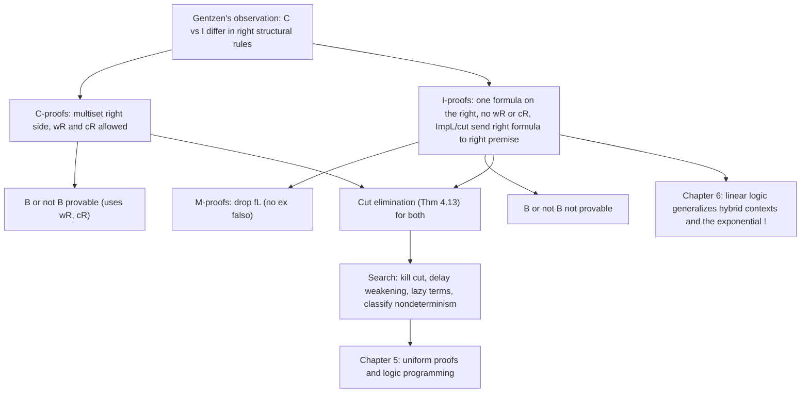

[[book-guidelines|↩ Back to guidelines]]

# Classical, Intuitionistic, and Minimal Logics

> Focus Area: `automated-reasoning`. Secondary touch on `type-theory` (signature inhabitation, eigenvariables, constructive content of proofs).
> Companion notes: [[Sequent-Calculus-Proof-Systems]] (the rules themselves, Chapter 3) and [[Cut-Elimination-and-Its-Consequences]] (the theorem, Sections 4.2-4.4). This note concentrates on what *distinguishes* the logics and on the search problem they pose.

## 1. The problem: three ways to say "classical versus intuitionistic"

Miller opens Chapter 4 with the observation that these two logics are the foundation of provers, logic programs, model checkers, and type systems, and that there are several ways to separate them:

1. **Proof-theoretic and philosophical.** Intuitionistic logic admits only proofs that provide *constructive evidence*. Classical logic admits those and more, notably the excluded middle $B \vee \neg B$, even when no procedure decides which disjunct holds.
2. **Semantic.** Intuitionistic logic has Kripke (possible-world) models: worlds arranged in a tree, an implication true at a world if true in all worlds it evolves to. (Covered in a different topic.)
3. **Gentzen's structural characterization.** The difference is a matter of *which structural rules are allowed on the right of the turnstile*. This is the one the book uses, and it matters because the same analysis later motivates [[Linear-Logic|linear logic]] (Chapter 6).

The motivating exercise (Exercise 4.1): prove there exist irrational $a, b$ with $a^b$ rational. Take $\sqrt{2}^{\sqrt{2}}$. By excluded middle it is rational or irrational. If rational, done with $a=b=\sqrt2$. If irrational, take $a=\sqrt2^{\sqrt2}$, $b=\sqrt2$, so $a^b = 2$. The proof never tells you *which* case holds. That is what "non-constructive" means, and it is exactly the kind of step an I-proof will refuse to make.

Programmer's version: a classical proof of $\exists x.\,P(x)$ may be a program that proves "it's not the case that no witness exists" without ever computing a witness. An intuitionistic proof is a program that returns the witness.

**What breaks without the structural view.** If you only have the philosophical definition, you cannot *check* it. "Is this proof constructive?" has no syntactic test. Gentzen's characterization turns it into a local, mechanical test on sequents: count the formulas on the right.

## 2. One signature, one rule set, two restrictions (Section 4.1)

### Connectives and sequents

Both logics share the signature of connectives

$$
\{\, f : o,\; t : o,\; \wedge,\vee,\supset : o\to o\to o \,\} \;\cup\; \{\, \forall_\tau, \exists_\tau : (\tau \to o)\to o \mid \tau \in S\setminus\{o\} \,\}.
$$

In words: $f$ is falsity, $t$ is truth, then conjunction, disjunction, implication, and one universal and one existential quantifier per non-propositional sort $\tau$. With $S=\{o\}$ there are no quantifiers and you get propositional logic. Note that **negation is not primitive**; $\neg B$ abbreviates $B \supset f$.

Sequents have the form

$$
\Sigma :: \Gamma \vdash \Delta
$$

where $\Sigma$ is the signature of eigenvariables currently in scope and $\Gamma$, $\Delta$ are **multisets** of $\Sigma$-formulas. Read it as: "from all of $\Gamma$, at least one of $\Delta$ follows." (Left side is a conjunction, right side a disjunction, the same sheet-of-paper reading as in [[Sequent-Calculus-Proof-Systems]].)

The rules come in three families (Figures 4.1 to 4.3):

| Family | Rules |
|---|---|
| Introduction | $\wedge L$ (two forms), $\wedge R$, $tR$, $\vee L$, $\vee R$ (two forms), $fL$, $\supset L$, $\supset R$, $\forall L$, $\forall R$, $\exists L$, $\exists R$ |
| Identity | $init$ ($B \vdash B$), $cut$ |
| Structural | $wL$, $wR$, $cL$, $cR$ (weakening and contraction on each side) |

Two bookkeeping remarks from the book. Of the binary-premise rules, $\supset L$ and $cut$ are **multiplicative** (they split the contexts), while $\wedge R$ and $\vee L$ are **additive** (they copy the context into both premises). And $t$, $f$ are the 0-ary versions of $\wedge$, $\vee$: $tR$ has zero premises (zero conjuncts to prove), and there is no $tL$ because the $n$-ary $\wedge L$ has $n$ instances and $n=0$ gives none.

### C-proofs and I-proofs

> **C-proof**: any proof using the rules of Figures 4.1, 4.2, 4.3. Multiple-conclusion sequents are allowed.
> **I-proof**: a C-proof in which *every* sequent has exactly one formula on the right (single-conclusion).

Write $\Sigma :: \Delta \vdash_C \Gamma$ and $\Sigma :: \Delta \vdash_I B$ for provability.

A single-conclusion restriction forces two consequences, which Proposition 4.2 shows are in fact an *equivalent* characterization:

**Proposition 4.2.** A C-proof $\Xi$ of $\Sigma :: \Gamma \vdash B$ is an I-proof iff (a) it has no occurrence of $cR$ or $wR$, and (b) in every $\supset L$ and every $cut$, the right-hand formula of the conclusion goes to the **right premise** (not the left one).

The two single-conclusion instances look like this:

$$
\frac{\Sigma :: \Gamma_1 \vdash B \qquad \Sigma :: C, \Gamma_2 \vdash E}{\Sigma :: B \supset C, \Gamma_1, \Gamma_2 \vdash E}\;\supset L
\qquad
\frac{\Sigma :: \Gamma_1 \vdash B \qquad \Sigma :: B, \Gamma_2 \vdash E}{\Sigma :: \Gamma_1, \Gamma_2 \vdash E}\;cut
$$

The proof of Proposition 4.2 is an induction on proof structure: the init, $tR$, $fL$ leaves are trivially single-conclusion, $\supset L$ and $cut$ pass the condition to both premises by hypothesis, and every other rule either preserves "one formula on the right" or (for $wR$, $cR$) is excluded.

### Why this prefigures linear logic

Miller flags two things that the reader should hold onto:

- **Hybrid contexts.** In I-proofs the left side keeps contraction and weakening; the right side has neither. Two zones with different structural behavior is the seed of linear logic's split contexts (Chapter 6).
- **A hidden modality in $\supset$.** The condition that $\supset L$ sends the right formula to the right premise means intuitionistic implication is doing extra work. Section 6.2 will show that extra work is the exponential $!$ of linear logic.

### The excluded middle, concretely (Figure 4.4)

A C-proof of $B \vee (B \supset f)$ (that is, $B \vee \neg B$):

$$
\dfrac{\dfrac{\dfrac{\dfrac{\dfrac{\dfrac{\;}{B \vdash B}\,init}{B \vdash B, f}\,wR}{\;\vdash B,\; B\supset f}\,\supset R}{\;\vdash B,\; B \vee (B\supset f)}\,\vee R}{\;\vdash B \vee (B\supset f),\; B\vee(B\supset f)}\,\vee R}{\;\vdash B \vee (B \supset f)}\,cR
$$

Read bottom-up as a search. The goal is a disjunction. First, $cR$ duplicates it, so there are two copies on the right. Apply $\vee R$ to one copy, choosing the left disjunct $B$, then $\vee R$ to the other copy, choosing the right disjunct $B \supset f$. The result is $\vdash B,\ B \supset f$, with two formulas on the right: the proof has not committed to either disjunct. Then $\supset R$ moves $B$ to the left, leaving $B \vdash B, f$, closed by $init$ after a **weakening on the right** ($wR$) to add the unused $f$. So the bottom-most step is **contraction on the right** ($cR$), which merges the two copies of $B \vee (B \supset f)$ when read top-down.

So the proof uses both $wR$ and $cR$, and it passes through a sequent with two right formulas. In an I-proof none of that is available, and indeed $B \vee \neg B$ has no I-proof. The intuition: to prove a disjunction constructively you must commit to one side *now*, with only the current context. The classical proof gets to keep both options on the table and "change its mind" using the right-hand context.

The book notes a small variation: the same proof shape gives $B \vee (B \supset C)$ for any $C$.

### Grounding: the I-proof restriction as a checkable invariant (Rust)

The right-hand-side restriction is a literal length check. Here is a sequent type and the two structural validators. This is the kind of code a proof checker's kernel would carry.

```rust
use std::collections::BTreeMap;

#[derive(Clone, Debug, PartialEq, Eq, PartialOrd, Ord)]
enum Formula {
    T,
    F,
    Atom(String),
    And(Box<Formula>, Box<Formula>),
    Or(Box<Formula>, Box<Formula>),
    Imp(Box<Formula>, Box<Formula>),
    // quantifiers elided in this sketch
}

// A multiset: formula -> multiplicity. Multiplicity is exactly what
// contraction/weakening change.
type Multiset = BTreeMap<Formula, usize>;

struct Sequent {
    left: Multiset,
    right: Multiset,
}

impl Sequent {
    fn right_size(&self) -> usize { self.right.values().sum() }
    /// Single-conclusion: the I-proof invariant.
    fn is_single_conclusion(&self) -> bool { self.right_size() == 1 }
}

enum Rule {
    Init, TR, FL, AndL(usize), AndR, OrL, OrR(usize),
    ImpL, ImpR, Cut,
    WL, CL, WR, CR,
}

/// Which rules are legal in which logic. In the C system, everything.
/// In the I system, no WR/CR, and every sequent in the derivation is
/// single-conclusion (which then forces the ImpL/Cut shape).
fn rule_allowed_in_i(rule: &Rule, conclusion: &Sequent, premises: &[Sequent]) -> bool {
    if matches!(rule, Rule::WR | Rule::CR) { return false; }
    conclusion.is_single_conclusion() && premises.iter().all(|p| p.is_single_conclusion())
}
```

The point of the sketch: "classical versus intuitionistic" is a *predicate over the sequents appearing in a derivation tree*, not a different rule set. That is the reason one checker can serve both logics with a mode flag.

### Grounding: Lean

Lean's core logic is intuitionistic: `Classical.em` is an **axiom** you have to opt into.

```lean
-- I-provable (single conclusion, no right structural rules needed):
example (p q : Prop) : (p → q) → (¬q → ¬p) := fun h nq hp => nq (h hp)

-- C-only: needs the excluded middle, so it needs Classical.
example (p : Prop) : p ∨ ¬p := Classical.em p

-- Exercise 4.3(5), Peirce's law, is classical-only:
example (p q : Prop) : ((p → q) → p) → p := fun h =>
  (Classical.em p).elim id (fun np => h (fun hp => absurd hp np))
```

Where the book says "there is no I-proof of $p \vee (p \supset q)$", Lean says "you cannot write that term without invoking `Classical.em` (or `Classical.byContradiction`)". The correspondence is clean: in Lean, the term *is* the constructive evidence; I-proofs are the terms of the simply-typed fragment. See [[Simply-Typed-Lambda-Terms-and-Churchs-Types]].

## 3. Signature inhabitation: a subtlety about empty types (end of Section 4.1)

Miller makes the quantifier rules *sort-aware* by tracking $\Sigma$. That surfaces a corner case most textbooks hide. Let $S=\{i,o\}$ and the only non-logical constant be $p : i \to o$. Then

$$
\cdot :: \forall_i x\,(p\,x) \;\vdash\; \exists_i x\,(p\,x)
$$

has **no proof**, even though traditional presentations prove it. Reason: $\exists R$ needs a witness, so $\exists R$ requires $\Sigma \Vdash t : i$, and there are no $\{p : i \to o\}$-terms of type $i$. The type $i$ is empty.

**Definition.** $\Sigma$ *inhabits* $S$ if for every $\tau \in S$ other than $o$ there is a $\Sigma$-term of type $\tau$. When $\Sigma$ inhabits $S$, provability coincides with the traditional presentations.

Why this is the right behavior: $\forall$ over an empty domain is vacuously true while $\exists$ over it is false. Traditional first-order logic assumes non-empty domains by fiat. The sequent calculus with explicit $\Sigma$ instead lets the *signature* decide, which is exactly how a typed language behaves. Exercise 4.7 plays with this: with only $f : i \to j$ and no constant of type $i$, `(∃j x t) ∨ (∀i y ∃j x t)` is the kind of formula whose provability depends on inhabitation, in comparison to the excluded-middle failure of Exercise 4.3(4).

Lean analog: `∀ x : α, P x → ∃ x : α, P x` needs `[Nonempty α]`. Lean's `Inhabited`/`Nonempty` is the same side condition made explicit.

**Soundness and completeness as comparisons.** The book uses C-proofs and I-proofs as the *yardstick*: a system $Y$ is sound for classical logic if everything $Y$ proves has a C-proof, complete if everything with a C-proof has a $Y$-proof (similarly for I-proofs). Two immediate facts: since $p \vee (p \supset q)$ has a C-proof but no I-proof, I-proofs are *not complete for* C-proofs, and C-proofs are *not sound for* I-proofs. Gentzen's cut-elimination theorem is itself a completeness theorem: it says the system with $cut$ removed is complete.

### Exercise 4.8 side note: the restart rule

A neat third description of the C/I gap (Gabbay): add to I-proofs the rule $\Sigma :: \Gamma \vdash B \;/\; \Sigma :: \Gamma \vdash C$, provided that on the path to the root some sequent has right-hand side $B$. In search terms: while proving a single-conclusion goal, you may *abandon* the current goal and *restart* an earlier one. A formula is C-provable iff I-provable with `restart`. This is "change your mind" from the excluded-middle proof, made into one rule.

## 4. Atomic initial rules (Section 4.2, first half)

The identity rules can be tamed. For the initial rule:

**Theorem 4.9.** If a sequent has a C-proof (resp. I-proof), it has one in which every $init$ is on an *atomic* formula.

The proof is an induction on $B$ showing $B \vdash B$ is derivable from atomic initial sequents. The two representative cases:

$$
\dfrac{\dfrac{B_1 \vdash B_1 \qquad B_2 \vdash B_2}{B_1,\; B_1 \supset B_2 \vdash B_2}\supset L}{B_1 \supset B_2 \vdash B_1 \supset B_2}\supset R
\qquad\qquad
\dfrac{\dfrac{\Sigma, y{:}\tau :: B\,y \vdash B\,y}{\Sigma, y{:}\tau :: \forall_\tau x.\,B\,x \vdash B\,y}\forall L}{\Sigma :: \forall_\tau x.\,B\,x \vdash \forall_\tau x.\,B\,x}\forall R
$$

Each replaces one $init$ at a larger formula with $init$ at strictly smaller ones. This is **$\eta$-expansion for proofs**: identity at a function type is replaced by "take an argument, apply, return". Same shape as eta-expanding $f$ to $\lambda x.\,f\,x$.

### Why atoms are the one place $init$ must survive

Atoms are built from non-logical constants (predicate symbols). Their meaning comes from *outside* logic, namely from logic programs, which provide the methods to prove atoms. Logical connectives have fixed meaning given by their introduction rules, but predicate symbols are "the plugs for programmers to impact the development of proofs". The atomic $init$ is the only point where a derivation touches the program. Without it nothing could ever close a branch.

**What breaks without atomic init restriction.** Nothing breaks logically, but search gets worse: at every sequent the prover has to consider closing it with $init$ on *any* formula, including compound ones. Restricting to atoms means only one kind of formula can close a branch, and this shrinks the search choice (Section 7 below).

### Grounding: Lean and Rust

Lean: this is why `exact h` (assumption) only really needs to work at atoms; for a compound goal, the elaborator can always `intro`/`constructor` it down first.

```rust
// Identity at a compound formula is *derived*, never primitive.
fn identity_proof(b: &Formula) -> Proof {
    match b {
        Formula::Atom(_) | Formula::T | Formula::F => Proof::init(b.clone()),
        Formula::Imp(b1, b2) => {
            // B1 |- B1 ; B2 |- B2 ==(ImpL)==> B1, B1=>B2 |- B2 ==(ImpR)==> |- B1=>B2
            let p1 = identity_proof(b1);
            let p2 = identity_proof(b2);
            Proof::imp_r(Proof::imp_l(p1, p2))
        }
        Formula::And(b1, b2) => Proof::and_r(
            Proof::and_l(0, identity_proof(b1)),
            Proof::and_l(1, identity_proof(b2)),
        ),
        Formula::Or(b1, b2) => Proof::or_l(
            Proof::or_r(0, identity_proof(b1)),
            Proof::or_r(1, identity_proof(b2)),
        ),
    }
}
// Termination: each recursive call is on a strict subformula.
```

(`Proof` is an assumed proof-term type; the point is the structural recursion on the formula.)

## 5. Cut elimination in this chapter (Sections 4.2 to 4.4, brief)

Cut is dealt with in depth in [[Cut-Elimination-and-Its-Consequences]]. What belongs in *this* note is how Chapter 4 uses it to pin down the two logics.

- **Theorem 4.13 (Gentzen).** If a sequent has a C-proof (resp. I-proof), it has a *cut-free* C-proof (resp. I-proof). The same theorem covers both logics. This is the book's reason to prefer sequent calculus over natural deduction (Section 4.7): Gentzen saw how to do it for intuitionistic natural deduction but not classical, because natural deduction has a single conclusion and so cannot express right-hand $cR$/$wR$. Sequent calculus handles both with a single procedure.
- **Cut elimination as admissibility.** Let $C^-$ be $C$ without $cut$. Theorem 4.13 says $cut$ is *admissible* in $C^-$.
- **Principal-case rewrites.** For a cut where both premises introduce the cut formula, $\wedge$ replaces the cut with a cut on a strict subformula; $\supset$ replaces one cut with two on smaller formulas; $\forall$ uses the substitution lemma (Exercise 4.20) to turn the eigenvariable into a term $t$; and $t$ is special because it has no left rule: the right proof is thrown away and *weakening* patches the endsequent.
- **Warnings.** Exercise 4.11, the "tonk" connective (left rules of $\wedge$, right rules of $\vee$, Prior 1960): cut elimination fails, since the two senses of the connective don't match. Exercise 4.12, definitions $p := (p \supset f)$: you get cut-free proofs of both $p \vdash f$ and $\vdash p$ (using $cR$), hence a proof with cut of $\vdash f$, and cut elimination cannot terminate. A logic with unrestricted recursive definitions can be inconsistent.
- **Consequences.** Duality of $init$ and $cut$ through the family $B \supset B$ (Section 4.3.1); an exponential blow-up in cut-free proofs of $P \vdash p(f^{2^n} a)$ (Section 4.3.2); logical equivalence $B \equiv C$ and replacement of subformulas (Section 4.3.3, Proposition 4.16); [[Sequent-Calculus-Proof-Systems#Invertibility|invertibility]] of $tR, \vee L, \wedge R, fL, \forall R, \exists L, \supset R$ proved by cut (Proposition 4.17).

Hook for later: the same pattern, **cut elimination as the meaning-giving test for connectives**, is what Chapter 5 will prove (focused, fragment-wise, Theorem 5.28) and Chapter 7 will prove for linear logic (Theorem 7.15).

## 6. Derivable versus admissible (Section 4.4), seen through the two logics

Two concepts that are easy to conflate:

- **Derivable rule.** Obtainable by *composing primitive rules*. Example: $\Sigma :: \Gamma, B_i \vdash \Delta \;/\; \Sigma :: \Gamma, B_1 \wedge \cdots \wedge B_n \vdash \Delta$ is derivable (just $\wedge L$ and the associativity convention).
- **Admissible rule.** Adding it does *not change the set of provable sequents*. You prove it by taking proofs of the premises and constructing, by an algorithm that may inspect those proofs, a proof of the conclusion.

Every derivable rule is admissible; the converse fails, and the interesting theorems are of the converse kind. Cut elimination says cut is admissible without being derivable. Other admissible rules from the exercises:

- **Strengthening of $t$** (Exercise 4.19): a proof of $\Gamma, t \vdash \Delta$ yields one of $\Gamma \vdash \Delta$. Strengthening in general is *not* admissible; this is a special case.
- **Instantiation** (Exercise 4.20): from $\Sigma, x{:}\tau :: \Gamma \vdash \Delta$ and $\Sigma \Vdash t : \tau$ infer $\Sigma :: \Gamma[t/x] \vdash \Delta[t/x]$. It has the same arrangement of rules in both proofs. It is "cut at the level of terms".
- **Ex falso quodlibet in I-proofs** (Lemma 4.22, next section).

Rust analogy: a *derivable* rule is a function composed from kernel primitives (a macro or tactic that expands into kernel calls, so it adds nothing to the trusted base). An *admissible* rule is a meta-theorem about the kernel: you can add it as an optimization only after proving it, or implement it as a proof-transforming function whose output the kernel still checks. LCF-style systems do the first; some certified provers do the second.

## 7. Negation, false, and minimal logic (Section 4.5)

### Gentzen's LK and LJ versus C-proofs and I-proofs

Miller's systems are essentially Gentzen's LK and LJ with two differences: no primitive negation (use $B \supset f$), and the units $t$ and $f$ are included (Gentzen had no units). Gentzen's negation rules are

$$
\frac{\Gamma \vdash B, \Delta}{\neg B, \Gamma \vdash \Delta}\,\neg L
\qquad
\frac{\Gamma, B \vdash \Delta}{\Gamma \vdash \neg B, \Delta}\,\neg R
$$

and **cannot be added directly to I-proofs**: $\neg L$ has a right-hand $B, \Delta$ in the premise but typically empty right-hand side in the conclusion. Gentzen's solution for LJ: keep all sequents with *at most one* formula on the right (so $\Delta$ may be empty), which makes $\neg L$ conclude with empty right and allows $wR$ to appear.

### Translating G-proofs to I-proofs

Define a **G-proof** as a C-proof with the negation rules and right sides of at most one formula (this models LJ). Define the mapping $(B)^\circ$ replacing every $\neg C$ by $C \supset f$, extended to sequents:

$$
(\Gamma \vdash \Delta)^\circ = \begin{cases} (\Gamma)^\circ \vdash (\Delta)^\circ & \Delta \text{ non-empty} \\ (\Gamma)^\circ \vdash f & \Delta \text{ empty.}\end{cases}
$$

**Proposition 4.23.** Every G-proof of $\Sigma :: \Gamma \vdash \Delta$ converts to an I-proof of $\Sigma :: (\Gamma)^\circ \vdash (\Delta)^\circ$.

The trick: an empty right side is replaced by $f$. The $\neg L$ and $\neg R$ steps become:

$$
\dfrac{\Gamma \vdash B}{\neg B, \Gamma \vdash \cdot}\neg L
\;\longmapsto\;
\dfrac{(\Gamma)^\circ \vdash (B)^\circ \qquad \dfrac{}{f \vdash f}\,fL}{(B)^\circ \supset f,\; (\Gamma)^\circ \vdash f}\supset L
\qquad
\dfrac{\Gamma, B \vdash \cdot}{\Gamma \vdash \neg B}\neg R
\;\longmapsto\;
\dfrac{(\Gamma)^\circ, (B)^\circ \vdash f}{(\Gamma)^\circ \vdash (B)^\circ \supset f}\supset R
$$

The only non-trivial case is a G-proof ending in $wR$ from an empty right side, $\Gamma \vdash \cdot \;/\; \Gamma \vdash B$. Its translation has $(\Gamma)^\circ \vdash f$, and to get $(\Gamma)^\circ \vdash (B)^\circ$ we need **ex falso quodlibet**.

### Ex falso is admissible

**Lemma 4.22.** If $\Xi$ is an I-proof of $\Sigma :: \Gamma \vdash f$, then for every $\Sigma$-formula $B$ there is an I-proof $\Xi'$ of $\Sigma :: \Gamma \vdash B$ with *the same structure*.

Proof sketch: induct on $\Xi$, changing right-hand $f$'s to $B$; the leaf $\Gamma', f \vdash f$ becomes $\Gamma', f \vdash B$, still closed by $fL$. Equivalently, you permute the cut

$$
\dfrac{\Gamma \vdash f \qquad \dfrac{}{f \vdash B}\,fL}{\Gamma \vdash B}\,cut
$$

up into its left premise.

Consequence stated by the book: **I-proofs contain the ex falso rule ($fL$) yet have no $wR$**, while G-proofs have both. Gentzen's $wR$ in LJ is "absorbed" into $fL$. So the structural characterization is clean: intuitionistic logic = no weakening and no contraction on the right.

### Minimal logic

Minimal logic is intuitionistic logic *without ex falso*:

> An **M-proof** is an I-proof in which $fL$ does not appear.

Since $fL$ is the only rule for $f$, the symbol $f$ is no longer a logical connective in M-proofs; it behaves like an arbitrary atom. Exercise 4.21 states this precisely: if $q$ is a fresh atom of type $o$ not occurring in $B$ and $B'$ is $B$ with every $f$ replaced by $q$, then $B$ has an M-proof iff $B'$ has an I-proof.

So the ladder is

$$
\text{Minimal} \;\subset\; \text{Intuitionistic} \;\subset\; \text{Classical}
$$

with each step adding exactly one principle:

| Logic | Right side | $fL$ (ex falso) | Right $wR$, $cR$ | Characteristic theorem not provable in the weaker one |
|---|---|---|---|---|
| M-proofs | exactly one formula | no | no | $f \supset B$ (without a special $f$ rule) |
| I-proofs | exactly one formula | yes | no | $B \vee \neg B$, $((p\supset q)\supset p)\supset p$ |
| C-proofs | multiset | yes | yes | (all classical theorems) |

Lean parallel: `False.elim` is `fL`/ex falso, and an `¬p` is literally `p → False`. A "minimal" Lean would be one in which `False` is just another opaque proposition constant with no eliminator. That is indeed what Exercise 4.21's $q$-substitution says.

### Two derivable rules (Exercise 4.24)

With $\neg B := B \supset f$:

$$
\dfrac{\Gamma \vdash B \qquad \Gamma \vdash \neg B}{\Gamma \vdash C}\;\textit{explode}
\qquad\qquad
\dfrac{\Gamma, B \vdash C \qquad \Gamma, \neg B \vdash C}{\Gamma \vdash C}\;\textit{excluded middle}
$$

*Explode* is derivable in I-proofs (it is ex falso plus $\supset L$). *Excluded middle* (as a case-split rule) is derivable using C-proofs, which also gives Exercise 4.4's recipe: any C-provable but not I-provable sequent becomes I-provable if instances of $B \vee \neg B$ are added to the left-hand context, since the left side may use contraction. Classical reasoning in an intuitionistic prover is "assume LEM for the atoms you need".

## 8. Search choices in Gentzen's calculus (Section 4.6)

This is the bridge to logic programming. Gentzen's calculus is perfect for proving cut elimination but poor as a computation model: at every step bottom-up there are too many options.

**Four sources of choice:**

1. **Cut**: can be tried on any sequent (and requires *inventing* the cut formula).
2. **Structural rules**: contraction and weakening can always fire.
3. **Introduction rules**: a sequent may contain many non-atomic formulas, and any of them could be introduced.
4. **Initial**: always possible to check whether the sequent is initial.

**Sub-choices** are worse: $\vee R$ picks a disjunct; $\wedge L$ picks a conjunct; $\forall L$ and $\exists R$ pick a **term** $t$; and $\supset L$ and $cut$ require *splitting* the surrounding multisets into two parts, for which there are exponentially many splits.

**How the book prunes them:**

| Choice | Mitigation | Cost / caveat |
|---|---|---|
| Cut and cut-formula invention | Cut elimination (Theorem 4.13) lets us drop it | Proofs become computation traces, not human lemma-structured arguments (see Section 3.7); cut-free proofs can be exponentially larger |
| Structural rules | Delay weakening to the leaves and build it into $init$; replace context splitting in $\supset L$ by contraction (copy all formulas to both premises) | The proof system is no longer "resource-tracking" (a point linear logic will reverse) |
| Quantifier instantiation $t$ | Use logic variables and unification to determine $t$ lazily | "Entirely standard", but *out of scope* for the book |
| Which introduction rule | Classify nondeterminism (below) | Structure for the non-invertible choices comes in Chapter 5 |

### Don't-know versus don't-care nondeterminism

> **Don't-care nondeterminism**: choices that need *never be undone*. Example: the order in which invertible rules are applied (Section 3.5). Any order loses no completeness.
> **Don't-know nondeterminism**: genuine choices, which might need to be undone in order to find a proof. Non-invertible introduction rules are the standard case.

From Proposition 4.17 the invertible rules are $tR, \vee L, \wedge R, fL, \forall R, \exists L, \supset R$. The *non*-invertible ones are $\wedge L, \vee R, \supset L, \forall L, \exists R$. So the search strategy in the next chapter will say: apply invertible rules eagerly in any order (no backtracking point), and treat each non-invertible step as a backtracking point.

### Grounding: don't-know choice in a prover loop (Rust and Python)

A cut-free, propositional, atomic-init search for single-conclusion (I-style) sequents; invertible rules applied eagerly, non-invertible ones are branching points. This is *illustrative*: the formal development of this strategy is in Chapter 5 and is covered under [[Computation-as-Proof-Search]].

```rust
/// Intuitionistic propositional, single-conclusion, cut-free.
/// `ctx` is a Vec so contraction is "just keep the formula" (we never
/// remove an assumption in this sketch, mimicking cL being free).
fn prove(ctx: &Vec<Formula>, goal: &Formula) -> bool {
    use Formula::*;
    // Invertible, right: don't-care. Apply and continue; never backtrack here.
    match goal {
        T => return true,                                  // tR
        And(a, b) => return prove(ctx, a) && prove(ctx, b), // AndR
        Imp(a, b) => {                                       // ImpR
            let mut ctx2 = ctx.clone();
            ctx2.push((**a).clone());
            return prove(&ctx2, b);
        }
        _ => {}
    }
    // Invertible, left: eliminate F, split Or, un-pair And. (don't-care)
    for (i, h) in ctx.iter().enumerate() {
        let mut rest = ctx.clone();
        rest.remove(i);
        match h {
            F => return true,                                // fL
            Or(a, b) => {                                    // OrL
                let mut l = rest.clone(); l.push((**a).clone());
                let mut r = rest.clone(); r.push((**b).clone());
                return prove(&l, goal) && prove(&r, goal);
            }
            _ => {}
        }
    }
    // Atomic init: the only identity rule left.
    if ctx.contains(goal) { return true; }
    // Non-invertible: don't-know. Each alternative is a backtrack point.
    if let Or(a, b) = goal {                                 // OrR: pick a side
        if prove(ctx, a) || prove(ctx, b) { return true; }
    }
    for h in ctx {
        if let Imp(a, c) = h {                               // ImpL: contraction-style
            let mut ctx2 = ctx.clone();                      // (keep h: copy to both)
            ctx2.push((**c).clone());
            if prove(ctx, a) && prove(&ctx2, goal) { return true; }
        }
        if let And(a, b) = h {                               // AndL: pick one conjunct
            for x in [a, b] {
                let mut ctx2 = ctx.clone(); ctx2.push((**x).clone());
                if prove(&ctx2, goal) { return true; }
            }
        }
    }
    false
}
// Caveat: this naive version can loop (ImpL keeps h forever). Intuitionistic
// propositional provability is PSPACE-complete (Section 4.7); real provers
// add loop checks (Dyckhoff's LJT) or other termination devices.
```

```python
# The same don't-know / don't-care distinction in 6 lines of pseudo-search:
def search(state):
    state = saturate_invertible(state)        # don't-care: any order, no undo
    if closed_by_atomic_init(state): return True
    return any(search(s) for s in non_invertible_choices(state))  # don't-know: backtrack
```

Pointer to the learning-goal thread "proof search" and "unification of terms": the third mitigation above ("logic variables and unification to determine instantiation terms lazily") is exactly what a metavariable-based elaborator does for `∃R`/`∀L`. A hole `?t` is created, and the first atom that needs to match fixes it. The book defers this; your elaborator will not.

**What breaks without don't-know/don't-care.** An implementation that treats *all* choices as backtrackable has to explore every permutation of invertible rules even though they commute. That's an unnecessary factorial blowup. The classification is what lets Prolog-like engines (Chapter 5) have a single, deterministic goal-decomposition phase.

## 9. Facet checklist (Topic List entry 5)

- **C-proofs and I-proofs**: Section 2; multiple- versus single-conclusion; Proposition 4.2; $\vdash_C$ and $\vdash_I$.
- **Excluded middle and structural rules on the right**: Figure 4.4 proof uses $wR$ and $cR$; I-proofs have neither; hybrid contexts prefigure linear logic.
- **Atomic initial rules**: Theorem 4.9; atoms are the plug where programs enter; cut can be atomic-restricted too but with harder proof.
- **Negation as implication of falsity**: $\neg B := B \supset f$; G-proofs translate to I-proofs by $(\cdot)^\circ$ (Proposition 4.23).
- **Minimal logic and ex falso quodlibet**: M-proofs omit $fL$; Exercise 4.21's $f \to q$ substitution; ex falso is admissible in I-proofs (Lemma 4.22).
- **Gentzen's LK and LJ**: LK $\approx$ C-proofs; LJ $\approx$ at-most-one-right-formula system; Section 4.5; natural-deduction comparison in Section 4.7.
- **Search choices in Gentzen's calculus**: Section 8; four sources of choice, mitigation, don't-know versus don't-care.

## 10. Synthesis and goal routing

### Structure of the chapter's argument



### How it bears on your goals (Focus Area: `automated-reasoning`, with `type-theory`)

- **Judgments, contexts, and a proof checker's kernel.** A sequent $\Sigma :: \Gamma \vdash \Delta$ is the same object as a typing judgment $\Gamma \vdash e : A$ with an extra signature and (in the classical case) several conclusions. I-proofs are the Curry-Howard image of the simply-typed fragment with one result type. The rule "single conclusion" is the type checker's "an expression has one type". Multi-conclusion C-proofs have no such term reading without control operators (continuations, `call/cc`), which is where classical logic shows up in programming languages.
- **Trusted kernel design.** The Rust sketch in Section 2 gives the shape: *one* sequent representation and *one* set of rules, with the logic selected by a validator on the derivation. A kernel that checks C-proofs and exposes an `intuitionistic` mode (reject $wR$/$cR$ and enforce the $\supset L$/cut shape) can certify that a proof used no classical principle, which matters if downstream consumers (an extraction to programs, or a refinement-type checker) need constructive witnesses.
- **Derivable versus admissible = tactic versus kernel rule.** Anything you can express as a composition of kernel rules (derivable) lives outside the trusted base. Admissible rules (cut, instantiation, ex falso) are theorems *about* the kernel. Know which one each feature is before you decide where it goes.
- **Proof certificates and proof reconstruction.** Atomic-only $init$ and cut-free proofs make *certificate checking* simple (small rule set, subformula property) but certificate *size* can explode exponentially (Section 4.3.2). Practical certificates keep lemmas (cuts) or share subproofs (a DAG). Watch for this when your prover emits proofs to the kernel.
- **Unification and metavariables.** Section 4.6's remark that $\forall L$ and $\exists R$ "generally use logic variables and unification to determine instantiation terms lazily" is the specification of what the elaborator's metavariable mechanism does for quantifier instantiation. Pattern unification (Miller's fragment) is the tractable version needed when the instantiation $t$ may itself contain bound variables. The book explicitly leaves this out here. Treat this section as the problem statement that later material (higher-order quantification, Chapter 9) answers.
- **Signature inhabitation** is the same side condition as non-empty sorts in a refinement-type language: a `forall x: T` hypothesis does not give you an `exists x: T` unless a term of `T` exists in scope. Worth a `Nonempty`-style check in a verification-condition generator that handles quantified specs.
- **Minimal versus intuitionistic versus classical as a design dial** for Hoare-style contract reasoning: if specifications mention `false` (contradictory preconditions, unreachable code), ex falso is what lets a verifier discharge goals vacuously. Lean's choice (ex falso built in, classical available by axiom) is a reasonable default for a verification backend, and SMT backends are classical.
- **Complexity note** (Section 4.7): first-order logic is undecidable; classical propositional is co-NP-complete; intuitionistic propositional is PSPACE-complete. For the SAT/SMT side of the toolchain this is the reason to dispatch propositional classical subgoals to a SAT solver while keeping intuitionistic/constructive reasoning for the elaborator.

(The book does not tag this topic against `type-theory` or `sat-smt-csp` in its learning-goals file; the connections above are offered as routing hints, not as claims the book itself makes, except where cited to a section.)

## 11. Open points the book flags

- Cut-elimination for focused fragments is deferred (Theorems 5.28, 7.15) and unfocused versions follow (Theorems 5.30, 7.19).
- Bibliographic notes (Section 4.7): Gentzen [1935] introduced natural deduction and the sequent calculus; Girard et al. [1989] observe that $init$ says the left occurrence of $B$ is *stronger* than the right while $cut$ says the opposite, a duality visible also in the Calculus of Structures (Guglielmi) and in linear-logic metalogic presentations.
- The chapter has no extended worked algorithm; the code in this note is original illustration of the same ideas, not book code.

## Where this leads

The two restrictions on I-proofs (no right structural rules, and the right-formula routing in $\supset L$) are what Chapter 5 exploits to define uniform proofs and the Horn-clause and hereditary-Harrop programming languages, and what Chapter 6 generalizes into linear logic's split contexts and the exponential $!$. The search-choice analysis of Section 4.6 is the specification that focused proof systems answer.
