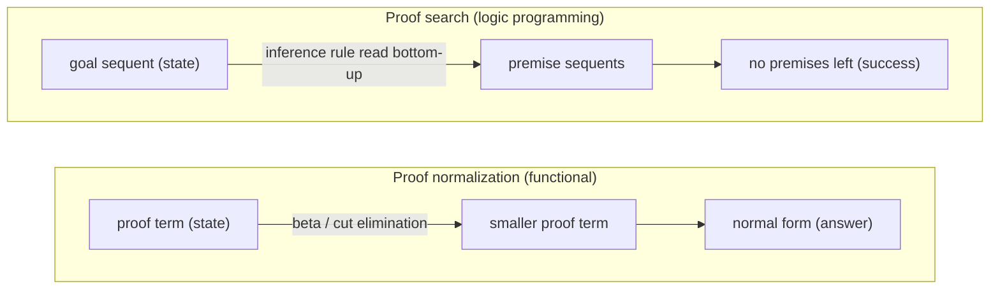
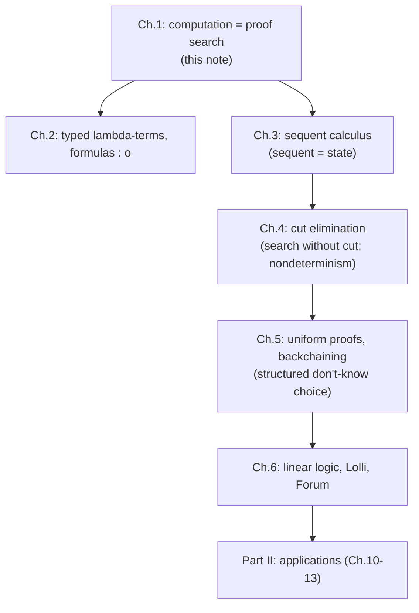

[[book-guidelines|↩ Back to guidelines]]

# Computation as Proof Search

Focus Area: `automated-reasoning`. Printed pages are cited as in the book; the PDF file is offset by 8 pages.

## 0. The question this chapter answers

There are many equivalent ways to say what "computation" is: the $\lambda$-calculus, Turing machines, recursive equations. Dozens of programming languages implement the same class of functions. So why would anyone want logic formulas to be programs?

Miller's answer is not "because it is another Turing-complete formalism". It is that logic comes with a mature, universally agreed semantics and a rich algebra of meaning-preserving operations (substitution, replacement of equivalents, abstraction). If a program *is* a formula, those properties transfer to the program. The question is then which *role* the logic plays. The chapter sorts the options, picks one, and explains why the historical foundation of Prolog (resolution) is a poor fit for it.

Everything below is read off Chapter 1, with Sections 3.1 and 4.6 used to make "sequent as computation state" and "nondeterminism" concrete.

---

## 1. Computation as model versus computation as deduction

**What problem does the split solve?** "Logic and computation" is used loosely to mean very different things. Compare:

- A Hoare triple $\{P\}\ C\ \{Q\}$ talks *about* a program $C$.
- A Prolog clause *is* the program.

In the first, the program lives outside the logic, as a mathematical object (nodes, transitions, states), and the logic makes statements about it. In the second, the logic's own syntax is the computation.

The book's taxonomy (Section 1.2):

| Approach | Where is the computation? | Role of logic |
|---|---|---|
| **Computation-as-model** | Encoded as external structures (states, transitions) | Logic makes statements about them; computations are *models* of formulas. Intensional operators: Hoare triples, modalities of temporal and dynamic logics |
| **Computation-as-deduction** | Inside logic: formulas, terms, types, proofs are elements of the computation | Logic *is* the specification language |

The author notes that the model approach is "the most broadly successful use of logic specifications with computation". This book deliberately works in the rarer second setting.

**What breaks without the distinction?** You cannot tell what a claim like "the logic captures the semantics" means. A verifier built on Hoare logic and a Prolog interpreter both "use logic", but a bug in the first is a wrong *statement about* a program, while a bug in the second is a wrong *program*.

### Grounding: model versus deduction in Rust and Lean

Computation-as-model, in the style of a verifier. The program is data, and logic is a judgment over it:

```rust
// The program is an ordinary data structure (a tiny imperative language).
enum Stmt {
    Assign(String, Expr),
    Seq(Box<Stmt>, Box<Stmt>),
}
enum Expr {
    Var(String),
    Lit(i64),
    Add(Box<Expr>, Box<Expr>),
}
// Logic lives *outside*, as a relation over that data:
// "{P} stmt {Q}" is a judgment you check about `Stmt`, e.g. by a
// verification-condition generator. The program never "runs" in the logic.
```

Computation-as-deduction. The logic program is the formula list, and "running" it is a proof attempt:

```rust
// A propositional Horn program: each clause is a formula `body => head`.
struct Clause {
    head: &'static str,
    body: Vec<&'static str>,
}
// There is no separate `Stmt` language. Executing the program means asking
// whether a goal formula is provable from these clauses (Section 3 below).
```

In Lean the two roles sit side by side. A `def` is a computation-as-model term you can evaluate. A `theorem` is a goal for a proof-search tactic:

```lean
def double (n : Nat) : Nat := n + n        -- term to be normalized
example : double 3 = 6 := rfl              -- checked by evaluation (normalization)
example (p q : Prop) (hp : p) (hq : q) : p ∧ q := by
  constructor <;> assumption               -- checked by a small proof search
```

---

## 2. Proof normalization versus proof search

Computation-as-deduction itself splits in two, depending on what the "state" is.

1. **Proof normalization.** The state is a *proof term*. Computing is normalization (called $\beta$-reduction or cut elimination). This is the Curry-Howard reading, the basis of functional programming (following Martin-Lof [1982]) and of new functional languages (Abramsky [1993]).
2. **Proof search.** The state is a *sequent*, a structured collection of formulas. Computing is the search for a proof of that sequent. "The changes that take place in sequents capture the dynamics of computation." This is the subject of the book.

Both must handle nondeterminism, and each handles it differently:

- Normalization-based languages fix a *redex order*: call-by-value or call-by-name.
- Search-based languages (Prolog, $\lambda$Prolog) usually impose *depth-first search with backtracking*.

The concerns differ in kind. Normalization is about rewriting and its **confluence**. Search is about **nondeterminism and reading inference rules in reverse** (from conclusion to premises). Miller is candid that the division is "informal and suggestive" and that future advances might merge or reorganize it.

**What breaks without this distinction?** You would carry the wrong intuitions across. Confluence is a theorem you *want* for normalization (the order of redexes should not change the answer). For search it generally fails, and that is a feature: different branches are different candidate answers.

### Grounding

The same logical object (an implication) behaves differently under each reading:



In Lean terms: `#reduce`, `whnf` and `rfl` checks are the normalization half. Tactics such as `simp`, `omega`, `aesop`, and `exact?` are the search half. They start from a goal and apply rules backward, producing subgoals.

---

## 3. Sequents as computation states

Chapter 1 only names the idea. Section 3.1 gives the picture, and it is worth having here because the whole book rests on it.

**First principles.** Imagine proving "for every natural number $n$, $n(n+1)$ is even". You take a blank sheet of paper, write the lemmas you accept at the top, and the claim at the bottom. Your job is to fill the gap. A *sequent* is a formal snapshot of that sheet:

$$\Sigma ;\ \Gamma \vdash B$$

Here $\Gamma$ is the multiset of formulas "at the top" (assumptions), $B$ is the conclusion "at the bottom", and $\Sigma$ is the signature of *eigenvariables* (fresh names that are bound across the sheet). In Section 3.1, the book writes the starting sheet as

$$T_1:\quad \cdot\,;\ L_1, L_2, L_3 \vdash \forall n.\forall p.\,(\mathit{times}\ n\ (s\ n)\ p) \supset (\mathit{even}\ p)$$

with $L_1 = \forall n.(\mathit{even}\ n)\lor(\mathit{odd}\ n)$ and so on. Starting a new sheet by introducing the variables and assuming the hypothesis gives the next state:

$$T_2:\quad n, p\,;\ L_1, L_2, L_3, (\mathit{times}\ n\ (s\ n)\ p) \vdash \mathit{even}\ p$$

and using $L_1$ adds $(\mathit{even}\ n)\lor(\mathit{odd}\ n)$ to the sheet ($T_3$). **A computation step is a transition between such sheets.** Reading an inference rule from conclusion to premises *is* the step function.

**Contrast with Frege proofs** (Section 3.1). A Frege system has three axiom schemas plus modus ponens, and inference acts on formulas. The Frege derivation of $f \supset w$ in the book needs seven lines and is not a state you can step from. The sequent calculus has *no axioms*, and "the burden of proof falls entirely on inference rules over sequents". That is exactly what makes sequents usable as machine states.

**What breaks without this?** If rules acted on single formulas and axioms had to be guessed, there would be no local, goal-directed notion of "what to do next". You would be hunting for the right axiom instance, not computing.

### Grounding in Rust and Lean

The sequent is a struct, and a rule is a function from one state to a list of states:

```rust
use std::collections::BTreeSet;

#[derive(Clone, PartialEq, Eq, PartialOrd, Ord, Debug)]
enum Formula {
    Atom(String),
    And(Box<Formula>, Box<Formula>),
    Imp(Box<Formula>, Box<Formula>),
}

/// `sigma ; gamma |- goal`  (eigenvariables omitted: propositional case).
#[derive(Clone, Debug)]
struct Sequent {
    gamma: BTreeSet<Formula>, // the "top of the sheet"
    goal: Formula,            // the "bottom of the sheet"
}

/// One bottom-up step on the goal: premises of the right rule for the goal's
/// top connective. An empty Vec means "this branch needs nothing more".
fn right_step(s: &Sequent) -> Option<Vec<Sequent>> {
    match &s.goal {
        Formula::And(a, b) => Some(vec![
            Sequent { gamma: s.gamma.clone(), goal: (**a).clone() },
            Sequent { gamma: s.gamma.clone(), goal: (**b).clone() },
        ]),
        Formula::Imp(a, b) => {
            let mut g = s.gamma.clone();
            g.insert((**a).clone()); // assume the antecedent
            Some(vec![Sequent { gamma: g, goal: (**b).clone() }])
        }
        Formula::Atom(_) => None, // needs a left rule or an initial sequent
    }
}
```

In Lean, the "sheet of paper" is literally the goal display. `Γ ⊢ B` is the local context above the turnstile (`⊢`), and each tactic is one bottom-up step. For example, `intro h` is the $\supset R$ step above.

---

## 4. Resolution refutation as an unfortunate foundation

The earliest theoretical framework for logic programming analyzed *resolution refutation* (Robinson [1965]), specifically SLD resolution. Miller calls this "unfortunate" for three reasons (Section 1.3):

1. **Refutation, not proof.** Resolution derives a contradiction from the program plus the *negated* goal. But logic programming seems to be about *proving* a goal from a program. The foundation is counterintuitive to the programmer.
2. **Normal forms.** Refutation systems need conjunctive normal form and Skolem normal form. Among the logics studied here, classical logic is the *only* one where these normal forms are available. Worse, they are *not preserved* when a higher-order predicate variable is replaced by an expression containing quantifiers and connectives.
3. **Most general unifiers.** The key resolution step computes mgus. Unification is really an implementation of the interplay between quantification and equality, and it is more natural to understand that interplay first and implement it after. For simply typed $\lambda$-terms, most general unifiers may *not exist*, so resolution cannot even handle those situations.

The sequent calculus is the alternative: it is framed in terms of *proving*, and needs neither normal forms nor unification as part of the abstract notion of proof search. Two benefits follow: quantifier interplay is explored *without Skolem functions*, and situations without mgus are not excluded. Note this is a statement about the *abstract* proof-search story. The book still says implementations "generally use logic variables and unification to determine instantiation terms lazily" (Section 4.6), just that unification "plays no central role" in the theory.

**What breaks without this reorientation?** In the higher-order setting resolution's machinery stops being sound or complete as stated, and a language like $\lambda$Prolog (higher-order predicates, abstract data types, modules) has no clean semantics. This chapter is the motivation for moving the foundation to sequents.

### Grounding

The refutation view clausifies and negates, while the search view keeps the goal as a goal:

```python
# Refutation view: add NOT goal to the clause set, derive the empty clause.
#   needs: negation, clausal normal form, (Skolemization for quantifiers), mgu
#
# Proof-search view: keep the goal as a goal, work backward from it.
def prove(goal, program):                   # program: dict atom -> list of bodies
    for body in program.get(goal, []):      # choose a clause (don't-know choice)
        if all(prove(g, program) for g in body):
            return True
    return False

prog = {"c": [["a", "b"]], "a": [[]], "b": [["a"]]}
print(prove("c", prog))   # True; no normal forms, no unifier in sight
```

Forward link to the project: the engine you eventually write for refinement-type verification conditions may well use resolution/unification internally. Miller's point is that the *specification* of what proof search means should not be that engine. In Lean's elaborator the same split exists: the `isDefEq` unifier is an implementation device, and the kernel's typing judgment is the specification.

---

## 5. Programming equals logic

### 5.1 Algorithm = Logic + Control

Kowalski [1979] proposed $\text{Algorithm} = \text{Logic} + \text{Control}$. It exposes a gap between a logical specification (first-order Horn clauses) and an algorithm. The book's example is the naive Horn clause specification of the Fibonacci series: depending on whether proof search is **top-down (goal-directed)** or **bottom-up (program-directed)**, the *same* logic yields either an exponential-time or a linear-time algorithm. So the programmer must be able to steer control, and Prolog added non-logical features for this (the cut $!$, negation-as-failure).

Rust illustration of the two control strategies over one specification $\mathit{fib}(0,0)$, $\mathit{fib}(1,1)$, $\mathit{fib}(n,a+b) \Leftarrow \mathit{fib}(n-1,a),\ \mathit{fib}(n-2,b)$:

```rust
// Top-down (goal-directed): start at fib(n, ?), recurse on subgoals.
// Without memoization this re-proves the same subgoals: exponential.
fn fib_top_down(n: u32) -> u64 {
    match n {
        0 => 0,
        1 => 1,
        _ => fib_top_down(n - 1) + fib_top_down(n - 2),
    }
}

// Bottom-up (program-directed): derive facts fib(0), fib(1), fib(2), ...
// from the clauses until fib(n) appears: linear.
fn fib_bottom_up(n: u32) -> u64 {
    let (mut a, mut b) = (0u64, 1u64);
    for _ in 0..n {
        let next = a + b;
        a = b;
        b = next;
    }
    a
}
```

Same logic, different complexity. That is the whole motivation for treating *control* as a first-class design question.

### 5.2 Programming = Logic

Practical languages added many features to Prolog: $\text{Programming} = \text{Logic} + \text{Control} + \text{I/O} + \text{Higher-order programming} + \text{Data abstractions} + \text{Modules} + \text{Concurrency} + \dots$. Done ad hoc, these features interact in complicated ways (higher-order versus modules, say), complicating design, implementation and semantic specification, and "logic ... was moved from center stage".

Miller's project: see how to satisfy the equation

$$\text{Programming} = \text{Logic}.$$

This will require rethinking both words. "Programming" means *high-level specification of computations*, not efficient low-level programs. "Logic" is reinterpreted by moving from first-order classical Horn clauses to **intuitionistic and [[Linear-Logic|linear logic]]**, possibly with higher-order quantification. **Goal-directed control will be built into the proof systems themselves.** Chapters 10-13 are the demonstration.

**A terminology trap.** Prolog's cut $!$ is unrelated to the sequent-calculus *cut rule*. Footnote 1: the book will not mention Prolog's $!$ again, and "both the name 'cut' and the '!' symbol will have entirely different meanings here". Do not conflate them while reading Chapters 4 and 6.

### 5.3 Why bother? (Section 1.5)

1. Formula operations are meaning-preserving: applying substitutions, or replacing a subformula by an equivalent one, is logically meaningful, so one expects meaning-preserving program transformations.
2. Multiple characterizations of the central notion: theorems as provable formulas or as true formulas; provability via sequent calculus, natural deduction, resolution refutation, tableaux. So different execution models can run the same program with the same meaning.
3. Proof theory brings abstractions that a language can harness (higher-order intuitionistic logic gives abstract data types, modules and higher-order programming) *without undefined interactions* between them.
4. The logics have universally accepted descriptions, so programs stay meaningful even if today's compilers disappear.

---

## 6. Don't-know and don't-care nondeterminism

This is the first topic that the chapter leaves implicit and Chapter 4 makes explicit (Section 4.6, p. 59). The setting: when you read rules bottom-up, there is a lot of freedom. Choosing $\land L$ means selecting a conjunct. Choosing $\forall L$ or $\exists R$ means picking a term $t$. Using $\supset L$ or cut means *splitting* the surrounding multiset contexts, and there can be exponentially many splits. Cut elimination removes the choice of a cut formula, structural rules can be built into inference rules, and term selection is deferred to logic variables and unification. What remains is nondeterminism in choosing among introduction rules, and it comes in two kinds:

- **Don't-care nondeterminism:** the choice never needs to be undone. Example: the order in which *invertible* rules are applied (Section 3.5). Any order loses no completeness.
- **Don't-know nondeterminism:** the choice might need to be *undone* to find a proof. Non-invertible introduction rules are genuine choices of this sort.

**Why this matters.** The two kinds demand completely different machinery. Don't-care choices can be committed to (pick one and move on, no stack). Don't-know choices need a choice point and backtracking, which is why Prolog's depth-first search with backtracking is the standard way to *implement* them. The book says it will "provide some structure to those choices in the next chapter", which turns out to be the program of uniform proofs and focusing.

**What breaks if you confuse them?** Treat a don't-know choice as don't-care and you lose completeness (you commit to a wrong branch). Treat a don't-care choice as don't-know and you pay exponential backtracking for nothing.

### Grounding in Python and Rust

A generator makes the difference explicit. Don't-know choices become a loop whose later iterations are the "undo", while don't-care choices are just a fixed order:

```python
def solve(goals, program):
    """Yield once per successful proof of all `goals` (conjunction, left-to-right)."""
    if not goals:
        yield True
        return
    first, rest = goals[0], goals[1:]       # don't-care: which goal first is arbitrary
    for body in program.get(first, []):     # don't-know: which clause to use
        yield from solve(body + rest, program)
        # falling off an iteration = backtracking to the next clause

program = {"p": [["q"], ["r"]], "q": [], "r": [[]]}
print(any(solve(["p"], program)))   # True, found after backtracking past clause q
```

A Rust version of the same shape, which makes the choice point visible in the type:

```rust
use std::collections::HashMap;

type Program = HashMap<&'static str, Vec<Vec<&'static str>>>;

/// Depth-first, left-to-right, backtracking prover for propositional Horn clauses.
/// `depth` bounds the search so cyclic programs terminate instead of looping.
fn prove(goals: &[&'static str], prog: &Program, depth: usize) -> bool {
    let Some((first, rest)) = goals.split_first() else {
        return true; // no goals left: success
    };
    if depth == 0 {
        return false;
    }
    let Some(bodies) = prog.get(first) else {
        return false; // no clause for this atom
    };
    // Don't-know: try each clause body; `any` backtracks on failure.
    bodies.iter().any(|body| {
        let mut next: Vec<&'static str> = body.clone();
        next.extend_from_slice(rest);
        prove(&next, prog, depth - 1)
    })
}
```

In Lean's tactic framework the same split appears as `first | tac1 | tac2` (don't-know: try, and backtrack on failure) versus the order in which you apply `intro` or `constructor` on goals that have only one applicable rule (don't-care).

---

## 7. The book's map of logics (Section 1.1)

Chapter 1 also fixes the vocabulary the rest of the book uses. Two axes:

- **Quantification:** no quantifiers (propositional), first-order (bound variables have primitive, non-propositional types), higher-order (quantification at all types, including propositional and functional ones).
- **Logic:** *classical* (truth values; $p\lor\neg p$ and $((p\supset q)\supset p)\supset p$ valid), *intuitionistic* (constructive: a proof of $\exists x.B(x)$ contains a witness $t$ and a proof of $B(t)$; a proof of $B_1\lor B_2$ contains a choice $i\in\{1,2\}$ and a proof of $B_i$, which is why $p\lor\neg p$ is not a theorem in general), *linear* (Girard [1987]; a logic of resources, where one $p$ differs from two, as in $p\land p$; models vending machines such as two 50-cent coins yielding one coffee, Petri nets, and process calculi).

Terms *and* formulas are simply typed $\lambda$-terms (Church [1940]); formulas are terms of primitive type $o$ (omicron), with equality given by $\alpha\beta\eta$-conversion. Gentzen's sequent calculus is the shared setting: the three logics get *different but closely related proof systems*, not one merged logic, so metatheory often transfers with slight modification.

The book is organized in two parts: Chapters 1-9 build the proof-theoretic foundations sequentially (all the languages, including first-order Horn clauses and higher-order hereditary Harrop formulas, end up inside higher-order linear logic), and Chapters 10-13 are independent applications. The proofs of the metatheory (Section 5.5 and Chapter 7) may be skipped on a first read.

---

## 8. Synthesis

### Where this leads

Chapter 1 sets the thesis. Chapter 2 supplies the typed-$\lambda$ syntax for formulas, Chapter 3 the sequent calculus whose bottom-up reading is the step function, and Chapter 4 cut elimination, which licenses ignoring cut during search. The don't-know/don't-care distinction is later given structure by uniform proofs and focused proof systems (Chapters 5 and 6), where backchaining arises. First-order Horn clauses, hereditary Harrop formulas, Lolli and Forum then realize $\text{Programming} = \text{Logic}$.



### How this bears on the project (Focus Area: `automated-reasoning`)

- **Proof search as the engine of a verifier.** The reader's custom theorem prover is a proof-search procedure. The model-versus-deduction split tells you which half is which: verification-condition generation from Hoare triples is *computation-as-model* (statements about programs), while discharging the resulting clauses is *computation-as-deduction*, i.e. proof search over sequents. Keep them as separate Rust modules.
- **Judgments and sequents.** A sequent $\Sigma;\Gamma\vdash B$ is the same shape as a typing judgment $\Gamma\vdash e : A$: a context to the left, a goal to the right. Bottom-up proof search is exactly the "checking mode" of a bidirectional type checker run on goals instead of terms. The context $\Gamma$ and eigenvariable signature $\Sigma$ are the context-management plumbing both need.
- **Proof certificates.** A successful search produces a derivation tree. Keeping the tree, rather than a boolean, is what yields proof objects for the trusted kernel. Normalization-style checking (replaying the derivation) and search-style discovery are complementary, and the split here mirrors a proof-producing architecture: untrusted search, small trusted checker.
- **Unification and metavariables.** Objection 3 to resolution is the seed of a later theme. Search defers instantiation to logic variables, resolved by unification (for typed $\lambda$-terms, Miller's higher-order pattern unification is the tractable fragment). The book defers that machinery, but it is the same mechanism your elaborator uses for implicit arguments. Here it is only flagged, not developed.
- **Control and complexity.** The Fibonacci example is a small instance of a general design fact for the compiler: the *same* clause set can be executed top-down or bottom-up, with very different cost. For the abstract-interpretation side this foreshadows goal-directed versus program-directed (bottom-up, fixpoint) evaluation of Horn clauses (CHC solving).

This chapter is deliberately thin on mechanism. The load-bearing material for the elaborator and prover (focused proofs, backchaining, uniform proofs) arrives in later chapters, so this note stays at the level of the framing and does not pretend otherwise.
