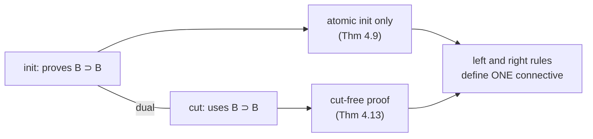
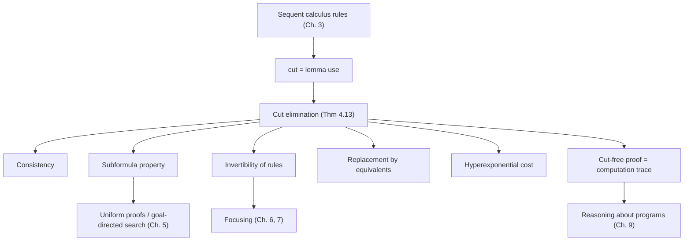

[[book-guidelines|↩ Back to guidelines]]

# Cut Elimination and Its Consequences

**Focus areas:** `automated-reasoning` (primary), with a strong bridge to `type-theory` (cut elimination is the proof-theoretic twin of $\beta$-reduction and of normalization).

## 1. The problem: lemmas are useful, but search hates them

Open any real proof and you find lemmas. Prove $n(n+1)$ is even by first establishing three helper facts $L_1, L_2, L_3$, then finishing in a few steps. Lemmas are how humans compress proofs.

Now flip to the viewpoint of this book: a proof is the trace of a *search*, and search is bottom-up. Standing at a sequent, you ask "which rule could have produced this?" A lemma breaks that. To use $L_1$ you have to guess $L_1$ out of thin air; nothing in the goal tells you what it is. The formula you need is not a piece of the goal.

So there are two questions, and the topic answers both:

1. Can we *allow* lemmas (the **cut** rule) in the proof system, so that the system is a faithful model of mathematical reasoning?
2. Can we *forbid* them during search without losing any theorems? If so, search only ever rearranges pieces of the goal, and proof search becomes a bounded, mechanical activity.

Cut elimination says yes to both, and the rest of the topic is what that "yes" buys and what it costs.

> **What breaks without it.** If cut were genuinely needed, no proof-search procedure could be complete without inventing lemmas. Logic programming-as-proof-search (the entire book) would collapse into "guess the right intermediate formula," which is a creative act, not a computation.

## 2. Cut as lemma use (Section 3.7)

### The rule, informally first

A two-sided sequent $\Sigma :: \Gamma \vdash \Delta$ reads: "from assumptions $\Gamma$ one can conclude (at least one of) $\Delta$." The cut rule says: if you can prove $B$ from some assumptions, and you can prove a conclusion using $B$ as an additional assumption, then you can chain them and drop $B$.

$$\frac{\Sigma :: \Gamma_1 \vdash B, \Delta_1 \qquad \Sigma :: \Gamma_2, B \vdash \Delta_2}{\Sigma :: \Gamma_1, \Gamma_2 \vdash \Delta_1, \Delta_2}\;\text{cut}$$

The formula $B$ appears in the premises but not in the conclusion. That single feature is what makes cut special: every other rule only builds up formulas that stay visible below. Cut makes a formula *vanish*. In a bottom-up search the vanished $B$ is a formula the prover must conjure.

The book's own illustration (Section 3.7) takes the example from Section 3.1: let $G$ be $\forall n.\forall p.(\textit{times}\; n\; (s\; n)\; p) \supset (\textit{even}\; p)$, and suppose $L_1, L_2, L_3$ have proofs $\Xi_1, \Xi_2, \Xi_3$. Three cuts stack:

$$\frac{\cdot :: \cdot \vdash L_1 \qquad \dfrac{\cdot :: \cdot \vdash L_2 \qquad \dfrac{\cdot :: \cdot \vdash L_3 \qquad \cdot :: L_1, L_2, L_3 \vdash G}{\cdot :: L_1, L_2 \vdash G}\text{cut}}{\cdot :: L_1 \vdash G}\text{cut}}{\cdot :: \cdot \vdash G}\text{cut}$$

(The book draws this with the lemma proofs $\Xi_1, \Xi_2, \Xi_3$ on the left branches.) The last step, $L_1, L_2, L_3 \vdash G$, is the "easy" proof that uses the lemmas. Reading bottom-up, the cuts *change the search problem* from "prove $G$" to "prove $G$ given $L_1, L_2, L_3$." Footnote 1 of the book notes that proving the lemmas themselves needs induction, which the book does not formalize.

Cut also appears in the identity pair (Section 3.2): $\mathit{init}$ gives reflexivity of $\vdash$, and $\mathit{cut}$ gives transitivity.

### Grounding: cut is `have`, and `have` is a let-binding

In Lean, introducing an intermediate fact is exactly a cut:

```lean
example (A B C : Prop) (h1 : A → B) (h2 : B → C) : A → C := by
  intro a
  have b : B := h1 a        -- the cut: B is a lemma proved, then used
  exact h2 b
```

The cut-free version simply has no named intermediate; the proof of $B$ is pasted wherever $b$ was used:

```lean
example (A B C : Prop) (h1 : A → B) (h2 : B → C) : A → C :=
  fun a => h2 (h1 a)        -- lemma inlined at its (single) use site
```

With one use the inlined version is no bigger. With many uses the inlining *duplicates* the proof of $B$ at each use. That duplication is the entire story of Section 5 below. The correspondence is the usual one: a `have`/`let` in a term is a cut, and eliminating it is $\beta$-reduction (the book states this connection in its discussion of the proof-normalization view of computation; here the book instead takes cut-free *search* as the model).

## 3. The theorem and where the book proves it

> **Theorem 4.13 (Cut-elimination, Gentzen 1935).** If a sequent has a C-proof (respectively, I-proof) then it has a cut-free C-proof (respectively, I-proof).

The book does *not* prove this for the unfocused systems directly. It proves it for focused ones and then derives the unfocused statement:

| Logic | Focused theorem | Unfocused corollary |
|---|---|---|
| Fragment of intuitionistic logic ($\Downarrow$fohh) | Theorem 5.28 | Theorem 5.30 |
| [[Linear-Logic|Linear logic]] | Theorem 7.15 | Theorem 7.19 |

For the classical textbook route the bibliographic notes (3.8) point to Gentzen [1935], Gallier [1986], Girard et al. [1989], Negri and von Plato [2001], Bimbó [2015]; and for metalevel proofs to Pfenning [2000], Miller and Pimentel [2004, 2013].

### The proof idea, by cases (Section 4.2)

The proof is a rewriting system on proofs. A cut is *stuck* only in the interesting configuration where the cut formula $B$ was *just introduced* on the right in the left premise and *just introduced* on the left in the right premise. (Other positions let you permute the cut upward into a premise, shrinking the proof.) The principal cases:

**Conjunction.** The cut formula is $A_1 \wedge A_2$, with $\wedge R$ above on one side and $\wedge L$ on the other:

$$\frac{\Xi_1 :\, \Gamma_1 \vdash A_1,\Delta_1 \quad \Xi_2 :\, \Gamma_1 \vdash A_2,\Delta_1}{\Gamma_1 \vdash A_1\wedge A_2,\Delta_1}\wedge R \quad\quad \frac{\Xi_3 :\, \Gamma_2, A_i \vdash \Delta_2}{\Gamma_2, A_1\wedge A_2 \vdash \Delta_2}\wedge L \quad\Longrightarrow\quad \text{cut}$$

rewrites to a single cut on $A_i$ between $\Xi_i$ and $\Xi_3$. One of $\Xi_1,\Xi_2$ is thrown away, and the new cut is on a **strict subformula**.

**Implication.** With $\supset R$ (premise $\Xi_1 : \Gamma_1, A_1 \vdash A_2, \Delta_1$) against $\supset L$ (premises $\Xi_2 : \Gamma_2 \vdash A_1, \Delta_2$ and $\Xi_3 : \Gamma_3, A_2 \vdash \Delta_3$), the cut on $A_1 \supset A_2$ becomes **two** cuts: first on $A_1$ (between $\Xi_2$ and $\Xi_1$), then on $A_2$ (between the result and $\Xi_3$). Both cut formulas are smaller than $A_1 \supset A_2$.

**Universal quantifier.** With $\forall R$ (premise proves $B x$ for a fresh eigenvariable $x$) against $\forall L$ (premise uses an instance $B t$), you first *substitute* $t$ for $x$ throughout the left proof. That substitution is itself an admissible rule: Exercise 4.20 states the `instan` rule

$$\frac{\Sigma \Vdash t:\tau \qquad \Sigma, x{:}\tau :: \Delta \vdash \Gamma}{\Sigma :: \Delta[t/x] \vdash \Gamma[t/x]}\;\textit{instan}$$

is admissible (the proof structure is unchanged). After this, a single cut on $B t$ remains, again on a smaller formula in the first-order case.

**Units, disjunction, existentials.** $\vee$ and $\exists$ mirror $\wedge$ and $\forall$ (Exercise 4.10). The case of $t$ is special: $t$ has $tR$ but no left rule, so a cut where the left premise ends in $tR$ is removed *entirely* by deleting the occurrence of $t$ from the right subproof (Exercise 4.19, strengthening) and adding weakenings.

### The termination intuition

At each principal step, the cut formula strictly shrinks (conjunction, implication, first-order quantifier) or the cut rises toward the leaves. Take the pair (size of cut formula, size of the subproofs) and the rewriting terminates. In the higher-order setting the instantiation step can *increase* formula size, which is why that case needs a different technique (candidates of reducibility; the guidelines list this under higher-order quantification, Chapter 9).

### Rust grounding: the principal-case rewrite is a pattern match

The implication case is a three-line rewrite. In Rust, the cut-reduction step is a function on a proof AST. This compiles; contexts are left implicit so the shape of the rewrite stays visible:

```rust
#[derive(Clone, Debug, PartialEq)]
enum F { Atom(&'static str), And(Box<F>, Box<F>), Imp(Box<F>, Box<F>) }

#[derive(Debug)]
enum Proof {
    Init(F),
    AndR(Box<Proof>, Box<Proof>),
    AndL(bool, Box<Proof>),               // which conjunct was kept
    ImpR(Box<Proof>),
    ImpL(Box<Proof>, Box<Proof>),
    Cut(F, Box<Proof>, Box<Proof>),       // cut formula, left proof, right proof
}

/// One step of cut elimination on a cut whose two premises both end in an
/// introduction of the cut formula (the "principal" cases of Section 4.2).
fn reduce_principal(cut_f: &F, left: Proof, right: Proof) -> Result<Proof, (Proof, Proof)> {
    use Proof::*;
    match (cut_f, left, right) {
        (F::And(a1, a2), AndR(p1, p2), AndL(i, p3)) => {
            let (ai, pi) = if i { (a2, p2) } else { (a1, p1) };
            Ok(Cut((**ai).clone(), pi, p3))              // one smaller cut
        }
        (F::Imp(a1, a2), ImpR(p1), ImpL(p2, p3)) => {
            let inner = Cut((**a1).clone(), p2, p1);      // cut on A1
            Ok(Cut((**a2).clone(), Box::new(inner), p3))  // then cut on A2
        }
        (_, Init(_), p) => Ok(p),   // cut against an initial sequent is trivial
        (_, p, Init(_)) => Ok(p),
        (_, l, r) => Err((l, r)),   // non-principal: permute the cut upward instead
    }
}
```

Two things to notice for a verifier author. First, the `Err` arm is the hard part of the real algorithm: commuting cuts through the rules whose principal formula is *not* the cut formula, which must handle contexts correctly (multiset splitting) and is where most implementations go wrong. Second, a kernel that *accepts* `Cut` in its proof language but whose checker is trusted must be sure this normalizer preserves the endsequent; the endsequent equality is the invariant to test.

## 4. Consistency from cut elimination

The cleanest consequence. Suppose a formula $B$ and its negation $B \supset f$ were both provable. Then $\cdot \vdash B$ and $\cdot \vdash B \supset f$ are provable. Since $\supset R$ is invertible (Section 4.3.4, and note that its [[Sequent-Calculus-Proof-Systems#Invertibility|invertibility]] is itself *proved from cut*), the sequent $B \vdash f$ is provable. Cut the two:

$$\frac{\cdot \vdash B \qquad B \vdash f}{\cdot \vdash f}\;\text{cut}$$

By cut elimination, $\cdot \vdash f$ has a cut-free proof. What could its last rule be? An introduction rule for $f$ on the right does not exist; the structural rules cannot produce an empty-right sequent from nothing provable; $\mathit{init}$ needs a matching formula on both sides. So no cut-free proof exists, and a formula and its negation cannot both be provable.

This is the argument you would run to prove a kernel sound relative to its rules: a small, syntactic case analysis on the *last rule* of a cut-free proof replaces any appeal to semantics. In Lean terms, it is why `False` has no constructors: the only way to build a closed proof of `False` would be to end a normal-form derivation, and no rule does.

```lean
-- the proof-theoretic argument, as terms: a proof of B and a proof of ¬B cut together
theorem consistent_step (B : Prop) (b : B) (nb : B → False) : False := nb b
-- if `nb b` normalizes to a closed canonical term of type False, that term would be a
-- constructor of False, and there are none.
```

### When cut elimination fails: "tonk" and definitions

The book gives two warning exercises about what happens when the rules for a connective are *not* in harmony.

- **Tonk (Exercise 4.11, Prior 1960).** Give a new connective $\diamond$ the left rules of $\wedge$ but the right rules of $\vee$. Then from any $A$ you can prove $A \diamond B$ (right rule of $\vee$) and from $A \diamond B$ you can conclude $B$ (left rule of $\wedge$), so everything follows from everything. Cut cannot be eliminated and the logic is trivial.
- **Definitions (Exercise 4.12).** Add $p := (p \supset f)$ with rules $\textit{defL}, \textit{defR}$. Then $p \vdash f$ and $\vdash p$ both have cut-free proofs (using $cR$), hence $\vdash f$ has a proof with a cut and no cut-free proof. Locally, cuts permute fine through $\textit{defL}/\textit{defR}$ (a cut on atom $A$ becomes a cut on the possibly *larger* formula $B$), which is exactly why termination breaks.

The lesson the book draws: the left and right rules for a connective must be two *senses* of *one* meaning. Cut elimination (together with the elimination of non-atomic initial sequents) is the theorem that certifies that harmony. It is a design-checking tool for new logical constructs, not only a metatheorem.

## 5. Subformula property

> **When no higher-order quantification is involved, every formula occurring in a sequent of a cut-free proof is a subformula of some formula in the endsequent.**

An instance of a quantified formula counts as a subformula of that formula. In the first-order case every proper subformula has fewer connectives, so this restricts search to **rearrangements of pieces of the goal** plus choices of instantiating terms. The search space is a finite set of formulas times choices of terms, not an open-ended space of lemmas.

**What breaks without it.** Compare the book's example of a Frege-style proof of $f \supset w$ (Figure 3.1): none of the formulas in its list is a subformula of the conclusion except the conclusion itself. It is a legitimate proof, and it is useless for search: a prover standing at $f \supset w$ has no way to know which formulas to try.

**Where it fails: higher-order logic.** Instantiating a predicate variable may substitute in a formula with *more* connectives than the quantified formula had. Cut elimination can still hold, but the subformula property no longer follows (the book illustrates this in Section 9.1 and again via the loss of the property under instantiation). This is the reason higher-order proof search needs additional structure, and it is the same phenomenon that makes higher-order unification undecidable in general while Miller's pattern fragment restores tractability. Here the book is making a *proof-theoretic* claim and does not construct the unification connection itself; the link is yours to hold onto.

## 6. Size explosion of cut-free proofs

Cut-free is the right shape for search and the wrong shape for people. Two facts from the book:

**Hyperexponential in general (Section 3.7 and bibliographic notes).** Statman [1978] gives theorems $H_0, H_1, \dots$ of first-order classical logic whose size and whose proofs-with-cut are *linear* in $n$, while the shortest cut-free proof is hyperexponential: with $h(0) = 1$, $h(n+1) = 2^{h(n)}$. The author's remark: such a proof need more rules than there are sub-atomic particles in the universe, and a cut-free proof that actually fits in memory is likely of a mathematically uninteresting theorem. That does not bother the book, because cut-free proofs here are **computation traces**, "more akin to Turing machine configurations," not arguments to be read.

**A concrete exponential example (Section 4.3.2).** Fix signature $\{a{:}i,\; f{:}i \to i,\; p{:}i \to o\}$ and let $P$ be the multiset $\{p\,a,\; \forall x.(p\,x \supset p\,(f\,x))\}$. Write $f^n t$ for $n$ applications of $f$. Then $P \vdash p(f^n a)$ for every $n \ge 0$, by a cut-free proof whose height is linear in $n$ (each step uses a $cL$ followed by $\forall L$, marked $\dagger$ in the book; Exercise 4.14). But the target $p(f^{2^n} a)$ has cut-free proofs of height $2^n$, while with lemmas of the shape "$\forall x.\, p\,x \supset p\,(f^{2^k} x)$" one can prove it with height linear in $n$ (Exercise 4.15), each lemma being proved by using the previous one twice. Hence moving from cuts to cut-free can make proofs grow **at least exponentially**.

[[Multiset-Rewriting-in-Linear-Logic#Python sketch|Python sketch]] of the arithmetic: count nodes as a tree (cut-free, lemma inlined at each use) versus as a DAG with sharing (cut: lemma proved once, referenced twice).

```python
def tree_size(k):   # lemma L_k used twice by L_{k+1}, inlined each time
    return 1 if k == 0 else 2 * tree_size(k - 1) + 1

def shared_size(k): # each lemma proved once; two references to the previous
    return 1 if k == 0 else shared_size(k - 1) + 1

for k in (1, 5, 10, 20):
    print(k, tree_size(k), shared_size(k))
# 20 -> 2_097_151 nodes inlined vs 21 shared
```

**The sharing observation is the engineering takeaway.** If you must store or transmit proofs, cut (or `let`, or DAG-shared subproofs, or Lean's `have` / auxiliary lemma declarations) is how you avoid the blow-up. If you must *search* or *run* a program as a proof, cut-free is the right form and you pay the price in trace length, not in invention.

## 7. Duality of cut and initial (Section 4.3.1)

The book states in Section 3.2.2 that $\mathit{init}$ and $\mathit{cut}$ express dual aspects of $\vdash$, and then makes that precise. Let $T$ be the set of formulas $B \supset B$ for $\Sigma$-formulas $B$.

- $\mathit{init}$ can **prove every member** of $T$.
- $\mathit{cut}$ can be replaced by $\supset L$ on a member of $T$, i.e. it **uses members of $T$ as assumptions**:

$$\frac{\Sigma :: \Gamma \vdash \Delta, B \qquad \Sigma :: B, \Gamma' \vdash \Delta'}{\Sigma :: \Gamma, \Gamma' \vdash \Delta, \Delta'}\text{cut} \quad\rightsquigarrow\quad \frac{\Sigma :: \Gamma \vdash \Delta, B \qquad \Sigma :: B, \Gamma' \vdash \Delta'}{\Sigma :: B \supset B, \Gamma, \Gamma' \vdash \Delta, \Delta'}\supset L$$

So a proof of $\Sigma :: \Gamma \vdash \Delta$ becomes a *cut-free* proof of $\Sigma :: T', \Gamma \vdash \Delta$ for a finite $T' \subseteq T$. Initial provides the identity formulas; cut consumes them. The symmetry is what the elimination results exploit: non-atomic $\mathit{init}$ is eliminated by *expanding* ($B_1 \supset B_2 \vdash B_1 \supset B_2$ via $\supset L$, $\supset R$ and two smaller inits; similarly for $\forall$, Theorem 4.9), and cut is eliminated by *contracting* matched introduction pairs. Atomic init remains forever, because atoms (predicates) get their meaning from the logic program, not from logic.



## 8. Admissible versus derivable rules (Section 4.4)

Two notions that differ in a way that matters for kernel design.

- A rule is **derivable** if it can be assembled from primitive rules of the system. Example: $\dfrac{\Sigma :: \Gamma, B_i \vdash \Delta}{\Sigma :: \Gamma, B_1\wedge\cdots\wedge B_n \vdash \Delta}$ is derivable for $n \ge 2$, $1 \le i \le n$.
- A rule is **admissible** if adding it to the primitive rules does not change the set of provable sequents. One proves it by showing how to turn proofs of the premises $S_1, \ldots, S_n$ into a proof of $S_0$ *by an argument about proofs*, not by stacking rules.

Every derivable rule is admissible; the converse fails, and showing admissibility is typically more work (an induction over proof structure).

**Cut elimination is the statement that cut is admissible in $\mathcal{C}^-$** (the system $\mathcal{C}$ without cut): Theorem 4.13 implies cut is admissible there. It is *not* derivable in $\mathcal{C}^-$; if it were, the exponential blow-up above could not occur.

Other examples from the book: weakening is a primitive rule, but *strengthening* (deleting a formula) is **not** admissible in general. Exercise 4.19 shows the single trivial instance that is ($\Gamma, t \vdash \Delta$ gives $\Gamma \vdash \Delta$). The $\mathit{instan}$ rule above is admissible (Exercise 4.20). And ex falso quodlibet is admissible in I-proofs (Lemma 4.22, section 4.5): any proof of $\Gamma \vdash f$ can be turned into a proof of $\Gamma \vdash B$ with the same structure, which the book also views as permuting the cut

$$\frac{\Gamma \vdash f \qquad f \vdash B\ (fL)}{\Gamma \vdash B}\text{cut}$$

upward into the left premise.

**Rust analogue.** Primitive rules are the variants of the `Proof` enum; derivable rules are helper functions that build a `Proof` from existing constructors (they type-check against the constructors); admissible rules are *functions that traverse a `Proof`* and return a new one (`instantiate`, `weaken`, `eliminate_cut`) and whose correctness is a theorem about the traversal. A trusted kernel should keep the first set tiny; the admissible rules can live *outside* the trusted base provided their outputs are re-checked.

## 9. Logical equivalence and replacement of subformulas (Section 4.3.3)

Everyday reasoning rewrites a formula inside a bigger formula by an equivalence. Why is that sound?

Write $B \equiv C$ for $(B \supset C) \wedge (C \supset B)$. Two $\Sigma$-formulas are equivalent in classical (respectively, intuitionistic) logic when $\Sigma :: \cdot \vdash B \equiv C$ is provable. Intuitionistic equivalence implies classical equivalence; the converse fails (the book's example: $p \vee (p \supset q)$ is classically equivalent to $(p \supset p) \vee q$ but not intuitionistically).

The book defines replacement of occurrences of $A$ by $B$ inductively via a judgment $\Sigma :: C \bowtie D$ (Figure 4.5): reflexivity $C \bowtie C$; congruence cases for $\wedge, \vee, \supset$ (with $E, F$ the replaced parts) and for $\forall_\tau, \exists_\tau$ under a bound $x{:}\tau$; and a base rule that, for $\hat\Sigma$-formulas $A, B$ with $\hat\Sigma :: \cdot \vdash A \equiv B$ proved, allows $\Sigma :: A\theta \bowtie B\theta$ for any substitution $\theta$ of the variables in $\hat\Sigma$ by $\Sigma$-terms. This is a hole-based $C[\square]$ definition rendered as a proof system.

> **Proposition 4.16.** If $\hat\Sigma :: \cdot \vdash A \equiv B$ is provable (classically, respectively intuitionistically) and $\Sigma :: C \bowtie D$ is provable by the rules of Figure 4.5, then $\Sigma :: \cdot \vdash C \equiv D$ is provable.

The proof is induction on $\bowtie$ derivations. In the $\supset$ case, given $C' \bowtie D'$ and $C'' \bowtie D''$ you build

$$\frac{\Sigma :: D' \vdash C' \qquad \Sigma :: C'' \vdash D''}{\dfrac{\Sigma :: C' \supset C'',\, D' \vdash D''}{\Sigma :: C' \supset C'' \vdash D' \supset D''}\supset R}\supset L$$

using the inductive hypotheses for the two premises. The base case needs the $\mathit{instan}$ admissibility (Exercise 4.20) to move proofs from $\hat\Sigma$ to $\Sigma$ through $\theta$. Note the role of cut elimination: the book says replacement is justified *by* cut elimination (the equivalence manipulations compose lemma proofs), and observes that, deliberately, equivalences are **not** added as inference rules in the sequent calculus; they are reasoning *about* the calculus.

### Invertibility proved from cut (Section 4.3.4)

A closely related use. A rule is **invertible** if provability of its conclusion implies provability of every premise.

> **Proposition 4.17.** $tR, \vee L, \wedge R, fL, \forall R, \exists L, \supset R$ are invertible.

$tR$ and $fL$ are immediate. For $\supset R$: given a C-proof $\Xi$ of $\Gamma \vdash B \supset C, \Delta$, build

$$\frac{\Gamma \vdash B \supset C, \Delta \quad \dfrac{B \vdash B \;(\mathit{init}) \quad C \vdash C \;(\mathit{init})}{B,\, B \supset C \vdash C}\supset L}{\dfrac{\Gamma, B \vdash C, \Delta}{\Gamma \vdash B \supset C, \Delta}\supset R}\text{cut}$$

Running cut elimination only affects rules *above* the cut, so the result ends with an introduction of $\supset$, which exposes the premise $\Gamma, B \vdash C, \Delta$. This trades a case analysis on arbitrary proof structure for one tiny derivation and one appeal to Theorem 4.13. Invertibility is what lets a prover apply those rules eagerly without backtracking (don't-care nondeterminism, the seed of focusing in later chapters).

## 10. Why this is the foundation for logic programming (Section 3.7, end)

The last paragraph of Section 3.7 is the sentence that justifies the book's structure. Consider a cut-free proof of $P \vdash G$ in a logic $\mathcal{X}$, with $P$ a program and $G$ a goal. That proof *is* a trace establishing the goal from the program. Now suppose $P' \vdash^{+} P$ is provable in a stronger logic $\mathcal{X}^+$ (say, with induction added, and with cut). If $\mathcal{X}^+$ also has cut elimination, then $P' \vdash G$ has a cut-free proof in $\mathcal{X}^+$; if things are organized well, a cut-free proof never touches the strong principles, so it is already a proof in $\mathcal{X}$. **Conclusion: every goal provable from $P$ is provable from $P'$**, derived from a formal proof about programs, with no case analysis on executions.

This is "reasoning about programs with cut and substitution," which is how Chapter 9 (the guidelines' Topic 16) proves facts such as the symmetry of reverse.

One disambiguation the book is careful about (Section 1.4): Prolog's cut `!` is a control operator that prunes search, and it has nothing to do with the sequent-calculus cut rule discussed here.

## 11. Facet checklist

| Subtopic from the Topic List | Where covered |
|---|---|
| Cut as lemma use | §2 |
| Consistency from cut elimination | §4 |
| Subformula property | §5 |
| Size explosion of cut-free proofs | §6 |
| Duality of cut and initial | §7 |
| Admissible versus derivable rules | §8 |
| Logical equivalence and replacement of subformulas | §9 |

## 12. Synthesis and goal routing



**Depends on:** the sequent calculus rules (Topic 3, including $\mathit{init}$/$\mathit{cut}$ in §3.2), $\beta$-normal $\eta$-long terms and substitution (Topic 2), and [[Classical-Intuitionistic-and-Minimal-Logics#C-proofs and I-proofs|C-proofs and I-proofs]] (Topic 5 sets these up; the cut-elimination theorem is stated for them).

**Feeds:** [[Uniform-Proofs-and-Abstract-Logic-Programming-Languages|uniform proofs and abstract logic programming languages]] (Topic 6), where cut-free provability is the *definition* of what the interpreter searches; focused cut elimination (Topics 11-12); candidates-of-reducibility proofs in the higher-order setting (Topic 15); and program reasoning (Topic 16).

### How it bears on your compiler and elaborator (Focus Area: `automated-reasoning`, with `type-theory`)

- **Proof certificates and trusted kernels.** The strongest practical reading: a cut-free proof is a checkable certificate of search; a proof with cuts is a compressed certificate. Design the kernel to accept `Cut` (small certificates, shared lemmas) while keeping a reference normalizer (like `reduce_principal` extended with commuting cases) for audits. This is the proof-theoretic form of "the kernel is small; the checker reduces."
- **Judgments, type checker, and proof checker.** Cut corresponds to `let` and application in the term language; elimination corresponds to $\beta$-reduction and (when quantifiers are involved) to substitution. The `instan` rule is the substitution lemma that every type-checker metatheory needs. Anything verifier-shaped here maps to Rust first.
- **Proof search for the clause/resolution engine.** The subformula property is the justification that your prover's search space is *bounded by the goal*. Where it fails (higher-order instantiation) the prover needs the restrictions that the Miller pattern fragment provides for unification; this is the link between this chapter and the metavariable unifier you are building.
- **Elaboration and Lean.** Lean's `have`, `let`, and auxiliary lemma declarations are cuts; definitional unfolding in the kernel (`isDefEq`, $\delta$, $\beta$) is where cut-elimination-style normalization actually occurs. The tonk/definitions failure modes are a design checklist for any new inductive or definitional feature you add to the kernel: do its introduction and elimination rules cohere?
- **Static analysis.** Exponential growth is an argument for sharing. If your analyzer emits proofs of verification conditions, emit them in DAG form with named lemmas, not unfolded.

Do not stretch this into SAT/SMT/CSP: the book does not tie the topic there.

## Where this leads

Cut elimination is the license for everything that follows: it turns "does $G$ follow from $P$?" into the finite, subformula-guided search of uniform proofs (Chapter 5), supplies invertibility results used to design focused systems (Chapters 5-7), and, once proved for focused systems, is the engine behind both the soundness of the logic programming languages and the proofs about programs in Chapter 9.
