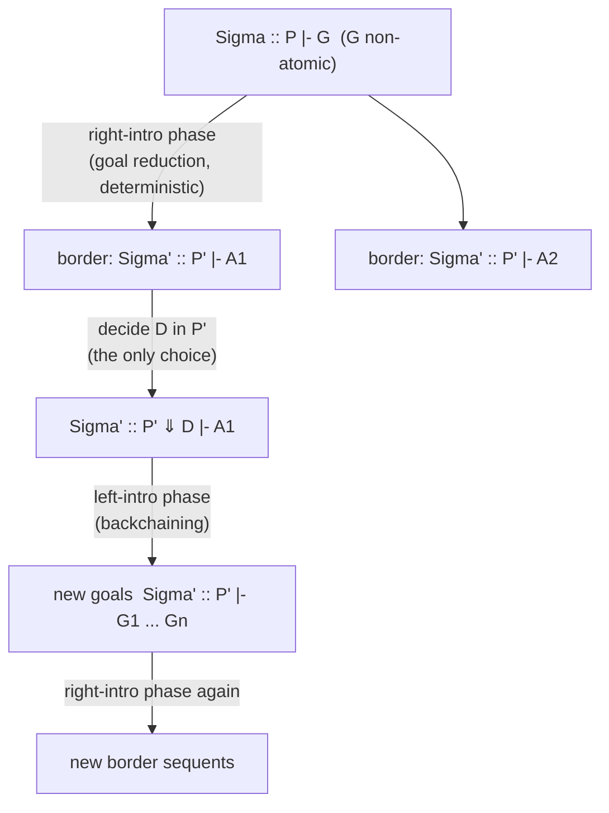

[[book-guidelines|↩ Back to guidelines]]

# Focused Proof Systems and Backchaining

**Focus area:** `automated-reasoning` (primary: proof search, focused sequent calculus, clause engines). Bridges to `type-theory` through the path/target/arguments view of a clause, which is the same shape as a Pi-type telescope.

## 1. The problem: too many ways to start

Uniform proofs (Section 5.1) already tell you what to do when the goal is not atomic: apply a right-introduction rule. That is goal reduction, and it is deterministic. The trouble starts when the goal is an atom $A$ and the program $P$ is a pile of formulas.

Miller's example in Section 3.6: a context with 1000 non-atomic formulas plus $B_1 \vee B_2$ and $C_1 \wedge C_2$. A plain Gentzen search must pick which of ~1002 occurrences to decompose next. Worse, the order in which you decompose several of them often does not matter (rules permute), so you explore about a million equivalent choices.

What breaks without a discipline here: bottom-up search is a tree of choices, and most of the branching is spurious. You pay exponential cost for *irrelevant* order-of-rules nondeterminism and get no extra provable sequents for it.

Focusing is the discipline. Two slogans:

- When the goal is non-atomic, do goal reduction (right rules). No choice is lost.
- When the goal is atomic, *commit* to one program clause and keep decomposing only that clause until an atom pops out. That is backchaining.

The book first sketches this in Section 3.6 (and credits Andreoli for the two-phase structure in [[Linear-Logic|linear logic]], based on the more fundamental invertible vs non-invertible distinction rather than left vs right). Section 5.4 makes it precise for hereditary Harrop formulas.

## 2. Focus and the decide rule

### 2.1 Why a new kind of sequent

Start from the intuitionistic system $I$ with a single formula on the right. Section 5.4 makes two housekeeping changes so that the structural rules stop getting in the way.

1. Weakening can be delayed until just before $init$, so fold it in: the derived rule $\Sigma :: \Gamma, B \vdash B$ is an initial sequent with arbitrary leftover context.
2. $\supset L$ is multiplicative, so searching it means guessing how to split $\Gamma$ (exponentially many ways). Since contraction and weakening are free on the left, use the admissible variant that copies the left context into both premises:

$$\frac{\Sigma :: \Gamma \vdash B \qquad \Sigma :: C, \Gamma \vdash E}{\Sigma :: B \supset C, \Gamma \vdash E}$$

Now look at the typical derivation when using a program clause $G \supset D \in P$ to prove atom $A$:

$$\frac{\Sigma :: P \vdash G \qquad \Sigma :: D, P \vdash A}{\dfrac{\Sigma :: G \supset D, P \vdash A}{\Sigma :: P \vdash A}\ cL}\ \supset L$$

You contract (copy the clause), then apply $\supset L$. The second premise is again "prove $A$," now with $D$ added. It is natural to insist that the new $D$ is used *immediately*, either being $A$ itself or reducing toward $A$ by further left rules. That insistence is the idea of focus.

### 2.2 The focused sequent

A new sequent form (Section 5.4):

$$\Sigma :: P \Downarrow D \vdash A$$

Read: signature $\Sigma$, program multiset $P$, **focus formula** $D$, atomic goal $A$. Provability of this implies provability of $\Sigma :: P, D \vdash A$, but the focus $D$ is now the only formula on which left-introduction rules may fire. In words: "I have chosen $D$, and I must keep working inside $D$."

The $\Downarrow$fohh system (Figure 5.1, p. 73):

$$\frac{\Sigma :: P \Downarrow D \vdash A}{\Sigma :: P \vdash A}\ decide \quad (D \in P) \qquad\qquad \frac{}{\Sigma :: P \Downarrow A \vdash A}\ init$$

$$\frac{\Sigma :: P \Downarrow D_i \vdash A}{\Sigma :: P \Downarrow D_1 \wedge D_2 \vdash A}\ \wedge L\ (i=1,2) \qquad \frac{\Sigma :: P \vdash G \quad \Sigma :: P \Downarrow D \vdash A}{\Sigma :: P \Downarrow G \supset D \vdash A}\ \supset L \qquad \frac{\Sigma \Vdash t : \tau \quad \Sigma :: P \Downarrow D[t/x] \vdash A}{\Sigma :: P \Downarrow \forall_\tau x.D \vdash A}\ \forall L$$

plus the right rules $tR$, $\wedge R$, $\supset R$, $\forall R$ (with eigenvariable $y$ added to $\Sigma$), and in $\Downarrow$fohh also $\vee R$ and $\exists R$. Here $A$ is atomic everywhere a left rule appears.

Things to notice:

- $decide$ is the only way to move from an unfocused sequent with atomic goal to a focused one. The choice of $D \in P$ is the single "don't-know" choice point.
- $init$ is only for atoms, and it forces the focus to *be* the goal atom.
- Contraction and weakening are not separate rules. $decide$ keeps $D$ in $P$ (that is contraction on demand), and $init$/$tR$ ignore the rest of $P$ (weakening).
- Soundness (Prop. 5.15) is a simple induction: map $\Sigma :: P \Downarrow D \vdash A$ to $\Sigma :: P, D \vdash A$ in $I$.

Honest caveat from the book: focusing is *not* justified by efficiency. Exercise 5.16 shows focused (backchaining-only) proofs can be much larger than proofs that use clauses forward-chaining (e.g. $D_n = a_0 \supset \dots \supset a_{n-1} \supset a_n$). The win is a smaller, structured *search space*, not shorter proofs. (The bibliographic notes tie this to polarity: if atoms are negative, you get backchaining; if positive, forward chaining.)

## 3. Right-introduction and left-introduction phases

Every $\Downarrow$fohh proof alternates two kinds of derivation segment.

- **Right-introduction phase** (goal reduction): only right rules, all open premises have *atomic* right sides. It is empty iff the goal is atomic.
- **Left-introduction phase** (backchaining): left rules plus $init$ and $decide$, all open premises are sequents without $\Downarrow$. It is never empty (it always contains a $decide$).

The sequents sitting between phases, those with an atomic goal and no $\Downarrow$, are the border sequents of Section 5 below.



A key structural fact for the fragment $\mathcal L_0 = \{t, \wedge, \supset, \forall\}$ (the formulas of $\Downarrow\mathcal L_0$, which equals fohh without $\vee$, $\exists$): all right rules are invertible, none of the left rules are. Consequences (p. 75):

- The right-introduction phase is a **function**. Given $\Sigma :: P \vdash G$ there is exactly one such phase (up to renaming eigenvariables) and it returns a unique multiset of border sequents.
- The left-introduction phase is a **nondeterministic relation**. This is where backtracking lives.

This is exactly the don't-care vs don't-know split from [[Computation-as-Proof-Search]]: goal reduction is don't-care, choosing a clause is don't-know.

## 4. Paths in formulas

To state and prove properties of the two phases without chasing individual rules, Miller packages a formula's "backchaining behavior" as a set of **paths**.

First principles: a Horn-like clause is a function-like thing. It takes some argument goals $G_1,\dots,G_n$ and produces one atom. A hereditary-Harrop clause can have nested binders and conjunctions, so a single formula can describe several such functions. A path extracts one of them.

Definition (p. 75). For an $\mathcal L_0$-formula $B$, $B \uparrow P$ holds (with $A$ atomic) by

$$\frac{}{A \uparrow A} \quad \frac{B \uparrow P}{B \wedge C \uparrow P} \quad \frac{C \uparrow P}{B \wedge C \uparrow P} \quad \frac{C \uparrow P}{B \supset C \uparrow B \supset P} \quad \frac{B \uparrow P}{\forall_\tau x.B \uparrow \forall_\tau x.P}$$

A path has the shape

$$\forall \bar x_1.(G_1 \supset \forall \bar x_2.(G_2 \supset \dots \supset \forall \bar x_n.(G_n \supset \forall \bar x_0.A)\dots))$$

with **target** $A$, **arguments** $G_1,\dots,G_n$, and **bound variables** $\bar x_0,\dots,\bar x_n$. It is also written as a sequent $\bar x :: G_1,\dots,G_n \vdash A$. The formula $t$ has no paths. Examples from the book: $(a \wedge b) \supset (c \wedge d)$ has paths $(a\wedge b)\supset c$ and $(a\wedge b)\supset d$. A hereditary Harrop formula $D$ has exactly one path, itself (Exercise 5.18).

Because $B \supset (B_2 \wedge B_3) \equiv (B \supset B_2)\wedge(B \supset B_3)$ and $\forall x.(B_1\wedge B_2)\equiv \forall x.B_1\wedge\forall x.B_2$ are intuitionistically provable, $B \equiv \bigwedge_{B\uparrow P} P$.

**Dual use of paths (the punchline):**

- **Proposition 5.19.** The right-introduction phase for $\Sigma :: \Gamma \vdash B$ has premises in one-to-one correspondence with *all* paths of $B$: for path $P$ with sequent $\Sigma' :: B_1,\dots,B_n \vdash A$, the premise is $\Sigma, \Sigma' :: \Gamma, B_1,\dots,B_n \vdash A$.
- **Proposition 5.20.** The left-introduction phase for $\Sigma :: \Gamma \Downarrow B \vdash A$ has premises $\Sigma :: \Gamma \vdash G_1, \dots, \Sigma :: \Gamma \vdash G_n$ iff *some* path of $B$ with target $A'$ and arguments $B_1..B_n$ and a substitution $\theta$ on its bound variables satisfy $A'\theta = A$ and $G_i = B_i\theta$.

So: on the right, *all* paths ("prove every way a clause could be used", conjunction); on the left, *some* path (existential choice plus unification of target with the goal). Both propositions are proved by structural induction on $B$; the $\supset$ case just adds an argument to the path, and the $\forall$ case extends $\theta$.

## 5. Synthetic inference rules and border sequents

Section 5.7 turns phases into single rules.

Define $|\Gamma|_\Sigma$ as the least set of pairs $\langle\Delta, D\rangle$ ($\Delta$ a multiset of goals, $D$ a formula) with

1. $D \in \Gamma \Rightarrow \langle\emptyset, D\rangle \in |\Gamma|_\Sigma$,
2. $\langle\Delta, D_1\wedge D_2\rangle \in |\Gamma|_\Sigma \Rightarrow \langle\Delta, D_1\rangle, \langle\Delta, D_2\rangle \in |\Gamma|_\Sigma$,
3. $\langle\Delta, G\supset D\rangle \in |\Gamma|_\Sigma \Rightarrow \langle\Delta\cup\{G\}, D\rangle \in |\Gamma|_\Sigma$,
4. $\langle\Delta, \forall_\tau x.D\rangle \in |\Gamma|_\Sigma$ and $t$ a $\Sigma$-term of type $\tau \Rightarrow \langle\Delta, D[t/x]\rangle \in |\Gamma|_\Sigma$.

Then backchaining is one rule:

$$\frac{\{\Sigma :: \Gamma \vdash G \mid G \in \Delta\}}{\Sigma :: \Gamma \vdash A}\ BC \quad \text{provided } A \text{ atomic and } \langle\Delta, A\rangle \in |\Gamma|_\Sigma$$

(no premises when $\Delta = \emptyset$). Lemma 5.35 shows this matches paths. Proposition 5.36: $\Sigma :: P \vdash G$ has a $\Downarrow\mathcal L_0'$-proof (right rules plus $BC$) iff it has an $I$-proof.

A **border sequent** is a sequent $\Sigma :: \Gamma \vdash A$ with $A$ atomic: it sits between the right phase below and the left phase above. A **synthetic inference rule** is what you get going up from a border sequent through $decide$, the whole left phase, and then the right phases of the new goals. Remaining open sequents are again border sequents. It fuses backchaining and goal reduction.

Worked example (pp. 89-90): $P = \{\forall x\forall y[\mathit{adj}\,x\,y \supset \mathit{path}\,x\,y],\ \forall x\forall y\forall z[\mathit{adj}\,x\,y \wedge \mathit{path}\,y\,z \supset \mathit{path}\,x\,z]\}$. Deciding on the second clause, 7 small inference rules ($decide$, $\forall L \times 3$, $\supset L$, $init$, $\wedge R$) collapse to

$$\frac{\Sigma :: \Gamma, P \vdash \mathit{adj}\,s\,u \qquad \Sigma :: \Gamma, P \vdash \mathit{path}\,u\,t}{\Sigma :: \Gamma, P \vdash \mathit{path}\,s\,t}$$

and the first clause gives $\mathit{adj}\,s\,t \Rightarrow \mathit{path}\,s\,t$. Exactly the usual Prolog clause, now seen as a proof rule with no logical constants. For Horn clauses you can remove every clause from the left and keep only atom-level rules. For higher clause order, connectives survive: focusing on $((p \supset q)\supset r)\supset s$ yields the synthetic rule $\Gamma, p \supset q \vdash r \,/\, \Gamma \vdash s$. Exercise 5.37: clausal order at most 2 gives rules over atoms only.

This is the proof-theoretic reading of "a logic program is a set of inference rules."

## 6. Admissibility of initial and cut, and completeness

The aim: show the focused system $\Downarrow\mathcal L_0$ does not lose anything relative to $I$. The route is the same as for ordinary cut elimination ([[Cut-Elimination-and-Its-Consequences]]) but works *inside* the focused system.

Restricting to $\mathcal L_0$ is needed because unrestricted $init$ and $cut$ range over any formula $B$, but only formulas that are both goals and clauses can appear on both sides. $\mathcal L_0$ formulas are exactly those.

### 6.1 Initial (Theorem 5.22)

If $B \in \Gamma$ then $\Sigma :: \Gamma \vdash B$ has a $\Downarrow\mathcal L_0$-proof. Proof by induction on $B$: the right phase yields one premise per path of $B$ (Prop. 5.19); in each, $decide$ on $B \in \Gamma$ and use Prop. 5.20 with $\theta = id$ to get a left phase whose premises are $\Gamma, B \vdash B_i$ for the path's arguments; recurse on those (smaller formulas). This is the focused analogue of $\eta$-expansion: initial for a complex formula reduces to initial on its argument subformulas.

### 6.2 Cut and key cut (Figure 5.2)

Add two rules to get $\Downarrow^+\mathcal L_0$:

$$\frac{\Sigma :: \Gamma \vdash B \quad \Sigma :: \Gamma, B \vdash C}{\Sigma :: \Gamma \vdash C}\ cut \qquad \frac{\Sigma :: \Gamma \vdash B \quad \Sigma :: \Gamma \Downarrow B \vdash A}{\Sigma :: \Gamma \vdash A}\ cut_k$$

$cut_k$ is the **key cut**: the right premise is a *focused* sequent whose focus is the cut formula. The measure is $|B|$, the number of logical connectives in $B$ (zero iff atomic).

The elimination is a two-level induction (Lemmas 5.24-5.27):

- **5.24** Replace $cut$ by $cut_k$. In the right subproof $\Xi_r$, every $decide$ on the cut formula $B$ becomes a $cut_k$ with the (weakened) left subproof. After that no $decide$ on $B$ remains, so $B$ can be strengthened away (Exercise 5.21). Cut formula size is unchanged.
- **5.26** Replace $cut_k$ by $cut$ on *strictly smaller* formulas. If $B$ is atomic, $B = C$ and the result is just the left subproof. Otherwise the left subproof ends in a right phase, the right in a left phase; Prop. 5.20 picks a path $P$ of $B$ with arguments $B_1\theta..B_n\theta$; Prop. 5.19 gives the matching premise of the right phase; substitution (Prop. 5.25) instantiates it; then chain $n$ cuts on $B_i\theta$, each smaller than $B$.
- **5.27** Combine: induct on $|B|$, and inside it on the number of $cut_k$ occurrences.
- **Theorem 5.28** (cut elimination for $\Downarrow^+\mathcal L_0$): induct on number of cuts, pick a topmost one.

Notice what the path machinery buys: the old "principal-case" analysis (which rule introduces the cut formula on each side) is replaced by "match a path on the left with the corresponding path on the right."

### 6.3 Completeness (Theorem 5.29)

If $\Sigma :: \Gamma \vdash G$ has a cut-free $I$-proof, it has a $\Downarrow\mathcal L_0$-proof. Show every rule of $I$ is admissible in $\Downarrow\mathcal L_0$:

- right rules: same rules, trivial.
- $init$: Theorem 5.22. $wL$: Proposition 5.23 (weakening). $cL$: redirect all $decide$s on the two copies of $B$ to one copy.
- $\wedge L$, $\supset L$, $\forall L$: each is derived from *initial* on the compound formula (e.g. $\Sigma :: B_1\supset B_2 \vdash_{\Downarrow} B_1\supset B_2$ gives $B_1, B_1\supset B_2 \vdash B_2$) plus **cut admissibility** (Thm 5.28).

So completeness of focusing is a corollary of "initial and cut are admissible in the focused system." The same proof plan is lifted to linear logic in Chapter 7 ("[[Formal-Metatheory-of-Focused-Linear-Logic|Formal Metatheory of Focused Linear Logic]]") and, with near-focused proofs, to the higher-order case in Chapter 9.

## 7. Disjunctive and existential goals as nonlogical constants

$\Downarrow\mathcal L_0$ has no $\vee$ or $\exists$. fohh allows them in goals (but not as top-level connectives of clauses). Section 5.8 shows they need no new focusing machinery.

Idea: right rules for $\vee$ and $\exists$ are exactly what a *clause* does when used by backchaining. Introduce nonlogical constants $\hat\vee : o \to o \to o$ and $\hat\exists_\tau : (\tau \to o) \to o$, and the (infinite) set $C$ of clauses:

$$\forall_o P\,\forall_o Q\,[P \supset (P\ \hat\vee\ Q)] \qquad \forall_o P\,\forall_o Q\,[Q \supset (P\ \hat\vee\ Q)] \qquad \forall_{\tau\to o}B\,\forall_\tau t\,[(B\,t) \supset (\hat\exists_\tau B)]$$

Their synthetic rules are exactly $\vee R$ (both versions) and $\exists R$:

$$\frac{\Sigma :: P, C \vdash P}{\Sigma :: P, C \vdash P \,\hat\vee\, Q} \qquad \frac{\Sigma :: P, C \vdash Q}{\Sigma :: P, C \vdash P \,\hat\vee\, Q} \qquad \frac{\Sigma :: P, C \vdash B\,t}{\Sigma :: P, C \vdash \hat\exists_\tau B}$$

These are not first-order Horn clauses (quantification over $o$ and $\tau \to o$), which is why Chapter 9 (higher-order Horn clauses) formally justifies the step.

**Proposition 5.38** (completeness of $\Downarrow$fohh for fohh). Given an $I$-proof $\Xi$ of $\Sigma::\Gamma\vdash G$, build the set $C(\Xi)$ of only those clause instances actually needed: each $\vee R$ step with premise $B_i$ contributes $\forall\Sigma'[B_i \supset (B_1\hat\vee B_2)]$, each $\exists R$ step contributes $\forall\Sigma'[B[t/x] \supset \hat\exists_\tau x.B]$. Rewrite $\Xi$ into an $I$-proof of $\Sigma :: C(\Xi), \hat\Gamma \vdash \hat G$ (each $\vee R$ becomes $init$ + $\supset L$ + $\forall L$ + $cL$), which only uses $\mathcal L_0$ formulas. Theorem 5.29 turns it into a $\Downarrow\mathcal L_0$ proof. Finally, since fohh programs never have $\hat\vee$/$\hat\exists$ as clause targets, the only $decide$s on $C(\Xi)$ emulate $\vee R$/$\exists R$ and are swapped back for the real rules.

Moral: in this setting, disjunction and existence are *just goals that a built-in clause solves*. That is how a Prolog `;` and `exists` behave.

## 8. Grounding the mechanism

### 8.1 Rust: the BC rule as a search procedure

A path is a struct. A program clause is a path. The `solve` loop is: take a border sequent's goal, `decide` over all clauses (don't-know choice, here via DFS with backtracking), unify target with goal ($A'\theta = A$), and push the path's arguments as new goals. The right-introduction phase is trivial here because arguments are already atoms (clauses of order at most 2, Exercise 5.37). Compiled and run: it returns `s(s(z))` for `sum (s z) (s z) R`, using the book's Figure 5.3 clauses.

```rust
use std::collections::HashMap;

#[derive(Clone, Debug, PartialEq)]
enum Term { Var(String), App(String, Vec<Term>) }
#[derive(Clone, Debug)]
struct Atom { pred: String, args: Vec<Term> }

/// forall xs. (G1 => ... => Gn => A): target, arguments, bound variables
#[derive(Clone, Debug)]
struct Path { vars: Vec<String>, args: Vec<Atom>, target: Atom }

type Subst = HashMap<String, Term>;

fn walk(t: &Term, s: &Subst) -> Term {
    match t {
        Term::Var(v) => s.get(v).map(|u| walk(u, s)).unwrap_or(t.clone()),
        _ => t.clone(),
    }
}

fn unify(a: &Term, b: &Term, s: &mut Subst) -> bool {
    match (walk(a, s), walk(b, s)) {
        (Term::Var(x), Term::Var(y)) if x == y => true,
        (Term::Var(x), t) | (t, Term::Var(x)) => { s.insert(x, t); true }
        (Term::App(f, xs), Term::App(g, ys)) =>
            f == g && xs.len() == ys.len()
                && xs.iter().zip(&ys).all(|(x, y)| unify(x, y, s)),
    }
}

// rename(p, k): freshen p.vars -- the "forall L" instantiation by fresh metavariables
fn solve(prog: &[Path], goals: Vec<Atom>, s: Subst,
         depth: usize, fresh: &mut usize) -> Option<Subst> {
    let Some((g, rest)) = goals.split_first() else { return Some(s) };
    if depth == 0 { return None }
    for p in prog {                         // decide: the don't-know choice point
        *fresh += 1;
        let p = rename(p, *fresh);
        let mut s2 = s.clone();
        if p.target.pred == g.pred
            && p.target.args.len() == g.args.len()
            && p.target.args.iter().zip(&g.args).all(|(a, b)| unify(a, b, &mut s2))
        {
            // premises of the synthetic rule: the path's arguments
            let mut next = p.args.clone();
            next.extend_from_slice(rest);
            if let Some(r) = solve(prog, next, s2, depth - 1, fresh) { return Some(r) }
        }
    }
    None
}
```

Mapping to the proof theory:

| Book | Code |
| --- | --- |
| program multiset $P$ | `prog: &[Path]` |
| path $\bar x :: G_1..G_n \vdash A'$ | `Path { vars, args, target }` |
| $\forall L$ with $\theta$ on bound vars | `rename` (fresh metavariables) + `unify` |
| $A'\theta = A$ | `unify(target, goal)` |
| premises $\Sigma::\Gamma\vdash G_i\theta$ | `next = p.args` |
| border sequent | an element of `goals` |
| $BC$ rule | one iteration of the loop body |

What a real engine adds: first-order unification here is naive (no occurs check, and the bindings are kept in a `HashMap`), the eigenvariable bookkeeping for $\supset R$ and $\forall R$ in non-Horn goals, and a program that *grows* (the $D \supset G$ goal pushes $D$ onto the clause list for the subproof). Higher-order goals need Miller pattern unification instead of the first-order `unify`.

### 8.2 Lean: the focused system as an inductive predicate

The propositional $\mathcal L_0$ fragment ($t$, $\wedge$, $\supset$) with the two sequent forms as a mutual inductive. This checked in Lean 4 (an example proof of $\{p_0, p_0 \supset p_1\} \vdash p_1$ via `decide`, `impL`, `init` also compiled).

```lean
inductive F where
  | atom (n : Nat)
  | tt
  | and (a b : F)
  | imp (a b : F)

mutual
-- Σ :: P ⊢ G   (unfocused; right rules and decide)
inductive Prov : List F → F → Prop
  | tR  {P} : Prov P F.tt
  | andR {P g₁ g₂} : Prov P g₁ → Prov P g₂ → Prov P (F.and g₁ g₂)
  | impR {P d g} : Prov (d :: P) g → Prov P (F.imp d g)
  | decide {P d a} : d ∈ P → Foc P d a → Prov P (F.atom a)

-- Σ :: P ⇓ D ⊢ A   (focused; left rules and init)
inductive Foc : List F → F → Nat → Prop
  | init {P a} : Foc P (F.atom a) a
  | andL₁ {P d₁ d₂ a} : Foc P d₁ a → Foc P (F.and d₁ d₂) a
  | andL₂ {P d₁ d₂ a} : Foc P d₂ a → Foc P (F.and d₁ d₂) a
  | impL {P g d a} : Prov P g → Foc P d a → Foc P (F.imp g d) a
end
```

Observations worth stealing:

- The two sequent forms are two mutually inductive relations. The shape of the type already enforces the phase discipline: `Prov` with non-atomic goal can only use right rules, `Prov` with atomic goal can only `decide`, and `Foc` can only decompose its focus.
- Theorems 5.22/5.28/5.29 become the lemmas `Prov (d :: P) ... ` weakening, `init_admissible`, and `cut_admissible : Prov P b → Prov (b :: P) c → Prov P c`, each provable by induction following the book's argument.
- The path relation $B \uparrow P$ is a separate inductive on `F`. Prop. 5.19/5.20 are lemmas relating `Prov`/`Foc` to it.
- Lean's `Decidable` search procedures for `Prov` would be a bounded backtracking over `decide`, the same loop as the Rust code.

### 8.3 Python: border sequents as a work-list

Not worth a separate engine. The Rust loop above is exactly what a Python version would look like: a list of goals (border sequents) and a recursive function that tries each clause. The only conceptual point Python makes cheap is that *both phases are the same loop*: right phase is "split conjunction goal into atom goals," left phase is "try a clause."

## 9. Closing synthesis

**Dependencies.** This topic depends on uniform proofs and hereditary Harrop formulas (Section 5.1-5.3), on the intuitionistic sequent system $I$ and its structural/identity rules ([[Sequent-Calculus-Proof-Systems]]), and on the cut-elimination plan ([[Cut-Elimination-and-Its-Consequences]]). It is the machinery that makes [[Computation-as-Proof-Search]] concrete: a "computation state" is a border sequent; a "step" is one $BC$ rule.

```text
Computation as proof search --> sequent calculus rules --> uniform proofs (goal-directed)
                                                              |
                                                              v
                             focus + decide  --> right phase / left phase (backchaining)
                                  |                       |
                                  v                       v
                    paths (target, args, bound vars)   synthetic rules, border sequents
                                  |                       |
                                  v                       v
              admissible init, cut_k  --> completeness     logic program = set of rules
                                  |
                                  v
        Ch. 6-7: zones + linear logic focusing (L1, L2)  /  Ch. 9: near-focused, higher order
```

**[[Classical-Intuitionistic-and-Minimal-Logics#Where this leads|Where this leads]].** Chapter 6 adds zones and linear connectives and re-does this construction (with $decide_!$ and $decide_l$); Chapter 7 repeats the admissibility-of-initial-and-cut proof for $\Downarrow\mathcal L_2$ and derives cut elimination for linear logic from focusing; Chapter 9 patches focusing when instantiation of predicate variables breaks the atomic invariants (near-focused proofs). Also, Chapter 5's Kripke model result and the limits of fohh (monotonicity) build on this system.

**Bearing on the project (`automated-reasoning`, with a `type-theory` bridge).**

- **Proof search with a controlled branching factor.** A custom prover's clause/resolution engine is exactly this: one `decide` choice per atomic goal, a deterministic goal-reduction phase, and a deterministic unifier at the clause head. Selecting which assumption to focus on is the only place the engine has to be smart (indexing, ordering). The rest is mechanical.
- **Unification.** The $\forall L$ rule instantiates bound variables with $\Sigma$-terms; in an implementation this is a fresh metavariable plus unification of the path target with the goal ($A'\theta = A$). In the first-order Horn case it is ordinary unification. In the higher-order setting the book works in (hereditary Harrop with $\lambda$-terms), this is where Miller's pattern unification takes over, matching the elaborator's metavariable solver. Scoping of eigenvariables ($\forall R$ extends $\Sigma$, and metavariable solutions may only mention variables in scope) is the same discipline that elaborators use for local contexts.
- **Proof certificates and trusted kernel.** Focused proofs have canonical shape (phases), so they are compact, replayable certificates. A kernel checking a $\Downarrow$ proof only needs the rule list of Figure 5.1 and substitution. Proving initial and cut admissible is the same kind of metatheory you want about a kernel's rule set: it tells you the checker can safely omit those rules while remaining complete.
- **Synthetic rules as clause compilation.** Replacing clauses by atom-level rules is a clause-compilation step; it also gives a principled way to *generate* verification rules from Horn-clause specifications (the CHC-style contracts the compiler will produce).
- **Judgment forms.** $\Sigma :: P \vdash G$ and $\Sigma :: P \Downarrow D \vdash A$ are judgment forms with contexts; the path $\bar x :: G_1..G_n \vdash A$ has the same shape as a Pi-type telescope $\Pi \bar x.\,G_1 \to \dots \to A$. The "type-checker versus proof-checker" analogy: checking a dependent function application is a focused left phase (decide the function, check each argument).
