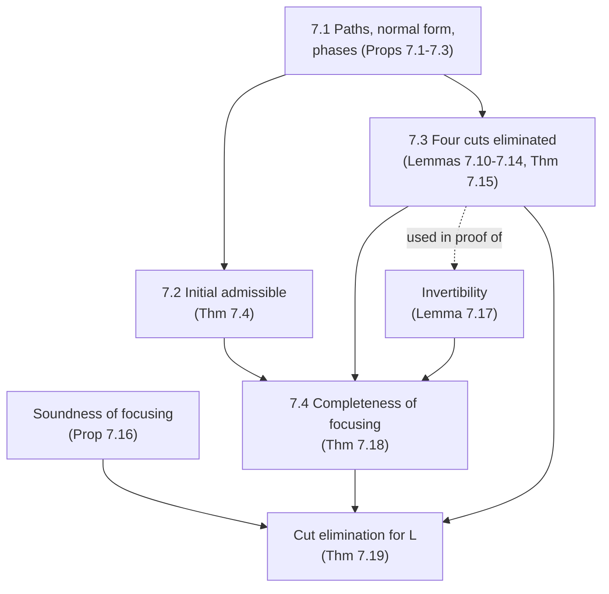

[[book-guidelines|↩ Back to guidelines]]

# Formal Metatheory of Focused Linear Logic

Related notes: [[Linear-Logic]], [[Focused-Proof-Systems-and-Backchaining]], [[Cut-Elimination-and-Its-Consequences]], [[Uniform-Proofs-and-Abstract-Logic-Programming-Languages]].

## 1. The problem this chapter solves

Chapter 6 gave us a focused proof system $\Downarrow\mathcal L_2$ for linear logic over the connectives $\mathcal L_2=\{\top,\&,\multimap,\Rightarrow,\forall,\bot,\mathbin{⅋},?\}$. It is the engine behind Lolli and Forum: proof search in it is "goal reduction, then backchaining", with the context shrinking and growing as resources are consumed. Using it as a *programming language* semantics is only legitimate if two things hold:

1. **It is complete.** Anything the ordinary sequent calculus $L$ can prove, $\Downarrow\mathcal L_2$ can prove too. Otherwise the interpreter misses answers.
2. **It is closed under cut.** A lemma you prove once can be reused. Without it, the focused system is not a logic, it is just a search procedure, and "program equivalence", "hiding", and object-logic encodings (Chapter 8) fall apart.

What breaks without these? A focused system that is incomplete silently drops solutions. A focused system without cut admissibility cannot even show that its own invertible rules are invertible (we will see exactly that argument in 7.4) and cannot be used as a metalogic.

Miller's trick is a single proof plan, already used for the Horn/hereditary Harrop fragment $\mathcal L_0$ in Section 5.5 and now lifted to linear logic. Notice what is *not* in the plan: there is no permutation argument over unfocused proofs. Completeness of focusing is derived as a corollary of two admissibility results.

The chapter outline (page 139) is the table of contents for this note:

1. Define **paths** in $\mathcal L_2$-formulas and their associated sequents.
2. Use paths to describe the right- and left-**introduction phases**.
3. Prove **admissibility of non-atomic initial** in $\Downarrow\mathcal L_2$.
4. Add **four cut rules** to $\Downarrow\mathcal L_2$ and prove they can be eliminated.
5. Prove **completeness** of $\Downarrow\mathcal L_2$ with respect to $L$.
6. Conclude **cut elimination for $L$**.



## 2. Notation recap (so the symbols land)

The sequents of $\Downarrow\mathcal L_2$ have four zones. Read $\Sigma :: \Psi;\Gamma\vdash\Delta;\Upsilon$ as follows:

- $\Sigma$ is the **signature**: the eigenvariables and constants currently in scope.
- $\Psi$ is the **left-unbounded** zone: formulas you may use any number of times (the "$!$-able" ones).
- $\Gamma$ is the **left-bounded** zone: formulas that must be used exactly once (the resources).
- $\Delta$ is the **right-bounded** zone: the goals to be proved *simultaneously*, each consumed once.
- $\Upsilon$ is the **right-unbounded** zone: the "$?$-able" goals, reusable.

The focused form $\Sigma :: \Psi;\Gamma\Downarrow B\vdash\Delta;\Upsilon$ marks the single formula $B$ that is currently under *focus* (being decomposed by left rules). The proof alternates between two phases:

- a **right-introduction phase** (goal reduction): decompose everything in $\Delta$ using right rules, until $\Delta$ contains only atoms. The resulting sequents are called **border sequents**;
- a **left-introduction phase** (backchaining): start with a `decide` (`decide_l` picks from $\Gamma$, `decide_!` from $\Psi$, `decide_?` from $\Upsilon$), then apply left rules to the focused formula until you land on border sequents again.

Andreoli's terms: right phase = *asynchronous* phase, left phase = *synchronous* phase (p. 163). The formula $\forall\bar x.[\ldots]$ and the polarity pairs are as in [[Linear-Logic]].

The rest of the chapter asks: what *shape* do these phases have, and how do we use that shape to prove things?

## 3. Section 7.1: paths and the shape of a phase

### 3.1 Why paths exist

When you focus on a formula $B$ and keep applying left rules, you are really choosing a *route* through $B$: at each `&` you pick a side, at each $\mathbin{⅋}$ you split resources, at each $\forall$ you pick a witness. The result of one such route is a leftover atomic "target" plus a bunch of sub-goals ("arguments"). If you do not name the route, you cannot talk about *all* the ways a phase can look, and every metatheory proof would have to redo case analysis on connectives.

What breaks without paths: every lemma (initial, each cut case, completeness) would need its own nested induction over formula structure and over proof shape. Paths abstract that once.

### 3.2 The relation $B\uparrow P$

Writing $A$ for an atom, the relation $B\uparrow P$ ("$P$ is a path of $B$") is generated by:

$$
A\uparrow A \qquad \bot\uparrow\bot \qquad ?B\uparrow ?B
$$
$$
\frac{B_i\uparrow P}{B_1\mathbin{\&}B_2\uparrow P}\;(i=1,2)\qquad
\frac{B\uparrow P}{C\Rightarrow B\uparrow C\Rightarrow P}\qquad
\frac{B\uparrow P}{C\multimap B\uparrow C\multimap P}
$$
$$
\frac{B\uparrow P}{\forall_\tau x.B\uparrow\forall_\tau x.P}\qquad
\frac{B_1\uparrow P_1\quad B_2\uparrow P_2}{B_1\mathbin{⅋}B_2\uparrow P_1\mathbin{⅋}P_2}
$$

Two things to see. First, a path contains no $\&$: the $\&$ rule is where the path *chooses*. A formula with $k$ nested alternatives has several paths, and each corresponds to one premise of the right-introduction phase (Prop. 7.2) or one possible left-introduction phase (Prop. 7.3). Second, $\mathbin{⅋}$ is the only binary connective that keeps both sides, because $\mathbin{⅋}$ is negative and its right rule is *invertible and does not choose*.

The book justifies dropping $\&$ via provable equivalences such as $C\mathbin{⅋}(B_1\&B_2)\dashv\vdash(C\mathbin{⅋}B_1)\&(C\mathbin{⅋}B_2)$ and the same for $\multimap$, $\Rightarrow$, and $\forall$. In particular $B\dashv\vdash\&_{B\uparrow P}P$.

### 3.3 The normal form

Using the further equivalences (quantifiers float out, $(B\multimap C_1)\mathbin{⅋}C_2\dashv\vdash B\multimap(C_1\mathbin{⅋}C_2)$, $B\mathbin{⅋}\bot\dashv\vdash B$, $\mathbin{⅋}$ commutative, and $B\multimap C\Rightarrow D\dashv\vdash C\Rightarrow B\multimap D$), every path has the shape

$$
\forall\bar x.\bigl[C_1\Rightarrow\cdots\Rightarrow C_n\Rightarrow B_1\multimap\cdots\multimap B_m\multimap A_1\mathbin{⅋}\cdots\mathbin{⅋}A_p\mathbin{⅋}?E_1\mathbin{⅋}\cdots\mathbin{⅋}?E_q\bigr].
$$

The book names the four multisets: $\{C_i\}$ are the **intuitionistic arguments**, $\{B_i\}$ the **linear arguments**, $\{A_i\}$ the **atomic targets**, $\{E_i\}$ the **?-targets**, and $\bar x$ the bound variables. It displays a path as a sequent:

$$
\bar x :: C_1,\ldots,C_n;\ B_1,\ldots,B_m\vdash A_1,\ldots,A_p;\ E_1,\ldots,E_q.
$$

Since these are multisets, the decomposition is unique. This is the "clause shape" generalized: in Chapter 5 a path was $\forall\bar x[C_1\supset\cdots\supset A]$, a Horn clause. Now it has two kinds of premise (linear $\multimap$ and unbounded $\Rightarrow$) and *two kinds of conclusion* (atoms in $\Delta$ and $?$-formulas in $\Upsilon$), which is exactly the Forum clause shape.

### 3.4 Right-introduction phase as a rewriting system

For $\forall\bar x(C\Rightarrow B_1\multimap B_2\multimap A_1\mathbin{⅋}A_2\mathbin{⅋}?E)$, which is its own path, the phase is one step:

$$
\frac{\bar x :: C;\ B_1,B_2\vdash A_1,A_2;\ E}{\cdot::\cdot;\cdot\vdash\forall\bar x(C\Rightarrow B_1\multimap B_2\multimap A_1\mathbin{⅋}A_2\mathbin{⅋}?E);\cdot}
$$

Everything is read off the path: $\Rightarrow$ pushes $C$ into $\Psi$, $\multimap$ pushes $B_i$ into $\Gamma$, $\mathbin{⅋}$ splits into separate targets in $\Delta$, $?$ moves $E$ into $\Upsilon$, and $\forall$ adds a fresh variable to $\Sigma$. The left-introduction phase, by contrast, has $n+m+q$ premises (one per argument), shown at the bottom of page 141: $\Psi;\cdot\vdash\hat C$, then $\Psi;\Gamma_i\vdash\hat B_i,A_i$, then $\Psi;\hat E\Downarrow\cdot\vdash\cdot$, with *resource splitting* $\Gamma=\Gamma_1\uplus\cdots\uplus\Gamma_m$ over the linear arguments only.

This explains polarity operationally: the right phase is a *deterministic* unpacking (all right rules are invertible), the left phase *distributes resources* (and that is where search is nondeterministic).

The book then views the right phase as a **multiset rewriting system** on multisets of sequents:

$$
M\cup\{S\}\ \to\ M\cup M'
$$

where $M'$ (0, 1, or 2 sequents) is the premises of some right-introduction rule applied to $S$. Two facts:

1. Border sequents are normal forms.
2. Termination: the *size* of a sequent is the number of connective occurrences in $\Delta$, and each step strictly decreases the total.

**Proposition 7.1 (confluence).** The system is confluent. By Newman's lemma (terminating plus locally confluent implies confluent) it suffices to check local confluence. If the two steps pick different sequents, just do the other step on each side. If they pick the same sequent but different formulas in $\Delta$ (say $B\mathbin{⅋}C$ and $D\mathbin{\&}E$), the common reduct exists because *right-introduction rules permute over each other* (Exercise 6.23).

The point is that "the set of premises of a right phase is unique". The order in which you decompose a goal does not matter. This is why a Forum interpreter can pick any non-atomic goal without backtracking.

**Proposition 7.2.** Any proof of $\Sigma::\Psi;\Gamma\vdash G,\Delta;\Upsilon$ can be rearranged so $G$ is decomposed first, giving one premise per path $P_i$ of $G$ (so $G\uparrow P_i$).

**Proposition 7.3.** The left phase at the bottom of a proof of $\Sigma::\Psi;\Gamma\Downarrow B\vdash A;\Upsilon$ is described by a path of $B$ with associated sequent $\Sigma'::C_1..C_n;B_1..B_m\vdash A_1..A_p;E_1..E_q$ and a substitution $\theta$ from $\Sigma'$ into $\Sigma$-terms: $A=\{A_i\theta\}\uplus\mathcal A_1\uplus\cdots\uplus\mathcal A_m$, $\Gamma=\Gamma_1\uplus\cdots\uplus\Gamma_m$, and the premises are

$$
\{\Sigma::\Psi;\cdot\vdash C_i\theta;\Upsilon\}_{i=1}^n\ \cup\ \{\Sigma::\Psi;\Gamma_i\vdash B_i\theta,\mathcal A_i;\Upsilon\}_{i=1}^m\ \cup\ \{\Sigma::\Psi;E_i\theta\vdash\cdot;\Upsilon\}_{i=1}^q.
$$

Note that in a left phase the signature and both unbounded zones are unchanged. Only the bounded zones vary.

### 3.5 Grounding (Rust): the right phase as a confluent rewriter

A checker-shaped fragment (propositional, no $\forall$) that implements exactly the one-step rewriting on multisets of sequents, with two different selection strategies, to check Prop. 7.1 on an example. Compiled and run with `rustc`.

```rust
#[derive(Clone, Debug, PartialEq, Eq, PartialOrd, Ord)]
enum F {
    Atom(&'static str),
    Top,
    Bot,
    With(Box<F>, Box<F>),   // &
    Par(Box<F>, Box<F>),    // par
    Lolli(Box<F>, Box<F>),  // B -o C   (B goes to the linear zone)
    Imp(Box<F>, Box<F>),    // B => C   (B goes to the unbounded zone)
    Why(Box<F>),            // ?B
}
use F::*;

/// A border sequent: Psi ; Gamma |- Atoms ; Upsilon (multisets kept sorted).
#[derive(Clone, Debug, PartialEq, Eq, PartialOrd, Ord, Default)]
struct Border { psi: Vec<F>, gamma: Vec<F>, atoms: Vec<F>, ups: Vec<F> }

type Seq = (Border, Vec<F>); // (the other zones, the right-bounded zone Delta)

/// One right-introduction step on the chosen non-atomic formula of Delta.
fn step(s: &Seq, pick: usize) -> Vec<Seq> {
    let (b, delta) = s;
    let mut rest = delta.clone();
    let g = rest.remove(pick);
    let with = |f: &dyn Fn(&mut Border, &mut Vec<F>)| {
        let (mut b2, mut d2) = (b.clone(), rest.clone());
        f(&mut b2, &mut d2);
        (b2, d2)
    };
    match g {
        Top => vec![],                                   // no premises
        Bot => vec![with(&|_, _| {})],
        With(x, y) => vec![                              // two premises: additive
            with(&|_, d| d.push((*x).clone())),
            with(&|_, d| d.push((*y).clone())),
        ],
        Par(x, y) => vec![with(&|_, d| { d.push((*x).clone()); d.push((*y).clone()) })],
        Lolli(x, y) => vec![with(&|b, d| { b.gamma.push((*x).clone()); d.push((*y).clone()) })],
        Imp(x, y)   => vec![with(&|b, d| { b.psi.push((*x).clone());   d.push((*y).clone()) })],
        Why(x)      => vec![with(&|b, _| b.ups.push((*x).clone()))],
        Atom(_) => unreachable!(),
    }
}

fn normalize(mut m: Vec<Seq>, strategy: impl Fn(&Seq) -> Option<usize>) -> Vec<Border> {
    let mut done = vec![];
    while let Some(s) = m.pop() {
        match strategy(&s) {
            None => { // only atoms left: border sequent
                let (mut b, d) = s;
                b.atoms = d;
                for v in [&mut b.psi, &mut b.gamma, &mut b.atoms, &mut b.ups] { v.sort(); }
                done.push(b);
            }
            Some(i) => m.extend(step(&s, i)),
        }
    }
    done.sort();
    done
}
```

Running it on $\Delta=\{(p\mathbin{⅋}(q\&r))\mathbin{⅋}?s,\ \ c\Rightarrow(d\multimap a)\}$ with "leftmost non-atom first" and "rightmost non-atom first" gives the same two border sequents in both cases: $c;\,d\vdash a,p,q;\,s$ and $c;\,d\vdash a,p,r;\,s$. Only the `&` multiplies premises, and the `?s`, `c`, `d` go to their zones. That is Prop. 7.1 and Prop. 7.2 in miniature. In a real implementation (the Forum interpreter or a proof-search kernel), this is the *deterministic part* of search: it is a normalization pass, no choice points.

## 4. Section 7.2: admissibility of the general initial rule

**Why.** In the focused system, `init` is only for atoms. But the *unfocused* system $L$ has $B\vdash B$ for every $B$, and completeness (7.4) needs to simulate it. We must show that non-atomic initial is derivable from the atomic one. This is the focused analogue of $\eta$-expansion: unfold $B$ until you hit atoms.

**Theorem 7.4 (initial admissibility).** For multisets $\Psi,\Upsilon$ of $\Sigma$-formulas and a $\Sigma$-formula $B$:

1. $\Sigma::\Psi;B\vdash B;\Upsilon$ is provable.
2. If $B\in\Psi$, then $\Sigma::\Psi;\cdot\vdash B;\Upsilon$ is provable.
3. If $B\in\Upsilon$, then $\Sigma::\Psi;B\vdash\cdot;\Upsilon$ is provable.

All three are proved *simultaneously* by induction on the structure of $B$. The mutual induction is the interesting part.

*Claim 1.* The right phase on $B$ (Prop. 7.2) gives one premise per path $P$ of $B$:

$$
\Sigma,\Sigma'::\Psi,C_1..C_n;\ B,B_1..B_m\vdash A_1..A_p;\ \Upsilon,E_1..E_q.
$$

In each, `decide_l` on $B$ in the bounded zone, then use Prop. 7.3 with $\theta=\mathrm{id}$. Because the atomic targets $A_i$ in the goal exactly match the atoms in the path, the left phase leaves exactly three kinds of open premises:

- $\ \Psi,\vec C;\cdot\vdash C_i;\ldots$ closed by claim 2 (since $C_i\in\Psi,\vec C$),
- $\ \ldots;B_i\vdash B_i;\ldots$ closed by claim 1 on the smaller $B_i$,
- $\ \ldots;E_i\vdash\cdot;\ldots E_i\ldots$ closed by claim 3.

*Claim 2* is the same with `decide_!`. *Claim 3* uses claim 1 to prove $B\vdash B;B$ and then `decide_?` on $B$.

**Exercise 7.5 pairs** (all provable): the $\Downarrow\mathcal L_2$-encodings of the exponentials as logical equivalences,

$$
?B\ \dashv\vdash\ (B\multimap\bot)\Rightarrow\bot,\qquad !B\ \dashv\vdash\ (B\Rightarrow\bot)\multimap\bot,
$$

because $\Downarrow\mathcal L_2$ has only $?$ as a primitive modality, $!$ is *defined*. (Page 145 notes that $\mathbin{⅋}$ is also redundant: $B\mathbin{⅋}C=(B\multimap\bot)\multimap C$.) These are used heavily below.

### Grounding (Lean): the induction principle behind the proof

Theorem 7.4's proof is structural recursion on formulas. In Lean the shape is the one you would give for an $\eta$-expansion function. Below is just the formula type and the degree function used later by the cut measure (checked in Lean 4):

```lean
inductive F where
  | atom (n : Nat) | top | bot
  | with_ (a b : F) | par (a b : F) | lolli (a b : F) | imp (a b : F) | why (a : F)

/-- degree: the number of connective occurrences in a formula -/
def F.degree : F → Nat
  | .atom _ | .top | .bot => 0
  | .with_ a b | .par a b | .lolli a b | .imp a b => a.degree + b.degree + 1
  | .why a => a.degree + 1
```

A Lean proof of claim 1 would be a function `F → Proof` by this recursion, with the three claims forming a mutual (or conjoined) recursion on `F`. That is precisely why Lean's termination checker accepts the mutual induction here: each call is on a strict subformula $C_i$, $B_i$, or $E_i$ of $B$ (each is a proper subformula of the path's source).

## 5. Section 7.3: four cut rules and their elimination

This is the heart of the chapter.

### 5.1 Why four cut rules

The unbounded and bounded zones behave differently, and the `?` is odd, so one cut rule does not fit. Figure 7.1 (p. 146), with $B$ the cut formula:

$$
\frac{\Sigma::\Psi;\cdot\vdash B;\Upsilon\qquad \Sigma::\Psi,B;\Gamma\vdash\Delta;\Upsilon}{\Sigma::\Psi;\Gamma\vdash\Delta;\Upsilon}\ cut_!
\qquad
\frac{\Sigma::\Psi;\Gamma\vdash\Delta;B,\Upsilon\qquad \Sigma::\Psi;B\vdash\cdot;\Upsilon}{\Sigma::\Psi;\Gamma\vdash\Delta;\Upsilon}\ cut_?
$$

$$
\frac{\Sigma::\Psi;\Gamma_1\vdash B,\Delta_1;\Upsilon\qquad \Sigma::\Psi;\Gamma_2,B\vdash\Delta_2;\Upsilon}{\Sigma::\Psi;\Gamma_1,\Gamma_2\vdash\Delta_1,\Delta_2;\Upsilon}\ cut_l
\qquad
\frac{\Sigma::\Psi;\Gamma_1\vdash B,\Delta;\Upsilon\qquad \Sigma::\Psi;\Gamma_2\Downarrow B\vdash A;\Upsilon}{\Sigma::\Psi;\Gamma_1,\Gamma_2\vdash\Delta,A;\Upsilon}\ cut_k
$$

Read them like this: bounded zones are treated multiplicatively (split between premises), unbounded zones additively (shared). The first three are the *regular* cuts. $cut_k$, the **key cut**, is the only one with a focused premise and exists purely as a technical device. It marks the exact place where a right phase and a left phase on the same formula meet, i.e. where "the cut formula is the principal formula on both sides". The $\Downarrow^+\mathcal L_2$ system is $\Downarrow\mathcal L_2$ plus these four rules. We want: **Theorem 7.15**: if a sequent has a $\Downarrow^+\mathcal L_2$-proof then it has a cut-free $\Downarrow\mathcal L_2$-proof.

A *border cut* is a regular cut whose conclusion is a border sequent (so its right premise is a border sequent too).

### 5.2 The special status of $?$

$?$ is the awkward connective. It is definable, $?B=(B\multimap\bot)\Rightarrow\bot$, and it has a right unbounded zone. Its rules are different: `decide_?` does not link a left phase to a right phase but sits between two adjacent *right* phases, and $?L$ does not keep $\Downarrow$ in its premise (Exercise 6.22). Miller keeps $?$ and $\mathbin{⅋}$ for the sake of examples, but notes that dropping them would simplify the proof. Practical implication: the measure below has a component that counts $cut_?$ separately.

### 5.3 What breaks without focusing: the LK collision

Section 6.1 explained why classical cut elimination is nondeterministic: cut against $wL$ and $wR$ can reduce to either of two unrelated proofs. After the proof, the book returns to this (p. 155): in $\Downarrow^+\mathcal L_2$ that cannot happen. In $cut_!$ the cut formula in the left premise cannot be weakened (it is the target of a right-introduction), though the one in the right premise can (by `init`). Similarly for $cut_?$, and in $cut_l$ neither occurrence can be weakened. So **no cut/weakening collision occurs in focused linear logic**, which is the focused system's gift to normalization.

### 5.4 The measure

The termination argument needs a well-founded measure on cut occurrences. Definitions (p. 145-146):

- A **thread** in a proof $\Xi$ is a list of sequent occurrences $S_1,\ldots,S_n$ with $S_1$ an `init` conclusion, $S_n$ the endsequent, and each $S_i$ a premise of a rule whose conclusion is $S_{i+1}$.
- The **rank** of $\Xi$ is the maximal number of `decide` and cut rule occurrences in threads that avoid left premises of $cut_l$, $cut_!$, and $cut_k$. (The rank is only used for proofs with no $cut_?$.)
- The **degree** of a formula is its number of connective occurrences.
- The **measure** of a cut occurrence, with $\Xi$ the subproof ending in it, is
$$|\Xi|=\langle d,\,q,\,w\rangle,\qquad d=\deg(\text{cut formula}),\ q=\#\text{occurrences of }cut_?\text{ in }\Xi,\ w=\operatorname{rank}(\Xi),$$
ordered lexicographically.

Why this triple and not just the degree? $cut_?$ is eliminated by replacing it with $cut_l$ (Lemma 7.10) *without* reducing the degree: the cut formula $B$ is unchanged, so $d$ ties. The second component $q$ is what drops, because a $cut_?$ disappeared. Then rank $w$ handles the side-cut permutations that move a cut up through a phase without changing $d$ or $q$.

```rust
// derive(Ord) on a tuple is exactly the lexicographic order the book uses,
// and a lexicographic product of well-founded orders is well-founded.
type Measure = (u32, u32, u32); // <d, q, w>
fn main() {
    assert!((2, 0, 9) < (3, 0, 1)); // smaller degree wins regardless of rank
    assert!((2, 0, 9) < (2, 1, 0)); // same degree, fewer cut? wins
}
```

The [[Multiset-Rewriting-in-Linear-Logic#Lean version|Lean version]], with the well-foundedness claim that Theorem 7.15's induction needs (checked in Lean 4 with no extra libraries):

```lean
abbrev Measure := Nat × Nat × Nat

def Measure.lt : Measure → Measure → Prop :=
  Prod.Lex (· < ·) (Prod.Lex (· < ·) (· < ·))

theorem Measure.wf : WellFounded Measure.lt :=
  (WellFoundedRelation.wf : WellFounded
    (Prod.Lex (· < ·) (Prod.Lex (· < ·) (· < ·) : Nat × Nat → Nat × Nat → Prop)))
```

### 5.5 Three structural lemmas

All are straightforward inductions on $\Downarrow^+\mathcal L_2$-proofs and *preserve the measure* of every cut occurrence:

- **Prop. 7.6 (weakening).** Add formulas to $\Sigma,\Psi,\Upsilon$ (not to the bounded zones).
- **Prop. 7.7 (substitution).** If $\Sigma,x{:}\tau::\ldots$ has a proof, then substituting a $\Sigma$-term $t$ for $x$ gives a proof of the substituted sequent (for primitive $\tau\ne o$).
- **Prop. 7.8 (strengthening).** If $B$ is in $\Psi$ and `decide_!` is never used on it in the proof, you can delete it from $\Psi$. Likewise for $\Upsilon$ and `decide_?`.

Strengthening is the move that makes the whole procedure work: after you replace every `decide` on $B$ by a cut, $B$ is no longer used and can be removed, which is what *removes* the cut.

Note the connection to the book's Section 3 on weakening: the unbounded zones are the only ones where weakening is free. The bounded zones never weaken, so no weakening lemma is needed there, which is why Prop. 7.6 is restricted as above.

### 5.6 Atomic key cuts, $Rep$, and $absorb$

An **atomic key cut** is a $cut_k$ with an atomic cut formula. Its right premise can only be proved by `init` or `init_?`, so the two possible shapes reduce to

$$
\frac{\Sigma::\Psi;\Gamma\vdash\Delta,A;\Upsilon}{\Sigma::\Psi;\Gamma\vdash\Delta,A;\Upsilon}\ Rep
\qquad
\frac{\Sigma::\Psi;\Gamma\vdash\Delta,A;A,\Upsilon}{\Sigma::\Psi;\Gamma\vdash\Delta;A,\Upsilon}\ absorb
$$

$Rep$ is a variant of Mints' repetition rule. By design the measure of any atomic key cut is always $\langle 0,0,1\rangle$, since the structure of its left premise is not measured. Procedurally, the cut-elimination argument has **two stages**:

1. Eliminate every cut except atomic key cuts. The result is a $\Downarrow^a\mathcal L_2$-proof.
2. Eliminate atomic key cuts. $Rep$ is trivially deleted. $absorb$ becomes `decide_?` after permuting it up over introduction rules (Lemma 7.9: because right rules permute, both $Rep$ and $absorb$ can be pushed up until they only mention border sequents; `absorb` with atomic right-bounded zone is exactly `decide_?`). Stage 2 uses no measure at all, only induction on the number of atomic key cuts.

### 5.7 The reduction lemmas

A **redex** is a $\Downarrow^+\mathcal L_2$-proof ending in a cut whose two immediate subproofs are $\Downarrow^a\mathcal L_2$-proofs. Each lemma replaces a redex by one whose cuts all have strictly smaller measure.

| Lemma | Redex | What happens | Why measure drops |
|---|---|---|---|
| 7.10 | $cut_?$ | In the left subproof, every `decide_?` on $B$ is replaced by a $cut_l$ with the (weakened) right subproof. Then no `decide_?` on $B$ remains, so strengthen $B$ out of $\Upsilon$ (Prop. 7.8). | One $cut_?$ fewer, same $d$: $q$ drops. |
| 7.11 | $cut_!$ | In the right subproof, every `decide_!` on $B$ becomes a $cut_k$ with the (weakened) left subproof. Strengthen $B$ out of $\Psi$. | The left premise of $cut_!$ is not counted in rank, so $w$ does not blow up. |
| 7.12 | $cut_l$, side case | The right premise ends in a `decide` on a formula other than the cut formula: use Prop. 7.3 to see the whole left phase, find the unique premise $k$ that contains the cut formula $C$ (the left phase is multiplicative, so there is exactly one), cut there, and move the phase *below* the cut. | The cut moved up past a phase, rank drops. |
| 7.13 | $cut_l$ | If $\Xi_r$ ends in `decide_l` on $B$ itself, turn it into $cut_k$. Otherwise it is a side cut: Lemma 7.12. | Cut formula same, rank lower. |
| 7.14 | $cut_k$ | If $B$ atomic, the result is $\Xi_l$. Otherwise the left subproof ends in a right phase and the right in a left phase on the same path $P$ (Prop. 7.2 and 7.3). Use Prop. 7.7 (substitute $\theta$) and then $n+m+q$ cuts ($cut_l$, $cut_!$, $cut_?$) between the premises. | Each new cut formula ($C_i\theta$, $B_i\theta$, $E_i\theta$) is **strictly smaller** than $B$: $d$ drops. |

The reading of Lemma 7.14 is the principal-formula reduction of every cut-elimination proof: "introduce on the left meets introduce on the right, break the formula apart, and cut on the pieces". In a focused system the whole *phase* is the unit, so one step breaks apart all connectives of a path at once. The $n+m+q$ cuts are *exactly* the arguments of the path: intuitionistic arguments get $cut_!$, linear arguments get $cut_l$, $?$-targets get $cut_?$.

The $cut_?$ case in Lemma 7.12 is special: if $\Xi_r$ ends in `decide_?` and all of $\Delta$ is atomic, permute `decide_?` below the cut. If $\Delta$ has non-atomic formulas, first permute the cut up through the left phase of $\Xi_l$ (which may produce several cuts, but all with atomic right-bounded zone), then proceed.

### 5.8 Theorem 7.15

**Theorem 7.15 (elimination of cuts).** If a sequent has a $\Downarrow^+\mathcal L_2$-proof, it has a cut-free $\Downarrow\mathcal L_2$-proof.

*Proof structure.* Part 1: show every $\Downarrow^+\mathcal L_2$-proof can be turned into a $\Downarrow^a\mathcal L_2$-proof, by induction on the number of non-atomic-key cuts; select such a redex and apply Lemma 7.10, 7.11, 7.13, or 7.14 according to which cut it ends in, then use the inner induction on the measure $|\Xi|$ to replace all the smaller redexes produced. Part 2: remove atomic key cuts as in 5.6.

Notice that all the reasoning is local to phases. Nowhere is there a case analysis of the form "the last rule on the left is $\otimes R$ and on the right is $\otimes L$": the path machinery has absorbed all of it.

## 6. Section 7.4: soundness and completeness of focusing

### 6.1 Translating $L$ into $\mathcal L_2$

$L$ has all of linear logic: $\top,\bot,\mathbin{⅋},\&,\forall,?$ (negative) and $1,0,\otimes,\oplus,\exists,!$ (positive), plus negation. $\Downarrow\mathcal L_2$ has only the negative ones plus $\multimap,\Rightarrow$. So positive connectives are *encoded by their double negation* using $\bot$. Two maps $(\cdot)^\triangledown$ (all formulas) and $(\cdot)^\blacktriangledown$ (only those with a positive top-level connective):

| $L$ formula | $(\cdot)^\blacktriangledown$ |
|---|---|
| $0$ | $\top$ |
| $1$ | $\bot$ |
| $B\otimes C$ | $B^\triangledown\multimap C^\triangledown\multimap\bot$ |
| $B\oplus C$ | $(B^\triangledown\multimap\bot)\,\&\,(C^\triangledown\multimap\bot)$ |
| $\exists x.B$ | $\forall x.(B^\triangledown\multimap\bot)$ |
| $!B$ | $B^\triangledown\Rightarrow\bot$ |

On the negative connectives $\triangledown$ is a homomorphism ($(B\mathbin{⅋}C)^\triangledown=B^\triangledown\mathbin{⅋}C^\triangledown$, $(?B)^\triangledown=?(B^\triangledown)$, etc.). For a positive $P$, $P^\triangledown=P^\blacktriangledown\multimap\bot$, and a top-level negation $B^\perp$ maps to $B^\triangledown\multimap\bot$. A top-level negation is treated as neither polarity until you see what it negates.

The idea: a positive formula in $L$ is a *left-focusable* thing, in $\mathcal L_2$ expressed by a $\multimap\bot$ you can later "undo" with the $\bot$ rule. The proof of Prop. 7.16 uses $\Theta^\blacktriangledown$, a multiset of positive formulas "waiting in the bounded zone", which is why that proposition has an extra parameter.

### 6.2 Proposition 7.16 (soundness)

If $\Sigma::\cdot;\Gamma^\triangledown\vdash\Delta^\triangledown;\cdot$ has a cut-free $\Downarrow\mathcal L_2$-proof then $\Sigma::\Gamma\vdash\Delta$ has a cut-free proof in $L$.

It is proved by strengthening to three mutually inductive statements about $\vdash$, $\Downarrow B^\triangledown$, and $\Downarrow B^\blacktriangledown$ with the conclusion

$$
\Sigma::\ !\Psi,\Gamma\vdash\Theta,\Delta,?\Upsilon.
$$

A key invariant (an immediate consequence of Prop. 7.2): every sequent of a $\Downarrow\mathcal L_2$-proof with $\bot$ in the right bounded zone is the conclusion of $\bot R$. The cases are simple: negative right rules map to the same rule in $L$; $\multimap R$ either introduces a negation $C^\perp$ (via $\bot R$ then $(\cdot)^\perp R$) or "parks" a positive $B^\blacktriangledown$ into $\Theta$; and `decide_?` and `decide_!` become the contraction-plus-dereliction pairs $?C,?D$ and $!C,!D$. No cut is needed: translating proofs of the focused system into $L$ is *direct*.

### 6.3 Lemma 7.17 (invertibility)

All eight right-introduction rules of $\Downarrow\mathcal L_2$ are invertible, and

$$
\Sigma::\Psi;\Gamma,(B\Rightarrow\bot)\multimap\bot\vdash\Delta;\Upsilon\iff\Sigma::\Psi,B;\Gamma\vdash\Delta;\Upsilon,
\qquad
\Sigma::\Psi;\Gamma\vdash?B,\Delta;\Upsilon\iff\Sigma::\Psi;\Gamma\vdash\Delta;\Upsilon,B.
$$

The proof is a **use of cut elimination inside the metatheory**. Example: to invert $\&R$, from $\Gamma\vdash B_1\&B_2,\Delta$, cut with the (initial-admissibility) proofs of $B_1\&B_2\vdash B_i$ for $i=1,2$, then apply Theorem 7.15 to get cut-free proofs. Likewise $?R$ uses the proof of $?B\vdash\cdot;B$ from Exercise 7.5. This is why the order is: initial, then cut, then [[Sequent-Calculus-Proof-Systems#Invertibility|invertibility]], then completeness. Cut admissibility is the tool you reach for to prove everything else.

### 6.4 Theorem 7.18 (completeness)

If $\Sigma::\Gamma\vdash\Delta$ has an $L$-proof then $\Sigma::\cdot;\Gamma^\triangledown\vdash\Delta^\triangledown;\cdot$ has a $\Downarrow\mathcal L_2$-proof.

*Plan.* Induction on the $L$ proof, showing that *each rule of $L$ is admissible* in $\Downarrow\mathcal L_2$ via $(\cdot)^\triangledown$.

- **initial** from Theorem 7.4.
- **cut** from $cut_l$ then Theorem 7.15.
- **right rules for $\top,\&,\forall,\bot,\mathbin{⅋}$**: same in both systems.
- **left rules for those**: the focused system only applies left rules when $\Delta$ is atomic, so use initial plus cut. Example: from $\Gamma,B_i\vdash\Delta$ derive $\Gamma,B_1\&B_2\vdash\Delta$ by cutting with $B_1^\triangledown\&B_2^\triangledown\vdash B_i^\triangledown$ (a subproof of $B_1^\triangledown\&B_2^\triangledown\vdash B_1^\triangledown\&B_2^\triangledown$ by 7.4).
- **positive connectives $0,\oplus,\exists,1,\otimes$**: e.g. $\oplus R$: from $\Gamma\vdash B_i,\Delta$ derive $\Gamma\vdash(B_1\oplus B_2),\Delta$ by cutting against $B_i^\triangledown,(B_1^\triangledown\multimap\bot)\&(B_2^\triangledown\multimap\bot)\vdash\cdot$ and then $\bot R$, $\multimap R$. For $\oplus L$, apply $\bot R$ and $\multimap R$ to both premises, join by $\&R$, then cut against the provable $\ldots,((B_1^\triangledown\multimap\bot)\&(B_2^\triangledown\multimap\bot))\multimap\bot\vdash\cdot$.
- **exponentials**: $!W$ via weakening (7.6) then the first equivalence of Lemma 7.17. $!C$ with two cuts using Exercise 7.5. $!D$ is a cut with $(!B)^\triangledown\vdash B$. $!R$ turns $(!\Gamma)^\triangledown$ into $\Gamma^\triangledown$ in $\Psi$ by repeated Lemma 7.17 and builds $(B^\triangledown\Rightarrow\bot)\multimap\bot$ with a left phase (`decide_l`, $\Rightarrow L$, $\bot L$). The $?$ cases are similar and simpler since $?$ translates to $?$.

Observe what completeness of focusing *is*: not a permutation argument but "the unfocused rules are all admissible in the focused system, thanks to initial and cut". Soundness is direct, completeness uses cut. That is the design of the whole chapter and it is the style of Chaudhuri (2006).

### 6.5 Theorem 7.19: cut elimination for $L$

Assume $\Sigma::B,\Delta_1\vdash\Gamma_1$ and $\Sigma::\Delta_2\vdash\Gamma_2,B$ have cut-free $L$-proofs. By completeness (7.18), both $\triangledown$-translations have $\Downarrow\mathcal L_2$-proofs. Use $cut_l$ of $\Downarrow^+\mathcal L_2$, eliminate it by Theorem 7.15, then translate back to a cut-free $L$-proof using soundness (7.16). A simple induction then removes every cut from any $L$-proof.

Note the elegance: the *unfocused* system's cut elimination is not proved by studying the unfocused system at all. It is a corollary of three results about the focused one.

## 7. What the same proof gives you for free

The book notes at the chapter start that cut admissibility for $\Downarrow\mathcal L_1$ and completeness of $\Downarrow\mathcal L_1$ need no separate proofs: they are special cases of Theorems 7.15 and 7.18, because $\mathcal L_1\subset\mathcal L_2$. The same holds for $\mathcal L_0$ (Section 5.5).

Bibliographic context (7.5):

- Andreoli (1992) introduced the focused system (one-sided; the zone between $\vdash$ and $\Uparrow$ is a *list* there but a *multiset* in Fig. 7.2). His $D_1$, $D_2$, $I_1$, $I_2$ correspond to `decide_l`, `decide_!`, `init`, `init_?`; right/left phases are his asynchronous/synchronous phases.
- Andreoli proved completeness of focusing by *permutation of rules in unfocused proofs*. Miller (1996) reused that proof. Bruscoli-Guglielmi (2006) and Guglielmi (1996) gave direct cut elimination at the level of synthetic rules (for a fragment without $?$).
- The admissibility-based style used here is due to Chaudhuri (2006) and Chaudhuri et al. (2008b) for intuitionistic linear logic, extended to intuitionistic and classical logic by Liang and Miller (2011, 2024); Simmons (2014) gave a formal verification for propositional intuitionistic logic; and Felty et al. (2021) a **mechanically verified proof of cut admissibility** for the Fig. 7.2 system.
- Hodas and Miller (1994) generalize the Kripke canonical model to a *resource-indexed* model: cut admissibility for linear logic over $\mathcal L_1$ is equivalent to cut-free provability coinciding with truth in the canonical resource-indexed model (compare Thm 5.32).

## 8. Answering the chapter's key questions

1. **Why does the measure include the number of $cut_?$ occurrences and the rank, not only the cut-formula degree?** Lemma 7.10 reduces a $cut_?$ to $cut_l$ with the *same* cut formula, so $d$ cannot decrease. The count $q$ decreases instead. Side cuts (7.12) and $cut_l$ to $cut_k$ (7.13) also leave $d$ and $q$ unchanged and only move cuts upward through a phase; the rank $w$, which does not count left premises of $cut_l$, $cut_!$, $cut_k$, strictly decreases.
2. **How is completeness of focusing derived from admissibility of initial and cut?** Each unfocused rule of $L$ (whose premises and conclusion are not in phase shape) is simulated inside $\Downarrow\mathcal L_2$ by combining (a) initial applied to the principal formula and (b) cut against the premises. Theorem 7.15 then removes the cuts. See 6.4.

## 9. Synthesis

### What depends on what

```
Section 5.5 (L0 plan)       Chapter 6 (L, zones, Lolli/Forum)
        \                          /
         v                        v
     7.1 paths, phases, confluence of right phase
         |                     |
         v                     v
   7.2 initial (Thm 7.4)   7.3 cuts (Lemmas 7.6-7.14, Thm 7.15)
         \                     /          |
          v                   v           v
          7.4 completeness (Thm 7.18) + soundness (Prop 7.16)
                         |
                         v
                  Cut elimination for L (Thm 7.19)
                         |
         +---------------+------------------+
         v                                  v
 Ch. 8: linear logic programs,        Ch. 9: near-focused proofs
 object-logic specs, cut as            (focusing breaks under
 a provable meta-property              higher-order instantiation)
```

### Where this leads

Chapter 8 uses this metatheory to justify specifying object proof systems and logic programs in Forum: cut admissibility (7.15) is what makes "equivalent specifications" and encoded sequent calculi meaningful. Chapter 9 re-proves the same properties for higher-order quantification with *near-focused* proofs, because instantiating predicate variables destroys the atomicity invariant that the $\Downarrow\mathcal L_2$ cut argument above relies on (see the key question there).

### Bearing on the project goals

Focus Area: `automated-reasoning` (this topic is tagged only with it in the book's `.learning-goals.md`).

- **Proof search with a trusted kernel.** The architecture here is the model of a *proof-producing prover*. A search procedure (the focused system, with its limited nondeterminism: only `decide` and resource splits) and a *small checker* for the unfocused or full calculus. Theorem 7.18 says search results can always be *reconstructed* in the full calculus $L$, and Prop. 7.16 says focused proofs always translate to cut-free $L$-proofs. That is exactly **proof certificates** and **proof reconstruction** with a **trusted kernel**. If the compiler's theorem prover returns focused proofs, a separate checker of $L$ needs only the soundness direction, the translation $(\cdot)^\triangledown$, and not the whole search machinery.
- **Why the checker should look like the proof.** The Rust fragment in 3.5 is the deterministic half of a prover: the right phase is a confluent normalizer on multisets of sequents. Because of Prop. 7.1 it never needs backtracking; a Rust implementation can use a plain worklist and any selection order. The nondeterministic half is the left phase and resource split (Prop. 7.3): $\Gamma=\Gamma_1\uplus\cdots\uplus\Gamma_m$ is where a real implementation needs the *lazy splitting* of Section 6.6.
- **Mechanism, not just theory: the paths are the clause compiler.** A path normal form $\forall\bar x[\vec C\Rightarrow\vec B\multimap\vec A\mathbin{⅋}?\vec E]$ is a data structure: `struct Path { bound: Vec<Var>, intu_args, lin_args, atom_targets, q_targets }`. Compiling a program formula to the list of its paths is the same job as clause normalization/clausification in a resolution engine, and each path's atomic targets are the heads that unification matches on `decide`. In the compiler's setting this is where *clause simplification* and *unification of terms* (the $\theta$ in Prop. 7.3) plug in.
- **Judgments and contexts.** The four-zone sequent is a *typing context with modes*: $\Psi$ is the structural (copyable) context, $\Gamma$ the linear (use-once) context. That is the same plumbing a linear/ownership-aware type checker (Rust's own borrow-checker is the programmer-facing relative) needs, and the cut rules are the substitution lemma for it: $cut_l$ is substitution for a linear variable (contexts split multiplicatively), $cut_!$ for an unrestricted one (contexts shared). Cut admissibility is "substitution is admissible", the metatheorem every dependently-typed kernel has to prove.
- **Proof-theoretic recipe.** The *two-step recipe* (admissibility of identity plus admissibility of cut gives completeness of focusing) is the template for proving that an optimized search strategy does not lose provability. It is also the shape of a mechanized proof in Lean: the structural lemmas 7.6-7.8 become `weaken`, `subst`, `strengthen` lemmas, the measure is a `WellFounded` instance (verified above), and Felty et al.'s mechanized development shows this is feasible.

No direct tie to `sat-smt-csp` or `static-analysis` here, and this chapter makes no claims about them.
