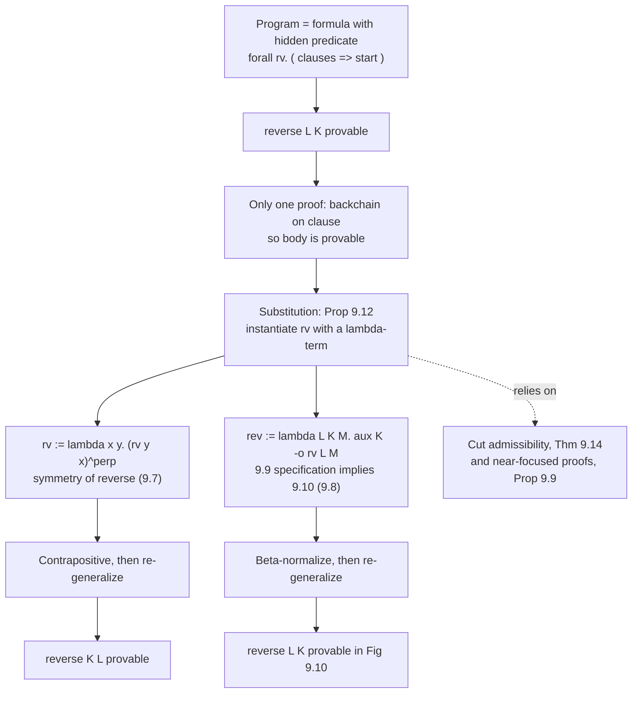

[[book-guidelines|↩ Back to guidelines]]

# Higher-Order Programming and Hiding of Specifications

Focus Areas: `type-theory`, `automated-reasoning`. Printed pages are cited as in the book; the PDF file is offset by 8 pages. The code is split between Miller's own $\lambda$Prolog figures (quoted in spirit, notation preserved), and original Rust, Lean and Python illustrations. The book gives no Rust or Lean; those are mine.

## 0. The problem this section solves

First-order logic programs have a hard limit: predicates are *names*, fixed in the signature. A clause can mention `adj`, but it cannot take "some predicate" as an argument. So you cannot write `map`, `filter`, or a tactic combinator once and reuse it. You also cannot *hide* an auxiliary predicate: if `reverse` uses a helper `rev`, then `rev` sits in the global namespace, and any other clause can call it.

Both limits have one cure: allow quantification over variables of predicate type, e.g. $\forall_{\tau \to o} P.\,\ldots$ (Chapter 9, Section 9.2, giving the logic $\mathcal L_2^\omega$). Then:

1. a predicate can be an *argument* to another predicate (higher-order programming, 9.6);
2. a predicate can be *bound* inside a formula and so invisible outside it (hiding, 9.7 and 9.8);
3. because the hidden predicate is a bound variable, the substitution theorem lets you *replace* it by any term of the right type, and that is a proof technique (9.7 and 9.8).

Third point is the surprise of the section: hiding is not just encapsulation, it is a **handle for reasoning**. Instantiating a hidden predicate proves facts about the program without induction.

What breaks without it: with first-order clauses only, the cut-elimination argument "if $\mathcal P'$ entails every clause of $\mathcal P$, then $\mathcal P'$ proves whatever $\mathcal P$ proves" is nearly vacuous, because $\mathcal P'$ must account for *every* clause of *every* auxiliary predicate in $\mathcal P$ (9.8). Only near-identical programs are comparable.

---

## 1. Higher-order predicates (9.6)

### 1.1 The idea

A predicate expression is a $\lambda$-term of type $\tau \to o$. Passing one as an argument is no more exotic than passing a closure. In the book's polymorphic $\lambda$Prolog syntax, `x\ adj x B` is the term $\lambda x.\,adj\ x\ B$, a one-argument predicate with $B$ free (a logic variable captured in the closure).

Figure 9.2 and the graph in Figure 9.3 (edges $a\to b$, $a\to e$, $b\to c$, $b\to d$, $d\to c$, $e\to d$) give the examples:

| Predicate | Type | Meaning |
|---|---|---|
| `forevery P L` | $(A \to o) \to list\ A \to o$ | $P$ holds of every element of $L$ |
| `forsome P L` | same | $P$ holds of some element of $L$ |
| `mappred P L K` | $(A \to B \to o) \to list\ A \to list\ B \to o$ | pointwise relation |
| `sublist P L K` | $(A \to o) \to list\ A \to list\ A \to o$ | $K$ is a sublist of $L$, all elements satisfy $P$ |
| `ref`, `sym`, `trans` | $(A\to A\to o) \to A \to A \to o$ | reflexive, symmetric, transitive closures of a relation |

The clauses:

```
forevery P nil.
forevery P (X :: L) :- P X, forevery P L.
forsome  P (X :: L) :- P X ; forsome P L.
mappred  P nil nil.
mappred  P (X :: L) (Y :: K) :- P X Y, mappred P L K.
```

The book's worked examples show that these are *relations*, not functions, so they run in several modes:

- `forevery (x\ adj x B) [b, e]` is provable iff $B$ is instantiated with $d$ (the one node both $b$ and $e$ point to).
- `forsome (x\ adj x c) [b, e]` is provable; `forsome (x\ adj e x) [a, b, c, e]` is not.
- `mappred adj [a, b, d] L` is provable iff $L$ is one of $[b,c,c]$, $[b,d,c]$, $[e,c,c]$, $[e,d,c]$: the logic variable $L$ is *enumerated* by backtracking.
- `sublist (x\ sigma y\ adj x y) [a,b,c,d,e] K` yields $[a,b,d,e]$ or any sublist of it, including the empty list.
- `sublist (x\ trans adj x e) [a,b,c,d,e] K` yields $[a]$ or `nil`.

### 1.2 Grounding

A Rust reading: the predicate argument is a closure, but because the relation is nondeterministic, the closure returns *all* solutions instead of one value.

```rust
use std::rc::Rc;

type Node = char;
type Pred<A> = Rc<dyn Fn(&A) -> bool>;
// A binary relation, run in "forward mode": given X, enumerate every Y.
type Rel<A, B> = Rc<dyn Fn(&A) -> Vec<B>>;

fn forevery<A>(p: &Pred<A>, l: &[A]) -> bool {
    l.iter().all(|x| p(x))
}

fn forsome<A>(p: &Pred<A>, l: &[A]) -> bool {
    l.iter().any(|x| p(x))
}

// mappred in mode (+,+,-): enumerate every K related to L.
fn mappred<A, B: Clone>(r: &Rel<A, B>, l: &[A]) -> Vec<Vec<B>> {
    match l.split_first() {
        None => vec![vec![]],
        Some((x, rest)) => {
            let tails = mappred(r, rest);
            let mut out = Vec::new();
            for y in r(x) {
                for t in &tails {
                    let mut k = vec![y.clone()];
                    k.extend(t.iter().cloned());
                    out.push(k);
                }
            }
            out
        }
    }
}

fn adj() -> Rel<Node, Node> {
    Rc::new(|x| match x {
        'a' => vec!['b', 'e'],
        'b' => vec!['c', 'd'],
        'd' => vec!['c'],
        'e' => vec!['d'],
        _ => vec![],
    })
}
// mappred(&adj(), &['a','b','d']) yields the four lists [b,c,c],[b,d,c],[e,c,c],[e,d,c].
```

Note what Rust cannot do here: `forevery (x\ adj x B) [b, e]` *solves for* $B$. A closure cannot be run backwards. The logic-programming version has one definition and many modes; the Rust version has one mode per function. That gap is the unification engine, and it is exactly what the project's own solver will have to supply.

Lean sees the same signatures as ordinary higher-order functions on `Prop`:

```lean
def forevery {α : Type} (P : α → Prop) : List α → Prop
  | []      => True
  | x :: xs => P x ∧ forevery P xs

def mappred {α β : Type} (R : α → β → Prop) : List α → List β → Prop
  | [],      []      => True
  | x :: xs, y :: ys => R x y ∧ mappred R xs ys
  | _,       _       => False
```

Here `P : α → Prop` is literally the book's $\tau \to o$. Lean's `Prop` plays the role of $o$.

### 1.3 A subtle consequence: logical constants inside atoms

The book stresses (p. 197) that `mappred P L K` is an *atomic* formula, since its head `mappred` is a non-logical constant. But substituting for `P` can place logical connectives *inside* an atom's argument, e.g. $P := \lambda x.\,\lambda y.\,(adj\ x\ y \mathbin{\&} \ldots)$. In first-order logic, atoms never contain logical constants. Here they can.

This is not cosmetic. It is the root of why Chapter 9 needs near-focused proofs (Section 9.3, not covered here) and why cut elimination needs a different proof (Section 9.4). Briefly: the "atomic initial rule" and the clausal invariants of focusing assume that atoms stay atoms under substitution. Predicate substitution breaks that. See [[Focused-Proof-Systems-and-Backchaining]].

---

## 2. Tactics and tacticals (9.6)

### 2.1 What problem do they solve?

An interactive prover works backward from a goal. A **tactic** is a small procedure that reduces one goal to a list of subgoals (and that list is "done" when empty). A **tactical** is a combinator that builds bigger tactics from smaller ones: "do this, then that", "try this, else that", "repeat until it stops working". Milner and Gordon et al. introduced them as ML programs. Felty and Miller then showed they can be written as *declarative* higher-order logic programs, so the tactic language is itself reasoned about by the logic.

Without higher-order predicates, a tactical like `then Tac1 Tac2` cannot be a predicate at all, because its arguments are predicates.

### 2.2 Goal structure (Figure 9.4)

```
kind goal type.
type trueg   goal.                       % the goal with no sub-tasks
type cc      goal -> goal -> goal.       % conjunction of two goal collections
type allg    (A -> goal) -> goal.        % explicitly universally quantified goal
type primgoal goal -> o.                 % separates primitive goals from the three above
```

Goals may be built from $\mathsf{trueg}$, $\mathsf{cc}$ and $\mathsf{allg}$, plus whatever domain-specific primitive goals the user adds. In Figure 9.5, the primitive goal is an object-logic sequent `seq Gamma B`, representing $\Gamma \vdash B$. Note that `allg` takes a *function* `A -> goal`: this is higher-order abstract syntax, the same device used in [[Specifying-Proof-Systems-in-a-Metalogic]] to represent binders.

A tactic is a binary relation $\mathit{tac} : goal \to goal \to o$. The reading of `tac G Gs` is: primitive goal `G` can be achieved if every goal in `Gs` can.

### 2.3 Primitive tactics are inference rules (Figure 9.6)

```
andR (seq Gamma (and B C)) ((seq Gamma B) cc (seq Gamma C)).
orR  (seq Gamma (or B C))  (seq Gamma B).
orR  (seq Gamma (or B C))  (seq Gamma C).
impR (seq Gamma (imp B C)) (seq (B :: Gamma) C).
allR (seq Gamma (all B))   (allg x\ seq Gamma (B x)).
init (seq Gamma B) trueg :- memb B Gamma.
```

Each clause is one backward application of an inference rule. `orR` has two clauses, so it is a nondeterministic relation: the two clauses are the two choices of disjunct. `allR` introduces an eigenvariable through `allg x\ ...`.

### 2.4 Tacticals (Figure 9.7)

```
maptac Tac trueg trueg.
maptac Tac (I1 cc I2) (O1 cc O2) :- maptac Tac I1 O1, maptac Tac I2 O2.
maptac Tac (allg I) (allg O)     :- pi t\ maptac Tac (I t) (O t).
maptac Tac I O                   :- primgoal I, Tac I O.

idtac  I I.
then   Tac1 Tac2 I O :- Tac1 I M, maptac Tac2 M O.
orelse Tac1 Tac2 I O :- Tac1 I O ; Tac2 I O.
repeat Tac       I O :- orelse (then Tac (repeat Tac)) idtac I O.
```

- `maptac` lifts a tactic on *primitive* goals to arbitrary goal structures, descending through `cc` and `allg`. The `pi t\` clause is the `allg` case: to map over $\forall$-goal, introduce a fresh $t$ and map over the body.
- `then` is relational composition (the book says natural join): run `Tac1`, then run `Tac2` on every resulting primitive subgoal.
- `orelse` is *union* of the two relations (both alternatives are offered). It is not Lean's first-success `<|>`; the commitment to the first success is a search-strategy matter, not a logical one.
- `repeat` is defined by recursion through `orelse`, `then` and itself.

### 2.5 Grounding in Rust

A tactic is a nondeterministic function from a goal to *alternative lists of resulting goals*. To keep the Rust short I model a tactic as returning one outcome per alternative, each outcome a single (possibly conjunctive) goal. This mirrors `tac G Gs` where `Gs` is a goal structure using `cc`.

```rust
use std::rc::Rc;

#[derive(Clone, Debug, PartialEq)]
enum Fm { Atom(&'static str), And(Box<Fm>, Box<Fm>), Or(Box<Fm>, Box<Fm>), Imp(Box<Fm>, Box<Fm>) }

#[derive(Clone, Debug, PartialEq)]
enum Goal {
    TrueG,
    Cc(Box<Goal>, Box<Goal>),
    Seq(Vec<Fm>, Fm), // primitive goal: Gamma |- B   (allg omitted for brevity)
}

// A tactic is a relation: one input goal, many possible output goals.
type Tactic = Rc<dyn Fn(&Goal) -> Vec<Goal>>;

fn and_r() -> Tactic {
    Rc::new(|g| match g {
        Goal::Seq(gamma, Fm::And(b, c)) => vec![Goal::Cc(
            Box::new(Goal::Seq(gamma.clone(), (**b).clone())),
            Box::new(Goal::Seq(gamma.clone(), (**c).clone())),
        )],
        _ => vec![],
    })
}

fn or_r() -> Tactic {
    Rc::new(|g| match g {
        Goal::Seq(gamma, Fm::Or(b, c)) => vec![
            Goal::Seq(gamma.clone(), (**b).clone()),
            Goal::Seq(gamma.clone(), (**c).clone()),
        ],
        _ => vec![],
    })
}

fn idtac() -> Tactic { Rc::new(|g| vec![g.clone()]) }

fn maptac(t: Tactic) -> Tactic {
    Rc::new(move |g| match g {
        Goal::TrueG => vec![Goal::TrueG],
        Goal::Cc(a, b) => {
            let (ls, rs) = (maptac(t.clone())(a), maptac(t.clone())(b));
            let mut out = Vec::new();
            for l in &ls { for r in &rs {
                out.push(Goal::Cc(Box::new(l.clone()), Box::new(r.clone())));
            }}
            out
        }
        Goal::Seq(..) => t(g), // the primgoal clause
    })
}

fn then(t1: Tactic, t2: Tactic) -> Tactic {
    Rc::new(move |g| t1(g).iter().flat_map(|m| maptac(t2.clone())(m)).collect())
}

fn orelse(t1: Tactic, t2: Tactic) -> Tactic {
    Rc::new(move |g| { let mut o = t1(g); o.extend(t2(g)); o })
}

fn repeat(t: Tactic) -> Tactic {
    // Built lazily inside the closure, so the recursion is only unfolded on demand.
    Rc::new(move |g| {
        let step = then(t.clone(), repeat(t.clone()));
        let mut out = step(g);
        out.extend(idtac()(g));
        out
    })
}
```

Observations that transfer to the project:

- The tactic type `Rc<dyn Fn(&Goal) -> Vec<Goal>>` is the shape of a proof-producing kernel's *rule application*. A tactic engine in a verifier is this plus a proof-term accumulator.
- The one thing this version loses is the logic variable. In $\lambda$Prolog, a tactic can be *run partially specified*, and unification fills in the rest. In Rust you commit to a mode.
- `repeat` terminates because `and_r`'s output on a non-conjunction sequent is empty, which makes the recursive `then` branch empty. Termination is a property of the *tactic*, not the tactical.

### 2.6 Grounding in Lean

Lean's own tactic framework is exactly this idea, in a monad instead of a relation:

- `t1 <;> t2` is the book's `then`: run `t1`, then `t2` on all resulting goals (this is the `maptac` step).
- `first | t1 | t2` commits to the first success; `orelse` as a *union* is closer to `t1 <|> t2` with backtracking enabled (the `TacticM` monad has a backtracking state).
- `repeat t` is the book's `repeat`.

```lean
example (p q r : Prop) (hp : p) (hq : q) (hr : r) : p ∧ (q ∧ r) := by
  repeat' constructor   -- andR applied exhaustively, `repeat` tactical
  all_goals assumption  -- `init`, mapped over every primitive goal
```

The Lean tactic state *is* a list of goals (a `cc`-collection), `constructor` on a conjunction is `andR`, `assumption` is `init`, and the metavariable-context-aware `TacticM` plays the role that the metalogic's quantifier `allg` and eigenvariables play in the book.

---

## 3. Hiding predicates by quantification (9.7, 9.8)

### 3.1 First principles

Consider the usual way to reverse a list in a logic program: carry an accumulator.

$$\mathit{reverse}\ L\ K \;\leftarrow\; \mathit{rev}\ L\ \mathsf{nil}\ K.$$

The helper `rev` is a pollution of the namespace and an accident of this implementation. Now ask: what is the *meaning* of the program, as opposed to its implementation? The meaning is the relation `reverse`; `rev` is a local variable. In a functional language, you would write `rev` as a nested function. In logic, a local variable is a **bound variable**, and $\forall$ (or $\exists$) is the binder. If the variable ranges over predicates, we need $\forall_{\tau \to o}$. That is why this section exists in a chapter about higher-order quantification.

Figure 9.8 (first-order Horn clauses, helper exposed):

```
reverse L K :- rev L nil K.
rev nil L L.
rev (X :: M) N L :- rev M (X :: N) L.
```

Figure 9.9 (helper hidden):

```
reverse L K :- pi rev\ (
  (pi L\ rev nil L L) =>
  (pi L\ pi M\ pi N\ pi X\ rev (X :: M) N L :- rev M (X :: N) L) =>
  rev L nil K ).
```

In Miller's logical notation, the body of the `reverse` clause is $\forall rev.(\ldots)$. Clauses for `rev` appear on the *left* of an implication, so they are available only while proving `rev L nil K`, and `rev` itself is a fresh eigenvariable: no other clause can name it. The scoping is not a convention enforced by a module system, it is enforced by the *proof rules* for $\forall_R$ and $\Rightarrow_R$.

### 3.2 Grounding

The Rust analogue of hiding is a nested closure capturing a private helper, or a private module item:

```rust
pub fn reverse<T: Clone>(l: &[T]) -> Vec<T> {
    // `rev` is local: no one else can call it, and it can be swapped out
    fn rev<T: Clone>(m: &[T], n: Vec<T>) -> Vec<T> {
        match m.split_first() {
            None => n,
            Some((x, rest)) => {
                let mut n2 = vec![x.clone()];
                n2.extend(n);
                rev(rest, n2)
            }
        }
    }
    rev(l, Vec::new())
}
```

This captures *encapsulation*, but not the point of the section: Rust cannot *instantiate* `rev` with an arbitrary other function to derive new facts about `reverse`. The proof-theoretic version can, because the quantifier is part of the logic.

The closest Lean idea is an existentially (or universally) quantified predicate in a `Prop`, i.e. impredicative encoding:

```lean
def Reverse {α : Type} (L K : List α) : Prop :=
  ∀ (rv : List α → List α → Prop),
    (∀ X P Q, rv P (X :: Q) → rv (X :: P) Q) →   -- the step clause
    rv [] K → rv L []                            -- base case in, start state out
```

Here `rv` is hidden by a $\forall$, exactly as in Miller's formula. (Lean has no linear implication, so the book's $\multimap$ becomes plain `→`; that loses the "used exactly once" discipline, see 3.3.)

### 3.3 The specification with linear logic (9.7)

Miller's version for 9.7 mixes two implications deliberately:

$$\forall L.\forall K.\Big[\forall rv.\big((\forall X.\forall P.\forall Q.\,(rv\ P\ (X::Q) \multimap rv\ (X::P)\ Q)) \Rightarrow rv\ \mathsf{nil}\ K \multimap rv\ L\ \mathsf{nil}\big) \multimap reverse\ L\ K\Big]$$

Reading it from first principles: $reverse\ L\ K$ holds if, for an arbitrary hidden $rv$, you can prove $rv\ L\ \mathsf{nil}$ from

- a *step* clause $\forall X P Q.\,(rv\ P\ (X::Q) \multimap rv\ (X::P)\ Q)$, to the left of the intuitionistic $\Rightarrow$, so reusable any number of times (it is moved one element per use), and
- a *base case* $rv\ \mathsf{nil}\ K$, to the left of the linear $\multimap$, so it must be used **exactly once**, at the end of the computation, where it forces the second list to *be* $K$.

This is the book's trace of pairs, $(a::b::c::\mathsf{nil},\ \mathsf{nil}) \to (b::c::\mathsf{nil},\ a::\mathsf{nil}) \to \cdots \to (\mathsf{nil},\ c::b::a::\mathsf{nil})$, turned into a formula. Reuse vs exactly-once is not decoration. It is what makes the reading "start state, a series of moves, one final state" the *only* reading of a proof.

---

## 4. Reasoning about programs with cut and substitution (9.7 and 9.8)

### 4.1 The tools

The book's central thesis in this section: since the program is a formula and running it is proof search, *the metatheory of the logic is the program-analysis toolbox*. Two metatheorems carry the load.

**Substitution (Proposition 9.12).** Let $\Sigma$ be a signature, $x$ not declared in $\Sigma$, $t$ a $\Sigma$-term of type $\tau$. If $\Sigma, x:\tau :: \Psi;\Gamma \vdash \Delta;\Upsilon$ has a $\Downarrow\mathcal L_2^\omega$-proof, then $\Sigma :: \Psi[t/x];\Gamma[t/x] \vdash \Delta[t/x];\Upsilon[t/x]$ has one too. The proof goes through the larger system $\Downarrow N^+$ (Lemma 9.11) and then back down using Proposition 9.9 (near-focused proofs convert to focused proofs).

**Cut admissibility (Theorem 9.14).** The four cut rules are admissible in $\Downarrow\mathcal L_2^\omega$. Via Theorem 9.13 (cut elimination for $\Downarrow N^+$, not proved in the book; termination needs Girard's candidats de réductibilité).

Both of these are the same slogan in two forms: a bound variable is a placeholder, so you may fill it; and a lemma proved as a premise may be inlined.

### 4.2 Symmetry of reverse (9.7): the proof

Claim: if $reverse\ L\ K$ is provable from the clause above, so is $reverse\ K\ L$.

*Informal idea (the book's):* write the computation as a table of pairs; flip the rows and flip the columns; you get a correct computation of reverse where start and end have swapped roles.

*Formal version:*

1. Assume $reverse\ L\ K$ is provable. There is only one way to prove it, by backchaining on the clause, so the body is provable:
$$\forall rv.\big((\forall X P Q.\,rv\ P\ (X::Q) \multimap rv\ (X::P)\ Q) \Rightarrow rv\ \mathsf{nil}\ K \multimap rv\ L\ \mathsf{nil}\big).$$
2. By Proposition 9.12, we may instantiate $rv$ with any binary predicate expression. Choose
$$rv := \lambda x.\lambda y.\,(rv\ y\ x)^\perp.$$
Swapping the order of $x$ and $y$ flips the **columns**. Negation $(\cdot)^\perp$ flips the **rows** (start and end).
3. The instantiated formula is
$$\big(\forall X P Q.\,(rv\ (X::Q)\ P)^\perp \multimap (rv\ Q\ (X::P))^\perp\big) \Rightarrow (rv\ K\ \mathsf{nil})^\perp \multimap (rv\ \mathsf{nil}\ L)^\perp.$$
4. Apply the contrapositive law for $\multimap$ and $(\cdot)^\perp$ (Exercise 6.25): $A^\perp \multimap B^\perp$ is equivalent to $B \multimap A$. This gives
$$\big(\forall X P Q.\,rv\ Q\ (X::P) \multimap rv\ (X::Q)\ P\big) \Rightarrow rv\ \mathsf{nil}\ L \multimap rv\ K\ \mathsf{nil}.$$
5. Re-generalize on $rv$ with $\forall rv$. This is the body of the `reverse` clause with $L$ and $K$ exchanged (the step clause is the same one up to renaming $P \leftrightarrow Q$). Therefore $reverse\ K\ L$ is provable. $\square$

No induction on lists. The two ingredients are the substitution of a $\lambda$-term for a predicate variable and linear logic's involutive negation.

**What breaks without it:** in the first-order specification of Figure 9.8 there is no $\forall rev$, so the helper's two clauses are global. You can't instantiate `rev` with a negated, flipped relation, because it is not a variable. (And without the *linear* base case, the contrapositive step is unavailable: intuitionistic $\Rightarrow$ has no involutive negation of this kind.)

### 4.3 Grounding the proof step in Lean

The mechanism "instantiate a universally quantified predicate with a cleverly chosen $\lambda$" is exactly how Leibniz equality yields symmetry (the book's Exercise 9.3 uses this definition: $\forall_{i\to o} P.(P\,t \supset P\,s)$):

```lean
def LEq {α : Type} (t s : α) : Prop := ∀ P : α → Prop, P t → P s

theorem LEq.symm {α : Type} {t s : α} (h : LEq t s) : LEq s t :=
  fun P => h (fun x => P x → P t) id
```

Instantiate the quantified $P$ with $\lambda x.\,(P\,x \to P\,t)$, the same kind of move as $\lambda x\lambda y.(rv\ y\ x)^\perp$: the new predicate encodes the *dual* of what you had. Lean checks the application by $\beta$-reduction in `isDefEq`, which is the "cascade of $\beta$-reductions" the book warns about in 9.2 when it says substitution $B[t/x]$ always produces a $\lambda$-normal form.

### 4.4 Entailment between programs (9.8)

The naive principle: if $\mathcal P'$ proves every clause of $\mathcal P$, and $\mathcal P$ proves $G$, then by repeated cut, $\mathcal P'$ proves $G$. It is correct, but weak, for two reasons the book gives: no induction is available, and **every clause for every predicate free in $\mathcal P$** must be accounted for. With hidden predicates, auxiliary predicates are not free in the program formula, so they need not be matched.

The worked example compares Figure 9.9 (hidden `rev`, intuitionistic) with Figure 9.10 (hidden `rv` and `aux`, linear). From the provable body of 9.9:

$$\forall rev.\big[(\forall L.\,rev\ \mathsf{nil}\ L\ L) \Rightarrow (\forall L M N X.\,rev\ M\ (X::N)\ L \multimap rev\ (X::M)\ N\ L) \Rightarrow rev\ L\ \mathsf{nil}\ K\big]$$

instantiate (Proposition 9.12) with

$$rev := \lambda L.\lambda K.\lambda M.\ aux\ K \multimap rv\ L\ M.$$

where $aux$ and $rv$ are fresh tokens. After $\beta$-normalization the result is provable, so by generalizing over $rv$ and $aux$, the body of Figure 9.10's clause is provable. Hence: **if $reverse\ L\ K$ is provable from Figure 9.9 then it is provable from Figure 9.10.** Notice what happened: an *intuitionistic*, accumulator-passing specification was transformed into a *linear*, resource-passing one purely by choosing a predicate expression, with no reference to lists.

The converse (Exercise 9.16) is left as an exercise and *does* require an inductive argument on $\Downarrow\mathcal L_2^\omega$-proof structure. The book notes it fails if one instantiates with $\lambda L\lambda K\lambda M.\ aux\ K \Rightarrow rv\ L\ M$ (intuitionistic instead of linear arrow). The one-way implication here is a *refinement* relation: Figure 9.10 is at least as strong as 9.9 for provability of `reverse`.

### 4.5 Diagram: where each tool is used



---

## 5. Notes and pitfalls

- **Fragile notion of atom.** Since substitution for predicate variables can put connectives inside atomic formulas, "atomic" is not stable. The book's later treatment (9.9, Synthetic rules) distinguishes rigid and flexible atoms. It is worth noting here only to explain why hiding-based reasoning is stated for $\Downarrow\mathcal L_2^\omega$ and not just any sequent system: the justification for the substitution step (Proposition 9.12) is itself non-trivial.
- **What the book does not claim.** Substitution plus cut gives *sound* transformations between specifications. It does not give a decision procedure for equivalence of programs, and it does not replace induction in general (Exercise 9.16's converse needs it).
- **Page/section scope.** I used Sections 9.6 to 9.8; the near-focused machinery (9.3) and Section 9.9 are covered by other topics in the guidelines.

---

## 6. Synthesis and where this leads

**Dependencies.** This topic depends on: simply typed $\lambda$-terms and the type $o$ ([[Simply-Typed-Lambda-Terms-and-Churchs-Types]]), the quantifier rules and the focused system $\Downarrow\mathcal L_2$ ([[Focused-Proof-Systems-and-Backchaining]]), cut admissibility ([[Cut-Elimination-and-Its-Consequences]]), the reverse specifications of Section 5.11 ([[Horn-Clauses-and-Hereditary-Harrop-Formulas]]), and linear logic ([[Linear-Logic]]). It supplies the proof technique reused in later chapters (the book states "several more" examples follow) and sets up the encodings of automata with $\lambda$-terms for letters, where eigenvariables are substituted for letters to prove closure under homomorphism.

**[[Classical-Intuitionistic-and-Minimal-Logics#Where this leads|Where this leads]].** The next stage is [[Multiset-Rewriting-in-Linear-Logic]] and the automata encodings, where $\forall$-quantified predicate variables again play the role of hidden state and substitution again becomes the proof method; and Section 9.9, which restricts the heads of higher-order Horn clauses to be rigid so that backchaining stays well behaved.

**How it bears on the project** (Focus Areas `type-theory` and `automated-reasoning`):

- *Tactic engine as proof-producing architecture.* Section 2 is a design for the verifier's tactic layer: a tactic is a relation on goals; a tactical is a higher-order combinator; `maptac` is the traversal that handles conjunction and eigenvariable-introducing goals (`allg`). The Rust sketch above is the skeleton; adding a proof-term accumulator and a trusted kernel that re-checks the final derivation gives the "proof reconstruction feeding the trusted kernel" architecture. Primitive tactics (`andR`, `impR`, ...) are exactly the *rules the kernel trusts*.
- *Metavariables and unification.* The modes `forevery (x\ adj x B) [b,e]` and `mappred adj [a,b,d] L` run only because unification binds logic variables. The elaborator's metavariable unifier is the Rust version of this mechanism. Also, the `allg x\ ...` / `pi t\ ...` clauses use *higher-order pattern* applications (`I t` with $t$ a bound variable), the Miller-pattern fragment where unification is decidable and has most general solutions. That is why $\lambda$Prolog's tactic code can run at all.
- *Hiding and refinement.* Hiding an internal predicate by $\forall$ and then instantiating it is the proof-theoretic shape of **abstract data types** and of **refinement between specifications**: the implication $\mathcal P' \Rightarrow \mathcal P$ for programs whose internals differ. For refinement-type contracts, "this implementation satisfies the interface regardless of its private predicate" is the same quantifier pattern. Likewise the Leibniz-equality example connects to definitional versus propositional equality: $\forall P.\,P\,t \to P\,s$ is the logic's own equality, and its symmetry proof is an instantiation of the hidden predicate.
- *Substitution, contexts and capture.* Everything here rests on the substitution lemma (Lemma 9.11) and on $\beta$-normalizing substitution results. Getting capture-avoiding, normalizing substitution right is the plumbing the project's kernel will need in any case; the lemma is the correctness statement to test it against.
- *What does not bear directly.* The `sat-smt-csp` and `static-analysis` areas get nothing from this topic.
