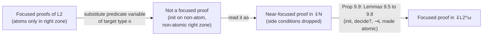

[[book-guidelines|↩ Back to guidelines]]

# Higher-Order Quantification

## 1. The problem this chapter solves

Up to Chapter 8, quantifiers range over *individuals*: types built from primitive types $S$ other than $o$. Chapter 9 lifts that restriction. The quantifiers $\forall_\tau, \exists_\tau$ may now bind variables of any simple type $\tau$, including types containing $o$, the type of formulas. A variable can stand for a predicate, a formula, or a function from formulas to formulas. The resulting logic is called $\mathcal L_2^\omega$ (the same connectives as $\mathcal L_2$, with unrestricted $\tau$).

Why want it? Three payoffs, each developed later in the book:

- **Programming.** Predicates become arguments (`mappred`, tacticals). A logic program can take other programs as inputs.
- **Hiding.** $\forall rev.\,(\text{clauses defining } rev)\supset\ldots$ makes a specification's auxiliary predicate private. This is the logical form of an abstract data type.
- **Definability.** Connectives can be defined from quantifiers. [[Linear-Logic|Linear logic]]'s units and additives fall out of $\forall_o$ and $\exists_o$.

The price: *everything that made first-order proof search tidy stops being true*. Atomic formulas are no longer stable under substitution, the subformula property degenerates, and cut elimination needs a much stronger induction. The chapter is largely the story of paying that price and recovering a usable focused system anyway. That is the part that matters to an implementer.

The book also dispatches an objection up front. Since arithmetic embeds in $\mathcal L_2^\omega$, Gödel's incompleteness applies. Miller's reply: the only meaning given to connectives is the sequent calculus itself, so "provable" is always recursively enumerable and incompleteness of a model-theoretic semantics is not the concern. "Soundness" and "completeness" in this book mean *one proof system matches another*, not a match against a model.

## 2. Two kinds of "higher order"

There are two ways to add types.

1. Allow $\tau$ to contain the arrow $\to$, but not $o$ (e.g. $\forall_{i\to i}$). Then substitution only changes *terms*; the logical structure of formulas is untouched. The proof theory is "essentially the same as first-order logic". $\lambda$-conversion is busier, but only inside terms.
2. Allow $\tau$ to mention $o$ (e.g. $\forall_o p$, $\forall_{i\to o} P$). Now a substitution can inject *logical connectives* where a variable used to be. This is the genuinely new thing.

Everything below is about (2).

## 3. The rules, and what is different about them

The quantifier rules are verbatim the ones from Figure 4.1, with $\tau$ unrestricted.

$$\frac{\Sigma :: \Gamma, B[t/x] \vdash \Delta}{\Sigma :: \Gamma, \forall_\tau x.B \vdash \Delta}\,\forall L \qquad \frac{\Sigma, c:\tau :: \Gamma \vdash \Delta, B[c/x]}{\Sigma :: \Gamma \vdash \Delta, \forall_\tau x.B}\,\forall R$$

$$\frac{\Sigma, c:\tau :: \Gamma, B[c/x] \vdash \Delta}{\Sigma :: \Gamma, \exists_\tau x.B \vdash \Delta}\,\exists L \qquad \frac{\Sigma :: \Gamma \vdash \Delta, B[t/x]}{\Sigma :: \Gamma \vdash \Delta, \exists_\tau x.B}\,\exists R$$

Here $\Sigma$ is the signature (declared constants and their types), $c$ is a fresh eigenvariable, and $t$ is any $\Sigma$-term of type $\tau$. Call the classical and intuitionistic systems with these rules $C^\omega$ and $I^\omega$.

The rules did not change. What changed is the *cost and shape of $B[t/x]$*. The book stresses that substitution always returns a $\lambda$-normal form. In first-order logic that is cheap: a first-order term replaces a variable and no redex appears. In higher-order logic, $t$ may be a $\lambda$-abstraction sitting in head position of $x\,\vec{s}$, and $\beta$-reduction cascades.

### 3.1 Instantiation can grow a formula

Instantiate $\forall_o p.\,p \Rightarrow p$ with a formula $B$ containing $n$ connectives. The quantified formula has two connective occurrences ($\forall$ and $\Rightarrow$). The instance $B \Rightarrow B$ has $2n+1$. The book's second example: $\forall p.\forall q.\,p\Rightarrow q$ (three connectives) instantiated with $\forall p.\,p\multimap p$ and then $p \multimap q$ yields $(\forall p.\,p\multimap p)\Rightarrow(p\multimap q)$ (four).

Here is the mechanism in Rust: a tiny formula language with flexible heads and a substitution that does the $\beta$-step. I checked this compiles and prints `1 -> 5`.

```rust
use std::collections::HashMap;

#[derive(Clone, Debug)]
enum Head { Const(String), Var(String) }   // rigid vs flexible

#[derive(Clone, Debug)]
enum F {
    Atom(Head, Vec<String>),               // head applied to first-order args
    Imp(Box<F>, Box<F>),
    ForallO(String, Box<F>),               // quantifier over a predicate variable
}

/// A predicate-variable instance: \x1..xn. body
struct Lam { params: Vec<String>, body: F }

fn connectives(f: &F) -> usize {
    match f {
        F::Atom(..) => 0,
        F::Imp(a, b) => 1 + connectives(a) + connectives(b),
        F::ForallO(_, b) => 1 + connectives(b),
    }
}

fn rename(f: &F, m: &HashMap<String, String>) -> F {
    match f {
        F::Atom(h, args) => F::Atom(h.clone(),
            args.iter().map(|a| m.get(a).cloned().unwrap_or(a.clone())).collect()),
        F::Imp(a, b) => F::Imp(Box::new(rename(a, m)), Box::new(rename(b, m))),
        F::ForallO(v, b) => F::ForallO(v.clone(), Box::new(rename(b, m))),
    }
}

/// B[lam/p]: replace every flexible atom `p args` by the beta-reduced body.
fn subst(f: &F, p: &str, lam: &Lam) -> F {
    match f {
        F::Atom(Head::Var(v), args) if v == p => {
            let m = lam.params.iter().cloned().zip(args.iter().cloned()).collect();
            rename(&lam.body, &m)          // beta step: a *connective* appears here
        }
        F::Atom(..) => f.clone(),
        F::Imp(a, b) => F::Imp(Box::new(subst(a, p, lam)), Box::new(subst(b, p, lam))),
        F::ForallO(v, b) if v != p => F::ForallO(v.clone(), Box::new(subst(b, p, lam))),
        F::ForallO(..) => f.clone(),
    }
}
```

The line to look at is the first `match` arm of `subst`: `F::Atom(Head::Var(..), ..)` is a *leaf*, and it is replaced by a *tree*. In a first-order setting the only leaves that get replaced are term variables, and they are replaced by terms, which are not formulas. That is the exact point at which every first-order invariant stops holding. (The sketch has no capture-avoidance; a real one needs it, and a real implementation also needs a normalizer, since substituting into an applied variable $P\,t$ creates redexes.)

**What breaks without noticing this.** Any size-based termination argument (induction on formula size, as used in the first-order cut-elimination of Chapter 7) is dead on arrival. After instantiation the premise formulas can be *bigger* than the quantified one they came from.

### 3.2 The subformula property collapses

In first-order logic a cut-free proof only mentions subformulas of the endsequent, with the convention that instances $B[t/x]$ count as subformulas of $\forall x.B$. That is useful: it bounds the search space. In $\mathcal L_2^\omega$ the same convention makes *every* formula a subformula of $\forall_o p.\,p$. The property is still technically true and no longer informative.

For proof search this is the headline: you cannot restrict candidate formulas by looking at the goal. The book's bibliographic notes (§9.10) are blunt that finding instantiations for predicate variables in proof search is "a difficult and largely open problem".

### 3.3 Connectives can sit under non-logical symbols

In first-order logic, a connective occurrence is either top-level or under only other connectives. Now it can also be inside the argument of a variable or non-logical constant, e.g. `call (A /\ B)`, or `P (Q => R)`. The book defines a connective as *top-level* if it is not within the scope of a variable or non-logical constant. This is what higher-order programming exploits (goals as data), and it is also why we need the "off-focus measure" in §5 below.

## 4. Quantifying at type $o$: Leibniz equality and cut simulation

### 4.1 Leibniz equality

Two terms are equal if they satisfy exactly the same predicates:

$$t \doteq s \;:=\; \forall_{\tau\to o} P.\,(P\,t \supset P\,s).$$

Exercise 9.3 asks you to show this is an equivalence relation in $I^\omega$. Symmetry: instantiate $P$ with $\lambda x.\,(P\,x \supset P\,t)$. Reflexivity is the identity, and transitivity is chaining. In $\mathcal L_2^\omega$ you can choose $\Rightarrow$ (reusable) or $\multimap$ (linear) for the implication, and Exercise 9.15 shows the two versions are provably equivalent.

That is exactly Lean's own `Prop` impredicativity in action. I checked this file type-checks:

```lean
def LeibEq {α : Type} (a b : α) : Prop := ∀ P : α → Prop, P a → P b

theorem LeibEq.refl {α} (a : α) : LeibEq a a := fun _ h => h

theorem LeibEq.symm {α} {a b : α} (h : LeibEq a b) : LeibEq b a :=
  fun P pb => h (fun x => P x → P a) (fun pa => pa) pb   -- the instantiation of P

theorem LeibEq.trans {α} {a b c : α} (h₁ : LeibEq a b) (h₂ : LeibEq b c) : LeibEq a c :=
  fun P pa => h₂ P (h₁ P pa)
```

The `symm` proof *is* "instantiate the predicate variable with a compound formula". Note what this shows about the relationship between definitional equality and this one. Leibniz equality is a *propositional* notion of equality proved inside the logic; it is not the $\beta\eta$ conversion that the proof system uses on terms. The book makes the same point in §9.10: the system is not extensional, since $\forall x.\,p\,x \equiv q\,x$ may be provable while $p = q$ is not; e.g. $\lambda x.\,p\,x \,\&\, q\,x$ and $\lambda x.\,q\,x \,\&\, p\,x$ are not $\beta\eta$-convertible.

### 4.2 Hidden cuts

Exercise 9.2 is the sharpest observation in the chapter. Compare the cut rule with an instance of $\supset L$:

$$\frac{\Sigma :: \Gamma_1 \vdash B \quad \Sigma :: \Gamma_2, B \vdash C}{\Sigma :: \Gamma_1,\Gamma_2 \vdash C}\;\text{cut} \qquad\qquad \frac{\Sigma :: \Gamma_1 \vdash B \quad \Sigma :: \Gamma_2, B \vdash C}{\Sigma :: B \supset B,\Gamma_1,\Gamma_2 \vdash C}\;\supset L$$

So if the assumption $\forall_o p.\,(p \supset p)$ is available, you can instantiate it with any cut formula $B$ and get a *cut-free* proof of what a cut would have proved. Higher-order assumptions can therefore conceal cuts. The same trick works with $\forall_\tau P.\,(P\,t \supset P\,s)$ (Exercise 9.4). Baaz and Leitsch observed this; Benzmüller et al. show it also happens with Church's extensionality and choice axioms.

**Consequence.** "Cut-free" no longer means "analytic". A cut-free proof in $\mathcal L_2^\omega$ may still have an arbitrarily clever lemma smuggled in by instantiation. This is why cut-free proofs here are not as "computationally honest" as in the first-order case.

## 5. Definability of connectives by quantification (§9.5)

With quantification over $o$ you do not need many connectives as primitives. These are provable in $\mathcal L_2^\omega$ (with the book's $\dashv\vdash$ for two-way provable equivalence):

| Defined | Via quantifiers |
|---|---|
| additive false $0$ | $\forall p.\,p$ |
| additive true $\top$ | $\exists p.\,p$ |
| multiplicative true $1$ | $\forall p.\,p \multimap p$ |
| multiplicative false $\bot$ | $\exists p.\,p \otimes p^\perp$ |
| $A \,\&\, B$ | $\exists p.\;!(p\multimap A)\otimes !(p\multimap B)\otimes p$ |
| $A \oplus B$ | $\forall p.\,(A\multimap p)\Rightarrow(B\multimap p)\Rightarrow p$ |

Two things worth noticing. First, the definitions go through *opposite polarities*: a negative connective like $\&$ is expressed with an existential and a positive $\oplus$ with a universal (the book notes that all these equivalences are between formulas of opposite polarity). Second, the level of machinery needed climbs: units need only quantifiers (plus $\multimap$ and $\otimes$ for the multiplicative ones), additive binary connectives additionally need exponentials.

The $\oplus$ line is the familiar Church/Böhm-Berarducci encoding of a sum type, "a sum is whatever lets you eliminate into any $p$". The classical-intuitionistic variants in Lean's impredicative `Prop`:

```lean
def Or' (A B : Prop) : Prop := ∀ p : Prop, (A → p) → (B → p) → p
def False' : Prop := ∀ p : Prop, p
theorem Or'.inl {A B : Prop} (a : A) : Or' A B := fun _ f _ => f a
theorem Or'.toOr {A B : Prop} (h : Or' A B) : A ∨ B := h (A ∨ B) Or.inl Or.inr
```

For a Rust reader the analogue is continuation-passing: the type `forall P. (A -> P) -> (B -> P) -> P`. Rust has no rank-2 polymorphism over types in the language, so the best you can write is a trait with a generic method, `trait Either<A,B> { fn fold<P>(self, f: impl FnOnce(A)->P, g: impl FnOnce(B)->P) -> P; }` (which is the same encoding, with the type parameter `P` chosen *by the caller*; that is exactly why it works as a universal quantifier).

The book's worked derivation shows $(\forall p.\,\forall q.\,p \Rightarrow q) \vdash \forall p.\forall q.\,p\multimap q$, built by two $\forall L$ steps with instances $\forall p.\,p\multimap p$ and $p\multimap q$. That derivation is a compact demonstration of a quantifier being instantiated by a *formula with its own binder*.

## 6. Why focusing breaks, and near-focused proofs (§9.3)

Here is the technical heart. Chapter 6 gave a focused system $\Downarrow\mathcal L_2$. Its rules lean on a global invariant: **the right-bounded zone of a sequent in a focused phase contains only atomic formulas**, and $init$ is only used on atoms. Under first-order substitution this invariant is stable: an atom stays an atom.

### 6.1 The failure

Take this $\Downarrow\mathcal L_2$ proof:

$$\frac{}{q:i\to o,\;p:i\to o,\;a:i :: \cdot;\cdot \Downarrow p\,a \vdash p\,a;\cdot}\;init$$

Substitute $p := \lambda w.\,q\,w \Rightarrow q\,a$. The result is

$$q:i\to o,\;a:i :: \cdot;\cdot \Downarrow q\,a\Rightarrow q\,a \vdash q\,a\Rightarrow q\,a;\cdot,$$

which is **not** provable in the focused system, because $init$ is restricted to atoms and $q\,a \Rightarrow q\,a$ is not one. Two things go wrong when a predicate variable at target type $o$ is instantiated:

1. $init$ and $init^?$ can end up on non-atomic formulas.
2. The conclusions of decide rules and most left-introduction rules can end up with non-atomic formulas in the right-bounded zone.

This is the real obstruction behind the failing of the substitution lemma: Proposition 7.7 (substituting for a variable of primitive type other than $o$) works, but there is no analogue for variables of higher type.

**Why you should care.** In the thing you will build, this is exactly the "substitution of a metavariable solution into a partially built proof" step. If your proof-search engine is focused and your metavariables can have predicate type, instantiating a metavariable invalidates the focused invariant of the partial derivation.

### 6.2 The repair: $\Downarrow N$

Define the **near-focused** system $\Downarrow N$ (Figure 9.1). It is the same rule set as $\Downarrow\mathcal L_2$ with three changes:

1. sequents may contain any $\mathcal L_2^\omega$ formula;
2. $init$ and $init^?$ may focus on a *general* formula $B$ (no atomicity side condition);
3. the three decide rules do not require the right-bounded zone $\Delta$ to be atomic.

A $\Downarrow\mathcal L_2^\omega$ proof is then *defined* as a $\Downarrow N$ proof in which every left-introduction and decide rule has an atomic right-bounded zone. Substitution is easy in $\Downarrow N$ (Lemma 9.11, for the version with cut) because nothing demands atoms. The work is to show you lose nothing: any $\Downarrow N$ proof can be turned into a proper focused one (Proposition 9.9).

Steps, in the order the book proves them:

| Step | Statement | Idea |
|---|---|---|
| Lemma 9.5 | $init^?$ is not needed | replace it by $decide^?$ followed by $init$, pushing the right-hand copy of $B$ through the left-introduction phase (induction on the phase) |
| Lemma 9.6 | every $init$ can be made atomic | define the *off-focus measure* = number of top-level connectives on the formula focused by $init$; for a non-atomic $B$, expand it (e.g. $B_1\,\&\,B_2$ splits into two atomic-er inits under $\&R$) and show the measure strictly drops |
| Lemma 9.7 | $decide^?$ can be made atomic | same style: permute so non-atomic right formulas are introduced *before* the decide |
| Lemma 9.8 | $\multimap L$ can be made atomic | permute the $\multimap L$ over a partial right-introduction phase (uses Prop. 7.2) so the left premise's right zone is atomic |
| **Prop. 9.9** | $\Downarrow N$ provable $\Rightarrow$ $\Downarrow\mathcal L_2^\omega$ provable | with the above, an easy induction shows every right-bounded zone is atomic |
| Cor. 9.10 | $\Sigma :: \Psi, B;\cdot\vdash B;\Upsilon$ and its three siblings are provable for *any* formula $B$ | each has a $\Downarrow N$ proof, so Prop. 9.9 transfers |

Prop. 9.9 and Cor. 9.10 give a second proof that *generalized initial* is admissible, replacing the structural induction of Theorem 7.4.

The pattern is a recurring one in proof-system engineering: *prove things in a more permissive system where the induction goes through, then prove a conservativity theorem down to the disciplined system.* If you design a kernel with a restricted core and a looser elaboration language, this is the same architecture.



## 7. Proof theory of $\mathcal L_2^\omega$ (§9.4)

Let $\Downarrow N^+$ be $\Downarrow N$ plus the four cut rules of Figure 7.1.

- **Lemma 9.11** (substitution into $\Downarrow N^+$ proofs) has a straightforward induction.
- **Proposition 9.12** (substitution into $\Downarrow\mathcal L_2^\omega$ proofs): a $\Downarrow\mathcal L_2^\omega$ proof is a $\Downarrow N$ proof; apply Lemma 9.11; then Prop. 9.9 returns a focused proof. This is how the repaired invariants earn their keep.
- **Theorem 9.13** (cut elimination for $\Downarrow N^+$): a $\Downarrow N^+$ proof can be turned into a $\Downarrow N$ proof. *Not proved in the book.*
- **Theorem 9.14** (cut admissibility for $\Downarrow\mathcal L_2^\omega$): any $\Downarrow\mathcal L_2^\omega$ proof is a $\Downarrow N^+$ proof; eliminate cuts (Thm 9.13); focus again (Prop. 9.9). Hence the four cut rules are admissible.

Why can't Chapter 7's argument be reused? Miller gives two reasons. First, the focused system and the *path* technique of Chapter 7 both depend on atomic formulas, which are not stable under higher-order substitution. Second, the *measure of a cut* (§7.3) does not decrease: substituting for a predicate variable can make the cut formula arbitrarily bigger. Terminating the cut-elimination procedure needs Girard's *candidats de réductibilité* (reducibility candidates), the technique used to prove strong normalization of System F. That is not a coincidence: a logic with $\forall_o$ over formulas is the logical twin of System F. By Gödel's second theorem, cut admissibility (which implies consistency) must use induction stronger than that used for the first-order system.

Consistency follows as in §3.7: if $\bot$ (or $0$) is provable then cut-free proof search would find a proof of the empty sequent, which no rule can produce.

## 8. Flexible versus rigid atoms, and the clause classes (§9.9)

Chapter 5 introduced *synthetic rules* (compiling clauses of clausal order $\le 2$ into rules involving only atoms). In $\mathcal L_2^\omega$ that idea is "problematic" for two reasons, and each leads to a design decision in $\lambda$Prolog.

**Problem 1: clausal order is unstable.** The clause `call G :- G.` has order 1 (the order function is $\mathrm{order}(B_1\supset B_2)=\max(\mathrm{order}(B_1)+1,\mathrm{order}(B_2))$). Instantiating $G$ with a formula of order $n$ gives a clause of order $n+1$. So an instance of a Horn clause need not be a Horn clause.

**Problem 2: flexible heads create nondeterminism.** Call an atom *rigid* if its topmost symbol is a non-logical constant, *flexible* if it is a variable. A substitution instance of a rigid atom is rigid. But suppose the program contains $\forall_o p.\,p \supset p$. Its backchaining behavior is the useless "repetition rule"

$$\frac{\Sigma :: \Gamma \vdash B}{\Sigma :: \Gamma \vdash B}$$

assembled from $\forall L$, $\supset L$, $init$. Leibniz equality $\forall_{\tau\to o}P.\,P\,a \supset P\,b$ gives the rule from $\Gamma \vdash P\,b$ to $\Gamma \vdash P\,a$ for *any* $P$. If the goal is an atom $A$ containing $n$ occurrences of $b$, there are $2^n$ choices of $\lambda x.B$ such that $(\lambda x.B)\,b$ reduces to $A$ (each occurrence of $b$ either abstracted or not). That is the combinatorial blow-up you get from higher-order unification with a flexible head.

**The solution: demand rigid heads.** The definitions in the book, with $A_r$ ranging over rigid atoms:

$$\textbf{Higher-order Horn:}\quad G ::= t \mid A \mid G_1\wedge G_2 \mid G_1\vee G_2 \mid \exists x.G \qquad D ::= A_r \mid G\supset A_r \mid \forall x.D \mid D_1\wedge D_2$$

$$\textbf{Higher-order hereditary Harrop:}\quad G ::= t \mid A \mid G_1\wedge G_2 \mid G_1\vee G_2 \mid \forall x.G \mid \exists x.G \mid D\supset G \qquad D\ \text{as above}$$

(Here $t$ is the true goal. In Horn clauses the connectives $\supset$ and $\forall$ may not occur *within* atomic formulas; in hereditary Harrop formulas $\supset$ may not.) Uniform proofs are complete for classical logic on $D$-vs-$G$ sequents in the Horn case (Miller and Nadathur 1986, Nadathur and Miller 1990) and for intuitionistic logic in the Harrop case (Miller et al. 1991). Note the book's own `call G :- G` clause is allowed: its head `call G` is rigid, even though its *body* is a variable goal.

Two consequences stated explicitly:

- a left-introduction phase on a $D$-formula has a *bounded, shape-determined* length, and later higher-order instantiations do not change that shape, which is what restores determinism to backchaining;
- a set of such formulas is *consistent*: for a propositional symbol $q$ not occurring in the set, $q$ is not provable. With a flexible head such as $\forall p.\,p$ this fails trivially.

**Rigid versus flexible, in code.** The `Head` enum from §3.1 is already the right type for this check. A program-well-formedness pass for a higher-order logic-programming system would be:

```rust
fn head_is_rigid(f: &F) -> bool {
    match f {
        F::Atom(Head::Const(_), _) => true,
        F::Atom(Head::Var(_), _) => false,
        F::Imp(_, concl) => head_is_rigid(concl),      // G ⊃ A_r
        F::ForallO(_, body) => head_is_rigid(body),    // ∀x.D
    }
}
```

This is a syntactic, linear-time admission check at clause-load time, and it is cheap precisely because *rigidity is stable under substitution*. That stability is the whole reason the restriction works.

## 9. Where unification enters (what the book says, and does not say)

The chapter does not develop a unification algorithm; the book's preface sets that aside. §9.10 only locates the territory. Huet's (pre)unification of simply typed $\lambda$-terms is the classical algorithm, used in TPS and in interpreters for $\lambda$Prolog. In general it is undecidable and may lack most general unifiers. Moving to Miller's **higher-order pattern unification** (1991) loses expressiveness but regains decidability and most general unifiers. Isabelle and Elf (the implementation of LF) use unification of typed $\lambda$-calculi.

For the reader's elaborator this is the direct link: the proof-search side of this chapter says *why* rigid heads matter (no flexible-head blow-up), and the unification side (pattern fragment) is what makes the metavariables that stand for predicates tractable.

## 10. Where this leads

The rest of Chapter 9 (programming with `forevery`, `mappred`, tacticals; hiding via $\forall rev$; the symmetry-of-reverse proof by instantiating a hidden predicate with $\lambda x\lambda y.(rv\,y\,x)^\perp$) is covered in the next topic on higher-order programming and hiding of specifications. Chapters 10-13 depend on $\mathcal L_2^\omega$ twice over: the multiset-rewriting encodings of automata hide state by $\exists$ at predicate type, and the operational semantics of the $\pi$-calculus relies on binder scope and higher-order abstract syntax. Both quietly assume Theorem 9.14.

## 11. Closing synthesis, and how it feeds the project

```
 L2 (first-order quantification, Ch 6-8)
   |  lift tau to include o
   v
 L2^omega  --- instantiation grows formulas, atoms not stable ---> invariants of ⇓L2 fail
   |                                                                |
   |  near-focused system ⇓N (permissive)  <--- Prop 9.9 ---------- |  (conservativity back to ⇓L2^omega)
   v
 Substitution (Prop 9.12) -> Cut admissibility (Thm 9.14, Girard candidates)
   |
   +--> definability of units, &, (+)  (9.5)        +--> rigid-head Horn / Harrop (9.9) --> lambdaProlog
```

Mapped onto the Focus Areas from your learning goals:

- **Automated Reasoning** (`automated-reasoning`): this is the "quantifiers, constructive higher-order logic, focused sequent calculus, linear logic" bullet in a single chapter. The concrete takeaways are (i) *prove in a permissive system, then show conservativity into the disciplined one* ($\Downarrow N \to \Downarrow\mathcal L_2^\omega$), and (ii) *restrict heads to rigid atoms so that backchaining stays deterministic*. (ii) is directly the design constraint for the clause/resolution engine of your theorem prover.
- **Type Theory** (`type-theory`): $\forall_o p.\,p$ is the logical shadow of System F's $\Pi A.\,A$. The impredicative encodings in §5 correspond to Church encodings (the Lean snippets above rely on `Prop` being impredicative). Substitution being the load-bearing operation (and its failure to preserve normal-form shape) is the same plumbing as capture-avoiding substitution and metavariable instantiation. A kernel's `isDefEq` plays the role that $\beta\eta$-conversion plays here, and the book's remark about the non-extensional equality ($\forall x.\,p\,x\equiv q\,x$ vs $p=q$) is the proof-theoretic form of the definitional-versus-propositional-equality distinction.
- **Unification and metavariables** (both areas): when a predicate-typed metavariable is solved during elaboration, the solved term can be a $\lambda$-abstraction containing connectives; that is §3 above. Rigid-versus-flexible is the same split Lean's unifier makes between a metavariable-headed application (postponed or pattern-solved) and a constant-headed one (decomposed). Treat any metavariable in head position as a constraint to defer, not a goal to solve eagerly.
- **Trusted kernels and proof certificates** (`automated-reasoning`, `type-theory`): the cut-admissibility theorem is a certificate-checking statement. A proof-producing prover can use a rich, near-focused-style certificate language and have the kernel normalize it. It also has a cost: the termination argument needs strength beyond first-order arithmetic, so a kernel for this logic cannot be justified by the same simple induction as the first-order one.

Not forced: the `sat-smt-csp` and `static-analysis` areas have no real hook in this topic (the book itself avoids constraint solving and unification algorithms), so no connection is manufactured.

**[[Classical-Intuitionistic-and-Minimal-Logics#Where this leads|Where this leads]] (one-line version).** Higher-order quantification gives the book hiding, higher-order programming, and the encodings of Chapters 10-13, and everything it buys is paid for by the near-focused detour and a Girard-style cut-elimination proof.
