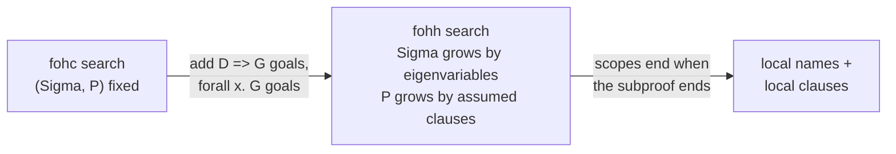

[[book-guidelines|↩ Back to guidelines]]

# Horn Clauses and Hereditary Harrop Formulas

Focus Area: `automated-reasoning`. Printed pages are cited as in the book; the PDF file is offset by 8 pages (printed p. 61 is PDF page 69).

## 0. The question this section answers

Topic 6 gave a *criterion*: a language is an abstract logic programming language when uniform (goal-directed) proofs are complete for it. A criterion is not a language. This topic produces the two concrete languages that meet it:

- **fohc**, first-order Horn clauses, the logic under Prolog.
- **fohh**, first-order hereditary Harrop formulas, the logic under the first-order core of $\lambda$Prolog.

The recurring design question is: *which connectives, and in which positions, may appear in programs and goals so that "search right-introduction rules for the goal, then consult the program only at atoms" stays complete?* fohc says "very few". fohh says "a lot more, but with the left and right positions kept mutually consistent". The whole chapter then studies what each choice buys (scoping, abstraction) and what each costs (expressive limits).

---

## 1. Two ingredients inherited from the previous topic

### 1.1 Goal-directed search

The state of an idealized interpreter is a sequent $\Sigma :: P \vdash G$: a signature $\Sigma$ of eigenvariables, a program $P$ (a collection of formulas), and a goal $G$. A **uniform proof** is a cut-free I-proof in which every sequent with a *non-atomic* right side is the conclusion of a right-introduction rule. The book spells out the induced search strategy (p. 61):

| Goal | Reduce to |
|---|---|
| $B_1 \wedge B_2$ | prove both $\Sigma :: P \vdash B_1$ and $\Sigma :: P \vdash B_2$ |
| $B_1 \vee B_2$ | prove one of $\Sigma :: P \vdash B_i$ |
| $\exists_\tau x.B$ | prove $\Sigma :: P \vdash B[t/x]$ for some $\Sigma$-term $t$ |
| $B_1 \supset B_2$ | prove $\Sigma :: P, B_1 \vdash B_2$ |
| $\forall_\tau x.B$ | prove $\Sigma, y{:}\tau :: P \vdash B[y/x]$, $y$ fresh |
| $t$ | succeed |

Only an *atomic* goal consults $P$. The meaning of connectives is fixed by the proof system and is independent of the program. An **abstract logic programming language** is a triple $\langle \mathcal D, \mathcal G, \vdash_{\mathcal X}\rangle$ such that for every signature, every finite set $P \subseteq \mathcal D$, and every $G \in \mathcal G$: $\Sigma :: P \vdash_{\mathcal X} G$ iff $\Sigma :: P \vdash G$ has a uniform proof.

**What breaks without restriction?** Uniform proofs are incomplete for full intuitionistic logic. The book's examples: $\Sigma :: p \vee q \vdash q \vee p$ and $\Sigma :: \exists x.\,r\,x \vdash \exists x.\,r\,x$ are intuitionistically provable yet have no uniform proof, because the disjunction/existential on the *left* must be opened before the right side can be decomposed. Restricting $\mathcal D$ and $\mathcal G$ removes exactly those cases.

### 1.2 Clausal order

The clausal order of an implication is $order(B_1 \supset B_2) = \max(order(B_1)+1,\ order(B_2))$ (Section 2.4). Atoms have order 0. It counts how deeply implications nest to the *left*. It is the measure that separates the two languages (Section 3.3).

---

## 2. First-order Horn clauses (fohc)

### 2.1 From refutation to proof

Historically (p. 63), Horn clauses were defined for *refutation*: a closed formula
$$\forall x_1 \ldots \forall x_n\,[\neg A_1 \vee \cdots \vee \neg A_m \vee B_1 \vee \cdots \vee B_p],\qquad p \le 1,$$
where all $A_i, B_j$ are atoms. With $p=1$ it is a *positive* (definite) clause, with $p=0$ a *negative* clause (the negated goal in a refutation). That definition is an artefact of resolution: you want clauses so you can refute a negated goal.

Once you search for sequent proofs instead, the natural presentation is as a pair of syntactic classes, **program clauses** $D$ and **goals** $G$:

$$G ::= A \mid G \wedge G \qquad\qquad D ::= A \mid G \supset A \mid \forall_\tau x.\,D \tag{5.1}$$

so a clause looks like $\forall x_1\cdots\forall x_n.(A_1 \wedge \cdots \wedge A_m \supset A_0)$. The book gives two more presentations of the same language.

$$G ::= t \mid A \mid G \wedge G \mid G \vee G \mid \exists_\tau x.G \qquad D ::= t \mid A \mid G \supset D \mid D \wedge D \mid \forall_\tau x.D \tag{5.2}$$

$$G ::= A \qquad\qquad D ::= A \mid A \supset D \mid \forall_\tau x.D \tag{5.3}$$

Here $t$ is the truth constant. $\tau$ ranges over primitive types other than $o$, which is why this is *first*-order. Presentation (5.2) is the one used for the topic's theory: $\mathcal D_1$ and $\mathcal G_1$ denote its program and goal classes.

Informally, **fohc** names any of the three. Reading (5.1) against the old definition: positive clauses are the $D$-formulas, and negations of $G$-formulas are the negative clauses.

The curry/uncurry equivalences, provable intuitionistically, connect the presentations:

1. $t \supset E \equiv E$
2. $(B \wedge C) \supset E \equiv B \supset C \supset E$
3. $(B \vee C) \supset E \equiv (B \supset E) \wedge (C \supset E)$
4. $(\exists x.B) \supset E \equiv \forall x.(B \supset E)$

Exercise 5.3 notes the price: flattening a (5.2) clause into (5.1) clauses can blow up exponentially (rule 3 duplicates $E$).

**Half meanings.** In (5.2), only atoms and conjunctions of atoms (including $t$) are both goals and clauses. Everything else is cut in half: $\vee$ and $\exists$ appear only on the *goal* (right) side, so only their right-introduction rules matter, while $\supset$ and $\forall$ appear only on the clause (left) side, so only their *left*-introduction rules matter. Also $\mathsf f$ (falsity) is excluded. That is why Horn programs are always consistent (Exercise 5.6).

### 2.2 Classical, intuitionistic, minimal: all the same here

**Proposition 5.5.** If $P$ is a multiset of $\mathcal D_1$ clauses and $G \in \mathcal G_1$, then $\Sigma :: P \vdash G$ has a C-proof only if it has an I-proof.

The proof strengthens the claim to multiple conclusions: if $\Delta$ is a multiset of $G$-formulas and $\Sigma :: P \vdash \Delta$ has a cut-free C-proof, then some single $G \in \Delta$ has an I-proof from $P$. The key trick is in the $\supset L$ and $\wedge R$ cases, where the "which conclusion survives" choice is resolved by moving the single survivor to the right premise or recombining with $\wedge L$. Exercise 5.4 gives the observation behind it: a cut-free C-proof in this setting only ever uses $\forall L, \wedge L, \supset L, \wedge R, \vee R, \exists R, tR$. There is no right-side structural freedom to exploit.

Consequence (p. 66): $\langle \mathcal D_1, \mathcal G_1, \vdash_{\mathcal X}\rangle$ is an abstract logic programming language for $\vdash_{\mathcal X}$ equal to $\vdash_C$, $\vdash_I$ or $\vdash_M$. For Horn clauses, the classical/intuitionistic/minimal distinction collapses. This is *the* reason Horn-clause people can ignore proof-theoretic logic choices: they do not matter.

**What breaks without this?** Everything above the Horn fragment. Exercise 5.9 asks you to show that Peirce's formula $((p \supset q) \supset p) \supset p$ is classically provable with only implications and has no uniform proof, and that three nested implications is the minimum for such a witness. This quantifies how fast the fragment is left.

### 2.3 A grounded example

The book's Figure 5.3 (p. 93), in $\lambda$Prolog syntax where `:-` is converse implication, `,` is $\wedge$ of goals, and capitalized names are universally quantified per clause:

```prolog
kind nat type.
type z nat.
type s nat -> nat.
type sum nat -> nat -> nat -> o.
type leq, greater nat -> nat -> o.

sum z N N.
sum (s N) M (s P) :- sum N M P.
leq z N.
leq (s N) (s M) :- leq N M.
greater N M :- leq (s M) N.
```

Each clause is a $D$-formula such as $\forall N\,\forall M\,\forall P.\,(sum\ N\ M\ P \supset sum\ (s\ N)\ M\ (s\ P))$. Note that the *data* ($z$, $s$) lives inside atoms, as first-order terms. That detail returns in Section 6.

---

## 3. Hereditary Harrop formulas (fohh)

### 3.1 Motivation: let goals carry implications and quantifiers

In fohc, $\supset$ and $\forall$ occur only on the left. Proofs therefore use $\supset L$ and $\forall L$ but never $\supset R$ or $\forall R$. fohh says: allow the *right* introduction rules too, by allowing goals of the form $D \supset G$ and $\forall x.G$. A goal may then **assume a clause** while it is being proved, and **create a fresh name**. That is the entire extension.

The first presentation (5.4), with *mutually recursive* classes:

$$G ::= A \mid G \wedge G \mid D \supset G \mid \forall x.G \qquad\qquad D ::= A \mid G \supset A \mid \forall x.D \tag{5.4}$$

Hereditary means the property propagates: negative subformulas of a $G$ are $D$s, and negative subformulas of a $D$ are $G$s (and positive ones stay in their class). The richer form (5.5), which the book adopts by default:

$$G ::= t \mid A \mid G\wedge G \mid G\vee G \mid \exists x.G \mid D \supset G \mid \forall x.G \qquad D ::= A \mid G \supset D \mid D \wedge D \mid \forall x.D \tag{5.5}$$

with $\mathcal D_2$ and $\mathcal G_2$ the classes. And a fully symmetric form (5.6) over $\{t, \wedge, \supset, \forall\}$ where $D$ and $G$ coincide. The book calls those formulas $\mathcal L_0$-formulas (Section 5.5): the right rules for $\mathcal L_0$ connectives are invertible, the left rules are not.

Compare with fohc: fohc is fohh with all implication nested depth at most one on the left, and no implications or $\forall$ in goals. Exercise 5.10 makes it exact: for $D \in \mathcal D_2$, $D$ is a Horn clause (5.2) iff $order(D) < 2$. So **the Horn/Harrop boundary is exactly clausal order 1 versus higher**.

### 3.2 Why hereditary and not just Harrop

A **Harrop formula** is built by $H ::= A \mid B \supset H \mid \forall x.H \mid H_1 \wedge H_2$ with $B$ an *arbitrary* first-order formula. Harrop formulas are "uniform at the root" (Exercise 5.14) and have the disjunction and existence properties. Hereditary Harrop formulas additionally require the hypotheses $B$ to be in the same class recursively, which is what makes the *entire* sequent stay inside the fragment.

**Proposition 5.11.** In a cut-free I-proof of $\Sigma :: P \vdash G$ with $P \subseteq \mathcal D_2$ and $G \in \mathcal G_2$, every sequent $\Sigma' :: P' \vdash B$ has $P'$ in $\mathcal D_2$ and $B$ in $\mathcal G_2$.

The left side stays "program" and the right side stays "goal" through the whole search. Without the hereditary condition, an implication goal $B \supset G$ would push an arbitrary formula $B$ into the program, and the identification of left with program would be lost.

### 3.3 Fohh is an abstract logic programming language, in intuitionistic logic only

- $\langle \mathcal D_2, \mathcal G_2, \vdash_C\rangle$ is **not** one: several formulas of $\mathcal G_2$ (items 4-7 of Exercise 4.3) are classically provable without a uniform proof. Peirce's formula is again the model.
- $\langle \mathcal D_2, \mathcal G_2, \vdash_I\rangle$ **is** (Proposition 5.13). Every cut-free I-proof can be converted into a uniform one.

The mechanism is Lemma 5.12, a **rule permutation** argument: if a left rule sits directly beneath a right-introduction rule, permute the left rule above it. Two cases from the book:

- $\supset L$ below $\wedge R$: duplicate the left premise, apply $\supset L$ to each branch, then $\wedge R$.
- $\supset L$ below $\supset R$: the new assumption $D'$ just joins $P$ and the $\supset R$ goes below.

Repeated, no left rule remains above a non-atomic right side. Since fohh has no $\mathsf f$, $\langle \mathcal D_2, \mathcal G_2, \vdash_M\rangle$ is essentially the same language.

**Relation to the classical collapse.** In fohc, C = I = M. In fohh, C is strictly larger than I (Peirce), and the intuitionistic reading is the one that matches search. The logic *is* the language design.

---

## 4. The dynamics of proof search

Section 5.4 sharpens the picture with the focused system $\Downarrow$fohh (details in topic 8). Two phases:

- a **right-introduction phase** (goal reduction), ending at *border sequents* with atomic right sides, and
- a **left-introduction phase** that starts with $decide$ (select $D \in P$) and ends in $init$ (**backchaining**).

Contraction and weakening are folded into $decide$ and $init$, and in $\supset L$ the left context is treated additively, which avoids the exponential context-splitting of a multiplicative rule (p. 71).

### 4.1 fohc: nothing changes

By completeness (Prop. 5.38), a provable fohc sequent has a $\Downarrow$fohh proof. That proof has no $\supset R$ or $\forall R$, so **every sequent in it has the same $\Sigma$ and the same $P$** (p. 94). Consequently:

- A clause needed during search must be present from the start: no hierarchical or local clauses.
- All constructors needed for data must be present from the start: no hidden data representation, no abstract data types.
- The only thing that changes between border sequents is the atomic goal. All the dynamics happens *inside non-logical atoms*. This is why Turing machines can be interpreted in fohc (Exercise 5.40, hence undecidability), and also why proof theory has little to say about specific Horn programs: most reasoning about them is by induction (p. 96). Chapter 11 of the book is the exception.

### 4.2 fohh: signatures and programs grow

Every sequent in a $\Downarrow\mathcal L_0$ proof of $\Sigma :: P \vdash G$ has the form (p. 99)
$$\Sigma, \Sigma' :: P, P' \vdash G' \quad\text{or}\quad \Sigma, \Sigma' :: P, P' \Downarrow D \vdash A.$$
$\Sigma'$ collects eigenvariables introduced by $\forall R$. $P'$ collects clauses introduced by $\supset R$. And there is a nice quantitative remark: if $P$ has clausal order $n\ge 1$ and $G$ has order at most $n-1$, then the clauses in $P'$ have order at most $n-2$.

Eigenvariables are never instantiated once introduced, so "eigenvariables do not actually vary and, hence, act as locally scoped constants." This is the entire mechanism behind local names.



### 4.3 A runnable model

This Rust sketch (compiled and run against the book's jar example) is a naive uniform-proof interpreter for the fragment used in Section 5. The point is the structure: **`And`, `Imp`, `All` are decided by the goal alone, and only `Atom` reads the program**. $\supset R$ is `push`/`pop`, and $\forall R$ is "mint a fresh constant". It uses eager all-solutions search, no occurs check, and no eigenvariable-escape check, so it illustrates the proof structure rather than serving as an engine.

```rust
use std::collections::HashMap;

#[derive(Clone, Debug)]
enum Term { Var(String), App(String, Vec<Term>) }

#[derive(Clone, Debug)]
enum Goal {
    Atom(Term),                 // A
    And(Box<Goal>, Box<Goal>),  // G1 /\ G2
    Imp(Box<Clause>, Box<Goal>),// D => G   (absent in fohc)
    All(String, Box<Goal>),     // forall x. G   (absent in fohc)
}

/// forall vars. (body => head)
#[derive(Clone, Debug)]
struct Clause { vars: Vec<String>, body: Vec<Goal>, head: Term }

type Subst = HashMap<String, Term>;

fn walk(t: &Term, s: &Subst) -> Term {
    match t {
        Term::Var(v) => match s.get(v) { Some(u) => walk(u, s), None => t.clone() },
        Term::App(f, args) => Term::App(f.clone(), args.iter().map(|a| walk(a, s)).collect()),
    }
}

// First-order unification (no occurs check, for brevity).
fn unify(a: &Term, b: &Term, mut s: Subst) -> Option<Subst> {
    match (walk(a, &s), walk(b, &s)) {
        (Term::Var(x), Term::Var(y)) if x == y => Some(s),
        (Term::Var(x), t) | (t, Term::Var(x)) => { s.insert(x, t); Some(s) }
        (Term::App(f, xs), Term::App(g, ys)) => {
            if f != g || xs.len() != ys.len() { return None; }
            xs.iter().zip(ys.iter()).try_fold(s, |s, (x, y)| unify(x, y, s))
        }
    }
}

fn ren_t(t: &Term, m: &HashMap<String, Term>) -> Term {
    match t {
        Term::Var(v) => m.get(v).cloned().unwrap_or_else(|| t.clone()),
        Term::App(f, a) => Term::App(f.clone(), a.iter().map(|x| ren_t(x, m)).collect()),
    }
}
fn ren_g(g: &Goal, m: &HashMap<String, Term>) -> Goal {
    match g {
        Goal::Atom(t) => Goal::Atom(ren_t(t, m)),
        Goal::And(a, b) => Goal::And(Box::new(ren_g(a, m)), Box::new(ren_g(b, m))),
        Goal::Imp(d, h) => {
            let mut m2 = m.clone();
            for v in &d.vars { m2.remove(v); }
            let d2 = Clause { vars: d.vars.clone(),
                body: d.body.iter().map(|b| ren_g(b, &m2)).collect(), head: ren_t(&d.head, &m2) };
            Goal::Imp(Box::new(d2), Box::new(ren_g(h, m)))
        }
        Goal::All(x, h) => { let mut m2 = m.clone(); m2.remove(x); Goal::All(x.clone(), Box::new(ren_g(h, &m2))) }
    }
}

/// Sigma :: P |- G, returning every answer substitution (depth-first, eager).
fn solve(p: &mut Vec<Clause>, g: &Goal, s: Subst, n: &mut u32) -> Vec<Subst> {
    match g {
        Goal::And(a, b) => solve(p, a, s, n).into_iter()
            .flat_map(|s1| solve(p, b, s1, n)).collect(),
        Goal::Imp(d, h) => { p.push((**d).clone()); let r = solve(p, h, s, n); p.pop(); r }
        Goal::All(x, h) => {
            *n += 1;                                  // new eigenvariable = fresh constant
            let c = Term::App(format!("c#{n}"), vec![]);
            let h2 = ren_g(h, &HashMap::from([(x.clone(), c)]));
            solve(p, &h2, s, n)
        }
        Goal::Atom(a) => {                            // decide + backchain
            let mut out = vec![];
            for d in p.clone() {
                *n += 1;
                let m: HashMap<_, _> = d.vars.iter()
                    .map(|v| (v.clone(), Term::Var(format!("{v}#{n}")))).collect();
                if let Some(s1) = unify(&ren_t(&d.head, &m), a, s.clone()) {
                    let mut ss = vec![s1];
                    for b in &d.body {
                        let b2 = ren_g(b, &m);
                        ss = ss.into_iter().flat_map(|s2| solve(p, &b2, s2, n)).collect();
                    }
                    out.extend(ss);
                }
            }
            out
        }
    }
}

fn v(x: &str) -> Term { Term::Var(x.into()) }
fn app(f: &str, a: Vec<Term>) -> Term { Term::App(f.into(), a) }

fn main() {
    // sterile X :- pi y \ in y X => dead y.   dead X :- heated Y, in X Y.   heated j.
    let sterile = Clause { vars: vec!["X".into()], head: app("sterile", vec![v("X")]),
        body: vec![Goal::All("y".into(), Box::new(Goal::Imp(
            Box::new(Clause { vars: vec![], body: vec![], head: app("in", vec![v("y"), v("X")]) }),
            Box::new(Goal::Atom(app("dead", vec![v("y")]))))))] };
    let dead = Clause { vars: vec!["X".into(), "Y".into()], head: app("dead", vec![v("X")]),
        body: vec![Goal::Atom(app("heated", vec![v("Y")])), Goal::Atom(app("in", vec![v("X"), v("Y")]))] };
    let heated = Clause { vars: vec![], head: app("heated", vec![app("j", vec![])]), body: vec![] };
    let mut prog = vec![sterile, dead, heated];
    let goal = Goal::Atom(app("sterile", vec![app("j", vec![])]));
    println!("{}", !solve(&mut prog, &goal, HashMap::new(), &mut 0).is_empty());
}
```

Reading it against the proof system:

- `Goal::Imp` is the $\supset R$ rule $\ \Sigma :: D, P \vdash G \,/\, \Sigma :: P \vdash D \supset G$.
- `Goal::All` is $\forall R$ with a fresh $y \notin \Sigma$. A real implementation must also track that no outer logic variable may later be bound to `c#n` (a *level* or *scope* check). That check is what makes the pattern-unification story in higher-order $\lambda$Prolog sound.
- `Goal::Atom` is $decide$ followed by $\forall L$ (renaming the clause's variables to fresh unification variables), $\supset L$ (the body goals are the premises), and $init$ (head unifies with the atom).
- Delete the `Imp` and `All` arms and you have fohc.

---

## 5. Scoped clauses and modular programming

### 5.1 The sterile jar

McCarthy's challenge (p. 96): a jar is sterile if every bacterium in it is dead. Heating a jar kills all bacteria in it. Prove that a heated jar is sterile.

```prolog
kind jar, bacterium type.
type j jar.
type sterile, heated jar -> o.
type dead bacterium -> o.
type in bacterium -> jar -> o.

sterile X :- pi y \ in y X => dead y.
dead X :- heated Y, in X Y.
heated j.
```

The first clause is $\forall x.(\forall y.(in\ y\ x \supset dead\ y) \supset sterile\ x)$, a clause whose *body* is a goal with $\forall$ and $\supset$, i.e. order 2. Its synthetic inference rule (Section 5.7) is

$$\frac{y{:}bacterium,\ \Sigma :: P,\ in\ y\ x \vdash dead\ y}{\Sigma :: P \vdash sterile\ x}$$

Read it as the mathematician does: "let $y$ be an arbitrary bacterium in $x$; show it is dead." The type `bacterium` has no constructors and nothing assumes anything about `in`. The proof quantifies over an *arbitrary* bacterium, with a fresh eigenvariable and a local assumption. No such proof is expressible in fohc.

The Lean counterpart is almost a transliteration, and shows the same $\forall R$/$\supset R$ moves as `fun y hy =>`:

```lean
variable (Bact Jar : Type) (inn : Bact → Jar → Prop)
         (heated : Jar → Prop) (dead : Bact → Prop) (j : Jar)

def sterile (x : Jar) : Prop := ∀ y, inn y x → dead y   -- forall R, then => R

example (h1 : ∀ x y, heated y → inn x y → dead x)       -- dead X :- heated Y, in X Y
        (h2 : heated j) : sterile Bact Jar inn dead j :=
  fun y hy => h1 y j h2 hy
```

Here `fun y hy` introduces the eigenvariable `y` and the local hypothesis `hy`, exactly the $\Sigma' = \{y\}$, $P' = \{in\ y\ j\}$ bookkeeping of Section 4.2. (In Lean the "program" is the local context and the search is done by hand or by `tauto`/`aesop`.)

### 5.2 Reverse with a hidden helper

Plain fohc (p. 97):

```prolog
reverse L K :- rev L nil K.
rev nil L L.
rev (X :: M) N L :- rev M (X :: N) L.
```

fohh with the helper's *base case* as an assumption (order 2):

```prolog
reverse L K :- rv nil K => rv L nil.
rv (X :: M) N :- rv M (X :: N).
```

and with *both* helper clauses assumed locally (order 3):

```prolog
reverse L K :-
  (pi X \ pi M \ pi N \ rv (X :: M) N :- rv M (X :: N)) =>
    rv nil K => rv L nil.
```

In the last version, `rv` has no clauses in the global program. They exist only during a proof of `reverse`, and no other program clause can access them. That is the **abstract data type / information hiding** that Section 4.1 said fohc lacks. The book's Exercise 5.42 asks where the "second pile of papers" lives in the proof: it is the accumulator argument, and the loop is the assumed recursive clause.

Order matters here: the program grows from order 1 (plain Horn), to 2 (assumption of an atom), to 3 (assumption of a clause).

### 5.3 Modules from implicational goals

Let `classify`, `scanner`, `misc` be conjunctions of clauses. Consider (p. 98)

$$misc \supset \bigl((classify \supset G_1) \wedge (scanner \supset G_2) \wedge G_3\bigr).$$

Proving it attempts $G_1$ against $misc \cup classify$, $G_2$ against $misc \cup scanner$, $G_3$ against $misc$. The clauses in `classify` are *not available* while proving $G_2$. So implication goals structure the **runtime environment**. Two subtleties the book flags:

- If `aux` is defined partly in `misc` and partly in `scanner`, the accumulated definition is the *mix* of both sets of clauses, which may relate in no simple way to either one alone. Accumulation is union, not override.
- No shadowing: this is union-scoping, not lexical hiding of definitions.

A tiny Python picture of scope as dynamic extent. The stack discipline is the point:

```python
from contextlib import contextmanager

program: list[str] = ["misc"]

@contextmanager
def assuming(clauses):           # the right rule for  D => G
    program.append(clauses)
    try:
        yield
    finally:
        program.pop()            # scope ends with the subproof

with assuming("classify"):
    assert program == ["misc", "classify"]    # G1 is proved here
with assuming("scanner"):
    assert program == ["misc", "scanner"]     # G2: classify is invisible
assert program == ["misc"]                    # G3
```

### 5.4 Scope extrusion: why classical logic cannot do this

The three goals

$$D \supset (G_1 \vee G_2),\qquad (D \supset G_1) \vee G_2,\qquad G_1 \vee (D \supset G_2)$$

give $D$ three *different* scopes in search. But since $B \supset C \equiv \neg B \vee C$ classically, all three are classically equivalent to $\neg D \vee G_1 \vee G_2$. The apparent scope of $D$ in $(D \supset G_1)\vee G_2$ "extrudes" over the whole disjunction. Classical logic therefore cannot express a module system. Intuitionistic logic does not have that equivalence, which is why fohh's *intuitionistic* provability is not just a technicality but a requirement.

(The same word, scope extrusion, reappears in the $\pi$-calculus chapter, where the book treats binding in processes.)

---

## 6. Expressive limits of fohc and fohh

The book's Section 5.13 is the "pumping lemma" part: what *cannot* be said. Everything here follows from one fact.

> **Monotonicity.** If $\Sigma :: \Gamma \vdash_I G$ and $\Gamma' \supseteq \Gamma$ then $\Sigma :: \Gamma' \vdash_I G$ (consequence of Prop. 5.23).

Provability can only *increase* as the program grows. Therefore a program cannot detect that something is *missing*. The consequences:

1. **Maximum of a set in the left context** (Exercise 5.43). Store $N=\{n_1,\ldots,n_k\}$ as atoms $a\,n_1,\ldots,a\,n_k$. No fohh program $P$ makes $A(N), P \vdash maxa\ m$ provable iff $m = \max N$: knowing $m$ is the *largest* needs knowing no larger atom exists, and adding atoms can only add conclusions. But Figure 5.4's `max` works in fohc when the set is a *list inside an atom*, because lists are closed terms, not open sets of assumptions.
2. **Non-reachability** (Exercise 5.44). With the graph of Figure 5.5 as atomic facts (`adj a b`...), reachability is `path X X.` and `path X Z :- adj X Y, path Y Z.`, but no fohh predicate holds iff there is *no* path, or iff a node has no neighbour.
3. **Sterile by inspection** (Exercise 5.45). You cannot specify "every bacterium recorded as `in b j` is recorded as `dead b`" by checking the facts, so the microscope-style proof is out. The $\forall y$ proof of Section 5.1 is available, and the check-every-element one is not. (The bibliographic notes point to model checking for that style.)
4. **Signature independence** (Exercise 5.46). Take $\Sigma$ with $i = \{a,b,c\}$. Any specification of `remove X L K` that mentions none of $a,b,c$ would, once it proves `remove a [a,b,a] [b]`, also prove the universally quantified version, and hence the instance `remove a [a,a,a] [a]`, which is wrong. So a correct `remove` must name the constructors of the element type (via `notequal`), and "substitute all occurrences" (`subAll`) is impossible in general for the same reason. The book's `subSome` (Figure 5.8) works because "some" does not need to know *which* terms are different.

   ```prolog
   remove X nil nil.
   remove X (X :: L) K :- remove X L K.
   remove X (Y :: L) (Y :: K) :- notequal X Y, remove X L K.
   ```
   (The printed clause in the book omits the `X` argument in the recursive call; I wrote the evidently intended version.)

The proposed repair (p. 103-104): treat programs not as extensible *theories* but as *definitions* (inductive definitions, least fixed points), closed under their clauses. That would give negation-as-failure-like reasoning and model checking, but the book keeps programs as extensible theories and moves on to [[Linear-Logic|linear logic]] and higher-order quantification instead.

**Summary of the fohc/fohh comparison.**

| | fohc | fohh |
|---|---|---|
| Goals | $A$, $G\wedge G$ (and $t,\vee,\exists$ in (5.2)) | adds $D \supset G$, $\forall x.G$ |
| Clausal order of programs | $\le 1$ | any |
| Left side during search | fixed $P$ | $P$ grows with $P'$ |
| Signature during search | fixed $\Sigma$ | grows with eigenvariables |
| Local clauses / hidden data | no | yes |
| Classical = intuitionistic | yes (Prop. 5.5) | no (Peirce) |
| Logic of search | any of C, I, M | intuitionistic (or minimal) |
| Cannot express | negation, "missing" info, signature-independent inequality | same |

---

## 7. $\vee$ and $\exists$ in goals via non-logical constants

A small but conceptually loaded point (Section 5.8, p. 91). The connectives $\vee$ and $\exists$ break the [[Sequent-Calculus-Proof-Systems#Invertibility|invertibility]] pattern used by $\mathcal L_0$. The book removes them from the *logical* signature and adds non-logical constants $\hat\vee : o\to o\to o$ and $\hat\exists_\tau : (\tau\to o)\to o$ with the Horn clauses

$$\forall P\,\forall Q\,[P \supset (P\mathbin{\hat\vee} Q)],\quad \forall P\,\forall Q\,[Q \supset (P\mathbin{\hat\vee} Q)],\quad \forall B\,\forall t\,[(B\,t)\supset \hat\exists_\tau B].$$

Their synthetic rules are exactly $\vee R$ and $\exists R$. Because $\vee$ and $\exists$ never occur as head connectives of program clauses, completeness of focused proofs for fohh (Prop. 5.38) follows from completeness for $\mathcal L_0$. These clauses are not *first*-order Horn clauses since $\forall P : o$ quantifies at type $o$. They are higher-order Horn clauses, which Chapter 9 justifies. This is the same trick that later shows the "Prolog `;` and `exists`" are *definable*, not primitive.

---

## 8. Synthetic inference rules: what a Horn clause really is

Section 5.7 explains what fohc programs are *as proof rules*. Focusing on a clause means: $decide$, then left rules, then right rules for any $G$-subgoals, until atomic sequents (*border sequents*) remain. The result is one **synthetic inference rule**. For the graph clauses `adj`/`path`:

$$\frac{\Sigma :: \Gamma, P \vdash adj\ s\ u \qquad \Sigma :: \Gamma, P \vdash path\ u\ t}{\Sigma :: \Gamma, P \vdash path\ s\ t}\qquad\qquad \frac{\Sigma :: \Gamma, P \vdash adj\ s\ t}{\Sigma :: \Gamma, P \vdash path\ s\ t}$$

No logical connectives appear. In general (Exercise 5.37), deciding on a formula of clausal order at most 2 gives rules over atoms only. A formula of higher order, such as $((p\supset q)\supset r)\supset s$, yields a rule with logical structure in its premise, $\Gamma, p\supset q \vdash r \ /\ \Gamma \vdash s$.

This is the cleanest statement of what the Horn/hereditary-Harrop hierarchy *is*. Order-1 clauses (Horn) give atom-to-atom rules over a fixed context. Order-2 clauses, such as the sterile-jar clause, still have atomic premises and conclusion (Exercise 5.37), but the premise sequent may carry extra atoms in its context and extra eigenvariables in its signature, which is exactly the dynamics of Section 4.2. Order 3 and above give rules whose premises contain implications, i.e. genuinely new hypotheses with structure.

---

## 9. Where the goals connect

**Focus Area: `automated-reasoning`.** (The book's Topic List tags this topic there.) A few direct connections to the standing project:

- **Judgments and a type checker as a proof checker.** $\Sigma :: P \vdash G$ is a judgment form with a context of typed eigenvariables ($\Sigma$) and a context of hypotheses ($P$). Compare a typing judgment $\Gamma \vdash e : \tau$. The rules $\supset R$ and $\forall R$ extend contexts. $\supset L$/$\forall L$/$decide$ consult them. A bidirectional type checker has the same split: *introduction* forms are checked (like goal reduction), *elimination* forms are inferred from the context head (like backchaining from a focused $D$). The fohh search is, quite literally, bidirectional proof search with *checking* for goals and *inference* (focus) for hypotheses.
- **Contexts and variable capture.** The eigenvariable discipline ($y\notin\Sigma$, never instantiated) is the same plumbing as binders/fresh names in an elaborator. The missing eigenvariable-escape check in the Rust model is exactly the scope check an elaborator's metavariable context needs, and it is what makes Miller's *pattern* unification (variables applied to distinct bound variables) tractable and unitary. First-order Horn unification has most general unifiers. The book's objection to resolution (topic 1) is that typed $\lambda$-term unification may not.
- **Unification and clause resolution.** The `unify` in `solve` is the unifier a prover embedded in your toolchain would need for `decide`. fohc search is the clause/resolution engine in its goal-directed (SLD-like) disguise, with the *proof* (not the refutation) as the object.
- **CHCs and Hoare logic.** Constrained Horn clauses used for verification conditions are Horn clauses of the (5.1) shape with a constraint atom in the body. Hoare-style loop invariants are the unknown predicates to be solved for. The book's results here (Prop. 5.5, only atoms-to-atoms synthetic rules, all dynamics inside atoms, induction needed to reason about them) are the right theoretical frame for why verifiers lean on *invariant synthesis* instead of proof-theoretic normalization on the clauses themselves. The Chapter 11 collection analysis (topic 18, tagged `static-analysis`) is the book's one counterexample.
- **Proof certificates and trusted kernels.** A $\Downarrow$fohh proof is a very small, checkable certificate: a tree of $decide$/$BC$ steps with substitutions. A kernel that checks it is a few dozen lines of the shape of `solve`, with the unifier in the trusted base.
- **Operational semantics.** Section 5.9's Horn programs (`sum`, `sort`, `path`) are operational semantics in clause form, and the Turing-machine interpreter (Exercise 5.40) shows the fragment is computationally universal. This is the small-step/big-step theme the book returns to in its last chapter.

I did not manufacture connections to `sat-smt-csp`: the book itself sets constraint solving aside.

```text
 Horn clauses (fohc)  --- add D => G, forall x. G in goals --->  hereditary Harrop (fohh)
   Sigma, P fixed                                                 Sigma, P grow
   C = I = M                                                      intuitionistic only
        |                                                               |
        +----- both are abstract logic programming languages -----------+
                   (uniform proofs complete; Prop. 5.13)
                                    |
                    focused proofs (decide, backchaining)
                    synthetic rules: atoms -> atoms
```

---

## Where this leads

Section 5.4 onward makes this topic's two languages the test-bed for focused proof systems: the $decide$ rule and the two-phase structure proved complete in topic 8, with cut elimination via paths. The Kripke-model section (topic 9) proves that truth coincides with provability for fohh. The expressive limits (no negation, no hidden multiset state, monotonicity) are exactly what linear logic repairs next (topics 10-11): Lolli generalizes fohh, Forum goes beyond it, and both stay conservative over it. And the order-2 and order-3 scoping idioms (`pi y \ in y X => dead y`, hidden `rv`) resurface as higher-order predicates and hiding by quantification in Chapter 9, where "Horn clause with rigid head" replaces the first-order notion.
