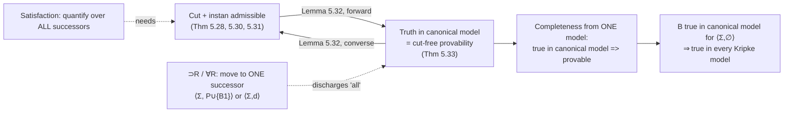

[[book-guidelines|↩ Back to guidelines]]

# Kripke Semantics and Canonical Models

**Focus areas:** this topic is untagged in the book's `.learning-goals.md`. It still bears on `automated-reasoning` (cut admissibility, trusted kernels) and, more loosely, `type-theory` (scoped signatures, normalization). The goal connections are in the closing synthesis and I kept them to what the material supports.

Related notes: [[Cut-Elimination-and-Its-Consequences]], [[Sequent-Calculus-Proof-Systems]].

## 1. The problem: two meanings of "true", and they must agree

Most of this book defines meaning through proofs: a connective means what its introduction rules say. That is *proof-theoretic* semantics. Everywhere else in logic, the standard way to give meaning is *model-theoretic*: build a mathematical structure, define "true in the structure", and prove soundness and completeness against provability.

Miller uses the words in the model-theoretic sense here (and says so, since §4.1 used them differently):

- **Soundness:** if a formula is provable, it is true in every model.
- **Completeness:** if a formula is true in every model, it is provable.

Why bother in a book about proof search? Because the two styles give connectives *different shapes of meaning*:

- In a sequent calculus, each connective has **two** senses: a right rule and a left rule (the book recalls this from §3.7).
- In a model, each connective has **one** clause: a single definition of when it is satisfied.

If the two presentations are to describe the same connective, something must reconcile "two rules" with "one clause". The punchline of §5.6 is that the reconciling device is exactly **cut admissibility**. That is a sharper statement than "cut elimination is a nice property". It says cut elimination is *the same fact* as truth coinciding with provability in a particular model.

What breaks without it: if cut were *not* admissible, then a hypothesis you can prove but not use directly would be "true" in any reasonable model and yet not cut-free provable. Truth and cut-free provability would drift apart, and the right and left rules of $\supset$ would not mean the same thing.

## 2. First principles: why intuitionistic truth is "evolving"

Classical logic has one fixed notion of a world: every atom is true or false, full stop. Intuitionistic logic rejects that picture of the truth as settled. Instead (the book's Ch. 4 introduction, p. 39):

> In Kripke models, standard classical models are called *worlds*. These worlds are arranged in a tree structure. A path in such a tree represents a possible evolution of truth in those worlds. An implication is true in a given world if it is true in all worlds to which it evolves.

Think of a world as **a state of knowledge**. As you learn more, the state moves "up" to a world that knows at least as much. Two rules govern that picture:

1. **Monotonicity (heredity).** Facts known now stay known later. Knowledge only grows.
2. **Implication looks forward.** "If $B_1$ then $B_2$" is true now when, *in every future state of knowledge where $B_1$ is established, $B_2$ is established too*. It is a promise about all the ways you might learn more, not just a check at the current state.

Programmer analogy: a world is a snapshot of a program's knowledge base (the facts and definitions in scope), and "evolves to" means "adds more facts or more names". An implication is a guarantee that survives every future addition. That analogy is not decoration. In this book it is literally true, because the worlds are built from logic-programming states, as the next section shows.

## 3. Worlds and Kripke models (the book's definitions)

Everything in §5.6 is restricted to $\mathcal L_0$-formulas, i.e. first-order formulas built from $\{t, \wedge, \supset, \forall\}$ (see §5.5). There is no disjunction, no existential, no $f$. For these, intuitionistic and [[Classical-Intuitionistic-and-Minimal-Logics#Minimal logic|minimal logic]] coincide (§4.5), and the formulas include all of fohh.

**World.** A world is a pair $\langle \Sigma, P\rangle$:

- $\Sigma$ is a finite **signature** (the typed constants/eigenvariables currently in scope),
- $P$ is a finite set of $\mathcal L_0$ $\Sigma$-formulas (the **program**, i.e. the left side of a sequent).

So a world is exactly the *state* of a sequent $\Sigma :: P \vdash G$ minus the goal. This is what makes the construction natural: the worlds are the states that proof search itself visits.

**Order.** $\langle \Sigma, P\rangle \preceq \langle \Sigma', P'\rangle$ iff $\Sigma \subseteq \Sigma'$ and $P \subseteq P'$. Evolution means adding names and adding hypotheses.

**Kripke model.** A pair $\langle W, I\rangle$ where $W$ is a (possibly infinite) set of worlds and $I$ maps each world $\langle\Sigma,P\rangle$ to a set of **atomic** $\Sigma$-formulas, and is **order-preserving**: $w \preceq w' \Rightarrow I(w) \subseteq I(w')$.

**Satisfaction** $I, w \Vdash B$ for an $\mathcal L_0$ $\Sigma$-formula $B$, by induction on $B$:

1. $I, \langle\Sigma,P\rangle \Vdash B$ if $B$ is atomic and $B \in I(\langle\Sigma,P\rangle)$.
2. $I, w \Vdash B \wedge B'$ if $I, w \Vdash B$ and $I, w \Vdash B'$.
3. $I, w \Vdash B \supset B'$ if for every $w' \in W$ with $w \preceq w'$: if $I, w' \Vdash B$ then $I, w' \Vdash B'$.
4. $I, \langle\Sigma,P\rangle \Vdash \forall_\tau x.\,B$ if for every $\langle\Sigma',P'\rangle \in W$ with $\langle\Sigma,P\rangle \preceq \langle\Sigma',P'\rangle$ and every $\Sigma'$-term $t$ of type $\tau$, $I, \langle\Sigma',P'\rangle \Vdash B[t/x]$.

(The clause for $t$ is trivially true; the book does not spell it out.)

Look at clause 4. It quantifies over *future signatures* and over *terms built from the future signature*. That is the model-theoretic mirror of eigenvariables: a universal is true now if it holds even after you introduce new names and after you instantiate with any term over them.

### Grounding: forcing, as a data structure

Rust first, because this is a verifier-shaped definition. A *finite* Kripke model over the propositional fragment makes the clauses executable. (The canonical model below is infinite, so you cannot enumerate it. This is only the generic definition.)

```rust
use std::collections::HashSet;

#[derive(Clone, PartialEq, Eq, Hash, Debug)]
enum Fm {
    Atom(&'static str),
    And(Box<Fm>, Box<Fm>),
    Imp(Box<Fm>, Box<Fm>),
}

struct Kripke {
    n: usize,                              // worlds are 0..n
    le: Vec<Vec<bool>>,                    // le[w][w2]: w <= w2 (reflexive, transitive)
    val: Vec<HashSet<&'static str>>,       // I(w); must be monotone along `le`
}

impl Kripke {
    fn forces(&self, w: usize, f: &Fm) -> bool {
        match f {
            Fm::Atom(a) => self.val[w].contains(a),
            Fm::And(a, b) => self.forces(w, a) && self.forces(w, b),
            // implication quantifies over ALL future worlds
            Fm::Imp(a, b) => (0..self.n)
                .filter(|&w2| self.le[w][w2])
                .all(|w2| !self.forces(w2, a) || self.forces(w2, b)),
        }
    }
}
```

The `Imp` arm is the whole story of intuitionistic implication: a loop over every reachable world. Compare it with what a prover does for the same connective.

## 4. Satisfaction versus provability of implication

This is the conceptual heart of the section and the book is explicit about it.

**Provability** of $B_1 \supset B_2$ at $\langle\Sigma,P\rangle$ means the sequent $\Sigma :: P \vdash B_1 \supset B_2$ is provable. The right rule for $\supset$ (invertible) moves to **one** new world $\langle \Sigma, P \cup \{B_1\}\rangle$ and tries to prove $B_2$ there.

**Satisfaction** of $B_1 \supset B_2$ at $\langle\Sigma,P\rangle$ examines **all** extensions of the world, and for each one where $B_1$ is true checks that $B_2$ is true.

| | Provability (sequent calculus) | Satisfaction (Kripke) |
|---|---|---|
| Implication | one successor world $P \cup \{B_1\}$ | all successor worlds $w' \succeq w$ |
| Universal | one fresh eigenvariable | every extension, every term |
| Senses of a connective | two (left and right rules) | one clause |
| Nature | a finite search | a possibly infinite check |

These look quite different. The surprise is not that they can disagree, but that for $\mathcal L_0$ they provably agree, and the reason is cut.

### What the prover does, in Rust

The proof-search side of the same connective, for the propositional $\{\wedge,\supset\}$ fragment with atomic initial rule only. This is a uniform-proof / backchaining sketch in the spirit of the book's $\Downarrow$fohh system (§5.4). It is incomplete as written (no loop checking) and is meant to show the *shape* of $\supset$R versus the loop above.

```rust
fn prove(prog: &mut Vec<Fm>, goal: &Fm) -> bool {
    match goal {
        Fm::And(a, b) => prove(prog, a) && prove(prog, b),
        // right rule for implication: ONE successor world
        Fm::Imp(a, b) => {
            prog.push((**a).clone());
            let ok = prove(prog, b);
            prog.pop();
            ok
        }
        Fm::Atom(_) => backchain(prog, goal),
    }
}

// decide on a clause D in prog, reduce D's head against the atom,
// recursing on the clause's body goals (the BC rule of §5.7).
fn backchain(prog: &mut Vec<Fm>, atom: &Fm) -> bool {
    let clauses = prog.clone();
    clauses.iter().any(|d| match_clause(prog, d, atom))
}

fn match_clause(prog: &mut Vec<Fm>, d: &Fm, atom: &Fm) -> bool {
    match d {
        Fm::Atom(_) => d == atom,
        Fm::And(a, b) => match_clause(prog, a, atom) || match_clause(prog, b, atom),
        // clause  G ⊃ D'  : prove G, then continue into D'
        Fm::Imp(g, d2) => match_clause(prog, d2, atom) && prove(prog, g),
    }
}
```

One recursive call per connective, one extension. No loop over worlds. The claim of §5.6 is that, in the canonical model, these two procedures define the same relation.

## 5. The canonical Kripke model

Fix a world $\langle \Sigma, P\rangle$. The **canonical model for $\langle\Sigma,P\rangle$** is the Kripke model with:

- worlds: all $\langle\Sigma',P'\rangle$ with $\langle\Sigma,P\rangle \preceq \langle\Sigma',P'\rangle$,
- interpretation: $I(\langle\Sigma',P'\rangle) = \{\, A \text{ atomic } \Sigma'\text{-formula} \mid \Sigma' :: P' \vdash A \text{ has a cut-free I-proof}\,\}$.

Two remarks the book makes or implies:

- **The model is built out of syntax.** Worlds are signatures and sets of formulas, and atoms are true exactly when the *proof system* says they are provable. No external mathematical structure is imported. This is why it is "canonical", the same trick as the Henkin/Lindenbaum construction in classical completeness proofs, but here the carrier is the search space.
- **It is infinite**: countably many worlds. You cannot enumerate it, so you cannot decide truth by brute force. The point is not to compute with it, but to *prove* that truth and cut-free provability coincide.

I is monotone for free: if $\Sigma' :: P' \vdash A$ is cut-free provable and the world grows, the proof still works (weakening is built into the way left contexts grow), so $I(w) \subseteq I(w')$ whenever $w \preceq w'$.

### Worked example: when $a \supset b$ is not true

Let $\Sigma$ contain atoms $a, b$ (propositional, so no terms) and $P = \emptyset$. The root world $w_0 = \langle\Sigma,\emptyset\rangle$ has $I(w_0) = \emptyset$, since nothing is provable from nothing.

- Is $a \supset b$ provable? Right rule moves to $\langle \Sigma, \{a\}\rangle$ and must prove $b$. It cannot. So no.
- Is $a \supset b$ true at $w_0$? Consider the extension $w_1 = \langle\Sigma,\{a\}\rangle \succeq w_0$. There $a \in I(w_1)$ (initial rule) but $b \notin I(w_1)$. So $a \supset b$ fails. Same verdict.

Now take $P = \{a \supset b\}$ and ask the same question at $w_0' = \langle\Sigma,P\rangle$. Provable: yes, immediately by initial. True: take any extension $\langle\Sigma',P'\rangle$ with $a \in I(\cdot)$. Since $P' \supseteq \{a \supset b\}$ and $a$ is cut-free provable from $P'$, you need to conclude $b$ is cut-free provable from $P'$. That step (using the proved $a$ as the premise of $a \supset b$) is *backchaining on the clause then proving its subgoal $a$ by the cut-free proof you already have*: an instance of **cut**. This is exactly where cut admissibility enters, and §5.6 makes it a theorem.

## 6. Cut admissibility as truth coinciding with provability

Two inference rules are involved (both appear in the book):

$$\frac{\Sigma :: \Gamma_1 \vdash B \qquad \Sigma :: B, \Gamma_2 \vdash E}{\Sigma :: \Gamma_1, \Gamma_2 \vdash E}\ \textit{cut}
\qquad\qquad
\frac{\Sigma \Vdash t : \tau \qquad \Sigma, x{:}\tau :: \Gamma \vdash B}{\Sigma :: \Gamma[t/x] \vdash B[t/x]}\ \textit{instan}$$

The `cut` rule instantiates a *hypothesis*, the `instan` rule instantiates an *eigenvariable*. Their admissibility for cut-free I-proofs over $\mathcal L_0$ is Theorem 5.30 (cut) and Theorem 5.31 (instan), both consequences of the cut elimination for $\Downarrow\mathcal L_0$ proved in §5.5 (Theorem 5.28).

**Lemma 5.32.** *The cut rule and the `instan` rule are admissible for cut-free I-proofs if and only if: for every world $\langle\Sigma,P\rangle$ and every $\Sigma$-formula $B$,*
$$\Sigma :: P \vdash B \text{ has a cut-free I-proof} \iff I, \langle\Sigma,P\rangle \Vdash B,$$
*where $I$ is the canonical model for $\langle\Sigma,P\rangle$.*

In the book's words: admissibility of cut and `instan` is *equivalent* to the coincidence of truth in the canonical model with provability. Not "implies". Equivalent.

### Forward direction: admissibility gives truth = provability

Induction on $B$.

- **Atomic:** immediate from the definition of $I$.
- **$B_1 \wedge B_2$:** immediate.
- **$B_1 \supset B_2$**, provable $\Rightarrow$ true. From $\Sigma :: P \vdash B_1 \supset B_2$ get $\Sigma :: P, B_1 \vdash B_2$ by [[Sequent-Calculus-Proof-Systems#Invertibility|invertibility]] of $\supset$R. Take any $w' = \langle\Sigma',P'\rangle \succeq \langle\Sigma,P\rangle$ with $I, w' \Vdash B_1$. By induction, $\Sigma' :: P' \vdash B_1$. Now $P \subseteq P'$, and we have a proof of $B_2$ from $P, B_1$. **Cut** plugs the proof of $B_1$ into the hypothesis $B_1$, giving $\Sigma' :: P' \vdash B_2$. By induction $I, w' \Vdash B_2$.
- **$B_1 \supset B_2$**, true $\Rightarrow$ provable. Instantiate the universal "all extensions" at the single most informative extension $\langle \Sigma, P \cup \{B_1\}\rangle$. There $B_1$ is trivially provable (initial), so by induction it is true; by the satisfaction clause $B_2$ is true there; by induction $\Sigma :: P, B_1 \vdash B_2$; apply $\supset$R. Here the *"all"* is discharged by picking *one* witness, the same world the right rule moves to. This is the formal link between "all successors" and "one successor".
- **$\forall_\tau x.B_1$**, provable $\Rightarrow$ true. From $\Sigma :: P \vdash \forall x.B_1$ get $\Sigma, d{:}\tau :: P \vdash B_1[d/x]$ for a fresh $d$. For any extension and any $\Sigma'$-term $t$, **`instan`** turns that into $\Sigma' :: P' \vdash B_1[t/x]$. By induction, $B_1[t/x]$ is true.
- **$\forall_\tau x.B_1$**, true $\Rightarrow$ provable. Pick the extension $\langle \Sigma\cup\{d\}, P\rangle$ with a fresh $d$. It is a $(\Sigma \cup \{d\})$-term, so $B_1[d/x]$ is true there, hence provable, hence $\forall$R applies.

### Converse: truth = provability gives cut and instan

Assume the equivalence. Let $\langle\Sigma,P\rangle \preceq \langle\Sigma',P'\rangle$.

1. If $\Sigma' :: P' \vdash B$ and $\Sigma :: P, B \vdash C$, then $\Sigma' :: P' \vdash C$ (cut). Proof: $\Sigma :: P \vdash B \supset C$, so $B \supset C$ is true at $\langle\Sigma,P\rangle$ by the equivalence. $B$ is true at $\langle\Sigma',P'\rangle$ by the equivalence. The satisfaction clause for $\supset$ gives $C$ true at $\langle\Sigma',P'\rangle$, and the equivalence turns this into provability.
2. If $t$ is a $\Sigma'$-term and $\Sigma, x{:}\tau :: P \vdash B$, then $\Sigma' :: P' \vdash B[t/x]$ (`instan`). Same argument with $\forall$ and clause 4.

Notice the shape of that proof. The *one clause* of semantic implication is doing the job of cut. Truth is closed under modus ponens across worlds because the satisfaction clause says so; if truth coincides with provability, provability inherits that closure, and that closure is cut.

**Theorem 5.33.** For a world $\langle\Sigma,P\rangle$ with canonical model $I$ and a $\Sigma$-formula $B$: $\Sigma :: P \vdash_I B \iff I \Vdash B$. In particular, for every $B \in P$, $I \Vdash B$. (Follows from Lemma 5.32 plus Theorems 5.28 and 5.31.)

### Why "canonical": completeness from one model

The book's argument: whatever general notion of Kripke model one adopts, soundness requires that provable formulas be true in all models. Suppose an $\mathcal L_0$ $\Sigma$-formula $B$ is true in the canonical model for $\langle\Sigma,\emptyset\rangle$. Then $\Sigma :: \cdot \vdash_I B$, hence $B$ is true in every generalized Kripke model. So truth in *this one model* implies truth in all, i.e. it is a canonical countermodel: if $B$ is unprovable, this single model refutes it. That strengthens the usual completeness ("true in all models implies provable") to "true in this model implies provable".

### Grounding: Lemma 5.32 in Lean

A Lean 4 sketch of the generic definitions and the shape of the lemma. It is a sketch: the cut theorem is stated and left as `sorry`, because the proof (the book's §5.5) is the hard part and not reproduced here.

```lean
inductive Fm where
  | atom (n : Nat)
  | and (a b : Fm)
  | imp (a b : Fm)

structure KModel where
  W    : Type
  le   : W → W → Prop
  refl : ∀ w, le w w
  trans : ∀ {a b c}, le a b → le b c → le a c
  val  : W → Nat → Prop
  mono : ∀ {w w'}, le w w' → ∀ n, val w n → val w' n

-- one clause per connective: this is "meaning given in one sense"
def KModel.force (M : KModel) : M.W → Fm → Prop
  | w, .atom n  => M.val w n
  | w, .and a b => M.force w a ∧ M.force w b
  | w, .imp a b => ∀ w', M.le w w' → M.force w' a → M.force w' b

-- two senses: right and left rules
inductive Prov : List Fm → Fm → Prop
  | init  {Γ n}   : Fm.atom n ∈ Γ → Prov Γ (.atom n)
  | andR  {Γ a b} : Prov Γ a → Prov Γ b → Prov Γ (.and a b)
  | impR  {Γ a b} : Prov (a :: Γ) b → Prov Γ (.imp a b)
  | andL  {Γ a b e} : Fm.and a b ∈ Γ → Prov (a :: b :: Γ) e → Prov Γ e
  | impL  {Γ a b e} : Fm.imp a b ∈ Γ → Prov Γ a → Prov (b :: Γ) e → Prov Γ e

-- the book's "cut admissible" (stated; the proof is §5.5's cut elimination)
theorem cut_admissible {Γ a e} : Prov Γ a → Prov (a :: Γ) e → Prov Γ e := by
  sorry
```

The book's Lemma 5.32 then reads: `cut_admissible` (plus an `instan` analogue once quantifiers are added) holds *iff* `Prov Γ B ↔ M_can.force ⟨Γ⟩ B` for the canonical model `M_can` whose atoms are the provable ones. This is the shape of a **normalization/cut-elimination result obtained semantically**, which is how a Lean proof of such a theorem is often organized.

## 7. Diagram: the whole argument at a glance



## 8. Side notes from elsewhere in the book

- **Authorship and lineage (§5.14, p. 103).** Kripke introduced his models for intuitionistic logic in 1965, a few years after modal logics (1959). The canonical model of §5.6 is a *simplified version of a construction in Miller [1992]*. Mitchell and Moggi [1991] built "Kripke lambda models" that are similar but more abstract and general. That last point is a pointer toward semantics of typed $\lambda$-calculus.
- **[[Linear-Logic|Linear logic]] generalization (§7.5, p. 165).** Hodas and Miller [1994] generalized this model to a **resource-indexed** one so that cut admissibility for linear logic over $\mathcal L_1$-formulas is equivalent to cut-free provability coinciding with truth in the canonical resource-indexed model (compare Theorem 5.32). The semantics follows the proof system's refinement.
- **Deliberate semantic restraint (Ch. 8 intro).** Miller notes the book is "not directly concerned with model-theoretic semantics for the proof systems we explore (except for the material on Kripke model semantics in Section 5.6)". So §5.6 is the one place where model-theoretic meaning is analyzed, and Gödel-style incompleteness for higher-order logic is set aside as irrelevant to the proof-theoretic program.
- **Thin material.** The section is short (about four printed pages) and states no worked examples. The numeric example in §5 above (with $a, b$) is my own illustration of the definitions, not a book example.

## 9. Synthesis: where this sits and what it means for the project

**Dependencies.** This topic depends on:

- the $\mathcal L_0$ fragment and the cut elimination for $\Downarrow\mathcal L_0$ proofs (§5.5, Theorem 5.28), see [[Cut-Elimination-and-Its-Consequences]],
- the intuitionistic sequent calculus with signatures (`I`-proofs, Figure 4.2) and its invertible right rules, see [[Sequent-Calculus-Proof-Systems]],
- the structure of focused proofs and paths, which supply the "no cut on $\mathcal L_0$ formulas" result.

Things that depend on it: the resource-indexed generalization for linear logic (§7.5), and the overall philosophy that meaning of connectives is anchored in cut-free proofs, which the later chapters on linear logic and [[Specifying-Proof-Systems-in-a-Metalogic|specifying proof systems in a metalogic]] (Chs. 7-8) continue to use.

**Goal-routing (`automated-reasoning`, `type-theory`; topic is untagged, so I scanned the full connections list).**

- *Judgments and contexts.* A world $\langle\Sigma,P\rangle$ is exactly a judgment context: a typed signature plus a hypothesis set. The order $\preceq$ is *context extension* (weakening plus new variables). So "Kripke worlds ordered by inclusion" is the semantic form of the context-extension structure your elaborator already maintains.
- *Trusted kernels and proof certificates.* Lemma 5.32 tells you what a kernel's cut-free fragment *means*: a cut-free checker decides membership in one semantic object. If you want a small trusted kernel that accepts only cut-free (normal) certificates, Theorem 5.33 is the argument that no theorem is lost, and that an unprovable $B$ is refuted by a single explicit model. It is the semantic twin of "the kernel only needs to check normal forms".
- *Eigenvariables, scoping, metavariables.* Clause 4 and the `instan` rule show that instantiating a universal is allowed only with terms over the *future* signature $\Sigma'$. That scoping discipline (a term may mention only names in scope at the world where it is used) is the same discipline that makes Miller's pattern unification sound: a metavariable can be assigned only a term whose free names are in its context. I flag this as a conceptual parallel supported by the book's treatment of $\Sigma$-terms, not something §5.6 states.
- *Proof search vs. model search.* The prover loop above explores **one** successor per connective, which is why goal-directed search stays finite per step. The satisfaction check explores **all** successors, which is unbounded. The canonical model equivalence is what licenses using the cheap procedure while meaning the expensive one.

I deliberately skip `sat-smt-csp`, `static-analysis`, and Hoare logic: the book does not connect Kripke models to them and I will not manufacture a link.

**[[Classical-Intuitionistic-and-Minimal-Logics#Where this leads|Where this leads]].** The canonical-model argument is reused, in a refined form, when the book moves to linear logic ($\mathcal L_1$ and the resource-indexed model of Hodas and Miller), and the principle "meaning equals cut-free provability, and cut admissibility is what makes that stable" is the same principle behind the metatheory of specifying proof systems in a metalogic. For your own work, the practical takeaway is that cut admissibility is not an optional cleanliness property: it is exactly what makes a proof-search procedure for implication and universals faithful to the logic's semantics.
