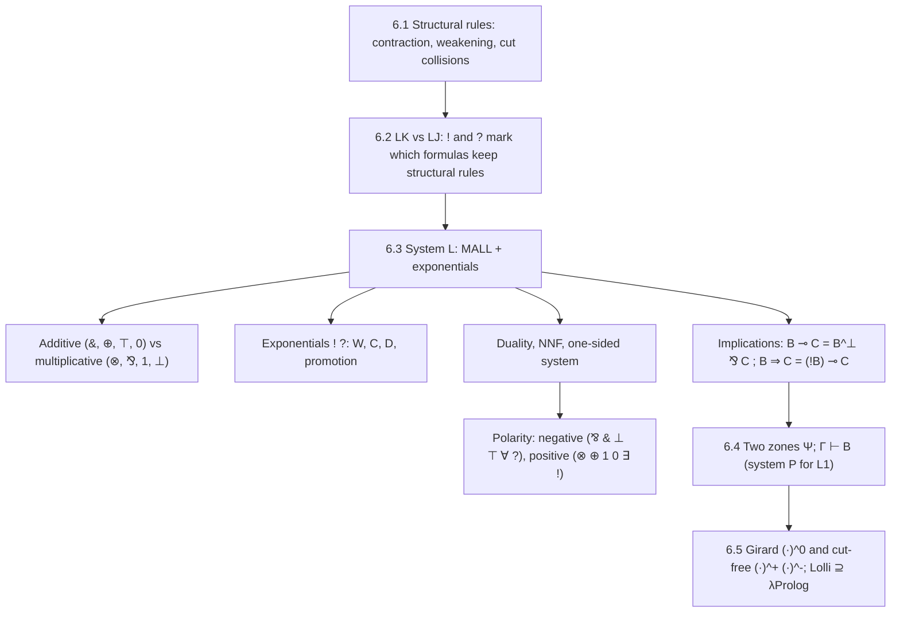

[[book-guidelines|↩ Back to guidelines]]

# Linear Logic

## 1. The problem linear logic solves

Chapter 5 gave a clean account of proof search for Prolog and $\lambda$Prolog (the fragment $\mathcal L_0=\{t,\wedge,\supset,\forall\}$). Miller opens Chapter 6 by listing three weaknesses of that account:

1. It only covers a fragment of intuitionistic logic, not a complete connective set.
2. It is single-conclusion only, so negation and De Morgan dualities cannot be used to reason about programs.
3. The dynamics of search are weak. In `fohh`, the left side of border sequents can only grow during search, and the right side only changes inside atoms. Sequents never evolve in rich ways, so a program cannot model state that changes.

Linear logic answers all three. It gives a multiple-conclusion calculus covering all connectives, and it lets the context *shrink* as well as grow, so a proof can consume resources.

The key observation is that the behavior of the **structural rules** (weakening $wL,wR$ and contraction $cL,cR$) is what makes proof search messy. Linear logic does not delete them. It moves them out of the sequent calculus's global rule set and onto individual formulas.

## 2. Why structural rules matter (Section 6.1)

Miller makes four points. Each is a "what breaks without this" argument for the design of linear logic.

**Controlling contraction improves search.** Delete the contraction rules from the unfocused classical and intuitionistic systems and the height of a cut-free proof is bounded by the number of connective occurrences in the endsequent. Provability then becomes decidable. Gentzen's decision procedure for propositional intuitionistic logic works by limiting contraction. The focused system $\Downarrow\mathcal L_0$ tames the structural rules too: $wL$ is built into `init`, and $cL$ is built into `decide` and $\supset L$.

**Invertible rules never need contraction.** The rule $\vee L$ is invertible (if the conclusion is provable, so are both premises), so $cL$ never has to be applied to a formula $B\vee C$. The rule $\wedge L$ is not invertible. A cut-free I-proof of $(p\wedge q)\supset(p\supset q\supset r)\supset r$ needs $cL$ on $p\wedge q$ to use both conjuncts. So contraction only matters on formulas whose introduction rule is non-invertible. That is an early hint of polarity (Section 4.5 below).

**Additive versus multiplicative.** A connective is *multiplicative* if one of its introduction rules splits the context between premises, and *additive* if the premises share the context. In LK and LJ you must choose one version per connective. Here $\wedge,\vee$ are additive and $\supset$ is multiplicative. With weakening and contraction available, the two versions are interderivable, so the choice is harmless. With weakening and contraction restricted, they behave differently, and you want both.

**Cut collides with structural rules.** Take $cut$ with a right premise ending in $cL$ on $C$. Cut elimination permutes the cut upward and duplicates the left premise:

$$\frac{\Gamma\vdash C\qquad \Gamma',C,C\vdash B}{\Gamma,\Gamma',C\vdash B}\ \text{cut}$$

In classical proofs the left premise might also end in $cR$, so the cut can move to either side. Cut elimination becomes nondeterministic. The worst case is cut against weakening. If $\Xi_1$ proves $\vdash B$ and $\Xi_2$ proves $\vdash B$, then $wR$ on one side and $wL$ on the other, followed by cut, can reduce to either $\Xi_1$ or $\Xi_2$. Entirely different proofs of the same formula result. Functional programming rests on *deterministic* cut elimination (normalization), so such systems are a poor foundation for it.

## 3. The origin story: LK versus LJ (Section 6.2)

Gentzen's LJ is LK restricted to at most one formula on the right. Miller restates this (Proposition 4.2) as two restrictions on a C-proof that keep every right side to exactly one formula:

1. No structural rules on the right: no $wR$, no $cR$.
2. The multiplicative rules $\supset L$ and `cut` must send the right-hand formula to the *right* premise only.

Read the $\supset L$ rule:

$$\frac{\Sigma::\Gamma_1\vdash\Delta_1,B\qquad \Sigma::C,\Gamma_2\vdash\Delta_2}{\Sigma::B\supset C,\Gamma_1,\Gamma_2\vdash\Delta_1,\Delta_2}\ \supset L$$

In an I-proof, $\supset L$ does two jobs at once. It introduces a connective *and* it dictates where a side formula goes. No other intuitionistic connective does this, so implication has hidden internal structure.

Linear logic exposes that structure. Structural rules survive only on the left in intuitionistic proofs, and only on some formulas. Linear logic marks exactly those formulas:

- $!B$ ("bang") on the left can be weakened and contracted.
- $?B$ ("why not") on the right can be weakened and contracted.

No other formula occurrence gets structural rules. This gives encodings:

- C-sequents become $!B_1,\ldots,!B_n\vdash ?C_1,\ldots,?C_m$.
- I-sequents become $!B_1,\ldots,!B_n\vdash B_0$, where $B_0$ is not a top-level $?$.

Intuitionistic implication then decomposes as $B\supset C \;\leadsto\; (!B)\multimap C$. The restriction on $\supset L$ is explained. The right-premise rule for $!R$ requires the context to be entirely $!$'d on the left and $?$'d on the right. With [[Automata-Encoded-as-Multisets#The encoding|the encoding]] above, the right-hand side has exactly one non-$?$ formula, so $\Delta_1$ must be empty and the side formula lands in the right premise.

## 4. Resource reading and the sequent system $L$ (Section 6.3)

### 4.1 First principles: formulas as resources

Classical logic reads a formula as true or false, and that reading allows free reuse. Linear logic reads $\Gamma\vdash B$ as "from the resources $\Gamma$ I can produce $B$", and each hypothesis is consumed once. Miller's example is a font shop.

- **$\otimes$ (tensor)** is *both at once*. If $\Gamma_1$ built font $B_1$ and $\Gamma_2$ built $B_2$, the pair $B_1\otimes B_2$ costs $\Gamma_1,\Gamma_2$ together. Fonts costing 3 and 7 give a pair costing 10. The buyer gets both fonts.
- **$\&$ (with)** is *your choice of one*. If each font needs the same $\Gamma$, then $B_1\& B_2$ costs just $\Gamma$. The buyer picks one font, and the other becomes inaccessible. Two fonts at 5 each still cost 5.
- **$!B$** is an unbounded supply of $B$. The promotion rule $!R$ is the "unlimited french fries" argument. A restaurant can promise unlimited fries if the cook has unlimited oil, salt, and potatoes and can make one fry.

Without this distinction you cannot say "I have a coin" differently from "I have a coin and may spend it as often as I like." Classical logic collapses the two, and that collapse is why it cannot model state.

### 4.2 The connectives

The proof system $L$ is built from Figures 6.1-6.4 of the book: propositional rules, identity rules, quantifier rules, and exponential rules. Binary connectives have type $o\to o\to o$, units have type $o$, negation and the exponentials have type $o\to o$, and $\forall_\tau,\exists_\tau$ have type $(\tau\to o)\to o$.

**MALL** (multiplicative additive linear logic) is the fragment from the propositional and identity rules. Each classical connective splits in two:

| Classical | Additive | Multiplicative |
|---|---|---|
| $t$ | $\top$ (top) | $1$ (one) |
| $f$ | $0$ (zero) | $\bot$ (bottom) |
| $\wedge$ | $\&$ (with) | $\otimes$ (tensor) |
| $\vee$ | $\oplus$ (o-plus) | $\mathbin{⅋}$ (par) |

Units: $1$ for $\otimes$, $\top$ for $\&$, $\bot$ for $\mathbin{⅋}$, $0$ for $\oplus$. Negation $(\cdot)^\perp$ is a first-class connective with the same rules as Gentzen's.

The key two-sided rules, with $\Sigma$ the signature, are:

$$\frac{\Sigma::\Gamma_1\vdash B,\Delta_1\quad \Sigma::\Gamma_2\vdash C,\Delta_2}{\Sigma::\Gamma_1,\Gamma_2\vdash B\otimes C,\Delta_1,\Delta_2}\ \otimes R
\qquad
\frac{\Sigma::\Gamma\vdash B,\Delta\quad \Sigma::\Gamma\vdash C,\Delta}{\Sigma::\Gamma\vdash B\mathbin{\&} C,\Delta}\ \&R$$

$$\frac{\Sigma::\Gamma\vdash B,C,\Delta}{\Sigma::\Gamma\vdash B\mathbin{⅋}C,\Delta}\ ⅋R
\qquad
\frac{\Sigma::\Gamma,B_1,B_2\vdash\Delta}{\Sigma::\Gamma,B_1\otimes B_2\vdash\Delta}\ \otimes L$$

Because MALL has no weakening or contraction, the additive and multiplicative versions are *not* interchangeable. Provability of MALL formulas is PSPACE-complete (Lincoln et al. 1992), and adding first-order quantifiers keeps it PSPACE-complete. Two sanity examples from the book: $\vdash 1\mathbin{⅋}1$ is not provable, and neither is its negation $\bot\otimes\bot$. The sequent $\vdash p\otimes q,\ p^\perp\otimes q,\ p\otimes q^\perp,\ p^\perp\otimes q^\perp$ is not provable even though every atom has a matching dual. The resources cannot be split consistently.

### 4.3 Exponentials: linear logic is MALL plus $!$ and $?$

Full linear logic adds the quantifiers and the exponentials. Each exponential has four rules (Figure 6.4):

$$\frac{\Gamma\vdash\Delta}{\Gamma,!B\vdash\Delta}\ !W
\qquad
\frac{\Gamma,!B,!B\vdash\Delta}{\Gamma,!B\vdash\Delta}\ !C
\qquad
\frac{\Gamma,B\vdash\Delta}{\Gamma,!B\vdash\Delta}\ !D
\qquad
\frac{!\Gamma\vdash B,?\Delta}{!\Gamma\vdash !B,?\Delta}\ !R$$

and the duals $?W$, $?C$, $?D$ and $?L$. In words:

- $W$ and $C$ are weakening and contraction, restricted to marked formulas.
- **Dereliction** ($!D$, $?D$), read bottom-up, says a formula may give up its right to be copied or dropped.
- **Promotion** ($!R$, $?L$), read bottom-up, says you may *earn* that right by proving the formula from a context where everything already has it.

Equivalences the book asks the reader to prove (Exercise 6.3) look like exponent laws, $x^{m+n}=x^m\times x^n$:

$$!\top\dashv\vdash 1,\qquad !(B\mathbin{\&}C)\dashv\vdash !B\otimes !C,\qquad ?0\dashv\vdash\bot,\qquad ?(B\oplus C)\dashv\vdash ?B\mathbin{⅋}?C.$$

Prefix sequences of $!$ and $?$ satisfy $\pi\pi B\dashv\vdash \pi B$, so up to equivalence only seven prefixes exist: empty, $!$, $?$, $!?$, $?!$, $!?!$, $?!?$ (Exercise 6.4).

Two more facts shape later chapters:

- **Uniqueness of connectives.** If you add a second tensor $\hat\otimes$ with the same rules as $\otimes$, then $B\otimes C\dashv\vdash B\mathbin{\hat\otimes}C$. The rules *define* the connective uniquely. This holds for every connective except the exponentials.
- **Sanity check for $!$.** With $B = p\otimes !(p\multimap p\otimes p)\otimes !(p\multimap 1)$, both $B\vdash B\otimes B$ and $B\vdash 1$ are provable. A single $p$ plus reusable "duplicate" and "delete" rules acts as a copyable and deletable resource (Exercise 6.12).

### 4.4 Duality, negation normal form, and the one-sided system

De Morgan duality is total in linear logic, exponentials and quantifiers included:

| connective | $\top$ | $\&$ | $1$ | $\otimes$ | $\bot$ | $⅋$ | $0$ | $\oplus$ | $!$ | $?$ | $\forall$ | $\exists$ |
|---|---|---|---|---|---|---|---|---|---|---|---|---|
| dual | $0$ | $\oplus$ | $\bot$ | $⅋$ | $1$ | $\otimes$ | $\top$ | $\&$ | $?$ | $!$ | $\exists$ | $\forall$ |

Examples: $(B\mathbin{⅋}C)^\perp\dashv\vdash B^\perp\otimes C^\perp$, $(B\mathbin{\&}C)^\perp\dashv\vdash B^\perp\oplus C^\perp$, $(?B)^\perp\dashv\vdash !(B^\perp)$, and $\top^\perp\dashv\vdash 0$. Every formula has an equivalent *negation normal form* where negation applies only to atoms. That permits the **one-sided system** of Figure 6.5, with sequents $\Sigma::\vdash\Delta$ and about half the rules. Here $B^\perp$ in `init` and `cut` is no longer a connective but an operator that negates and renormalizes:

$$\frac{}{\Sigma::\vdash B,B^\perp}\ \text{init}
\qquad
\frac{\Sigma::\vdash B,\Delta\quad\Sigma::\vdash B^\perp,\Delta'}{\Sigma::\vdash\Delta,\Delta'}\ \text{cut}$$

Miller uses two-sided sequents in most of the book and the one-sided one only sparingly.

### 4.5 Polarity

In MALL, the right rule of a connective is invertible iff the left rule (or the right rule of its De Morgan dual) is *not*. This sorts connectives:

- **Negative** (right rule invertible): $\bot,\top,⅋,\&,\forall$, and $?$.
- **Positive** (left rule invertible): $1,0,\otimes,\oplus,\exists$, and $!$.

A second reading, which Miller finds more illuminating, is *oracle dependence*. A right rule for a positive connective needs outside information:

- $\oplus R$ must be told which disjunct to pick.
- $\otimes R$ must be told how to split the context.
- $1R$ must know the context is empty.
- $\exists R$ must be given a witness term.
- $!R$ needs the guarantee that the whole context is marked.

Negative right rules just fire. Atoms are conventionally negative (following Andreoli 1992), which connects polarity to the uniform proofs of Chapter 5.

**What breaks without polarity.** You get no principled answer to "which rule do I try first in search?" Negative connectives can be decomposed eagerly without losing completeness. Positive ones require choice (backtracking). That is exactly the split that focused proofs formalize in the next chapters.

Polarity is also tied to when $B\dashv\vdash !B$. If all atoms and negative connectives in $B$ sit under a $!$, then $B\dashv\vdash !B$ (Exercise 6.7). Positive connectives preserve "being a bang" (Exercise 6.6).

### 4.6 Linear and intuitionistic implication

Two implications are added as proper connectives:

$$B\multimap C\;\equiv\;B^\perp\mathbin{⅋}C\qquad\qquad B\Rightarrow C\;\equiv\;(!B)\multimap C$$

Both are multiplicative and negative, since both are built on $⅋$. The rules for $\multimap$ are:

$$\frac{\Sigma::\Gamma_1\vdash B,\Delta_1\quad\Sigma::\Gamma_2,C\vdash\Delta_2}{\Sigma::\Gamma_1,\Gamma_2,B\multimap C\vdash\Delta_1,\Delta_2}\ \multimap L
\qquad
\frac{\Sigma::\Gamma,B\vdash C,\Delta}{\Sigma::\Gamma\vdash B\multimap C,\Delta}\ \multimap R$$

Write $B\mathbin{\circ\!\!-\!\!\circ} C$ for $(B\multimap C)\mathbin{\&}(C\multimap B)$. Since $\&R$ and $⅋R$ are invertible (Exercise 6.8), this formula is provable iff $B\dashv\vdash C$. Curry/uncurry laws hold, for example $(B\otimes C)\multimap H\dashv\vdash B\multimap C\multimap H$, $(B\oplus C)\multimap H\dashv\vdash (B\multimap H)\mathbin{\&}(C\multimap H)$, and $(\exists x.Bx)\multimap H\dashv\vdash\forall x.(Bx\multimap H)$.

Negation becomes an abbreviation: $B^\perp \equiv B\multimap\bot$.

**The rule-shape problem.** Naive rules for $\Rightarrow$ would mention $!B$ in the premise:

$$\frac{\Gamma\vdash !B,\Delta_1\ \ \Gamma_2,C\vdash\Delta_2}{\Gamma_1,\Gamma_2,B\Rightarrow C\vdash\Delta_1,\Delta_2}$$

But a good sequent-calculus rule has exactly one new connective in the conclusion and none introduced in the premises. The $!$ in the premise violates this, as do $!C$ and $!R$. Miller's fix is **zones** (Section 6.4), which keep the structural bookkeeping in the shape of the sequent instead of in connectives.

## 5. Two zones: the bridge to logic programming (Section 6.4)

For $\mathcal L_1=\{\top,\&,\multimap,\Rightarrow,\forall\}$ the proof system $P$ (Figure 6.6) uses sequents

$$\Sigma::\Psi;\Gamma\vdash B,$$

where $\Psi$ is the **left-unbounded zone** (reusable) and $\Gamma$ the **left-bounded zone** (used exactly once). The informal meaning is the linear sequent $!\Psi,\Gamma\vdash B$. Selected rules:

$$\frac{\Sigma::\Psi,B;\Gamma,B\vdash C}{\Sigma::\Psi,B;\Gamma\vdash C}\ \text{absorb}
\qquad
\frac{\Sigma::\Psi;\Gamma\vdash B\quad\Sigma::\Psi;\Gamma',C\vdash E}{\Sigma::\Psi;\Gamma,\Gamma',B\multimap C\vdash E}\ \multimap L$$

$$\frac{\Sigma::\Psi;\cdot\vdash B\quad\Sigma::\Psi;\Gamma,C\vdash E}{\Sigma::\Psi;\Gamma,B\Rightarrow C\vdash E}\ \Rightarrow L
\qquad
\frac{\Sigma::\Psi,B;\Gamma\vdash C}{\Sigma::\Psi;\Gamma\vdash B\Rightarrow C}\ \Rightarrow R$$

Multiplicative rules behave hybrid: a formula in $\Psi$ appears in *all* premises (justified by contraction on the unbounded zone), while a formula in $\Gamma$ goes to exactly one. This is the linear version of "copy the shared program, split the resources." Now every rule introduces one connective, and the rules $\Rightarrow L$ and $cut_!$ require an empty bounded zone in a premise, which matches the $!R$ promotion condition.

This section is only touched here because it is a hand-off to the next topic (multi-zone sequents and Lolli/Forum). It is the reason linear logic is useful for *programming* and not only for semantics.

## 6. Embedding intuitionistic logic and Prolog (Section 6.5)

The language $\langle\mathcal L_1,\mathcal L_1,\vdash_L\rangle$ is **Lolli**: $\lambda$Prolog's core plus $\multimap$. To show it extends $\mathcal L_0$, Miller gives translations from $\{t,\wedge,\supset,\forall\}$.

**Girard's translation** preserves provability *and proofs*:

$$\begin{aligned}
(A)^0&=A\ (A\text{ atomic}),\quad (t)^0=\top,\quad (B_1\wedge B_2)^0=(B_1)^0\mathbin{\&}(B_2)^0,\\
(B_1\supset B_2)^0&=(B_1)^0\Rightarrow(B_2)^0,\quad(\forall x.B)^0=\forall x.(B)^0.
\end{aligned}$$

**The cut-free translations** $(\cdot)^+$ and $(\cdot)^-$ are valid when only cut-free proofs are considered:

$$\begin{aligned}
(t)^+&=1, & (t)^-&=\top,\\
(B_1\wedge B_2)^+&=(B_1)^+\otimes(B_2)^+, & (B_1\wedge B_2)^-&=(B_1)^-\mathbin{\&}(B_2)^-,\\
(B_1\supset B_2)^+&=(B_1)^-\Rightarrow(B_2)^+, & (B_1\supset B_2)^-&=(B_1)^+\multimap(B_2)^-,\\
(\forall x.B)^{\pm}&=\forall x.(B)^{\pm}, & (A)^{\pm}&=A.
\end{aligned}$$

When positive $\vee$ and $\exists$ are allowed, add $(B_1\vee B_2)^+=(B_1)^+\oplus(B_2)^+$ and $(\exists x.B)^+=\exists x.(B)^+$.

**Proposition 6.15.** For formulas over $t,\wedge,\supset,\forall$: $\Sigma::\Delta\vdash B$ has an I-proof iff $\Sigma::\Delta^-;\cdot\vdash B^+$ has a cut-free proof in $\Downarrow\mathcal L_1$. It follows from the more general Proposition 7.18. Essentially, $\Downarrow\mathcal L_0$-proofs *are* $\Downarrow\mathcal L_1$-proofs of translated sequents.

The practical consequence is syntax design. A Prolog clause $A_0 :- A_1,\ldots,A_n$ stands for $(A_1\wedge\cdots\wedge A_n)\supset A_0$ and, under the negative translation, becomes

$$(A_1\otimes\cdots\otimes A_n)\multimap A_0.$$

So the **comma is $\otimes$** and **`:-` is the converse of $\multimap$**. Existing Prolog and $\lambda$Prolog programs keep their meaning inside Lolli. Another example: the natural-deduction rule for implication, written in $\lambda$Prolog as `prov (A imp B) :- prov A => prov B`, translates to $\forall A.\forall B.((\text{prov}(A)\Rightarrow\text{prov}(B))\multimap\text{prov}(A\ \text{imp}\ B))$. So the `=>` symbol denotes $\Rightarrow$.

## 7. Grounding in code

### 7.1 Rust: formulas, duals, and polarity

This is the first piece of a checker. The `dual` function is De Morgan negation normal form, and `polarity` is the oracle-dependence classification.

```rust
#[derive(Clone, Debug, PartialEq)]
enum F {
    Atom(&'static str),      // positive atom p
    NegAtom(&'static str),   // p^perp
    Top, Zero, One, Bot,
    With(Box<F>, Box<F>),    // &
    Plus(Box<F>, Box<F>),    // (+)
    Tensor(Box<F>, Box<F>),  // (x)
    Par(Box<F>, Box<F>),     // par
    Bang(Box<F>),
    Quest(Box<F>),
    // Quantifiers omitted: they need binders (see Substitution notes).
}

#[derive(PartialEq, Debug)]
enum Polarity { Positive, Negative }

fn dual(f: &F) -> F {
    use F::*;
    match f {
        Atom(p) => NegAtom(p),
        NegAtom(p) => Atom(p),
        Top => Zero, Zero => Top,
        One => Bot,  Bot => One,
        With(a, b)   => Plus(Box::new(dual(a)), Box::new(dual(b))),
        Plus(a, b)   => With(Box::new(dual(a)), Box::new(dual(b))),
        Tensor(a, b) => Par(Box::new(dual(a)), Box::new(dual(b))),
        Par(a, b)    => Tensor(Box::new(dual(a)), Box::new(dual(b))),
        Bang(a)  => Quest(Box::new(dual(a))),
        Quest(a) => Bang(Box::new(dual(a))),
    }
}

fn polarity(f: &F) -> Polarity {
    use F::*;
    match f {
        One | Zero | Tensor(..) | Plus(..) | Bang(_) => Polarity::Positive,
        // Atoms are negative by Andreoli's convention.
        _ => Polarity::Negative,
    }
}

/// Linear implication is just a definition: B -o C = B^perp par C.
fn lolli(b: &F, c: F) -> F { F::Par(Box::new(dual(b)), Box::new(c)) }
```

Duality is an involution and flips polarity. Here is a check you can add as a test (atoms and `NegAtom` both come out negative in this encoding because of the atom convention, so the flip law holds only for non-atoms):

```rust
#[test]
fn dual_flips_polarity_on_connectives() {
    let t = F::Tensor(Box::new(F::Atom("a")), Box::new(F::One));
    assert_eq!(polarity(&t), Polarity::Positive);
    assert_eq!(polarity(&dual(&t)), Polarity::Negative);
    assert_eq!(dual(&dual(&t)), t);
}
```

### 7.2 Rust: why $\otimes R$ is the "oracle" rule

Reading $\otimes R$ bottom-up, a prover must *guess* how to split the context. This is where positive-connective nondeterminism lives. Contexts are multisets, so enumerate subsets.

```rust
/// All ways to split a multiset into (left, right). 2^n splits.
fn splits<T: Clone>(ctx: &[T]) -> Vec<(Vec<T>, Vec<T>)> {
    let n = ctx.len();
    (0..(1u32 << n))
        .map(|mask| {
            let mut l = Vec::new();
            let mut r = Vec::new();
            for (i, x) in ctx.iter().enumerate() {
                if mask >> i & 1 == 1 { l.push(x.clone()) } else { r.push(x.clone()) }
            }
            (l, r)
        })
        .collect()
}
```

The $2^n$ blowup is why Section 6.6 of the book (the next topic area) introduces *lazy splitting*: pass the whole context into one premise, let it consume what it needs, and hand the remainder to the other premise. Contrast `&R`, which copies the same $\Gamma$ to both premises and needs no guessing.

### 7.3 Lean: the formulas, and an honest note on resource tracking

Lean's dependent type theory has no built-in linear logic. Lean's context is a set where variables can be used freely, which is the structural-rule behavior linear logic removes. What Lean *can* do is encode the object logic. Here is the one-sided system's formula type and its negation normal form map, mirroring Section 6.3.4:

```lean
inductive LF where
  | atom  : String → LF
  | natom : String → LF
  | top | zero | one | bot : LF
  | with_  : LF → LF → LF
  | plus   : LF → LF → LF
  | tensor : LF → LF → LF
  | par    : LF → LF → LF
  | bang   : LF → LF
  | quest  : LF → LF

def LF.dual : LF → LF
  | .atom p => .natom p      | .natom p => .atom p
  | .top => .zero            | .zero => .top
  | .one => .bot             | .bot => .one
  | .with_ a b => .plus a.dual b.dual
  | .plus a b  => .with_ a.dual b.dual
  | .tensor a b => .par a.dual b.dual
  | .par a b    => .tensor a.dual b.dual
  | .bang a => .quest a.dual | .quest a => .bang a.dual

theorem LF.dual_dual : ∀ f : LF, f.dual.dual = f := by
  intro f
  induction f <;> simp [LF.dual, *]
```

A one-sided derivability relation over multisets is then an inductive predicate whose constructors are exactly the rules of Figure 6.5, with `tensor` splitting the context via `List.Perm`-style append and `with_` duplicating it. This is the Lean-side analogue of the Rust checker above, and it is how one would mechanize the metatheory the book proves on paper.

Closer to the real thing: Lean's `Type` universe behaves like the *intuitionistic* world with $!$ implicitly everywhere. That matches the book's reading $B\supset C\leadsto(!B)\multimap C$.

### 7.4 Python: lazy splitting in five lines (preview)

```python
def prove_tensor(ctx, goals):
    """Prove goals[0] (x) goals[1] ... by consuming ctx linearly; return leftover or None."""
    for g in goals:
        if g not in ctx:
            return None
        ctx = [c for i, c in enumerate(ctx) if i != ctx.index(g)]
    return ctx
```

The leftover list is the "output context" that Section 6.6 of the book formalizes as an IO proof system. This is only a sketch, and it ignores `!`, `&`, and connective structure.

## 8. Map of the section



## 9. Synthesis

**Depends on.** The sequent calculi and structural rules of Chapters 3-4 (the I- and C-proof systems), cut admissibility (Chapter 4), and the uniform-proof and backchaining analysis of $\mathcal L_0$ and `fohh` from Chapter 5.

**Used by.** The rest of Chapter 6 (multi-zone sequents, Lolli, Forum), Chapter 7's [[Formal-Metatheory-of-Focused-Linear-Logic|formal metatheory of focused linear logic]] (including the general Proposition 7.18 behind Prop. 6.15), and the applications in Chapters 10-13. Those include automata as multisets, Horn-clause collection analysis, security protocols, and operational semantics. Polarity is the concept that all of these reuse.

**Open questions flagged by the book.** Why do I-proofs' shape motivate $!$ and $?$ and make $\supset L$ special? What does polarity say about which right rules need an oracle? Why do two zones let $\Rightarrow$ and $\multimap$ be proper connectives with one-connective-per-rule introduction rules? Each is answered in this article's Sections 3, 4.5, and 5.

### Where this leads

Next comes the multiple-conclusion, four-zone focused system $\Downarrow\mathcal L_2$ for Forum, where $\bot,⅋,?$ are added and the bounded zone can change arbitrarily during search. That is the point at which sequents genuinely compute (a switch toggling off to on, a counter incrementing).

### Bearing on the project goals

Focus Area: **Automated Reasoning** (`automated-reasoning`), with linear logic named explicitly in that area's scope.

- **Proof search and clause simplification.** Polarity and [[Sequent-Calculus-Proof-Systems#Invertibility|invertibility]] are the engine behind a *focused* prover. Eagerly apply negative (invertible) rules, and branch only on positive ones. The `splits` function in 7.2 is the context-splitting cost that a Rust proof search must avoid, and the book's lazy-splitting answer is in the next topic area.
- **Proof certificates and trusted kernels.** The rule of thumb "each rule introduces exactly one connective; structural behavior lives in the sequent's shape" is the same discipline that keeps a small trusted kernel auditable. Two-zone sequents are a clean representation of a context with reusable and consumed hypotheses.
- **Judgments and contexts (workbench thread).** $\Psi;\Gamma$ is a context with two usage disciplines, the proof-theoretic ancestor of a type-checking context that tracks linear or affine usage. Rust's ownership is the nearest everyday analogue: a `T` moved is a linear resource, and `Rc<T>` or `Clone` plays the role of $!$.
- **Hoare logic and symbolic execution.** Consuming and producing resources while proving is the proof-theoretic shape that separation-logic-style reasoning later uses. The book itself does not develop that link, so treat it as a pointer and not as content from these pages.
- **Metavariables and unification.** Not engaged here. The quantifier rules use eigenvariables and substitution exactly as in classical and intuitionistic logic, so nothing new surfaces for the elaborator in this section.
