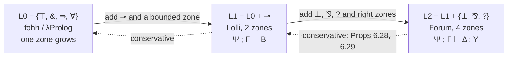

[[book-guidelines|↩ Back to guidelines]]

# Multi-Zone Sequents and Linear Logic Programming Languages

## 1. The problem: giving a logic program a state

Chapter 5 gave Prolog and $\lambda$Prolog a proof-theoretic meaning: a program is a set of formulas, a query is a goal, and running is the search for a cut-free proof. It also exposed a limitation. In the fohh fragment, the left context of a sequent only grows during search. Hypotheses are added by $\supset$ and $\forall$ on the right of the turnstile, and nothing ever leaves. A program in that setting has no way to say "this resource is used up" or "the switch is now on, not off". Computation can accumulate facts, but it cannot update them.

Linear logic is the fix, because its contexts are resources that can be consumed. But linear logic has a design problem of its own. Its sequents have one flat left context, and the formulas that may be reused (the ones under $!$) are marked inside that context. Miller wants three things at once:

1. keep goal-directed search and backchaining (the machinery of uniform and focused proofs);
2. get both a reusable implication $\Rightarrow$ and a resource-consuming implication $\multimap$ as honest connectives, each with a single introduction rule whose conclusion mentions one connective occurrence and whose premises mention none;
3. let the context change in arbitrary ways during search, so that it can model state.

The trick that delivers all three is to stop treating the left context as one multiset and split it into **zones**. Everything in this note (Lolli, Forum, the lazy-splitting resource model, the conservativity results, the subexponential remark) follows from that single bookkeeping move.

**What breaks without it.** If you keep the flat context $!B_1,\ldots,!B_n,C_1,\ldots,C_m$, the introduction rule for $B\supset C=(!B)\multimap C$ has to explain the $!$ in the middle of a multiset. That rule is the odd one out in the sequent calculus: it needs a premise with an empty linear context (Chapter 6 calls $\supset$L "special"). Putting $!$-formulas into their own zone makes that specialness a visible, local property of the rule.

## 2. Two zones on the left: $\Sigma :: \Psi;\Gamma \vdash B$

A sequent now has the form

$$\Sigma :: \Psi;\ \Gamma \vdash B$$

where $\Sigma$ is the signature of eigenvariables (we ignore it below, as Miller's own prose mostly does), and $\Psi$, $\Gamma$ are multisets of formulas.

- $\Psi$ is the **left-unbounded zone**: formulas that may be used any number of times, including zero.
- $\Gamma$ is the **left-bounded zone**: formulas that must each be used exactly once.

Its informal reading in linear logic is
$$!B_1,\ldots,!B_n,\ C_1,\ldots,C_m \vdash E \qquad\text{for}\qquad B_1,\ldots,B_n ;\ C_1,\ldots,C_m \vdash E.$$

So the zone *is* the exponential. Being in $\Psi$ means "wearing a $!$", but the $!$ is no longer a connective you have to take apart. It is a position.

### 2.1 The proof system $P$ for $\mathcal L_1=\{\top,\&,\multimap,\Rightarrow,\forall\}$

Let $\mathcal L_1$ be the connectives $\{\top,\&,\multimap,\Rightarrow,\forall\}$. Miller's proof system $P$ (Figure 6.6) has these rules, written here without the signature:

$$\frac{}{\Psi;A\vdash A}\ init \qquad \frac{\Psi,B;\ \Gamma,B\vdash C}{\Psi,B;\ \Gamma\vdash C}\ absorb \qquad \frac{}{\Psi;\Gamma\vdash\top}\ \top R$$

$$\frac{\Psi;\Gamma\vdash B \quad \Psi;\Gamma\vdash C}{\Psi;\Gamma\vdash B\&C}\ \&R \qquad \frac{\Psi;\Gamma,B_i\vdash C}{\Psi;\Gamma,B_1\&B_2\vdash C}\ \&L\ (i=1,2)$$

$$\frac{\Psi;\Gamma\vdash B \quad \Psi;\Gamma',C\vdash E}{\Psi;\Gamma,\Gamma',B\multimap C\vdash E}\ \multimap L \qquad \frac{\Psi;\Gamma,B\vdash C}{\Psi;\Gamma\vdash B\multimap C}\ \multimap R$$

$$\frac{\Psi;\cdot\vdash B \quad \Psi;\Gamma,C\vdash E}{\Psi;\Gamma,B\Rightarrow C\vdash E}\ \Rightarrow L \qquad \frac{\Psi,B;\Gamma\vdash C}{\Psi;\Gamma\vdash B\Rightarrow C}\ \Rightarrow R$$

plus $\forall L$, $\forall R$ and the two cuts $cut_l$ and $cut_!$ (the second needs its cut-formula's proof to have an empty bounded zone, just as $\Rightarrow L$ does).

Read the rules as a table of what each does to the two zones:

| Rule | what happens to $\Psi$ | what happens to $\Gamma$ |
|---|---|---|
| $\&R$, $\&L$, $\top R$, $\forall$ (additive) | copied to all premises | copied to all premises |
| $\multimap L$ (multiplicative) | **copied** to both premises | **split** between premises |
| $\Rightarrow L$ | copied to both | goes to the right premise only; the left premise gets $\cdot$ |
| $\multimap R$ | unchanged | the antecedent $B$ is **added** to $\Gamma$ |
| $\Rightarrow R$ | the antecedent $B$ is **added** to $\Psi$ | unchanged |
| $absorb$ | $B$ stays | a **copy** of $B$ is moved into $\Gamma$ |

Three observations about this table matter more than any individual rule.

**The hybrid multiplicative behavior is justified by contraction.** In $\multimap L$, a formula in $\Psi$ appears in both premises while a formula in $\Gamma$ goes to exactly one. This looks ad hoc until you replay it in plain linear logic: from $!\Psi,\Gamma_1\vdash B$ and $!\Psi,\Gamma_2,C\vdash E$ the flat $\multimap L$ rule gives $!\Psi,!\Psi,\Gamma_1,\Gamma_2,B\multimap C\vdash E$, and then $!C$ (contraction) collapses the duplicated $!\Psi$. Having a zone for $!$-formulas is exactly having contraction available there.

**Every rule has the one-connective property.** The conclusion mentions one occurrence of a connective, and the premises mention no connectives of that kind at the top level. This is what Miller meant by "proper connectives": $\Rightarrow$ and $\multimap$ each get a single rule per side, with no $!$ to peel apart.

**$absorb$ is contraction plus dereliction for $!$ in one step.** It is how a reusable formula becomes a one-shot formula so that it can be consumed from $\Gamma$.

Miller states the correspondence with unfocused linear logic as Proposition 6.13. Define $B^\diamond$ by replacing $C_1\Rightarrow C_2$ with $(!C_1)^\perp ⅋ C_2$ and $C_1\multimap C_2$ with $C_1^\perp ⅋ C_2$. Then $\Psi;\Gamma\vdash B$ has a $P$-proof if and only if $!(\Psi^\diamond),\Gamma^\diamond\vdash B^\diamond$ has an $L$-proof. The forward direction is an easy induction. The converse is not proved here: it falls out of the completeness of the focused system $\Downarrow\mathcal L_2$ in Chapter 7 (see [[Linear-Logic]] for the base calculus $L$).

## 3. Focusing the two-zone system: backchaining with linear contexts

Proof system $P$ is not the right shape for programming: a left rule can fire on any formula in any zone. As in the Chapter 5 treatment of fohh, Miller adds a **focus** to force backchaining. The sequent form $\Psi;\Gamma\Downarrow D\vdash A$ marks one designated formula $D$, and left rules only apply to it. Two decide rules start a focus:

$$\frac{\Psi,D;\ \Gamma\Downarrow D\vdash A}{\Psi,D;\ \Gamma\vdash A}\ decide_! \qquad \frac{\Psi;\ \Gamma\Downarrow D\vdash A}{\Psi;\ \Gamma,D\vdash A}\ decide_l$$

The first leaves $D$ in $\Psi$: a program clause, reusable. The second **removes** $D$ from $\Gamma$: a linear fact, consumed by choosing it. The system is called $\Downarrow\mathcal L_1$ (Figure 6.7).

Equivalently, the left rules collapse into one **backchaining** rule $BC$ (Figure 6.8). For a clause $B$, write $\|B\|_\Sigma$ for the set of triples $\langle\Psi',\Gamma',B'\rangle$ obtained by walking down $B$ and sorting the antecedents by connective: $\&$ selects a branch, $\Rightarrow$ puts its antecedent in $\Psi'$ (an *unbounded subgoal*), $\multimap$ puts its antecedent in $\Gamma'$ (a *bounded subgoal*), and $\forall$ instantiates. If $A$ is atomic and $\langle\{B_1..B_n\},\{C_1..C_m\},A\rangle\in\|B\|_\Sigma$, then

$$\frac{\Psi;\cdot\vdash B_1\ \cdots\ \Psi;\cdot\vdash B_n \qquad \Psi;\Gamma_1\vdash C_1\ \cdots\ \Psi;\Gamma_m\vdash C_m}{\Psi;\Gamma_1,\ldots,\Gamma_m,B\vdash A}\ BC$$

The unbounded subgoals are proved with an **empty** bounded zone. The bounded subgoals share the bounded zone among them, partitioned. Proposition 6.14 says $\Downarrow\mathcal L_1$ and $\Downarrow\mathcal L_1'$ (with $BC$) prove the same sequents.

### 3.1 Why this is a better dynamics than fohh

In a fohh proof, every sequent had the form "same signature plus new constants, left side plus new hypotheses". In $\Downarrow\mathcal L_1$ every sequent has the form $\Sigma,\Sigma';\Psi,\Psi';\Gamma'\vdash G'$. The signature and $\Psi$ still only grow, but $\Gamma'$ is **unconstrained**: formulas present at the root may be gone higher up, and new ones may appear. Miller's own summary is that the bounded zone can represent "the state of a computation, or a switch that is off but later on".

## 4. Lolli: $\langle\mathcal L_1,\mathcal L_1,\vdash_L\rangle$

The abstract logic programming language $\langle\mathcal L_1,\mathcal L_1,\vdash_L\rangle$ (clauses and goals both from $\mathcal L_1$, with linear-logic provability) is called **Lolli**, after the lollipop $\multimap$. It looks like $\lambda$Prolog with $\multimap$ added, so the first obligation is to show that the old programs still mean the same thing.

### 4.1 Embedding fohh

Girard's translation of intuitionistic logic into linear logic preserves provability and proofs. On $\{t,\wedge,\supset,\forall\}$:
$$(t)^0=\top,\quad (B_1\wedge B_2)^0=(B_1)^0\&(B_2)^0,\quad (B_1\supset B_2)^0=(B_1)^0\Rightarrow(B_2)^0,\quad (\forall x.B)^0=\forall x.(B)^0.$$
This is the "rename the connectives" translation: it maps $\supset$ to $\Rightarrow$, and $\wedge$ to the additive $\&$.

If you only care about **cut-free** proofs, there is a second, polarity-aware pair of translations $(\cdot)^+$ and $(\cdot)^-$ (negative for clauses on the left, positive for goals on the right):

| intuitionistic | $(\cdot)^+$ | $(\cdot)^-$ |
|---|---|---|
| $t$ | $1$ | $\top$ |
| $B_1\wedge B_2$ | $(B_1)^+\otimes(B_2)^+$ | $(B_1)^-\&(B_2)^-$ |
| $B_1\supset B_2$ | $(B_1)^-\Rightarrow(B_2)^+$ | $(B_1)^+\multimap(B_2)^-$ |
| $\forall x.B$ | $\forall x.(B)^+$ | $\forall x.(B)^-$ |

(and $\oplus$, $\exists$ in the positive translation if the Harrop formulas use $\vee,\exists$). Proposition 6.15: $\Sigma::\Delta\vdash B$ has an I-proof iff $\Sigma::\Delta^-;\cdot\vdash B^+$ has a cut-free $\Downarrow\mathcal L_1$-proof. This is the translation that fixes Lolli's concrete syntax:

- a Prolog clause $A_0 \mathrel{:\!-} A_1,\ldots,A_n$ is $(A_1\otimes\cdots\otimes A_n)\multimap A_0$: **the comma is $\otimes$ and $:-$ is the converse of $\multimap$**;
- `=>` is $\Rightarrow$, `-o` is $\multimap$, `<=` is the converse of $\Rightarrow$, `&` is $\&$, `erase` is $\top$ (Section 8.2).

A nice consequence from Section 6.5: the natural-deduction rule for implication introduction, written as a provability predicate, becomes
$$\forall A.\forall B.\big((prov(A)\Rightarrow prov(B))\multimap prov(A\ imp\ B)\big).$$
The three-vertical-dots hypothetical becomes $\Rightarrow$ (reusable hypothesis) and the horizontal bar becomes $\multimap$.

### 4.2 Lolli programs: positive connectives as definitions

Because $\mathcal L_1$ has only negative connectives, the positive ones ($1,\otimes,\oplus,\exists,!$) are not primitive but *defined by clauses* that only need right-introduction rules (Figure 8.1):

```
true.
(P , Q) :- P, Q.
(P ; Q) :- P.
(P ; Q) :- Q.
exists B :- B T.
bang G <= G.
```

Pay attention to `bang G <= G`. The converse of $\Rightarrow$ puts the subgoal in an **empty bounded zone**. So `bang G` succeeds exactly when `G` is provable with no linear resources. This is the programming meaning of $!$ (Exercise 8.3 states it as: $\Psi;\Delta\vdash bang\ G$ is provable iff $\Delta=\cdot$ and $\Psi;\cdot\vdash G$ is).

### 4.3 Worked example: permuting a list by loading and unloading $\Gamma$

Since $\Gamma$ is a multiset, loading list elements into it and unloading them in any order permutes them (Section 8.3):

```
load nil K        :- unload K.
load (X :: L) K   :- (item X -o load L K).
unload nil.
unload (X :: L)   :- item X, unload L.
perm L K          <= load L K.
```

`load` pushes each element into $\Gamma$ as a linear fact `item X`. When the list is empty, `unload` pops items back out in whatever order the proof search chooses, because each `item X` subgoal is solved by $decide_l$ on a fact somewhere in $\Gamma$. The `perm` clause uses `<=` to force $\Gamma$ to be empty when the whole thing starts, so that stray `item` facts from an enclosing computation do not pollute the result. This is the first-principles reason $!$ exists in the language: **isolation of a subcomputation from its linear environment**.

Two things must hold for this to be correct, and the book spells them out: `item`, `load` and `unload` must not occur as clause heads elsewhere in the program (Section 9.8 solves this by quantifying over predicate names), and the starting bounded zone must be empty.

### 4.4 Multiset rewriting on the left

The same trick runs rewriting systems. For $H=\{\langle L_i,R_i\rangle\}$ with $M\Longrightarrow_H N$ when $M=C\cup L_i$ and $N=C\cup R_i$, the clause
```
rew K :- item a1, ..., item an, (item b1 -o ... -o item bm -o rew K).
```
reads the $a_i$ out of the bounded zone (consuming them), loads the $b_j$, and loops. Both the book and a reader will notice one drawback that is not a logical one: `rewrite` is a predicate on lists, and a multiset of $n$ items has up to $n!$ list representations.

## 5. Forum: multiple conclusions, four zones

Lolli's contexts are one-sided: only the left side has bounded and unbounded parts, and all state is a multiset of *facts* on the left. Linear logic is symmetric, and the right side has the same two phenomena. Miller extends the connective set to

$$\mathcal L_2=\mathcal L_1\cup\{\bot,⅋,?\}=\{\top,\&,\multimap,\Rightarrow,\forall,\bot,⅋,?\}.$$

These three additions are the 0-ary, 2-ary and "$\infty$-ary" forms of multiplicative disjunction; all have negative polarity, like everything already in $\mathcal L_1$. This presentation of linear logic is Miller's **Forum** (his 1996 name for the "Forum presentation of linear logic"). It is also complete: $\mathcal L_1\cup\{\bot\}$ already defines every other linear connective (Exercise 6.20), and $?$ and $⅋$ are redundant given the equivalences
$$?B\ \dashv\vdash\ (B\multimap\bot)\Rightarrow\bot \qquad\qquad B⅋C\ \dashv\vdash\ (B\multimap\bot)\multimap C.$$
They are kept because they make specifications natural.

### 5.1 What does "goal-directed" mean with several goals?

With one conclusion, goal-directed search means "you may always introduce the top connective of the goal, whatever is on the left". With several conclusions on the right the natural generalization is: *every* non-atomic right formula may be introduced at any time, and the order does not matter. Miller captures this with permutations: a cut-free proof is **uniform** if for every subproof $\Xi'$ and every non-atomic formula occurrence $B$ on the right of its endsequent, there is a proof $\Xi''$ equal to $\Xi'$ up to permutations of inference rules whose last rule introduces the top connective of $B$. An abstract logic programming language is again a triple $\langle\mathcal D,\mathcal G,\vdash\rangle$ in which provability and uniform provability coincide.

### 5.2 The system $\Downarrow\mathcal L_2$ (Figure 6.11)

Sequents have four zones, and two shapes (unfocused and focused):

$$\Sigma::\Psi;\ \Gamma\vdash\Delta;\ \Upsilon \qquad\text{and}\qquad \Sigma::\Psi;\ \Gamma\Downarrow B\vdash\Delta;\ \Upsilon$$

| zone | name | linear-logic reading |
|---|---|---|
| $\Psi$ | left-unbounded | $!\Psi$ |
| $\Gamma$ | left-bounded | $\Gamma$ |
| $\Delta$ | right-bounded | $\Delta$ |
| $\Upsilon$ | right-unbounded | $?\Upsilon$ |

So the intended meaning is $!\Psi,\Gamma\vdash\Delta,?\Upsilon$. The new right-introduction rules are all **additive in the subject formula and permutable**; the new left rules are all **multiplicative**:

$$\frac{\Psi;\Gamma\vdash\Delta;\Upsilon}{\Psi;\Gamma\vdash\bot,\Delta;\Upsilon}\ \bot R \qquad \frac{\Psi;\Gamma\vdash B,C,\Delta;\Upsilon}{\Psi;\Gamma\vdash B⅋C,\Delta;\Upsilon}\ ⅋R \qquad \frac{\Psi;\Gamma\vdash\Delta;B,\Upsilon}{\Psi;\Gamma\vdash ?B,\Delta;\Upsilon}\ ?R$$

$$\frac{\Psi;\Gamma_1\Downarrow B\vdash A_1;\Upsilon\quad\Psi;\Gamma_2\Downarrow C\vdash A_2;\Upsilon}{\Psi;\Gamma_1,\Gamma_2\Downarrow B⅋C\vdash A_1,A_2;\Upsilon}\ ⅋L \qquad \frac{\Psi;B\vdash\cdot;\Upsilon}{\Psi;\cdot\Downarrow ?B\vdash\cdot;\Upsilon}\ ?L$$

The rules for $\multimap L$, $\Rightarrow L$, $\&$, $\forall$ are the Lolli ones with the extra right zones threaded through ($\multimap L$ now splits the *right* bounded atoms too: $\Gamma_1\vdash A_1,B;\Upsilon$ and $\Gamma_2\Downarrow C\vdash A_2;\Upsilon$ give $\Gamma_1,\Gamma_2\Downarrow B\multimap C\vdash A_1,A_2;\Upsilon$). There are now four decide/init rules:

$$\frac{\Psi;\Gamma\Downarrow B\vdash A;\Upsilon}{\Psi;B,\Gamma\vdash A;\Upsilon}\ decide_l \quad \frac{B,\Psi;\Gamma\Downarrow B\vdash A;\Upsilon}{B,\Psi;\Gamma\vdash A;\Upsilon}\ decide_! \quad \frac{\Psi;\Gamma\vdash A,B;B,\Upsilon}{\Psi;\Gamma\vdash A;B,\Upsilon}\ decide_?$$
$$\frac{}{\Psi;\cdot\Downarrow A\vdash A;\Upsilon}\ init \qquad \frac{}{\Psi;\cdot\Downarrow A\vdash\cdot;A,\Upsilon}\ init_?$$

The $decide_?$ rule is the right-side mirror of $absorb$: it copies an unbounded right formula into the bounded right zone. The $?L$ rule is the one left rule that does **not** preserve focus (Exercise 6.22: the "focus-preserving" variant is incomplete, with $?(a\multimap b)\multimap?(a\multimap b)$ as the counterexample).

Soundness (Theorem 6.21) is a simple induction: a $\Downarrow\mathcal L_2$-proof of $\Psi;\Gamma\vdash\Delta;\Upsilon$ yields an $L$-proof of $!\Psi^\diamond,\Gamma^\diamond\vdash\Delta^\diamond,?\Upsilon^\diamond$. Completeness waits for Chapter 7, which proves the three kinds of cut (and the general initial rule) admissible.

### 5.3 Conservativity: Forum does not change what Lolli means

A reader should worry that adding $\bot,⅋,?$ and multiple conclusions could change what $\mathcal L_1$ or fohh programs prove. Section 6.8 shows it does not. Exercises 6.26 and 6.27 show that a $\Downarrow\mathcal L_2$-proof of a single-conclusion $\mathcal L_1$-sequent contains only single-conclusion sequents (there is no proof of an $\mathcal L_1$-sequent with an empty right side). Therefore:

- Proposition 6.28: if $B$ is an $\mathcal L_1$-formula and $\Sigma::\cdot;\cdot\vdash B;\cdot$ has a $\Downarrow\mathcal L_2$-proof $\Xi$, then $\Xi$ is a $\Downarrow\mathcal L_1$-proof.
- Proposition 6.29: the same for $\mathcal L_0=\{\top,\&,\Rightarrow,\forall\}$, the (renamed) fohh connectives.

So there is a tower $\mathcal L_0\subset\mathcal L_1\subset\mathcal L_2$, each language conservative over the previous one. Prolog and $\lambda$Prolog programs behave identically in Lolli and in Forum.



## 6. The cost problem: lazy splitting with input/output contexts

Every multiplicative rule requires splitting $\Gamma$ in two. A bounded zone with $n$ distinct formulas has $2^n$ splittings, and trying them all is a non-starter for an implementation.

Miller's remedy (Section 6.6) is **lazy splitting**. Do not split when you apply $\multimap L$. Instead, hand the *whole* bounded zone to the left premise; whatever that premise does not consume comes back as output, and the right premise gets exactly that leftover. This is sound because the $decide_l$ rule is the only rule that consumes a formula, and it does so one formula at a time.

The IO proof system (Figure 6.9) replaces the bounded zone $\Gamma$ by a pair $[I\parallel O]$ of lists of **option formulas**, where an option is $\langle B\rangle$ (formula present) or $\circ$ (deleted). The key rules:

$$\frac{\Psi;[I\parallel M]\vdash G\quad\Psi;[M\parallel O]\Downarrow D\vdash A}{\Psi;[I\parallel O]\Downarrow G\multimap D\vdash A}\ \multimap L \qquad \frac{\Psi;[\langle B\rangle::I\parallel\circ::O]\vdash C}{\Psi;[I\parallel O]\vdash B\multimap C}\ \multimap R$$

$$\frac{pick\ I\ D\ M \quad \Psi;[M\parallel O]\Downarrow D\vdash A}{\Psi;[I\parallel O]\vdash A}\ decide_l \qquad \frac{}{\Psi;[I\parallel I]\Downarrow A\vdash A}\ init \qquad \frac{\Psi;[I\parallel I]\vdash G\quad\Psi;[I\parallel O]\Downarrow D\vdash A}{\Psi;[I\parallel O]\Downarrow G\Rightarrow D\vdash A}\ \Rightarrow L$$

Read it as dataflow:

- $\multimap L$ **threads** the context: $I\to M\to O$. The left premise consumes some formulas, and what is left (the middle $M$) goes on.
- $\multimap R$ pushes $\langle B\rangle$ on the input and requires $\circ$ in the corresponding output slot: the new hypothesis **must** be consumed. That is exactly what "linear" means operationally.
- $\Rightarrow L$ and $init$ use $[I\parallel I]$: nothing is consumed. This is how "the left premise has an empty bounded zone" is realized without splitting: instead of an empty $\Gamma$, the premise must leave $\Gamma$ untouched.
- $\top R$ uses a $subcontext$ condition: it is allowed to throw away any subset of what is left (that is what $\top$ is for).

The helper predicates are two short Horn clauses over lists (Figure 6.10), with `none` for $\circ$ and `some B` for $\langle B\rangle$:
```
pick (some B :: I) B (none :: I).
pick (C :: I)      B (C :: O)    :- pick I B O.
subcontext nil nil.
subcontext (C :: O)    (C :: I)      :- subcontext O I.
subcontext (none :: O) (some B :: I) :- subcontext O I.
```
Define $I-O$ as the multiset of formulas $D$ with $\langle D\rangle$ in $I$ and $\circ$ at the same position in $O$. Lemma 6.17 says $I-I=\emptyset$, that differences add up along chains of $subcontext$, and that $pick\ I\ D\ O$ means $I-O=\{D\}$. Lemma 6.18 says IO-provable sequents satisfy $subcontext\ O\ I$. Then:

**Proposition 6.19 (soundness).** If $\Psi;[I\parallel O]\vdash G$ has an IO-proof, then $\Psi;I-O\vdash G$ has a $\Downarrow\mathcal L_1$-proof (and similarly for focused sequents).

The proof is a rewrite: replace each $[I\parallel O]$ by the multiset $I-O$. For $\multimap L$, set $\Gamma_1=I-M$ and $\Gamma_2=M-O$; by Lemma 6.17, $I-O$ is their union, so the rule becomes the original splitting $\multimap L$. Note the book proves *soundness* only here, not completeness of the IO system.

### 6.1 A Rust sketch of the IO system

The following is a faithful, small, executable rendering of the propositional Lolli fragment with lazy splitting. A `None` entry is the $\circ$ mark. It is not Miller's code, only an implementation of the rules above. I checked that it compiles and runs.

```rust
#[derive(Clone, Debug, PartialEq)]
enum F {
    Atom(&'static str),
    Top,
    With(Box<F>, Box<F>),
    Lolli(Box<F>, Box<F>), // B -o C  (linear)
    Imp(Box<F>, Box<F>),   // B => C  (unbounded)
}
use F::*;

type Zone = Vec<Option<F>>; // `None` is the book's deletion mark

fn lolli(a: F, b: F) -> F { Lolli(Box::new(a), Box::new(b)) }
fn imp(a: F, b: F) -> F { Imp(Box::new(a), Box::new(b)) }

/// Target atom of a clause: used to prune `decide` before focusing (this also
/// avoids the left-recursion that a naive version of the rules would hit).
fn head(d: &F) -> Option<&F> {
    match d {
        Atom(_) => Some(d),
        Lolli(_, d2) | Imp(_, d2) => head(d2),
        With(_, _) | Top => None,
    }
}

/// Sigma :: Psi; [I || O] |- G.  `io` holds I on entry and O on exit.
fn goal(psi: &[F], io: &mut Zone, g: &F) -> bool {
    match g {
        Top => { io.iter_mut().for_each(|s| *s = None); true } // one choice of subcontext
        With(l, r) => {
            if **r == Top { return goal(psi, io, l); }
            if **l == Top { return goal(psi, io, r); }
            let (mut a, mut b) = (io.clone(), io.clone());
            if goal(psi, &mut a, l) && goal(psi, &mut b, r) && a == b { *io = a; true } else { false }
        }
        Lolli(b, c) => {
            io.push(Some((**b).clone()));
            let ok = goal(psi, io, c) && io.last() == Some(&None); // B must be consumed
            io.pop();
            ok
        }
        Imp(b, c) => {
            let mut psi2 = psi.to_vec();
            psi2.push((**b).clone());
            goal(&psi2, io, c)
        }
        Atom(_) => {
            for d in psi {                                   // decide_! : reusable clause
                if matches!(head(d), Some(h) if h != g) { continue; }
                let snap = io.clone();
                if focus(psi, io, d, g) { return true; }
                *io = snap;
            }
            for i in 0..io.len() {                           // decide_l : consume a linear fact
                if let Some(d) = io[i].clone() {
                    if matches!(head(&d), Some(h) if h != g) { continue; }
                    let snap = io.clone();
                    io[i] = None;
                    if focus(psi, io, &d, g) { return true; }
                    *io = snap;
                }
            }
            false
        }
    }
}

/// Sigma :: Psi; [I || O] >> D |- A
fn focus(psi: &[F], io: &mut Zone, d: &F, a: &F) -> bool {
    match d {
        Atom(_) => d == a,                                    // init
        With(l, r) => {
            let snap = io.clone();
            if focus(psi, io, l, a) { return true; }
            *io = snap;
            focus(psi, io, r, a)
        }
        Lolli(g, d2) => goal(psi, io, g) && focus(psi, io, d2, a), // threads I -> M -> O
        Imp(g, d2) => {
            let before = io.clone();
            goal(psi, io, g) && *io == before && focus(psi, io, d2, a) // [I || I]
        }
        Top => false,
    }
}
```

With $\Psi=\{a\multimap b\multimap c\}$, the goal $a\multimap b\multimap c$ succeeds (both $a$ and $b$ are consumed exactly once), while $a\multimap c$ fails because $b$ is missing. With $\Psi=\{a\multimap a\multimap c\}$, the goal $a\multimap c$ fails (one $a$, needed twice), but $a\Rightarrow c$ succeeds because the hypothesis is unbounded.

The code has two shortcuts relative to the book's rules, and both are mine. $\top$ discards *everything* instead of nondeterministically choosing a subcontext, which is why `With` special-cases a `Top` branch, and there are no quantifiers. It is a sketch of the dataflow, not a complete Lolli.

Rust [[Automata-Encoded-as-Multisets#Grounding|grounding]] for the cost model: each `Vec<Option<F>>` snapshot is the "undo" the book's $[I\parallel O]$ pairs avoid in a Prolog-style engine (there, $I$ and $O$ are logic variables, and backtracking restores them for free). A production engine would use a trail or persistent structures; the cloned snapshots here cost $O(n)$ per choice point.

## 7. Forum programs: state on the right, and synthetic inference rules

### 7.1 Border sequents and synthetic rules

A **border sequent** is $\Sigma::\Psi;\Gamma\vdash A;\Upsilon$ with only atoms in the right-bounded zone. A **synthetic inference rule** is what you get by going up from a border sequent through a $decide_l$ or $decide_!$, then a left-introduction phase, then a right-introduction phase. Any open premises are again border sequents. Each synthetic rule is one "step" of the abstract machine: one backchaining followed by the decomposition of the clause body. (The $decide_?$ case is the same with an empty left-introduction phase.)

### 7.2 Example: toggling a switch, two ways

Suppose we want a computation to move from `step1` to `step2` while flipping a switch. On the left (Lolli):

```
step1 :- off, on -o step2.
step1 :- on, off -o step2.
```

This is the formula $\mathit{off}\multimap(\mathit{on}\multimap\mathit{step2})\multimap\mathit{step1}$, and its bottom-up reading gives the inference $\frac{\Psi;\Gamma,\mathit{on}\vdash\mathit{step2}}{\Psi;\Gamma,\mathit{off}\vdash\mathit{step1}}$: the fact `off` is consumed and the fact `on` is produced. The two $\multimap L$ occurrences involved in the derivation split the bounded zone, but in this one case there is only one split that completes the left-introduction phase. The proof actually combines **two** synthetic rules, since it contains two decide rules. If you replaced $\multimap$ with $\Rightarrow$, the switch would accumulate both `off` and `on` forever, "clearly a poor implementation of a switch".

On the right (Forum), using `||` for $⅋$:

```
step1 || off :- on || step2.
step1 || on  :- off || step2.
```

These are the formulas $(\mathit{on}⅋\mathit{step2})\multimap(\mathit{step1}⅋\mathit{off})$ and its twin. The state now lives in the right-bounded zone as atoms, and the toggle is **one** synthetic rule:
$$\frac{\Psi;\Gamma\vdash\mathit{step2},\mathit{on},\Delta;\Upsilon}{\Psi;\Gamma\vdash\mathit{step1},\mathit{off},\Delta;\Upsilon}$$

In effect, Forum programs are **multiset rewrite rules whose rewriting happens in the sequent**: the head atoms (left of `:-`) are deleted and the body atoms (right of `:-`) added, with all the rest of $\Delta$ untouched (the "frame").

Python models that single synthetic step directly:

```python
from collections import Counter

# Forum-style rule  step1 || off :- on || step2   (right-bounded zone is a multiset)
RULES = [({"step1", "off"}, {"on", "step2"}),
         ({"step1", "on"},  {"off", "step2"})]

def step(delta: Counter):
    """Backchain once: synthetic rule = delete the head atoms, add the body atoms."""
    for head, body in RULES:
        h = Counter(head)
        if all(delta[k] >= v for k, v in h.items()):
            yield delta - h + Counter(body)

print(list(step(Counter({"step1": 1, "off": 1, "x": 1}))))
# [Counter({'x': 1, 'step2': 1, 'on': 1})]   -- `x` is the untouched frame
```

### 7.3 Multisets as formulas, on either side (Chapter 8)

Chapter 8 makes [[Automata-Encoded-as-Multisets#The encoding|the encoding]] explicit. With an atomic `item x` denoting a one-element multiset:

- **conjunctive encoding**: $1$ and $\otimes$; proof search manipulates the multiset on the **left** (Lolli style, the $\mathcal L_1$ subset);
- **disjunctive encoding**: $\bot$ and $⅋$; the multiset lives on the **right**, so multiple conclusions are required ($\Downarrow\mathcal L_2$).

Exercise 8.1 shows the disjunctive encoding makes equality symmetric: for $P_1=A_1⅋\cdots⅋A_n$ and $P_2=B_1⅋\cdots⅋B_m$ atomic, $P_1\multimap P_2$ provable implies $P_2\multimap P_1$ provable. The book shows two equivalent ways to say multiset inclusion $S\sqsubseteq T$: $S⅋0\multimap T$ (the additive $0$ may absorb leftovers) and $\exists q.(S⅋q\multimap T)$ (a higher-order quantifier picks the difference). The provable equivalence $\forall S.\forall T.[(S⅋0\multimap T)\dashv\vdash\exists q.(S⅋q\multimap T)]$ is one of the places where this chapter leans on the higher-order quantification of Chapter 9.

The right-side version of summation (Section 8.6):
```
sumall M     :- acc M -o acc z.
acc N || a M :- sum N M S, acc S.
```
The query $\Psi;\cdot\vdash a\,n_1⅋a\,n_2⅋\cdots⅋a\,n_i⅋\mathit{sumall}\ m;\cdot$ succeeds iff $m=n_1+\cdots+n_i$ (Exercise 8.7). `acc` is an accumulator that is itself a resource on the left. Each `a`-atom on the right is folded into it, one at a time. Note this program is impossible for fohh (Exercise 5.43), where a multiset cannot be consumed.

### 7.4 Object logics as multiset rewriting (Section 8.7)

The most striking Forum application is specifying a sequent calculus as a set of $\mathcal L_2$ clauses. The object sequent $B_1,\ldots,B_n\longrightarrow C_1,\ldots,C_m$ is represented as a *disjunction* on the right of the metalevel sequent, with two predicates $\lfloor\cdot\rfloor$ (left side) and $\lceil\cdot\rceil$ (right side), and the exponential $?$ marking the formulas on which object-level weakening and contraction are allowed:

| object logic | representation of the sequent |
|---|---|
| linear | $\lfloor B_1\rfloor⅋\cdots⅋\lfloor B_n\rfloor⅋\lceil C_1\rceil⅋\cdots⅋\lceil C_m\rceil$ |
| intuitionistic | $?\lfloor B_1\rfloor⅋\cdots⅋?\lfloor B_n\rfloor⅋\lceil C\rceil$ |
| classical | $?\lfloor B_1\rfloor⅋\cdots⅋?\lfloor B_n\rfloor⅋?\lceil C_1\rceil⅋\cdots⅋?\lceil C_m\rceil$ |

The structural rules for each logic are literally *where the $?$ marks are*. Figure 8.7 then specifies intuitionistic provability for $\wedge,\vee,\supset$. A few of its clauses, each of which is $!$-closed:
$$\lceil A\supset B\rceil\multimap ?\lfloor A\rfloor⅋\lceil B\rceil \qquad \lfloor A\supset B\rfloor\Leftarrow\lceil A\rceil\multimap ?\lfloor B\rfloor \qquad \lceil B\rceil⅋\lfloor B\rfloor\ (\text{initial}) \qquad \bot\multimap?\lfloor C\rfloor\Leftarrow\lceil C\rceil\ (\text{cut})$$
Using $decide_!$ on the first clause yields a synthetic rule $\frac{\cdot::J;\cdot\vdash\lceil B\rceil;\lfloor A\rfloor,\lfloor\Gamma\rfloor}{\cdot::J;\cdot\vdash\lceil A\supset B\rceil;\lfloor\Gamma\rfloor}$, which is exactly the object-level $\supset R$. The difference between $\Leftarrow$ and $\multimap$ matters: in the cut and $\supset L$ clauses, $\Leftarrow$ puts the left premise's goal in an empty bounded zone. If you used $\multimap$ in the cut clause, a second spurious synthetic rule $\Gamma\longrightarrow B,C \ ;\ C,\Gamma\longrightarrow\cdot\ /\ \Gamma\longrightarrow B$ would appear, and the specification would no longer match the object system rule for rule. That is the formal reason, in Miller's words, that cut and $\supset L$ are the odd rules out in intuitionistic sequent calculi (Proposition 4.2). It also is why the two zones matter: a specification language with only one kind of implication could not even *say* the two rules differ.

## 8. Subexponentials (briefly)

The book touches this only in the bibliographic notes and Exercise 6.5, but it is a natural reading of everything above. There is nothing special about having exactly one unbounded zone. Linear logic can carry a *family* of exponentials, each with a possibly different subset of weakening, contraction, and dereliction, and these do not satisfy all the usual exponential laws (Exercise 6.3). Such operators are called **subexponentials** (Nigam and Miller, 2009). In the zone language they correspond to **more than one unbounded zone** with different structural permissions: say, a zone with contraction but no weakening. Pointers to richer uses are Chaudhuri [2018], Liang and Miller [2015], and Olarte et al. [2015]. The same notes mention multifocusing (Delande and Miller, 2008) as a way to capture parallelism in sequent proofs, and Lygon (Pym and Harland), ACL (Kobayashi and Yonezawa) and the survey Miller [2004] as other linear logic programming languages from the 1990s. The book does not develop any of these; I only note them as the section's pointers, not as covered material.

## 9. Grounding in Lean

The zone discipline is not a notational convenience. It *is* the structural-rule policy, and in a proof assistant it becomes a choice of how many lists a judgment carries. Here is the propositional core of $P$ as an inductive judgment (checked with Lean 4):

```lean
inductive Fm where
  | atom : Nat → Fm
  | top  : Fm
  | wth  : Fm → Fm → Fm   -- B & C
  | lol  : Fm → Fm → Fm   -- B ⊸ C
  | imp  : Fm → Fm → Fm   -- B ⇒ C

open Fm

/-- `P Ψ Γ B` is  Σ :: Ψ; Γ ⊢ B  (Ψ unbounded, Γ bounded; signature omitted). -/
inductive P : List Fm → List Fm → Fm → Prop where
  | init   {Ψ a}         : P Ψ [atom a] (atom a)
  | absorb {Ψ Γ B C}     : B ∈ Ψ → P Ψ (B :: Γ) C → P Ψ Γ C
  | topR   {Ψ Γ}         : P Ψ Γ top
  | wthR   {Ψ Γ B C}     : P Ψ Γ B → P Ψ Γ C → P Ψ Γ (wth B C)
  | wthL1  {Ψ Γ B₁ B₂ C} : P Ψ (B₁ :: Γ) C → P Ψ (wth B₁ B₂ :: Γ) C
  | lolR   {Ψ Γ B C}     : P Ψ (B :: Γ) C → P Ψ Γ (lol B C)
  | lolL   {Ψ Γ₁ Γ₂ B C E} :   -- multiplicative: the bounded zone is split
      P Ψ Γ₁ B → P Ψ (C :: Γ₂) E → P Ψ (lol B C :: (Γ₁ ++ Γ₂)) E
  | impR   {Ψ Γ B C}     : P (B :: Ψ) Γ C → P Ψ Γ (imp B C)
  | impL   {Ψ Γ B C E}   : P Ψ [] B → P Ψ (C :: Γ) E → P Ψ (imp B C :: Γ) E

example : P [] [] (lol (atom 0) (atom 0)) := P.lolR P.init
example : P [] [] (imp (atom 0) (lol (atom 0) (atom 0))) := P.impR (P.lolR P.init)
```

Two honest caveats. Miller treats $\Gamma$ as a multiset, while this uses `List` and omits exchange, so I only let the left rules fire on the head of the list; a faithful version would use `List.Perm` or `Multiset`. And there is no $\forall$ and no cut. The point of the encoding is the shape: `lolR` and `impR` differ **only in which list receives $B$**, and `impL` is the only left rule with a `[]` premise. Lean's `Ψ` list is the one where weakening and contraction are admissible (here `absorb`), and `Γ` is the one where they are not. In Lean terms this is precisely "this is `Prop`-valued derivation over two contexts", the same pattern as an LCF-style kernel judgment $\Delta;\Gamma\vdash t:A$ that separates an intuitionistic context from a linear one (as in linear type theories).

## 10. Closing synthesis

```
 Ch.4  sequent calculus, structural rules, cut
   |                \
   v                 v
 Ch.5  uniform proofs, backchaining -> fohh (L0, one growing zone)
   |
   v
 Ch.6  linear logic (6.1-6.3) -> two zones, P, Lolli (L1) -> IO / lazy splitting
                              -> four zones, Forum (L2), conservativity
   |                               \
   v                                v
 Ch.7  cut elimination for ⇓L2      Ch.8  Lolli / Forum programs
       (completeness of focusing)         (perm, multiset rewriting, G4ip, object-logic specs)
                                          |
                                          v
                                     Ch.9-13  higher-order quantification, automata,
                                              static analysis, security protocols, op. semantics
```

**[[Classical-Intuitionistic-and-Minimal-Logics#Where this leads|Where this leads]].** Chapter 7 proves the properties this note had to assume: that $\Downarrow\mathcal L_2$ admits generalized initial and four cut rules, is complete for $L$, and therefore gives cut elimination for linear logic. That also finishes Proposition 6.13's missing direction. Chapter 8 (partly summarized above) puts the language to work, and Chapters 10 to 13 use Forum for automata (as multisets), security protocols, and operational semantics, always by the same mechanism: state is a multiset of atoms, a rule is a synthetic inference step, and a program run is proof search.

### Bearing on the project goals (Focus Area `automated-reasoning`)

The book's own tagging puts this topic under `automated-reasoning`. I draw only the connections the source pages support.

- **Proof search with resource-aware contexts.** The IO system is a concrete algorithm for the hardest part of linear proof search (context splitting). A theorem prover that embeds linear or ordered hypotheses, for example to track permissions in refinement-type contexts, can reuse the dataflow $[I\parallel O]$ rather than guess splits. The Rust sketch in Section 6.1 shows it is a few dozen lines.
- **Judgments and contexts.** A judgment $\Sigma::\Psi;\Gamma\vdash B$ is the same object as a typing judgment $\Delta;\Gamma\vdash t:A$ in a linear or substructural type theory. The "which structural rules does each context admit" question is the type-checker-versus-proof-checker bridge the learning goals ask to keep surfacing: weakening and contraction admissible in $\Psi$, absent in $\Gamma$. Whenever the elaborator needs to decide how an argument may be used (once or many times), it is choosing between $\Rightarrow$ and $\multimap$.
- **Proof certificates and trusted kernels.** Synthetic inference rules are the right granularity for a certificate: one decide plus its introduction phases is one checkable step. Section 7.4 shows an *object* proof system encoded as clauses whose synthetic rules reproduce the object rules one-for-one, which is the same idea as a kernel that checks a derivation by running a small trusted rule set.
- **Hoare-style state.** The switch example is the smallest instance of treating a program state as a multiset that rules rewrite. The book makes no claim about Hoare logic or weakest preconditions here; that connection is mine, and it is only an analogy (the frame in a Forum rule resembles the frame rule of separation logic, since the untouched $\Delta$ is carried through).
- **Unification and metavariables.** This chapter does not use higher-order unification beyond $\forall$-instantiation by $\Sigma$-terms. For that thread see [[Simply-Typed-Lambda-Terms-and-Churchs-Types]] and [[Horn-Clauses-and-Hereditary-Harrop-Formulas]].

Related notes: [[Linear-Logic]], [[Focused-Proof-Systems-and-Backchaining]], [[Uniform-Proofs-and-Abstract-Logic-Programming-Languages]], [[Horn-Clauses-and-Hereditary-Harrop-Formulas]].
