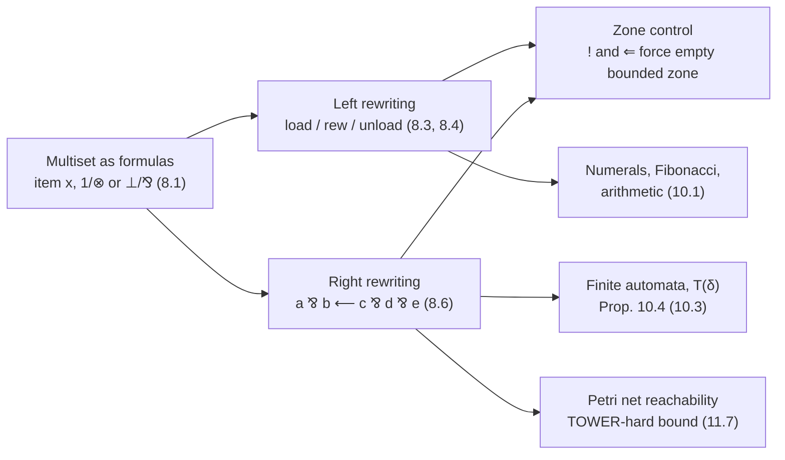

[[book-guidelines|↩ Back to guidelines]]

# Multiset Rewriting in Linear Logic

## 1. The problem: state that changes

A Prolog program (or a $\lambda$Prolog program over hereditary Harrop formulas) proves things from a context that only ever *grows*. Once a hypothesis is in the left of a sequent, it stays there, and it can be used as many times as you like. That is exactly wrong for modelling a vending machine, a chemical reaction, a counter, a stack, or an automaton: in those systems an action *consumes* some things and *produces* others.

The mismatch has a precise name: the intuitionistic sequent calculus has free weakening and contraction on its left side. Linear logic removes those rules from the formulas in the *bounded* zone of a sequent, so a hypothesis there is used exactly once. Chapter 6 built the focused systems $\Downarrow\mathcal L_1$ and $\Downarrow\mathcal L_2$ for this (see [[Linear-Logic]]). Chapter 8 then asks a practical question: what is the simplest thing you can *compute* with a context that shrinks and grows? The answer is **multiset rewriting**. The bounded zone of a sequent is a multiset. A backchaining step that eats some atoms and adds others is a rewrite step.

What breaks without this: with only intuitionistic contexts, Miller's own Exercise 5.43 (cited in Exercise 8.4) shows you cannot even write a program that computes the maximum of a multiset stored as atoms on the left. Reading an atom does not remove it, so the program has no way to say "these two are consumed, this one replaces them".

## 2. Encoding multisets as formulas (Section 8.1)

Start with the data. Let `item` be a predicate of one argument. The atom $item\ x$ stands for the multiset containing $x$ exactly once. A multiset is a combination of such atoms, and linear logic has two natural combinators, which give two encodings:

| Encoding | Empty multiset | Combine | Where proof search manipulates it | Needs |
|---|---|---|---|---|
| Conjunctive | $1$ | $\otimes$ (tensor) | left of $\vdash$ | intuitionistic subset $\mathcal L_1$ suffices |
| Disjunctive | $\bot$ | $\mathbin{⅋}$ (par) | right of $\vdash$ | multiple conclusions, i.e. $\Downarrow\mathcal L_2$ |

So the multiset $\{1,2,2\}$ is $item\,1\otimes item\,2\otimes item\,2$ in the first encoding and $item\,1\mathbin{⅋} item\,2\mathbin{⅋} item\,2$ in the second.

The [[Automata-Encoded-as-Multisets#Grounding|grounding]] intuition for a programmer: a multiset is a `HashMap<Atom, usize>` of counts, and "the bounded zone of the sequent" is exactly that map, mutated by proof search.

**Multiset equality.** Let $S=item\,s_1\mathbin{⅋}\cdots\mathbin{⅋} item\,s_n$ and $T=item\,t_1\mathbin{⅋}\cdots\mathbin{⅋} item\,t_m$. Exercise 8.1 gives that $S\multimap T$ is provable iff $T\multimap S$ is provable iff the two multisets are equal. Equality is two-way consumption: every item on one side is matched with one on the other and nothing is left over.

**Multiset inclusion** $S\sqsubseteq T$ needs a way to say "leftovers are allowed". The book gives two encodings:

1. $S\mathbin{⅋}0\multimap T$. The additive $0$ lets surplus items of $T$ be thrown away.
2. $\exists q.(S\mathbin{⅋}q\multimap T)$. Here the second-order quantifier $q$ is "the rest", the multiset difference (though nothing forces $q$ to be a multiset; it ranges over any formula).

They are equivalent in higher-order linear logic: $\forall S.\forall T.[(S\mathbin{⅋}0\multimap T)\dashv\vdash\exists q.(S\mathbin{⅋}q\multimap T)]$, where $B\dashv\vdash C$ abbreviates $(B\multimap C)\,\&\,(C\multimap B)$. The first encoding is the one reused later in the collection analysis of Chapter 11 (see [[#7. Where this leads]]).

## 3. Rewriting on the left: Lolli and the bounded zone

### 3.1 Notation the programs use (Section 8.2)

The examples are written in **Lolli**, the $\mathcal L_1$-based language. Surface syntax: `=>` is $\Rightarrow$ (intuitionistic implication, unbounded context), `-o` is $\multimap$, `:-` is the converse of $\multimap$, `<=` is the converse of $\Rightarrow$, `&` is $\&$, `erase` is $\top$. The positive connectives $true$, `,` , `;`, $exists$, $bang$ are defined by clauses that give only their right-introduction rules (Figure 8.1), for instance `bang G <= G`.

### 3.2 Load and unload: permutations (Section 8.3)

A first example that already contains the whole trick. To permute a list, put its members into the bounded zone one by one, then take them out in any order:

```
type load   list A -> list A -> o.
type unload list A -> o.

load nil K        :- unload K.
load (X :: L) K   :- (item X -o load L K).
unload nil.
unload (X :: L)   :- item X, unload L.
```

- `item X -o load L K` **adds** `item X` to the bounded zone (an implication whose antecedent becomes a hypothesis), then continues.
- `unload (X :: L) :- item X, unload L` **consumes** one `item X` from the zone. The comma is $\otimes$, so the zone is split between the two subgoals, and `item X` has to be proved from the one atom in its share. Which atom you pick is a nondeterministic choice, so every permutation is reachable.

The book states the invariant relative to a context. Let $\Psi$ hold these four clauses plus formulas not mentioning `item`, `load`, `unload` as head, and let $\Delta=item\,a_1,\dots,item\,a_n$, which "encodes" the multiset $\{a_1,\dots,a_n\}$. Then:

1. $\Sigma::\Psi;\Delta\vdash(unload\,K);\cdot$ is provable iff $K$ lists the same elements with the same multiplicities as the multiset encoded in $\Delta$.
2. $\Sigma::\Psi;\Delta\vdash(load\,L\,K);\cdot$ is provable iff $K$ is a list containing the elements of $L$ together with those encoded in $\Delta$.

**What breaks without control.** Statement 2 mixes in whatever happens to be in $\Delta$. To permute a list you need the bounded zone to be *empty* when you start. The tool is the exponential $!$. Proving $!\,G_1\otimes G_2$ forces $G_1$ to be proved with an empty bounded zone, while $G_2$ gets all of $\Delta$ (Exercise 8.3: $\Sigma::\Psi_0,\Psi;\Delta\vdash bang\,G;\cdot$ iff $\Delta$ is empty and $G$ is provable with an empty zone). Hence:

```
perm L K :- bang (load L K).       % or equivalently
perm L K <= load L K.
```

The `<=` form is the same thing: the goal to the right of $\Leftarrow$ is attempted in an empty bounded zone. This is the first mechanism worth remembering: **$\Rightarrow$/$!$ delimits a "pure" call from the stateful context**.

### 3.3 A general rewriting system (Section 8.4)

Let $H=\{\langle L_i,R_i\rangle\mid i\in I\}$ be a finite set of pairs of finite multisets, for a finite index set $I$. Define

$$M\Longrightarrow_H N\quad\text{iff}\quad\exists i\in I,\ \exists C.\ M=C\cup L_i\ \text{and}\ N=C\cup R_i,$$

and let $\Longrightarrow^*_H$ be its reflexive-transitive closure. Intuition: choose a rule, find its left-hand multiset inside $M$ (the rest of $M$ is the untouched frame $C$), swap it for the right-hand multiset.

The goal is a predicate $rewrite$ such that $(rewrite\ L\ K)$ is provable iff the multisets encoded by the lists $L$ and $K$ are related by $\Longrightarrow^*_H$. The $H$-independent part $\Gamma_0$:

```
rewrite L K     <= load L K.
load (X :: L) K :- (item X -o load L K).
load nil K      :- rew K.
rew K           :- unload K.
unload (X :: L) :- item X, unload L.
unload nil.
```

This is the permutation program again, except that `load nil K` calls a new predicate `rew`, a "socket" where rules are plugged in. Each pair $\langle\{a_1,\dots,a_n\},\{b_1,\dots,b_m\}\rangle\in H$ becomes one more clause:

```
rew K :- item a1, ..., item an,
         (item b1 -o ... -o item bm -o rew K).
```

Read operationally: remove the $a_i$ from the bounded zone, load the $b_i$, try another rewrite. The `rew K :- unload K` clause is the exit: stop rewriting and check that what is left in the zone is the target list $K$. (If $n$ or $m$ is zero, that part of the clause is dropped.) The book's example, $H=\{\langle\{a,b\},\{b,c\}\rangle,\langle\{a,a\},\{a\}\rangle\}$, gives

```
rew K :- item a, item b, (item b -o (item c -o rew K)).
rew K :- item a, item a, (item a -o rew K).
```

**Caveats the book states.** `rewrite` relates *lists*, though they are meant to denote multisets, and there can be up to $n!$ lists for one $n$-element multiset. That redundancy is the cost of encoding an unordered thing with an ordered carrier. The book suggests noncommutative variants of linear logic as a possible remedy (references in the Chapter 10 notes). It also notes (Exercise 8.4) that the maximum of a multiset, impossible in intuitionistic logic, is programmable in $\Downarrow\mathcal L_1$.

### 3.4 Grounding: the same machine in Rust

Here is the rewriting relation as data. A marking (multiset) is a map from atom to count; a rule has a left and right multiset. "Use a clause in the proof" is "subtract the left side, add the right side".

```rust
use std::collections::BTreeMap;

type Atom = &'static str;
/// A multiset of atoms: atom -> multiplicity (zero entries are removed).
type Multiset = BTreeMap<Atom, u32>;

struct Rule {
    lhs: Multiset, // L_i : consumed
    rhs: Multiset, // R_i : produced
}

/// M = C ∪ L_i  ==>  N = C ∪ R_i.  Returns None if L_i is not ⊆ M.
fn step(m: &Multiset, r: &Rule) -> Option<Multiset> {
    let mut n = m.clone();
    for (a, &k) in &r.lhs {
        let have = n.get_mut(a)?;
        if *have < k { return None; }       // inclusion S ⊑ M fails
        *have -= k;
        if *have == 0 { n.remove(a); }
    }
    for (a, &k) in &r.rhs {
        *n.entry(a).or_insert(0) += k;
    }
    Some(n)
}

/// One-step successors: the nondeterminism of "which clause of rew do I pick".
fn successors<'a>(m: &'a Multiset, h: &'a [Rule]) -> impl Iterator<Item = Multiset> + 'a {
    h.iter().filter_map(move |r| step(m, r))
}
```

Notice what the logic gave for free: the "subtract the left side" loop is *exactly* the clause body `item a1, ..., item an`, the check `have < k` is the failure of the $\otimes$-split, and the loop that adds the right side is the chain of `-o` loads. The proof search is the BFS/DFS over `successors`.

## 4. Rewriting on the right (Section 8.6)

Everything above lived on the left, in $\Downarrow\mathcal L_1$. The disjunctive encoding moves the multiset to the right of the sequent, which needs $\Downarrow\mathcal L_2$ with its two bounded zones. Consider the clause

$$a\mathbin{⅋}b\ \longleftarrow\ c\mathbin{⅋}d\mathbin{⅋}e$$

(the book writes the converse of $\multimap$ as an arrow pointing left, so the head $a\mathbin{⅋}b$ is on the left, as in Prolog; this is $c\mathbin{⅋}d\mathbin{⅋}e\multimap a\mathbin{⅋}b$). Take the sequent $\Sigma::\Psi;\Delta\vdash a,b,\Gamma;\Upsilon$ with this clause in $\Psi$. A proof deciding on this clause produces the premise

$$\Sigma::\Psi;\Delta\vdash c,d,e,\Gamma;\Upsilon,$$

after closing the two atomic initial branches $a\vdash a$ and $b\vdash b$. In words: the right-hand multiset $a,b,\Gamma$ was **rewritten** to $c,d,e,\Gamma$ by backchaining. No `load`/`unload` plumbing is needed. The rule's head $a\mathbin{⅋}b$ is matched directly against the goal multiset, and $\Gamma$ is the frame that is carried along untouched.

**Context splitting with several implications.** A clause may have several top-level implications. For a clause of the form $A_1\mathbin{⅋}A_2\Leftarrow G_4\longleftarrow G_3\Leftarrow G_2\longleftarrow G_1$ (the book's notation, with $\longleftarrow$ the converse of $\multimap$ and $\Leftarrow$ the converse of $\Rightarrow$) and a sequent $\Sigma::\Psi;\Delta\vdash A_1,A_2,A;\Upsilon$, proof search generates four sequents:

$$\Sigma::\Psi;\Delta_1\vdash G_1,A_1;\Upsilon\qquad \Sigma::\Psi;\cdot\vdash G_2;\Upsilon\qquad \Sigma::\Psi;\Delta_2\vdash G_3,A_2;\Upsilon\qquad \Sigma::\Psi;\cdot\vdash G_4;\Upsilon$$

where $\Delta=\Delta_1\cup\Delta_2$ and the right bounded zone is likewise divided between the goals next to $\longleftarrow$. The rule to remember: **goals right of $\longleftarrow$ (a linear premise) share the bounded zones between them; goals right of $\Leftarrow$ (an intuitionistic premise) get empty bounded zones.** This is the same lesson as $!$ in the permutation example, now stated as a resource-splitting discipline.

**Example (Exercise 8.7).** Summing a multiset of numbers held on the right as $a\,n_1\mathbin{⅋}\cdots\mathbin{⅋}a\,n_i$:

```
sumall M     :- acc M -o acc z.
acc N || a M :- sum N M S, acc S.
```

(In the PDF text extraction the `||` is the `⅋` connective; the second clause is the right-side rewriting rule "an `acc N` together with an `a M` becomes `acc S` where `S = N + M`".) `sumall M` starts an accumulator at $z$, and each `a M` on the right is consumed together with the accumulator and replaced by the new accumulator. At the end `acc z` has become `acc m` and `sumall m` is proved. The sequent $\Sigma::\Psi;\cdot\vdash a\,n_1\mathbin{⅋}\cdots\mathbin{⅋}a\,n_i\mathbin{⅋}sumall\,m;\cdot$ is provable iff $m=n_1+\cdots+n_i$.

## 5. Numerals as multisets (Chapter 10, Section 10.1)

Chapter 10 reuses all of this and asks how little structure is needed to compute. Two encodings of natural numbers:

- **Numbers as atoms (Church-style).** Take `type zero o`, `type succ o -> o`, with the program `zero.` and `succ X :- X.` For each $n$, the sequent $\cdot::P;\cdot\vdash succ^n(zero);\cdot$ has a proof. The same program works with the clause $\forall x.(x\multimap succ\,x)$ and $zero$ in the *left bounded zone*: $\cdot::\forall x.(x\multimap succ\,x);zero\vdash succ^n(zero);\cdot$ is provable. So a number is a nested term of type $o$, and increment is a rewrite $x\mapsto succ\,x$.
- **Numbers as multiplicity.** Let $\star:o$ be a token. Write $\star^n$ for the multiset with $\star$ occurring $n$ times, and $\star^0$ for the empty multiset. The number $n$ *is* the count.

These are connected by a **substitution** argument, which is the elegant move of the chapter. Reclassify $zero$ and $succ$ as eigenvariables, then substitute

$$zero\mapsto\bot\qquad succ\mapsto\lambda w.\ \star\mathbin{⅋}w.$$

Using Exercise 10.1 (the equivalence $(\forall x.(x\multimap\star\mathbin{⅋}x))\dashv\vdash(\bot\multimap\star)$) and the substitution property (Proposition 9.12), the nested numeral $succ^n(zero)$ turns into $\star\mathbin{⅋}\cdots\mathbin{⅋}\star\mathbin{⅋}\bot$ with $n$ copies of $\star$, which is the disjunctive encoding of the multiset $\star^n$. The book's characterisation: for a multiset $\Delta$ of atoms, $\cdot::\bot\multimap\star;\bot\vdash\Delta;\cdot$ is provable iff $\Delta=\star^n$ for some $n$.

**Fibonacci as multiset rewriting.** With $\Sigma_0\ni\star:o,\ z:nat,\ s:nat\to nat,\ f:nat\to o$ and

```
f z.
f (s z) ⅋ ⋆.
∀x. (f x ⊸ f (s x) ⊸ f (s (s x))).
```

the sequent $\cdot::P;\cdot\vdash f(s^n z),\Delta;\cdot$ is provable iff $\Delta=\star^m$ where $m$ is the $n$-th Fibonacci number ($F_0=0$, $F_1=1$, e.g. $F_{12}=144$). Think of it as a program with an unbounded counter: the $\star$ tokens are produced as a side-effect, and the answer is the multiplicity left in the bounded zone. Each clause is a "recursion without a call stack": proving $f(s(s\,x))$ requires proving $f\,x$ and $f(s\,x)$, and the $\star$ outputs of the two sub-derivations are pooled by the multiset union that the sequent performs.

Arithmetic (Figure 10.1) in the same style: `two || star || star`, `suc P || star :- P`, `plus P Q :- P :- Q` give, for example, that $\cdot::P;\bot\vdash plus(plus(suc\,three)\,two)\,three,\Delta;\cdot$ is provable iff $\Delta$ is $star$ with multiplicity 9 (Exercise 10.2: $(3+1)+2+3=9$).

## 6. Automata as rewriting: the same machinery, one level up (Sections 10.2-10.3)

The strongest argument that this really is "computation by proof" is that the same $\mathbin{⅋}$-on-the-right recipe encodes a finite automaton with **only the primitive type $o$**.

- Letters are constants of type $o\to o$; a word is a term $\lambda x.(u\,(v\,(u\,x)))$ for $uvu$, with $\epsilon=\lambda x.x$. Concatenation is function composition $\lambda x.\,w\,(w'\,x)$.
- A finite automaton is $F=\langle Q,\Lambda,\delta,s,F\rangle$ with $\delta\subseteq Q\times\Lambda^*\times Q$. States are constants of type $o$.
- The theory $T(\delta)$ has one clause per transition $\langle p,w,q\rangle\in\delta$:

$$\forall x.\,[\,q\mathbin{⅋}x\ \multimap\ p\mathbin{⅋}(w\,x)\,].$$

Each clause is a rewrite on the right: read "state $q$ with the rest-of-the-input $x$" as the consumed multiset and "state $p$ with word $w$ prepended" as the produced one. An $\epsilon$-transition $\forall x.[q\mathbin{⅋}x\multimap p\mathbin{⅋}x]$ is logically just $q\multimap p$ (Exercise 10.3).

**Proposition 10.4** (faithfulness, in the book's notation). $p\xrightarrow{w}{}^*q$ holds iff $\cdot::T(\delta);\cdot\vdash\forall x.[q\mathbin{⅋}x\multimap p\mathbin{⅋}(w\,x)];\cdot$ is provable in $\Downarrow\mathcal L_2^\omega$; and $w\in L(F)$ iff $\cdot::T(\delta);\cdot\vdash\forall x.[(f_1\,\&\cdots\&\,f_n)\mathbin{⅋}x\multimap s\mathbin{⅋}(w\,x)];\cdot$ is provable, with $f_1,\dots,f_n$ the final states. The proof goes by induction on the definition of $\xrightarrow{w}{}^*$ in one direction and by induction on the decide depth of a focused proof in the other. This is a precise instance of the pattern "synthetic inference rule = one rewrite step": a decide on a clause in $T'(\delta)$ yields the synthetic rule

$$\frac{\cdot::T'(\delta);\Gamma\vdash q,t,\Delta;\cdot}{\cdot::T'(\delta);\Gamma\vdash p,(w\,t),\Delta;\cdot}\ \langle p,w,q\rangle.$$

The rest of the chapter (not detailed here) uses substitution into proofs to get closure of regular languages under homomorphism, and adds a stack for pushdown automata; see [[Focused-Proof-Systems-and-Backchaining]] for why a decide step gives exactly one synthetic rule.

## 7. Petri nets: the source material is thin here

A note on Topic List item "Petri net reachability": the book has **no dedicated section** on it. What it gives is:

- The book's introduction mentions (informally) that linear logic can model "vending machines (e.g., two 50-cent coins yield one coffee), Petri nets, and process calculi".
- Chapter 8's bibliographic notes (Section 8.8, p. 180) say multiset rewriting specifies Petri nets (Engberg-Winskel, Gehlot-Gunter, Asperti et al., Marti-Oliet-Meseguer, Kanovich, Delzanno), and that the connection to linear logic makes encoding them as linear logic programs natural.
- Chapter 11, end of Section 11.7 (pp. 233-234): proofs in the multiset-statement proof system of Figure 11.7 are "straight-line" until the decide rule, the left side stays constant, and the right side does multiset rewriting based on the unbounded-zone clauses. Since that rewriting can encode **Petri net reachability** (Esparza-Nielsen 1994, Leroux-Schmitz 2019), the complexity of proving judgments in this logic has a **TOWER lower bound** (Czerwinski et al. 2020). The author notes it is likely that for multiset collection analysis of actual Prolog programs, the proof system does much better than this worst case suggests.

The following explanation of how a Petri net *is* an $H$ above is my own illustration of the idea in the book, not text from it. A Petri net has places and transitions. A marking is a multiset of tokens over places, and a transition $t$ with input multiset ${}^\bullet t$ and output multiset $t^\bullet$ is enabled in marking $M$ when ${}^\bullet t\sqsubseteq M$, and fires to $(M\setminus{}^\bullet t)\cup t^\bullet$. That is *literally* the relation $M\Longrightarrow_H N$ with $\langle L_i,R_i\rangle=\langle{}^\bullet t_i,t_i^\bullet\rangle$. Reachability, "is $N$ reachable from $M$", is $M\Longrightarrow_H^*N$. Via the encodings of Section 3 or Section 4, reachability becomes provability of a sequent in $\Downarrow\mathcal L_1$ or $\Downarrow\mathcal L_2$. A vending machine as a toy:

$$H=\{\langle\{coin,coin\},\{coffee\}\rangle\}\qquad\{coin,coin,coin,coin\}\Longrightarrow_H^*\{coffee,coffee\}.$$

```rust
use std::collections::{BTreeSet, VecDeque};

/// Bounded reachability for a Petri net / multiset rewriting system.
/// Reachability is decidable for Petri nets but TOWER-hard in the worst case
/// (book, Section 11.7), and the state space is infinite whenever the net is
/// unbounded, so a fuel cap is mandatory in a naive BFS.
fn reachable(start: &Multiset, goal: &Multiset, h: &[Rule], fuel: usize) -> bool {
    let mut seen: BTreeSet<Multiset> = BTreeSet::new();
    let mut q = VecDeque::from([start.clone()]);
    seen.insert(start.clone());
    let mut steps = 0;
    while let Some(m) = q.pop_front() {
        if &m == goal { return true; }
        steps += 1;
        if steps > fuel { return false; } // "don't know", not "no"
        for n in successors(&m, h) {
            if seen.insert(n.clone()) { q.push_back(n); }
        }
    }
    false
}
```

The honest reading of the return value `false` is "not found within the fuel", unless the net is known to be bounded. A real tool would use coverability graphs, Karp-Miller trees, or the proof-theoretic specialised rules of Figure 11.7 instead of raw BFS.

### Lean version

Lean's `Multiset` and `Relation.ReflTransGen` mirror the book's definitions almost symbol for symbol:

```lean
import Mathlib.Data.Multiset.Basic
import Mathlib.Logic.Relation

structure Rule (α : Type) where
  lhs : Multiset α   -- L_i
  rhs : Multiset α   -- R_i

/-- M ⟹_H N  iff  ∃ i C, M = C + L_i ∧ N = C + R_i -/
inductive Step {α : Type} (H : List (Rule α)) : Multiset α → Multiset α → Prop
  | fire (r : Rule α) (hr : r ∈ H) (C : Multiset α) :
      Step H (C + r.lhs) (C + r.rhs)

/-- ⟹*_H : reflexive-transitive closure, the book's `rewrite` relation. -/
abbrev Steps {α : Type} (H : List (Rule α)) := Relation.ReflTransGen (Step H)

example : Steps [⟨{1, 1}, {2}⟩] {1, 1, 1, 1} {2, 2} := by
  -- two firings of the coin ⟹ coffee rule
  sorry  -- illustrative; discharge with `ReflTransGen.head` and `Step.fire`
```

The `Step.fire` constructor with its frame `C` is the whole content of "$M$ is $C\cup L_i$". The theorem the book proves, in effect, is that `Steps H M N` is equivalent to provability of the corresponding sequent in focused linear logic, i.e. a soundness/completeness statement relating this inductive relation to a proof system.

### Python sketch

For quick experiments only; the Rust above is the load-bearing grounding.

```python
from collections import Counter

def step(m: Counter, lhs: Counter, rhs: Counter):
    if any(m[a] < k for a, k in lhs.items()):   # L_i not included in M
        return None
    return (m - lhs) + rhs
```

## 8. Where each piece lives



## 9. Synthesis

**What it depends on.** Chapter 6's linear logic with its focused systems $\Downarrow\mathcal L_1$ and $\Downarrow\mathcal L_2$ (bounded and unbounded zones; decide $l$ versus decide $!$) and Chapter 7's phase analysis. Rewriting steps are *synthetic inference rules*: one decide plus the following introduction phase equals one rewrite. Higher-order quantification $\mathcal L_2^\omega$ (Chapter 9) is required only for the numeral/automaton encodings (via substitution into proofs) and for hiding of predicates.

**What depends on it.** Chapter 10's automata (see also the topic "[[Automata-Encoded-as-Multisets|Automata Encoded as Multisets]]" in the guidelines), Chapter 11's collection analysis (multiset inclusion $S\mathbin{⅋}0\multimap T$ and equality $S\dashv\vdash T$, with the Petri net hardness bound), and Chapter 13's operational semantics, where multiset rewriting, Gamma-like and chemical-abstract-machine systems are specified directly (CML-style threads as multisets).

**Focus Areas** (`automated-reasoning`, `static-analysis` per this book's tagging).

- *Proof search as computation (`automated-reasoning`).* The permutation and rewrite programs are proof search in a nondeterministic resource-tracking logic. The mechanism to carry into a prover is the **context-splitting discipline**: linear premises divide the bounded context between subgoals, intuitionistic premises ($\Rightarrow$, $!$) get an empty one. That is the `Γ = Δ₁ ∪ Δ₂` bookkeeping that any linear or resource-aware checker must implement, whether as a Rust data structure with ownership-style splitting or as a lazy-splitting algorithm (the book itself notes the naive "guess the split" version in Chapter 6 is wasteful).
- *Judgments, contexts, proof certificates.* A derivation of $M\Longrightarrow^*_HN$ is a certificate: the sequence of rules fired. Checking it is a linear-time replay of `step`, exactly like replaying a proof against a trusted kernel; finding it is a search problem. This is the proof-producing split between a solver and a small checker that your verifier's trusted kernel needs.
- *Substitution and context management.* The numeral example shows substitution into a *proof* (not just a term) as a proof-reuse device: instantiate $zero\mapsto\bot$, $succ\mapsto\lambda w.\star\mathbin{⅋}w$ and the old proof becomes a proof of the new statement. This is the same plumbing (Proposition 9.12) that underlies substitution lemmas in type-theoretic soundness proofs. Its relevance to the compiler is indirect but real: whenever the elaborator instantiates a metavariable (a *higher-order* instance like $\lambda w.\star\mathbin{⅋}w$ here), previously valid derivations must remain valid.
- *Static analysis: reachability and invariants (`static-analysis`).* A multiset rewriting system is a Petri net / vector addition system, i.e. a counter-abstraction of a program with unboundedly many resources. Reachability is the safety question, and the TOWER lower bound from Section 11.7 means any complete analysis of this fragment is expensive in the worst case. For abstract interpretation this is the argument for *over-approximating* (for example, collapsing multisets to sets or interval counts: the book's own set versus multiset judgments in Chapter 11) rather than computing exact reachability. Invariant generation for such systems is the search for a place invariant, a linear functional that rewriting preserves, which is a proof of safety without exploring states. This last connection is my gloss; the book gives only the complexity remark.
- *Operational semantics (`type-theory` tag, via Chapter 13).* Rewriting rules as reduction steps, with the frame $C$ the "evaluation context"; this is why multiset rewriting is a standard encoding of concurrent semantics.

No `sat-smt-csp` connection is forced here: the book deliberately sets constraint solving aside.

## 10. Where this leads

Multiset rewriting is the engine under Chapter 10's automata and machine encodings, Chapter 11's static collection analysis (where its Petri-net reachability hardness is the complexity bound), and Chapter 13's concurrent operational semantics. Everywhere a later chapter says "a state that changes", it means a bounded-zone multiset that a decide step rewrites.
