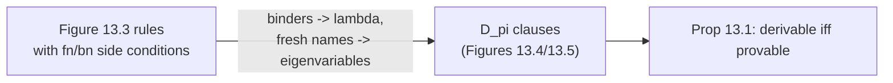

[[book-guidelines|↩ Back to guidelines]]

# Operational Semantics in Logic

## 1. The problem this chapter solves

You have a small programming language, say the untyped $\lambda$-calculus or the finite $\pi$-calculus, and you want to say what programs *do*. Then you want to run that description, reason about it, and maybe extend it with state and threads. The usual toolkit (domains, algebras, games, Petri nets) is heavy. Miller's pitch is that the logic programming languages from the earlier chapters already are an operational-semantics framework: a semantic specification is a logic program, and *running* the semantics is *proof search*.

Three payoffs, stated in the chapter intro:

- **Animation.** A logic-programming interpreter executes the specification directly.
- **Binders for free.** Object-language binders ($\lambda x$, $\nu x$, $x(y).P$) become meta-level $\lambda$-abstractions, and the logic's treatment of bound variables does the freshness bookkeeping.
- **Reasoning.** A logical specification can be reasoned about with proof theory (cut, equivalence of theories).

The chapter walks through three semantic styles, each paired with the logic fragment that fits it.

| Style | Logic fragment | Section |
|---|---|---|
| Big-step / small-step SOS | Horn clauses, hereditary Harrop formulas | 13.3, 13.4 |
| Abstract machines | Binary clauses (Horn with a one-atom body) | 13.5 |
| Multiset rewriting, state, concurrency | Linear logic | 13.6 |

The unifying thought: moving down the table, you give up logical connectives to gain explicit control over order of computation, then buy back expressive power with linear logic.

## 2. Programs as terms: higher-order abstract syntax (13.2)

Before semantics you need syntax. The trick is the same one the type-theory community calls HOAS (the book calls it $\lambda$-tree syntax): represent object-level binding by the *meta-level's own* $\lambda$.

For the untyped $\lambda$-calculus, one syntactic type `tm` and two constructors:

```
kind tm  type.
type app tm -> tm -> tm.
type abs (tm -> tm) -> tm.
```

Look at `abs`. Its argument has type $tm \to tm$: a *function* from terms to terms, not a pair (variable name, body). So $\lambda x.\,x\,x$ is `abs (λx. app x x)`. The bound variable is a genuine meta-variable. The book notes the payoff: two untyped terms are $\alpha$-convertible iff their encodings are $\beta\eta$-convertible. So $\alpha$-equivalence is just the logic's own conversion; you never write a renaming function.

In Lean this is the classic higher-order encoding, and it works fine as a *data* declaration if you keep the argument positive. In Rust you cannot do it directly with a plain `enum` (you would write `Abs(Box<dyn Fn(Tm) -> Tm>)`, which loses inspectability), which is exactly why de Bruijn indices or named binders show up in Rust interpreters.

```lean
-- HOAS-ish, in Lean: needs care (strict positivity). Using a
-- parametric version keeps it legal.
inductive Tm (V : Type) where
  | var : V → Tm V
  | app : Tm V → Tm V → Tm V
  | abs : (V → Tm V) → Tm V      -- PHOAS: the meta-binder carries the variable
```

```rust
// What most Rust interpreters do instead: de Bruijn indices.
enum Tm {
    Var(usize),
    App(Box<Tm>, Box<Tm>),
    Abs(Box<Tm>),
}
```

For the finite $\pi$-calculus (grammar $P ::= 0 \mid \bar{x}y.P \mid x(y).P \mid \tau.P \mid (y)P \mid [x=y]P \mid P\mid P \mid P+P$), Figure 13.1 declares two types, names `n` and processes `p`, and constructors

$$null : p,\quad taup : p\to p,\quad plus,\,par : p\to p\to p,\quad match,\,out : n\to n\to p\to p,\quad nu : (n\to p)\to p,\quad in : n\to(n\to p)\to p.$$

Only $nu$ and $in$ take an abstraction, because only those bind. The translation $[\![\cdot]\!]$ sends, e.g., $x(y).P \mapsto in\;x\;(\lambda y.[\![P]\!])$ and $(x)P \mapsto nu\,(\lambda x.[\![P]\!])$. So $\nu y.[x=y]\bar{x}z.0$ becomes `nu y\ match x y (out x z null)`, with $x, z$ free.

**What breaks without this.** With named variables you must define free/bound-variable functions, capture-avoiding substitution, and side conditions like "$w \notin fn((y)P)$". Every one of those is a place for bugs. HOAS pushes all of it into the logic once.

## 3. Big-step semantics (13.3)

A big-step relation $M \Downarrow V$ relates an expression to its final value. Call-by-value $\lambda$-calculus:

$$\frac{}{\lambda x.R \Downarrow \lambda x.R}\qquad \frac{M\Downarrow \lambda x.R\quad N\Downarrow U\quad R[U/x]\Downarrow V}{(M\,N)\Downarrow V}$$

As a Horn-clause program (Figure 13.2):

```
type eval tm -> tm -> o.
eval (abs R) (abs R).
eval (app M N) V :- eval M (abs R), eval N U, eval (R U) V.
```

The line to stare at is `eval (R U) V`. The inference-rule version has the substitution $R[U/x]$. Here `R` is a meta-function; once `R` is instantiated by a `abs`-body, the application `(R U)` is a $\beta$-redex that the logic reduces for you. Substitution is not coded, it is inherited.

This is essentially a three-line evaluator. In Python:

```python
def eval_(t, env):
    match t:
        case ("abs", _): return t
        case ("app", m, n):
            f = eval_(m, env)           # must be an abs
            u = eval_(n, env)
            return eval_(f.body(u), env)  # body(u) = beta reduction
```

Note what the Horn-clause version does *not* say: in which order the three subgoals run. For a pure language that does not matter. Section 13.5 is about what to do when it does.

## 4. Small-step semantics: the $\pi$-calculus (13.4)

Small-step relations capture one step in a long computation, which suits concurrency through interleaving. The late transition system for the finite $\pi$-calculus has judgments $P \xrightarrow{\alpha} Q$ with actions $\tau$ (silent), $xy$ / $x(w)$ (input, free/bound), $\bar{x}y$ / $\bar{x}(w)$ (output, free/bound). Figure 13.3 lists rules (tau, in, out, match, sum, par, res, open, close, comm) with side conditions like "$bn(\alpha)\cap fn(Q)=\emptyset$" and "$y \neq x$".

[[Automata-Encoded-as-Multisets#The encoding|The encoding]] (Figures 13.4, 13.5) introduces a sort `a` of actions with $\tau : a$ and $\downarrow,\uparrow : n \to n \to a$, then splits the transition relation in two:

- free actions: $P \xrightarrow{A} Q$, a predicate of type $p \to a \to p \to o$ (`one`),
- bound actions: $P \rightharpoonup^{A} Q$, of type $p \to (n \to a) \to (n\to p)\to o$ (`oneb`).

A bound action is a *function* in the action position, and the resulting process $Q$ is an *abstraction* over the new name. For example, the `in` axiom is just

```
oneb (in X M) (dn X) M.
```

and the `par` rule for bound actions is

```
oneb (par P Q) A (x\ par (M x) Q) :- oneb P A M.
```

The side conditions are gone. The book's example: in the `open` rule, the proviso $y \neq x$ is implicit, because the clause quantifies over $X$ *outside* the scope of the quantifier on $y$, so $X$ cannot be instantiated with $y$ (substitution cannot capture a bound name). The `res` rule uses a universal goal, `pi x\ one (P x) A (Q x)`: to move a transition under a $\nu$, pick a fresh eigenvariable and prove the transition for it. That is the logical meaning of "the transition is uniform in the bound name."

**Proposition 13.1 (adequacy).** For a list $\bar n$ of names including all free names in $P,Q,\alpha$: $P\xrightarrow{\alpha}Q$ is derivable in the $\pi$-calculus iff $\forall\bar n.[\![P\xrightarrow{\alpha}Q]\!]$ is provable from the theory $D_\pi$ (proof in Tiu 2004; Tiu and Miller 2010).

This is the chapter's answer to its first Key Question: representing binders by meta-level $\lambda$-abstraction and using eigenvariables for freshness removes the proviso machinery, with adequacy stating that nothing was lost.



In Rust the closest thing is a function `fn step(p: &Proc) -> Vec<(Action, Proc)>`, where you must manually generate fresh names and rename. The logic version delegates both.

## 5. Binary clauses and abstract machines (13.5)

### 5.1 Continuation passing in logic

Horn clauses leave subgoal order unspecified. To pin it down, apply a CPS transformation to the *logic program*. For each predicate $p : \tau_1\to\dots\to\tau_n\to o$ add $\hat p : \tau_1\to\dots\to\tau_n\to o\to o$ with an extra continuation argument of type $o$ (a formula!). Then

$$\forall\bar z.[(A_1\wedge\dots\wedge A_n)\supset A_0]\;\;\leadsto\;\;\forall\bar z\,\forall k.[\hat A_1(\hat A_2(\cdots(\hat A_n\,k)\cdots))\supset \hat A_0\,k],$$

and a fact $A_0$ becomes $\forall k.[k\supset \hat A_0\,k]$. These are *binary clauses*: one atom in the body. Correctness: $\mathcal P\vdash A$ iff $\hat{\mathcal P}\vdash \hat A\;\top$.

Call-by-value evaluation becomes (Figure 13.6, writing `evalc` for $(\cdot\Downarrow\cdot);\cdot$):

```
evalc (abs R) (abs R) K :- K.
evalc (app M N) V K :-
  evalc M (abs R) (evalc N U (evalc (R U) V K)).
```

Now the evaluation order is forced by *nesting*, not by $\wedge$. The sequencing lives in a non-logical constant, which the book openly calls "a retreat from logic". The retreat buys two things: explicit order, and a hook for linear logic. This is the same as CPS-converting an interpreter in Rust to pass a `Box<dyn FnOnce(Value)>`, except here the continuation is a *goal*.

### 5.2 Abstract evaluation systems

Hannan and Miller's **abstract evaluation system** is a quadruple $(\Sigma,R,\rho,S)$: a first-order term rewriting system $(\Sigma, R\cup\{\rho\})$ with $\rho\notin R$ and $S\subseteq R$, where all rewrites apply at the root. An evaluation starts with one use of the *load* rule $\rho$, runs rules from $R$, and ends with a rule from $S$ (*unload*).

The chapter gives two machines in this form, using de Bruijn notation, with $\{E,M\}$ for a closure:

- **Krivine machine**, states $\langle E, M, S\rangle$ (environment, term, argument stack). Rules: push an argument on application, bind on $\lambda$, look up index $0$ / $n+1$ in the environment, unload at $\langle E,\lambda M,nil\rangle$.
- **SECD machine** (Landin), states $\langle S,E,C,D\rangle$ (stack, environment, command list, dump) with `ap` instructions and a dump for returns.

```rust
// Krivine machine as a Rust step function: one rewrite rule per match arm.
enum Term { Lam(Box<Term>), App(Box<Term>, Box<Term>), Idx(usize) }
#[derive(Clone)] enum Clo { Pair(Vec<Clo>, std::rc::Rc<Term>) }
struct State { env: Vec<Clo>, term: std::rc::Rc<Term>, stack: Vec<Clo> }
// step: App(m,n)  -> push closure {env,n} on stack, continue with m
//       Lam(m)    -> pop closure from stack, push on env, continue with m
//       Idx(0)    -> jump into env[0] closure; Idx(n+1) -> drop head of env
```

The bridge to logic: given an AES, with unary predicates `load`, `rewrite`, `unload`, take

1. $\forall\hat x.[\mathit{rewrite}\; r\supset \mathit{load}\; l]$ for $\rho = l\Rightarrow r$,
2. $\forall\hat x.[\mathit{rewrite}\; r\supset \mathit{rewrite}\; l]$ for each $l\Rightarrow r\in R$,
3. $\forall\hat x.[\mathit{unload}\; r\supset \mathit{rewrite}\; l]$ for each $l\Rightarrow r\in S$.

If $t$ evaluates to $s$ in the machine, then $\mathit{unload}\;t\supset\mathit{load}\;s$ is provable, and (Figure 13.9) its proof is a single vertical chain: $\mathit{unload}\,t \vdash \mathit{load}\,s$, then $\mathit{rewrite}\,s_1,\dots,\mathit{rewrite}\,s_n$, then $\mathit{unload}\,t\vdash\mathit{unload}\,t$. Reading that chain bottom-up *is* the machine run. A machine execution trace is literally a focused proof of synthetic rules (cf. [[Focused-Proof-Systems-and-Backchaining]]).

**What breaks.** Everything dynamic (reference cells, exceptions, threads) has to live inside the term $s_i$ as lists. That is non-modular: adding a feature means rewriting every rule's state shape. This motivates the last step.

## 6. Linear logic: state and concurrency (13.6)

Section 6.5 observed that the top-level intuitionistic $\supset$ of Horn clauses can be read as $\multimap$ with the same operational behavior. Then each binary clause is a **multiset rewrite**: one atom is replaced by another. A single atom is a single thread. Several atoms in the multiset (written with $⅋$) are several threads. See [[Multiset-Rewriting-in-Linear-Logic]].

### 6.1 A global counter

Add constants $get, inc : tm$ and integers as values. A register is an atom $r\,V$ alongside the evaluation atom:

$$\forall K\forall V.(r\,V ⅋ K\multimap((get\Downarrow V);K) ⅋ r\,V),\qquad \forall K\forall V.(r\,(V{+}1) ⅋ K\multimap((inc\Downarrow V);K) ⅋ r\,V).$$

With these clauses $D$, the sequent $D;\cdot\vdash((M\Downarrow V);\top) ⅋ r\,0;\cdot$ is provable exactly when $M$ evaluates to $V$ with the counter starting at $0$. The ordinary evaluator clauses for `app`/`abs` did not change. State is modular.

The register's *name* $r$ should be private. Higher-order quantification hides it (see [[Higher-Order-Quantification]] and [[Higher-Order-Programming-and-Hiding-of-Specifications]]). Figure 13.10 gives three specifications $E_1,E_2,E_3$ of the counter, each $\exists r.[\dots]$:

- $E_1$: value stored on the *right* of the sequent as $(r\,0)^\perp$; `get`/`inc` synchronize a $\Downarrow$-atom with an $r$-atom.
- $E_2$: same, but `inc` *subtracts* 1 and `get` returns $-V$ (a deliberately perverse implementation).
- $E_3$: counter stored as a *linear assumption* on the left; `get`/`inc` destructively read it and rewrite it with $r\,V \otimes (r\,V' \multimap K)$.

**Proposition 13.2.** $E_1\vdash E_2$, $E_2\vdash E_3$, $E_3\vdash E_1$ are all provable in linear logic. Proof idea: choose an eigenvariable $s$ for the left $\exists$, then instantiate the right $\exists$ with $\lambda x.s(-x)$, $\lambda x.(s(-x))^\perp$, or $\lambda x.(s\,x)^\perp$ respectively (the first two need $-0=0$, $-(x{+}1)=-x-1$, $-(x{-}1)=-x+1$).

Logical equivalence is strong: by cut, $E_1\vdash(M\Downarrow V);\top$ implies $E_2\vdash(M\Downarrow V);\top$. So **no evaluation can distinguish the three counters**. This is observational equivalence of abstract data types, obtained as a plain entailment. The same idea extends (Chirimar 1995; Miller 1996) to dynamically allocated references as in Algol or Standard ML, and to exceptions and continuations, each added modularly.

The Rust analogue of $E_1\equiv E_3$ is two different `struct Counter` implementations behind one `trait`; Prop. 13.2 is a *proof* that clients cannot tell them apart.

```rust
trait Counter { fn get(&self) -> i64; fn inc(&mut self) -> i64; }
struct Plain(i64);          // E1 / E3 shape
struct Negated(i64);        // E2 shape: stores -v, reports -stored
```

### 6.2 Concurrent ML primitives

Extend the $\lambda$-calculus with `none`, `guard`, `poll`, `receive`, `some`, `sync`, `choose`, `transmit`, `wrap`, `spawn`, `newchan` (Figures 13.11, 13.12). Highlights:

- Eight constructors evaluate to themselves (Figure 13.11).
- `sync E` turns an *evaluation thread* into an *event thread*: $(E\Downarrow U);(event\;U\;V\;K)\multimap((sync\,E)\Downarrow V);K$.
- `spawn R` starts a new thread, with its continuation being $\bot$ (it just ends): $(((R\;unit)\Downarrow unit);\bot) ⅋ K\multimap((spawn\,R)\Downarrow unit);K$.
- `newchan R` picks a fresh eigenvariable $c$ (via $\forall c$) and assumes $\forall I.(I\multimap (c\Downarrow c);I)$ so that $c$ is a value. Fresh channel names are, again, eigenvariables.
- Communication is the single clause whose head has two atoms: $K ⅋ L\multimap event\,(receive\,C)\,V\,K ⅋ event\,(transmit\,C\,V)\,unit\,L$. Two threads rendezvous by a multiset rewrite.
- `choose` is a local nondeterministic choice (two clauses). `wrap` and `guard` chain evaluation and synchronization.
- `poll` is the one use of additive connectives. It tries $(event\;E\;U\;\top)\,\&\,K$: the $\&$ *copies* the thread context, tries to sync in one copy, and if that succeeds the other copy continues with $K$ untouched. If no partner is present, the second clause returns `none`. Caveat the book admits: this `poll` can return `none` even when a partner exists, so it is not exactly CML's semantics.

Global choice as in CCS is flagged as "much more involved".

## 7. Reading the chapter's two Key Questions

1. *Why does $\lambda$-tree syntax remove the freshness side conditions?* Because bound names are eigenvariables or meta-abstractions: capture is impossible by the logic's own substitution, and "$X\neq y$" is encoded by quantifier scope (Section 4 above).
2. *What does CPS buy, and what does linear logic add?* CPS fixes evaluation order (necessary for side effects). Linear logic turns the single continuation thread into a multiset of threads and gives resource-like cells (registers, channels) as consumable atoms, without touching the pure clauses (Section 6).

## 8. Where this leads (and how it bears on your goals)

**Dependencies.** Uses focused backchaining ([[Focused-Proof-Systems-and-Backchaining]]), hereditary Harrop formulas ([[Horn-Clauses-and-Hereditary-Harrop-Formulas]]) for the quantifier-scoping trick, linear logic and its programming languages ([[Linear-Logic]], [[Multi-Zone-Sequents-and-Linear-Logic-Programming-Languages]]), multiset rewriting ([[Multiset-Rewriting-in-Linear-Logic]]), and higher-order quantification for hiding. The $\pi$-calculus syntax was previously met in the security-protocols chapter (Chapter 12; see the Process Calculi topic). This is the last chapter of the book. Section 13.7 points onward to static semantics (type inference via Hindley-Milner as logic programs) and to Abella for *reasoning* about these specifications.

**Focus area: `type-theory`.** Three threads to carry into a verifier/elaborator project:

- *Binder representation.* HOAS here is the same design question as named vs. de Bruijn vs. PHOAS in a Lean/Rust kernel. Miller's answer (meta-level $\lambda$ plus eigenvariables) makes $\alpha$ free and substitution a $\beta$-step; the cost is that you need a meta-logic with higher-order unification on patterns ([[Simply-Typed-Lambda-Terms-and-Churchs-Types]]).
- *Big-step evaluator as $\beta$-reduction.* `eval (R U) V` is the same move as a kernel's `whnf` calling `instantiate` on a body.
- *Hidden state and abstract types.* $\exists r.[\dots]$ is existential-type packaging; Prop. 13.2 is "two implementations of an abstract type are logically equivalent," the proof-theoretic form of representation independence.

```
 syntax:  tm / p  (HOAS)
    │
    ├─ Horn / hH ──► big-step eval, small-step pi (D_pi)
    ├─ binary clauses (CPS) ──► abstract machines (Krivine, SECD) as AES
    └─ linear logic (⊸, ⅋, ∃r, &) ──► counters, refs, CML threads
```
