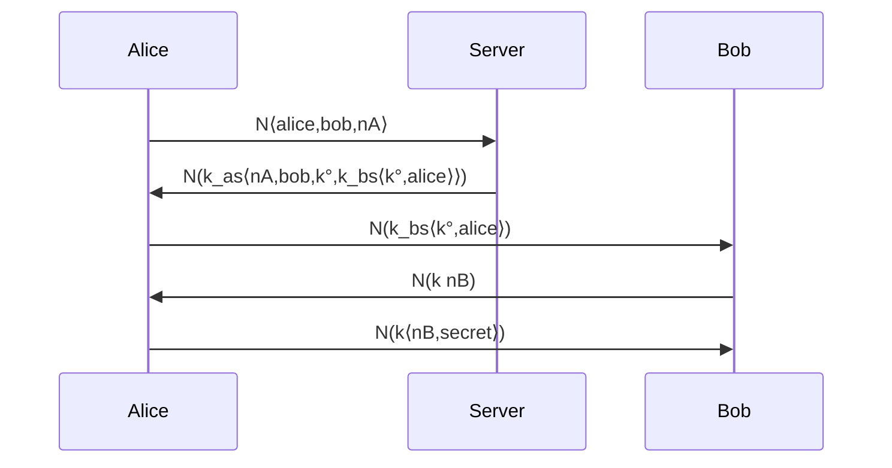

[[book-guidelines|↩ Back to guidelines]]

# Process Calculi and Security Protocols

## 1. The problem this chapter solves

Chapter 8 showed that multiset rewriting is a fragment of [[Linear-Logic|linear logic]]: a state is a multiset of atoms, a rewrite rule is a clause, and a computation is a focused proof search. Chapter 12 asks what happens when the atoms stand for **concurrent agents** and the multiset stands for a **shared network**.

Two targets:

- **Process calculi**, specifically a corner of Milner's $\pi$-calculus. Can two processes "meet" and exchange a name using only logical connectives?
- **Security protocols**, like Needham-Schroeder. Can we write a protocol as a *logical formula*, so that "the protocol does what it should" becomes provability of a sequent?

The answer is yes, with caveats. The first attempt (the $\pi$-calculus) works but leaks: some logically valid steps are not valid process reductions. So the chapter backs off to a weaker, more disciplined calculus where linear logic is an exact fit. The payoff is a precise reading of a protocol as a nest of implications, which looks almost exactly like CCS prefixes.

Notation note: following the book, a clause is written head-on-the-left, $a \mathbin{⅋} b \multimap r$, meaning "to prove $r$, prove $a \mathbin{⅋} b$". This is the backward implication used in Forum-style backchaining. The book's chosen reading is: when this appears on a program, $r$ is the result, and $a\mathbin{⅋}b$ is what gets consumed.

## 2. $\mathbin{⅋}$ as a meeting place (12.1)

### Pointers versus processes

Think of a data structure with a pointer to resource $A$ and a pointer to resource $B$. Holding the top pointer gives you access to *both*. That is exactly $A \otimes B$: both resources are there.

Now dualize. Flip the arrows, and turn passive resources into active processes. Two processes $P$ and $Q$ converge on a single point and are replaced by one new process. That is the operational meaning of backchaining on

$$P \mathbin{⅋} Q \multimap R.$$

The $\mathbin{⅋}$ is a location where processes interact: a **forum**. This is where the language Forum gets its name (the focused system $\Downarrow\mathcal L_2^\omega$ from Chapters 7-9 is its proof theory).

Rust analogy: $\otimes$ is a struct holding two owned values; $\mathbin{⅋}$ is a rendezvous, closer to a barrier or a `join`-style synchronization point that consumes two tasks and yields one continuation.

### The finite $\pi$-calculus in one paragraph

Agents:

- $\bar x z.P$: send name $z$ on wire $x$, then continue as $P$.
- $x(y).Q$: receive on $x$, bind the received name to $y$ in $Q$.
- $(x)P$: restriction; $x$ is private to $P$.
- $P \mid Q$: parallel composition; $0$: the null process; $P+Q$: choice; $[x=y]P$: match.

The core reduction: $\bar x z.P \mid x(y).Q \;\longrightarrow\; P \mid Q[z/y]$.

**Scope extrusion** is the subtle feature. In $(z)(\bar x z.P \mid Q) \mid x(y).R$ the private name $z$ gets sent out, so its scope must grow to cover $R$. The book's example:

$$(x(y).\bar y a.\bar y b.0) \mid (z)(\bar x z.\,z(u).z(v).\bar u v.0)$$

reduces (extrude $z$, communicate on $x$, then twice on $z$) to $(z)(0 \mid \bar a b.0)$, i.e. essentially $\bar a b.0$. A fresh channel $z$ is invented, handed to the other side, and used to send $a$ and $b$ back, which are then forwarded on the *outside* names.

### The encoding

Add four non-logical symbols to $\mathcal L_2^\omega$:

```
kind  name   type.
type  or     o -> o -> o.
type  send   name -> name -> o -> o.
type  get    name -> (name -> o) -> o.
type  match  name -> name -> o -> o.
```

Note `get` takes a function `name -> o`. The $\pi$-calculus input binder becomes a $\lambda$-abstraction, so binding and substitution are delegated to the logic (higher-order abstract syntax). The translation:

| $\pi$-calculus | logic |
|---|---|
| $P \mid Q$ | $\langle\langle P\rangle\rangle \mathbin{⅋} \langle\langle Q\rangle\rangle$ |
| $(x)P$ | $\forall x.\langle\langle P\rangle\rangle$ |
| $0$ | $\bot$ |
| $\bar x y.P$ | `send x y ⟨⟨P⟩⟩` |
| $x(y).P$ | `get x λy.⟨⟨P⟩⟩` |
| $P+Q$ | `or ⟨⟨P⟩⟩ ⟨⟨Q⟩⟩` |
| $[x=y]P$ | `match x y ⟨⟨P⟩⟩` |

and the dynamics lives in four axioms:

```
get X R || send X Y Q :- R Y || Q.
match X X P :- P.
or P Q :- P.
or P Q :- Q.
```

The first is the communication rule: a `get` and a `send` on the same wire `X` are consumed together at a `||` (that is $\mathbin{⅋}$), and the continuation `R Y` is the $\lambda$-body applied to the sent name. The notion "$P$ reduces to $Q$" is provability of $\Sigma :: \Psi;\ \langle\langle Q\rangle\rangle \vdash \langle\langle P\rangle\rangle;\cdot$, where $\Psi$ holds the four axioms. (Exercises 12.1 and 12.2 ask you to build exactly these proofs, including showing that a `match`-guarded process accepts $a$ and $b$ but not $c$.)

A small Rust sketch of the same shape, a process as an enum with `Get` holding a closure for the binder:

```rust
type Name = &'static str;

enum Proc {
    Nil,                                   // 0   <-> bottom
    Send(Name, Name, Box<Proc>),           // x̄y.P
    Get(Name, Box<dyn Fn(Name) -> Proc>),  // x(y).P, binder as closure
    Par(Box<Proc>, Box<Proc>),             // P | Q  <-> par
    Or(Box<Proc>, Box<Proc>),              // P + Q (nonlogical!)
}
```

The Rust closure plays the role of the $\lambda$ in `get x λy.P`; in Lean this would be `get : Name → (Name → Proc) → Proc`, which is literally the book's type.

### What breaks: two flaws

1. **Only some combinators are logical.** One would like $P+Q$ to be $\oplus$. The right rule for $\oplus$ does capture local choice. But the *left* rule would give: if $P$ reduces to $Q_1$ and to $Q_2$ then $P$ reduces to $Q_1 + Q_2$. That is not a $\pi$-calculus reduction. A non-logical `or` axiomatized by backchaining gives only the right-rule behavior, which is why `or` is a constant.
2. **$\forall$-left is too generous.** $\forall x.\forall y.P\,x\,y \vdash \forall x.P\,x\,x$ holds in every quantificational logic in the book. For processes it says $(x)\bar x a.\bar x b.0$ would reduce to $(x)(y)\bar x a.\bar y b.0$, which is not an accepted reduction.

A better $\pi$-calculus encoding, with processes as *terms* rather than formulas, comes in Chapter 13. See [[Operational-Semantics-in-Logic]] when that article exists. For now the chapter pivots to a weaker calculus where the logic is an exact fit.

## 3. Specifying communication protocols (12.2)

### The Needham-Schroeder Shared Key protocol

Alice wants a private channel to Bob through a trusted server $S$. Each shares a long-term key with $S$ ($k_{AS}$, $k_{BS}$).

1. $A \to S: A, B, n_A$
2. $S \to A: \{n_A, B, k_{AB}, \{k_{AB}, A\}_{k_{BS}}\}_{k_{AS}}$
3. $A \to B: \{k_{AB}, A\}_{k_{BS}}$
4. $B \to A: \{n_B\}_{k_{AB}}$
5. $A \to B: \{n_B, \text{Secret}\}_{k_{AB}}$

Here $\{t_1,\dots,t_n\}_k$ is the tuple encrypted with key $k$.

### Five observations that turn this into logic

**(a) The arrow is misleading; communication is asynchronous.** $A \to B : M$ looks like a three-way synchronization between Alice, Bob and $M$. It is not. Alice drops $M$ on a public network; Bob picks it up later; an intruder may interleave. So write it as multiset rewriting with network atoms $N\,M$:

$$A \;\longrightarrow\; A' \mid N\,M \qquad\quad B \mid N\,M \;\longrightarrow\; B' \qquad\quad E \mid N\,M \;\longrightarrow\; E' \mid N\,M$$

Alice posts. Bob consumes. The eavesdropper $E$ consumes and *re-posts* while remembering the message. In general: $A \mid N M_1 \mid\cdots\mid N M_p \longrightarrow A' \mid N P_1\mid\cdots\mid N P_q$.

**(b) Static key distribution is existential.** Which agents know key $k$ must be declared and fixed up front. A `local k.` block is like an $\exists$: you can inspect every occurrence of $k$ in its scope and know exactly who holds it. Anything outside the scope cannot mention it.

**(c) Dynamic creation of nonces and keys is universal.** `new k.` generates a fresh symbol at run time. It supports $\alpha$-conversion and behaves like reasoning generically: that is $\forall$ (an eigenvariable).

**(d) The two dual readings.**

| | $\mid$ | unit | $\longrightarrow$ | new | local |
|---|---|---|---|---|---|
| disjunctive | $\mathbin{⅋}$ | $\bot$ | $\multimap$ (head left) | $\forall$ | $\exists$ |
| conjunctive | $\otimes$ | $1$ | $\multimap$ (usual) | $\exists$ | $\forall$ |

Disjunctive is the $\mathcal L_2^\omega$/Forum view the book uses. The conjunctive one is the MSR system of Cervesato et al. Proof search does essentially the same thing in both; what happens on the right in one happens on the left in the other.

**(e) Encryption is an abstract data type.** Take two primitive types $\{o, d\}$; $d$ holds data. A key is a symbolic function $k : d \to d$, and $\{M\}_k$ is just the application $k\,M$. Pairing $\langle\cdot,\cdot\rangle : d\to d\to d$. To put a key *inside* data there is a coercion $(\cdot)^\circ : (d\to d)\to d$. An agent that holds the constructor $k$ can decrypt by ordinary pattern matching; one that does not, cannot. This is exactly an abstract data type: the constructor's scope is limited by quantification.

Example, with two existentially hidden keys:

$$\exists k_{as}.\exists k_{bs}.\Big[\ a_1\langle M,S\rangle \multimap a_2\,S \mathbin{⅋} N(k_{as}\,M).\quad b_1\,T \mathbin{⅋} N(k_{bs}\,M) \multimap b_2\,M\,T.\quad s_1 \mathbin{⅋} N(k_{as}\,P) \multimap N(k_{bs}\,P)\ \Big]$$

Alice encrypts to the server under $k_{as}$; the server re-encrypts under $k_{bs}$ for Bob and disappears. The $\exists$ guarantees these are the only occurrences of those keys, even if more principals are added later. Keys can still leak onto the network, which is scope extrusion again.

Pitfall to keep in mind: in this model *everyone* can read every network atom. Encryption is the only confidentiality mechanism.

Rust sketch of the abstract-data-type view, where possessing the key type is the capability:

```rust
mod keys {
    pub struct Key(());                 // constructor private: no forging
    pub struct Cipher<'k>(Vec<u8>, std::marker::PhantomData<&'k Key>);
    impl Key {
        pub fn new() -> Key { Key(()) }
        pub fn enc(&self, m: Vec<u8>) -> Cipher<'_> { Cipher(m, std::marker::PhantomData) }
        pub fn dec<'k>(&self, c: Cipher<'k>) -> Vec<u8> { c.0 }
    }
}
```

This is only an analogy: Rust's visibility rules enforce the opacity at compile time, while in the book the logic's quantifier scoping does it.

## 4. Protocols as theories in linear logic (12.3)

### Agent clauses and theories

An **agent identifier** $\rho$, with indices $\rho_i$, gives **agent state predicates** whose arguments have type $d$. They record where an agent is in the protocol, and its memory. An **agent clause** has the shape

$$\forall \bar x.\big[a_1 \mathbin{⅋}\cdots\mathbin{⅋} a_m \multimap \forall \bar y.[\,b_1 \mathbin{⅋}\cdots\mathbin{⅋} b_n\,]\big]$$

where every atom is a network message $N\,t$ or an agent state atom, with restrictions:

1. exactly one agent state atom in the head, at most one in the body;
2. if both exist they share the same agent identifier, and the index increases ($i<j$).

So a clause involves a single agent: agents never synchronize with each other directly (only through $N$), no agent turns into another, an agent may be deleted, and every run is finite.

An **agent theory** is $\exists \bar x\,[C_1\otimes\cdots\otimes C_s]$ with $x_i$ of type $d$ or $d\to d$ (the hidden keys) and at most one clause per head state predicate (agents are deterministic; this is easily relaxed).

### Needham-Schroeder as a theory (Fig. 12.3)

Six clauses, for Alice $a_1\ldots a_4$, Bob $b_1\ldots b_3$, and the server $s_1$:

$$\begin{aligned}
&a_1\,S \multimap \forall n_a.\ a_2\,n_a\,S \mathbin{⅋} N\langle alice,bob,n_a\rangle\\
&a_2\,N\,S \mathbin{⅋} N(k_{as}\langle N,bob,K,E\rangle) \multimap a_3\,K\,S \mathbin{⅋} N\,E\\
&a_3\,Key\,S \mathbin{⅋} N(Key^\circ\,N_b) \multimap a_4 \mathbin{⅋} N(Key\langle N_b,S\rangle)\\
&b_1 \mathbin{⅋} N(k_{bs}\langle Key^\circ,alice\rangle) \multimap \forall n_b.\ b_2\,n_b\,Key^\circ \mathbin{⅋} N(Key\,n_b)\\
&b_2\,N_b\,Key^\circ \mathbin{⅋} N(Key\langle N_b,S\rangle) \multimap b_3\,S\\
&s_1 \mathbin{⅋} N\langle alice,bob,N\rangle \multimap \forall k.\,N(k_{as}\langle N,bob,k^\circ,k_{bs}\langle k^\circ,alice\rangle\rangle)
\end{aligned}$$

(Transcribed from the figure; the PDF text extraction is slightly mangled around $Key^\circ$, so check the figure if you need exact placement of $^\circ$.)

Read it as a state machine per agent. The $\forall$ in a body is `new` (fresh nonce $n_a$, fresh session key $k$). Universal variables like $K$, $E$, $Key$ are filled by pattern matching on the network message.

**Correctness statement.** The protocol implements the specification $\forall x.[a_1\,x \mathbin{⅋} b_1 \mathbin{⅋} s_1 \multimap a_4 \mathbin{⅋} b_3\,x]$: there is a simple $\Downarrow\mathcal L_2^\omega$-proof of

$$\Sigma, k_{as}, k_{bs} :: C_1,\dots,C_6;\ \cdot \;\vdash\; \forall x.[\,a_4\mathbin{⅋} b_3\,x \multimap a_1\,x\mathbin{⅋} b_1\mathbin{⅋} s_1\,];\ \cdot$$

Initial states (Alice with a secret $x$, Bob, the server) get rewritten to final states where Bob now holds $x$. Note what this does and does not prove: it shows the honest run exists. It says nothing about attackers, which would require adding intruder clauses and asking a harder question.

### Guessing, and why it is a feature of the logic

Compare two Alice clauses:

$$a\,K^\circ \mathbin{⅋} N(K\,M) \multimap a'\,M \tag{3.1}$$
$$a \mathbin{⅋} N(K\,M) \multimap a'\,M \tag{3.2}$$

(3.1) uses a key she holds. (3.2) appears to decrypt without a key, which is cheating. Logically, (3.2) is equivalent to $\forall M.\forall X.[a \mathbin{⅋} N X \multimap a'\,M]$ and to $\forall X.[a\mathbin{⅋}N X \multimap \exists M.\,a'\,M]$: Alice does not decode anything, she **guesses** $M$ with $\exists$. Operationally, unifying $K\,M$ with a message $k\,secret$ has three simply typed $\lambda$-unifiers:

$$[M\mapsto k\,secret,\ K\mapsto \lambda w.w]\quad [M\mapsto s,\ K\mapsto k]\quad [M\mapsto M,\ K\mapsto \lambda w.\,k\,secret]$$

so $M$ can be anything of type $d$. The lesson: higher-order patterns let a "key" variable absorb arbitrary structure, so you must be careful not to write protocols whose variables are applied-and-unknown.

(Exercise 12.3 gives a nice equivalence: $a_1 \multimap \forall k.N(k\,m)$ and $a_1 \multimap \forall k.N(k\,m')$ are logically equivalent. Both emit an unreadable message under a fresh key, so $m$ and $m'$ are indistinguishable.)

## 5. Hiding agent states (12.4)

Agent state predicates $\rho_i$ are private bookkeeping. Linear logic can hide them with $\exists$ at predicate type.

**Fewer-way synchronization.** An $n$-way ($n\ge 3$) rewrite can be factored through hidden intermediates:

$$\exists l_1.\exists l_2.\Big[\ a\mathbin{⅋}b \multimap l_1.\quad l_1\mathbin{⅋}c \multimap l_2\mathbin{⅋}e.\quad l_2 \multimap d\mathbin{⅋}f\ \Big] \;\dashv\vdash\; a\mathbin{⅋}b\mathbin{⅋}c \multimap d\mathbin{⅋}e\mathbin{⅋}f$$

Forward is easy. The reverse substitutes $a\mathbin{⅋}b$ for $l_1$ and $d\mathbin{⅋}f$ for $l_2$, a genuinely higher-order step. Caveat: entailment cannot see *failed* searches. A search with $a, b$ but no $c$ gets stuck in the left formula after consuming $a,b$, but is merely stuck in the right one. Because the proof theory reasons about complete proofs, the two are interchangeable.

**State-passing becomes nested implication.**

$$\exists a_2.\exists a_3.\Big[\ a_1\mathbin{⅋}N m_0 \multimap a_2\mathbin{⅋}N m_1.\ \ a_2\mathbin{⅋}N m_2 \multimap a_3\mathbin{⅋}N m_3.\ \ a_3\mathbin{⅋}N m_4\multimap a_4\mathbin{⅋}N m_5\Big]$$
$$\dashv\vdash\quad a_1\mathbin{⅋}N m_0 \multimap (N m_1 \multimap (N m_2 \multimap (N m_3 \multimap (N m_4 \multimap (N m_5 \mathbin{⅋} a_4))))).$$

Every time you cross a $\multimap$ to the right, polarity flips: output becomes input becomes output. The state predicates have been replaced by *position in the nesting*. This is the whole trick of the chapter.

Rust analogy: instead of an enum of explicit states plus a `match` over (state, message), you write a chain of continuations (`recv(|m| send(.., recv(|m2| ...)))`). The "state" is the closure's captured environment. Hiding $\exists a_i$ is closure conversion in reverse.

## 6. Agents as nested implications (12.5)

Two grammars:

$$H ::= A \mid \bot \mid H \mathbin{⅋} H \qquad\qquad K ::= H \mid H \multimap K \mid \forall x.\,K$$

$A$ ranges over network atoms $N\,t$. An $H$ is a bundle of messages, either output or input. A $K$ is an **agent formula**: deep nesting of $\multimap$ alternates output and input. The only predicate left is $N$.

### Proof search reads it as a protocol

In a sequent $\Sigma :: \cdot;\ \Gamma \vdash \Delta, \mathcal A;\ \cdot$ with $\Gamma,\Delta$ multisets of $K$ formulas and $\mathcal A$ network atoms:

- **right-introduction phase** = *all* output actions by all agents in $\Delta$;
- **left-introduction phase** = an agent chosen for focus *inputs* a message.

Take $P = \forall x.\forall y.(N(f\,x)\mathbin{⅋}N(g\,x\,y)\multimap \hat P\,x\,y)$. On the right, the derived rule (read bottom-up)

$$\frac{\Sigma,x,y :: \cdot;\ \Gamma,\hat P\,x\,y \vdash \Delta,\mathcal A, N(f\,x), N(g\,x\,y);\ \cdot}{\Sigma :: \cdot;\ \Gamma \vdash \Delta,\mathcal A,P;\ \cdot}$$

says: $P$ creates fresh tokens $x,y$ (eigenvariables), emits two messages, and its body $\hat P\,x\,y$ jumps to the *left*, i.e. input mode. On the left the dual rule says $P$ consumes $N(f\,t), N(g\,t\,s)$ for some $\Sigma$-terms $t,s$ and continues on the right.

Negation flips input and output. $\bot \multimap P$ on the right outputs nothing and moves $P$ left. Phases can be contracted:

$$p \multimap (\bot \multimap (q \multimap k)) \dashv\vdash p \mathbin{⅋} q \multimap k.$$

### NS again (Fig. 12.4)

Alice (Out, In, Out, In, Out, Cont):

$$\forall n_a.\ N\langle alice,bob,n_a\rangle \multimap \big(\forall Key.\forall E.\,N(k_{as}\langle n_a,bob,Key^\circ,E\rangle) \multimap (N\,E \multimap (\forall N.\,N(Key\,N) \multimap (N(Key\langle N,secret\rangle)\multimap a_4))) \big)$$

Bob: $\bot \multimap(\forall Key.\,N(k_{bs}\langle Key^\circ,alice\rangle)\multimap(\forall n_b.\,N(Key\,n_b)\multimap(\forall S.\,N(Key\langle n_b,S\rangle)\multimap b_3\,S)))$.

Server: $\bot\multimap(\forall N.\,N\langle alice,bob,N\rangle \multimap (\forall k.\,N(k_{as}\langle N,bob,k^\circ,k_{bs}\langle k^\circ,alice\rangle\rangle)))$.

Put all three on the right of a turnstile with nothing on the left. Alice outputs and moves left. Bob and the server output nothing and move left. Now the server is chosen as focus, inputs Alice's message, outputs the ticket, and so on. The protocol *is* the proof search schedule.



### Variations

- **Persistent server:** replace $\multimap$ with $\Leftarrow$ on the server's first line (the clause moves to the unbounded zone and can be reused).
- **Adversary modelling:** put network messages in the *right-unbounded* zone, i.e. use $?$ on outputs. An attacker remembers every message even after consumption.
- **Process-calculus feel:** $\multimap$ plays the role of the dot prefix in CCS. $\forall$ on output is restriction (`new`); $\forall$ on input is value binding. $a\multimap(b\multimap(c\multimap\cdots))$ reads as $\bar a \parallel (b.(\bar c\parallel(d.\cdots)))$ or $a.(\bar b\parallel(c.(\bar d\parallel\cdots)))$ depending on the side it sits on. Without implication: $a\mathbin{⅋}(b^\perp\otimes(c\mathbin{⅋}(d^\perp\otimes\cdots)))$.

## 7. A Lean-flavoured summary

The shape of an agent formula as a datatype (the book's $K$ grammar), with output and input alternating:

```lean
inductive K (D : Type) where
  | done   : K D                          -- ⊥ / continuation
  | out    : List (D) → K D → K D         -- H ⊸ K when on the right
  | inp    : (D → K D) → K D              -- ∀x. N x ⊸ K (binder = λ)
```

This is only an informal sketch of the idea. The book's formulas are typed $\lambda$-terms of type $o$, not an inductive family like this, and it does not make precise the output/input polarity discipline.

## 8. Where this leads

Chapter 12's encoding of $\pi$ is deliberately weak; Chapter 13 (see [[Operational-Semantics-in-Logic]]) replaces it with processes as *terms* and transitions as clauses, fixing the $\oplus$ and $\forall$-left problems. The "hide internal state by $\exists$ over predicates" move is the same one used for abstract data types in [[Higher-Order-Programming-and-Hiding-of-Specifications]], and the $\otimes$/$\mathbin{⅋}$ multiset reading of state comes from [[Multiset-Rewriting-in-Linear-Logic]]. The focused phases (negative vs positive) that make "all outputs then one input" precise are from [[Focused-Proof-Systems-and-Backchaining]] and [[Multi-Zone-Sequents-and-Linear-Logic-Programming-Languages]].

For a reader building a verifier or a protocol checker in Rust or Lean, the practical takeaway is a design: represent a protocol as a chain of alternating send/receive continuations over a shared multiset, with fresh names for `new` and abstract key types for encryption. That structure is exactly what proof search over $K$ formulas executes. (This topic is untagged against the workbench Focus Areas, so there is no goal-routed synthesis beyond this note.)
