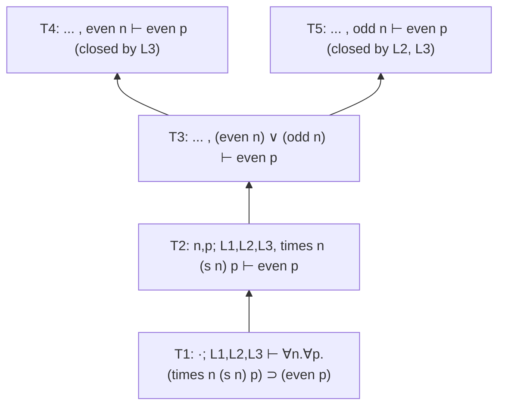
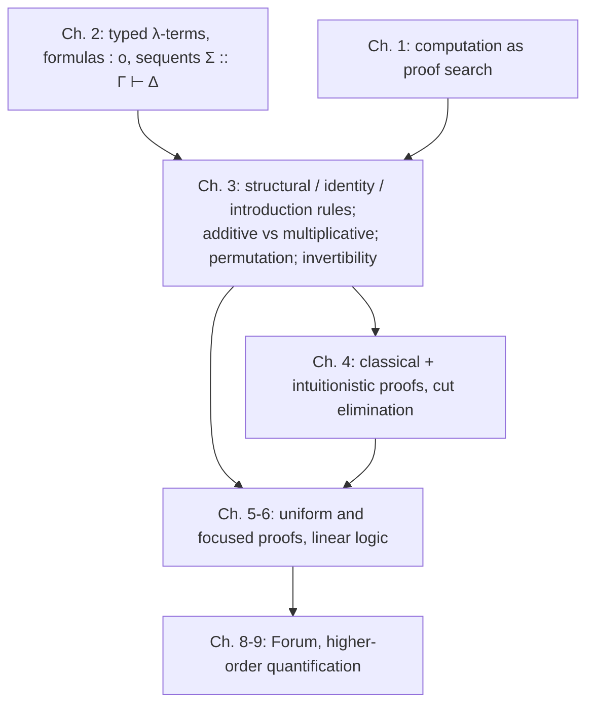

[[book-guidelines|↩ Back to guidelines]]

# Sequent Calculus Proof Systems

> Focus Area: `automated-reasoning`. Secondary touch on `type-theory` (signatures, eigenvariables, binders).

## 1. The problem: proofs you can check versus proofs you can search for

Start with the oldest style of formal proof. A **Frege (or Hilbert) proof** fixes some formulas as *axioms* and a few inference rules, and a proof is a list of formulas where every entry is an axiom or follows from earlier entries. The book's Figure 3.1 uses three axiom schemas for propositional classical logic,

$$
\begin{aligned}
(\mathrm{Ax1})\;& X \supset Y \supset X\\
(\mathrm{Ax2})\;& (X \supset (Y \supset Z)) \supset ((X \supset Y) \supset (X \supset Z))\\
(\mathrm{Ax3})\;& ((X \supset f) \supset f) \supset X
\end{aligned}
$$

plus one rule, modus ponens (from $A \supset B$ and $A$, conclude $B$). With these, the seven-line list in Figure 3.1 proves $f \supset w$ (ex falso quodlibet: from false, anything follows).

Checking such a list is trivial: scan top to bottom, confirm each line is an axiom instance or an `mp` of two earlier lines. That is a linear-time loop. Finding one is hopeless to automate. Look at line (2) of the example: the proof has to *guess* the instance $(((w \supset f)\supset f)\supset w)\supset(f\supset(((w\supset f)\supset f)\supset w))$ of (Ax1). Nothing in the goal $f \supset w$ suggests that formula. Modus ponens, read bottom-up, says "to prove $B$, find some $A$ such that both $A \supset B$ and $A$ are provable", and $A$ is unconstrained by $B$. The search space is not guided by the goal.

Think of a Frege proof as a compiled binary: easy to verify, opaque to read, and no hint in it about how it was produced. The sequent calculus is the structured alternative. The book's whole program (computation as proof search, see [[Computation-as-Proof-Search]]) needs a proof system where the *state of an incomplete proof* is a first-class object. That object is the sequent.

Two departures from Frege proofs (Section 3.1):

1. Inference rules act on **sequents**, a richer structure than a formula.
2. There are **no axioms**. The whole burden is carried by inference rules over sequents.

**What breaks without this.** With axioms plus modus ponens only, the only way to run "backward" from a goal is to invent middle formulas. A search procedure built on that has no notion of "a smaller problem" to recurse on. Sequent rules, in contrast, (mostly) replace a goal by simpler goals built from its own subformulas.

## 2. The sheet-of-paper reading of a sequent

Miller's motivating example: prove that $n(n+1)$ is even for every natural number $n$. The informal proof: pick arbitrary $m$. It is either even or odd. If even, the product is even. If odd, $m+1$ is even, so again the product is even.

Formalizing the first step means naming three lemmas the argument accepts as already proved (with sorts and constants $z : nat$, $s : nat \to nat$, $even, odd : nat \to o$, $times : nat \to nat \to nat \to o$):

$$
\begin{aligned}
L_1 &\;\; \forall n.\,(even\ n) \vee (odd\ n)\\
L_2 &\;\; \forall n.\,(odd\ n) \supset (even\ (s\ n))\\
L_3 &\;\; \forall n.\forall m.\forall p.\,((even\ n)\vee(even\ m)) \supset (times\ n\ m\ p) \supset (even\ p)
\end{aligned}
$$

Now take a blank sheet of paper. Write the lemmas at the top and the target at the bottom. The sheet is a **sequent**:

$$
T_1:\quad \cdot\,;\; L_1, L_2, L_3 \;\vdash\; \forall n.\forall p.\,(times\ n\ (s\ n)\ p)\supset(even\ p)
$$

The dot is the empty list of **eigenvariables** (the variables bound over the whole sequent). Move forward one step: introduce the universals and the implication, and the sheet becomes

$$
T_2:\quad n, p\,;\; L_1, L_2, L_3, (times\ n\ (s\ n)\ p) \;\vdash\; (even\ p)
$$

Now $n$ and $p$ are bound over the sequent and there is a new assumption. Use $L_1$ to add $(even\ n)\vee(odd\ n)$ ($T_3$). The disjunction forces a case analysis, so one sheet becomes two, identical except that the disjunction is replaced by $(even\ n)$ in $T_4$ and by $(odd\ n)$ in $T_5$. The proof so far is a tree growing upward from the endsequent:



Arrows point from conclusion to premises, which is the direction a prover moves. The horizontal line justifying the step from $T_3$ to $\{T_4,T_5\}$ is the "rule of cases", called $\vee L$ in Chapter 4.

Two readings of the same object:

- **Single-conclusion**: assumptions above the turnstile, one goal below. This is the human-proof reading.
- **Multiple-conclusion** (Gentzen's more general form): the comma on the left acts as conjunction, the comma on the right as disjunction. The sequent $x,y : B_1,B_2,B_3 \vdash C_1,C_2$ is semantically related to

$$
\forall x.\forall y.\,[(B_1\wedge B_2\wedge B_3)\supset(C_1\vee C_2)].
$$

The book is explicit that it does not restrict itself to human-readable proofs. It focuses on the low-level structure that makes automated search possible for some fragments.

### Grounding: a sequent as a Rust value

A sequent is state, so make it a struct. Formulas come from Chapter 2 (terms of type $o$), here shrunk to a first-order propositional-plus-quantifier core.

```rust
use std::collections::BTreeMap;

#[derive(Clone, PartialEq, Eq, PartialOrd, Ord, Debug)]
enum Formula {
    Atom(String, Vec<Term>),          // p t1 ... tn
    True,                              // t
    And(Box<Formula>, Box<Formula>),
    Or(Box<Formula>, Box<Formula>),
    Imp(Box<Formula>, Box<Formula>),
    // de Bruijn-free toy: bound name + body, relies on alpha-renaming discipline
    All(String, Box<Formula>),
}

#[derive(Clone, PartialEq, Eq, PartialOrd, Ord, Debug)]
enum Term { Var(String), App(String, Vec<Term>) }

/// A multiset: formula -> multiplicity.
type Multiset = BTreeMap<Formula, usize>;

/// Sigma :: Gamma |- Delta
#[derive(Clone, Debug)]
struct Sequent {
    sigma: Vec<(String, String)>,     // eigenvariables with their types
    left: Multiset,                   // Gamma
    right: Multiset,                  // Delta
}

/// A derivation is a tree of rule applications; a proof is a derivation
/// with no open leaves.
enum Derivation {
    Open(Sequent),                                    // unjustified leaf
    Rule { name: &'static str, conclusion: Sequent, premises: Vec<Derivation> },
}
```

`Derivation::Open` is the book's "leaf with no line drawn over it". A *proof* is a derivation where every leaf is the conclusion of a zero-premise rule (such as `init` or `tR`).

## 3. Sequents carry signatures: `Σ :: Γ ⊢ Δ`

Chapter 2 gives the sequent its full shape $\Sigma :: \Gamma \vdash \Delta$, where $\Sigma$ is a signature (a list of distinct typed variables), and $\Gamma, \Delta$ are multisets of formulas. The signature is not decoration. It answers "which variables currently exist, with which types?", which is exactly what a typing context answers in a type checker. Here it also controls the quantifier rules.

Notation conventions that the book fixes, worth internalizing:

- $\Sigma :: \Gamma \vdash_{\mathcal X} \Delta$ means this sequent has a proof in the proof system $\mathcal X$ (a set of inference rules).
- $\Gamma \vdash_{\mathcal X}\Delta$ drops an empty $\Sigma$. $\vdash_{\mathcal X}\Delta$ also drops the empty $\Gamma$.
- The bare $\vdash$ is overloaded: it is a *sequent* (syntax) and, from context, the *proposition that the sequent is provable*. Keep the two senses apart.

## 4. The three families of rules

An inference rule has exactly one sequent as conclusion and zero or more as premises. Every rule in the book is one of three kinds: **structural**, **identity**, **introduction**.

### 4.1 Structural rules: what you can do to contexts

Left and right versions of exchange ($x$), contraction ($c$), and weakening ($w$) (Figure 3.2):

$$
\frac{\Sigma :: \Gamma, B, C, \Gamma' \vdash \Delta}{\Sigma :: \Gamma, C, B, \Gamma' \vdash \Delta}\,xL
\qquad
\frac{\Sigma :: \Gamma, B, B \vdash \Delta}{\Sigma :: \Gamma, B \vdash \Delta}\,cL
\qquad
\frac{\Sigma :: \Gamma \vdash \Delta}{\Sigma :: \Gamma, B \vdash \Delta}\,wL
$$

The right versions $xR$, $cR$, $wR$ are symmetric on $\Delta$. Which of them make sense depends on what a context *is*:

| Context is a... | Exchange | Contraction | Weakening |
|---|---|---|---|
| list | needed to reorder adjacent items | collapses two copies | inserts at the end only |
| multiset | not used (order is irrelevant) | collapses two copies | inserts |
| set | not used | not used (copies cannot exist) | the only one that makes sense |

In this book exchange is never used and contexts are almost always multisets. Only weakening and contraction ever appear, and only when a proof system adds them explicitly. If you have a *set* of formulas and want to put it in a sequent, coerce it to the multiset where each element occurs exactly once. In Rust terms: `BTreeSet<Formula>` for a set, `BTreeMap<Formula, usize>` for a multiset (as above), `Vec<Formula>` for a list. The choice of container *is* the choice of which structural rules are baked in.

**What breaks without making this explicit.** If you use a multiset container but your proof system does not list `cL`, then "use this assumption twice" is something the *data structure* allows but the *logic* does not. Getting that out of sync is how [[Linear-Logic|linear logic]] implementations end up unsound. This is why Miller refuses to let structural rules enter implicitly (more on that in section 5).

Exercise 3.1 in the book: if $\Delta'$ is a permutation of the list $\Delta$, a sequence of $xR$ steps derives $\Sigma :: \Gamma \vdash \Delta$ from $\Sigma :: \Gamma\vdash\Delta'$.

### 4.2 Identity rules: what $\vdash$ itself means

Two rules (Figure 3.3):

$$
\frac{}{\Sigma :: B \vdash B}\,init
\qquad\qquad
\frac{\Sigma :: \Gamma \vdash \Delta, B \quad \Sigma :: B, \Gamma' \vdash \Delta'}{\Sigma :: \Gamma, \Gamma' \vdash \Delta, \Delta'}\,cut
$$

Structural rules are about the *shape of contexts*. Identity rules are about the *meaning of $\vdash$*: `init` says $\vdash$ is reflexive, `cut` says it is transitive. Both have a repeated schema variable $B$ (twice in the conclusion of `init`, once in each premise of `cut`), so applying either requires comparing two formula occurrences for identity. Section 4.2 of the book shows that, in a precise sense, the two are *dual* aspects of $\vdash$, which is the topic of [[Cut-Elimination-and-Its-Consequences]].

Terminology point. In many textbooks a zero-premise rule is called an *axiom*. Miller reserves "axiom" for a **formula** accepted as a starting point (as in Frege proofs). Sequents are not formulas, so the leaves of a sequent proof are called **initial sequents**. This matters when you read other literature: "the axiom rule" there is "an initial sequent" here.

A tiny sanity exercise from the book (Exercise 3.3): a system with *only* `init` and `cut` proves exactly the sequents of the form $B \vdash B$ (and sequents derivable from them by cut, which are again of that form up to context), and every provable sequent is provable without `cut`. This is the smallest instance of cut elimination.

### 4.3 Introduction rules: reasoning from and to a connective

An introduction rule introduces one occurrence of a connective in its conclusion. In a two-sided system, each connective is introduced on the left and on the right by a small collection of rules: 0, 1, or 2. The informal reading from the sheet of paper:

- a **left** rule says how to *reason from* a hypothesis with that connective,
- a **right** rule says how to *reason to* a goal with that connective.

Figure 3.4 gives examples:

$$
\frac{\Sigma :: B, \Gamma \vdash \Delta}{\Sigma :: B\wedge C, \Gamma\vdash\Delta}\,\wedge L
\qquad
\frac{\Sigma :: C, \Gamma \vdash \Delta}{\Sigma :: B\wedge C, \Gamma\vdash\Delta}\,\wedge L
\qquad
\frac{\Sigma :: \Gamma \vdash \Delta, B \quad \Sigma :: \Gamma\vdash\Delta, C}{\Sigma :: \Gamma\vdash\Delta, B\wedge C}\,\wedge R
$$

$$
\frac{}{\Sigma :: \Gamma\vdash\Delta, t}\,tR
\qquad
\frac{\Sigma :: \Gamma_1\vdash\Delta_1, B \quad \Sigma :: C,\Gamma_2\vdash\Delta_2}{\Sigma :: B\supset C, \Gamma_1,\Gamma_2\vdash\Delta_1,\Delta_2}\,\supset L
\qquad
\frac{\Sigma :: B,\Gamma\vdash\Delta, C}{\Sigma :: \Gamma\vdash\Delta, B\supset C}\,\supset R
$$

Counting rules per connective: conjunction has *two* left rules and one right; implication and $\forall$ have one of each; $t$ has one right rule and *zero* left rules (there is nothing to learn from knowing "true").

**One-sided systems.** If a sequent has only a right side, the left-introduction rule for a connective is replaced by the right-introduction rule for its De Morgan dual. That restricts one-sided systems to logics where every connective has a De Morgan dual. The only one-sided system in the book is the linear logic system of Chapter 6.

### 4.4 The quantifier rules and the mobility of binders

The quantifier rules are where the signature $\Sigma$ earns its keep:

$$
\frac{\Sigma \Vdash t : \tau \quad \Sigma :: \Gamma, B[t/x]\vdash\Delta}{\Sigma :: \Gamma, \forall_\tau x.B\vdash\Delta}\,\forall L
\qquad
\frac{\Sigma, y:\tau :: \Gamma\vdash\Delta, B[y/x]}{\Sigma :: \Gamma\vdash\Delta, \forall_\tau x.B}\,\forall R
$$

- **$\forall L$** consumes the signature: it uses the typing judgment $\Sigma \Vdash t:\tau$ to decide which terms $t$ are legal instantiations. (Strictly, the check is against the logical, non-logical, and eigenvariable signatures together; since the first two are global they are folded into one $\Sigma$ for convenience. The judgment may be a subproof or a side condition, a choice the book leaves to the system designer.)
- **$\forall R$** *changes* the signature: reading bottom-up, the conclusion has $\Sigma$ and the premise has $\Sigma \cup \{y:\tau\}$. The variable $y$ is an **eigenvariable** (Gentzen's term for a sequent-level bound variable). It must not occur free in any formula of the conclusion, equivalently every occurrence of $y$ above the line appears inside the displayed $B[y/x]$.

Miller's way of seeing $\forall R$ is worth keeping: **it moves a binder**. Because binding structures are identified up to $\alpha$-conversion, the rule can be written

$$
\frac{\Sigma, x:\tau :: \Gamma\vdash\Delta, B}{\Sigma :: \Gamma\vdash\Delta, \forall_\tau x.B}\,\forall R
$$

Read from premise to conclusion, the binder for $x$ migrates from the *sequent* level (the signature) into the *formula* level ($\forall_\tau x$). At no point is the binder replaced by a free variable. This is the proof-theoretic origin of the mobility-of-binders idea that returns in $\lambda$Prolog, where $\Pi x\backslash\,G$ as a goal introduces a fresh eigenvariable.

**What breaks without the freshness side condition.** Take the (bad) "proof" of $\forall x.p(x) \Leftarrow p(y)$-style reasoning: if $\forall R$ were allowed to pick a $y$ already free in $\Gamma$, you could prove "$p(y)\vdash\forall x.p(x)$", i.e. from one instance conclude everything. The condition "$y$ not free in the conclusion" is what makes $y$ stand for *an arbitrary element* rather than *a particular element you already talked about*.

### Grounding: a rule application, with an eigenvariable check, in Rust

Bottom-up proof search applies a rule *backwards*: given a conclusion, produce premises. Here is $\wedge R$ (additive) and $\forall R$ (binder moves into the signature), as pure functions on the `Sequent` type above. Each returns `None` when the rule does not apply to the chosen subject formula.

```rust
fn remove_one(ms: &Multiset, f: &Formula) -> Option<Multiset> {
    let mut out = ms.clone();
    match out.get_mut(f) {
        Some(n) if *n > 1 => { *n -= 1; Some(out) }
        Some(_) => { out.remove(f); Some(out) }
        None => None,
    }
}

fn add_one(ms: &Multiset, f: Formula) -> Multiset {
    let mut out = ms.clone();
    *out.entry(f).or_insert(0) += 1;
    out
}

/// Search direction for AND-right (additive):
///   Sigma :: G |- D, B     Sigma :: G |- D, C
///   ------------------------------------------
///           Sigma :: G |- D, B /\ C
fn and_right(concl: &Sequent, subject: &Formula) -> Option<Vec<Sequent>> {
    let Formula::And(b, c) = subject else { return None };
    let rest = remove_one(&concl.right, subject)?;
    Some(vec![
        Sequent { right: add_one(&rest, (**b).clone()), ..concl.clone() },
        Sequent { right: add_one(&rest, (**c).clone()), ..concl.clone() },
    ])
    // Additive: BOTH premises reuse the whole context. In real code `left`
    // would be an Rc/persistent structure so these clones are pointer copies.
}

/// Search direction for FORALL-right: the binder moves from formula to signature.
/// The fresh name must not occur free in the conclusion.
fn forall_right(concl: &Sequent, subject: &Formula, fresh: &str, ty: &str) -> Option<Sequent> {
    let Formula::All(x, body) = subject else { return None };
    if occurs_free_in_sequent(fresh, concl) { return None; }   // eigenvariable condition
    let rest = remove_one(&concl.right, subject)?;
    let inst = subst(body, x, &Term::Var(fresh.to_string())); // B[y/x]
    let mut sigma = concl.sigma.clone();
    sigma.push((fresh.to_string(), ty.to_string()));
    Some(Sequent { sigma, right: add_one(&rest, inst), left: concl.left.clone() })
}
# fn occurs_free_in_sequent(_: &str, _: &Sequent) -> bool { false }
# fn subst(b: &Formula, _: &str, _: &Term) -> Formula { b.clone() }
```

The `fresh` argument is the engineering form of the eigenvariable condition. In a real prover you would draw it from a fresh-name supply and the check becomes an assertion rather than a search. The *decision* "what instantiation $t$ to use" in $\forall L$ is the opposite situation: nothing in the sequent determines it, which is exactly where unification (and, in the higher-order case, Miller's pattern unification) enters later in the book.

### Grounding: the same shape in Lean

Lean's kernel typing rules are sequent-flavored: a goal is $\Gamma \vdash e : T$ with a local context $\Gamma$, and `intro` is $\supset R$ / $\forall R$:

```lean
-- ∀R / ⊃R is `intro`: the binder moves from the goal into the local context.
example (P Q : Prop) : P → Q → P := by
  intro hp hq        -- sequent: P, Q ⊢ P     (hp, hq are the context Γ)
  exact hp           -- `init`: the goal is literally an assumption

-- ∀L is instantiation: the term t must be well-typed in the current context.
example (p : Nat → Prop) (h : ∀ n, p n) : p 5 := h 5
```

In `intro x` on a goal `∀ x : T, B x`, Lean adds a *fresh local `x : T`* to the context and leaves `B x` as the goal. That fresh local is the eigenvariable, and the context is the signature $\Sigma$ (merged with $\Gamma$ because Lean uses a dependent context where both live together). The correspondence is close enough to count as the same mechanism.

## 5. Additive versus multiplicative rules

When a rule has two premises, there are two natural ways to relate the premise contexts to the conclusion context.

- **Multiplicative**: contexts of the premises are *merged* (split) to form the context of the conclusion. $\mathit{cut}$ and $\supset L$ in the figures above are multiplicative.
- **Additive**: the premise contexts are *the same* as the conclusion context. $\wedge R$ is additive. An additive version of cut:

$$
\frac{\Sigma :: \Gamma\vdash\Delta,B \qquad \Sigma :: B,\Gamma\vdash\Delta}{\Sigma :: \Gamma\vdash\Delta}
$$

### The general definition

The book gives a definition that works for *any* rule, not only two-premise ones. Classify each formula occurrence in the **conclusion** as:

- a **subject occurrence**: for an introduction rule, the one occurrence introduced; for `init`, both occurrences; for `cut`, there are none;
- a **context occurrence**: every other occurrence.

Then:

- a rule is **additive** if every context occurrence in the conclusion has an occurrence in *every* premise;
- a rule is **multiplicative** if every context occurrence in the conclusion has an occurrence in *exactly one* premise;
- occurrences are compared on the same side (left to left, right to right).

Consequence: $tR$ is additive but *not* multiplicative (it has no premises, so no premise contains the context). The rule $\overline{\Sigma :: \cdot\vdash t}$ with an empty context is both, because the conditions are vacuous.

Two multiplicative conjunction rules:

$$
\frac{\Sigma :: B, C,\Gamma\vdash\Delta}{\Sigma :: B\wedge C,\Gamma\vdash\Delta}\,\wedge L_m
\qquad
\frac{\Sigma :: \Gamma_1\vdash\Delta_1, B \quad \Sigma :: \Gamma_2\vdash\Delta_2, C}{\Sigma :: \Gamma_1,\Gamma_2\vdash\Delta_1,\Delta_2, B\wedge C}\,\wedge R_m
$$

### Why the pairing of rules matters: structural rules sneak in

Exercise 3.2 shows that when weakening and contraction are available, the additive and multiplicative conjunction rules derive each other. The converse direction is the instructive part: pairing the wrong left and right rules *derives a structural rule*, even though you never listed it. Pair $\wedge L_m$ with $\wedge R$:

$$
\dfrac{\dfrac{}{B\vdash B}\,init \quad \dfrac{}{B\vdash B}\,init}{B\vdash B\wedge B}\,\wedge R
\qquad
\dfrac{\Gamma, B, B\vdash\Delta}{\Gamma, B\wedge B\vdash\Delta}\,\wedge L_m
\;\;\Longrightarrow\;\;
\dfrac{\Gamma, B, B\vdash\Delta}{\Gamma, B\vdash\Delta}\ \text{via } cut
$$

That is the contraction rule $cL$, derived. Symmetrically, pairing $\wedge L$ with $\wedge R_m$ derives an instance of weakening $wL$ (from $\Gamma, B\vdash\Delta$ get $\Gamma, B, C\vdash\Delta$). So the rule: *if you do not want weakening or contraction in your logic, you must choose introduction pairs carefully.*

- Gentzen's original calculus, and the classical and intuitionistic systems of Chapter 4, pair $\wedge L$ with $\wedge R$.
- Linear logic (Chapter 6) has *two* conjunctions: $\&$ with additive right rule and $\wedge L$-like left rule, and $\otimes$ with multiplicative right rule and $\wedge L_m$-like left rule. Having both is what lets it stay structural-rule-free.

### The cost trade-off (build versus search)

The book makes a sharp implementation observation. Take a naive implementation where a context may contain thousands of large formulas.

| | Building a proof (premises known, derive conclusion) | Searching for a proof (conclusion known, derive premises) |
|---|---|---|
| **Additive** | expensive: must check that the premise contexts are *equal* | cheap: both premises just share pointers to the conclusion's context |
| **Multiplicative** | cheap: just combine the premise contexts | expensive: there can be exponentially many ways to split the conclusion's context into two parts |

For a context with $k$ formulas, a binary multiplicative rule such as $\supset L$ read bottom-up has up to $2^k$ ways to choose which formulas go to which premise. This is not an abstract worry: it is exactly why linear logic programming languages (Chapter 6) need a lazy-splitting resource model, where the context is passed through the first premise and the leftovers are handed to the second instead of guessing a split upfront. For this article, remember the asymmetry: for a prover (search), additive is the friendly one.

```python
from itertools import combinations

def context_splits(gamma):
    """All ways a multiplicative rule can split a context (Gamma1, Gamma2)."""
    n = len(gamma)
    for r in range(n + 1):
        for idx in combinations(range(n), r):
            g1 = [gamma[i] for i in idx]
            g2 = [gamma[i] for i in range(n) if i not in idx]
            yield g1, g2

print(sum(1 for _ in context_splits(list("abcdefghij"))))   # 1024 = 2**10
```

## 6. Derivations, proofs, and proof systems

Section 3.4 pins down the vocabulary, which is the contract every later chapter relies on. Fix a style of sequent (one- or two-sided), and let $S$ be a sequent.

- A **derivation** for $S$ is a tree of inference-rule occurrences whose root is labelled $S$ (the **endsequent**), where each rule occurrence's conclusion is either the root or a premise of another rule occurrence in the tree.
- A derivation is a **proof** of $S$ if every leaf is the conclusion of a *zero-premise* rule (`init`, $tR$, ...).
- So a derivation can be a *partial proof*: leaves with no justifying rule are **open**. In drawn trees, an open leaf has no line over it, a closed one does.
- A **proof system** is a collection of inference rules. If $\mathcal X$ is a set of rules for two-sided sequents, $\Sigma :: \Gamma \vdash_{\mathcal X}\Delta$ says this sequent has a proof in $\mathcal X$.

This is the exact vocabulary of a proof-search engine. A prover's state is a derivation with open leaves. A step selects an open leaf and a rule that matches it, and replaces the leaf by a rule occurrence whose premises are the new open leaves. Success means no open leaves remain. The `Derivation` enum in section 2 is this definition transcribed.

In Lean terms, the whole thing is an inductive predicate on sequents, and "proof of $S$" is an element of it:

```lean
inductive Fm | atom (n : Nat) | tt | and (a b : Fm) | imp (a b : Fm)

abbrev Ctx := List Fm            -- treat as multiset by quotienting; here, list

inductive Pf : Ctx → Ctx → Prop
  | init  (b : Fm)           : Pf [b] [b]
  | tR    (Γ Δ : Ctx)        : Pf Γ (Fm.tt :: Δ)
  | andR  {Γ Δ b c} : Pf Γ (b :: Δ) → Pf Γ (c :: Δ) → Pf Γ (Fm.and b c :: Δ)   -- additive
  | andL1 {Γ Δ b c} : Pf (b :: Γ) Δ → Pf (Fm.and b c :: Γ) Δ
  | andL2 {Γ Δ b c} : Pf (c :: Γ) Δ → Pf (Fm.and b c :: Γ) Δ
  | impR  {Γ Δ b c} : Pf (b :: Γ) (c :: Δ) → Pf Γ (Fm.imp b c :: Δ)
  -- impL is multiplicative: premises get Γ1, Γ2 and the conclusion gets Γ1 ++ Γ2
  | impL  {Γ1 Γ2 Δ1 Δ2 b c} : Pf Γ1 (b :: Δ1) → Pf (c :: Γ2) Δ2 →
                              Pf (Fm.imp b c :: (Γ1 ++ Γ2)) (Δ1 ++ Δ2)
```

Each constructor is one rule, premises are the argument types, and the rule's additive or multiplicative character is visible in whether the premises share (`Γ`) or split (`Γ1 ++ Γ2`) the context. The sketch uses lists and so needs permutation lemmas that the book's multiset convention gets for free. It is an illustration, not the book's formalization.

## 7. Permutation of inference rules

Rules can often be exchanged in a derivation. The book's example uses $\supset L$, $\supset R$ and $\vee L$:

$$
\frac{\Sigma :: B,\Gamma\vdash\Delta,C}{\Sigma :: \Gamma\vdash\Delta,B\supset C}\,\supset R
\qquad
\frac{\Sigma :: B,\Gamma\vdash\Delta\quad\Sigma :: C,\Gamma\vdash\Delta}{\Sigma :: B\vee C,\Gamma\vdash\Delta}\,\vee L
$$

Figure 3.5: the same endsequent $\Sigma :: \Gamma, p\vee q\vdash r\supset s,\Delta$ is reached by two derivations with the same leaves. In one, $\vee L$ sits above $\supset R$. In the other, they are switched and $\supset R$ is used twice. The root and leaf sequents agree; only the order differs.

Permutation is sometimes only possible with structural rules' help. Figure 3.6 shows $\supset L$ over $\supset R$ swapped, but the swapped version needs weakenings ($wR$, $wL$) and a contraction ($cR$ on the duplicated $r\supset s$). In a logic without those structural rules, the two orders **cannot** be exchanged. The book notes intuitionistic logic is such a case. This is the concrete payoff of keeping the structural rules explicit.

### Why a prover cares

Suppose you chose $\supset R$ first and then $\vee L$, and an exhaustive search shows the left premise $\Sigma :: \Gamma, p, r\vdash s,\Delta$ has no proof. A naive strategy might try the other order next. By the second derivation, that order leads to the *same* unprovable left premise. The retry is wasted work. Knowing that two rules permute lets the prover **commit** to one order and prune the other from its search tree.

### Invertibility

A rule says: *if the premises are provable, the conclusion is provable*. The converse does not always hold. A rule is **invertible** when it does: *if the conclusion is provable, then all premises are provable*.

For a prover this is the best property a rule can have:

- applying an invertible rule never loses a proof, so you can apply it eagerly with **no backtracking** (a *don't-care* choice, as opposed to the *don't-know* choices that need backtracking, see [[Computation-as-Proof-Search]]);
- invertible rules can be applied in any order, and you never need to consider any other order.

The book gives a proof technique: a rule is invertible if, for every pair of rules in which the rule in question sits *above* another rule, the pair can be swapped. The invertibility of $\wedge R$ in classical logic, for instance, is what lets a prover split a conjunctive goal into subgoals without worrying. In contrast $\supset L$ and $\vee R$ (single-conclusion, e.g. in intuitionistic logic) can lose provability: choosing which disjunct to prove commits you.

A concrete contrast in the rules above:

| Rule | Reading bottom-up | Invertible (classical, multiple-conclusion)? |
|---|---|---|
| $\wedge R$ | prove both conjuncts | yes: if $B\wedge C$ is provable, so are $B$ and $C$ |
| $\supset R$ | assume $B$, prove $C$ | yes |
| $\vee L$ | case split on a hypothesis | yes |
| $\forall R$ | pick a fresh eigenvariable | yes |
| $\forall L$ | choose a witness $t$ | no: a bad $t$ can lose the proof |

(Chapter 4 proves the invertibility of $tR,\vee L,\wedge R, fL,\forall R,\exists L,\supset R$ using cut; this table follows that list.)

### The fan-out problem that motivates what comes next

Section 3.6 sets up why permutation and invertibility alone are not enough. With a left context $\Gamma$ of 1000 non-atomic formulas plus $B_1\vee B_2$ and $C_1\wedge C_2$, proving $\Gamma, B_1\vee B_2, C_1\wedge C_2\vdash A$ ($A$ atomic) offers 1002 choices of which connective to introduce first. Counting the orders of subsequent steps gives about a million derivations differing only by irrelevant ordering (the example's $\vee L$ below $\wedge L_m$ is the same as $\wedge L_m$ below $\vee L$, they permute). The remedy, previewed here and developed in Chapters 5 and 6, is to organize proofs into alternating phases: a **goal-reduction phase** (only right rules, invertible-style) and a **backchaining phase** (focused left rules). That is the idea behind **uniform proofs** (Miller et al.) and **focused proofs** (Andreoli, for linear logic).

## 8. Frege proofs versus sequent proofs: a summary

| Aspect | Frege / Hilbert proof | Sequent calculus proof |
|---|---|---|
| Unit of inference | formula | sequent $\Sigma :: \Gamma\vdash\Delta$ |
| Starting points | axioms (formulas) | initial sequents ($init$, $tR$, ...), **no axioms** |
| Shape | linear list of formulas | tree of rule occurrences |
| Rules | few (modus ponens) | many: structural, identity, introduction |
| Checking | trivial | easy (local rule check per node) |
| Searching | unguided: must invent middle formulas | guided by the goal's connectives and subformulas |
| Hypotheses | implicit, via axioms and $\supset$ | explicit, in $\Gamma$ |
| Variable handling | via axiom schemas | signature $\Sigma$ and eigenvariables |

(The "subformulas guide search" row is the *subformula property*, which relies on cut being eliminable. It is previewed in Chapter 3 but the proof and consequences belong to [[Cut-Elimination-and-Its-Consequences]]. The book also notes it fails in the higher-order case, Chapter 9.)

## 9. Synthesis: how this fits and where it points

**Dependencies.** This chapter depends on Chapter 2's simply typed $\lambda$-terms and formulas as terms of type $o$ (see [[Simply-Typed-Lambda-Terms-and-Churchs-Types]]): the signature $\Sigma$, typing judgment $\Sigma\Vdash t:\tau$, and capture-avoiding substitution $B[t/x]$ are all consumed directly here.



**[[Classical-Intuitionistic-and-Minimal-Logics#Where this leads|Where this leads]].** Chapter 4 instantiates this rule vocabulary as [[Classical-Intuitionistic-and-Minimal-Logics#C-proofs and I-proofs|C-proofs and I-proofs]] (Gentzen's LK and LJ) and proves cut elimination, and the permutation and invertibility notions here are what Chapters 5 and 6 turn into uniform proofs, focusing, and the additive/multiplicative split of linear logic ($\&$ versus $\otimes$).

### Bearing on the compiler and prover project (`automated-reasoning`, with `type-theory`)

- **Judgments and contexts.** $\Sigma :: \Gamma\vdash\Delta$ is a judgment with two contexts (variables and hypotheses). The Rust `Sequent` struct above is the natural representation for the prover's goal state. A verification condition is just such a goal.
- **Proof search is a state machine over open leaves.** The derivation-with-open-leaves definition is the data model for the embedded theorem prover. Rule application functions of the shape `fn(&Sequent, subject) -> Option<Vec<Sequent>>` are its core. This is load-bearing: the trusted-kernel side can then be a *checker* that only verifies each rule occurrence locally (cheap, as with the Frege proof), while the untrusted prover does the search. That split is the idea behind proof certificates and proof reconstruction.
- **Eigenvariables and fresh metavariables.** $\forall R$ introduces a rigid fresh variable and $\forall L$ introduces a choice. In an elaborator these correspond to `intro` (fresh local) versus a metavariable `?m` that gets assigned later by unification, in the spirit of Miller's pattern unification. The eigenvariable freshness condition is the same discipline as "metavariable cannot depend on locals outside its scope".
- **Context representation decides algorithm cost.** The additive versus multiplicative cost table is directly an implementation constraint: if the prover's logic has a multiplicative rule (linear or separation-style resources), a naive split enumerates $2^k$ options, so plan for lazy splitting or constraint-based context management. For classical/intuitionistic fragments, additive rules with shared immutable contexts (`Rc`) are the efficient design.
- **Invertible rules first.** In the prover, apply invertible rules eagerly with no choice point, and reserve backtracking for non-invertible ones ($\forall L$ witnesses, left rules on non-atomic hypotheses). That ordering is the cheap first form of the focusing idea.
- **Hoare/weakest-precondition link.** Left introduction ($\supset L$, $\forall L$) is forward reasoning from hypotheses, right introduction is backward reasoning to the goal. The `tR`/`∧R` decomposition of a postcondition into obligations is the sequent-calculus version of weakest-precondition generation. This is a connection of analogy, not something Chapter 3 itself states.

Some Required Conceptual Connections from the workbench list (unification, constraint generation, abstract interpretation, CHCs) do not bear on Chapter 3 directly. They enter later, once uniform proofs and Horn clauses appear.

## 10. Checklist against the Topic List

- Sequents with signatures and eigenvariables: sections 2, 3, 4.4
- Structural, identity, and introduction rules: section 4
- Additive and multiplicative rules: section 5
- Derivations and proofs: section 6
- Permutation of inference rules: section 7
- Invertible rules: section 7
- Frege proofs versus sequent proofs: sections 1 and 8

## Source note

Drawn from the book's Chapter 3 (Sections 3.1 to 3.5, plus the opening of 3.6 for motivation), pp. 23-34, which correspond to PDF pages 31-42. Sections 3.6 (focus) and 3.7 (cut elimination) are previewed only, and covered by sibling articles. Examples marked as original (the Rust and Lean code, the context-splitting counter, the invertibility table's presentation) illustrate the book's ideas and are not from the book; the sheet-of-paper example, Figures 3.1 to 3.6, and Exercises 3.1 to 3.3 are the book's.
