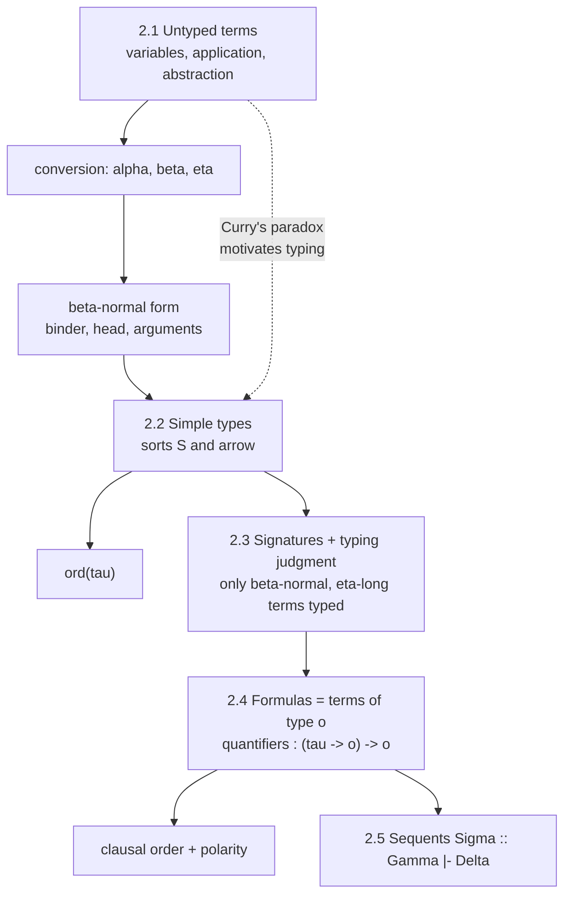
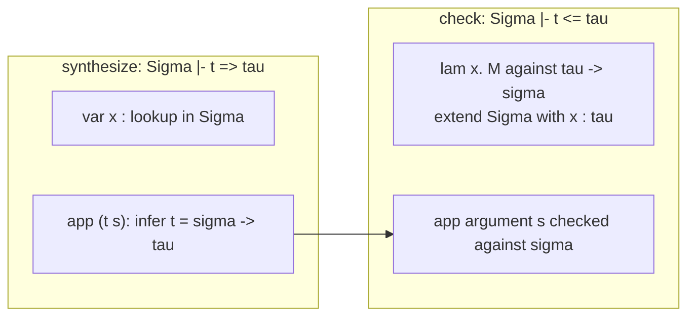
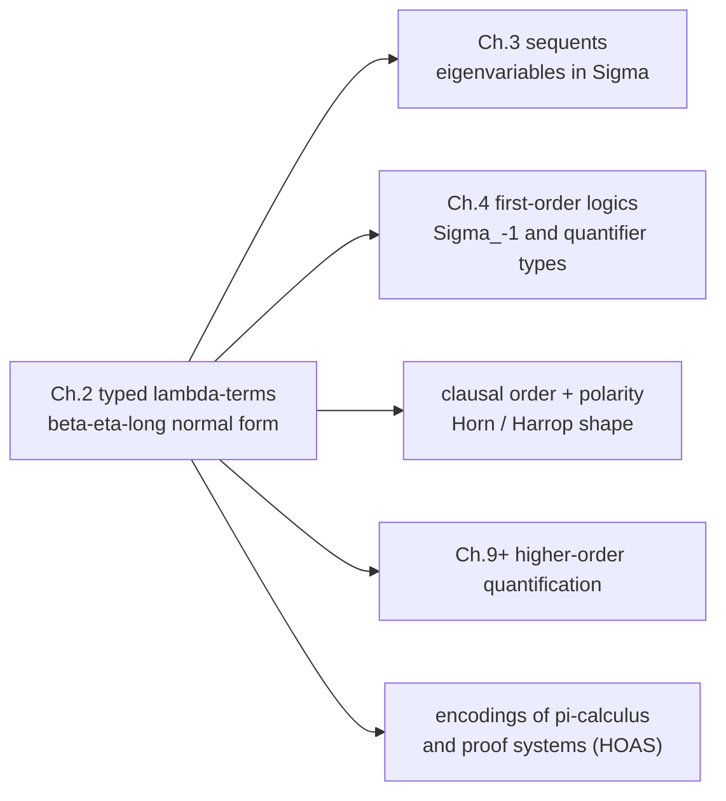

[[book-guidelines|↩ Back to guidelines]]

# Simply Typed Lambda-Terms and Church's Types

## 0. Why this chapter exists

A logic book that wants to cover first-order, higher-order, classical, intuitionistic and [[Linear-Logic|linear logic]] needs *one* syntax that can host all of them. Miller's answer is Church's: take the simply typed $\lambda$-calculus as the only syntactic machinery, and treat formulas as nothing more than terms of a distinguished type $o$.

The payoff is that **binding** is implemented exactly once. Quantifiers, lambda abstraction, eigenvariables and (later) clause variables all reuse the same binder and the same substitution. What breaks without this: with the traditional "terms first, formulas second" presentation you need a separate binding story for $\forall$, another for $\exists$, another for $\lambda$ in higher-order logic, and a separate substitution lemma for each. Here there is one capture-avoiding substitution and one normalization procedure.

The chapter also fixes a decision that shapes the whole book: only $\beta$-normal, $\eta$-long terms get types. That makes "a term of type $\tau$" a canonical syntactic object, which is what lets proof search and unification treat terms as data.

The chapter has six parts: untyped $\lambda$-terms (2.1), simple types (2.2), signatures and typing judgments (2.3), formulas (2.4), sequents (2.5), and bibliographic notes (2.6). This note covers 2.1-2.4 in depth and 2.5-2.6 only where they feed the type story.



## 1. Untyped $\lambda$-terms and conversion (2.1)

### 1.1 The problem being solved

We need a notation for "an expression with a hole that can be filled in" such that filling the hole is a single well-defined operation. That is a function without a name. Without it, $\forall x.\,B$ has no principled meaning for "instantiate $x$ with $t$"; it would be a bespoke operation on formula trees.

### 1.2 The syntax

Fix a denumerably infinite set of tokens (identifiers). Terms are built three ways:

1. A token (acting as a variable) is a term.
2. If $M, N$ are terms, their application is $(M\,N)$. Application is juxtaposition and associates to the left.
3. If $M$ is a term and $x$ a token, the abstraction is $(\lambda x.M)$. The token $x$ is bound with scope $M$.

In Rust, this is the textbook enum. Using de Bruijn indices is the usual implementation choice precisely because it makes $\alpha$-equivalence into structural equality (the book instead *identifies* $\alpha$-convertible terms):

```rust
// Named representation, mirrors the book's presentation.
#[derive(Clone, Debug, PartialEq)]
enum Term {
    Var(String),
    App(Box<Term>, Box<Term>),   // (M N)
    Lam(String, Box<Term>),      // (\x. M)
}

// De Bruijn representation: alpha-equivalence is derived Eq.
#[derive(Clone, Debug, PartialEq, Eq)]
enum DB {
    Var(usize),
    App(Box<DB>, Box<DB>),
    Lam(Box<DB>),
}
```

Lean has the same shape as an inductive type:

```lean
inductive Tm where
  | var : Nat → Tm          -- de Bruijn index
  | app : Tm → Tm → Tm
  | lam : Tm → Tm
```

### 1.3 The three conversions

The book defines these relations on terms:

- **$\alpha$-conversion.** Two terms are $\alpha$-convertible if they differ only in the names of bound variables. The book identifies such terms, so $\lambda x.x$ and $\lambda y.y$ are the same term.
- **$\beta$-redex and $\beta$-reduction.** A subexpression $(\lambda x.M)N$ is a $\beta$-redex. Replacing it with the capture-avoiding substitution $M[N/x]$ is $\beta$-reduction. The converse is $\beta$-expansion. Terms related by a finite (possibly empty) sequence of reductions and expansions are $\beta$-convertible.
- **$\eta$-redex and $\eta$-reduction.** A subexpression $\lambda x.(M\,x)$ where $x$ has no free occurrence in $M$ is an $\eta$-redex. Replacing it by $M$ is $\eta$-reduction; the converse is $\eta$-expansion. $\beta\eta$-conversion combines both, always assuming $\alpha$.

Intuition: $\beta$ says "applying a function means substituting the argument." $\eta$ says "a function that just forwards its argument to $M$ is $M$," i.e. functions are determined by their behavior on arguments (extensionality at the level of syntax).

The key piece of plumbing is **capture-avoiding substitution**. The failure mode:

$$(\lambda x.\lambda y.\,x)\,y \;\to_\beta\; \lambda y.\,y \quad\text{(wrong: the free } y \text{ got captured)}$$

The correct result renames the bound variable first: $\lambda y'.\,y$. In the book's terms: $\alpha$-convert the binder away from the free variables of the argument, then substitute.

```rust
use std::collections::HashSet;

fn free_vars(t: &Term, out: &mut HashSet<String>) {
    match t {
        Term::Var(x) => { out.insert(x.clone()); }
        Term::App(m, n) => { free_vars(m, out); free_vars(n, out); }
        Term::Lam(x, b) => {
            let mut inner = HashSet::new();
            free_vars(b, &mut inner);
            inner.remove(x);
            out.extend(inner);
        }
    }
}

fn fresh(base: &str, avoid: &HashSet<String>) -> String {
    let mut i = 0;
    loop {
        let c = format!("{base}{i}");
        if !avoid.contains(&c) { return c; }
        i += 1;
    }
}

/// M[N/x], capture-avoiding.
fn subst(m: &Term, x: &str, n: &Term) -> Term {
    match m {
        Term::Var(y) => if y == x { n.clone() } else { m.clone() },
        Term::App(a, b) => Term::App(Box::new(subst(a, x, n)), Box::new(subst(b, x, n))),
        Term::Lam(y, body) => {
            if y == x { return m.clone(); }           // x is shadowed
            let mut fv_n = HashSet::new();
            free_vars(n, &mut fv_n);
            if fv_n.contains(y) {                      // would capture: alpha-rename y
                let mut avoid = fv_n.clone();
                free_vars(body, &mut avoid);
                avoid.insert(x.to_string());
                let y2 = fresh(y, &avoid);
                let body2 = subst(body, y, &Term::Var(y2.clone()));
                Term::Lam(y2, Box::new(subst(&body2, x, n)))
            } else {
                Term::Lam(y.clone(), Box::new(subst(body, x, n)))
            }
        }
    }
}
```

This is the same plumbing that will reappear as eigenvariable freshness in sequent rules and as context-extension side conditions ("$x$ does not occur in $\Sigma$") in typing rules.

### 1.4 $\beta$-normal form: binder, head, arguments

A term is **$\beta$-normal** if it contains no $\beta$-redex. Positively, it has the shape

$$\lambda x_1.\cdots\lambda x_n.\,(h\;t_1\cdots t_m),\qquad n,m\ge 0,$$

where $h, x_1,\ldots,x_n$ are tokens and each $t_i$ is itself $\beta$-normal. The book names the parts: the list $x_1,\ldots,x_n$ is the **binder**, $h$ is the **head**, and $t_1,\ldots,t_m$ are the **arguments**.

This "binder / head / spine" decomposition is the same thing a Rust or Lean implementation uses as its working representation of normal terms: a head symbol applied to a spine of arguments under a prefix of binders. It is also exactly the view that Miller's pattern unification inspects (is the head a flexible variable? are its arguments distinct bound variables?).

```rust
/// beta-normal term: \x1...xn. h t1 ... tm
struct Normal {
    binder: Vec<String>,
    head: String,
    args: Vec<Normal>,
}
```

### 1.5 Substitution as a list of pairs

Let $\theta = \langle x_1,t_1\rangle,\ldots,\langle x_n,t_n\rangle$ with each $x_i$ a variable and $t_i$ a $\lambda$-term. Treated as a substitution, applying $\theta$ to a term (or formula) $s$ is written postfix, $s\theta$, and denotes the $\beta$-normal form of $[\lambda x_1.\cdots\lambda x_n.s]\,t_1\cdots t_n$.

So substitution is *defined through $\beta$-reduction*: instantiating $x_1,\ldots,x_n$ is abstracting them and applying to the values. The book says this explicitly: "$\beta$-reduction will usually be used to instantiate quantified expressions" (rather than for functional-program evaluation).

In Lean the same idea is `Expr.instantiate` / `instantiate_rev` followed by `headBeta`: instantiating a bound variable and re-normalizing at the head.

### 1.6 What the exercises teach

- **Ex. 2.1.** Not every term has a $\beta$-normal form. $((\lambda x.(xx))(\lambda x.(xx)))$ ($\Omega$) reduces to itself forever. Also $((\lambda x.y)\,\Omega)$ *does* normalize to $y$ (by reducing the outer redex first), a reminder that normalization depends on reduction strategy being allowed to discard the diverging argument.
- **Ex. 2.2.** Church numerals $\lambda f.\lambda x.f^n x$ encode $n$; $S=\lambda N.\lambda M.\lambda f.\lambda x.((N f)(M f x))$ adds and $P=\lambda N.\lambda M.\lambda f.\lambda x.((N(Mf))x)$ multiplies. The untyped calculus is a full computation model.
- **Ex. 2.3.** The family $E_n$ shows that computing $\beta$-normal forms can blow up in size dramatically. Normalization is not cheap, which matters later when "$\beta$-normal form of $[\lambda x.s]\,t$" is used inside every proof-search step.
- **Ex. 2.4.** Probes substitution under binders. $(\lambda x.w)[N/w]$ is $\lambda x.N$ (after renaming $x$ if $N$ mentions it free), a term that ignores its argument; $\lambda y.y$ does not, so no such $N$ exists. Capture-avoidance is what blocks the tempting answer $N=x$: the free $x$ is not captured by the binder, the binder is renamed.

A minimal [[Multiset-Rewriting-in-Linear-Logic#Python sketch|Python sketch]] for experimenting with normalization (shows the Church-numeral computation of Ex. 2.2; not load-bearing):

```python
# de Bruijn terms as tuples: ('v', i) | ('a', f, x) | ('l', body)
def shift(t, d, c=0):
    k = t[0]
    if k == 'v': return ('v', t[1] + d) if t[1] >= c else t
    if k == 'a': return ('a', shift(t[1], d, c), shift(t[2], d, c))
    return ('l', shift(t[1], d, c + 1))

def subst(t, j, s):
    k = t[0]
    if k == 'v': return s if t[1] == j else t
    if k == 'a': return ('a', subst(t[1], j, s), subst(t[2], j, s))
    return ('l', subst(t[1], j + 1, shift(s, 1)))

def step(t):  # leftmost-outermost beta step, or None if normal
    k = t[0]
    if k == 'a':
        f, x = t[1], t[2]
        if f[0] == 'l':
            return shift(subst(f[1], 0, shift(x, 1)), -1)
        r = step(f)
        if r is not None: return ('a', r, x)
        r = step(x)
        return None if r is None else ('a', f, r)
    if k == 'l':
        r = step(t[1])
        return None if r is None else ('l', r)
    return None

def normalize(t, fuel=10_000):
    for _ in range(fuel):
        n = step(t)
        if n is None: return t
        t = n
    raise RuntimeError("no normal form within fuel")
```

## 2. Curry's paradox: why untyped terms cannot host a logic (2.1, Ex. 2.5)

Before adding types, the book motivates them. Curry [1942] showed that mixing untyped $\lambda$-terms with logical connectives yields an inconsistent logic.

**First principles.** Untyped $\lambda$-calculus lets every term have a fixed point. Let

$$Y = \lambda f.\,(\lambda x.\,f\,(x\,x))\,(\lambda x.\,f\,(x\,x)).$$

Then for any $g$, $(Y\,g)$ $\beta$-converts to $(g\,(Y\,g))$. So any function $g$ has a fixed point $Y\,g$.

That is fine for programs (it is general recursion). It is fatal when some terms are propositions and $\supset$ is a term constructor. Take negation, $B=\lambda x.\,x\supset f$ ("implies false"). Negation should never have a fixed point, yet $Y\,B$ converts to $(Y\,B)\supset f$. Write $P := Y\,B$, so $P \equiv (P\supset f)$.

Sketch of the inconsistency (the book leaves it as Ex. 2.5):

1. Assume $P$. Since $P\equiv (P\supset f)$, we have $P\supset f$. Modus ponens with the assumption gives $f$.
2. Discharging the assumption, $P\supset f$. By conversion, this is $P$.
3. Applying step 1's reasoning to this unconditional $P$ gives $f$. Falsehood is provable.

**What breaks without types:** a term that says "I am false if I am true" is a legal formula. Self-reference through the *term language* (not through any axiom) destroys consistency. This is the logical cousin of the liar paradox, and the same mechanism behind Russell's paradox when comprehension is untyped.

**The fix:** a typing discipline. In the simply typed calculus $Y$ is not typable (it needs $x\,x$, which would require a type $\tau$ with $\tau=\tau\to\sigma$). Note the contrast with the Curry-Howard view: the book is explicit (2.6) that it does *not* model computation by normalizing proof terms. It models computation as **search for cut-free proofs**; types here are used only to keep the syntax of formulas well-formed.

```lean
-- In Lean the self-application x x is rejected by the elaborator:
-- def Y (f : α → α) : α := (fun x => f (x x)) (fun x => f (x x))
-- error: occurs check -- x : ?β → ?α but x : ?β
```

## 3. Simple types and the order of a type (2.2)

### 3.1 Definition

Fix a nonempty set $S$ of tokens, the **primitive types** (also called **sorts**). The set of types is the smallest set containing $S$ and closed under the binary infix arrow $\to$. Greek letters $\tau,\sigma$ range over types. The arrow associates to the right: $\tau_1\to\tau_2\to\tau_3$ means $\tau_1\to(\tau_2\to\tau_3)$.

These are *simple* types: no binders, no variables in types, hence **no type polymorphism** in the underlying logic (the book notes polymorphism does appear in some later examples, as a convenience).

```rust
#[derive(Clone, Debug, PartialEq, Eq)]
enum Ty {
    Prim(String),                 // member of S, e.g. "i", "o", "n", "p"
    Arrow(Box<Ty>, Box<Ty>),      // tau -> sigma
}
```

```lean
inductive Ty where
  | prim : String → Ty
  | arrow : Ty → Ty → Ty
```

### 3.2 Types as syntactic categories, not function spaces

This is the conceptually important point of the section. The book's example: in [[Automata-Encoded-as-Multisets#The encoding|the encoding]] of the $\pi$-calculus (Section 13.2) there are primitive types $n$ (names) and $p$ (processes). The type $n\to p$ is the type of *abstractions of a name over a process*. It does **not** denote all set-theoretic functions from names to processes.

Concretely: if $M:n\to p$ and $N$ is a name, the $\beta$-normal form of $(M\,N)$ is a process. But the function "map the name $a$ to $P_1$ and every other name to $P_2$" is a perfectly good mathematical function that corresponds to **no** syntactic expression of type $n\to p$.

So $\tau\to\sigma$ should be read as "syntax with a $\tau$-hole producing syntax of category $\sigma$". This is the same discipline as higher-order abstract syntax (HOAS), and it is why this setting is well suited to encoding object-language binders (the book later uses it for the $\pi$-calculus and for proof systems themselves).

### 3.3 Argument types, target type, and order

Every type has the form $\tau_1\to\cdots\to\tau_n\to\tau_0$ with $\tau_0\in S$ and $n\ge0$. The $\tau_1,\ldots,\tau_n$ are the **argument types**; $\tau_0$ is the **target type**. If $n=0$, the type is just $\tau_0$.

The **order** of a type counts left-nesting of arrows:

$$\mathrm{ord}(\tau)=0\ \text{ if }\tau\in S,\qquad \mathrm{ord}(\tau_1\to\tau_2)=\max(\mathrm{ord}(\tau_1)+1,\ \mathrm{ord}(\tau_2)).$$

Examples with $i\in S$:

| type | order |
|---|---|
| $i$ | 0 |
| $i\to i$ | 1 |
| $i\to i\to i$ | 1 |
| $(i\to i)\to i$ | 2 |
| $((i\to i)\to i)\to i$ | 3 |

The book notes: $\tau$ has order 0 or 1 **iff** all its argument types are primitive. Order is the dial that separates the logics: first-order means constants of order at most 1 and quantifiers over order-0 types; higher-order means no such restriction.

```rust
impl Ty {
    fn order(&self) -> usize {
        match self {
            Ty::Prim(_) => 0,
            Ty::Arrow(a, b) => (a.order() + 1).max(b.order()),
        }
    }
    /// Split tau1 -> ... -> taun -> tau0 into (args, target).
    fn spine(&self) -> (Vec<&Ty>, &Ty) {
        let mut args = vec![];
        let mut cur = self;
        while let Ty::Arrow(a, b) = cur { args.push(&**a); cur = b; }
        (args, cur)
    }
}
```

```lean
def Ty.order : Ty → Nat
  | .prim _ => 0
  | .arrow a b => max (a.order + 1) b.order
```

## 4. Signatures and typing judgments (2.3)

### 4.1 Signatures

A **signature** $\Sigma$ over $S$ is a (possibly empty) set of pairs $x:\tau$. It must be **determinate**: if $x:\tau$ and $x:\sigma$ are both in $\Sigma$ then $\tau$ and $\sigma$ are the same type expression. A signature has **order $n$** if every assigned type has order at most $n$; it is **first-order** when $\mathrm{ord}(\tau)\le1$ for every $h:\tau\in\Sigma$.

A signature is exactly a typing context $\Gamma$ in the usual presentation, except the book keeps it as a *set with a determinacy condition* and uses it to declare constants and eigenvariables as well as bound variables. In Rust it is a `HashMap<String, Ty>` with insertion that rejects conflicts:

```rust
use std::collections::HashMap;

struct Sig(HashMap<String, Ty>);

impl Sig {
    fn extend(&self, x: &str, t: Ty) -> Result<Sig, String> {
        // determinacy + "x does not occur in Sigma" for bound variables
        if self.0.contains_key(x) {
            return Err(format!("{x} already declared"));
        }
        let mut m = self.0.clone();
        m.insert(x.to_string(), t);
        Ok(Sig(m))
    }
    fn max_order(&self) -> usize {
        self.0.values().map(Ty::order).max().unwrap_or(0)
    }
}
```

### 4.2 The judgment and the "common" rules

The **typing judgment** $\Sigma\Vdash t:\tau$ relates a signature, a $\lambda$-term, and a type. The variables of $\Sigma$ are considered *bound over* the judgment. The familiar rules are:

$$\frac{}{\Sigma,\,x:\tau\ \Vdash\ x:\tau}\qquad
\frac{\Sigma\Vdash t:\sigma\to\tau\quad \Sigma\Vdash s:\sigma}{\Sigma\Vdash (t\,s):\tau}\qquad
\frac{\Sigma,\,x:\tau\Vdash M:\sigma}{\Sigma\Vdash(\lambda x.M):\tau\to\sigma}$$

with the side condition on the last rule that $x$ does not occur in $\Sigma$ (so the extended signature stays determinate).

These rules are *syntax-directed*, which is why they read directly as a bidirectional checker: the variable and application rules synthesize a type (application: synthesize the head's arrow type, then **check** the argument against $\sigma$), while the abstraction rule is naturally a checking rule against a given arrow type.



### 4.3 The book's restriction: only $\beta$-normal, $\eta$-long terms are typed

The three rules above are valid for terms not in $\beta$-normal form. The book **restricts** the judgment so that only $\beta$-normal terms receive types, and adopts the rules of Figure 2.1 as the official ones:

$$\frac{\Sigma,\,x_1{:}\tau_1,\ldots,x_n{:}\tau_n\Vdash t:\tau_0}{\Sigma\Vdash\lambda x_1.\cdots\lambda x_n.\,t\ :\ \tau_1\to\cdots\to\tau_n\to\tau_0}$$

$$\frac{\Sigma\Vdash t_1:\sigma_1\ \ \cdots\ \ \Sigma\Vdash t_n:\sigma_n\qquad h:\sigma_1\to\cdots\to\sigma_n\to\tau_0\in\Sigma}{\Sigma\Vdash(h\,t_1\cdots t_n):\tau_0}$$

Both rules require $\tau_0\in S$ and $n\ge0$, and the $x_i$ must not occur in $\Sigma$.

Look at what this does:

- The second rule only types **a head applied to all of its arguments**, producing a **primitive** target type $\tau_0$. There is no way to type a partially applied head by itself. So a head with type $i\to i$ standing alone as a term is not well-typed; it must appear $\eta$-expanded as $\lambda x.(h\,x)$.
- The first rule introduces all the binders of the abstraction at once.
- Consequently, every typable term is in **$\beta\eta$-long normal form**: first compute the $\beta$-normal form, then $\eta$-expand until every head is fully applied.

The book's example, for $i\in S$:

$$\Sigma\Vdash\lambda x.x:(i\to i)\to i\to i\quad\text{is **not** provable,}$$
$$\Sigma\Vdash\lambda x.\lambda y.\,x\,y:(i\to i)\to i\to i\quad\text{**is** provable.}$$

The first term has a variable $x:i\to i$ as a body that is not applied to anything and whose type is not primitive; the second is its $\eta$-expansion.

When $\Sigma\Vdash t:\tau$ is provable the book says $t$ is a **$\Sigma$-term of type $\tau$**.

**Why this design?** Because a typable term is now a *canonical representative* of its $\beta\eta$-equivalence class. Two formulas that are $\beta\eta$-convertible are literally the same typed term. This kills the need to check convertibility inside the proof system: matching rule schemas against formulas is plain syntactic matching, after normalization. Definitional equality ($\beta\eta$) has been *compiled away into the syntax*. (Compare Lean, where `isDefEq` must decide $\beta\eta$ at runtime, plus $\delta$, $\zeta$, $\iota$, proof irrelevance.)

**What breaks without it:** if non-normal terms were typed, "is this formula an instance of the rule schema $B\wedge C$?" would require higher-order matching modulo $\beta$ at every inference step.

```rust
/// Checker for the book's official judgment (Figure 2.1):
/// Sigma |- t : tau, only for beta-normal, eta-long t.
fn check(sig: &Sig, bound: &mut Vec<(String, Ty)>, t: &Normal, ty: &Ty) -> Result<(), String> {
    let (arg_tys, target) = ty.spine();
    // Rule 1: binder length must equal number of argument types
    // (eta-longness: the binder consumes ALL arrows of ty).
    if t.binder.len() != arg_tys.len() {
        return Err("not eta-long: binder does not match arrow arity".into());
    }
    let mark = bound.len();
    for (x, a) in t.binder.iter().zip(arg_tys) {
        bound.push((x.clone(), a.clone()));      // fresh by assumption
    }
    // Rule 2: head applied to all its arguments, target primitive
    let head_ty = bound.iter().rev().find(|(n, _)| n == &t.head).map(|(_, t)| t)
        .or_else(|| sig.0.get(&t.head))
        .ok_or("unbound head")?
        .clone();
    let (h_args, h_target) = head_ty.spine();
    if h_args.len() != t.args.len() { return Err("head not fully applied".into()); }
    if h_target != target { return Err("target type mismatch".into()); }
    for (arg, a_ty) in t.args.iter().zip(h_args) {
        check(sig, bound, arg, a_ty)?;
    }
    bound.truncate(mark);
    Ok(())
}
```

The `binder.len() == arg_tys.len()` test is the entire $\eta$-long condition. Note also that this is a *checking* function with the type in hand, matching the bidirectional reading.

Lean correspondence: a Lean `Expr` is typed up to $\beta\eta$ at the kernel level, but elaborated terms are not forced into long normal form. The closest analogue to the book's normal-form discipline is how Lean's `simp`/unifier work with `instantiate` + `headBeta` and with $\eta$-expansion of metavariable applications.

### 4.4 Uniqueness of primitive types (Ex. 2.6)

Exercise 2.6 asks to prove: if $\Sigma\Vdash t:\tau$ and $\Sigma\Vdash t:\tau'$ with $\tau,\tau'$ *primitive*, then $\tau=\tau'$. And to show this fails when non-primitive types are allowed.

Intuition for the positive half: with a primitive target the derivation is forced, since the head's declared type is fixed by the determinate $\Sigma$ and its target is $\tau_0$. For non-primitive types the claim fails because the same normal-form shape can be read at different arrow types once binders are in play (this is the book's exercise; the note does not work out a counterexample, so check it against the book).

## 5. Formulas as terms of type $o$ (2.4)

### 5.1 The idea

Most presentations define terms, then formulas over terms as a separate grammar. Following Church [1940], Miller defines a formula to be a **term of the particular type $o$** (omicron). Then "what is a formula" is answered by the same typing judgment as everything else.

### 5.2 Logical signature $\Sigma_{-1}$ and non-logical signature $\Sigma_0$

Fix a signature $\Sigma_{-1}$ of the "foundations": tokens whose types have target $o$. These split into propositional constants and quantifiers.

For classical and intuitionistic first-order logic (Chapter 4):

$$\Sigma_{-1}\supseteq\{\,t:o,\ f:o,\ \wedge:o\to o\to o,\ \vee:o\to o\to o,\ \supset:o\to o\to o\,\}.$$

These have order 0 or 1 (they only mention $o$). The binary connectives are written infix: the term $((\wedge\,P)\,Q)$ is displayed $(P\wedge Q)$. Precedence: $\wedge$ and $\vee$ associate to the left, $\supset$ to the right, and $\wedge$ binds tighter than $\vee$, which binds tighter than $\supset$.

**Quantifiers are constants of type $(\tau\to o)\to o$**, one pair per type $\tau$:

$$\forall_\tau,\ \exists_\tau\ :\ (\tau\to o)\to o.$$

The abbreviation $\forall_\tau x.B$ stands for $\forall_\tau(\lambda x.B)$. The book's observation: the binding in quantification **is** the $\lambda$-binder. A quantifier is a higher-order function symbol that takes a predicate abstraction.

```rust
// Formulas as Normal-form terms of type o. The connectives live in Sigma_{-1}.
fn sigma_minus1(tau: &Ty) -> Sig {
    let o = Ty::Prim("o".into());
    let bin = Ty::Arrow(Box::new(o.clone()), Box::new(Ty::Arrow(Box::new(o.clone()), Box::new(o.clone()))));
    let quant = Ty::Arrow(
        Box::new(Ty::Arrow(Box::new(tau.clone()), Box::new(o.clone()))),
        Box::new(o.clone()),
    );
    let mut m = HashMap::new();
    for c in ["and", "or", "imp"] { m.insert(c.to_string(), bin.clone()); }
    m.insert("t".into(), o.clone());
    m.insert("f".into(), o.clone());
    m.insert("forall".into(), quant.clone());
    m.insert("exists".into(), quant);
    Sig(m)
}
// forall x. P x  ==  Normal { binder: [], head: "forall",
//     args: [ Normal { binder: ["x"], head: "P", args: [Normal{binder:[],head:"x",args:[]}] } ] }
```

```lean
-- The same trick in Lean: the quantifier is a constant taking a predicate.
-- (Lean's own Exists has this exact shape.)
#check @Exists   -- {α : Sort u} → (α → Prop) → Prop
#check @Eq       -- binary predicate symbol: α → α → Prop
```

Since $o$ is just a sort, nothing prevents formulas from being arguments to quantifiers or to other constants. This is precisely where the first-order versus higher-order distinction lives.

### 5.3 Predicate vs function symbols

Fix $\Sigma_0$ for non-logical constants. Let $c:\tau_1\to\cdots\to\tau_n\to\tau_0\in\Sigma_0$ with $\tau_0$ primitive, $n\ge0$.

- If $\tau_0=o$, then $c$ is a **predicate symbol** of arity $n$.
- If $\tau_0\in S\setminus\{o\}$, then $c$ is a **function symbol** of arity $n$.

A term of type $o$ over $\Sigma_{-1}\cup\Sigma_0$ is a **$\Sigma_0$-formula** (or just "formula").

### 5.4 Propositional, first-order, higher-order

- A logic is **propositional** if its only connectives are propositional (no quantifiers).
- A logic is **first-order** if the only quantifiers are drawn from
$$\{\forall_\tau:(\tau\to o)\to o\mid\tau\in S\setminus\{o\}\}\ \cup\ \{\exists_\tau:(\tau\to o)\to o\mid\tau\in S\setminus\{o\}\}.$$
These have order 2, and the restriction $\tau\ne o$ means quantification only ranges over primitive, non-formula types.
- A logic with **no restriction** on the quantified types is **higher-order** (treated from Chapter 9).

With a first-order $\Sigma_{-1}$ and first-order $\Sigma_0$: a **first-order term** of type $\tau$ is a token of type $\tau$ or $(f\,t_1\ldots t_n)$ with $f$ a function symbol and $t_i$ a term of type $\tau_i$ (the **head** is $f$, the **arguments** are the $t_i$). A formula is **atomic** if its head is non-logical and **non-atomic** if its head is a logical symbol. Negation is an abbreviation: $\neg B := B\supset f$.

Classical and intuitionistic logic share the connectives $\wedge,\vee,\supset,t,f,\forall_\tau,\exists_\tau$; they differ only in the proof rules, not in the syntax.

**What breaks without the $\tau\ne o$ restriction:** you could write $\forall_o p.\,p$, a quantification over propositions, which makes the logic impredicative and invalidates arguments (like the ones in later chapters) that rely on subformula-style termination of proof search.

### 5.5 Clausal order of formulas

Mirroring $\mathrm{ord}(\tau)$, which counts nesting of $\to$ to the left of $\to$ in a type, the **clausal order** $\mathrm{order}(B)$ counts nestings of $\supset$ to the left of $\supset$ in a formula:

$$\begin{aligned}
\mathrm{order}(A)&=0&&A\text{ atomic},\ t,\ \text{or } f\\
\mathrm{order}(B_1\wedge B_2)&=\max(\mathrm{order}(B_1),\mathrm{order}(B_2))\\
\mathrm{order}(B_1\vee B_2)&=\max(\mathrm{order}(B_1),\mathrm{order}(B_2))\\
\mathrm{order}(B_1\supset B_2)&=\max(\mathrm{order}(B_1)+1,\ \mathrm{order}(B_2))\\
\mathrm{order}(\forall x.B)&=\mathrm{order}(B)\\
\mathrm{order}(\exists x.B)&=\mathrm{order}(B).
\end{aligned}$$

Note $\mathrm{order}(\neg B)=\mathrm{order}(B)+1$. The clausal order of a finite set or multiset of formulas is the maximum over its members.

Examples: $p\supset q$ has order 1. $(p\supset q)\supset r$ has order 2. $\forall x.\,(\mathrm{edge}(x,y)\supset\mathrm{path}(x,y))$ has order 1: a typical Horn clause. Later chapters use "Horn clauses are order $\le1$" and "hereditary Harrop formulas allow nested implications on the left of limited shape" as the defining distinction of logic-programming languages, so this function is load-bearing even though it looks decorative.

```rust
#[derive(Clone, Debug)]
enum Fm {
    Atom(String),
    T, F,
    And(Box<Fm>, Box<Fm>),
    Or(Box<Fm>, Box<Fm>),
    Imp(Box<Fm>, Box<Fm>),
    All(String, Box<Fm>),
    Ex(String, Box<Fm>),
}

fn order(b: &Fm) -> usize {
    match b {
        Fm::Atom(_) | Fm::T | Fm::F => 0,
        Fm::And(x, y) | Fm::Or(x, y) => order(x).max(order(y)),
        Fm::Imp(x, y) => (order(x) + 1).max(order(y)),
        Fm::All(_, x) | Fm::Ex(_, x) => order(x),
    }
}
```

### 5.6 Polarity of subformula occurrences

A subformula occurrence $C$ in $B$ is **positive** if it lies to the left of an *even* number of implications in $B$, and **negative** if the number is *odd*. Formally:

1. $B$ is a positive subformula occurrence of $B$.
2. If $C$ is positive in $B$, then $C$ is positive in $B\wedge B'$, $B'\wedge B$, $B\vee B'$, $B'\vee B$, $B'\supset B$, $\forall_\tau x.B$, $\exists_\tau x.B$; and $C$ is **negative** in $B\supset B'$.
3. If $C$ is negative in $B$, then $C$ is negative in the same contexts as in (2) (all except the left of $\supset$), and $C$ is **positive** in $B\supset B'$.

If $B$ has no implication then all its subformula occurrences are positive.

The two notions answer different questions:

| | clausal order | polarity |
|---|---|---|
| unit | a whole formula | one occurrence inside it |
| value | a number | positive / negative |
| counts | maximal left-nesting of $\supset$ | parity of left-nesting of $\supset$ |
| governs | the *shape* of program clauses (Horn: order $\le1$) | which side of a sequent a subformula effectively sits on during proof search |

(Answer to the guidelines' second Key Question: order is a global complexity measure of a formula, polarity is a local sign of one occurrence. Order is what bounds the shape of program clauses.)

Worked polarity check on $B=(p\supset q)\supset r$:

- $B$: positive (rule 1).
- $p\supset q$: it is the left of one $\supset$, so negative.
- $p$: left of two $\supset$, so positive.
- $q$: right of the inner $\supset$ inside a negative position, so negative.
- $r$: right of the outer $\supset$, positive.

```rust
#[derive(Copy, Clone, Debug, PartialEq)]
enum Pol { Pos, Neg }
fn flip(p: Pol) -> Pol { if p == Pol::Pos { Pol::Neg } else { Pol::Pos } }

/// Collect (atom name, polarity) for every atomic occurrence.
fn atoms(b: &Fm, p: Pol, out: &mut Vec<(String, Pol)>) {
    match b {
        Fm::Atom(a) => out.push((a.clone(), p)),
        Fm::T | Fm::F => {}
        Fm::And(x, y) | Fm::Or(x, y) => { atoms(x, p, out); atoms(y, p, out); }
        Fm::Imp(x, y) => { atoms(x, flip(p), out); atoms(y, p, out); }
        Fm::All(_, x) | Fm::Ex(_, x) => atoms(x, p, out),
    }
}
```

Polarity is the same notion that later underpins focusing (asynchronous vs synchronous connectives) and, in a very different setting, the sign of occurrences that decides monotonicity in abstract-interpretation transfer functions.

## 6. Sequents and the typing story (2.5, briefly)

The chapter closes by introducing sequents $\Sigma::\Gamma\vdash\Delta$, a pair of collections (lists, multisets or sets; almost always multisets), one-sided $\vdash\Delta$ or two-sided, with optional zone separators $\Gamma;\Gamma'\vdash\Delta;\Delta'$. The type-relevant points:

- A **signature is prefixed to the sequent** to declare the eigenvariables that appear free in its formulas. Every formula in $\Gamma$ or $\Delta$ must have type $o$ over $\Sigma_{-1}\cup\Sigma_0\cup\Sigma$.
- Matching schematic expressions against collections depends on the collection type. For $n$ occurrences: a list $\Gamma',\Gamma''$ has $n+1$ matches (prefix/suffix); a multiset has up to $2^n$ (each formula goes left or right); a set has up to $3^n$ (left, right, or both). The pattern $B,\Gamma'$ against a multiset picks any occurrence of $B$. This is the combinatorial source of nondeterminism in proof search, so the choice of collection type is a real algorithmic decision.

The book's departures from Gentzen (2.6): $\vdash$ rather than $\longrightarrow$ (reserved for rewriting/computation, Chapter 12); multisets rather than lists; and eigenvariables as **locally bound over sequents** rather than managed through global side conditions.

The 2.6 bibliographic notes also record two relevant facts. First, Church's Simple Theory of Types minus the axioms of choice, extensionality and infinity is Andrews' *Elementary Theory of Types*, which is the template used here. Second, the term-level typing here is **Curry-style**: bound variables are not globally typed but receive their type when first bound, in contrast to Church-style typing where every variable carries a type independent of binding. The same Church-style representation is used by HOL, Isabelle, Abella and $\lambda$Prolog. Richer type systems exist: $\lambda$Prolog has polymorphism, and Elf (based on LF) has dependent types.

## 7. Checklist against the Topic List

| subtopic | where |
|---|---|
| Untyped $\lambda$-terms and conversion | sections 1.1-1.6 |
| Simple types and the order of a type | section 3 |
| Signatures and typing judgments | section 4 |
| Formulas as terms of type $o$ | section 5.1-5.4 |
| Clausal order and polarity of subformulas | sections 5.5-5.6 |
| Curry's paradox | section 2 |
| Substitution and capture-avoiding binding | sections 1.3, 1.5 |

## 8. Synthesis: how this connects to the rest

**Depends on:** nothing in the book except basic familiarity with the $\lambda$-calculus. It sits right after the introduction of "[[Computation-as-Proof-Search|computation as proof search]]" and provides the syntax everything else is stated in.

**Depended on by:**

- Chapter 3 (sequent calculus) uses $\Sigma::\Gamma\vdash\Delta$, the substitution notation $s\theta$, and the rule for $\forall R$ that moves a binder from the formula to the signature as an eigenvariable.
- Chapter 4 (classical/intuitionistic) uses $\Sigma_{-1}$ and the first-order restriction.
- The program-clause shapes in later chapters (Horn clauses, hereditary Harrop formulas) are defined via clausal order and polarity.
- Chapters 9 onward use the unrestricted quantifier types $\forall_\tau$ with $\tau$ of any order, i.e. higher-order quantification, plus $\beta$-normal-form substitution for instantiation.
- The $\pi$-calculus and proof-system encodings use types as syntactic categories and abstractions as binders.



### Bearing on the project (Focus Areas `type-theory`, `automated-reasoning`)

This topic is tagged `type-theory` in the book's learning-goals file, and it draws on both areas' connections.

- **Judgments and contexts.** $\Sigma\Vdash t:\tau$ is the smallest honest instance of "a type checker is a proof checker": three syntax-directed rules over a context. The checker above is precisely what the Rust compiler's term/type layer would look like, and the `bound`/`Sig` handling is the context discipline with the freshness side condition ("$x$ not in $\Sigma$") that later reappears for eigenvariables in sequent rules and for context validity in Hoare-triple soundness. This is load-bearing: capture-avoiding substitution and fresh-name management are the recurring plumbing for both the elaborator and the verifier.
- **Normal forms as compiled-in definitional equality.** Typing only $\beta\eta$-long normal forms makes $\beta\eta$ part of syntax equality. In the planned kernel, the analogue is the decision about whether `isDefEq` normalizes eagerly or lazily; the book's design is the "normalize on construction" end of that spectrum. The binder/head/arguments view is the working representation for spine-based heads.
- **Metavariables and unification.** Heads are tokens that can be variables (flexible) or constants (rigid). That distinction, not made explicit in this chapter, is what Miller's pattern unification later inspects: a flexible head applied to distinct bound variables is a pattern. Typing only long normal forms is what makes that inspection syntactic. Substitution $s\theta$ defined as "$\beta$-normal form of $[\lambda\bar x.s]\bar t$" is exactly how a metavariable assignment is instantiated, and corresponds to Lean's `instantiateMVars` followed by `headBeta`.
- **Bidirectional typing.** The syntax-directed rules in 4.2 and the arity-forced check in 4.3 read as inference-for-heads / checking-for-arguments, even though the book does not use that vocabulary.
- **Refinement and dependent types.** Simple types here are the *base layer*: non-dependent, non-polymorphic. They are the "simple type skeleton" over which a refinement language would add predicates. The formula-as-type-$o$ trick (formulas inhabit the same term language as programs) is the closest the chapter gets to a refinement-style design where predicates are terms of the host language.
- **Not covered here:** the chapter says nothing about unification algorithms, constraints, SAT/SMT, or abstract interpretation. The learning-goals file correctly leaves `sat-smt-csp` untagged for this book. The $\mathrm{order}$ and polarity functions have a loose echo in the sign-sensitive reasoning of static analysis, but the chapter does not develop it, so no stronger claim is made.

## Where this leads

Chapter 3 turns the typed syntax into a proof system: sequents carry a signature $\Sigma$, the $\forall R$ rule introduces an eigenvariable into it, and substitution $s\theta$ instantiates $\forall L$ and $\exists R$. Later, clausal order and polarity classify program clauses (Horn, hereditary Harrop), and the same typed $\beta\eta$-long terms support higher-order quantification and $\lambda$-tree syntax for encoding binders in object languages.
