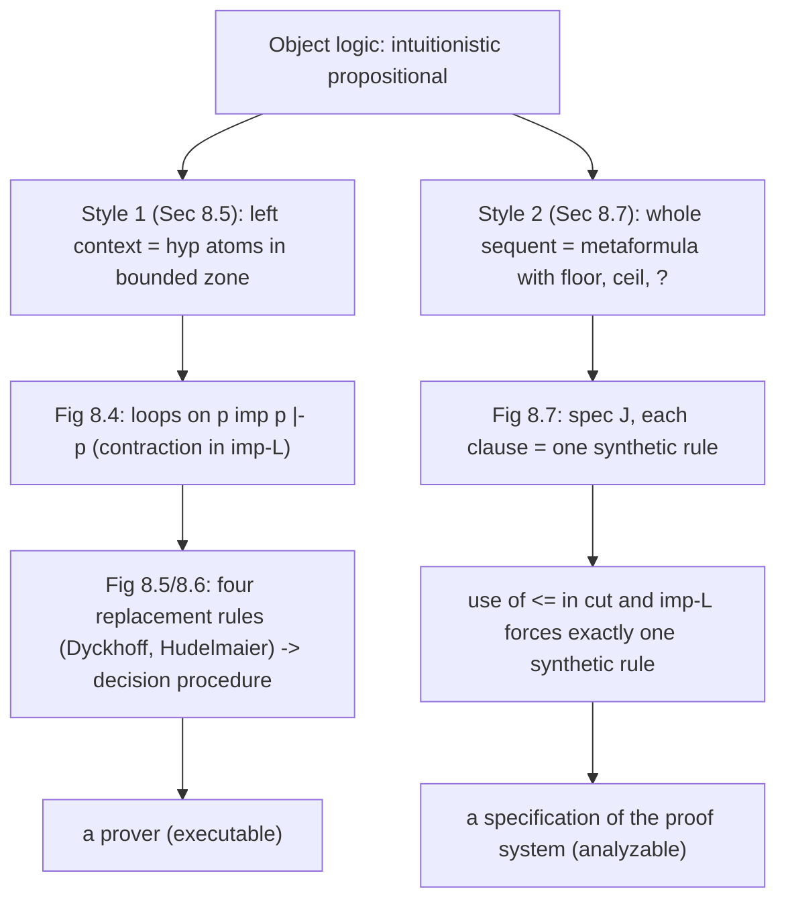

[[book-guidelines|↩ Back to guidelines]]

# Specifying Proof Systems in a Metalogic

## 1. The problem: writing a theorem prover as a logic program

A logic programming language is a machine for searching proofs. So there is an obvious experiment: write the *rules of a logic* as a logic program, and let the language's own search engine find proofs in that logic. Miller names the two logics involved (Section 8.5):

- the **metalogic**: the logic underlying the programming language (here, a fragment of linear logic, the Lolli language of $\mathcal L_1$ or $\mathcal L_2$ from Chapter 6);
- the **object logic**: the logic being implemented (here, propositional intuitionistic logic over $\wedge$, $\vee$, $\supset$).

This is the same shape as a Rust program that implements a type checker for another language: the host language runs, the object language is *data*. The twist is that the host here is itself a logic, so "the object logic's inference rules" become "metalogic formulas", and "a derivation in the object logic" becomes "a derivation in the metalogic that *simulates* it". The central correctness claim is always an adequacy statement: provable in the metalogic from the specification if and only if provable in the object logic.

What breaks without a good specification style? Two things, and the section is organised around them:

1. **Context management.** If the metalogic remembers every hypothesis forever, the prover's search space is polluted, and it may not terminate at all (Section 8.5; Sections 2 to 4 below).
2. **Fidelity of rule shape.** If the metalogic formula for a rule has the wrong connective, one object rule turns into two metalevel behaviours, one of which is not an object rule (Section 8.7; Sections 5 to 7 below).

## 2. First attempt: natural deduction in an intuitionistic metalogic

Miller starts with the most direct specification. Two metalevel predicates over object formulas (type `fm`):

- `pv G`: "$G$ is provable";
- `hyp H`: "$H$ is a current hypothesis".

Natural deduction has introduction rules (reason *to* a connective) and elimination rules (reason *from* it), recalled from Section 3.7. They become clauses almost verbatim:

```
pv (A imp B) :- hyp A => pv B.                 % implication introduction
pv G :- hyp (A and B), (hyp A => hyp B => pv G).   % conjunction elimination
pv G :- hyp G.                                 % close the proof
```

Read the second clause operationally, as a backward-chaining program: to prove any goal $G$, look for a hypothesis `A and B` in the context; if there is one, extend the context with both `A` and `B` and keep proving $G$. The `=>` is intuitionistic implication in the metalogic: *adding* a hypothesis to the program for the duration of a subproof is exactly what $\Rightarrow$ does in the uniform-proof reading of Chapter 5 (see [[Uniform-Proofs-and-Abstract-Logic-Programming-Languages]] and [[Horn-Clauses-and-Hereditary-Harrop-Formulas]]).

This is easy to make adequate: there is a metalogic proof of `pv G` from the specification plus `hyp H1`, ..., `hyp Hi` iff $G$ follows from $H_1,\dots,H_i$ in the object logic.

**What breaks.** Intuitionistic logic has free weakening and contraction on the left. So every `hyp H` that has ever been added stays in the context, available arbitrarily many times, for the rest of the search. Miller's example: apply the rule of cases (disjunction elimination) to a disjunctive hypothesis. That disjunction is *dead* afterwards, it will never be needed in either branch, but the metalogic cannot know that and the prover keeps scanning it. The search is wasteful and, as we will see, can loop.

The fix he proposes is twofold: abandon natural deduction for sequent calculus (whose left-introduction rules *replace* a formula by its components, which is a deletion), and move to a metalogic that has control over hypotheses (linear logic).

## 3. Second attempt: sequent calculus with an explicit context discipline

Figure 8.3 is a sequent calculus for propositional intuitionistic logic with single-conclusion sequents $\Gamma \vdash G$, $\Gamma$ a multiset, and *no weakening or contraction rules*:

$$
\frac{\Gamma, A \vdash B}{\Gamma \vdash A \supset B}\ \supset R
\qquad
\frac{\Gamma\vdash A \quad \Gamma \vdash B}{\Gamma\vdash A\wedge B}\ \wedge R
\qquad
\frac{\Gamma, A, B \vdash G}{\Gamma, A\wedge B\vdash G}\ \wedge L
\qquad
\frac{\Gamma, A\vdash G \quad \Gamma, B\vdash G}{\Gamma, A\vee B\vdash G}\ \vee L
$$

$$
\frac{\Gamma, C\supset B \vdash C \qquad \Gamma, B\vdash G}{\Gamma, C\supset B\vdash G}\ \supset L
\qquad
\frac{}{\Gamma, A\vdash A}\ init,\ A \text{ atomic}
$$

(plus $\vee R$ in two forms, $\Gamma\vdash A \Rightarrow \Gamma\vdash A\vee B$ and likewise for $B$.)

Read the rules as "how a formula is consumed". $\wedge L$ and $\vee L$ *remove* the principal formula and put its pieces back. The one exception is $\supset L$: the principal implication $C\supset B$ **must also appear in its left premise**. That is the only place a hypothesis may be used more than once, and it is necessary: to use $C\supset B$ you must prove $C$, and the proof of $C$ may itself need $C\supset B$ again.

### The Lolli specification (Figure 8.4)

The sequent system becomes a Lolli program where the *bounded zone* (the linear context, see [[Linear-Logic]]) holds exactly the `hyp` atoms and nothing else. Linear implication `-o` adds a hypothesis that can be used once; additive conjunction `&` hands the *same* context to both subgoals.

```
pv (A and B) :- pv A & pv B.
pv (A imp B) :- hyp A -o pv B.
pv (A or B)  :- pv A.
pv (A or B)  :- pv B.
pv G :- hyp (A and B), (hyp A -o hyp B -o pv G).
pv G :- hyp (A or B),  ((hyp A -o pv G) & (hyp B -o pv G)).
pv G :- hyp (C imp B), ((hyp (C imp B) -o pv C) & (hyp B -o pv G)).
pv A :- isatom A, hyp A, erase.
```

Notice how each connective of the metalogic is doing a specific bookkeeping job:

| Object rule feature | Metalevel device |
|---|---|
| a rule that *shares* its context between two premises ($\wedge R$, $\vee L$) | additive conjunction `&` |
| a rule that adds one hypothesis | `-o` (hypothesis used at most once, then gone) |
| $\supset L$ keeping the implication in the left premise | re-adding `hyp (C imp B)` in the left branch |
| $init$ ignoring the remaining context (weakening) | `erase`, the additive true $\top$, which absorbs any leftover bounded-zone formulas |

That last line is the subtle one. In a linear metalogic, a proof ends only when the bounded zone is consumed; `erase` is how the specification says "the other hypotheses are irrelevant, throw them away". Without it, $init$ would only be applicable to sequents containing *exactly* one hypothesis. This is the "what breaks" case for weakening: the object logic has it implicitly in $init$, so [[Automata-Encoded-as-Multisets#The encoding|the encoding]] must supply it explicitly.

## 4. Why the specification still loops, and the contraction-free fix

The program in Figure 8.4 is adequate but does not give a terminating procedure. Try $p\supset p\vdash p$ (Miller's example). The only left rule available is $\supset L$ on $p\supset p$, whose left premise is again $p\supset p \vdash p$. Search runs forever. The cause is the one explicit contraction that $\supset L$ builds in.

Dyckhoff [1992] and Hudelmaier [1992] replaced the single $\supset L$ rule by four rules, one per shape of antecedent $C$ in $C\supset B$ (Figure 8.5):

$$
\frac{\Gamma, A, B\vdash G}{\Gamma, A, A\supset B\vdash G}\ \supset L_1\ (A\text{ atomic})
\qquad
\frac{\Gamma, C\supset D\supset B\vdash G}{\Gamma,(C\wedge D)\supset B\vdash G}\ \supset L_2
$$

$$
\frac{\Gamma, C\supset B, D\supset B\vdash G}{\Gamma, (C\vee D)\supset B\vdash G}\ \supset L_3
\qquad
\frac{\Gamma, D\supset B\vdash C\supset D \quad \Gamma, B\vdash G}{\Gamma,(C\supset D)\supset B\vdash G}\ \supset L_4
$$

Each rule removes the principal implication and replaces it with something strictly "smaller" in a suitable multiset ordering. That is the intuition behind termination, and it is why no contraction rule is needed. Figure 8.6 gives them as Lolli clauses, for example:

```
pv G :- hyp ((C imp D) imp B),
        ((hyp (D imp B) -o pv (C imp D)) & (hyp B -o pv G)).
```

Swap these four clauses for the one $\supset L$ clause of Figure 8.4 and, Miller notes, a depth-first interpreter yields a **decision procedure** for propositional intuitionistic logic. The book does not prove termination or correctness of this particular program here; it relies on the cited papers for the properties of the replacement rules. I verified the shape of the argument only by running it (next section).

### Grounding in Rust: the Lolli program as a function

The key idea to transfer is that "the bounded zone" is a *multiset you take things out of*. In Rust that is a `Vec<Fm>` where a left rule calls `remove(i)` and only pushes back what the rule's conclusion mentions. `&` becomes two calls on the same `ctx`; `-o` becomes cloning the context with one more hypothesis. This is a direct, runnable transcription of Figures 8.4 and 8.6 (my own illustration; the book gives only the Lolli text):

```rust
use std::rc::Rc;

#[derive(Clone, PartialEq, Debug)]
enum Fm {
    Atom(&'static str),
    And(Rc<Fm>, Rc<Fm>),
    Or(Rc<Fm>, Rc<Fm>),
    Imp(Rc<Fm>, Rc<Fm>),
}
use Fm::*;

fn and(a: Fm, b: Fm) -> Fm { And(Rc::new(a), Rc::new(b)) }
fn or(a: Fm, b: Fm) -> Fm { Or(Rc::new(a), Rc::new(b)) }
fn imp(a: Fm, b: Fm) -> Fm { Imp(Rc::new(a), Rc::new(b)) }

/// `ctx` is a multiset (the "bounded zone"): rules *take* a formula out of it.
fn pv(ctx: &[Fm], g: &Fm) -> bool {
    // right rules (pv (A and B) :- pv A & pv B ; pv (A imp B) :- hyp A -o pv B)
    match g {
        And(a, b) => return pv(ctx, a) && pv(ctx, b),
        Imp(a, b) => {
            let mut c = ctx.to_vec();
            c.push((**a).clone());
            return pv(&c, b);
        }
        _ => {}
    }
    if let Or(a, b) = g {
        if pv(ctx, a) || pv(ctx, b) { return true; }
    }
    // left rules: choose one hypothesis, REMOVE it from the context
    for i in 0..ctx.len() {
        let mut rest = ctx.to_vec();
        let h = rest.remove(i);
        let ok = match &h {
            Atom(_) => h == *g, // init; the rest of the context is erased
            And(a, b) => { rest.push((**a).clone()); rest.push((**b).clone()); pv(&rest, g) }
            Or(a, b) => {
                let mut l = rest.clone(); l.push((**a).clone());
                let mut r = rest; r.push((**b).clone());
                pv(&l, g) && pv(&r, g)
            }
            Imp(c, b) => match &**c {
                Atom(_) if rest.contains(c) => { rest.push((**b).clone()); pv(&rest, g) } // ⊃L1
                Atom(_) => false,
                And(c1, d) => { rest.push(imp((**c1).clone(), imp((**d).clone(), (**b).clone()))); pv(&rest, g) } // ⊃L2
                Or(c1, d) => {
                    rest.push(imp((**c1).clone(), (**b).clone()));
                    rest.push(imp((**d).clone(), (**b).clone()));
                    pv(&rest, g) // ⊃L3
                }
                Imp(c1, d) => { // ⊃L4
                    let mut l = rest.clone();
                    l.push(imp((**d).clone(), (**b).clone()));
                    let mut r = rest; r.push((**b).clone());
                    pv(&l, &imp((**c1).clone(), (**d).clone())) && pv(&r, g)
                }
            },
        };
        if ok { return true; }
    }
    false
}
```

I checked it on $p\supset p\vdash p$ (fails and terminates), $\vdash p\supset p$, $\vdash (p\wedge q)\supset(q\wedge p)$ (provable), and $\vdash p\vee(p\supset q)$ (not provable). Note what is *not* in the code: there is no `contract` step and no visited-set. Termination comes entirely from the shape of the rules. Compare how a naive $\supset L$ would be written: it would `ctx.clone()` the implication into the left recursive call, which is exactly the loop.

## 5. Sequents as metalevel formulas (Section 8.7)

Section 8.5 specified the object logic by treating *the left context* as a bag of `hyp` atoms and leaving the right side implicit as the goal. Section 8.7 shows a more uniform style that treats **the entire sequent as a single formula of the metalogic**, so that a sequent calculus rule becomes a clause that rewrites the sequent.

The motivation is Section 4.1's observation: classical, intuitionistic and linear sequent calculi differ in *where weakening and contraction are allowed*.

| Logic | Structural rules allowed | Where |
|---|---|---|
| classical | weakening and contraction | left and right |
| intuitionistic | weakening and contraction | left only |
| linear | none | neither |

Linear logic has a dedicated place for exactly this: the exponential $?$ marks a formula to which weakening and contraction apply (Chapter 6). So the plan is: use two metalevel predicates $\lfloor\cdot\rfloor$ and $\lceil\cdot\rceil$ of type $fm\to o$ (left side / right side), and represent an object sequent as a $\mathbin{⅋}$-disjunction, put the $?$ exactly where the object logic allows structural rules. Using $\longrightarrow$ for the object sequent arrow, following Gentzen:

$$
\begin{aligned}
\text{Linear: } & B_1,\dots,B_n \longrightarrow C_1,\dots,C_m \ \mapsto\ \lfloor B_1\rfloor \mathbin{⅋}\cdots\mathbin{⅋}\lfloor B_n\rfloor \mathbin{⅋}\lceil C_1\rceil\mathbin{⅋}\cdots\mathbin{⅋}\lceil C_m\rceil\\
\text{Intuitionistic: } & B_1,\dots,B_n \longrightarrow C \ \mapsto\ {?\lfloor B_1\rfloor} \mathbin{⅋}\cdots\mathbin{⅋}{?\lfloor B_n\rfloor} \mathbin{⅋} \lceil C\rceil\\
\text{Classical: } & B_1,\dots,B_n \longrightarrow C_1,\dots,C_m \ \mapsto\ {?\lfloor B_1\rfloor} \mathbin{⅋}\cdots\mathbin{⅋}{?\lfloor B_n\rfloor} \mathbin{⅋} {?\lceil C_1\rceil}\mathbin{⅋}\cdots\mathbin{⅋}{?\lceil C_m\rceil}
\end{aligned}
$$

Why $\mathbin{⅋}$ (par) on the *right* of the metalevel turnstile? Because a multiset on the right-hand side is a disjunctive encoding (Section 8.1, see [[Multiset-Rewriting-in-Linear-Logic]]): $\mathbin{⅋}$ is the right-side comma. So the object-level sequent literally *is* the multiset of formulas to the right of $;$ in the metalevel sequent, and the object-level rules become multiset rewriting in the **right-bounded zone** of $\Downarrow\mathcal L_2$. The `?` marks make the structural rules available only on the intended formulas, since $?$-formulas live in the unbounded zone and can be copied and discarded for free.

What breaks if you pick the wrong marking? Put `?` on the right in the intuitionistic encoding and you would have specified classical logic. The $\lfloor\cdot\rfloor$, $\lceil\cdot\rceil$ and $?$ together encode the whole difference between the three logics, which is a nice demonstration that "logic = where structural rules live".

## 6. The specification $J$ and its synthetic rules

Figure 8.7 gives the specification $J$ for $\wedge$, $\vee$, $\supset$ plus *initial* and *cut* (I write $\mathrel{\circ\!\!-}$ for the book's reverse linear implication, the metalevel "if"; $\Leftarrow$ is the intuitionistic reverse implication):

$$
\begin{array}{ll}
(\supset R) & \lceil A\supset B\rceil \mathrel{\circ\!\!-} {?\lfloor A\rfloor} \mathbin{⅋} \lceil B\rceil\\
(\supset L) & \lfloor A\supset B\rfloor \mathrel{\circ\!\!-} {?\lfloor B\rfloor} \Leftarrow \lceil A\rceil\\
(\wedge R) & \lceil A\wedge B\rceil \mathrel{\circ\!\!-} \lceil A\rceil \mathrel{\circ\!\!-} \lceil B\rceil\\
(\wedge L_1) & \lfloor A\wedge B\rfloor \mathrel{\circ\!\!-} {?\lfloor A\rfloor}\\
(\wedge L_2) & \lfloor A\wedge B\rfloor \mathrel{\circ\!\!-} {?\lfloor B\rfloor}\\
(\vee L) & \lfloor A\vee B\rfloor \mathrel{\circ\!\!-} {?\lfloor A\rfloor} \mathbin{\&} {?\lfloor B\rfloor}\\
(\vee R_1) & \lceil A\vee B\rceil \mathrel{\circ\!\!-} \lceil A\rceil\\
(\vee R_2) & \lceil A\vee B\rceil \mathrel{\circ\!\!-} \lceil B\rceil\\
(initial) & \lceil B\rceil \mathbin{⅋} \lfloor B\rfloor\\
(cut) & \bot \mathrel{\circ\!\!-} {?\lfloor C\rfloor} \Leftarrow \lceil C\rceil
\end{array}
$$

Each displayed clause abbreviates its universal closure under $!$ (so it lives in the unbounded zone and can be reused every time). Let $\Sigma_0$ contain the object connectives of Figure 8.2 and the two predicates $\lfloor\cdot\rfloor$, $\lceil\cdot\rceil$. Now the payoff of the focused-proof machinery of Chapters 6 and 7: when a proof of a sequent $\cdot :: J;\cdot\vdash \dots$ picks a clause by $decide!$, the *whole* focused phase (the backchaining step, a "bipole") is a single **synthetic inference rule** of the metalogic. Miller computes two of them:

$$
\frac{\cdot :: J;\ \cdot \vdash \lceil B\rceil;\ \lfloor A\rfloor,\lfloor\Gamma\rfloor}{\cdot :: J;\ \cdot \vdash \lceil A\supset B\rceil;\ \lfloor\Gamma\rfloor}
\qquad\qquad
\frac{\cdot :: J;\ \cdot\vdash \lceil C\rceil;\ \mathcal L \qquad \cdot :: J;\ \cdot\vdash\lceil B\rceil;\ \lfloor C\rfloor,\mathcal L}{\cdot :: J;\ \cdot\vdash \lceil B\rceil;\ \mathcal L}
$$

with $\lfloor\Gamma\rfloor = \{\lfloor B\rfloor \mid B\in\Gamma\}$. The left one is exactly object-level $\supset R$: reduce $\Gamma\longrightarrow A\supset B$ to $A,\Gamma\longrightarrow B$. The right one is exactly object-level $cut$ (Figure 8.8). In general: **synthetic rules of the specification = rules of the object calculus**, which gives the adequacy statement for free, provided each clause yields exactly the intended rule and no more. That is why the next section matters. (Figure 8.8 lists all the object rules encoded by $J$: $\supset L$, $\supset R$, $\wedge L_1,\wedge L_2,\wedge R$, $\vee L$, $\vee R_1,\vee R_2$, *initial*, *cut*.)

### What the right-bounded zone buys you

Compare with Section 8.5. There, only the left side was in the linear zone and the right side was implicit control flow of the interpreter. Here both sides are *data* in the same multiset, so a rule like $\supset R$ can move a formula from one side to the other by rewriting. You could write rules whose premises have multiple conclusions (classical) just by changing where `?` goes. The cost is that the specification is less "executable" as a prover: it describes the *proof system* more than it implements a *search strategy*. Section 8.5's version is a prover; Section 8.7's is a specification you reason about.

## 7. Why object-level cut and $\supset L$ use $\Leftarrow$, not $\mathrel{\circ\!\!-}$

This is the most delicate point of the section and Miller devotes a paragraph to it. Suppose we wrote cut with a linear connective:

$$
(cut') \qquad \bot \mathrel{\circ\!\!-} {?\lfloor C\rfloor} \mathrel{\circ\!\!-} \lceil C\rceil .
$$

Then $decide!$ on it produces **two** synthetic rules: the intended cut, and a spurious one,

$$
\frac{\cdot :: J;\cdot\vdash \lceil B\rceil,\lceil C\rceil;\ \mathcal L\qquad \cdot :: J;\cdot\vdash\ \cdot\ ;\ \lfloor C\rfloor,\mathcal L}{\cdot :: J;\cdot\vdash \lceil B\rceil;\ \mathcal L}
\quad\text{i.e. object-level}\quad
\frac{\Gamma\longrightarrow B, C\qquad C,\Gamma\longrightarrow\ \cdot}{\Gamma\longrightarrow B}.
$$

The reason is that the linear $\mathrel{\circ\!\!-}$ lets the *new* subgoal $\lceil C\rceil$ share the right-bounded zone with the existing $\lceil B\rceil$, so $B$ may migrate into the left premise, which is not a legal single-conclusion intuitionistic rule. Miller says one can prove this extra rule is never ultimately usable (the left premise is not provable from $J$), but we want **exactly one** synthetic rule per clause, so that rule-by-rule inspection is a faithful proof of adequacy.

The intuitionistic $\Leftarrow$ fixes this: its right-hand subgoal is proved with an *empty bounded zone* (the book's backchaining rule for $\Leftarrow$ sends the premise to a sequent with an empty linear context), which pins the left premise to have the single conclusion $\lceil C\rceil$. The same holds for $\supset L$. This matches the Chapter 6 remark (Section 6.2, Proposition 4.2) that cut and $\supset L$ are different from the other intuitionistic rules: they are the two rules whose premise has a conclusion on the right independent of the rest, i.e. the two places where the single-conclusion constraint on the right actually bites. In $J$ that difference is just the choice of $\Leftarrow$ over $\mathrel{\circ\!\!-}$.

Exercise 8.8 asks you to prove from (initial) and (cut) the duality $\forall B.\ !\lceil B\rceil \equiv (?\lfloor B\rfloor)^\perp$, which says "right occurrences of $B$ are the negation of left occurrences" at the metalevel. I do not reproduce a solution here.

### Grounding in Lean: the object logic as an inductive predicate

Lean's `inductive` is literally "a specification of a proof system as clauses". Each constructor is a rule of Figure 8.8; the metalogic is Lean's own. Contexts are lists, and the constructors may select any member, which stands in for multiset exchange:

```lean
inductive Fm where
  | atom : Nat → Fm
  | conj : Fm → Fm → Fm
  | disj  : Fm → Fm → Fm
  | imp  : Fm → Fm → Fm

open Fm

/-- Object-level intuitionistic sequents `Γ ⟶ G`, mirroring Figure 8.8 (contexts as lists; rules may pick any element) -/
inductive Sq : List Fm → Fm → Prop where
  | init  {Γ n} : atom n ∈ Γ → Sq Γ (atom n)
  | impR  {Γ A B} : Sq (A :: Γ) B → Sq Γ (imp A B)
  | impL  {Γ A B E} : imp A B ∈ Γ → Sq Γ A → Sq (B :: Γ) E → Sq Γ E
  | andR  {Γ A B} : Sq Γ A → Sq Γ B → Sq Γ (conj A B)
  | andL  {Γ A B E} : conj A B ∈ Γ → Sq (A :: B :: Γ) E → Sq Γ E
  | orL   {Γ A B E} : disj A B ∈ Γ → Sq (A :: Γ) E → Sq (B :: Γ) E → Sq Γ E
  | orR1  {Γ A B} : Sq Γ A → Sq Γ (disj A B)
  | orR2  {Γ A B} : Sq Γ B → Sq Γ (disj A B)
  | cut   {Γ C B} : Sq Γ C → Sq (C :: Γ) B → Sq Γ B
```

(Compiles under Lean 4 as given.) The gap between this and Miller's approach is instructive: in Lean the structural properties (exchange, weakening, contraction) are *separate lemmas you must prove* about `List`-based contexts. In the linear-logic metalogic they are *built into the sequent structure* by the choice of zone, and the `?`/$\lfloor\cdot\rfloor$/$\lceil\cdot\rceil$ encoding sets them per logic. The constructor `impL` takes `imp A B ∈ Γ` and keeps `Γ` in the left premise, exactly the "implication must also appear in its left premise" condition.

### A Python sketch of the rule-to-function reading

The synthetic rule for $\supset R$ as a plain function from a goal sequent to its premise sequents, to show how little machinery a rule has once the sequent is a data structure:

```python
def imp_right(left: tuple, goal):
    # goal = ("imp", A, B); one premise: (A :: left) |- B
    tag, a, b = goal
    assert tag == "imp"
    return [((a,) + left, b)]

def cut(left: tuple, goal, c):
    # two premises: left |- c  and  (c :: left) |- goal
    return [(left, c), ((c,) + left, goal)]
```

## 8. Structural diagram: two styles of specification



## 9. Where this leads and how it bears on your goals

**[[Classical-Intuitionistic-and-Minimal-Logics#Where this leads|Where this leads]].** Section 8.7's technique, "encode a sequent as a multiset and read focused backchaining steps as synthetic rules", is reused in Chapter 9 (higher-order quantification, where instantiating predicate variables can break the atomic-initial invariant that makes synthetic rules clean) and in the object-level specifications of Chapters 10 to 13. Chapter 9's near-focused proofs are in part a repair for exactly the fragility visible here: the synthetic rules of $J$ depend on atomicity of initial and clausal order, which substitution can destroy. Chapter 13 reuses the "binders at the object level are binders at the metalevel" idea for operational semantics.

**Focus Areas: `automated-reasoning` (primary).**

- *Proof search and clause simplification:* Section 8.5 is a worked example of a proof-search procedure whose termination is bought by *rule design*, not by loop checks. If you build a theorem prover core in Rust, the G4ip rules (Figure 8.5) are the right default for the propositional-intuitionistic layer: no contraction, no visited-set, deterministic decision. The Rust code above is a sketch of how that layer might look. For first-order or dependent goals you lose the decision property, but the lesson that *context discipline determines search behaviour* carries over.
- *Judgments, contexts, and proof certificates:* a derivation in $J$ is a proof of the metalogic; its synthetic-rule projection is the object-level proof. That is a concrete instance of **proof certificates**: the metalogic proof is the evidence, the object-level derivation is what a trusted kernel would re-check. Because each clause yields exactly one rule, certificate checking is rule-by-rule, which is what makes the trusted-kernel argument small (see [[Cut-Elimination-and-Its-Consequences]] for why cut-free metalevel proofs are enough).
- *Judgment forms, type checker as proof checker:* the left/right distinction $\lfloor\cdot\rfloor$ vs $\lceil\cdot\rceil$ is the same distinction as "hypothesis in the context" vs "type being checked/synthesized". A bidirectional type checker has the same two modes (inference gives you a right-side formula, checking consumes one). That is a reading, not a claim of the book.
- *Contexts and contraction:* the hypothesis-management problem of Section 8.5 is the same plumbing as typing contexts in an elaborator: whether `Γ` is copied into subderivations, and whether a binding can be used more than once (refinement and linear/affine type systems) are exactly the $?$ vs bounded-zone choice.

**`type-theory` note.** The `hyp A -o pv B` clause is the proof-theoretic skeleton of the $\lambda$-abstraction rule: adding a hypothesis for the scope of a subproof. In Lean terms, it is `intro`. Metalevel binding of object variables (Chapter 13) goes one step further but is not used in this section, whose object logic is propositional.

**Load-bearing:** the contraction-free implication rules (Section 4) and the "exactly one synthetic rule per clause" discipline (Section 7) are what to carry forward. The rest of the section is the instance that exhibits them.

*(Not covered in this section: quantifiers in the object logic, higher-order specifications, and a proof of the adequacy theorem itself. The book states adequacy informally here and leaves detailed treatment to the cited literature and later chapters.)*
