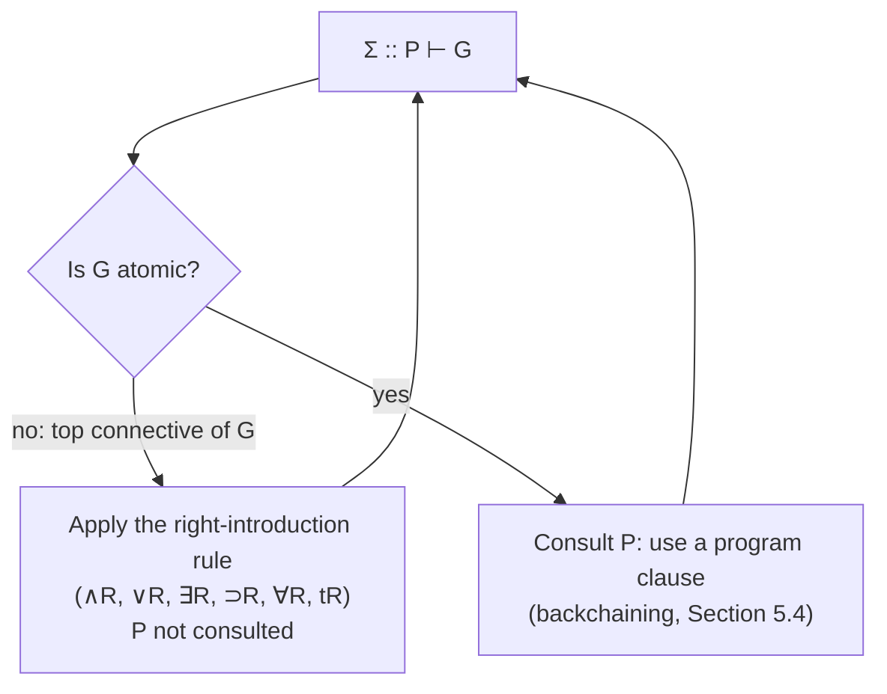

[[book-guidelines|↩ Back to guidelines]]

# Uniform Proofs and Abstract Logic Programming Languages

Focus Area: `automated-reasoning`. Printed pages are cited as in the book; the PDF file is offset by 8 pages (printed p. 61 is PDF page 69).

## 0. The question this section answers

A sequent calculus proof search is a wide-open search. At every step you can apply a structural rule, a left rule, a right rule, an identity rule, or a cut, on any formula, in any order. That is fine for a theorem prover that is allowed to be clever. It is not fine for a *programming language*, where the programmer needs to predict what the machine does from the shape of the program.

Miller's move in Section 5.1 is to **fix the search strategy by the shape of the goal**, and then ask a sharp question: for which programs and goals does this restricted strategy lose nothing? The set of such (program, goal, logic) triples is what he calls an *abstract logic programming language*. Everything below is read off Sections 5.1-5.3, with the Harrop-formula remark from 5.3 and the history from 5.14.

---

## 1. Goal-directed proof search

**What problem does it solve?** You want an interpreter that has no choice about *how to decompose a goal*, only about *how to use the program*. Think of a query to a database: `and`, `or`, `exists` in the query have a fixed meaning, and the database is consulted only for the base facts.

**The computation state.** The book models an idealized interpreter state as a two-sided sequent

$$\Sigma :: P \vdash G$$

- $\Sigma$ is the **signature**: it declares the eigenvariables (fresh constants) currently in scope.
- $P$ is the **program**: a collection of $\Sigma$-formulas, used as assumptions.
- $G$ is the **goal**: a $\Sigma$-formula we want to prove from $P$.

**The restriction.** If $G$ is not atomic, its top-level connective *decides* which rule is used: a **right-introduction rule** must be attempted. Its search meaning is fixed by the proof system and is independent of the program. Only when $G$ is atomic (its head symbol is a non-logical constant) is the program consulted, because the program is what gives meaning to non-logical predicates.

Instantiating the right-introduction rules of Figure 4.1 gives six search strategies (read bottom-up, as reduction of a goal to subgoals):

| # | Goal being proved | Reduces to |
|---|---|---|
| 1 | $\Sigma :: P \vdash B_1 \wedge B_2$ | both $\Sigma :: P \vdash B_1$ and $\Sigma :: P \vdash B_2$ |
| 2 | $\Sigma :: P \vdash B_1 \vee B_2$ | either $\Sigma :: P \vdash B_1$ or $\Sigma :: P \vdash B_2$ |
| 3 | $\Sigma :: P \vdash \exists_\tau x.B$ | $\Sigma :: P \vdash B[t/x]$ for some $\Sigma$-term $t : \tau$ |
| 4 | $\Sigma :: P \vdash B_1 \supset B_2$ | $\Sigma :: P, B_1 \vdash B_2$ (load the hypothesis into the program) |
| 5 | $\Sigma :: P \vdash \forall_\tau x.B$ | $\Sigma, y{:}\tau :: P \vdash B[y/x]$ with $y$ fresh (not in $\Sigma$) |
| 6 | $\Sigma :: P \vdash \mathsf{t}$ | immediate success |

(The book's text writes "$c$ is a token not in $\Sigma$" in item 5 while the rule uses $y$; it is the same fresh constant.)

Read the table as the semantics of a query language:

- $\wedge$ is "and then" (two subgoals, both needed).
- $\vee$ is a *choice point*: the machine picks a side, possibly backtracking.
- $\exists$ is a choice point on a *term*: the machine must guess a witness (this is where unification variables enter in real systems).
- $\supset$ is *local assumption*: the program grows for the duration of the subgoal.
- $\forall$ is *local fresh name*: the signature grows for the duration of the subgoal.

### 1.1 Definition: uniform proof

> A cut-free I-proof $\Xi$ is a **uniform proof** if every occurrence of a sequent in $\Xi$ that has a non-atomic right-hand side is the conclusion of a right-introduction rule.

So when the right side is a compound formula, **no** left-introduction, identity, or structural rule may be the last rule. The definition says nothing about atomic right-hand sides. That gap is filled later by backchaining and focusing (Section 5.4; see [[Focused-Proof-Systems-and-Backchaining]]). Exercise 5.1 asks you to show uniform proofs are always *atomically closed*, meaning `init` is only used on atoms.

Note that uniform proofs are defined only for I-proofs, i.e. single-conclusion. This is the *single-conclusion* version. Section 6.7 generalizes to multiple conclusions once [[Linear-Logic|linear logic]] is available.

**What breaks without this restriction.** Without it, the search for a proof of $\Sigma :: P \vdash G_1 \wedge G_2$ could start by case-splitting on some disjunction in $P$, or by contracting a program clause, before ever touching $\wedge$. The meaning of "and" in a goal would then depend on what is in the program. The restriction makes the logical connectives *the same* in every program, which is the property that lets you call them "logical" constants.

### 1.2 Worked failures: provable but not uniformly provable

The definition is not vacuous. Let $\Sigma_0 = \{p : o,\ q : o,\ r : i \to o,\ a : i,\ b : i\}$. The book gives two groups.

**Provable classically, but with no I-proof (so no uniform proof):**

$$\Sigma :: (r\,a \wedge r\,b) \supset q \vdash \exists_i x\,(r\,x \supset q) \qquad\text{and}\qquad \Sigma :: \cdot \vdash p \vee (p \supset q)$$

The second is a cousin of excluded middle: you cannot decide which disjunct holds, and the constructive reading refuses to guess.

**Provable intuitionistically, but with no uniform proof:**

$$\Sigma :: p \vee q \vdash q \vee p \qquad\text{and}\qquad \Sigma :: \exists_i x.\, r\,x \vdash \exists_i x.\, r\,x$$

Look at why the first fails. The right side $q \vee p$ is non-atomic, so a uniform proof must start with $\vee R$, committing to $q$ or to $p$. But $p \vee q \vdash q$ is not provable (take $p$ true, $q$ false), and neither is $p \vee q \vdash p$. The real proof first does case analysis on the *left* ($\vee L$), then picks the right disjunct in each branch. That is a left rule below a right rule's would-be position, so it is not uniform.

The second is the same story for $\exists$: the proof opens the existential on the left (giving a fresh $x$ with $r\,x$) and only then rebuilds an existential on the right using that $x$. A uniform proof would have to guess a witness term for $\exists R$ up front, and no closed term is available.

This is the concrete shape of the problem: **a left rule that has to fire before a right rule can.** Programs that never put $\vee$ or $\exists$ on the left cannot cause that, which is where Harrop formulas come in (Section 3 below).

---

## 2. Abstract logic programming languages

**What problem does it solve?** "Logic programming language" is usually defined by a concrete machine (SLD resolution, WAM). Miller wants a definition that is implementation-independent and about *logic*: when is goal-directed search a *faithful* implementation of provability?

### 2.1 Definition

An **abstract logic programming language** is a triple $\langle \mathcal D, \mathcal G, \vdash_{\mathcal X} \rangle$ such that for all signatures $\Sigma$, all finite sets $P$ of $\Sigma$-formulas drawn from $\mathcal D$, and all $\Sigma$-formulas $G$ drawn from $\mathcal G$:

$$\Sigma :: P \vdash_{\mathcal X} G \quad\Longleftrightarrow\quad \Sigma :: P \vdash G \text{ has a uniform proof.}$$

The ingredients:

- $\mathcal D$ is the set of allowed **program clauses** (the "definite" formulas).
- $\mathcal G$ is the set of allowed **goals**.
- $\vdash_{\mathcal X}$ is the provability relation of some logic: classical ($\vdash_C$), intuitionistic ($\vdash_I$), or minimal ($\vdash_M$).

In words: *completeness of uniform proofs relative to a logic, on a chosen class of programs and goals.* It is a design recipe: pick $\mathcal D$ and $\mathcal G$ small enough that goal-directed search is complete, and large enough to be useful.

**What breaks without the "iff".** The "if" direction (uniform proof implies provable) is automatic, since a uniform proof is a proof. The "only if" direction is the substance. If it fails, your interpreter answers "no" to goals that are in fact consequences of the program. Prolog programmers know this as incompleteness of a search strategy; here it is stated as a property of the *logic fragment*, before any machine exists.

### 2.2 The examples the book will use

The chapter then shows (Sections 5.2 and 5.3, summarized in sections 4 and 5 below) that two fragments satisfy the definition:

- **fohc**, first-order Horn clauses, with $\langle \mathcal D_1, \mathcal G_1, \vdash_{\mathcal X}\rangle$ for $\vdash_{\mathcal X} \in \{\vdash_C, \vdash_I, \vdash_M\}$.
- **fohh**, first-order hereditary Harrop formulas, with $\langle \mathcal D_2, \mathcal G_2, \vdash_I\rangle$. (Note the book is explicit that $\langle \mathcal D_2, \mathcal G_2, \vdash_C\rangle$ is *not* one.)

The later languages of the book (Lolli, Forum) are defined by the same recipe over linear logic; see Section 5.1's pointer to the multiple-conclusion generalization.

---

## 3. Disjunction and existence properties

**What problem do they solve?** A goal-directed interpreter that answers "yes" to $\exists x.\,B$ should be able to hand you the witness. One that answers "yes" to $B \vee C$ should be able to tell you *which one*. Otherwise the answer is an oracle, not a computation.

### 3.1 Definitions

Let $\Delta$ be a finite multiset of formulas.

- $\Delta$ has the **disjunction property** if provability of $\Sigma :: \Delta \vdash B \vee C$ implies provability of $\Sigma :: \Delta \vdash B$ or of $\Sigma :: \Delta \vdash C$.
- $\Delta$ has the **existence property** if provability of $\Sigma :: \Delta \vdash \exists_\tau x.B$ implies there is a $\Sigma$-term $t : \tau$ with $\Sigma :: \Delta \vdash B[t/x]$ provable.

The book's claim: **whenever uniform proofs are complete, both properties hold.** The argument is one line, and worth seeing: a proof of $\Sigma :: \Delta \vdash B \vee C$ can be taken uniform, so it ends in $\vee R$, so its premise is a proof of $B$ or of $C$. The existential case is identical with $\exists R$ and its witness $t$.

The failing sequents of Section 1.2 are exactly counterexamples: $p \vee q \vdash q \vee p$ proves a disjunction while proving neither disjunct, so $\{p \vee q\}$ lacks the disjunction property. Likewise $\{\exists x.\, r\,x\}$ lacks the existence property for $\exists x.\, r\,x$ (no particular witness is derivable).

Why this matters for programming: the existence property is the logical content of **"a query returns an answer substitution"**. The disjunction property is the logical content of **"a query chooses a branch"**. A language lacking them can prove things but cannot *compute* with them.

### 3.2 Grounding: the properties as a type-theory slogan

In constructive type theory the existence property is the statement that a closed proof of $\exists x.\,B(x)$ is a pair of a witness and a proof. Lean makes this literal:

```lean
-- A proof of an existential *is* a witness plus evidence (no left rule needed):
example : ∃ n : Nat, n + 2 = 5 := ⟨3, rfl⟩

-- With a hypothesis that is a disjunction, the proof is NOT "pick a side first":
-- we must eliminate the hypothesis (a "left rule") before constructing the goal.
example (p q : Prop) : p ∨ q → q ∨ p :=
  fun h => h.elim Or.inr Or.inl      -- Or.elim first, Or.inr/Or.inl inside

-- Neither disjunct follows from the hypothesis alone:
-- example (p q : Prop) : p ∨ q → q := ...   -- not provable
```

The second example is exactly the book's $p \vee q \vdash q \vee p$: provable, but the shape of the proof begins with the *eliminator* on the hypothesis, not with the introduction on the goal. A uniform prover, which insists on `Or.inl` or `Or.inr` first, cannot find it.

Python gives the "answer is a witness" reading quickly. A goal-directed interpreter for $\exists$ literally returns the witness it found:

```python
# Sketch: a goal-directed solver returns the term chosen by the ∃R rule.
# Program: a set of ground facts. Goal: ∃x. r(x).
program = {("r", "a")}
constants = ["a", "b"]

def solve_exists(pred):
    for t in constants:              # candidate witnesses ("some Σ-term t")
        if (pred, t) in program:     # atomic goal: consult the program
            return t                 # existence property: we hand back t
    return None

print(solve_exists("r"))             # -> "a"
```

---

## 4. Horn clauses: the first abstract logic programming language

Section 5.2 shows that Horn clauses fit the definition. The text gives this in three steps.

**Classical origin.** A first-order Horn clause is a closed formula
$$\forall x_1 \ldots \forall x_n\,[\neg A_1 \vee \cdots \vee \neg A_m \vee B_1 \vee \cdots \vee B_p],\qquad p \le 1.$$
This presentation exists because the original semantics was a *refutation* procedure (Robinson's resolution), not a proof procedure. Miller calls the focus on refutation an unfortunate foundation; changing to sequent proofs changes the presentation to goals and program clauses.

**Three presentations of fohc** (all with $A$ ranging over atoms, $\tau$ over primitive types other than $o$):

$$G ::= A \mid G \wedge G \qquad D ::= A \mid G \supset A \mid \forall_\tau x\,D \tag{5.1}$$

$$G ::= \mathsf t \mid A \mid G \wedge G \mid G \vee G \mid \exists_\tau x.G \qquad D ::= \mathsf t \mid A \mid G \supset D \mid D \wedge D \mid \forall_\tau x.D \tag{5.2}$$

$$G ::= A \qquad D ::= A \mid A \supset D \mid \forall_\tau x.D \tag{5.3}$$

Presentation (5.1) matches the textbook disjunction-of-literals definition. Presentation (5.2) is the richest and gives the sets $\mathcal D_1$ and $\mathcal G_1$ used in the theorems. Presentation (5.3) uses only implication and $\forall$.

The **curry/uncurry equivalences**, provable intuitionistically, translate between them:

1. $\mathsf t \supset E \equiv E$
2. $(B \wedge C) \supset E \equiv B \supset C \supset E$
3. $(B \vee C) \supset E \equiv (B \supset E) \wedge (C \supset E)$
4. $(\exists x.B) \supset E \equiv \forall x.(B \supset E)$

(Exercise 5.3: the rewrite can make the clause exponentially larger.) Exercise 5.2: the clausal order of a $\mathcal G_1$ formula is 0, and of a $\mathcal D_1$ formula is 0 or 1.

**The key proposition (5.5).** If $P$ is a multiset of $\mathcal D_1$-formulas and $G \in \mathcal G_1$, then $\Sigma :: P \vdash G$ has a C-proof implies it has an I-proof. The proof strengthens the claim: if $\Delta$ is a multiset of $\mathcal G$-formulas and $\Sigma :: P \vdash \Delta$ has a cut-free C-proof, then *some* $G \in \Delta$ has $\Sigma :: P \vdash G$ with an I-proof, by induction on the cut-free C-proof (the $\supset L$ and $\wedge R$ cases are the interesting ones: you rebuild a single-conclusion rule from the surviving premise). Together with the I-to-uniform direction below, this gives:

> $\langle \mathcal D_1, \mathcal G_1, \vdash_{\mathcal X} \rangle$ is an abstract logic programming language for $\vdash_{\mathcal X}$ equal to $\vdash_C$, $\vdash_I$, or $\vdash_M$.

An important structural observation (text after Exercise 5.9): under presentation (5.2) only atoms and conjunctions of atoms are *both* goals and program clauses. Every other connective is used at half its meaning. $\vee$ and $\exists$ appear only through their right-introduction rules (goals), and $\supset$ and $\forall$ only through their left-introduction rules (clauses). Horn clauses are a "half-logic".

**What breaks without it.** If classical and intuitionistic provability disagreed on Horn programs, then reading a Prolog program classically (as resolution does) and constructively (as proof search does) would assign different meanings. Proposition 5.5 says they agree, so the classical origin of Horn clauses and the constructive proof-search reading describe the same language.

Exercise 5.9 gives a nice boundary example: Peirce's formula $((p \supset q) \supset p) \supset p$ is classically provable with no uniform proof, and the fewest implications in such an implication-only formula is 3.

---

## 5. Hereditary Harrop formulas: goals that bring their own assumptions

Section 5.3 extends fohc so that implications and universals may appear in *goals* (and so in clause bodies).

$$G ::= A \mid G \wedge G \mid D \supset G \mid \forall x.G \qquad D ::= A \mid G \supset A \mid \forall x.D \tag{5.4}$$

The richer form the book uses by default is

$$G ::= \mathsf t \mid A \mid G \wedge G \mid G \vee G \mid \exists x.G \mid D \supset G \mid \forall x.G \qquad D ::= A \mid G \supset D \mid D \wedge D \mid \forall x.D \tag{5.5}$$

with sets $\mathcal D_2$ and $\mathcal G_2$. A fully symmetric presentation (5.6) has $D$ and $G$ range over the same $\mathcal L_0 = \{\mathsf t, \wedge, \supset, \forall\}$ formulas; it appears again in the focusing sections.

The definition is **mutually recursive and "hereditary"**: a negative subformula of a $G$-formula is a $D$-formula, and a negative subformula of a $D$-formula is a $G$-formula. That is the point of the name. Whatever sits to the left of an implication, at any depth, is still a legal *program clause*; whatever sits to the right is still a legal goal. So cut-free proofs gain right rules for $\supset$ and $\forall$ in addition to left rules. Compare the operational reading from the table in Section 1: rules 4 and 5 (local assumption, local fresh name) are now live, which is what makes scoped modules and abstract data types possible later.

**Proposition 5.11** shows the left/right discipline is preserved: in a cut-free I-proof of $\Sigma :: P \vdash G$ with $P \subset \mathcal D_2$, $G \in \mathcal G_2$, every sequent $\Sigma' :: P' \vdash B$ in the proof has $P'$ in $\mathcal D_2$ and $B \in \mathcal G_2$. "Left is program, right is goal" is invariant under proof search.

**Why classical logic is out.** $\langle \mathcal D_2, \mathcal G_2, \vdash_C\rangle$ is *not* an abstract logic programming language: some members of $\mathcal G_2$ have classical but no uniform proofs (the book points to formulas 4-7 of Exercise 4.3). So fohh is defined over intuitionistic logic, $\langle \mathcal D_2, \mathcal G_2, \vdash_I\rangle$. Since fohh has no $\mathsf f$, [[Classical-Intuitionistic-and-Minimal-Logics#Minimal logic|minimal logic]] gives essentially the same language.

### 5.1 The theorem: fohh is an abstract logic programming language

Two results:

**Lemma 5.12.** Let $G \in \mathcal G_2$ be non-atomic, $P$ a finite multiset of $\mathcal D_2$-formulas. If $\Sigma :: P \vdash G$ has an I-proof whose last rule is *not* a right-introduction rule, and all premises have uniform proofs, then $\Sigma :: P \vdash G$ has a uniform proof.

The proof is a **rule permutation** argument. The last rule is $cL$, $wL$, $\wedge L$, $\forall L$, or $\supset L$, and a premise is proved by a right rule ($\wedge R$, $\vee R$, $\forall R$, $\exists R$, $\supset R$). Permute the left rule *up* past the right rule, then induct. Two cases the book shows:

- $\supset L$ below $\wedge R$: duplicate the $\supset L$ onto both conjunct premises, then put $\wedge R$ below. The left context is treated additively, which is what makes duplication sound.
- $\supset L$ below $\supset R$: swap them, so the $\supset R$ comes last.

**Proposition 5.13.** If $\Sigma :: P \vdash G$ has a cut-free I-proof, then it has a uniform proof (for $P \subset \mathcal D_2$, $G \in \mathcal G_2$).

The proof takes an atomically closed cut-free I-proof (by Theorem 4.9), picks a "bad" left rule with non-atomic right-hand side whose premises are already uniform, and repairs it with Lemma 5.12. Repeat until none is left. (Proposition 5.13 plus cut elimination for I-proofs, from [[Cut-Elimination-and-Its-Consequences]], gives completeness for all I-provable sequents.)

**What breaks if left rules cannot be permuted up.** In a language with $\vee L$ or $\exists L$ among the program's *clauses*, the permutation fails at exactly those rules, because they need the case split to happen *before* the right rule can proceed. Hereditary Harrop formulas never put disjunction or existential in the program, and that is the structural reason the permutation works.

---

## 6. Harrop formulas

The book introduces, at the end of 5.3, the broader class

$$H ::= A \mid B \supset H \mid \forall x.H \mid H_1 \wedge H_2,$$

where $A$ ranges over atoms and $B$ over **arbitrary** first-order formulas. These are the **Harrop formulas**. Hereditary Harrop formulas are Harrop formulas, but with the arbitrary $B$ restricted to be itself a $G$-formula (hereditarily).

The property is stated as an exercise (5.14): if $\Gamma$ is a multiset of Harrop formulas and $B$ is an arbitrary formula, the sequent $\Sigma :: \Gamma \vdash B$ is "**uniform at the root**": if $B$ is non-atomic and the sequent is intuitionistically provable, it has an I-proof ending in a right-introduction rule. The exercise then asks whether uniform proofs are *complete* for such sequents. (The book leaves both parts as an exercise, so this note does not assert the answer.)

Historically (Section 5.14), Harrop formulas were defined and shown to have the disjunction and existence properties in Harrop [1960]. That is the ancestor of the whole construction: Harrop identified which *assumptions* keep $\vee$ and $\exists$ constructive; Miller's definition adds that the same class gives a complete goal-directed search. The design choice of identifying the right side of sequents with goals and the left with programs dates to Miller and Nadathur [1986] and Miller [1986]; Gabbay and Olivetti [2000] give a more general treatment of goal-directed proof search.

---

## 7. Grounding in Rust: the interpreter the definition describes

Here is a propositional-plus-assumptions skeleton of a uniform-proof interpreter. It implements strategies 1, 2, 4, 6 of the table and backchaining for atoms. Quantifiers are omitted to keep the code short (strategies 3 and 5 would carry a signature and a substitution).

```rust
use std::rc::Rc;

#[derive(Clone, Debug, PartialEq)]
enum F {
    True,                          // t
    Atom(&'static str),            // A
    And(Rc<F>, Rc<F>),             // B1 ∧ B2
    Or(Rc<F>, Rc<F>),              // B1 ∨ B2   (goal position only)
    Imp(Rc<F>, Rc<F>),             // B1 ⊃ B2
}

/// Σ :: P ⊢ G, with Σ omitted (propositional).
/// `depth` guards against the non-termination that real Prolog also has.
fn prove(program: &Vec<F>, goal: &F, depth: u32) -> bool {
    if depth == 0 { return false; }
    match goal {
        // Right-introduction rules, one per connective. The program is NOT consulted.
        F::True => true,
        F::And(a, b) => prove(program, a, depth - 1) && prove(program, b, depth - 1),
        F::Or(a, b) => prove(program, a, depth - 1) || prove(program, b, depth - 1),
        F::Imp(d, g) => {
            let mut p2 = program.clone();
            p2.push((**d).clone());           // load hypothesis into the program
            prove(&p2, g, depth - 1)
        }
        // Atomic goal: only now consult the program (backchaining, see 5.4).
        F::Atom(_) => program.iter().any(|d| backchain(program, d, goal, depth - 1)),
    }
}

/// Use clause D to prove atom `a`: D = A | G ⊃ D' | D1 ∧ D2.
fn backchain(program: &Vec<F>, d: &F, a: &F, depth: u32) -> bool {
    match d {
        F::Atom(_) => d == a,
        F::And(d1, d2) => backchain(program, d1, a, depth) || backchain(program, d2, a, depth),
        F::Imp(g, d2) => backchain(program, d2, a, depth) && prove(program, g, depth),
        _ => false, // t and ∨ are not program clauses here
    }
}
```

What the code shows about the theory:

- The **`match goal`** arm structure *is* the definition of uniform proof: the connective on the right fixes the next step, and `program` is passed through unchanged except in the `Imp` case.
- The only place `program` is *searched* is the `F::Atom` arm. This is the "program gives meaning to non-logical predicates" sentence.
- `F::Or` is a choice point (`||` is Rust's backtracking). If you add `F::Or` to *program clauses* (a case on the left), `backchain` has no sound clause for it: this is exactly the left rule that breaks uniformity.
- Calling `prove` on `p ∨ q ⊢ q ∨ p` (program `[Or(p,q)]`, goal `Or(q,p)`) returns `false`, matching the book's example of a provable sequent with no uniform proof. This interpreter is *incomplete* for that input because the input leaves the fragment $\mathcal D$.



---

## 8. Synthesis

**What this topic depends on.** Chapter 3 (sequent calculus, signatures, eigenvariables), Chapter 4 (C and I proofs, cut elimination, atomically closed proofs, and the permutability of rules), and the definition of clausal order from Section 2.4.

**What depends on it.**

- Section 5.4 finishes the specification: for atomic goals the program is consulted by the `decide` rule, giving **focused proofs** where right-introduction (goal reduction) and left-introduction (backchaining) phases alternate. See [[Focused-Proof-Systems-and-Backchaining]].
- Sections 5.9-5.12 give the programming examples in fohc and fohh. See [[Horn-Clauses-and-Hereditary-Harrop-Formulas]].
- Chapter 6 replays the whole recipe in **linear logic**: Lolli and Forum are abstract logic programming languages over linear logic, with *multiple-conclusion* uniform proofs (Section 6.7).

```text
 uniform proof (goal-directed)  ──defines──▶  abstract logic programming language ⟨D, G, ⊢X⟩
            │                                         │
            │ completeness ⇒                          ├── fohc  (⊢C, ⊢I, ⊢M)
            ▼                                         └── fohh  (⊢I only)
 disjunction + existence properties                         │
 (Harrop 1960)                                              ▼
                                           focusing / backchaining (5.4)
```

**[[Classical-Intuitionistic-and-Minimal-Logics#Where this leads|Where this leads]].** Uniform proofs are the criterion for "this logic fragment is a programming language"; every later language in the book (fohh, Lolli, Forum) is certified by proving that criterion for its own sequent calculus, and focusing (Section 5.4) is the next step that also tames atomic goals.

### How this bears on the learning goals (Focus Area: `automated-reasoning`)

- **Unification and metavariables.** Strategy 3 ($\exists R$ with "some $\Sigma$-term $t$") is where a real implementation introduces a *logic variable* to be solved later by unification. The existence property is the logical guarantee that the solved variable is a genuine witness. This is the mechanism a Miller-style pattern unifier plugs into: the book's own design is to keep $\exists$ choice abstract, and higher-order unification (later chapters) refines it. The book deliberately sets unification algorithms aside, so treat this as a pointer, not as a claim of the text.
- **Eigenvariables and contexts.** Strategy 5 ($\forall R$ extends $\Sigma$) and strategy 4 ($\supset R$ extends $P$) are exactly the two ways a **typing context** grows in an elaborator when it enters a binder or loads a hypothesis. A bidirectional checker descending through $\Pi$ or $\lambda$ binders is doing goal-directed search on its own sequent $\Gamma \vdash e : A$: the *checking* direction is the right rule, the *inference* direction is atomic-goal backchaining. This is an analogy for the `type-theory` area, not something the book states.
- **Proof certificates and kernels.** A uniform proof is a very regular proof object: the shape of the goal determines each step, so a certificate need only record clause choices and witnesses. That is a plausible compact format for a proof-reconstruction layer feeding a trusted kernel.
- **Horn clauses.** fohc is the fragment that constrained Horn clause (CHC) based verification tools use as input language; the abstract-logic-programming characterization says *why* goal-directed solving is complete for them. (The CHC-solving connection is not developed in these pages; it is flagged for the `static-analysis` chapters of the book.)
