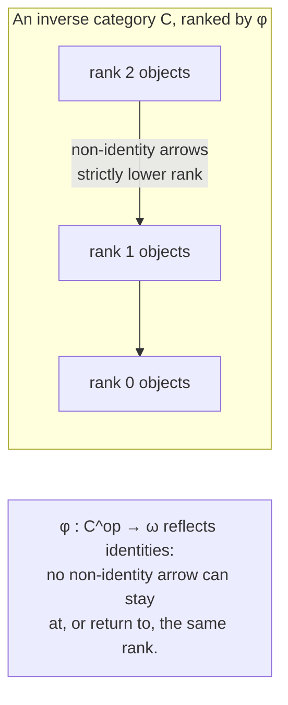

[[book-guidelines|↩ Back to guidelines]]

# Category Theory Internal to the Outer Level

## Why bother re-deriving category theory at all?

Here's the thing that makes this section almost anticlimactic on first read, and deliberately so: **the outer level of 2LTT is just Martin-Löf type theory with UIP (uniqueness of identity proofs) and function extensionality.** That's it. No univalence, no higher structure, every type a set. Which means every categorical construction you already know how to formalize in an ordinary, 1-truncated type theory — categories, functors, natural transformations, limits, adjunctions — just *works*, with zero new ideas needed. The paper says as much, almost apologetically (Remark 3.2): they won't "indulge in the exercise of replicating the whole of category theory," and just trust that it's "a matter of diligence and patience."

So why does this deserve its own section at all? Because two-level type theory's entire value proposition is using the *outer* level's boring, well-behaved 1-category theory as scaffolding to talk *about* the *inner* level's univalent, higher-dimensional world. Chapter 3's job is to set up that scaffolding precisely enough that later chapters ([[Reedy-Fibrant-Diagrams|Reedy fibrant diagrams]], semisimplicial types) can build genuinely new machinery on top of it without hand-waving about which level a given object or equation lives in. Get the outer/inner bookkeeping wrong here, and every later theorem about "fibrant limits" or "Reedy fibrations" becomes ambiguous about what kind of equality it's even asserting.

**What breaks without this distinction.** If you tried to do category theory using the *inner* (univalent) notion of type instead, "sameness of objects" would carry higher structure — a category's hom-*type* between two isomorphic objects wouldn't just be inhabited-or-not, it would itself be a space with potentially interesting path structure, and the classical 1-categorical axioms (associativity as an *equation*, not merely a coherent higher cell) wouldn't typecheck as strict equalities anymore. You'd be forced straight into $(\infty,1)$-category theory before you had any of the tools to define it. The outer level exists precisely to let you postpone that: build ordinary categories first, out of the flat, UIP-respecting outer equality, and only later — once fibrancy and Reedy machinery are in place — reach for something that behaves like higher categories (that's the destination of Chapter 4's semi-Segal types, a separate topic).

## Categories, functors, and natural transformations, defined internally

**Definition 3.1 (category).** A category $C$ consists of:

- a type $|C| : \mathcal{U}$ of objects;
- for objects $x, y$, a type $C(x,y) : \mathcal{U}$ of morphisms;
- identities $\mathrm{id} : C(x,x)$;
- composition $\circ : C(y,z) \to C(x,y) \to C(x,z)$;
- satisfying the usual laws $f \circ \mathrm{id} = f$, $\mathrm{id} \circ f = f$, $h \circ (g \circ f) = (h \circ g) \circ f$.

Two details are worth dwelling on, because they're exactly the places where "outer" matters:

1. **This is literally the HoTT book's definition of a *precategory*, not category.** In HoTT, a *category* additionally requires that isomorphic objects be *equal* (the univalence-flavored condition that turns "isomorphic" into "identical"), because in a univalent setting the identity type between objects can be strictly weaker than isomorphism unless you impose that. Here, that extra condition is simply unnecessary: since the outer level satisfies UIP, every outer type is automatically a *set* (0-truncated), so there's no extra higher structure for a "precategory vs. category" distinction to police. The paper gets to just say "category" and mean the precategory notion, for free.
2. **The category of types, $\mathcal{U}$, is a genuine example**, with morphisms = functions — and by "a slight abuse of notation," the authors write $\mathcal{U}$ for both the universe and the category built from it. This overloading recurs throughout (e.g. $C$ itself denotes both a category and its type of objects), and it's intentional shorthand once you've internalized which register you're reading in.

From this one definition, the paper claims (Remark 3.2) that the entire standard toolkit is recoverable: the functor category $[C,D]$, natural transformations $\mathrm{Nat}(C,D)$ between functors $F, G : C \to D$, the (larger) category of categories with functors and natural transformations as morphisms, limits, adjunctions, uniqueness of limits up to isomorphism, and so on — all constructively, all inside the outer level.

**Rust framing.** A `Category` here is structurally close to a Rust trait bundling an associated `Hom<X, Y>` type family plus an `id` and a `compose` that must satisfy laws you can't express as compiler-checked bounds (associativity, unit laws) but could state as `#[test]` properties or, if you wanted real teeth, as a `PartialEq`-respecting proof obligation in a verified subset. The overloading of $C$ for "the category" and "its objects" is the same move as a Rust `impl<T> Category for Graph<T>` where `Graph<T>` doubles as the object type of its own trivial category (objects = graphs, morphisms = graph homomorphisms) — you don't need a separate wrapper type, the carrier *is* the object set.

**Lean framing.** This is exactly `CategoryTheory.Category` in Mathlib's core, minus the (optional, separately-imposed) univalence-style saturation condition. Mathlib's `Category` class is also, by construction, a "precategory" in the HoTT-book sense — it lives in a type theory with definitional UIP (Lean's `Prop`/`Type` hierarchy has proof-irrelevant `Prop` but no built-in univalence for `Type`), so the "objects up to iso are equal" question doesn't even arise as a *coherence obligation* the way it does in HoTT; it's either true by `Quotient`/`Setoid` engineering or simply not asked. The paper's outer level is, in this sense, doing exactly what Lean's ambient type theory does by default — which is precisely why the authors can treat "diligence and patience" (i.e., write the Lean/Coq/Agda-style development) as a settled matter, and why their own partial Lean formalisation (covered under "[[Formalisation-of-2LTT-in-Proof-Assistants|Formalisation of 2LTT in Proof Assistants]]") could lean on Lean's ordinary category theory library rather than reinventing it.

## Finite types: inner vs. outer finiteness

Before categories proper, §3.1 spends real effort on a seemingly small definition, because it's the paper's first worked example of a *general* phenomenon: outer and inner versions of "the same" concept can fail to coincide, and the paper needs the vocabulary to say so precisely.

- $\mathrm{Fin}_n$ (no annotation) is the **outer** finite type with $n$ elements — concretely, natural numbers below $n$ under the outer, decidable-equality, UIP-respecting order.
- $\mathrm{Fin}^i_n$ is the **inner** finite type, defined for $n : \mathbb{N}^i$ (an *inner* natural number).
- A type $X$ is **finite** if $\Sigma(n:\mathbb{N}).\, X \cong \mathrm{Fin}_n$ — note this is an outer isomorphism, an outer existential, using the outer naturals.
- There is always a canonical function $\mathrm{Fin}_n \to \mathrm{Fin}^i_n$ (via the coercion $\mathbb{N} \to \mathbb{N}^i$), but **no canonical map back**, and no reason in general to expect one, let alone an isomorphism — that would need the strengthening axiom (A1) from Chapter 2 (fibrant outer naturals) to even become plausible.

**What breaks without this distinction.** If you conflated the two, "finiteness of a type" would silently mean two different things depending on which side of the conversion function $c$ you were standing on, and results proved about $\mathrm{Fin}_n$ (using outer, UIP-flavored reasoning — decidable equality, no path structure to worry about) would get smuggled into inner-level statements where they're not automatically valid. This distinction matters immediately in Chapter 4: theorems like "Reedy fibrant diagrams over a *finite* inverse category have fibrant limits" (Theorem 4.8) are stated about *outer* finiteness of the index category's object type — the induction is a completely ordinary, decidable, outer-level induction on cardinality, even though the diagram's *values* live in the fibrant (inner-flavored) world.

**Lean framing.** This is the exact shape of the distinction between `Fin n` for `n : ℕ` (Lean's ordinary, decidable, `DecidableEq`-carrying finite type) versus something like a HoTT-flavored "finite $\infty$-groupoid" you might encounter in a univalent foundations library (`Fin` up to weak equivalence rather than definitional equality) — except that in Lean's actual default type theory these rarely diverge, because Lean doesn't have a native univalent inner layer to diverge *from*. 2LTT is precisely manufacturing, on purpose, the situation Lean's practical type theory avoids by fiat.

## Size and smallness

The paper also has to face the classical category-theorist's headache — Russell's-paradox-style size issues — and resolves it the way most working type-theoretic developments do: **relatively, not absolutely.** Rather than fixing a specific universe level and calling everything below it "small" (a choice that would be arbitrary and would hard-code an assumption about how many universes you'll ever need), the convention is:

> "Small" means *one universe level below whatever the current ambient/default universe is* — a statement about *relative* size, not an absolute cutoff.

This is standard practice in any type theory with a cumulative universe hierarchy (Agda, Lean, Coq all face the identical problem when defining, say, the category of small categories living inside a category of large categories), but it's worth naming because Chapter 4's classifier construction for Reedy fibrations (a separate topic, but foreshadowed here) depends on being able to talk about "the type of all diagrams of a given shape" without that type swallowing itself.

One more genuinely subtle point closes §3.1: **the universe $\mathcal{U}^i$ of inner types is itself a category** (objects = inner types, morphisms = inner functions, i.e. the outer *transcription* of inner function types) — but it is a strictly worse-behaved one than $\mathcal{U}$. In particular, $\mathcal{U}^i$ **does not have pullbacks** as an outer-level category, precisely because pulling back requires forming an inner $\Sigma$-type classified by an *equation* of inner functions, and outer equality of inner functions is not the same well-behaved thing as inner path equality — this is exactly the "positive type formers aren't preserved by $c$" asymmetry from Chapter 2, resurfacing as a concrete categorical defect. (The paper flags that Lemma 3.10(i) — closure of fibrations under pullback — is the fix that gets used instead, once fibrancy is on the table.)

## Inverse categories and rank functors

Chapter 4 opens (§4.1) with a very concrete failure that motivates everything else in the topic: take the truncated simplex-like category $\Delta_+^{<3}$, three objects $[0],[1],[2]$ ("vertices," "edges," "triangles") with generating morphisms $s,t:[0]\to[1]$ and $u,v,w:[1]\to[2]$ subject to $u\circ s = v\circ s$, $u\circ t = w\circ s$, $v\circ t = w\circ t$. A functor $F : (\Delta_+^{<3})^{op} \to \mathcal{U}$ unfolds, completely mechanically, into a **9-tuple** $(X_0,X_1,X_2,f_s,f_t,f_u,f_v,f_w,e_0,e_1,e_2)$ — three types, five maps, and three *strict equalities* between composite maps. This 9-tuple encoding is **not fibrant**: strict equality of functions is an outer, UIP-flavored notion that the univalent inner level cannot express directly as a path type.

The fix the chapter is building toward is **Reedy fibrancy** (a full topic in its own right), but the *prerequisite* for even stating it is a categorical notion that captures "this diagram shape only lets you go one way" — because the matching-object construction that defines Reedy fibrancy needs to do induction on the diagram's shape, and induction needs a well-founded measure to induct on. That's exactly what an inverse category supplies.

**Definition 4.1 (inverse category).** A category $C$ is **inverse** if there is a functor
$$
\varphi : C^{op} \to \omega
$$
(the **rank functor**) that *reflects identities*: whenever $f : x \to y$ with $\varphi(x) = \varphi(y)$, then $f$ is (definitionally, up to the pairing) the identity arrow. Here $\omega$ is the category with objects $\mathbb{N}$ and $\omega(n,m) :\equiv m \le n$ — a poset, chosen over general Reedy-category ordinals purely to sidestep encoding arbitrary ordinals in the theory. Objects of rank $< n$ form the full subcategory $C^{<n}$.

Unpack what "reflects identities" buys you: **every non-identity morphism strictly lowers rank.** There is no way to compose your way back up to where you started (other than by literally not moving). This is precisely the "one-way" restriction that lets you build things — limits, replacements, classifiers — by strong induction on rank, peeling off the objects of maximal rank one at a time (this is exactly the proof strategy Theorem 4.8 uses later, by induction on the finite cardinality of $|C|$, choosing an object $z$ of maximal rank at each step).

$\Delta_+^{op}$ (the semisimplicial index category, covered as its own topic) is the paper's running example: its rank functor is literally the simplex dimension $n$, and because $\Delta_+$ has only *face* maps (no degeneracies collapsing dimension), $\Delta_+^{op}$'s morphisms strictly decrease $n$ — an inverse category by construction, not by afterthought.

**Rust/Lean framing.** The rank functor is exactly a well-founded termination measure: the categorified version of a Rust recursive function whose recursive calls strictly decrease a `usize`, or a Lean definition discharged via `termination_by` / `decreasing_by` on `Nat`. "Inverse category" is what it looks like to *categorify* "this recursion scheme is well-founded" — you're not just asserting a single function terminates, you're asserting an entire *diagram shape* admits induction, which is exactly the leverage Theorem 4.8's proof (Chapter 4, Reedy fibrant limits) cashes in.

## The category of elements and the Grothendieck construction

Given a category $C$ and a functor $F : C \to \mathcal{U}$, the **category of elements** of $F$, written $F/C$ (deliberately evoking coslice notation), is the ordinary Grothendieck construction:

- objects: pairs $(a, x)$ with $a : |C|$ and $x : F(a)$;
- morphisms $(a,x) \to (b,y)$: maps $f : a \to b$ in $C$ such that $Ff(x) = y$.

There is a forgetful functor $F/C \to C$, which is always a **discrete Grothendieck opfibration** (this is a general fact about categories of elements, not specific to 2LTT — every fibre of the forgetful map is a discrete type, namely $F(a)$ itself). It becomes a **cosieve** — a subcategory closed under postcomposition, containing no "extra" morphisms beyond inclusion — exactly when $F$ is valued in propositions (subsingleton types), the special case relevant to the "subfunctors of representables" discussion below.

Two structural facts close the loop back to inverse categories, and they're the actual payoff of this section:

1. **If $C$ is inverse, so is $F/C$.** The forgetful functor $F/C \to C$ lets you pull back $C$'s own rank functor $\varphi$ along it, giving $F/C$ a rank functor of its own. So the Grothendieck construction *preserves* the one-way structure that makes induction possible — you don't lose your inductive handle by passing to a category of elements.
2. **The coslice as a special case.** Given any object $x : C$, the ordinary **coslice** $x/C$ (objects: pairs $(y,f)$ with $f : x \to y$; morphisms: $h : y \to y'$ with $h \circ f = f'$) is literally the category of elements of the **representable functor** $C[x] :\equiv C(x, -)$. The forgetful functor $x/C \to C$ is, again, a discrete Grothendieck opfibration — a special case of fact (1) with $F = C[x]$.

**Rust/Lean framing.** The category of elements is the categorified shape of a dependent pair type indexed over a base — `(a: A, x: F(a))` is exactly a Rust `enum`-of-structs keyed by a discriminant `a: A`, each carrying payload `F(a)`; morphisms tracking $Ff(x) = y$ are the categorified analogue of a well-typed transformation that respects the payload's dependency on the tag. In Lean, this is precisely `Σ (a : C), F a` at the object level, and the "forgetful functor is a discrete opfibration" fact is the categorical restatement of "projecting out of a `Sigma` type is always well-defined and total" — you never lose information about which fibre you're in.

## Reduced coslices and the abstract boundary

This is where the chapter earns its keep: a definition that looks arbitrary in isolation but is *exactly* what the matching-object construction (the technical heart of Reedy fibrancy, covered under "Reedy Fibrant Diagrams") needs.

**Definition 4.2 (reduced coslice).** Given $x : C$, the **reduced coslice** $x \diagdown C$ is the full subcategory of the coslice $x/C$ on objects $(y,f)$ that are *not* equal to $(x, \mathrm{id}_x)$ — i.e., objects come with a proof $p : (y,f) \neq (x,\mathrm{id}_x)$. Write such an object as a triple $(y,f,p)$. There's a fully faithful forgetful functor $x\diagdown C \to x/C$, and composing with $x/C \to C$ gives $\mathrm{forget} : x \diagdown C \to C$.

In words: **the reduced coslice is "everything you can map to from $x$, except the trivial self-map."** Why would you ever want to throw away exactly one object? Because of what it does structurally once $C$ is inverse: the identity arrow is the *only* endomorphism-at-$x$ an inverse category can have (by identity-reflection, any endomorphism at constant rank must be the identity), so removing it removes precisely — and only — the "boundary of nothing" case, leaving a subcategory whose objects are genuinely lower-ranked than $x$. This is what makes the reduced coslice usable as an induction target: everything in $x \diagdown C$ has strictly lower rank than $x$.

**The abstract boundary, via subfunctors of representables.** The paper gives a second, more conceptual route to the same object, and it's worth following because it explains *why* "reduced coslice" is the right name. Recall $C[x] :\equiv C(-, x)$, the representable diagram at $x$ (so $x/C$ is its category of elements). Subfunctors of $C[x]$ correspond exactly to **cosieves**: families of propositions
$$
\varphi : \Pi_{i:C}\big(C(x,i) \to \mathrm{Prop}\big)
$$
closed under postcomposition, $\varphi_y(f) \to \varphi_z(g \circ f)$. Given such a $\varphi$, the corresponding subfunctor is $\Phi(y) :\equiv \Sigma(f : C(x,y)).\, \varphi_y(f)$.

Now take the specific cosieve $\delta(y,f) :\equiv (y \neq x)$ — "every arrow out of $x$ except the one landing back at $x$." Because $C$ is inverse (so the only endomorphism at $x$ really is the identity), $\delta$ is well-defined as a cosieve. The corresponding subfunctor of $C[x]$ is denoted
$$
\partial C[x]
$$
and called the **abstract boundary** of $x$, with $i_x : \partial C[x] \to C[x]$ the evident inclusion.

**Lemma 4.3** ties the two constructions together and is the section's punchline: *the reduced coslice $x \diagdown C$ is, up to isomorphism, the category of elements of the abstract boundary $\partial C[x]$*, and this correspondence sends the inclusion $\partial C[x] \to C[x]$ to the forgetful functor $x \diagdown C \to x/C$. In other words, "remove the identity arrow from the coslice" and "take the maximal proper subfunctor of the representable diagram" are the *same* construction viewed two ways — one concrete (objects and morphisms you can list), one functorial (a subfunctor you can quantify over uniformly). Chapter 4 needs the functorial phrasing specifically because the **matching object** $M^X_z$ of a diagram $X$ at $z$ is defined as $\mathrm{Nat}(\partial C[z], X)$ (the type of natural transformations from the boundary into $X$) — "the compatible boundary data an object at $z$ would have to restrict to" — and Reedy fibrancy is the condition that the canonical map $X_z \to M^X_z$ is a fibration. Without the abstract-boundary formulation, "matching object" would have no uniform, natural-in-$X$ description at all.

**Rust/Lean framing.** The abstract boundary is the categorified shape of "everything reachable from a node except staying put" — think of a Rust `enum Step<T> { Forward(T), Stay }` where you've refined the type to statically exclude the `Stay` variant: `∂C[x]` is exactly `C[x]` minus its one distinguished basepoint element, tracked at the *type* level (a subfunctor, i.e. a dependent refinement) rather than by a runtime check. In Lean terms, this is a `Subtype` of the representable presheaf cut out by the decidable(-ish) predicate `y ≠ x`, and Lemma 4.3's "two constructions agree" is the categorical analogue of proving two different-looking `Subtype` definitions are propositionally (here: isomorphism-of-categories) equal — a coherence lemma you'd want to state once and reuse, exactly as this paper does for every later Reedy-fibrancy statement.

## Where this leads

```mermaid
graph TD
    A["Outer-level category theory\n(Def 3.1, §3.1)"] --> B["Finite types, size conventions\n(inner vs outer Finₙ, relative smallness)"]
    A --> C["Inverse categories\n(rank functor φ, Def 4.1)"]
    C --> D["Category of elements F/C\n(Grothendieck construction)"]
    D --> E["Coslice x/C\n= category of elements of C[x]"]
    E --> F["Reduced coslice x⇊C\n(Def 4.2)"]
    F --> G["Abstract boundary ∂C[x]\n(Lemma 4.3: same thing, functorially)"]
    G --> H["Matching object Mᶻ_X = Nat(∂C[z], X)\n→ Reedy fibrancy (Ch. 4, separate topic)"]
```

Everything here is quietly load-bearing for the rest of the paper. The outer-level category theory of §3.1 is what makes it legitimate to even *state* definitions like "fibration" or "cofibrant type" (the "[[Fibrancy-and-Cofibrancy|Fibrancy and Cofibrancy]]" topic) as ordinary categorical structure rather than something requiring new foundations. The inverse-category / rank-functor apparatus of §4.2 is the *only* reason Theorem 4.8 (fibrant limits of Reedy fibrant diagrams) is provable by ordinary structural induction — without a well-founded rank, "define the diagram's limit by looking at strictly smaller pieces" wouldn't typecheck as an induction principle at all. And the abstract-boundary reformulation of the reduced coslice is not a stylistic nicety; it's the exact definition the matching object $M^X_z$ needs in order to be natural in $X$, which in turn is what Reedy fibrations, Reedy fibrant replacement, and ultimately the semisimplicial-type / $(\infty,1)$-category machinery of the later sections are built on top of.

**On the standing learning goals (`type-theory`).** This topic is the paper's clearest instance of a theme worth carrying into the elaborator/verifier project: *a categorical construction (Grothendieck construction, representable functor, subfunctor-as-cosieve) implemented as an ordinary dependent-type construction* (a $\Sigma$-type indexed over a base, a predicate-refined subtype) *is doing exactly the same job a hand-rolled data structure would do in a compiler* — the category of elements here is structurally identical to how you'd represent a tagged, dependently-typed AST node keyed by a syntactic category, and the abstract-boundary trick (cutting a distinguished basepoint out of a representable functor via a decidable predicate) is the same move as refining an inductive type by an invariant-carrying subtype. There's no unification or metavariable-resolution content in this particular section (the authors' own book-level learning-goals note is right that this book doesn't touch that machinery directly) — but the discipline of keeping outer (strict, decidable, UIP) and inner (proof-relevant, higher) equality rigorously separate is precisely the discipline a bidirectional elaborator needs when it has to distinguish *definitional* equality (checked by the trusted kernel, analogous to this paper's outer level) from *propositional* equality obligations it defers to the user or a tactic (analogous to inner-level path equality) — the same categorical bookkeeping problem, one level down.
