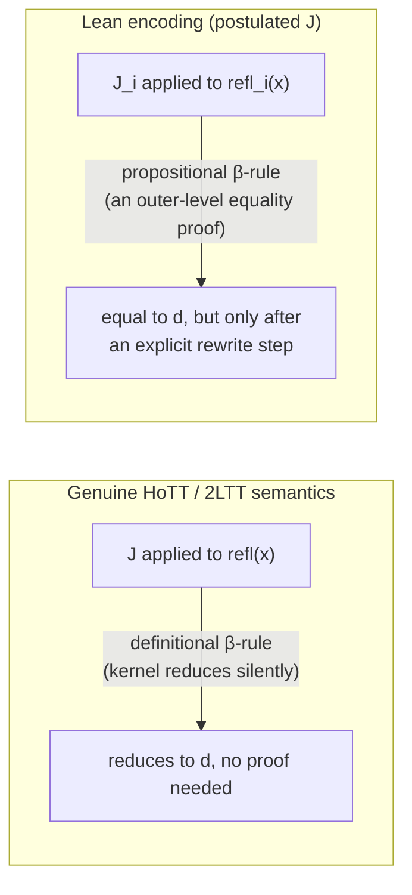

[[book-guidelines|↩ Back to guidelines]]

> **A short chapter, honestly.** The paper's own discussion of formalisation is compressed into one paragraph of the Introduction (Section 1.1, pp. 5–6) and one paragraph of the Conclusions (Section 5, p. 54–55) — under two pages of primary text combined. This article treats it at that scale: it's a focused note on an engineering problem the authors ran into and how three proof assistant communities have each answered it differently, not a padded chapter-length treatment. Where the source is silent on a detail (e.g. exact Lean syntax — the paper uses Lean 2, whose surface syntax has since been superseded), the code shown here is an illustrative reconstruction, flagged as such.

## The problem: no proof assistant natively speaks 2LTT

Every construction in this paper up to this point — fibrant types, Reedy fibrations, semi-Segal types — has been developed in the syntax of two-level type theory itself: a system with **two genuinely separate sorts of types**, an outer level (ordinary Martin-Löf type theory with UIP) and an inner level (HoTT, univalent, no UIP), linked by a one-directional conversion function $c$ from inner to outer.

The catch, acknowledged explicitly in the paper (p. 5): "our choice also matches the way that 2LTT can be implemented in existing proof assistants such as Coq, Agda, or Lean" — but none of these systems ships two-level type theory as a primitive. Coq, Agda, and (the Lean 2 used here) each give you exactly *one* type theory to build in, and that type theory already comes with its own built-in stance on whether equality satisfies UIP. So "formalising 2LTT" doesn't mean writing down the syntax of Section 2.1 and hitting compile — it means **encoding** a two-sorted theory inside a one-sorted host theory, faithfully enough that the encoding's proofs correspond to genuine 2LTT proofs.

This is a mechanism-level problem, not a metatheoretic one: how do you tag which of the host system's types "count as" inner (fibrant) versus outer, and how do you make that tagging propagate automatically through composite types ($\Pi$, $\Sigma$, products) instead of forcing the user to annotate everything by hand? The paper reports three different answers — Lean (the authors' own), Coq (Boulier–Tabareau), and Agda (a native-syntax extension) — that differ specifically along that mechanism axis, and one further complication (loss of a computation rule) that the authors' own Lean approach ran into and had to accept as a tradeoff.

## Strategy 1: encoding fibrancy via type classes (Lean)

The authors' own partial formalisation (Lean 2, footnote 10, used to mechanise Theorem 4.8 on fibrant limits of [[Reedy-Fibrant-Diagrams|Reedy fibrant diagrams]]) takes the **outer level as the host's native types**, since Lean's ordinary type theory already validates UIP (its propositional equality is, thanks to UIP, "indeed propositional in the sense of HoTT" — p. 54). The inner (fibrant) level then has to be built as extra structure layered *on top of* ordinary Lean types:

- Ordinary Lean types = outer types, directly, no encoding needed.
- A **type class** (their term) marks which outer types are additionally fibrant, and — crucially — Lean's type class *resolution* mechanism automatically infers and propagates that marking through composite constructions, rather than requiring the user to prove fibrancy by hand at every step.
- The fibrant identity type (the inner "path" equality, the paper's $=^i$) is *postulated* directly as an axiom, along with its eliminator $J$ (a fibrant analogue of Lemma 3.5's closure of fibrant types under $\Pi$ and $\Sigma$ has to be proved too, so that fibrancy survives forming function types and pairs of fibrant types).

Why type classes specifically, and not just a manually-threaded proof argument? Because fibrancy is exactly the kind of property you want *inferred*, not written out at every use site — the same shape of problem Rust solves with trait bounds and Lean's own elaborator solves with instance search. If you had to write, at every single use of a $\Sigma$-type built from two fibrant types, an explicit proof term witnessing "this $\Sigma$-type is fibrant," the encoding would drown in bookkeeping that has nothing to do with the actual mathematics. Type class resolution turns that bookkeeping into a search procedure the elaborator runs silently.

**Rust grounding (primary).** A trait-bound-based sketch of the same idea:

```rust
// Illustrative: the paper's fibrancy-tracking discipline is structurally
// identical to Rust's trait-based capability tracking.
trait Fibrant {}

// A fibrant unit type (base case, cf. Lemma 3.5: 1 is fibrant)
struct FibUnit;
impl Fibrant for FibUnit {}

// Closure under Sigma: if A and, for every a: A, B(a) are fibrant,
// the dependent pair type is fibrant too. Rust has no dependent
// pairs natively, but the *shape* of the inference is the same:
// a blanket impl that propagates the marker trait through a
// composite type, exactly as Lean's instance search would.
struct Sigma<A, B> {
    fst: A,
    snd: B,
}
impl<A: Fibrant, B: Fibrant> Fibrant for Sigma<A, B> {}

// The compiler's trait solver now infers Fibrant for Sigma<FibUnit, FibUnit>
// automatically — this inference step *is* what Lean's type class
// resolution is doing when it propagates the fibrancy tag.
fn requires_fibrant<T: Fibrant>(_x: T) {}
```

**Lean grounding (secondary, promoted here because the source itself is a Lean formalisation).** An illustrative reconstruction — the paper used Lean 2, whose syntax differs from modern Lean, so treat this as a translation of the *idea*, not a transcription of their code:

```
-- Illustrative reconstruction of the paper's encoding strategy,
-- in modern Lean-flavored syntax (Lean 2's own syntax was different).
class Fibrant (A : Type u) : Prop  -- a marker; the paper's "type class tracking fibrancy"

axiom Fibrant.unit : Fibrant PUnit

-- fibrancy closed under Sigma (mirrors the inner-level Sigma-type former Σ^i)
axiom Fibrant.sigma {A : Type u} {B : A → Type u}
  [Fibrant A] (h : ∀ a, Fibrant (B a)) : Fibrant (Σ a, B a)

-- the postulated fibrant identity type and its eliminator J
axiom Id_i {A : Type u} [Fibrant A] (x y : A) : Type u
axiom J_i {A : Type u} [Fibrant A] {x y : A} (p : Id_i x y)
  (C : ∀ y, Id_i x y → Sort v) (d : C x (refl_i x)) : C y p
```

The `[Fibrant A]` bracket is an *instance-implicit* argument — this is precisely the mechanism the paper is invoking. It also happens to be a small, concrete example of the exact elaboration machinery this project cares about: instance/type-class resolution is a **restricted proof-search procedure** the elaborator runs during unification, closely related in spirit to the kind of constrained search a metavariable unifier performs when resolving implicit arguments. The paper is, in effect, offloading part of the "does this type satisfy property $P$" judgment onto the host elaborator's own search engine instead of writing it out as explicit proof terms.

## The cost: J stops computing definitionally

Here is where the encoding leaks. In genuine two-level type theory (or in HoTT itself), the eliminator $J$ for an identity type comes with a **computation (β) rule**: applying $J$ to a proof of the form $\mathrm{refl}(x)$ reduces — *definitionally*, i.e. the type checker sees it for free, with no proof obligation — to the base case $d$. This is what makes path induction usable in practice: you pattern-match on `refl` and the type checker just accepts it.

Postulating `Id_i` and `J_i` as bare axioms, as the Lean encoding does, gives you the *eliminator* but not this computational behavior for free — because axioms don't reduce; they're opaque constants as far as the kernel's conversion checker is concerned. The paper is explicit about the consequence (p. 54):

> "The usual computation (or β-) rule for J is defined using outer equality — the propositional equality of the proof assistant — and not judgemental equality. This means that this computation does *a priori* not happen automatically, and explicit rewrites along the propositional β-rules are needed in proof implementations when working in the inner level."

In other words: the $\beta$-rule for the fibrant $J$ still holds, but only as a *propositional* equality (an outer-level proof you must invoke), not a *definitional* one (something the kernel checks silently by reduction). Concretely, this means every place where a HoTT-style proof would rely on "$J$ applied to `refl` just becomes the base case, no further work needed," the Lean formalisation instead needs an explicit rewrite step — analogous to Lean's `▸` notation or `Eq.mpr`, threading a propositional-equality proof through the goal by hand rather than getting the simplification for free.

**Why this matters beyond this one paper.** This is the exact same fault line that separates a type checker's fast, silent `isDefEq` check from the slow, proof-term-carrying machinery needed once two things are merely *propositionally* equal. Any kernel design — including a Rust-based dependent/refinement-type kernel — has to decide, for every equational fact, which side of that line it falls on: reduced away for free during conversion checking, or carried as an explicit term the elaborator/checker must construct and verify. The paper's finding here is a data point about that tradeoff: postulating an eliminator without a matching computation rule is *usable* (the authors report it "did not find the lack of a definitional β-rule for J … to affect the internalisation of results" — they still fully formalised Theorem 4.8), but it visibly shifts work from "free by computation" to "explicit obligation for the elaborator/proof author," which is a real cost even when it isn't a blocking one.



## Strategies 2 and 3: what other proof assistants do instead

The paper (Section 1.1, pp. 5–6) surveys two alternatives to the Lean type-class encoding, both aimed at recovering better computational behavior than "postulate and rewrite":

**Coq — private inductive types (Boulier–Tabareau).** Coq's type theory offers a feature Lean 2 lacked at the time: *private inductive types* [Bertot 2013]. A private inductive type lets you define the fibrant identity type as an honest inductive type — which would normally hand the user its default (and, for identity types, UIP-collapsing) elimination principle — but then hide that default eliminator and expose only a custom one you supply yourself. This is the key trick: **you get to keep genuine computational (definitional) behavior**, because it's still a real inductive type as far as the kernel's reduction rules are concerned, while restricting what the user is allowed to eliminate into, so that the UIP-flavored consequences of Coq's native inductive-type theory don't leak through and destroy the fibrant level's homotopical content. The tradeoff stated plainly by the source: "private inductive types are not available in all proof assistants" — this is a Coq-specific escape hatch, not a portable one.

**Agda — a universe of strict sets, `SSet`.** Agda's route inverts the whole direction of the encoding. Where Lean and Coq both start from the *outer* level as the host's native types and encode the *inner* (fibrant) level as extra structure on top, Agda already treats its native types as fibrant by default (Agda has long supported HoTT-flavored development without a built-in UIP commitment). So instead of adding fibrancy as an extra layer, Agda adds a **new universe of strict sets**, `SSet`, to play the role of the *outer* level — the reverse of what Lean/Coq needed to add. This is "a version of 2LTT more directly," in the paper's words, because it's a native language extension rather than an axiom-and-type-class encoding bolted onto an existing single-level theory, and (unlike the Lean encoding) it doesn't force the same postulate-and-lose-computation compromise, since `SSet` is a first-class part of the type theory rather than a set of postulated constants.

| | Native host types treated as | Extra structure added | Fibrant `J` computes definitionally? |
|---|---|---|---|
| **Lean** (this paper) | outer (UIP already holds) | type class marking fibrancy; postulated inner `Id`/`J` | No — only propositionally; needs explicit rewrites |
| **Coq** (Boulier–Tabareau) | outer | fibrant `Id` as a *private inductive type* with a custom eliminator | Yes — genuine inductive type, real reduction, but eliminators restricted to the ones you expose |
| **Agda** (`SSet` extension) | inner / fibrant (Agda's default) | new universe `SSet` playing the *outer* role | Native language feature, not an axiom encoding |

## Where this leads

This chapter is deliberately the paper's closing note, not a load-bearing technical development — nothing in Sections 2–4 depends on the formalisation strategy described here. Its real payoff is methodological: it's a worked example of the gap between a *specified* type theory (Section 2's syntax and semantics) and an *implemented* one, and of the specific price you pay (loss of a definitional computation rule) when you bridge that gap by postulation rather than by extending the host kernel natively.

For the standing project — a Rust-based dependent/refinement-type compiler with its own elaborator and trusted kernel — two threads from this chapter are directly load-bearing, under the `type-theory` and `automated-reasoning` Focus Areas:

- **Type-class/instance resolution as a restricted elaboration search.** The Lean encoding's reliance on type class resolution to propagate fibrancy tags is a small, concrete instance of the same problem a metavariable unifier faces when resolving implicit arguments or typeclass-style constraints: it's a bounded proof-search procedure embedded in the elaborator, and its termination/completeness properties matter for exactly the reasons Miller-pattern unification matters for implicit-argument resolution — you want a fragment that's tractable to search, not full higher-order unification.
- **The definitional-vs-propositional equality boundary is a trusted-kernel design decision, not a detail.** Every time this project's kernel decides that some equational fact is checked by conversion (`isDefEq`, silent, cheap) versus proved and carried as an explicit term (expensive, visible in the proof object), it is making the same choice the Lean encoding made when it postulated `J` without a matching computation rule. This chapter is evidence that such a choice is *survivable* (the authors still fully mechanised Theorem 4.8) but not free — it pushes proof obligations that "should" be automatic onto explicit rewrite steps, which is exactly the kind of hidden cost a soundness argument for the kernel's conversion checker needs to account for.
