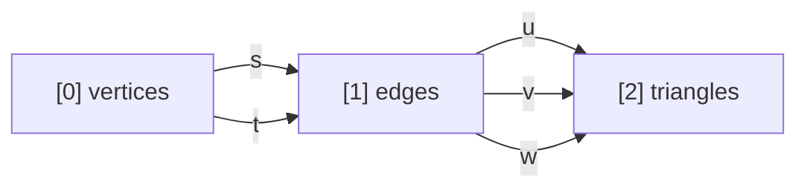
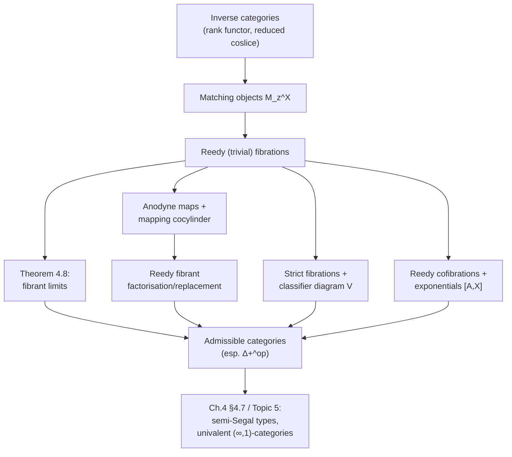

[[book-guidelines|↩ Back to guidelines]]

# Reedy Fibrant Diagrams

## The problem: a diagram of types that isn't itself a type worth having

Chapter 3 gave us fibrant types, fibrations, and cofibrations as the vocabulary of 2LTT's homotopical toolkit ([[Category-Theory-Internal-to-the-Outer-Level|see the companion article]] for the inverse-category basics this one leans on: rank functors, categories of elements, reduced coslices). Chapter 4 asks a harder question: what if you don't just want *one* fibrant type, but a whole **diagram** of them — a functor $F : C \to \mathcal U$ out of some indexing category $C$ — and you want the *type of all such diagrams* to itself be fibrant?

This isn't a pedantic escalation. It's exactly the shape of problem the whole paper exists to solve: semisimplicial types are diagrams over the semisimplex category $\Delta_+^{op}$, and if the type of semisimplicial types isn't fibrant, none of the homotopy-invariant reasoning 2LTT is built for will apply to it.

The book opens the chapter with a small, fully worked example that makes the difficulty concrete. Take the category $\Delta_+^{<3}$: three objects $[0], [1], [2]$ ("vertices", "edges", "triangles"), with face maps $s, t : [0] \to [1]$ and $u, v, w : [1] \to [2]$, subject to three commutativity equations:



with $u \circ s = v \circ s$, $u \circ t = w \circ s$, $v \circ t = w \circ t$. A functor $F : (\Delta_+^{<3})^{op} \to \mathcal U$ is, on the nose, isomorphic to a **9-tuple**:

$$
(X_0, X_1, X_2,\; f_s, f_t, f_u, f_v, f_w,\; e_0, e_1, e_2)
$$

three types, five structure maps between them, and three *strict equality proofs* $e_i$ witnessing the commuting triangles. This is a completely faithful, completely literal unfolding of "functor out of a three-object category" — and it is *not fibrant*. The reason is structural: strict equalities between outer maps ($e_0, e_1, e_2$) are outer propositions, and a $\Sigma$-type packaging outer equality proofs together with types has no reason to be equivalent to an inner (homotopical) type. You've built a strict record, not a homotopy-coherent one.

Compare this to the encoding the book actually wants: a triple $(A_0, A_1, A_2)$ where

$$
A_0 : \mathcal U, \qquad A_1 : A_0 \to A_0 \to \mathcal U, \qquad A_2 : \Pi(a,b,c : A_0).\, A_1\,a\,b \to A_1\,b\,c \to A_1\,a\,c \to \mathcal U.
$$

Here $A_1$ is *indexed twice* over $A_0$ instead of being an independent type connected to $A_0$ by two separate face maps, and $A_2$ is indexed over compatible triples of edges instead of carrying three separate coherence proofs. This triple can be written down entirely in the *inner* (homotopical) theory — no outer strict equality appears anywhere in its type — and it turns out to be fibrant. But it is emphatically not isomorphic to the 9-tuple: every triple determines a 9-tuple functor, but not every functor comes from a triple, and the two types of "diagrams" are related only by a weaker notion of equivalence. Reconciling this gap — showing every functor is *equivalent to* (not equal to) a well-behaved one — is exactly the content of **Reedy fibrant replacement**, the destination of this chapter.

**What breaks without matching objects.** If you tried to define "fibrant diagram" naively as "the diagram lands entirely in fibrant types, pointwise," you'd get something too weak: pointwise-fibrant diagrams (like the naive 9-tuple's non-fibrant hybrid) don't compose well, don't have fibrant limits in general, and don't support the induction you need to build one degree of the diagram from the ones below it. What you actually need is a notion of fibrancy that is *relative to the diagram's own history* — the new piece has to be fibrant *relative to what's already forced by lower-degree data*. That relative reference point is the **matching object**.

## Matching objects: the boundary data a new cell must restrict to

Recall the machinery from the inverse-categories article: for an inverse category $C$ (one equipped with a rank functor $\varphi : C^{op} \to \omega$ reflecting identities) and an object $z : C$, the **reduced coslice** $z \diagdown C$ collects the coslice objects $(y, f)$ with $f : z \to y$ *excluding* the identity arrow, and the **abstract boundary** $\partial C[z] \hookrightarrow C[z]$ is the maximal proper subfunctor of the representable diagram $C[z]$ — everything reachable from $z$ except $z$ itself, via the identity.

**Definition 4.4 (matching object).** For a diagram $X : C \to \mathcal U$ and an object $z : C$, the matching object $M_z^X$ is the limit of the composite

$$
z \diagdown C \xrightarrow{\ \text{forget}\ } C \xrightarrow{\ X\ } \mathcal U.
$$

Intuitively: $M_z^X$ is "everything the diagram already says about the shape at $z$, computed purely from strictly-lower-degree data" — the boundary data a putative new value $X_z$ would have to restrict to, before you even ask whether it's fibrant. The universal property of the limit hands you a canonical comparison map $X_z \to M_z^X$ for free, natural in $X$.

Lemma 4.5 gives the cleaner, Yoneda-flavored restatement that makes matching objects easy to compute in practice:

$$
M_z^X \;\cong\; \mathrm{Nat}(\partial C[z], X), \qquad \text{and under Yoneda } X_z \cong \mathrm{Nat}(C[z], X),\ \text{the map } X_z \to M_z^X \text{ is } \mathrm{Nat}(i_z, X)
$$

where $i_z : \partial C[z] \to C[z]$ is the boundary inclusion. So the matching object is "natural transformations out of the boundary," and the comparison map is precisely restriction of a natural transformation along the boundary inclusion — a shape you'll recognize instantly if you've ever implemented restriction maps for a sheaf or a simplicial set.

**Worked example.** For $\Delta_+^{<3}$ at $z = [2]$ (a triangle), the reduced coslice consists of everything reachable from $[2]$ other than its own identity — nothing, since $[2]$ has maximal rank in $\Delta_+^{<3}$ — so $M_{[2]}^X$ is degenerate in that toy category (the interesting matching objects for triangles show up once you go to $\Delta_+^{op}$ proper, where a triangle's boundary is its three edges). For $z = [1]$ (an edge), the reduced coslice under $[0]$ picks up the two face maps to $[1]$, so $M_{[1]}^X$ packages exactly the pair of things a candidate edge-type would need to restrict to along $s$ and $t$ — you can see the shape of "$A_1$ indexed over $A_0 \times A_0$" emerging directly from this limit.

**Rust framing.** Matching objects are the formal version of a pattern every Rust programmer building an incremental/append-only data structure already knows: *you can't add a new node until you know what it has to be consistent with.* Think of building an interval tree, a CRDT, or a `petgraph`-style DAG level by level:

```rust
// The "already known" boundary data at rank n+1, computed purely
// from ranks <= n -- this IS the matching object, concretely.
struct MatchingObject<Boundary> {
    // one field per lower-degree neighbor this new cell must agree with
    constraints: Boundary,
}

// A Reedy-fibrant "diagram" step: you're not free to invent X_z from
// scratch, you must produce something that *fibers over* M_z^X.
trait ReedyStep<Prev> {
    type Boundary;              // the matching object M_z^X
    type Cell;                  // the new X_z
    fn matching_object(prev: &Prev) -> Self::Boundary;
    fn extend(b: &Self::Boundary) -> Self::Cell; // must restrict correctly
}
```

The naive 9-tuple encoding is what you get if you instead store `X_0, X_1, X_2` as independent fields plus separately-maintained "proof" fields `e0, e1, e2` asserting consistency after the fact — an invariant that has to be re-checked and re-proved by hand every time you touch the structure, exactly like a struct with redundant derived fields that silently desync. The matching-object encoding makes the inconsistent state *unrepresentable*: $A_1$ is literally indexed by pairs of $A_0$, so there is no slot in which a mismatched edge could even be stored.

## Reedy fibrations and Reedy fibrant diagrams

With matching objects in hand, the definition of Reedy fibrancy is a direct generalization of "a map is a fibration" from single types to whole diagrams — except the fibration condition is imposed level-by-level, relative to the matching object rather than absolutely.

**Definition 4.6 (Reedy (trivial) fibration).** Let $X, Y : C \to \mathcal U$ be diagrams and $p : Y \to X$ a natural transformation. Then $p$ is a **Reedy (trivial) fibration** if, for every $z : C$, the canonical comparison map

$$
Y_z \;\longrightarrow\; M_z^Y \times_{M_z^X} X_z
$$

(induced by the universal property of the pullback) is a (trivial) fibration. A diagram $X$ is **Reedy (trivially) fibrant** if the unique map $X \to \mathbf 1$ (to the diagram constantly equal to the unit type) is a Reedy (trivial) fibration — which, since $M_z^{\mathbf 1} = \mathbf 1$, simplifies to: $X_z \to M_z^X$ is a (trivial) fibration, for every $z$.

Read this condition operationally: *at every stage $z$, the new data $X_z$ must be fibrant not absolutely, but relative to what the diagram's own lower-degree structure already pins down.* This is exactly the "restriction map is well-behaved" condition from classical Reedy theory (Shulman's presentation for simplicial-style model structures, [Shu15b, Def. 11.3], here fully internalized in 2LTT), specialized to inverse categories where every non-identity map strictly decreases rank.

Lemma 4.7 packages this in terms of the pullback-hom (Leibniz) construction from Chapter 3: writing $\widehat{\mathrm{Nat}}$ for the Leibniz construction applied to the natural-transformation bifunctor, $p : Y \to X$ is a Reedy (trivial) fibration exactly when $\widehat{\mathrm{Nat}}(i^z, p)$ is a (trivial) fibration for every $z$, where $i^z : \partial C[z] \to C[z]$ is the boundary inclusion. This reformulation is what makes the closure properties provable at all — it reduces "closed under pullback/composition/products" (Lemma 4.9) to the same closure properties already established for ordinary fibrations in Chapter 3, transported through the Leibniz-construction machinery of [RV14].

**Lean framing.** If you've used Mathlib's `CategoryTheory.Limits` API, the matching-object comparison map is precisely a `CategoryTheory.Limits.limit.lift` applied to the cone that restriction along $z \diagdown C \to C$ gives you, and the boundary inclusion $i^z$ plays the role Mathlib's `CategoryTheory.StructuredArrow`/comma-category machinery plays when you build a Kan extension one object at a time. There's no literal `ReedyFibration` in Mathlib, but the *shape* of the definition — "a natural transformation is fibration-like iff its comparison map against a limit-of-a-restriction is fibration-like at every stage" — is structurally identical to how Mathlib phrases "creates limits along a functor," and it's worth internalizing that correspondence: Reedy theory is level-wise lifting-property bookkeeping dressed up in limit notation.

## The payoff: fibrant limits of Reedy fibrant diagrams

**Theorem 4.8** (internalizing Shulman [Shu15b, Lemma 11.8]). *If $C$ is an inverse category with a finite type of objects, and $X : C \to \mathcal U$ is a Reedy (trivially) fibrant diagram, then $X$ has a (trivially) fibrant limit.*

This is the load-bearing result of the whole chapter, and its proof is worth walking through because the technique — strong induction on rank, peeling off one maximal-rank object at a time — recurs constantly (it's exactly the same induction used later for Reedy fibrant *factorizations*).

*Proof sketch.* Induct on $|C|$. Base case: $|C| \cong \mathrm{Fin}_0$, limit is the unit type (trivially fibrant). Inductive step: pick an object $z$ of maximal rank (possible constructively since $|C|$ is finite), let $C'$ be $C$ with $z$ removed (still inverse), and let $X'$ be $X$ restricted to $C'$. The key geometric fact is that the square of diagrams

$$
\begin{array}{ccc}
\partial C[z] & \to & C[z] \\
\downarrow & & \downarrow \\
\mathbf 1' & \to & \mathbf 1
\end{array}
$$

is a **pushout** (checked levelwise, using decidable equality on the finite object-type of $C$), where $\mathbf 1'$ is the terminal diagram on $C'$ Kan-extended to $C$ (value $1$ everywhere except $0$ at $z$). Applying $\mathrm{Nat}(-, X)$ turns this pushout into a **pullback**:

<svg viewBox="0 0 460 220" xmlns="http://www.w3.org/2000/svg" font-family="sans-serif" font-size="15">
  <defs>
    <marker id="arrow" markerWidth="8" markerHeight="8" refX="6" refY="3" orient="auto">
      <path d="M0,0 L0,6 L6,3 z" fill="#888"/>
    </marker>
  </defs>
  <text x="60" y="30" fill="#4a90d9">lim X</text>
  <text x="370" y="30" fill="#4a90d9">X_z</text>
  <text x="45" y="190" fill="#4a90d9">lim X'</text>
  <text x="380" y="190" fill="#4a90d9">M_z^X</text>
  <line x1="95" y1="22" x2="355" y2="22" stroke="#888" stroke-width="1.5" marker-end="url(#arrow)"/>
  <line x1="95" y1="180" x2="355" y2="180" stroke="#888" stroke-width="1.5" marker-end="url(#arrow)"/>
  <line x1="65" y1="45" x2="65" y2="165" stroke="#888" stroke-width="1.5" marker-end="url(#arrow)"/>
  <line x1="385" y1="45" x2="385" y2="165" stroke="#e07b39" stroke-width="2" marker-end="url(#arrow)"/>
  <text x="390" y="105" fill="#e07b39">fibration</text>
  <text x="45" y="105" fill="#333">fibration</text>
  <text x="130" y="105" fill="#666" font-size="13">(pullback square, by Lemma 3.10(i))</text>
</svg>

The right vertical map $X_z \to M_z^X$ is a fibration because $X$ is Reedy fibrant. Fibrations are stable under pullback (Lemma 3.10(i)), so the left map $\lim X \to \lim X'$ is a fibration too. By the induction hypothesis, $\lim X'$ is fibrant. A fibration into a fibrant type has fibrant total space, so $\lim X$ is fibrant. $\blacksquare$

Notice what makes this work: the *entire* argument reduces to a single instance of "fibrations pull back to fibrations," repeated once per object in rank order. The Reedy fibrancy condition is precisely strong enough to keep feeding that machine a fresh fibration at every step.

The book flags one subtlety worth internalizing: because 2LTT lets diagrams be valued in *outer* types (not just inner/fibrant ones), Reedy fibrancy here is a strictly more general notion than Shulman's original — Shulman's setting has no outer level, so every diagram is automatically inner-valued and matching objects are guaranteed to exist; 2LTT recovers Shulman's exact notion as the special case where all outer types happen to be coercions of inner ones. This freedom to talk about non-fibrant, non-inner diagrams "on the way to" a fibrant one is precisely the meta-theoretic power the two-level split buys you — you get to reason about strict scaffolding without being forced to prove it's homotopically well-behaved from the outset.

## Admissible inverse categories

Theorem 4.8 needs $C$ finite. To build up *infinite* structures level by level (semisimplicial types have infinitely many levels), you need each *finite piece used in the induction* — specifically, each reduced coslice — to already have fibrant limits, even though $C$ itself isn't finite.

**Definition 4.19 (admissible inverse category).** $C$ is admissible if, for every $a : C$, Reedy (trivially) fibrant diagrams over the reduced coslice $a \diagdown C$ have a (trivially) fibrant limit.

This is exactly the hypothesis that lets the finite-case machinery of Theorem 4.8 bootstrap into an infinite setting one matching object at a time — it says "even though I can't take a limit over all of $C$ at once, every *local, bounded* piece I actually need behaves." Lemma 4.20 draws the immediate consequence: on an admissible $C$, every Reedy fibrant diagram is automatically **pointwise fibrant** and has all its matching objects fibrant (each $M_z^X$ is a limit over the finite-behaving $z \diagdown C$, hence fibrant; then $X_z \to M_z^X$ being a fibration into a fibrant type makes $X_z$ fibrant too).

**Definition 4.21.** The category $\Delta_+^{op}$ — objects the natural numbers $[0],[1],[2],\dots$, morphisms $\Delta_+^{op}([m],[k])$ the strictly increasing functions $\mathrm{Fin}_{k+1} \to \mathrm{Fin}_{m+1}$ — is the paper's central example of an admissible inverse category, because every reduced coslice in $\Delta_+^{op}$ is finite, so Theorem 4.8 applies to every one of them.

## Anodyne maps and Reedy fibrant factorisations

Now for the harder problem the chapter opened with: given an arbitrary functor (like the 9-tuple encoding), how do you produce an *equivalent* Reedy fibrant one? The tool is the same left-lifting-property machinery HoTT and model category theory both use for factorization systems.

**Definition 4.11 (anodyne map).** $i : A \to B$ is **anodyne** if it has the left lifting property against all fibrations: for every fibration $p : Y \to X$, the pullback exponential $(B \to Y) \to (B \to X) \times_{A \to X} (A \to Y)$ has a section.

Unpacked (Lemma 4.12) this says: given any fibrant family $X : B \to \mathcal U_{\mathrm{fib}}$ and any section $t$ of $X$ over $A$ (via $i$), you can always extend $t$ to a section $t'$ over all of $B$ that restricts back to $t$. This is a *totality/extension* guarantee — "whatever you've defined on the smaller piece, you're always allowed to finish."

Two facts anchor the theory:

- **Lemma 4.16**: trivial cofibrations are anodyne (their pullback exponential against any fibration is a trivial fibration, hence split).
- **Lemma 4.17**: for a fibrant $A$ and $a_0 : A$, the map $\mathbf 1 \to \Sigma(a:A).\, a =_i a_0$ selecting $(a_0, \mathrm{refl})$ is anodyne — this is *literally* the elimination + computation rule for the fibrant identity type, repackaged as a lifting property. If you've internalized $J$/`Eq.rec` as "path induction lets you always extend a proof at the reflexivity case to a proof everywhere," this lemma is exactly that statement rephrased in lifting-property language.

**Corollary 4.18 (mapping cocylinder).** Any $f : A \to B$ between fibrant types factors as $A \xrightarrow{\ i\ } N \xrightarrow{\ p\ } B$ with $i$ anodyne and $p$ a fibration, by setting $N := \Sigma(a:A).\Sigma(b:B).\, f(a) =_i b$ — the standard "graph of $f$, glued along a path" mapping-cylinder trick, whose fibers over $A$ are literally instances of Lemma 4.17.

**Lemma 4.26 (Reedy fibrant factorisation).** *Let $f : X \to Z$ be a natural transformation of pointwise fibrant diagrams over an admissible inverse category $C$. Then $f$ factors as $X \xrightarrow{i} Y \xrightarrow{p} Z$ with $i$ anodyne and $p$ a Reedy fibration.*

The proof is, once again, induction on rank — this time building the factorization diagram $Y$ one degree at a time. At each new object $x$ of rank $n+1$: take the limit $L$ over the already-built $Y^{(n)}$ restricted to the reduced coslice of $x$ (this is the matching object $M_x^{Y^{(n+1)}}$, computed *before* you've defined $Y_x$); pull back against $Z_x$ to get a fibrant $L \times_{M_x^Z} Z_x$; then apply the mapping-cocylinder construction (Corollary 4.18) to the induced map $X_x \to L \times_{M_x^Z} Z_x$ to get $Y_x$, with the cocylinder's anodyne inclusion giving you $i_x$ and its projection giving you $p_x$, which is automatically a Reedy fibration at $x$ because $L$ *is* the matching object by construction.

**Corollary 4.27 (Reedy fibrant replacement).** Apply Lemma 4.26 with $Z$ the constant diagram at the unit type: any pointwise fibrant diagram $X$ admits an anodyne (hence equivalence, by Lemma 4.24/4.15) map $\eta : X \to Y$ into a genuinely Reedy fibrant $Y$.

This is precisely the promise made at the start of the chapter: the naive 9-tuple functor over $\Delta_+^{<3}$ is not itself Reedy fibrant, but it is equivalent (via an anodyne map) to one that is — its Reedy fibrant replacement, which will look like the $(A_0, A_1, A_2)$-style encoding.

**Rust framing — extension/totality as a trait obligation.** The anodyne lifting property is the categorical cousin of a "safe default extension" guarantee, e.g. `serde`'s `#[serde(default)]` letting you always complete a partially-specified struct, or the way `Option::zip`/monadic `and_then` chains guarantee you can always push a computation through as long as the smaller piece typechecks. The mapping cocylinder is the "graph-of-a-function" trick you'd reach for if you needed to turn an arbitrary function into a fibration-shaped (surjective-onto-its-image-with-nice-fibers) map without changing its homotopy type — structurally the same move as wrapping a value in a tagged `Result<T, Proof>` to make a partial computation total.

## Strict fibrations and classifiers for Reedy fibrations

Sections 4.3–4.4 work with fibrations up to isomorphism (the honest, invariant notion). To build a *classifying object* — a universe whose points *are* Reedy fibrant diagrams — the book needs something less invariant but strictly presentable: a literal family of inner types.

**Definition 4.29 (strict fibration).** A strict fibration on $X$ is a family of *inner* types indexed over $X$, i.e. a term of $X \to \mathcal U^i$. Any such family $A$ determines a map $\Sigma_X A \to X$; conversely, maps isomorphic to some $\Sigma_X A \to X$ are exactly the (ordinary) fibrations, so strict fibrations are automatically fibrations — but the converse choice of $A$ is *not* invariant under isomorphism, only under literal (strict) equality, because it depends on the specific representation $X \to \mathcal U^i$.

**Definition 4.31 (strict Reedy fibration).** Replace "fibration" with "strict fibration" in Definition 4.6's matching-object condition: a strict Reedy fibration is $p : Y \to X$ together with, for each $z$, a chosen strict fibration structure on $Y_z \to M_z^Y \times_{M_z^X} X_z$.

The payoff of insisting on *strict* choices is that strict Reedy fibrations over $C$ organize into an honest category $R_C$, and the forgetful functor $R_C \to [C, \mathcal U]$ sending $X \to A$ to its base $A$ is a **discrete Grothendieck fibration** (Lemma 4.33) — meaning every base diagram $A$ has a *unique* fiber of strict Reedy fibrations sitting over it, built up (again!) by induction on rank. That uniqueness is exactly what you need to define a presheaf

$$
\mathrm{Reedy}_C : [C, \mathcal U]^{op} \to \mathcal U
$$

sending each diagram to (the type of) its strict Reedy fibration structures, and to show (Lemma 4.34) it sends van Kampen colimits to limits — the technical property that makes it representable.

**Definition 4.35 (the classifying diagram).** $\mathcal V_z := \mathrm{Reedy}_C(C[z])$.

**Lemma 4.36.** $\mathrm{Nat}(B, \mathcal V) \cong \mathrm{Reedy}_C(B)$ naturally in $B$ — proved by writing $B$ as a van Kampen colimit of representables and using that both sides send colimits to limits. This is the Reedy-theoretic incarnation of the Yoneda-style "universe classifies families" pattern from Hofmann–Streicher presheaf models [HS97], specialized to strict Reedy fibrations.

**Corollary 4.37 / Lemma 4.38.** If $C$ is admissible, $\mathcal V$ is itself Reedy fibrant, and $\lim \mathcal V \cong \mathrm{Nat}(\mathbf 1, \mathcal V)$ is exactly the type of strictly Reedy fibrant diagrams over $C$ — and it is *fibrant* whenever $C$ is admissible and Reedy fibrant diagrams on $C$ itself have fibrant limits (which holds e.g. for the truncations $(\Delta_+^{op})^{<n}$). This is the internal universe/classifier for (strictly) Reedy fibrant diagrams the section set out to build — and specialized to $\Delta_+^{op}$, it's precisely the type of semisimplicial types up to a given level, the very object the introduction's motivating question ($S : \mathbb N \to \mathcal U$) was asking for.

**Lemma 4.39** closes the loop between the invariant and strict notions: a diagram $X$ is Reedy fibrant (in the honest sense) iff it is isomorphic to *some* strictly Reedy fibrant $Y$ — proved, unsurprisingly, by strictifying $X$ one rank at a time, replacing each $X_z \cong \Sigma_{M_z^X} T_z$ using that $X_z \to M_z^X$ being a fibration gives you the classifying family $T_z$.

**Lean framing.** This strict/invariant split is a close cousin of the difference between a `Prop`-valued predicate "is a fibration" and a `Type`/`Sort`-valued structure "is *equipped with* a fibration structure" in Lean/Mathlib — the latter is what you need if you want a `Sigma`-type of "all fibrations over $X$" to itself be a well-behaved type you can do induction over, exactly the discrete-fibration/Grothendieck-construction pattern `CategoryTheory.Grothendieck` encodes.

## Reedy cofibrations and exponentials of diagrams

The last piece dualizes Definition 3.13's (trivial) cofibrations to the diagram setting, needed to make function-diagrams $[A, X]$ (natural-transformation types) behave well.

**Definition 4.40.** $f : A \to B$ is a **Reedy (trivial) cofibration** if $\widehat{\exp}(f, -)$ sends Reedy fibrations to Reedy (trivial) fibrations. $B$ is Reedy (trivially) cofibrant if $\mathbf 0 \to B$ is.

The headline result avoids having to verify this pointwise-painful condition by hand in the main case of interest:

**Theorem 4.42.** *A pointwise cofibration $f : A \to B$ of diagrams over $C$ is automatically a Reedy cofibration.*

The proof is a genuinely elegant piece of formal manipulation rather than another rank-induction: it exploits that the forgetful functor $z \diagdown C \to C$ (well, more precisely a related discrete fibration) has a left Kan extension $F_!$ that both preserves products (giving the key isomorphism $F_! X \times Y \cong F_!(X \times F^* Y)$) and turns the boundary inclusion $i^z$ into a pushout-product decomposable via a coreflective-embedding argument. Chasing the resulting chain of natural isomorphisms reduces $\widehat{\mathrm{Nat}}(i^z \widehat\times f, p)$ down to $\widehat{\exp}(f_z, \widehat{\mathrm{Nat}}(i^z, p))$ — a single ordinary pullback-exponential of the pointwise cofibration $f_z$ against a fibration, which is exactly what Chapter 3 already tells you is a fibration.

Two immediate consequences round out the section:

- **Lemma 4.43 / Corollary 4.44.** If $A$ is pointwise cofibrant and $X$ is Reedy fibrant, then $[A,X]$ (the diagram of natural-transformation types) is again Reedy fibrant, and if $C$'s Reedy fibrant diagrams have fibrant limits, $\mathrm{Nat}(A,X)$ is a genuinely fibrant type. This is what will let the next chapter form types like $\mathrm{Nat}(\Delta[n], X)$ — mapping-in types out of representables — and know they land back in fibrant territory.

## Where this leads



Everything in this chapter is scaffolding for a single destination: once $\Delta_+^{op}$ is known to be admissible (Theorem 4.8 + finiteness of its reduced coslices) and every semisimplicial type has a Reedy fibrant replacement (Corollary 4.27) and Reedy-cofibrant boundary inclusions behave (Theorem 4.42), the paper can define semi-Segal types as Reedy fibrant semisimplicial types local with respect to inner horn inclusions — and from there, univalent $(\infty,1)$-categories, purely inside 2LTT. That's the subject of the next topic in this book.

Within the standing `type-theory` focus area, the throughline worth keeping is the **matching-object pattern itself**: "the new piece of an inductively-built structure must restrict correctly to a limit computed from strictly-smaller pieces" is the same discipline that shows up whenever you build indexed/dependent data level-by-level — well-founded recursion on an inductive family, or a bidirectional elaborator's context extension where a new binder's type must agree with what earlier metavariable solutions already forced. This chapter is highly homotopy-theoretic and doesn't touch unification or constraint solving directly (per this book's own goals note), so treat it as *background machinery for indexed/dependent-family reasoning* rather than a direct blueprint for the elaborator — but the rank-by-rank induction technique (Theorem 4.8, Lemma 4.26) is a clean, fully worked example of the "build the $n+1$-th piece by taking a limit/constraint over everything already committed at rank $\le n$" strategy that recurs constantly in any system doing incremental, dependency-respecting construction of typed data.
