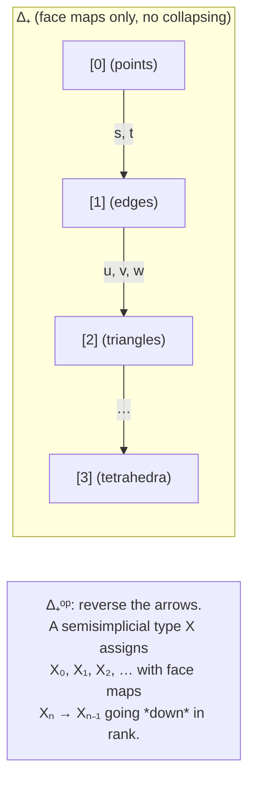

[[book-guidelines|↩ Back to guidelines]]

# Semisimplicial Types and $(\infty,1)$-Categories

## The problem that started it all

Before any machinery, the book opens with a genuinely embarrassing gap in homotopy type theory (HoTT), and it's worth sitting with it, because everything in this article exists to patch it.

A *semisimplicial type* of level 1 is just a type $A_0 : \mathcal{U}$. A semisimplicial type of level 2 is a type of points plus a type family of "edges" between them: $(A_0, A_1)$ with $A_1 : A_0 \to A_0 \to \mathcal{U}$. Level 3 adds "triangle fillers":

$$
A_2 : \Pi(x,y,z : A_0).\, A_1\,x\,y \to A_1\,y\,z \to A_1\,x\,z \to \mathcal{U}
$$

Read $A_0$ as points, $A_1\,x\,y$ as the type of paths/lines from $x$ to $y$, and $A_2\,x\,y\,z\,f\,g\,h$ as the type of ways to fill the triangle whose sides are $f, g, h$. You can keep going — level 4 needs a type of tetrahedron-fillers indexed over triples of triangle-fillers satisfying compatibility, and so on — and it is "tedious but intuitively clear" (the authors' words) how to write down level $k$ for any *fixed, external* $k$.

That's exactly the trap. For each externally chosen number $k = 4, 5, 100$, you can sit down and write the type $S_k$ that encodes semisimplicial types of level $k$, and this has actually been done in proof assistants. But the open problem is different:

> Can we construct a single function $S : \mathbb{N} \to \mathcal{U}$, internal to the type theory, such that $S(n)$ is the type of semisimplicial types of level $n$, for a *variable* $n : \mathbb{N}$?

**What breaks without this.** The naive instinct is "just take the general recursive definition and formalize it as a function of $n$." But the recursive step for $A_n$ has to quantify over an $n$-fold family of prior fillers, with a shape of dependency that itself depends on $n$ in a way HoTT's ordinary induction principles can't uniformly express — you'd need to talk *about* the theory (an $n$-indexed diagram shape) from *inside* the theory, and HoTT gives you no internal handle on "the structure of the recursion so far" as a first-class object you can quantify over. This is a *meta-theoretic* fact wearing the clothes of an ordinary type-theoretic construction, and that mismatch is precisely what two-level type theory (2LTT) is built to resolve.

Voevodsky's answer, Homotopy Type System (HTS), got $S$ to exist by adding a second, non-univalent layer of "exact equality" to HoTT — but at the cost of an ad hoc-feeling axiom (the outer natural numbers behave like the *actual* naturals) that wasn't designed with any conservativity guarantee back to plain HoTT. The present paper's 2LTT is the "minimal" redo of that idea: an outer level (ordinary Martin-Löf type theory with UIP — uniqueness of identity proofs) coexisting with an inner level (HoTT), connected by a one-directional *conversion function* $c$ from inner to outer types. The point of the outer level is exactly to give you a legitimate place to quantify over "an externally-varying $n$" as an actual internal variable, without smuggling in HTS's stronger and less justified assumptions. Chapter 4 is where this machinery gets cashed in: it develops the general theory of *diagrams valued in types*, of which the "semisimplicial types of level $n$" tower is the running motivating example, and by §4.7 uses the same machinery to define what a *category* even means when your objects are types rather than sets — the $(\infty,1)$-category.

**Rust/Lean framing.** If you've ever hand-written a family of generic structs indexed by a *type-level* natural number in Rust (`Vec0`, `Vec1<T>`, ...) and hit the wall where you want `Vec<N, T>` for a runtime/generic `N` with the *shape* of the recursion changing with `N` — that's a mundane shadow of the same problem. In Lean, the analogous itch is wanting to define a family of `Structure`s by recursion on `n : Nat` where the *type* of the $n$-th field bundle isn't uniform — you reach for `Nat.rec` at the `Sort` level, but then proving anything uniform about the whole family requires reasoning about the recursor's unfolding as data, not just using it. 2LTT's outer level is essentially a principled way to get that "reasoning about the recursion as data" for free.

## Why "9-tuple" encodings aren't the answer either

Chapter 4 opens (§4.1) with a smaller, very concrete instance of the same disease, using the truncated category $\Delta_+^{<3}$: three objects $[0], [1], [2]$ ("vertices," "edges," "triangles"), with generating morphisms $s, t : [0]\to[1]$ (source, target) and $u, v, w : [1] \to [2]$, subject to $u \circ s = v \circ s$, $u \circ t = w \circ s$, $v \circ t = w \circ t$.

A functor $F : (\Delta_+^{<3})^{op} \to \mathcal{U}$ unwinds, completely mechanically, to a 9-tuple:

$$
(X_0, X_1, X_2,\ f_s, f_t, f_u, f_v, f_w,\ e_0, e_1, e_2)
$$

— three types, five maps between them, and three *strict* equations $e_0 : f_s \circ f_u = f_s \circ f_v$, etc. This is the "obvious" translation of a diagram into type theory, and it is **not fibrant** — strict equality of functions is an outer-level, UIP-flavored notion, not something the univalent inner level can express directly as a type of paths.

Compare this to the semisimplicial encoding from the introduction: $(A_0, A_1, A_2)$ with $A_1 : A_0 \to A_0 \to \mathcal{U}$ and $A_2$ a dependent family over triples of $A_1$-elements. This *is* expressible purely in the inner theory (no strict equality needed) — but it is a genuinely different type from the 9-tuple version; they're not isomorphic, only equivalent in some weaker sense that the chapter spends its first several sections making precise. The technical name for "the version that behaves correctly" is **Reedy fibrant**, and the promise the chapter delivers on is: every diagram (9-tuple style) has a Reedy fibrant replacement (nested-family style) that is equivalent to it — Corollary 4.27, reached via anodyne maps and mapping cocylinders. This article assumes that toolkit as background (it's covered by "[[Reedy-Fibrant-Diagrams|Reedy Fibrant Diagrams]]" in the guidelines) and picks up where it cashes out: at $\Delta_+^{op}$ itself, and at the definition of $(\infty,1)$-category built on top of it.

## The semisimplicial category $\Delta_+^{op}$

**What problem does it solve?** The 9-tuple/nested-family contrast above is really about diagrams over *one specific shape* $\Delta_+^{<3}$. To get semisimplicial types of *every* level at once — and eventually the open problem's $S : \mathbb{N} \to \mathcal{U}$ — you need the shape that "vertices, edges, triangles, tetrahedra, ..." is an instance of, in full generality. That shape is $\Delta_+^{op}$.

**Definition 4.21.** The category $\Delta_+$ has the natural numbers as objects, written $[0], [1], [2], \dots$ — think of $[n]$ as the "$n$-simplex," with $n+1$ vertices. Morphisms $\Delta_+([m],[k])$ are *strictly increasing* functions $\mathrm{Fin}_{k+1} \to \mathrm{Fin}_{m+1}$ (order-preserving, injective face inclusions — no degeneracies, which is exactly the "semi-" in semisimplicial: the full simplex category $\Delta$ also has degeneracy maps that collapse simplices, and dropping those is what keeps this category *inverse*, in the technical sense below). $\Delta_+^{op}$ is its opposite. A **semisimplicial type** is, by definition, simply a diagram (functor) $X : \Delta_+^{op} \to \mathcal{U}$ — the object $X_n$ ("the type of $n$-simplices") sits at $[n]$, and the face maps go $X_n \to X_{n-1}$ (contravariant in $\Delta_+$, hence the "op").

This is why $\Delta_+^{op}$ is called the running example of an **inverse category** (Definition 4.1): a category equipped with a rank functor $\varphi : C^{op} \to \omega$ (into the poset of naturals under $\leq$) that reflects identities — informally, "every non-identity morphism strictly decreases rank," so there is no way to compose your way back up. For $\Delta_+^{op}$, rank is just the simplex dimension $n$; because $\Delta_+$ only has *face* maps ($[k] \hookrightarrow [m]$ for $k \le m$, never collapsing maps), going the other way in $\Delta_+^{op}$ strictly decreases $n$. This "one-way" structure is exactly what makes the Reedy-fibrancy machinery from §§4.2–4.4 applicable: the **matching object** $M_z^X$ at level $z$ (the limit of $X$ restricted to the *reduced coslice* $z \diagdown C$ — informally, "the type of compatible boundary data that an $n$-simplex would have to restrict to") only depends on strictly lower ranks, so you can define $X$ by induction on rank without circularity. A diagram $X$ is **Reedy fibrant** when each canonical comparison map $X_z \to M_z^X$ is a fibration — i.e., "having an $n$-simplex, given its boundary, is well-behaved (a fibration) as an operation." $\Delta_+^{op}$ is furthermore **admissible** (Definition 4.19: Reedy fibrant diagrams over every reduced coslice have fibrant limits) because all its reduced coslices are finite — this is what guarantees, via Theorem 4.8, that the *type of Reedy fibrant semisimplicial types* is itself fibrant, i.e., lives back inside the inner (univalent) universe. Without admissibility you'd have well-behaved individual semisimplicial types but no well-behaved *type of* semisimplicial types to quantify $S(n)$ over — the whole point would be lost.

**Rust/Lean framing.** $\Delta_+^{op}$'s rank functor is exactly a well-founded recursion measure: it's the type-theoretic analogue of proving a Rust recursive data structure terminates by structural recursion on a `usize` that strictly decreases, or of Lean's `termination_by`/`decreasing_by` obligations on a `WellFoundedRecursion`. "Inverse category" is the categorified version of "this recursion scheme is well-founded" — which is precisely why it supports building things (limits, Reedy fibrant replacements) by induction on rank, as Theorem 4.8's proof literally does (by induction on the finite cardinality of the index category, peeling off a maximal-rank object at each step).

## Semi-Segal types and the Segal condition

**Motivation.** §4.7 pivots from "how do we encode diagrams well" to the paper's headline application: an internal, type-theoretic definition of $(\infty,1)$-category — a category where "morphism" isn't a set but a *space* (type) of morphisms, itself possibly having higher morphisms between morphisms, indefinitely. The classical (topology/homotopy theory) approach to this uses **complete Segal spaces** (Rezk): simplicial objects (spaces $X_0, X_1, X_2,\dots$ indexed by $\Delta^{op}$, the *full* simplex category with degeneracies) satisfying a homotopical gluing condition. The paper's twist: because Reedy fibrancy was only developed for *inverse* categories, and $\Delta^{op}$ isn't inverse (composition with degeneracies can raise rank), the authors restrict to the semisimplicial case, $\Delta_+^{op}$, following Harpaz's theorem that semisimplicial spaces with a Segal condition plus a completeness condition already model $(\infty,1)$-categories just as well.

Think of a Reedy fibrant semisimplicial type $X$ as: $X_0$ = objects, $X_1$ = "generalized morphisms" (an edge from $x$ to $y$, but with $x, y$ picked out only up to the ambient homotopy, since everything lives in a type), $X_2$ = 2-simplices witnessing "composability," and so on. The raw data alone doesn't say composition is *well-defined* — it only says a filler exists in certain cases. The **Segal condition** is what upgrades "some fillers exist" into "composition is an honest (if only weakly-associative) operation."

**Formal statement (Definitions 4.45–4.46).** For a Reedy cofibration $\tau : F \to G$ between semisimplicial types with $G$ *bounded* (i.e., a left Kan extension from some finite truncation $(\Delta_+^{op})^{<n}$), a Reedy fibrant $X$ is **local with respect to $\tau$** if
$$
\mathrm{Nat}(G,X) \to \mathrm{Nat}(F,X)
$$
is a trivial fibration ($\mathrm{Nat}$ is the type of natural transformations of diagrams — the type-theoretic analogue of the hom-set between functors). A **semi-Segal type** is a Reedy fibrant semisimplicial type $X$ that is local with respect to all *inner horn inclusions* $\Lambda^k[n] \to \Delta[n]$ for $0 < k < n$ — where $\Delta[n] := \Delta_+^{op}[n]$ is the representable diagram at $[n]$ (think: "the free-standing $n$-simplex, with all its faces"), and $\Lambda^k[n]$ is $\Delta[n]$ with its interior and the face opposite vertex $k$ removed (the "horn" — an $n$-simplex missing exactly one non-boundary face). Concretely for $n=2$, $k=1$: given a composable pair of edges $x \to y \to z$ (a $\Lambda^1[2]$, the horn), locality says there's an *essentially unique* way to fill in the missing edge $x \to z$ and the 2-simplex witnessing it — that's composition, up to coherent choice.

Equivalently (Definition 4.46's remark, arguably cleaner), the same condition can be phrased as locality with respect to the pushout-corner maps
$$
\Delta[a] +_{\Delta[0]} \Delta[b] \xrightarrow{\ c_{a,b}\ } \Delta[a+b]
$$
for all $a, b \ge 0$ (you can restrict to $a=1$ without loss of generality) — gluing an $a$-simplex to a $b$-simplex along a shared vertex should be locally indistinguishable, as a mapping-in target, from the single $(a{+}b)$-simplex that results from concatenating them.

**Why inner horns and not all horns.** Requiring fillers only for *inner* horns ($0 < k < n$, never the outer horns $k=0$ or $k=n$) is exactly the type-theoretic incarnation of quasicategory theory's founding idea (Boardman–Vogt, Joyal): outer horns would force every edge to be *invertible* (like in a Kan complex, modeling $\infty$-groupoids), whereas inner horns alone give you composition without forcing invertibility — the correct notion for a *category* (not every morphism a weak equivalence) with $(\infty,1)$-structure. The paper is explicit that a semi-Segal type only models "$(\infty,1)$-pre-semicategories": it's missing identity arrows and it's not yet *univalent*.

**What breaks without completeness.** A semi-Segal type's vertex type $X_0$ can carry "extra, non-categorical information": two vertices could be genuinely different elements of $X_0$ yet be linked by an equivalence in $X_1$ that the theory has no way of collapsing, because nothing forces $X_0$'s own type-theoretic identity (its path type) to *agree* with "being an equivalence" in the categorical sense. This is precisely the same disease univalence itself fixes for ordinary types (equal types vs. merely-equivalent types) — except now it needs to be re-derived *inside* the semi-Segal structure.

## Equivalences within a semi-Segal type

To fix both defects (no univalence, no identities) at once, the paper defines what an equivalence *internal to the structure* means, without presupposing identity arrows.

For a semi-Segal type $X$ and vertices $x,y : X_0$, write $X(x,y)$ for the fibrant type of edges from $x$ to $y$ (a sub-type of $X_1$, fibrant because Reedy fibrancy makes each $X_n$ fibrant). Locality with respect to the inner horn $\Lambda^1[2] \to \Delta[2]$ gives a **composition map**
$$
-\circ- : X(y,z) \times X(x,y) \to X(x,z).
$$

**Definition 4.47.** An edge $f : X(x,y)$ is an **equivalence** if, for every vertex $z$, both
$$
f \circ - : X(z,x) \to X(z,y) \qquad\text{and}\qquad -\circ f : X(y,z) \to X(x,z)
$$
are equivalences of (fibrant) types — i.e., $f$ acts invertibly by pre- and post-composition, which is the categorical definition of "isomorphism" transplanted to a setting with no strict associativity to lean on (you can't just ask for a two-sided inverse edge, because "inverse" would itself need to be checked up to higher coherence — this composition-action criterion sidesteps that entirely). Since "being an equivalence" is a *fibrant proposition*, equivalences form a fibrant sub-type $E \subseteq X_1$.

**Definition 4.48 (univalent $(\infty,1)$-category).** A semi-Segal type $X$ is a (univalent) **$(\infty,1)$-category** if the source map
$$
E \twoheadrightarrow X_0, \qquad f \mapsto x \ (\text{the source of } f : X(x,y))
$$
is an equivalence. This is the **completeness condition**: it says "every vertex has a canonically-attached identity equivalence, and conversely every equivalence *is*, up to the type's own notion of sameness, that canonical one" — i.e., $E \simeq X_0$ via "take the identity at $x$." This is exactly univalence's slogan ("equal iff equivalent") reformulated *internally to $X$*, rather than as an axiom about the ambient universe. Because the source map lands in an equivalence, you get identity arrows for free (pull back $\mathrm{id}_x$ through the equivalence), closing the second gap left by the bare Segal condition.

The book drops the word "univalent" after this definition since it's the only $(\infty,1)$-category notion in play, and notes that Definitions 4.46–4.48 are all invariant under levelwise equivalence of Reedy fibrant semisimplicial types — a basic sanity check that the notion doesn't secretly depend on a choice of strict presentation. (Two of the authors separately verified, in follow-up work, that this definition specializes correctly to ordinary univalent categories and to $(2,1)$-categories in the truncated cases — a nontrivial consistency check that the "generic recipe" degenerates correctly at low dimension.)

## The semisimplicial nerve and the $(\infty,1)$-category TYPE

The chapter closes by producing actual examples, via the classical *nerve* construction, now built to *land* on the semi-Segal machinery rather than assumed to satisfy it for free.

For an ordinary category $C$, its **semisimplicial nerve** $N_+(C)$ is the semisimplicial type whose $n$-simplices are functors $[n] \to C$ (where $[n]$ is the ordinal with $n+1$ objects, viewed categorically). Because the boundary-gluing square (4.8) — gluing $[a]$ and $[b]$ along a shared endpoint to get $[a+b]$ — is an honest *pushout* in $\mathbf{Cat}$, the nerve sends it to a strict pullback square:
$$
\begin{array}{ccc}
N_+(C)([a{+}b]) & \to & N_+(C)([a]) \\
\downarrow & & \downarrow \\
N_+(C)([b]) & \to & N_+(C)([0])
\end{array}
$$
— a *strict* version of the Segal condition, before any fibrancy is imposed.

**Lemma 4.49 / Corollary 4.50.** If $C$ has slices with fibrant types of objects, $N_+(C)$ takes each face-inclusion map to a fibration (the key step is that the fiber of the "target" map $N_+(C)([1]) \to N_+(C)([0])$ over $x$ is (isomorphic to) $|C/x|$ — the slice category's objects), and $N_+(C)$ is then valued entirely in fibrant types.

**Lemma 4.51.** Given that, any Reedy fibrant replacement $X$ of $N_+(C)$ *is* a semi-Segal type. The proof is a gluing-lemma argument: the strict pullback square above becomes, after passing through the replacement $j : N_+(C) \to X$, a square of equivalences on three corners with one leg a fibration, and a homotopical gluing lemma for fibration categories upgrades that to the fourth corner also being an equivalence — precisely $\mathrm{Nat}(c_{a,b}, X)$, the Segal condition.

Concretely, you can build such an $X$ starting from $X_0 := |C|$ and $X_1(x,y) := C(x,y)$ (the actual hom-sets of $C$, now viewed as fibrant discrete types), and then an edge in $X$ is an equivalence *exactly when* the corresponding morphism of $C$ is a genuine (homotopical) isomorphism. Consequently $X$ is univalent as an $(\infty,1)$-category exactly when $C$ is "wildly univalent": the canonical map from $|C|$ to $C$'s type of isomorphisms is itself an equivalence — a strict-category analogue of the univalence axiom, now stated purely in terms of ordinary category theory data.

**The star example: TYPE.** Taking $C$ to be the category of *fibrant types* (types living in the inner universe, with functions as morphisms) produces the $(\infty,1)$-category $\mathrm{TYPE}$ — large but locally small — which classifies families of types over other $(\infty,1)$-categories, exactly the role $\mathcal{U}$ plays for ordinary type-indexed families. The paper sketches its *universal fibration*: letting $\mathcal{U}^\bullet$ be the category of fibrant types *with a chosen element* (morphisms strictly preserving that element), there's a forgetful functor $\mathcal{U}^\bullet \to \mathcal{U}$, Reedy fibrant on underlying graphs, and a relative Reedy fibrant replacement produces a square
$$
\begin{array}{ccc}
\mathrm{TYPE}^\bullet & \to & N_+(\mathcal{U}^\bullet) \\
\downarrow & & \downarrow \\
\mathrm{TYPE} & \to & N_+(\mathcal{U})
\end{array}
$$
where $\mathrm{TYPE}^\bullet \twoheadrightarrow \mathrm{TYPE}$ turns out to be a *left fibration* — the $(\infty,1)$-categorical analogue of a Grothendieck (op)fibration classifying families — giving a route to a Grothendieck construction for presheaves valued in $(\infty,1)$-categories.

## Where this leads

Structurally, this topic is the capstone of Chapter 4: everything from [[Reedy-Fibrant-Diagrams#Admissible inverse categories|admissible inverse categories]] (§4.2) through Reedy fibrant factorisations (§4.4) and exponentials of diagrams (§4.6) exists so that §4.7 can define "semi-Segal type" and "univalent $(\infty,1)$-category" as ordinary internal definitions in 2LTT — sentences you can write down and quantify over, not external constructions requiring you to step outside the type theory. That's the direct payoff on the Introduction's open problem: the type of Reedy fibrant semisimplicial types *restricted to level $n$* (a special case of the classifiers-for-Reedy-fibrations material in §4.5) is exactly a candidate for $S(n)$, now genuinely internal because $n$ is an outer-level variable rather than a fixed meta-level parameter. The Conclusions (Chapter 5) make the scope-limiting caveat explicit: this only gets you the semisimplicial *tower*, sized by an *outer* natural number bound; whether a fully general $S : \mathbb{N} \to \mathcal{U}$ exists with $\mathbb{N}$ the *inner* naturals remains open, and depends on which of 2LTT's optional strengthenings (Chapter 2, axioms (A1)–(A3)) you're willing to assume, since conservativity back to plain HoTT is only guaranteed for the "basic" (unstrengthened) theory.

For the standing `type-theory` project (this book's tagged Focus Area): this topic is the sharpest illustration in the book of the *outer level's raison d'être*, not just as a UIP-and-funext convenience layer, but as the place where you get to treat an entire indexed *family of definitions* (the semisimplicial-type recursion) as first-class internal data — a pattern with a real echo in a dependent-type elaborator's own metatheory: any time an elaborator needs to reason *about* the shape of a family of inductively-generated obligations (e.g., a universe of coherence data indexed by depth, or a hierarchy of definitional-equality proof obligations that grows with unification depth), it faces the same "external recursion vs. internal object" tension that motivates 2LTT here. The Segal condition itself is also worth flagging as a categorified unification-adjacent idea: "a filler exists and is essentially unique" (Definition 4.45's trivial-fibration condition) is structurally the same shape of statement as "a most general unifier exists and is unique up to the relevant equivalence" — both are instances of asking a lifting/extension problem to have a *contractible* space of solutions rather than merely a nonempty one.
