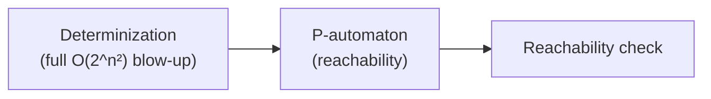
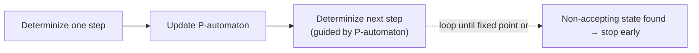
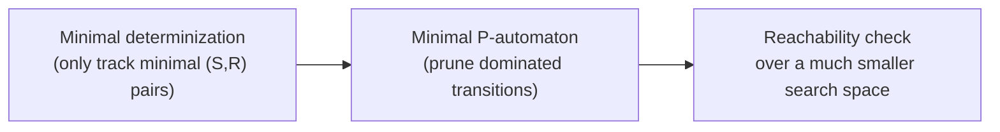

[[book-guidelines|↩ Back to guidelines]]

# Antichain-Based Decision Procedures

## Decidable is not the same as usable

[[Visibly-Pushdown-Automata]] proved universality and inclusion decidable for VPAs — EXPTIME-complete, via determinize-then-check-reachability, exactly the finite-automaton recipe made legal again by VPA's alphabet-driven determinizability. But EXPTIME-complete with a $O(2^{n^2})$ determinization blow-up is a wall in practice: this chapter's own experiments show the naive ("STANDARD") implementation timing out on essentially every nontrivial random VPA. **This chapter's entire contribution is closing the gap between "decidable" and "fast enough to actually run."**

The core insight, borrowed from prior work on finite/tree/Büchi automata (Wulf et al., De Wulf–Doyen–Henzinger–Raskin), is that the worst-case blow-up from determinization is a *pessimistic upper bound on how much information you might ever need* — not a lower bound on how much you *usually* need. **Antichains** exploit this gap: instead of materializing the entire determinized automaton, track only the minimal elements of the sets that determinization would have produced, and stop as soon as those minimal elements settle the question. Worst-case [[Superdeterministic-Pushdown-Automata#Complexity|complexity]] is unchanged (this is not a magic complexity improvement) — but on typical inputs, especially ones where the answer is "no" (not universal, not included), you find a witness fast without ever computing most of the determinized state space.

## Warm-up: antichains for finite automata

Before tackling VPAs, the chapter re-derives the technique for plain NFAs (Section 5.1), because the VPA version is a direct, careful generalization of this simpler case.

**The standard method's cost:** subset construction determinizes an $n$-state NFA into up to $2^n$ states; checking universality then reduces to reachability of a "bad" (non-accepting) subset. Checking inclusion $L(A) \subseteq L(B)$ needs $\overline{B}$, which needs determinizing $B$ first — same cost, paid unconditionally even when the answer turns out "obviously yes" or "obviously no" after seeing very little of the automaton.

**The antichain idea, made precise.** An **antichain** over a set $Q$ (Definition 5.2) is a set of subsets of $Q$ that are pairwise **incomparable** under $\subseteq$ — no element of the antichain is a subset of another. Antichains over $Q$ form a **complete lattice** $(L, \sqsubseteq, \sqcup, \sqcap)$ (Lemma 5.2) under the order $p \sqsubseteq p'$ iff every set in $p'$ has a subset present in $p$ — intuitively, $p$ carries "at least as tight" information as $p'$.

Define $\mathrm{Post}(p)$ as the antichain of *minimal* one-step successor sets reachable from any $s \in p$ — this is monotone on the lattice, and is literally "one step of the subset construction, immediately pruned to keep only the minimal (most informative) results." Iterate: $\mathrm{Post}^{i}(p) = \mathrm{Post}(\mathrm{Post}^{i-1}(p)) \sqcap p$. Because the lattice is finite, this sequence is eventually stationary (**Tarski's fixed-point theorem** guarantees a least fixed point $\mathrm{Post}^*(p_0)$), and:

$$\text{NFA } A \text{ is not universal} \iff \exists s \in \mathrm{Post}^*(\{Q_0\}) \text{ with } s \cap F = \emptyset$$

(Theorem 5.4). **Why keeping only minimal sets is enough**, and this is the load-bearing idea for everything that follows in the chapter: if $s \subseteq s'$ and $s' \cap F = \emptyset$ already witnesses non-universality, then $s \cap F = \emptyset$ too (a subset of a set disjoint from $F$ is also disjoint from $F$) — so once you've found the *smallest* witnessing sets, any larger set built from them is redundant information you never needed to track. The computation can also **stop the moment** a non-accepting set appears (Remark 5.1) — you don't even need to finish computing the fixed point if you're just checking a yes/no question and the answer is already "no."

Inclusion gets the same treatment over a richer lattice of pairs $(l, s) \in Q_A \times 2^{Q_B}$ — one component tracking a single state of $A$ (no subset needed there, since $A$ isn't being determinized) and one tracking a minimal antichain-set for $B$ (Theorem 5.5): $L(A) \not\subseteq L(B)$ iff some reachable $(l, s)$ has $l \in F_A$ and $s \subseteq Q_B \setminus F_B$ — a direct symbolic search for a concrete witness word, never touching $\overline{B}$ as an explicit automaton.

## Why the same trick doesn't transfer directly to VPAs

For NFAs the state space (subsets of $Q$) is finite, so the antichain lattice is finite and Tarski's theorem applies immediately. A VPA's configuration space, by contrast, is **infinite** — configurations are (state, unbounded stack) pairs. Naively trying to compute a least fixed point over an infinite lattice simply doesn't terminate. **This is exactly the same infinite-state obstacle [[Pushdown-Automata-Foundations]]'s P-automata technique was built to handle** — represent an infinite set of configurations symbolically via a finite automaton over the stack alphabet — and Section 5.2's methods are, at bottom, a marriage of antichains (for the finite "which determinized states/summaries are relevant" question) with P-automata (for the infinite "which stack configurations are reachable" question).

## Standard method: correct but far too slow

The naive VPA algorithm (Section 5.2.1) chains together two known techniques: determinize using [[Visibly-Pushdown-Automata]]'s congruence-based construction (tracking summary edges $S$ — a relation on $Q \times Q$ recording which push-to-pop state pairs are consistent — and path edges $R$ — states reachable from the initial state), then run P-automata reachability on the result to look for a non-accepting configuration.

The book's own prototype (Java/NetBeans) implementing exactly this times out on essentially every randomly generated VPA of nontrivial size (Table 5.1's STANDARD row: 100% timeout even at small sizes) — determinization simply has to complete *before* any reachability information is available at all, so there's no way to short-circuit early.

## On-the-fly: interleave determinization with reachability

The first improvement (Section 5.2.2) is conceptually simple but effective: **don't finish determinizing before starting reachability — do both simultaneously, one step at a time.** Build one new transition of the determinized VPA $M^d$, immediately feed it into the P-automaton construction, use the updated P-automaton to discover what new determinized transitions are needed next, and repeat.

**Why this helps even though it doesn't change the worst case:** the moment a non-accepting configuration is added to the P-automaton, the algorithm halts immediately (Theorem 5.6) — it never needs to finish building the rest of the (possibly enormous) determinized automaton. On instances where the answer is "not universal" (or "not included") and a small witness exists early, this can terminate almost immediately instead of after full determinization. Experimentally (Table 5.1), ON-THE-FLY is dramatically faster than STANDARD, though it still degrades on genuinely universal VPAs, where there's no early "no" to find and the full state space effectively has to be explored.

## Antichain-based: keep determinization implicit, not just interleaved

The chapter's main algorithmic contribution generalizes the on-the-fly idea one step further: instead of *fully* constructing each determinized state as it's discovered, track only the **minimal** ones — exactly the same "throw away redundant larger elements" idea as the finite-automaton antichain method, but now applied to VPA states, stack symbols, *and* whole configurations simultaneously.

**Ordering over determinized states, stack symbols, and configurations** (Definitions 5.7–5.8): a determinized state is a pair $(S, R)$ (summary edges, path edges); order them by pointwise subset: $(S_1, R_1) \le (S_2, R_2)$ iff $S_1 \subseteq S_2$ and $R_1 \subseteq R_2$. Stack symbols inherit the same order. A whole configuration $(q, \gamma_n \cdots \gamma_1 \bot) \le (q', \gamma_n' \cdots \gamma_1' \bot)$ iff the states are ordered *and every stack symbol at every corresponding depth is ordered* — a pointwise, depth-by-depth comparison up and down the stack.

**The Key Lemma (Lemma 5.10)** is the technical heart, proved by induction on word length using three case lemmas (5.7–5.9, one per transition kind — internal, push, pop): **the ordering is preserved by runs.** If $c_1 \le c_2$ before reading a word $w$, then whatever configurations $c_1$ and $c_2$ evolve into after reading $w$ satisfy the same ordering. This is the exact analogue of the finite-automaton fact "$s \subseteq s'$ implies $\mathrm{post}(s) \subseteq \mathrm{post}(s')$" — monotonicity under the transition dynamics — except now proved over infinite-depth stack configurations rather than finite subsets.

**Why this monotonicity is exactly what's needed (the Main Theorem, 5.11):** a configuration is non-accepting iff $R \cap F = \emptyset$; if $c_1 \le c_2$ and $c_2$ is non-accepting, then $c_1$ is too (smaller $R$ can only make the intersection with $F$ smaller or equal). So — precisely mirroring the finite-automaton argument — only the *minimal* reachable configurations need to be tracked at all: **a VPA is not universal iff some minimal reachable determinized configuration is non-accepting.** Any larger configuration that would also witness non-universality is redundant, because a smaller one (if reachable) already certifies the same fact, and by the Key Lemma, reachability of a smaller configuration is exactly as informative as reachability of any configuration it dominates.

**Minimizing the P-automaton itself** (Definition 5.9) applies the same pruning to the symbolic representation: if two P-automaton transitions $(q_1', \gamma_1', p)$ and $(q_2', \gamma_2', p)$ both lead to the same target $p$, and $q_1' \le q_2'$ with $\gamma_1' \le \gamma_2'$, the second (dominated) transition is simply deleted — it carries no information the first doesn't already subsume.

Inclusion checking follows the same pattern as on-the-fly inclusion, but now with minimal determinization of $B$ and a minimized product-automaton search over $A \times B^{\min}$: the moment a state $(p,q) \in F_A \times F_{B^{\min}}$ appears, a concrete witness word $w \in L(A) \setminus L(B)$ has been found.

## What the experiments actually show

The book's own benchmark data is candid about where each method wins:

- **STANDARD times out on essentially everything** (Tables 5.1–5.2) — even small, sparse, randomly generated VPAs (10–80 states) never complete within 60–180 seconds once made complete/dense.
- **ON-THE-FLY and ANTICHAIN both dramatically beat STANDARD** for *non-universal* (or *not-included*) instances, where a witness is found quickly.
- **For universal VPAs specifically — the case with no early "no" to exploit — ANTICHAIN meaningfully outperforms ON-THE-FLY** (Table 5.2: at final-state density 1.0, ANTICHAIN completes in ~87s average vs. ON-THE-FLY timing out at density 0.6+). This is exactly where the minimality pruning earns its keep: when the whole search space genuinely has to be explored to confirm universality, keeping only minimal configurations shrinks *how much* space that actually is, whereas on-the-fly still has to enumerate the full (unpruned) determinized state space.
- The prototype is unoptimized (no BDDs), and the book explicitly flags this as the natural next lever for further speedup — a direction it doesn't pursue itself, leaving it as future work (echoed again in the thesis's conclusion, Chapter 7).

## Connecting to abstract interpretation and CEGAR

The overall shape of this chapter's technique — a monotone $\mathrm{Post}$-style transfer function over a lattice, iterated to a least fixed point via Tarski's theorem, with the lattice's *order* chosen so that only minimal/maximal elements need to be tracked — is structurally identical to the **abstract interpretation** framework: a Galois-connection-style abstraction of an infinite concrete domain (here, the infinite space of VPA configurations) down to a lattice with enough structure (antichains, ordered by pointwise domination) that fixed-point computation terminates. The P-automaton itself plays the role of a symbolic, finitely-representable abstract domain element standing in for an infinite concrete set of configurations — precisely the same move abstract-interpretation-based reachability analyses make when they use, say, intervals or octagons to finitely represent infinite sets of program states. And the "stop as soon as a bad state is found, without fully computing the fixed point" discipline (Remark 5.1, and the early-exit conditions in Algorithms 2 and 3) is the same operational shortcut CEGAR-style model checkers use: don't compute the whole abstract reachable set if a counterexample surfaces early — an antichain algorithm and a CEGAR loop are both, at core, lazy fixed-point computations over a monotone lattice, pruned by an early-exit witness condition.

## Where this leads

This chapter is the thesis's proof that a decidable-but-EXPTIME-complete problem can still be made *practically tractable* by exploiting structure the worst-case complexity bound ignores — the same lesson (implicit determinization via a well-chosen lattice ordering) generalizes to universality/inclusion for tree automata, and — with a different, alternation-based technique — to Büchi automata (ALASKA), both cited in the related-work discussion. Within this thesis specifically, the ordering-and-minimality technique here is the direct methodological ancestor of [[Timed-Automata-and-Their-Pushdown-Extensions]]'s decidability argument, which likewise needs a translation between timed and untimed automata to stay within a framework (VPA-style congruences and P-automata) where decidable, implementable algorithms are already known to exist.
