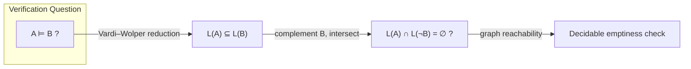

[[book-guidelines|↩ Back to guidelines]]

# Model Checking via the Automata-Theoretic Approach

## The problem: proving absence of bugs, not just finding presence of them

Testing a system means running it on a chosen sample of inputs and checking each one manually or with an oracle. This is fundamentally incomplete — you can never enumerate every input, every interleaving, every schedule, and the quality of what you find depends entirely on the tester's imagination for edge cases. What you want instead is a *proof*, over the *entire* space of behaviors at once, that the system meets its specification.

**Model checking** (Clarke–Emerson, Quielle–Sifakis, 1980s) is exactly this, made algorithmic: given a finite-state model $A$ of a system and a specification $B$, decide automatically whether every behavior of $A$ satisfies $B$. No proof needs to be written by a human — you press a button, and the checker either confirms the property or produces a concrete counterexample trace. Compared to interactive theorem proving, this is a massive practical win: the reason model checking took off in hardware verification is that "automatic and always terminates" beats "may take a human-month per lemma" for almost every engineering purpose, even though the class of properties it can handle unassisted is narrower.

**What breaks without automation:** an interactive proof assistant can, in principle, verify anything a model checker can and much more — but every step of that proof potentially needs a human to supply a lemma or a tactic. Model checking trades expressiveness for total automation by restricting the *shape* of both models (finite-state) and specifications (temporal logic formulas over that finite state space), which is exactly what turns "verification" into "a decision procedure."

## From "does it satisfy the spec" to "is one language inside another"

The trick that makes model checking a *decision procedure* rather than a proof search is due to Vardi and Wolper (1986): the **automata-theoretic approach**. Represent both the system $A$ and the specification $B$ as automata over the same alphabet of observable behaviors (traces). Then:

$$A \models B \iff L(A) \subseteq L(B) \iff L(A) \cap L(\overline{B}) = \emptyset$$

Read this right to left: "system satisfies spec" becomes "every behavior the system can produce is also a behavior the spec allows," which is language inclusion, which in turn is checkable by complementing the specification automaton, intersecting with the system automaton, and testing the result for emptiness — a *graph reachability* question, which is about as basic an algorithmic primitive as exists.

This reduction is elegant precisely because finite automata have exactly the closure properties needed to make every step in that chain work: closed under complement (so $\overline{B}$ makes sense as an automaton), closed under intersection (so $L(A) \cap L(\overline{B})$ makes sense as an automaton), and emptiness is decidable (so the final check terminates). **This is not a coincidence — it's the entire reason finite automata were chosen as the vehicle.** Any other formalism substituted here needs the same three properties or the reduction collapses.

## Where it breaks: infinite-state software

Finite-state model checking is a great match for hardware (circuits genuinely have finitely many latch configurations) but a poor match for software: a program's state space is infinite in several independent ways — unbounded recursion depth (nested/recursive procedure calls), unbounded data domains (integers, heap-allocated structures), and unbounded concurrency (dynamically spawned processes). "Model" the program as a finite automaton and you've thrown away the very feature — the call stack — that makes recursive control flow recursive.

**Pushdown automata (PDAs)** are the natural fix for exactly one of these infinities: unbounded recursion. A PDA is a finite automaton with an unbounded stack that can only be read/written at the top — which is precisely the access discipline of a call stack (push on call, pop on return). See [[Pushdown-Automata-Foundations]] for the full formal apparatus; the relevant fact here is just: PDAs can model recursive procedures with an infinite (unbounded-depth) state space, using finitely many rules.

The automata-theoretic reduction now becomes:

$$P \models \varphi \iff L(P^a) \subseteq L(A_\varphi) \iff L(P^a) \cap L(A_{\neg\varphi}) = \emptyset$$

where $P^a$ is the pushdown model of the program and $A_\varphi$ (or its complement $A_{\neg\varphi}$) encodes the specification. Whether this reduction is still *decidable* depends entirely on what kind of automaton $A_{\neg\varphi}$ is allowed to be — and this is where the story splits in two, which is the fork the entire thesis lives on.

## Case 1: regular properties — the reduction survives

If the specification is a **regular** property (expressible in CTL or LTL over the finite-control part of the program — e.g., "state $q$ is eventually reached," ignoring stack content), then $A_{\neg\varphi}$ is a plain finite automaton. The crucial closure fact that saves the day: **the intersection of a context-free language and a regular language is still context-free.** $L(P^a)$ (context-free, since PDAs recognize exactly the context-free languages) intersected with $L(A_{\neg\varphi})$ (regular) stays context-free, and emptiness of a context-free language *is* decidable (in polynomial time, via the P-automata / $\text{post}^*$ reachability technique — see [[Pushdown-Automata-Foundations]]).

This is precisely Theorem 2.3 from the foundations chapter, specialized: $L(A) \subseteq L(B)$ is decidable when $A$ is a PDA and $B$ is a finite automaton. [[Superdeterministic-Pushdown-Automata#Complexity|Complexity]]-wise: pushdown model checking for CTL is DEXPTIME-complete, while for LTL it's polynomial — a striking asymmetry that comes down to CTL's branching-time semantics requiring alternation-style reasoning over the pushdown graph, where LTL's linear-time semantics reduces more directly to a Büchi-pushdown emptiness check. Tools like Moped and Slam implement this and are genuinely used as backends in software model checkers.

## Case 2: context-free properties — the reduction breaks

Now suppose the property itself is non-regular — genuinely stack-shaped, like "every acquired lock is eventually released, with the same nesting discipline as the call stack that acquired it" (a property that inherently needs to *match* calls against returns, which a finite automaton structurally cannot do). To express this, $A_{\neg\varphi}$ itself needs to be a pushdown automaton, not a finite automaton.

But now the reduction needs $L(P^a) \cap L(A_{\neg\varphi})$, an intersection of *two* context-free languages — and **the context-free languages are not closed under intersection**. Worse, general PDA-vs-PDA language inclusion is **undecidable** (Theorem 2.2 in the foundations chapter). The elegant three-step reduction that worked for finite automata (complement, intersect, check emptiness) simply has no algorithmic content once both sides are pushdown.

**What breaks, concretely:** complementation of a PDA does not stay a PDA in general (PDAs, unlike FAs, cannot be determinized, and complementation for nondeterministic automata classically goes *through* determinization). Without determinizability, "compute $\overline{B}$ as an automaton" is not a step you can perform. This single missing closure property is the entire reason the automata-theoretic approach doesn't scale from regular to context-free specifications for free.

## The thesis's answer: restrict, don't abandon, the automata-theoretic approach

Rather than giving up on context-free specifications, or falling back to undecidable-in-general procedures, the strategy explored across this book is: **find a proper subclass of pushdown automata that is expressive enough to state genuinely stack-shaped properties, yet restricted enough to recover the closure properties (determinizability, complementation, or at least a decidable inclusion procedure) that the automata-theoretic approach needs.**

This section (1.2–1.3 of the book) surveys the field's prior attempts and previews the thesis's own four contributions, each targeting a different point on the expressiveness/decidability trade-off:

- **CaRet** (Alur et al.) — a linear temporal logic that can state some non-regular (call/return-matching) properties directly, with pushdown model checking decidable in exponential time. It's *less expressive* than general PDAs, which is exactly the price paid for decidability.
- **Visibly pushdown automata (VPAs)** (Alur–Madhusudan), directly inspired by CaRet — PDAs where the *input symbol itself* determines whether a transition pushes, pops, or does neither, via a fixed partition of the alphabet into call/return/internal symbols. This external, syntactic constraint on stack behavior is what restores determinizability, and with it, closure under all Boolean operations and decidable universality/inclusion (at EXPTIME-completeness — expensive, but decidable). See [[Visibly-Pushdown-Automata]].
- **Superdeterministic PDAs (SPDAs)** (Greibach–Friedman, refined in this thesis) — instead of restricting the specification syntactically like VPAs do, restrict it to a finite-delay deterministic PDA with a bounded stack-length-divergence property, and decide $L(A) \subseteq L(B)$ for an *arbitrary* PDA $A$ against such a $B$ via a direct product/simulation construction. See [[Superdeterministic-Pushdown-Automata]].
- **Antichain-based algorithms** — even once inclusion for VPAs is known decidable, the naive determinize-then-check algorithm is exponential and impractical; antichains keep determinization *implicit*, tracking only minimal configurations needed to decide reachability, trading a theoretically-unchanged worst case for a dramatic practical speedup. See [[Antichain-Based-Decision-Procedures]].
- **Event-clock visibly pushdown automata (ECVPAs)** — pushing the whole framework into real time, extending VPAs with event clocks (clocks whose valuation is a syntactic function of the input word, not of nondeterministic transition choices — exactly the property that keeps event-clock automata determinizable, the timed analogue of VPA's syntactic visibility constraint) to decide inclusion between timed pushdown specifications. See [[Timed-Automata-and-Their-Pushdown-Extensions]].

Structurally, every one of these four contributions is a *restriction* on one side of the same inclusion question $L(A) \subseteq L(B)$ — restrict $B$ (SPDA, VPA, ECVPA) so that determinization or a direct simulation becomes possible, and the intractable general problem (Theorem 2.2's undecidability) becomes a decidable, and in three of the four cases, *practically implemented and benchmarked*, algorithm.

## Where this leads

This chapter's single reduction — $A \models B \iff L(A) \subseteq L(B)$ — is the organizing question for the entire dissertation; every later chapter answers "for which automaton classes $A$, $B$ is this decidable, and how do you actually compute it?" The closure-property failure identified here (PDAs aren't closed under intersection/complementation, so the naive reduction chain breaks) is the single technical obstruction that Chapters 3 through 6 each attack from a different angle. This is also the same general pattern — "verification reduces to a language/state-space inclusion or intersection-emptiness question that a naive automaton complementation would answer, but the automaton class in play isn't closed under complementation, so you need a restricted subclass or a symbolic fixed-point technique instead" — that underlies CEGAR loops and Horn-clause / Constrained-Horn-Clause verification-condition discharge in abstract interpretation and automated reasoning more broadly: the antichain/fixed-point machinery of Chapter 5, in particular, is a close structural cousin of the lattice-based reachability computations used there.
