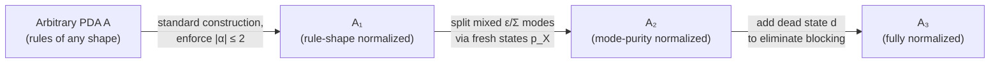
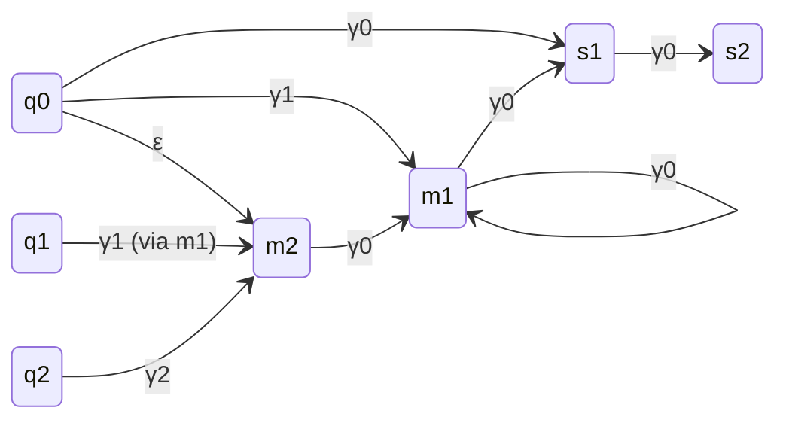

[[book-guidelines|↩ Back to guidelines]]

# Pushdown Automata Foundations

## Why a stack, and why does it break everything

A finite automaton (FA) is a perfectly good model of control flow as long as "control flow" has no memory beyond *which state you're in*. The moment you need to track something unbounded — how many `(` you've seen without a matching `)`, how many procedure calls are still on the call stack — a finite set of states can't do it. You need unbounded memory with a very specific access discipline: last-in-first-out. That's a pushdown automaton (PDA): a finite automaton bolted onto a stack.

This sounds like a modest upgrade. It is not. Finite automata have a suite of properties that make them a joy to build algorithms on: they're closed under union, intersection, and complementation; determinization always works (the subset construction); and language inclusion $L(A) \subseteq L(B)$ is decidable by complementing $B$, intersecting, and checking emptiness. **None of this survives the addition of a stack.** PDAs are closed under union but *not* under intersection or complementation, and they cannot be determinized in general. As a direct consequence, $L(A) \subseteq L(B)$ for two arbitrary PDAs is **undecidable** — you can't compute $\overline{L(B)}$ because complementation of context-free languages doesn't stay context-free.

This is the tension the entire thesis is built around: pushdown model checking wants to ask inclusion questions, but the general question is unanswerable. Chapter 2 is the ground floor — it fixes vocabulary and states precisely *which* small piece of the picture (PDA-vs-FA inclusion, and PDA emptiness) *is* decidable, so that later chapters can carve out larger decidable islands (SPDAs in Ch. 3, VPAs in Ch. 4–6) by construction rather than by hoping.

## The formal object: what a PDA actually is

The book's Definition 2.1 gives a PDA as a 7-tuple $A = (Q, \Sigma, \Gamma, Z_0, \Delta, q_0, F)$:

- $Q$ — finite control states,
- $\Sigma$ — input alphabet,
- $\Gamma$ — stack alphabet, disjoint from $Q$,
- $Z_0 \in \Gamma$ — the initial stack symbol (also written $\bot$),
- $\Delta$ — transition rules of the form $(p, X) \xrightarrow{a} (q, \alpha)$, with $p, q \in Q$, $a \in \Sigma \cup \{\varepsilon\}$, $X \in \Gamma$, $\alpha \in \Gamma^*$,
- $q_0$ — initial state,
- $F \subseteq Q$ — final states.

A rule is classified purely by $|\alpha|$, the length of the string pushed back onto the stack in place of the popped symbol $X$:

- $|\alpha| = 2$: **push** (read $X$ off the top, write two symbols back — net stack growth of 1),
- $|\alpha| = 1$: **internal** (pop $X$, push back a single symbol — net stack height unchanged),
- $|\alpha| = 0$: **pop** (pop $X$, write nothing back — net stack shrinkage of 1).

Notice what's *not* separate here: "push/internal/pop" isn't a tag on the rule, it's *derived* from counting symbols on the right-hand side. This will matter later — [[Visibly-Pushdown-Automata|visibly pushdown automata]] (Chapter 4) turn this derived classification into something the *input symbol itself* announces up front, which is exactly the property that makes them determinizable where general PDAs aren't.

A **mode** $(p, X)$ is a (state, top-of-stack) pair — the thing a transition rule is indexed by. Three mode categories matter throughout the thesis:

- **blocking**: no rule at all is defined for $(p, X)$ — the automaton is stuck,
- **reading**: no $\varepsilon$-rule is defined for $(p,X)$, so any move must consume input,
- (implicitly) **$\varepsilon$-only**: only $\varepsilon$-rules are defined — the automaton can act without consuming input.

**What breaks without a mode discipline:** if a mode could mix $\varepsilon$-rules and input-consuming rules for the *same* $(p, X)$, or could be silently blocking in some places and not others, algorithms that need to reason about "how many silent moves can happen before something has to be read" (this is exactly *finite delay*, defined next) would have no structural handle to grab onto. The book's normal form (Definition 2.9, below) exists precisely to eliminate this ambiguity before any serious construction is attempted.

### Real-time and deterministic PDAs

Two restricted subclasses, Definition 2.2:

- **RPDA** (real-time): every rule requires $a \neq \varepsilon$ — no silent transitions at all. The automaton must consume a symbol on every step.
- **DPDA** (deterministic): for every $(p, X, a)$, at most one $(q, \alpha)$ is reachable, *and* if an $\varepsilon$-rule exists out of $(p,X)$, no non-$\varepsilon$-rule can also exist out of $(p,X)$ (otherwise the automaton would have to "guess" whether to consume input or not).

### Configurations and stacking computations

A **configuration** is a pair $(p, y) \in Q \times \Gamma^*$ — control state plus entire stack content, written with the *top of stack on the right* (Definition 2.3). The transition relation lifts rules to configurations: if $(p,X) \xrightarrow{a} (q,\alpha) \in \Delta$, then for *any* stack suffix $\beta$, $(p, X\beta) \xrightarrow{a} (q, \alpha\beta)$ — the rest of the stack is untouched, which is exactly the LIFO discipline made formal. Chaining one-step computations over a word $w$ gives $c_1 \xrightarrow{w} c_2$.

The one genuinely subtle definition here is **stacking computation** (Definition 2.3, item 6):

$$c_1 \uparrow (a_1 \cdots a_n) c_{n+1}$$

meaning an $n$-step computation from $c_1$ to $c_{n+1}$ where *every intermediate configuration has stack height at least $|c_1|$* — the computation never pops below where it started. This is the formal way of saying "a self-contained excursion that returns to at least the starting stack depth," and it is the building block that later chapters (SPDA's alternate-stacking, VPA's well-matched words) use to reason compositionally about pieces of a run without tracking the whole stack.

**Accessibility and liveness** (Definition 2.4) split into a forward and a backward condition, and the distinction matters: a configuration is *accessible* if it's reachable from the initial configuration $(q_0, Z_0)$, but it's *live* only if it can additionally reach acceptance. A configuration can be accessible without being live (a dead-end branch of the computation), and reasoning that ignores this distinction is a classic source of unsound automata constructions — this exact issue resurfaces in Chapter 3, where the original Greibach–Friedman proof needed an explicit side-condition to rule out non-live configurations, one that the thesis's own construction manages to avoid entirely.

**Finite delay** (Definition 2.5) bounds how many $\varepsilon$-rules can fire consecutively: a PDA is of *delay $d$* if no run has more than $d$ silent steps in a row, and is *finite delay* if such a $d$ exists for the whole automaton. Delay 0 collapses to real-time. Finite delay is the property that makes an automaton's "thinking" bounded even when it's allowed to be silent — you'll see it again as a defining requirement for superdeterministic PDAs in Chapter 3.

### Acceptance and equivalence

The book fixes acceptance by **both** final state and empty stack (Definition 2.6): $L(c) = \{w \mid c \xrightarrow{w} (q, \varepsilon), q \in F\}$, and $L(A) = L((q_0, Z_0))$. Two PDAs (or configurations) are *equivalent* if they accept the same language (Definition 2.7) — a purely extensional notion that will later be contrasted with much stronger *structural* correspondences (like the ordering-preserving simulations of Chapter 5).

A **finite automaton is just a PDA with only internal transitions** (Definition 2.8) — the stack never actually changes shape, so it's inert and can be ignored. This isn't a throwaway remark: it means every closure/decidability result about PDAs specializes correctly to FAs, and conversely, any PDA construction that reduces to "finite-automaton behavior" in a special case is a sanity check the construction should satisfy.

## What breaks without normalization — and the normal form that fixes it

Definition 2.9 introduces **normalized PDAs**: no blocking modes, every mode is either purely-$\varepsilon$ or purely-on-$\Sigma$ (never mixed), and every rule is exactly one of three shapes — $(p,X) \xrightarrow{a} (q,\varepsilon)$ (pop), $(p,X) \xrightarrow{a} (q,X)$ (internal, stack symbol *unchanged*), or $(p,X) \xrightarrow{a} (q, YX)$ (push, exactly one new symbol on top).

**What breaks without this:** without normalization, a construction that needs to do induction on "the rule shape at this step" has to handle an open-ended set of cases — $\alpha$ could be any string of any length. Pinning $|\alpha| \in \{0, 1, 2\}$ with a *fixed* symbol pattern (not just a fixed length) turns "case analysis on the rule" into a clean 3-way (or 6-way, once you split on $a \in \Sigma$ vs. $a = \varepsilon$) case split — this is exactly what Chapter 3's product construction $M(A, B, r)$ leans on to enumerate its transition cases mechanically. Lemma 2.4 proves every PDA has an equivalent normalized PDA (and the construction preserves determinism), via a three-stage transformation $A \to A_1 \to A_2 \to A_3$ that successively enforces rule shape, then mode purity, then non-blockingness (using a dead state $d$ that absorbs otherwise-undefined transitions).

## Closure and decidability: the actual boundary

This is the load-bearing section of the chapter (Theorems 2.1–2.3):

| Property | Finite automata | Pushdown automata |
|---|---|---|
| Emptiness | decidable, linear | **decidable, polynomial time** (Thm 2.1) |
| Closed under union | yes | **yes** |
| Closed under intersection | yes | **no** |
| Closed under complementation | yes | **no** |
| $L(A) \subseteq L(B)$, both PDA | decidable | **undecidable** (Thm 2.2) |
| $L(A) \subseteq L(B)$, $A$ PDA, $B$ FA | decidable | **decidable** (Thm 2.3) |

The undecidability of general PDA inclusion (Thm 2.2) is *why* this entire thesis exists: you cannot get inclusion for free the way you can for FAs (complement $B$, intersect with $A$, check emptiness — each step requires a closure property PDAs don't have). Theorem 2.3 is the one bright spot the automata-theoretic approach to model checking already exploits (checking a program against a regular/finite-state specification), and it's also the *shape* every subsequent chapter's contribution takes: find a subclass of "$B$" (SPDA, then VPA) restrictive enough that intersection/complementation-like reasoning becomes possible again, without restricting $A$ so much that it stops being a useful model of real programs.

## Emptiness via P-automata: making reachability concrete

Emptiness is decidable (Thm 2.1), but the *classical* proof method — via the Pumping Lemma — gives no algorithm anyone would want to implement. Section 2.3 recalls the practical alternative: **P-automata**, a technique (Finkel et al.; Esparza et al.) that represents a *possibly infinite set* of PDA configurations as a finite automaton, then computes reachability by saturating that automaton with new transitions.

**The core idea, from first principles:** a PDA configuration $(p, w)$ is a state plus an unbounded stack string. You can't enumerate all configurations directly. But you *can* build a finite automaton whose accepted language, read as stack strings, *encodes* an infinite set of configurations — read stack contents right-to-left as an input word, and a state $p$ (as one of the automaton's initial states) recognizing $w$ means "$(p, w)$ is a member of this set."

Formally (Definition 2.10): a **P-automaton** for a PDA $P = (P, \Sigma, \Gamma, \bot, \Delta, s_0, F)$ is a finite automaton $A = (Q, \Gamma, \delta, P, F)$ — note $\Gamma$ (the *stack* alphabet) is now the P-automaton's *input* alphabet, and $P$'s control states serve as $A$'s (multiple) initial states. $A$ accepts $(p, w)$ iff there's a run from $p$ to some final state on input $w$.

The reachability computation is a **saturation**: starting from a P-automaton for the configurations of interest $C$, repeatedly add transitions according to three rules, one per PDA rule shape (pop, internal, push), until nothing new can be added. The result, $A_{post^*}$, recognizes exactly $post^*(C)$ — every configuration reachable from $C$. Emptiness of $L(P)$ is then the special case $C = \{(q_0, Z_0)\}$, checking whether any accepting configuration is reachable.

**What breaks without this:** a naive reachability computation over the (infinite) configuration graph has no termination guarantee. The P-automaton trick works because the *set* of reachable configurations, even though infinite, has finite *description [[Superdeterministic-Pushdown-Automata#Complexity|complexity]]* — it's always regular (this is a nontrivial theorem the book takes as background) — so saturation over a finite automaton's transition set is guaranteed to terminate. This same "represent an infinite set of automaton-states via a finite automaton over stack symbols" idea reappears, generalized, as the backbone of the antichain-based algorithms in Chapter 5.

The book's worked example (Example 2.1) traces the saturation by hand: a 3-state PDA with 4 rules and a P-automaton for $\{(q_0, \gamma_0\gamma_0)\}$ grows, over 6 saturation steps, into a P-automaton recognizing $post^*$ of that singleton set — new states $p_{(q,\gamma)}$ get introduced for push-rule targets, and new transitions get chained in following the three saturation rules until a fixed point is reached.

*(Simplified sketch of Figure 2.2's saturated P-automaton — states `m1`, `m2` are the fresh $p_{(q,\gamma)}$ states introduced during saturation; the actual figure has additional structure the ASCII/Mermaid rendering above compresses for readability.)*

## Why this matters: pushdown model checking

Section 2.4 closes the chapter by cashing out the formalism into the motivating application: **pushdown model checking**. A recursive program (with nested procedure/method calls) is naturally modeled by a pushdown automaton $P^a$ — the stack tracks the call stack. Model checking a regular safety property $\varphi$ reduces, exactly as in finite-state model checking, to:

$$P \models \varphi \iff L(P^a) \subseteq L(A_\varphi) \iff L(P^a) \cap L(A_{\neg\varphi}) = \emptyset$$

This works *only* because $A_{\neg\varphi}$ is a **finite automaton** (regular properties), which is precisely Theorem 2.3's decidable special case — $A$ (PDA) vs. $B$ (FA) inclusion. Pushdown CTL model checking is DEXPTIME-complete; pushdown LTL model checking is polynomial. But the moment the specification itself needs to express a *context-free* (non-regular) property — e.g., "every acquired lock is eventually released, tracked with the same nesting discipline as the call stack" — the automata-theoretic reduction needs $B$ itself to be more than a finite automaton, and general PDA-vs-PDA inclusion is exactly the undecidable problem from Theorem 2.2.

This is the precise fork in the road CaRet (Alur et al.) and then visibly pushdown automata (Alur–Madhusudan) are built to navigate: keep $B$ expressive enough to state non-regular, stack-shaped properties, but restricted enough that inclusion against it stays decidable. Chapters 3–6 are the thesis's four different answers to "how restricted, exactly."

## Where this leads

Chapter 2's vocabulary — configurations, stacking computations, normalized form, finite delay, the PDA-vs-FA decidability boundary, and P-automata reachability — is reused directly: normalized form and finite delay reappear as defining ingredients of *superdeterministic* PDAs (Chapter 3); stacking computations underlie the "well-matched word" notion of visibly pushdown automata (Chapter 4); and P-automata reachability is the backend that both the standard and on-the-fly VPA algorithms of Chapter 5 build on top of, before the antichain method replaces explicit reachability with a lattice of minimal configurations.
