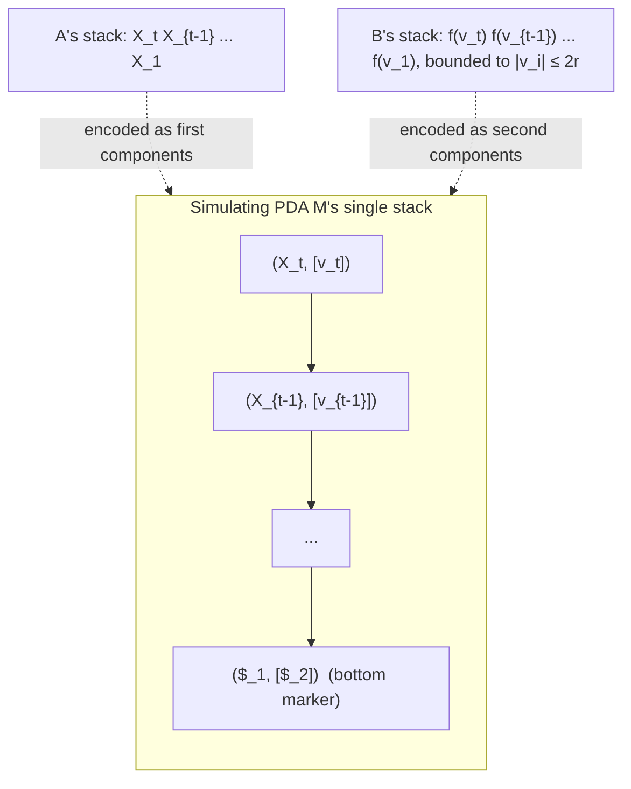

[[book-guidelines|↩ Back to guidelines]]

# Superdeterministic Pushdown Automata

## The question: how far can $B$ be pushed before inclusion becomes undecidable?

[[Pushdown-Automata-Foundations]] established the wall: $L(A) \subseteq L(B)$ is undecidable when both $A$ and $B$ are arbitrary PDAs, but decidable when $B$ is restricted all the way down to a finite automaton. That's a huge gap. This chapter asks the natural follow-up question: **how much of PDA-ness can $B$ keep while $A$ stays a fully general PDA, without losing decidability of inclusion?**

The answer, due to Greibach and Friedman (1980), is a class called **superdeterministic pushdown automata (SPDAs)** — and per the book's survey (Section 3.4), it's the *largest* known class for which this asymmetric inclusion question ($A$ arbitrary, $B$ restricted) is decidable. This chapter doesn't invent SPDAs; it takes Greibach and Friedman's decidability proof and **replaces its proof technique** with a cleaner one — same result, a genuinely more usable construction.

## What makes a DPDA "superdeterministic"

Start from a deterministic PDA (DPDA) — no branching, at most one move per (state, stack-top, input) triple (see [[Pushdown-Automata-Foundations]] for the base definitions). Determinism alone isn't enough to guarantee good inclusion behavior against it; SPDAs add two further conditions (Definition 3.1):

1. **Finite delay** — a bound $d$ on how many consecutive $\varepsilon$-transitions can fire without consuming input. Without this, an automaton could "think forever" between reads, which breaks any algorithm that wants to bound how far ahead it needs to simulate before deciding something.
2. **The defining superdeterminism condition:** for any two accessible, reading-mode configurations $c_1, c_2$ with the *same control state*, if both read the *same word* $w$ and land in $c_1', c_2'$, then $c_1'$ and $c_2'$ also share a control state, **and** the stack-length change is identical: $|c_1| - |c_1'| = |c_2| - |c_2'|$.

**What problem does condition 2 solve?** It says: once you know the control state, reading any fixed word $w$ has a *state-and-height-change effect that doesn't depend on how deep the stack currently is or what's beneath the top* — only on the control state and $w$. This is what lets an algorithm reason about $B$'s behavior *compositionally*, piece by piece, without tracking the whole (unbounded) stack content. Contrast this with an arbitrary DPDA, where the effect of reading $w$ can depend arbitrarily on buried stack content, making any bound on the required lookahead impossible to establish.

A concrete failure case makes condition 2's necessity vivid (the book's own counterexample): the language $L = \{a^m b^n \mid m \geq n\}$ is *not* superdeterministic. Any PDA for it pushes on $a$ and pops on $b$; after reading $a^5$ and $a^{10}$ separately, the automaton lands in configurations $c_1, c_2$ sharing a control state (it's just been pushing the same symbol) — but appending $b^{10}$ drives $c_1$ to height-change $0-5$ and $c_2$ to height-change $0-10$. Different height changes from the same control state on the same word: condition 2 is violated, so no SPDA can recognize this language, no matter how you build the automaton. By contrast, $\{a^n b^n \mid n \geq 0\}$ — a genuine "balanced" language — *is* superdeterministic, because reading $b^n$ from any configuration reached via $a^n$ has a uniform, position-independent effect once you know you're "in the pop phase."

The class of **superdeterministic languages** turns out to be broad: it contains the *generalized parenthesis languages*, a strict superset of both classical parenthesis languages and Dyck languages — a substantial, practically-relevant class, not a toy corner case.

**Decidability boundary, stated precisely:** checking whether a *given PDA* is an SPDA is decidable (you can compute a finite-delay bound and then examine finitely many computations to check condition 2). But checking whether a *given context-free language* (with no automaton attached) is superdeterministic is undecidable — a sharp reminder that decidability results about automata classes and decidability results about language classes are genuinely different questions.

## The Key Lemma: bounding how far two automata can drift apart

The technical engine of the whole chapter is a single bound (Lemma 3.1, the "Key Lemma"): if $A$ is normalized (see [[Pushdown-Automata-Foundations]]) and $B$ is a one-increasing SPDA of delay $d$, and $L(c_1) \subseteq L(c_1')$ for configurations $c_1$ (in $A$) and $c_1'$ (in $B$), then along any *stacking computation* $c_1 \uparrow (w) c_2$ in $A$ (with $c_2$ live) matched by $c_1' \xrightarrow{w} c_2'$ in $B$, the stack-height *difference* between the two automata's configurations is bounded by a computable constant $k$ — a number built purely from $A$ and $B$'s sizes and $B$'s delay $d$.

**Why this is the crux of everything downstream:** it says two languages that are related by inclusion at the *start* of a run can't drift arbitrarily far apart in relative stack height while continuing to satisfy that inclusion. If a candidate "simulating" run ever sees the stack-height gap exceed $k$, that's not just suspicious — it's a mathematical certificate that the inclusion has already failed somewhere earlier. This is what turns "does $L(A) \subseteq L(B)$ hold" from an infinite question (comparing behavior over all words) into a finite one (run a bounded simulation and watch for a threshold breach).

## Alternate stacking: weaving two automata's stacks into one

To exploit the Key Lemma algorithmically, the book uses Valiant's **alternate stacking** technique: build a single stack machine $M$ whose stack *interleaves* segments of $A$'s stack and segments of $B$'s stack — content like $u_1v_1u_2v_2\cdots u_tv_t$, where each $u_i$ is a stack segment of $A$ and each $v_i$ a bounded-length encoding of a segment of $B$'s stack. $M$ advances by simulating one step of $A$ using $u_i$ and (when appropriate) one step of $B$ using $v_i$.

The delicate part: in general, weaving two stacks together like this does *not* produce something that's itself a valid pushdown automaton (a PDA can only touch the top of *one* stack). Alternate stacking "succeeds" exactly when the segments can be bounded in length — which is exactly what the Key Lemma provides: set the segment bound $r$ to $k+1$, and $B$'s segment never needs to exceed the bound, because if it did, that would itself certify inclusion failure (a "stacking-fail transition," discussed below).

### The thesis's refinement: a direct product, not an opaque encoding

Greibach and Friedman's original construction encoded *everything* — states, stack content, transitions — as opaque stack symbols of a single machine, which made it impossible to describe $M$'s control states or transitions explicitly, and forced them to introduce a separate, non-constructive **"liveness" side-condition** (whether a configuration of $A$ can still reach acceptance) to make the correctness proof go through.

This chapter's contribution (Definition 3.3) is to build $M = M(A, B, r)$ as an explicit **product construction**: $M$'s control states are literal pairs $\langle p_1, p_2 \rangle \in Q_A \times Q_B$ (plus bookkeeping states $Q_A \times \{0\}$ for "B has diverged, only simulate $A$ from here"), and its stack alphabet is literal pairs $(X, [v])$ of an $A$-stack-symbol and a bounded encoding of a $B$-stack-segment. Every transition of $M$ is defined by directly pattern-matching a rule of $A$ against a rule of $B$ — six labeled families of cases (internal-vs-$B$, push-vs-$B$, pop-vs-$B$, "$A$'s stack empty," "$B$ has $\varepsilon$-moves while $A$ waits," and the single starting transition), each spelling out exactly what happens to both automata's stacks in the same rule.

Because everything is *literally* a pair of states and a pair of stack contents rather than an opaque encoding, whether $L(A) \not\subseteq L(B)$ is witnessed **directly** by $M$ reaching an accepting configuration — no separate liveness check is needed, because "$A$ accepts but $B$ doesn't" (or "$B$ gets stuck / diverges too far") is exactly what the product's own accepting states $F_M = (F_A \times (Q_B \setminus F_B)) \cup (F_A \times \{0\})$ already encode. This is the chapter's central simplification: **push the semantic content of "liveness" into the syntax of the product's accepting states, instead of proving it as an external property.**

A **stacking-fail transition** fires when $B$'s encoded stack segment would need to exceed the bound $2r$, or drops to empty in a way that breaks the encoding invariant — at that point $M$ gives up trying to track $B$ precisely and switches to a bookkeeping mode (states $Q_A \times \{0\}$) that just finishes simulating $A$ alone. Whether this happens turns out (via the Key Lemma) to be exactly the signal that $A$ and $B$'s languages have diverged.

**Worked example (Example 3.1):** two small PDAs $C$ (a general PDA for $\{a^nb^nc^m \mid n,m\geq 1\}$) and $D$ (an SPDA for $\{a^mb^nc^n \mid m \geq 0, n \geq 1\}$) yield, with segment bound $r=1$, a five-state simulating PDA $M(C,D,1)$ whose language turns out to be exactly $\{a^nb^nc^m\}$ — confirming $L(C) \not\subseteq L(D)$ (words like $a b c$ are in $C$'s language via the simulating automaton reaching an accepting state that certifies a mismatch), traced out concretely rule-by-rule in the book.

## Soundness and completeness — without ever proving liveness

The correctness argument (Section 3.3) is the direct payoff of the product construction:

- **Soundness (Lemma 3.2):** if $L(A) \not\subseteq L(B)$, some witness word $w \in L(A) \setminus L(B)$ exists, and by directly tracing $M$'s transitions on $w$ (case-split on whether $B$ has no computation on $w$, has one landing in a non-final state, or fails during stacking), $M$ accepts $w$ — for *any* choice of the bound $r \geq 1$. Nothing here needed liveness.
- **Completeness (Lemma 3.3):** conversely, if $M(A, B, k+1)$ accepts some $w$ — reaching either an $F_A \times (Q_B \setminus F_B)$ configuration (direct mismatch) or an $F_A \times \{0\}$ configuration (via $B$ blocking, or via a stacking failure) — then $w$ witnesses $L(A) \not\subseteq L(B)$. The stacking-failure sub-case is the interesting one: assuming (for contradiction) that $L(A) \subseteq L(B)$ *does* hold, the proof locates the exact point in the run where the encoded $B$-segment overflowed the bound $r = k+1$, and shows this forces a stack-height gap strictly greater than $k$ between matched configurations of $A$ and $B$ — directly contradicting the Key Lemma. So the "why did $M$ decide to give up on tracking $B$" question answers itself as "because tracking further would have proven the Key Lemma false, which is impossible if inclusion actually held."

Together (Lemma 3.4): $L(A) \subseteq L(B) \iff L(M(A,B,k+1)) = \emptyset$ — and emptiness of a PDA is exactly the polynomial-time-decidable question from [[Pushdown-Automata-Foundations]].

## Complexity

Theorem 3.5: the decision procedure runs in time $2^{2^{p(h)}}$ for a polynomial $p$ in $h = |A| + |B|$ — **double-exponential**. This isn't a weakness introduced by the refined construction; it's inherited from the same complexity class as the original Greibach–Friedman proof (the size of $M$'s stack alphabet grows as $|\Gamma_B|^{2k+2}$, and $k$ itself is already doubly-exponential in the automata's combined size via the Key Lemma's bound). The chapter's contribution is a *simpler, more implementable proof*, not a *faster* algorithm — a useful distinction: proof clarity and asymptotic complexity are orthogonal axes, and this chapter deliberately optimizes only the first.

## Why the acceptance condition matters — a sharp decidability cliff

Section 3.4 flags a detail easy to miss: the *entire* decidability result depends on accepting SPDAs by **final state and empty stack together**. If SPDAs instead accept by final state *alone*, the same inclusion problem becomes **undecidable**. This is a striking illustration that a definition's fine print — here, the acceptance convention — can be the difference between a decidable and undecidable problem, even holding every other part of the definition fixed. It's a recurring theme worth watching for in later chapters: [[Visibly-Pushdown-Automata]] and its extensions are similarly sensitive to exactly how acceptance and closure conditions are set up.

## Where this leads

SPDAs are the thesis's *first* answer to "how far can $B$ be pushed while $A$ stays fully general" — a semantic restriction (a property about how $B$'s runs behave) rather than a syntactic one. The next three chapters explore a different, syntactic restriction — [[Visibly-Pushdown-Automata]], where the input alphabet itself dictates stack behavior — which trades some of SPDA's semantic generality for *symmetric* closure properties (VPAs are closed under all Boolean operations, not just useful for one-sided inclusion against a fixed $B$) and for algorithms that are actually implementable in practice ([[Antichain-Based-Decision-Procedures]]), unlike this chapter's double-exponential procedure.
