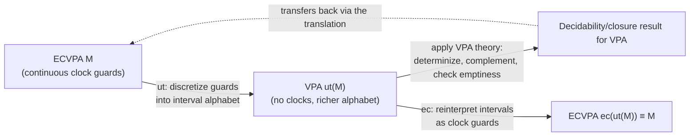
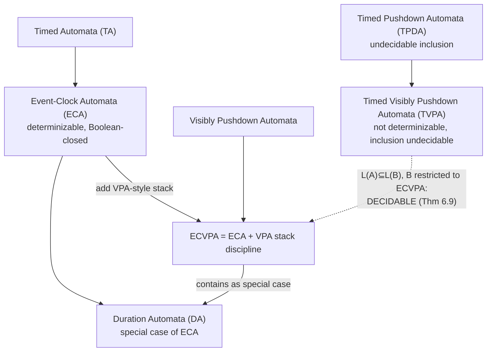

[[book-guidelines|↩ Back to guidelines]]

# Timed Automata and Their Pushdown Extensions

## Adding a new axis of unboundedness: real time

Every previous chapter fought one specific source of undecidability: an unbounded *stack*. This chapter introduces a second, independent source of unboundedness — **real-valued time** — and asks the same structural question the whole thesis has been asking all along: what's the largest class you can build that stays closed enough, and determinizable enough, for inclusion to remain decidable?

A **timed automaton (TA)**, due to Alur and Dill, is a finite automaton plus a finite set of real-valued clocks; transitions can test clock values against constants and reset clocks. This is enough to state genuinely quantitative properties ("this response must occur within 5 time units"), and tools like UPPAAL make TA-based verification practical for reachability and safety. But — predictably, given the pattern established across this thesis — **general TA-vs-TA language inclusion is undecidable.** The chapter's task is to find the timed analogue of what VPAs did for the stack: a syntactic restriction that restores decidability, and then combine *that* restriction with VPA's own stack restriction into a single automaton class.

## Event-clock automata: the timed analogue of visibility

The key restricted class that makes this work is **event-clock automata (ECAs)**, and the restriction they impose on clocks is a direct structural cousin of what VPAs impose on the stack. Instead of allowing arbitrary clocks that get reset by arbitrary transition choices, an ECA associates **exactly two implicit clocks with each alphabet symbol** $a$:

- $x_a$ (**event-recording**): the time elapsed since the *last* occurrence of $a$,
- $y_a$ (**event-predicting**): the time that *will* elapse before the *next* occurrence of $a$.

If there's no such last/next occurrence, the value is the special symbol $\bot$ (undefined) — Definition 6.2's clock-valuation function $\nu_j^{\bar w}(x_a)$ and $\nu_j^{\bar w}(y_a)$ compute these directly from the timed word itself, by scanning forward or backward to the nearest occurrence of $a$.

**Why this is exactly analogous to VPA visibility:** a VPA's stack action on reading symbol $a$ is a syntactic function of $a$ alone — not of nondeterministic transition choice. An ECA's clock *valuations* are likewise a syntactic function of the **input word alone** — $\nu_j^{\bar w}(x_a)$ is computable directly by scanning $\bar w$, with no reference to which nondeterministic transition the automaton happens to take. **This is the single property that makes ECAs determinizable and closed under all Boolean operations**, exactly as alphabet-fixed stack actions made VPAs determinizable. Contrast this with a general TA, where a clock's value depends on *when it was last reset*, which is itself a transition-dependent (hence nondeterminism-dependent) choice — the analogue of a general PDA's push/pop being rule-dependent rather than symbol-dependent.

## Event-clock visibly pushdown automata: combining both restrictions

The chapter's actual contribution, **event-clock visibly pushdown automata (ECVPAs)**, is the natural product of the two ideas developed across the thesis: take a VPA (alphabet-partitioned stack discipline, from [[Visibly-Pushdown-Automata]]) and attach event-clock constraints to its transitions (Definition 6.4). Each transition — push, pop, or internal — carries a guard $\varphi \in \Phi(C_\Sigma)$, a Boolean formula over event-clock comparisons to rational constants, e.g. "fire this push only if $x_a < 2$."

This combination is expressive enough to state genuinely useful **context-free real-time properties** that neither piece alone can express: "if $p$ holds when a procedure is invoked, the procedure must return within $d$ time units, and $q$ must hold at the return" needs *both* the stack discipline (to correctly match a specific invocation to its corresponding return, across arbitrarily deep nesting) *and* the timing constraint (the $d$-time-unit bound) — a VPA alone has no clocks, and an ECA alone has no way to match nested calls and returns. Example 6.3's automaton in the book directly instantiates this pattern: a push guarded by $y_c < 50$ (a global deadline on the whole matched block) combined with pops guarded by $x_a < 2$, $x_b < 2$ (local inter-symbol timing), accepting exactly the timed language $\{(\bar\alpha, \bar t) \mid \bar\alpha = a^nb^nc,\ldots\}$ — provably **not** acceptable by any plain timed automaton, since its untimed projection $\{a^nb^nc\}$ is context-free, not regular.

A worked incomparability result (Example 6.4) sharpens the boundary: the timed language "some two $a$'s exactly 1 time unit apart" is accepted by a simple one-clock TA but **cannot** be accepted by any ECVPA — because it needs a clock that gets reset at an *arbitrary, nondeterministically chosen* point (exactly the "clock reset by transition choice" freedom ECVPAs deliberately forbid). This is a clean illustration of the same expressiveness/decidability trade-off seen everywhere else in this thesis: ECVPAs are strictly less expressive than general TAs or TPDAs in some directions, and strictly more expressive in others (they can do unbounded-nesting, context-free-shaped timing that plain TAs cannot) — the two classes are genuinely **incomparable**, not nested.

## The translation trick: borrow VPA's machinery instead of reproving everything

Rather than re-deriving determinization, closure, and inclusion decidability for ECVPAs from scratch, the chapter's central technical device is a **translation pair** between ECVPAs and plain (untimed) VPAs — proving that everything true about VPAs is, via this translation, automatically true about ECVPAs too.

**Untimed transformation $ut(M)$** (Definition 6.9): replace each event-clock guard $\varphi$ with a *finite* case-split over an **interval-based alphabet** $\Pi = \Sigma \times \mathrm{Intv}^{|C_\Sigma|}$ — discretize the continuous clock-value space into finitely many intervals (bounded by the finitely many rational constants that actually appear in $M$'s guards), and replace one guarded transition with several parallel transitions, one per interval combination that could satisfy the guard. The result $ut(M)$ is an ordinary VPA — no clocks, no continuous time, just a syntactically richer alphabet encoding *which* interval each clock's value falls into.

**Timed transformation $ec(N)$** (Definition 6.10) is the inverse: given a VPA over an interval alphabet, replace each interval-tagged symbol with the corresponding event-clock guard, recovering an ECVPA.

**Why this round-trip is exact, not just approximate** (Lemma 6.1, Lemma 6.2, Theorem 6.3: $L(ec(ut(M))) = L(M)$): the interval alphabet is fine-grained enough (built from the *exact* constants appearing in $M$) that no information is lost in either direction — $tw$ (Definition 6.8) recovers exactly the set of timed words consistent with a given interval-annotated untimed word, and this correspondence is a bijection on languages, not a lossy approximation. This is the mechanism that lets the thesis **reduce ECVPA theory to already-solved VPA theory** wholesale: determinization (Lemma 6.4, inherited via $O(2^{n^2})$-style blow-up directly from VPA determinization), closure under all Boolean operations (Theorem 6.5), and EXPTIME-completeness of inclusion (Theorem 6.6) all transfer *for free*, with proofs that are essentially "translate, apply the VPA theorem, translate back."

## The real payoff: TVPA-vs-ECVPA inclusion is decidable

The chapter's headline result addresses a specifically **asymmetric** inclusion question — echoing the exact shape of [[Superdeterministic-Pushdown-Automata]]'s "restrict only $B$" strategy, but now in the timed setting. **Timed visibly pushdown automata (TVPAs)** (Emmi–Majumdar) are a more general, more expressive timed extension of VPAs — general clocks $X$ with arbitrary reset sets $\lambda$ on transitions, *not* restricted to the event-clock discipline. This generality costs everything: **TVPAs are not determinizable, not closed under complementation, and TVPA-vs-TVPA inclusion is undecidable even when $B$ has just one clock** (Theorem 6.7) — a considerably worse decidability boundary than plain (untimed) timed automata, where at least the one-clock-$B$ special case is decidable (Ouaknine–Worrell, via well-structured transition systems).

The thesis's answer: **decidability is recoverable if $A$ stays a fully general TVPA, but $B$ is restricted to an ECVPA** (Theorem 6.9). The proof is a clean four-step pipeline, and every step reuses machinery already built:

1. Translate $A$ into a TVPA and *complement $B$* — but $B$ is an ECVPA, so this is done by determinizing $B$ (Lemma 6.4, via the translation to VPA), complementing the *deterministic* VPA (trivial: flip accepting states), and translating back.
2. Translate this complemented ECVPA $\overline{B}$ into a TVPA $B'$ using an **event-clock-to-original-clock translation** (Lemma 6.8, adapted from the analogous ECA-to-TA translation of Alur–Fix–Henzinger): each event-recording clock $x_a$ becomes an ordinary clock reset on every $a$-transition; each event-predicting clock $y_a$ becomes a more elaborate construction — a fresh clock $z_{(y_b \sim c)}$ per atomic prediction-constraint, reset when the prediction is "made" and checked when the predicted occurrence actually arrives, turning a *forward-looking* guard into an *ordinary, backward-looking* clock check via a state-space blow-up that tracks which predictions are still pending.
3. Intersect $A$ with $B'$ — both are now TVPAs (a class closed under intersection, unlike being closed under complementation, which TVPAs specifically lack).
4. Check emptiness of $L(A) \cap L(B')$ by translating the whole intersection back to an (untimed) VPA via $ut$, and checking VPA emptiness — cubic time, per [[Pushdown-Automata-Foundations]]'s P-automata machinery.

$L(A) \subseteq L(B) \iff L(A) \cap L(B') = \emptyset$, and every individual step is decidable, so the whole procedure is decidable — with the same EXPTIME-complete [[Superdeterministic-Pushdown-Automata#Complexity|complexity]] class as plain VPA inclusion, since the exponential blow-up is entirely absorbed by the (already EXPTIME-complete) VPA determinization step.

**Why complementing $A$ instead of $B$ wouldn't have worked:** $A$ is a fully general TVPA — not closed under complementation, so there's no way to build $\overline{A}$ within any tractable class. The entire strategy hinges on the asymmetry: only $B$ needs to be restricted enough to admit complementation, and $B$ being an ECVPA (rather than a general TVPA) is exactly what buys that.

## Duration automata: a special case that comes along for free

**Duration automata (DAs)** — a simpler formalism for component-based real-time systems, essentially a one-clock timed automaton where the clock resets on every transition — turn out to be a **special case of ECAs** (Example 6.2: a DA's single clock behaves exactly like an event-recording clock for a distinguished "any transition" symbol), and hence of ECVPAs. Because the ECVPA machinery already gives decidable inclusion against a TVPA, **DA inclusion is decidable for free**, with no separate proof needed — a clean illustration of the payoff of building a translation-based theory: once a new, specialized formalism is shown to embed into an already-understood class, all of that class's positive results transfer immediately.

## Where this leads

This chapter closes the thesis's main technical arc by demonstrating that the "restrict $B$ syntactically, keep $A$ general" strategy first proven viable for the *stack* dimension (via SPDAs in [[Superdeterministic-Pushdown-Automata]], and symmetrically via VPAs in [[Visibly-Pushdown-Automata]]) transfers cleanly to the *time* dimension — and, more importantly, that these two restrictions **compose**: an event-clock discipline (timed visibility) layered on top of an alphabet-partition discipline (stack visibility) yields a single automaton class, ECVPAs, inheriting decidable inclusion, closure, and determinizability from both parent theories via one clean translation. The thesis's conclusion (Chapter 7) points to XML stream firewalling and BDD-backed implementations of exactly this VPA/ECVPA machinery as the natural next engineering step — carrying forward both this chapter's timed extension and [[Antichain-Based-Decision-Procedures]]'s practical algorithms into a single deployable tool.
