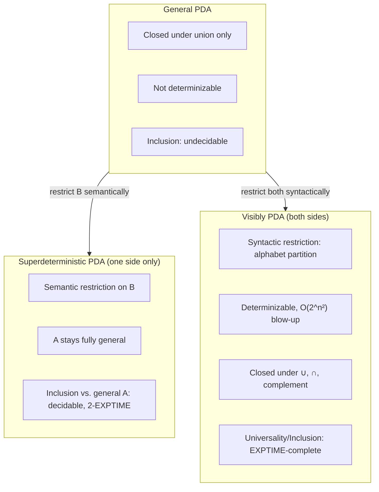

[[book-guidelines|↩ Back to guidelines]]

# Visibly Pushdown Automata

## The idea: make the input symbol confess what it's about to do to the stack

[[Superdeterministic-Pushdown-Automata]] recovered decidable inclusion by imposing a *semantic* condition on $B$ — a property about how runs behave that you have to prove holds, not something visible in the automaton's transitions. Visibly pushdown automata (VPAs), due to Alur and Madhusudan, take the opposite strategy: impose a **syntactic** condition, one you can read directly off the alphabet, and get *symmetric* closure properties (both $A$ and $B$ can be VPAs, not just one) as a bonus.

The idea is disarmingly simple. In a general PDA, whether a transition pushes, pops, or leaves the stack alone is a property of the *rule chosen* — and with nondeterminism, the same input symbol from the same state might trigger a push in one branch and a pop in another. VPAs forbid this ambiguity by fixing the classification **in the alphabet itself**: partition $\Sigma = \Sigma_c \cup \Sigma_r \cup \Sigma_i$ into call symbols (always push), return symbols (always pop), and internal symbols (never touch the stack) — once and for all, independent of which automaton you're running or which state you're in.

**What breaks without this, concretely:** the reason general PDAs can't be determinized is that the subset-construction idea from finite automata — track *the set* of states reachable on a given prefix — fails as soon as different nondeterministic branches can have different stack heights. You can't meaningfully compare or merge two branches' "sets of possible next stack tops" if one branch pushed and another popped on the same input. Visibility eliminates this by fiat: every branch, on the same input symbol, performs the *same kind* of stack action, so all branches after reading a prefix $u$ have stacks of the *same height* — this synchronization is what makes a subset-style construction viable again.

## Formal definition

A VPA (Definition 4.1) is $M = (Q, Q_0, \Gamma, \Delta, F)$ where $\Delta = \Delta_c \cup \Delta_r \cup \Delta_i$ splits by the alphabet partition:

- $\Delta_c: Q \times \Sigma_c \to Q \times (\Gamma \setminus \{\bot\})$ — a call reads $c$, moves state, and *pushes* a stack symbol: $q \xrightarrow{c/+\gamma} q'$.
- $\Delta_r: Q \times \Sigma_r \times \Gamma \to Q$ — a return reads $r$ *and* the current top-of-stack $\gamma$, moves state, and pops: $q \xrightarrow{r/-\gamma} q'$. Crucially, if the stack is empty (top is $\bot$), the return still fires — it reads $\bot$ but doesn't actually pop it. This is a **completion** requirement: every state must have *some* transition on every input symbol, so the automaton never simply gets stuck due to an empty stack.
- $\Delta_i: Q \times \Sigma_i \to Q$ — an internal move changes state with no stack interaction at all.

Two design choices are worth dwelling on, because they're exactly the properties later constructions lean on:

1. **A call transition is insensitive to the current top of stack.** This is what makes the language of *well-matched words* (defined below) stable under concatenation — a prerequisite for the congruence-based determinization to even make sense.
2. **A return transition is defined even on an empty stack.** This is purely a completion device — VPAs are total automata by construction, never blocking, which simplifies every downstream algorithm that would otherwise need to handle partiality as a special case.

A key structural consequence, called **height-determinism** (Remark 4.3): the stack height after reading a word $u$ is the *same for every run* of $u$, regardless of nondeterministic choices — because every run performs exactly the same sequence of push/pop/internal actions, dictated purely by $u$'s symbols. Two VPAs over the same alphabet partition are automatically *synchronized* — they reach the same stack height after any given input — a property Chapter 4's related-work section (Nowotka–Srba) shows is exactly what's needed for PDA-vs-PDA inclusion to even have a chance at decidability outside the visibly-pushdown setting.

**Expressiveness, precisely bounded:** VPLs (visibly pushdown languages) strictly contain the parenthesis languages and Dyck languages (Remark 4.2) — a genuinely useful class, capturing balanced-bracket-style properties like matched procedure calls/returns. But VPLs are a **proper subclass** of the deterministic context-free languages: $L' = \{a^n b a^n \mid n \geq 1\}$ is deterministic context-free (one DPDA both pushes and pops on the symbol $a$, in different phases) but *cannot* be a VPL, because $a$ would have to be simultaneously a call symbol and a return symbol — a contradiction with the fixed partition. **This is the price of visibility**: you trade some expressiveness (symbols must commit to one stack role globally) for determinizability.

## Well-matched words: the compositional structure that determinization needs

To reason about VPA behavior compositionally — critical for both determinization and for the antichain algorithms of [[Antichain-Based-Decision-Procedures]] — the book defines three notions on words (Definition 4.3):

- **call-matched**: every suffix has at least as many calls as returns (no "dangling" unmatched returns can appear *after* some point looking forward — read it as "every call still has enough returns yet to come"),
- **return-matched**: every prefix has at least as many calls as returns seen so far (no return arrives before its matching call),
- **well-matched**: both — every call has a matching return and vice versa, with proper nesting.

Any word decomposes uniquely (Lemma 4.1) as $u = v c_1 v_1 \cdots c_n v_n$ where $v$ is call-matched (a "still-open" prefix of unmatched calls) and each $c_i v_i$ is a call followed by a well-matched block. This decomposition is the backbone of the determinization construction below: it separates "stuff that's already fully resolved" ($v_i$'s) from "stuff still pending" ($v$, the calls not yet returned).

## Determinization via congruences

The chapter gives its own refined version of Alur–Madhusudan's original determinization proof, phrased via **congruence relations** rather than an explicit subset construction — a cleaner characterization theorem (Theorem 4.2): $L$ is a VPL **if and only if** three specific relations are all finite congruences:

- $\approx_L$ on well-matched words ($u_1 \approx_L u_2$ iff substituting one for the other inside *any* context $v \, \cdot \, v'$ never changes membership in $L$),
- $\equiv_L$ on all words (a right congruence w.r.t. concatenation by return-matched suffixes),
- $\sim_L^0$ on call-matched words.

This is a Myhill–Nerode-style characterization, generalized: instead of one equivalence relation (as for regular languages), you need three, one per "kind" of word fragment (well-matched, arbitrary, call-matched), reflecting the three-way structural decomposition above. **What breaks without splitting into three relations:** a single Myhill–Nerode relation over all of $\Sigma^*$ can't capture "these two well-matched chunks are interchangeable *inside a nested context*" separately from "these two overall prefixes behave the same going forward" — the well-matched chunks need their own finer congruence because they can recur at arbitrary nesting depths.

The construction itself (Definition 4.5) builds states of the determinized $M^d$ as pairs $\llbracket u \rrbracket = ([v_n]_\approx, [u]_\equiv)$ — the equivalence class of the *currently-open* well-matched suffix, paired with the equivalence class of the whole prefix read so far. Concretely, the determinized automaton's *stack* stores these equivalence-class pairs (not the original stack alphabet at all) — each push remembers "what state class was I in when I opened this call," so a matching return can look up exactly the class needed to close the loop and jump to the right next state.

**[[Superdeterministic-Pushdown-Automata#Complexity|Complexity]]:** determinizing an $n$-state VPA can require up to $O(2^{n^2})$ states and $O(2^{n^2})$ stack symbols (Theorem 4.3) — a genuinely severe blow-up, doubly exponential in effect once you compose two determinizations. The chapter's own version is a refinement that produces a *smaller* determinized automaton than the original Alur–Madhusudan construction (Remark 4.4), though the asymptotic bound is unchanged. This blow-up is exactly *why* [[Antichain-Based-Decision-Procedures]] exists: an algorithm that needs the explicit determinized automaton pays this cost up front, whereas one that keeps determinization *implicit* (tracking only minimal configurations on demand) can often avoid most of it in practice.

A second, "practical" instantiation of the abstract congruence triple (Definition 4.6–4.7) is given directly from $M$ itself: **reachables** $\delta_\bot(u)$ (which states are reachable from $\bot$ on $u$) and **summaries** $\Delta(u)$ (which state-pairs $(q, q')$ can be connected by running $u$ starting from an arbitrary stack $w$ and ending with $w'$, for well-matched $u$). These *summary edges* — pairs of states that a well-matched chunk can connect, abstracting away everything about the stack in between — are the concept that resurfaces, generalized to an ordered lattice, as the central data structure of the antichain-based VPA algorithm in Chapter 5.

## Closure properties and the decidability payoff

This is the entire point of the construction: unlike general PDAs (closed under union only), **VPAs are closed under union, intersection, and complementation** (Theorem 4.5) — the full Boolean algebra, symmetric and unconditional, not requiring one side to be more restricted than the other the way SPDA-based inclusion did.

Consequently, both universality ($L(M) = \Sigma^*$?) and inclusion ($L(M_1) \subseteq L(M_2)$?) are **decidable** for VPAs — via the same determinize-complement-intersect-check-emptiness recipe that works for finite automata, now legal again because determinization exists. The catch is complexity: **EXPTIME-complete** (Theorem 4.6) — inherent to the problem, not an artifact of a particular algorithm, since the $O(2^{n^2})$ determinization blow-up is unavoidable in the worst case. This EXPTIME-completeness is exactly the practical obstacle that [[Antichain-Based-Decision-Procedures]] is built to soften (not beat in the worst case, but avoid paying in the common case).

## Where this leads

VPAs are the syntactic sibling of SPDAs — trading some expressive power (calls, returns, internals are alphabet-fixed) for full, symmetric closure. This chapter's own determinization construction and its well-matched/summary-edge machinery are the load-bearing prerequisites for two very different follow-ups in the thesis: [[Extensions-of-Visibly-Pushdown-Automata-and-Their-Limits]] shows how fragile this determinizability is — multi-stack and stack-with-a-movable-head extensions that look like natural generalizations of visibility turn out *not* to be determinizable, breaking the very property this chapter built everything on. And [[Antichain-Based-Decision-Procedures]] takes the summary-edges idea and generalizes it into a lattice-based algorithm that avoids ever materializing the full $O(2^{n^2})$ determinized automaton, making VPA universality and inclusion checking practical rather than merely decidable.
