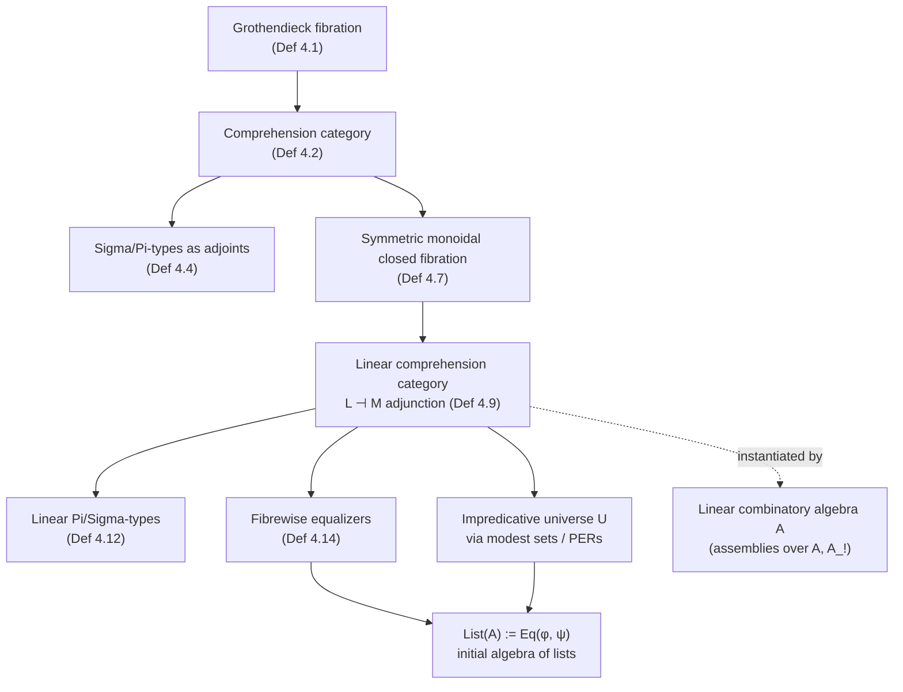

[[book-guidelines|↩ Back to guidelines]]

# Comprehension Categories and Fibrations

## The problem: what does a "model of type theory" even have to be?

Before you can prove a type theory *consistent* — before you can trust that its rules don't let you derive `False` — you need something outside the syntax to check it against. A category-theoretic model does that job: contexts become objects, types-in-context become some structured family of objects, terms become morphisms, and substitution becomes... something. That "something" is the part that's easy to get informally wrong. If you just say "a type in context $\Gamma$ is an object, and substituting $\Gamma' \to \Gamma$ gives you a new object," you need to be precise about *which* new object, and you need that assignment to behave functorially — composing two substitutions has to agree with substituting twice.

This is exactly the problem a **fibration** solves. And once you have fibrations, you still need one more ingredient to model *context extension* — the operation behind $\Gamma, x{:}A$ — which is what a **comprehension category** adds on top.

This article covers the categorical scaffolding itself: fibrations, comprehension categories, and their linear generalization. It does *not* re-derive the concrete realizability instances built from a combinatory algebra — assemblies, modest sets, and the impredicative universe as a family of PERs are covered in [[Realizability-Models-via-Assemblies|Realizability Models via Assemblies]]. Think of this article as the abstract machine, and that one as the specific machine (built from an LCA) that the paper actually runs on it.

## Fibrations: substitution as a functor, done right

### What breaks without this

Suppose you want to say "types in context $\Gamma$" is a category $p[\Gamma]$, and that a substitution $s : \Gamma' \to \Gamma$ gives a functor $s^* : p[\Gamma] \to p[\Gamma']$ (pull a type back along a substitution — this is exactly `A[s]` in ordinary type-theory notation). The naive way to build this is to hand-write $s^*$ directly. But then you have to *separately* prove functoriality ($\mathrm{id}^* = \mathrm{id}$, $(s \circ t)^* = t^* \circ s^*$, up to iso) and this bookkeeping metastasizes fast, especially once you want the choice of pullback to interact well with dependent products and sums.

A **Grothendieck fibration** sidesteps the hand-written functor by characterizing $s^*$ *universally*, the same way you'd characterize a pullback: as an object with a unique-factorization property, rather than as data you construct by hand.

### Definition 4.1 — fibration

> Let $p : E \to B$ be a functor. A morphism $f : x \to y$ in $E$ is **cartesian** if for every object $z \in E$ and morphisms $h : z \to y$, $g : p(z) \to p(x)$ with $p(h) = p(f) \circ g$, there is a *unique* $k : z \to x$ with $p(k) = g$ and $f \circ k = h$.
>
> $p$ is a **(Grothendieck) fibration** if for every $f : x \to p(y)$ in $B$, there is some $\bar{f} : \bar{x} \to y$ in $E$ with $p(\bar{x}) = x$ and $\bar{f}$ cartesian, $p(\bar{f}) = f$.

Read $B$ as the category of **contexts** and $E$ as the category of **types** (an object of $E$ is "a type, together with the context it lives in"; $p$ forgets the type and remembers just the context). The fibration condition says: given a context map $f : \Gamma' \to \Gamma$ and a type $y$ over $\Gamma$, there's a canonical choice of "pulled-back type" $\bar x$ over $\Gamma'$, and it's the *best* such choice — every other candidate factors through it uniquely. That uniqueness is what makes $s^*$ well-defined as a functor (up to canonical isomorphism) instead of a fragile ad hoc construction.

Given an object $x \in B$, write $p[x]$ for the **fibre**: the subcategory of $E$ sitting over $x$ (the types-in-context-$x$). Every $s : x \to y$ induces $s^* : p[y] \to p[x]$ — substitution, recovered as a genuine functor, for free, from the universal property.

**Rust framing.** Think of $p[x]$ as `Vec<Type>` indexed by a context `x`, and $s^*$ as the function that renames/relabels free variables when you move a term from one scope into an enclosing or sibling scope — except here it's packaged so that "relabel along $s$, then relabel along $t$" is *provably* the same functor as "relabel along $s \circ t$," rather than something you'd have to prove by induction on syntax every time.

**Lean framing.** This is precisely what a substitution function `subst : Expr → (Nat → Expr) → Expr` is doing operationally, except the fibration packages the *coherence* of substitution (that it commutes with composition) as a categorical fact rather than a lemma you prove separately for every syntactic category (terms, types, contexts) you define.

## Comprehension categories: adding context extension

A fibration alone gives you substitution on types. It says nothing about $\Gamma, x{:}A$ — the operation of extending a context by a fresh variable of some type. That's a *second* piece of structure, layered on top.

### Definition 4.2 — comprehension category

A comprehension category is a strictly commuting triangle of functors:

$$
\begin{array}{ccc}
E & \xrightarrow{\ \chi\ } & B^{\to} \\
{\scriptstyle p}\downarrow & & \downarrow{\scriptstyle \mathrm{cod}} \\
& B &
\end{array}
$$

Here $B^{\to}$ is the **arrow category** of $B$ (objects are morphisms of $B$, i.e. literally "a context together with an extension of it"), and $\mathrm{cod}$ sends a morphism to its codomain. We write such a comprehension category as $\chi : E \to B^{\to}$, and call it **full** when $\chi$ is fully faithful.

Unpacking this: for $x \in E$ with $p(x) = x$ (a type $x$ living over context $x$), $\chi(x)$ is a morphism in $B$ — write it $\pi_x : x.x \to x$. This $\pi_x$ *is* the context-extension projection: $x.x$ plays the role of $\Gamma, v{:}A$, and $\pi_x$ is the weakening substitution that forgets the new variable $v$. The requirement that $\chi$ preserve cartesian morphisms means: substituting into an extended context and then projecting agrees with projecting and then substituting — i.e., weakening commutes with substitution, which is exactly the property you need for the usual weakening lemma in a type theory's metatheory to hold *by construction* rather than by induction.

**Why "full"?** (Remark 4.3.) If $\chi$ is not fully faithful, the comprehension category carries extra structure: morphisms between types that aren't isomorphisms, which is precisely what you'd use to model **subtyping**. Since the paper's LDTT has no subtyping, every comprehension category it uses is full — $\chi$ being fully faithful means "type $A$ in context $\Gamma,x{:}B$" corresponds *exactly* (not just up to some coercion) to a term of $B \to A$-shaped data, with no room for silent coercions to sneak in.

**One more standing assumption:** $p$ has fibrewise terminal objects, and $\chi$ preserves them. This is what lets you identify "a term of type $A$ in context $\Gamma$" with "a morphism from the terminal object $1$ to $A$ in the fibre $p[\Gamma]$" — the usual trick of representing terms as global elements. Every later definition (of $\Pi$, $\Sigma$, equalizers, …) leans on this identification without restating it.

## Quantifiers as adjoints (Lawvere's idea)

### Definition 4.4 — $\Sigma$- and $\Pi$-types

Lawvere's insight — "quantifiers are adjoints" — turns into: $\chi : E \to B^{\to}$ **supports $\Sigma$-types** if for every $s : x \to y$ in $B$, the substitution functor $s^* : p[y] \to p[x]$ has a **left adjoint** $\textstyle\sum_s$, satisfying Beck–Chevalley (pullback squares in $B$ induce, up to iso, the matching squares of left adjoints — the semantic mirror of "substitution commutes with $\Sigma$-formation"). Symmetrically, $\chi$ **supports $\Pi$-types** if $s^*$ has a **right adjoint**, again Beck–Chevalley-coherent.

$\Sigma$-types are called **strong** if, for $x \in B$, a type $x \in p[x]$, and a type $y \in p[x.x]$, the canonical map $x.x.y \to x.\left(\sum_x y\right)$ is an isomorphism — this is exactly what's needed to validate the $\eta$-rule for dependent pairs (a pair is *literally* interchangeable with its two projections re-paired, not just propositionally equal to it).

### What breaks without this framing

If you only ask for adjoints to the *weakening* functors $\pi_x^*$ (the special case $s = \pi_x$), you get ordinary $\Sigma$/$\Pi$. But Definition 4.4 asks for adjoints to **every** substitution $s$, not just weakenings. Remark 4.5 explains why that extra generality is worth the cost: adjoints to *contraction* functors (substituting a variable for another variable already in scope, collapsing two occurrences into one) give you **extensional identity types** for free, from the same categorical gadget. This is a nice compression — one definition, instantiated at two different kinds of substitution morphism, produces both $\Sigma$-types and extensional equality. (It also explains, structurally, why the paper's LDTT can assert equality reflection: the model has the relevant adjoints built in from the start.)

## Symmetric monoidal closed fibrations: where linearity enters

Everything above is the ordinary (cartesian) story. To model *linear* types, you need a second flavor of fibration, because linear types don't admit the structural rules (weakening, contraction) that cartesian types do — you can't duplicate or discard a linear resource. Categorically, "no duplication, no discarding" means: no cartesian product, no terminal object in that fibre — instead, a **monoidal** structure (a tensor $\otimes$, a unit $I$, and internal-hom $\multimap$) that need not be cartesian.

### Definition 4.7 — symmetric monoidal closed fibration

A fibration $q : E \to B$ is **symmetric monoidal closed** if every fibre $q[x]$ is a symmetric monoidal closed category, and every substitution functor $s^* : q[y] \to q[x]$ is a symmetric monoidal closed *functor* (i.e. it preserves $\otimes$, $I$, and $\multimap$ up to coherent iso, not just as bare functors).

Concretely: each fibre $q[x]$ — "linear types in context $x$" — is a full model of (multiplicative, intuitionistic) linear logic on its own, and substituting a linear type along $s$ doesn't disturb that structure. This is the fibre-by-fibre version of "linear connectives are stable under substitution," stated as a coherence condition instead of a family of separately-proved lemmas.

*(Note the paper flags a genuine choice point in the literature here: you could instead ask the monoidal structure to live on the total category $E$ rather than fibrewise on each $q[x]$. The paper needs it fibrewise, because "the linear types available in context $\Gamma$" is what needs to form a linear-logic model — the total category mixing all contexts together isn't the right level of granularity for that.)*

## Linear comprehension categories: gluing linear and cartesian sides together

A single symmetric monoidal closed fibration gives you a self-contained model of linear logic, but LDTT needs **both** a cartesian side and a linear side, connected by the modalities $M$ (linear $\to$ cartesian) and $L$ (cartesian $\to$ linear) from [[Linear-Dependent-Type-Theory|Linear Dependent Type Theory (LDTT)]]. That connection is modeled as an **adjunction between the two fibrations.**

### Definition 4.9 — linear comprehension category

$$
\begin{array}{ccccc}
& L & & & \\
L & \dashv & E & \xrightarrow{\ \chi\ } & B^{\to} \\
& M & {\scriptstyle p}\downarrow & & \downarrow{\scriptstyle \mathrm{cod}} \\
& & & B &
\end{array}
\qquad q : L \to B
$$

The data: a (full) cartesian comprehension category $\chi : E \to B^{\to}$ as before, plus a symmetric monoidal closed fibration $q : L \to B$ (the linear side), plus an adjunction $L \dashv M$ between $L$ and $E$ that is a **fibrewise symmetric monoidal adjunction** (so $L$, restricted to each fibre, is a *strong monoidal* functor — Proposition 4.10 tells you this is exactly equivalent to the adjunction being symmetric monoidal, so you only ever have to check the "left adjoint is strong monoidal" half). $E$ is additionally required to have fibrewise terminal objects and binary products (it's the cartesian side, after all), and both $L$ and $M$ must preserve cartesian morphisms — i.e., they commute with substitution, so the modalities behave uniformly no matter which context you're in.

The syntax-to-semantics dictionary (Table 3 in the paper) is worth having in one place:

| Syntax | Linear comprehension category | Realizability model |
|---|---|---|
| Context | Object in $B$ | Assembly over $A_!$ |
| Cartesian type | Object in $E$ | Family of assemblies over $A_!$ |
| Term of type $X$ | Section of $\pi_X$ | Section of $\pi_X$ |
| Linear type | Object in $L$ | Family of assemblies over $A$ |
| Linear term | Morphism in $L$ | Morphism of linear assemblies |

The one line worth pausing on: **linear terms are interpreted as morphisms in $L$**, not as global sections the way cartesian terms are. That's the categorical reflection of "you can't just point at a linear value the way you point at a cartesian one" — a linear term of type $A \multimap B$ genuinely *is* a map, used exactly once, not a distinguished element you could duplicate.

### Why $M$ only sees linear terms with no free linear variables

The paper stresses this restriction and it's worth understanding *why* rather than just accepting it as a syntactic rule. $M$ is strong monoidal (part of Definition 4.9), and for a strong monoidal functor, terms of type $x$ (morphisms $1 \to x$ from the *terminal* — hence trivially-duplicable — object) correspond exactly to terms of type $M(x)$. A linear term with free linear variables isn't a morphism out of the terminal object (it depends on a genuinely linear resource sitting in the context), so there's no map for $M$ to send it to. Restricting $M$ to the empty linear context is therefore not an arbitrary syntactic restriction bolted onto the type theory — it's forced by what "strong monoidal" already means for a functor whose domain is a category without duplicable objects in general.

### The concrete instance: Example 4.11

Given an LCA $A$ (see [[Combinatory-Algebra-and-Combinatory-Completeness|Combinatory Algebra and Combinatory Completeness]]), the paper builds:

- $M : D\mathrm{Asm}_L(A) \to D\mathrm{Asm}_C(A_!)$ — forgets the linear-assembly structure of $(X, Y)$, keeping just the family $Y_x$ (sound because $A$ and $A_!$ share an underlying set, so "the same" realizers work either way, just interpreted under a different application).
- $L : D\mathrm{Asm}_C(A_!) \to D\mathrm{Asm}_L(A)$ — takes a cartesian family $Y_x$ and re-realizes it linearly: $a \Vdash y$ in the new assembly iff $a = {!}b$ for some $b \Vdash y$ in the old one. Note the $!$: this is the categorical shadow of "a linear resource born from a cartesian (freely duplicable) one always comes wrapped in the exponential."

Both $M$ and $L$ turn out to be *faithful* (injective on morphisms) — this is exactly the semantic fact the syntactic **$M$-injectivity rule** ($M$-inj) from [[Linear-Dependent-Type-Theory|Linear Dependent Type Theory (LDTT)]] is asserting. The type theory's injectivity axiom isn't an ad hoc addition; it's forced to hold in this model, and the paper adds it precisely because the model validates it. The whole construction generalizes Hoshino's linear-non-linear model from simple types to the dependent setting — the novelty here is making the *fibred*, substitution-respecting version of that idea work.

## Fibrewise equalizers: subtypes on the linear side

[[Linear-Dependent-Type-Theory|Equalizer types]] $\mathrm{Eq}(f,g)$ need semantics too, and the categorical answer is the obvious one, made precise:

### Definition 4.14

A fibration $p : E \to B$ has **fibrewise equalizers** if every fibre $p[x]$ has equalizers, and every $s^*$ preserves them. A linear comprehension category **supports equalizer types** when its linear fibration $q : L \to B$ has fibrewise equalizers in this sense.

There's a useful shortcut buried in the text: if $s^*$ already has both a left and a right adjoint (which it does here, per Definition 4.12 for linear $\Pi$/$\Sigma$), then $s^*$ automatically preserves *all* limits and colimits — so once you've set up linear dependent products and sums, checking "does each fibre have equalizers" is the *only* remaining thing to verify (Example 4.15 does exactly this, and it's routine once you have the adjoints).

**Why this matters for [[Impredicative-Encoding-of-Linear-Lists|the list encoding]]:** ordinary $\Sigma$-types can't cut out a subtype of a *linear* type (the indexing type of $\Sigma$/$\sqsubset$ must be cartesian, per Definition 4.12's requirement — see [[Linear-Dependent-Type-Theory|LDTT]]). Equalizers are the paper's replacement tool for "carve out a well-behaved subtype," precisely because equalizers exist *within* the linear fibre and don't need a cartesian index. That's the single categorical reason equalizer types had to be added to the syntax at all.

## What depends on this machinery

Every concrete fact in the rest of the paper is an instance of one of these abstract definitions:
- The realizability model built from an LCA (see [[Realizability-Models-via-Assemblies|Realizability Models via Assemblies]]) is *one particular* linear comprehension category — Example 4.11 is where the abstract Definition 4.9 gets cashed out concretely.
- The impredicative universe (see [[Impredicativity-and-Impredicative-Universes|Impredicativity and Impredicative Universes]]) rides on the modest-sets/PER equivalence, which only needs a fibration with the right closure properties — the categorical framing here is what makes "closed under large products" a *provable* fact about a specific fibre category, rather than a syntactic postulate taken on faith.
- The initial list algebra (see [[Impredicative-Encoding-of-Linear-Lists|Impredicative Encoding of Linear Lists]]) needs exactly the equalizer machinery developed here, applied to the linear fibre, because $\Sigma$-types are unavailable for cutting linear subtypes.

## Where this leads

For the compiler/elaborator project this reading feeds (`type-theory` Focus Area): a fibration is the semantic backbone of *any* substitution-respecting type checker, whether or not you ever call it a fibration in the implementation. The discipline enforced here — every operation on types must commute with substitution, provably, not just "in practice" — is exactly the invariant a kernel's `isDefEq`-style equality check has to preserve when it walks under binders and substitutes metavariable solutions into a goal. The comprehension-category layer (context extension as a genuine categorical operation, with weakening as a first-class morphism) is the abstract shape of a typing context data structure that supports safe de Bruijn-index shifting; the $\Sigma$/$\Pi$-as-adjoint framing is the reason "substitution commutes with type formation" is not an accident you have to hope for, but a Beck–Chevalley condition you can check once, structurally, and then rely on everywhere a checker instantiates a $\Pi$-type or a dependent pair.
