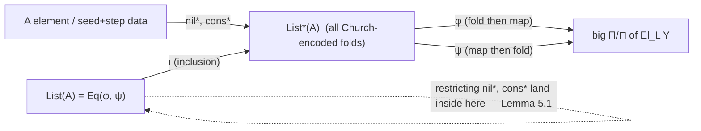
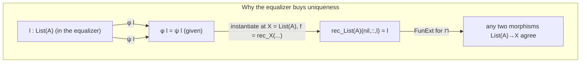

[[book-guidelines|↩ Back to guidelines]]

# Impredicative Encoding of Linear Lists

## The problem: a "list type" that only fakes being a list

Suppose you're building a language with an impredicative universe $U$ (see [[Impredicativity-and-Impredicative-Universes]]) — a type of codes closed under large $\Pi$'s and $\sqcap$'s. The classic move, going back to Girard's own proof of strong normalization for System F, is to *define* an inductive type instead of adding it as a primitive: encode `List<A>` as "the type of its own eliminator," i.e. as a big polymorphic function type. No new type former needed — you get lists "for free" out of impredicative quantification.

The catch, and it's a real one, is that this free lunch only gets you *weak* initiality. You can define `nil`, `cons`, and a recursor that computes correctly on values *built with* `nil`/`cons`. What you can't get for free is the **induction principle** — the ability to prove a property `P : List<A> -> Prop` holds for *every* list by checking it on `nil` and the `cons` step. Nothing in the impredicative encoding rules out "junk": elements of the encoded type that behave like lists extensionally but weren't actually built by finitely many `nil`/`cons` applications. This is a genuine, previously-known gap (Geuvers 2001; Rummelhoff 2004) — impredicative encodings of inductive types are not, in general, initial algebras.

This article works through how the paper closes that gap for lists over a *linear* type $A$, adapting a fix due to Awodey, Frey, and Speight (2018) that was originally stated for the cartesian setting.

**What breaks without the fix.** If you only had `List*(A)` (defined below) and tried to prove "every linear list either is `nil` or is `cons`-headed," you'd be stuck — the encoding's own definition gives you no way to case-split on *how* an arbitrary inhabitant was built, because as far as the type is concerned, an inhabitant just *is* a function, and functions don't remember their history. This is exactly the same failure mode as trying to write a `match` on a `Box<dyn Fn>` in Rust and recover which closure produced it — the type has erased the constructor information you'd need for structural induction.

## Step 1: the naive (Church/Girard-style) encoding

Fix a linear type $A$ (closed, i.e. not depending on other variables). The paper defines:

$$
\mathrm{List}^{*}(A) :\equiv \sqcap_{X:U}\ \mathrm{El}_L(X) \multimap\ {!}(A \multimap \mathrm{El}_L(X) \multimap \mathrm{El}_L(X)) \multimap \mathrm{El}_L(X)
$$

Read it the way you'd read the cartesian Church-encoding $\Pi_{X:\mathsf{Type}}\ X \to (A \to X \to X) \to X$, just with every arrow replaced by its linear counterpart where the *list itself* is the linear payload:

- $\sqcap_{X:U}(\dots)$ — for every candidate result type $X$ (a code in the impredicative universe $U$), quantified using the **linear** dependent product $\sqcap$ (see [[Linear-Dependent-Type-Theory]]) rather than $\Pi$, because the whole point is that a `List*(A)` value itself will be *consumed* — it's not something you get to duplicate for free.
- $\mathrm{El}_L(X) \multimap \dots$ — given a "base case" value of the decoded linear type $\mathrm{El}_L(X)$ (the thing you'd return for `nil`),
- ${!}(A \multimap \mathrm{El}_L(X) \multimap \mathrm{El}_L(X)) \multimap \mathrm{El}_L(X)$ — and given a **reusable** ($!$-guarded, i.e. of "exponential"/unrestricted-use type) combining function that consumes one element of $A$ and one accumulated result to produce a new one,
- $\dots \multimap \mathrm{El}_L(X)$ — you get back a result of type $\mathrm{El}_L(X)$.

The $!$ in front of the combining-function argument matters concretely: a list of length $n$ needs to *call* that function $n$ times, so it can't itself be a resource that's used once and gone — it has to be something you can invoke over and over, which is exactly what $!$ (linear logic's "of course"/exponential modality) buys you. Concretely, `List*(A)` is "the type of things that know how to fold themselves given a seed and a step function" — a Church-encoded `fold`.

**Constructors**, both defined by literally supplying the fold behavior you'd expect:

$$
\mathrm{nil}^{*} :\equiv \lambda (X:U)(n:\mathrm{El}_L(X))(c:{!}(A \multimap \mathrm{El}_L(X) \multimap \mathrm{El}_L(X))).\ n
$$

$$
a ::^{*} l :\equiv \lambda (X:U)(n:\mathrm{El}_L(X))(c:{!}(A \multimap \mathrm{El}_L(X) \multimap \mathrm{El}_L(X))).\ c\ a\ (l\ X\ n\ c)
$$

`nil*` just returns the seed, ignoring the step function. `a ::* l` runs the *rest* of the fold first (`l X n c`), then applies the step function `c` to `a` and that result — exactly a right fold. And the **recursor** is just application:

$$
\mathrm{rec}_X(n, c, l) :\equiv l\ X\ n\ c
$$

There's nothing left to *implement* for the recursor — because a `List*(A)` value already *is* "a fold, waiting for its seed and step function," running the recursion is just calling it. This is the entire appeal of impredicative encoding: `rec` computes definitionally on `nil*`/`::*`, with zero extra axioms.

```rust
// The impredicative encoding, informally, is:
//   List*<A> ~ dyn for<X> Fn(X, Box<dyn Fn(A, X) -> X>) -> X
// i.e. "a value that knows how to fold itself" — nothing more.
// You cannot pattern-match on it to recover "was this built with nil or cons?"
// the way you could with a genuine `enum List<A> { Nil, Cons(A, Box<List<A>>) }`.
trait ChurchList<A> {
    fn fold<X>(&self, seed: X, step: &dyn Fn(&A, X) -> X) -> X;
}
```

This Rust sketch is exactly why induction fails: a `dyn ChurchList<A>` gives you *behavior*, not *structure*. You can't write a Rust `match` on it, and correspondingly the type theory gives you no way to induct on it.

## Step 2: why "weakly initial" isn't good enough — algebras and morphisms

To state the problem precisely (and then fix it), the paper needs the categorical vocabulary of **algebras** for the list signature — the same vocabulary you'd use to describe *any* inductive type as an initial algebra for its constructors' functor.

An **algebra** is a choice of carrier type $X:U$ together with a `nil`-like element and a `cons`-like operation *for that carrier*:

$$
\mathrm{Alg} :\equiv \Sigma_{X:U}\ M(\mathrm{El}_L(X)) \times M\big({!}(A \multimap \mathrm{El}_L(X) \multimap \mathrm{El}_L(X))\big)
$$

Notice the **modality $M$** wrapping both components (see [[Linear-Dependent-Type-Theory]] for $M$'s rules). $\mathrm{El}_L(X)$ and the step-function type are *linear* types, but $\mathrm{Alg}$ needs to package them as data inside an ordinary $\Sigma$-type — and $\Sigma$ can only bind *cartesian* components. $M$ is exactly the bridge: $M(\mathrm{El}_L(X))$ is the cartesian reflection of "a linear term of type $\mathrm{El}_L(X)$ in the empty linear context." So an algebra really is: a carrier $X$, a "seed" $n_X : \mathrm{El}_L(X)$, and a "step" $c_X : {!}(A \multimap \mathrm{El}_L(X) \multimap \mathrm{El}_L(X))$ — both linear terms, just recorded via $M$ so they fit inside cartesian $\Sigma$.

A **morphism of algebras** $X \to Y$ is a cartesian term $f : M(\mathrm{El}_L(X) \multimap \mathrm{El}_L(Y))$ — again $M$-wrapped so it can live in a $\Sigma$ — that respects the structure:

$$
\mathrm{IsMor}(X, Y, f) :\equiv (f\ n_X =_L n_Y) \times \sqcap_{a:A, x:X}\ f(c_X\ a\ x) =_L c_Y\ a\ (f\ x)
$$

$$
\mathrm{Mor}(X, Y) :\equiv \Sigma_{f : M(\mathrm{El}_L(X) \multimap \mathrm{El}_L(Y))}\ \mathrm{IsMor}(\dots)
$$

The equalities here are the **derived linear equalities** $=_L$ from [[Linear-Dependent-Type-Theory]] ($a =_L a'$ means $M(a) = M(a')$ as cartesian terms) — this is precisely why the paper bothered adding the $M$-inj rule earlier: without injectivity of $M$, you couldn't freely move between "$M(a) = M(a')$ holds" and "the underlying linear terms are propositionally equal," and the algebra-morphism commuting squares below need exactly that move.

Once you have $\mathrm{Alg}$ and $\mathrm{Mor}$, "$\mathrm{List}^{*}(A)$ is only weakly initial" has a precise meaning: for every algebra $X$ there **exists** a morphism $\mathrm{List}^{*}(A) \to X$ (namely $\lambda l.\, \mathrm{rec}_X(n_X, c_X, l)$) — that's the "weak" part — but that morphism need not be **unique**, and in general isn't. Initiality demands uniqueness; that's exactly the extra fact induction gives you and the naive encoding doesn't.

## Step 3: cutting `List*(A)` down with an equalizer

The Awodey–Frey–Speight fix, transplanted from the cartesian to the linear setting: take the *subtype* of `List*(A)` consisting of exactly those elements that "act the same way when folded through every algebra morphism." Concretely, define two maps out of `List*(A)`, both landing in the same big linearly-quantified codomain (ranging over every algebra, every target algebra, and every morphism between them):

$$
\varphi, \psi : \mathrm{List}^{*}(A) \multimap \sqcap_{(X,n_X,c_X):\mathrm{Alg}}\ \sqcap_{(Y,n_Y,c_Y):\mathrm{Alg}}\ \sqcap_{(f,p,q):\mathrm{Mor}(X,Y)}\ \mathrm{El}_L(Y)
$$

$$
\varphi :\equiv \lambda l\, X\, n_X\, c_X\, Y\, n_Y\, c_Y\, f\, p\, q.\ f(\mathrm{rec}_X(n_X, c_X, l))
$$

$$
\psi :\equiv \lambda l\, X\, n_X\, c_X\, Y\, n_Y\, c_Y\, f\, p\, q.\ \mathrm{rec}_Y(n_Y, c_Y, l)
$$

In words: given a list $l$, an algebra $X$, another algebra $Y$, and a morphism $f : X \to Y$ between them, $\varphi$ says "fold $l$ into $X$, then push the result along $f$ into $Y$," while $\psi$ says "fold $l$ directly into $Y$." For a *genuine* list, these two must agree — folding-then-mapping is the same as mapping-then-folding, because a morphism is defined to commute with the fold structure. $\varphi$ and $\psi$ agreeing is precisely the naturality condition that a "real" list satisfies and a piece of junk in `List*(A)` might not.

This is where the equalizer type from [[Linear-Dependent-Type-Theory]] earns its keep — the paper picked equalizers over $\Sigma$-types specifically *because* this construction is linear:

> "Although \[Awodey, Frey, and Speight\] use $\Sigma$-types to construct the equalizer, we refrain from the linear analogue, namely $\sqsubset$-types. The type $A$ in $\sqsubset_{x:A} B\,x$ is required to be cartesian, so we cannot use $\sqsubset$-types to construct subtypes of linear types."

That's a genuinely load-bearing design fact, not incidental: $\sqsubset$ (linear dependent sum) can only be indexed by a *cartesian* type, but here the thing being cut down (`List*(A)`) is linear. You need a subtyping mechanism that works natively on the linear side — hence equalizers were added to the calculus in Section 2 for exactly this moment.

$$
\mathrm{List}(A) :\equiv \mathrm{Eq}(\varphi, \psi)
$$

`List(A)` is defined as the equalizer of $\varphi$ and $\psi$: the sub-object of `List*(A)` on which the two agree. Recall from the equalizer rules that $\mathrm{Eq}(\varphi,\psi)$ comes with an elimination map $\iota_{\varphi,\psi} : \mathrm{Eq}(\varphi,\psi) \multimap \mathrm{List}^{*}(A)$ (an inclusion, "forget you're in the sub-object"), and its universal property says: any map into `List*(A)` that already equalizes $\varphi,\psi$ factors uniquely through $\mathrm{Eq}(\varphi,\psi)$.



## Step 4: `List(A)` really is an algebra (Lemma 5.1)

Having *cut down* `List*(A)`, the first thing to check is that you haven't cut too much — that `nil*` and `::*` still land inside the equalizer, i.e. that they already satisfy $\varphi = \psi$. That's Lemma 5.1, and its proof is a clean unfolding exercise once you trust the definitions:

**Base case**, $\varphi(\mathrm{nil}^{*}) = \psi(\mathrm{nil}^{*})$:

$$
\varphi(\mathrm{nil}^{*}) = f(\mathrm{rec}_X(n_X, c_X, \mathrm{nil}^{*})) = f\, n_X
\qquad
\psi(\mathrm{nil}^{*}) = \mathrm{rec}_Y(n_Y, c_Y, \mathrm{nil}^{*}) = n_Y
$$

using $\mathrm{rec}_X(n_X,c_X,\mathrm{nil}^{*}) = n_X$ definitionally (unfold $\mathrm{nil}^{*}$ and apply). These are equal *because $f$ is a morphism* — that's literally the first component of $\mathrm{IsMor}$, $f\,n_X =_L n_Y$ — and the paper is careful to note this equality is only obtained "by reflection and injectivity": $f\,n_X =_L n_Y$ unfolds to $M(f\,n_X) = M(n_Y)$ (a *cartesian* propositional equality), equality reflection upgrades that to a *definitional* equality of cartesian terms $M(f\,n_X) \equiv M(n_Y)$, and then $M$-inj strips the $M$ off both sides to conclude $f\,n_X \equiv n_Y$ as linear terms. Every step of that chain is one of the specific rules the paper added in Section 2 — this is the payoff moment for having bothered.

**Inductive step**, assuming $\varphi\,l = \psi\,l$ (i.e. $l$ is already known to be in the equalizer), show $\varphi(a ::^{*} l) = \psi(a ::^{*} l)$:

$$
\varphi(a::^{*}l) = f(\mathrm{rec}_X(n_X,c_X,a::^{*}l)) = f(c_X\,a\,(\mathrm{rec}_X(n_X,c_X,l)))
$$

$$
\psi(a::^{*}l) = \mathrm{rec}_Y(n_Y,c_Y,a::^{*}l) = c_Y\,a\,(\mathrm{rec}_Y(n_Y,c_Y,l)) = c_Y\,a\,(f(\mathrm{rec}_X(n_X,c_X,l)))
$$

The last step substitutes in the induction hypothesis (well — really, it substitutes $\varphi\,l = \psi\,l$, i.e. $f(\mathrm{rec}_X(\dots,l)) = \mathrm{rec}_Y(\dots,l)$). The two final expressions, $f(c_X\,a\,(\dots))$ and $c_Y\,a\,(f(\dots))$, are equal precisely by the *second* clause of $\mathrm{IsMor}$ — $f$ commuting with the step function — again via injectivity.

So both constructors preserve the equalizing condition, which is exactly what's needed to conclude $\mathrm{nil} : \mathrm{List}(A)$ and $(::) : A \to \mathrm{List}(A) \multimap \mathrm{List}(A)$ exist as genuine operations on the *restricted* type, giving `List(A)` its own algebra structure.

## Step 5: `List(A)` is initial (Theorem 5.2)

Now the payoff. Given *any* algebra $X = (X, n_X, c_X)$, define

$$
f :\equiv \lambda(l : \mathrm{List}(A)).\ \mathrm{rec}_X(n_X, c_X, l)
$$

**Existence** (a morphism $\mathrm{List}(A) \to X$): unfolding definitions gives exactly the equations you want on the constructors,

$$
\mathrm{rec}_X(n_X, c_X, \pi_1\,\mathrm{nil}) = \mathrm{rec}_X(n_X,c_X,\mathrm{nil}^{*}) = n_X
$$

$$
\mathrm{rec}_X(n_X, c_X, \pi_1(a :: l)) = \mathrm{rec}_X(n_X,c_X,a::^{*}l) = c_X\,a\,(\mathrm{rec}_X(n_X,c_X,l))
$$

so $f$ does send `nil` to $n_X$ and `::` to $c_X$ as required — $f$ is a genuine algebra morphism (here $\pi_1$ projects the equalizer element back to its underlying `List*(A)` value via $\iota_{\varphi,\psi}$).

**Uniqueness** is the step that actually *uses* the fact that we restricted to the equalizer, and it's where the earlier investment in $\sqcap$-function extensionality ([[Linear-Dependent-Type-Theory]]'s $\mathrm{FunExt}$) pays off. It suffices to show $\mathrm{rec}_{\mathrm{List}(A)}(\mathrm{nil}, ::, l) = l$ for every $l : \mathrm{List}(A)$ (i.e. that the "identity" morphism found by recursing into `List(A)`'s own algebra structure really is the identity) — because then *any* two candidate morphisms $g, h : \mathrm{List}(A) \to X$ must both equal $\lambda l.\,\mathrm{rec}_X(n_X,c_X,l)$, since a morphism is forced to commute with recursion.

By function extensionality for $\sqcap$, proving $\mathrm{rec}_{\mathrm{List}(A)}(\mathrm{nil},::,l) = l$ (an equality of elements of `List*(A)`, which is itself a $\sqcap$-type) reduces to checking pointwise, for all $X, n_X, c_X$:

$$
\mathrm{rec}_{\mathrm{List}(A)}(\mathrm{nil},::,l)\ X\ n_X\ c_X = l\ X\ n_X\ c_X
$$

Unfolding both sides: the right side is $l\,X\,n_X\,c_X = \mathrm{rec}_X(n_X,c_X,l)$ by definition of what it means for $l$ to be (the underlying data of) a Church-list. The left side reduces, after unfolding $\mathrm{rec}_{\mathrm{List}(A)}$, to $\mathrm{rec}_X(n_X, c_X,\ \mathrm{rec}_{\mathrm{List}(A)}(\mathrm{nil},::,l))$. So the whole thing collapses to showing

$$
\mathrm{rec}_X(n_X,c_X,\ \mathrm{rec}_{\mathrm{List}(A)}(\mathrm{nil},::,l)) = \mathrm{rec}_X(n_X,c_X,l)
$$

— and this follows because $\lambda l.\,\mathrm{rec}_X(n_X,c_X,l)$ is *itself* a morphism $\mathrm{List}(A) \to X$ (by the Existence part just shown, applied to $X$ in place of an arbitrary target), and the fact that $l : \mathrm{List}(A)$ (i.e. $l$ sits in the equalizer, so $\varphi\,l = \psi\,l$) is *exactly* what licenses substituting one side for the other here. This is genuinely circular-looking on first read; the trick is that it's really an instance of $\varphi\,l=\psi\,l$ applied at the specific algebra "$\mathrm{List}(A)$ itself mapping to $X$" — the equalizer condition, chosen at exactly the right instantiation, *is* the uniqueness proof.



## Where this leads

This construction is a template, not a one-off: the paper's Conclusion explicitly flags generalizing this same equalizer-refinement recipe from lists to *arbitrary* inductive types (and the cited follow-up work already extends the *cartesian* version of this method to higher inductive types and coinductive types). Structurally, the recipe is always: (1) get a weakly-initial impredicative encoding for free from the universe's closure properties, (2) build the "commutes-with-every-morphism" naturality maps $\varphi,\psi$, (3) cut down via the appropriate subtyping mechanism (equalizer here, because the ambient type is linear) to force uniqueness.

For the two [[Impredicativity-and-Impredicative-Universes|`type-theory`]] and `automated-reasoning` [[Combinatory-Algebra-and-Combinatory-Completeness|Focus Areas]] this workbench is tracking:

- **`type-theory`:** this is as concrete as "inductive types" gets — a worked, from-scratch construction of an initial algebra without a primitive inductive-type former, which is exactly the mechanism question behind implementing inductive data in a kernel that only has $\Pi/\Sigma$ (or here, $\sqcap$/equalizers) as primitives. If your compiler's core calculus is impredicative, this is the pattern for compiling `enum`-style inductive types down to that smaller core rather than adding them as new primitives.
- **`automated-reasoning`:** the Lemma 5.1 / Theorem 5.2 proofs are a small but genuine worked example of *proof-term reconstruction* inside a trusted kernel — every step is either definitional unfolding (free, "the kernel just runs it") or an appeal to a specific named rule (reflection, $M$-inj, $\sqcap$-FunExt). A kernel implementing this calculus would need exactly these rules wired into its `isDefEq`/conversion checker for the proof above to actually typecheck as written; the "circular-looking" uniqueness step is a good stress test for whether your unifier can spot the right instantiation of an equalizer hypothesis rather than looping.
