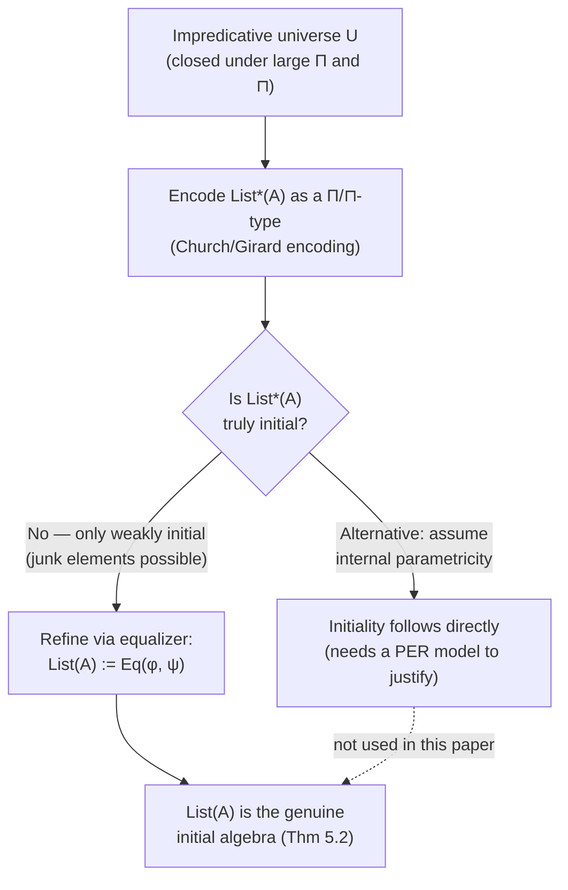

[[book-guidelines|↩ Back to guidelines]]

## The problem: a universe that can't quantify over itself

Suppose you're building a type checker and you introduce a "universe" type `Type` — a type whose values are themselves types, so you can write generic code like a `List<T>` that works `for all T : Type`. The moment you do this, a question forces itself on you: is `Type` itself a member of `Type`?

If you say yes, naively, you get Girard's paradox — the type-theoretic cousin of Russell's paradox, and it's inconsistent. Most real systems dodge this with a *predicative* hierarchy: `Type₀ : Type₁ : Type₂ : ...`, where a universe can only quantify over *strictly smaller* universes. This is safe, but it's also annoying to work with — you're constantly threading universe levels through polymorphic code, and universe-level unification is its own can of worms (ask anyone who's fought Coq's or Lean's universe inference).

The alternative — the one this paper's title is about — is **impredicativity**: you keep a single universe, but you carefully restrict *what's allowed to live in it* so that the paradox can't fire. Concretely: `Type` doesn't contain itself as a member, but it *is* closed under forming function types (and, for dependent products, $\Pi$-types) whose *codomain* lands in `Type`, even when the *domain* is huge — possibly even `Type` itself. That's what "impredicative" means here: the universe of small things is closed under products indexed by arbitrarily large things, because what matters for staying in the universe is that the *result* is small.

This is exactly the deal that the Calculus of Constructions (CoC) — the theoretical ancestor of Rocq/Coq — makes for its impredicative sort `Prop`. And it's a genuinely useful deal, not just cleverness for its own sake: an impredicative universe lets you *encode* data. Instead of adding lists to your language as a new primitive, you can *define* them as an ordinary $\Pi$-type inside the universe, à la System F:

$$
\mathrm{List}(A) :\equiv \prod_{X : U} X \to (A \to X \to X) \to X
$$

Read this the way you'd read a Rust trait bound: "give me any result type $X$, a base case of type $X$, a step function `A -> X -> X`, and I'll produce an $X$." That's a Church-encoded list — and this whole type only type-checks *inside* $U$ if $U$ can quantify over itself, which is precisely impredicativity.

## Why can't you just use ordinary set theory to justify this?

Here's the "[[Comprehension-Categories-and-Fibrations#What breaks without this|what breaks without this]]" moment. If you tried to build a *classical set-theoretic* model of an impredicative dependent type theory — interpret each type as a set, each $\Pi$-type as the set of set-theoretic functions — you'd run into a cardinality wall. An impredicative $\Pi_{X:U} \cdots$ has to be interpretable as a set that's itself small enough to be an element of the set interpreting $U$, and yet it ranges over *all* elements of $U$, including itself. Reynolds showed in 1984 ("Polymorphism is not set-theoretic") that this is exactly the kind of self-reference that ordinary set theory can't support — there's no naive set-theoretic model of System F, and the same obstruction blocks classical models of impredicative dependent type theory.

So if you want to know that your impredicative type theory is even *consistent* — that you haven't secretly reintroduced Girard's paradox with extra dependent-type dressing — you need a different kind of semantics. That's where **realizability** comes in (covered in depth in [[Realizability-Models-via-Assemblies]] and [[Comprehension-Categories-and-Fibrations]]): instead of interpreting a type as a set, you interpret it as a set *together with a notion of which concrete programs count as evidence/realizers for its elements*. This sidesteps the cardinality problem because the "smallness" that matters is about which sets of realizers exist, not raw set-theoretic size — and it's the standard method (dating to Kleene) for building models that certify consistency of otherwise-suspicious axioms.

This paper's whole realizability construction exists to answer one question: *can we get an impredicative universe in the presence of linearity too, and is the result actually consistent?* The answer, constructively demonstrated rather than just asserted, is yes.

## The paper's specific universe: one universe, two decodings

Most treatments of impredicativity you'll have seen assume an *undifferentiated* type theory (no linearity). This paper's setting is [[Linear-Dependent-Type-Theory|linear dependent type theory (LDTT)]], which has *two* notions of type living side by side: ordinary "cartesian" types (values can be copied and dropped freely — like `Copy` types in Rust) and "linear" types (values must be used exactly once — like an owned, non-`Copy` `File` handle that you must either consume or explicitly drop). This raises a design question the authors have to answer before they can even state their impredicativity rule: **do cartesian and linear types get their own separate impredicative universes, or one shared universe?**

They pick the shared option. Their universe $U$ is a Tarski-style universe: a cartesian type of *codes*, with two separate decoding functions turning a code into an actual type:

$$
\frac{\Gamma \vdash A : U}{\Gamma \vdash \mathrm{El}_C(A)\ \mathrm{type}}
\qquad\qquad
\frac{\Gamma \vdash A : U}{\Gamma \vdash \mathrm{El}_L(A)\ \mathrm{lin}}
$$

Think of $U$ as an `enum` of type-descriptions, and $\mathrm{El}_C$/$\mathrm{El}_L$ as two different "interpreters" you can run over the same code — one that hands you back a `Copy`-style type, one that hands you back a linear/owned-style type. Crucially, $U$ itself is a *cartesian* type — you're allowed to freely duplicate and discard a "type description," even when the type it describes turns out to be linear. That asymmetry is deliberate: it's the difference between copying a *blueprint* for a resource and copying the *resource itself*.

Impredicativity is then two separate closure rules, one per side:

$$
\frac{\Gamma \vdash A\ \mathrm{type} \qquad \Gamma, x:A \vdash B : U}{\Gamma \vdash \widehat{\textstyle\prod_{x:A}} B : U}
\qquad\qquad
\frac{\Gamma \vdash A\ \mathrm{type} \qquad \Gamma, x:A \vdash B : U}{\Gamma \vdash \widehat{\textstyle\sqcap_{x:A}} B : U}
$$

The hat notation ($\widehat{\Pi}$, $\widehat{\sqcap}$) marks these as the "internal," universe-*coded* versions of the ordinary $\Pi$-type and its linear analogue $\sqcap$ (the linear dependent function type from [[Linear-Dependent-Type-Theory]]) — as opposed to the "external" type formers that live directly in the syntax. In both rules, notice what's *not* required to be small: the domain $A$ is just required to be a well-formed (possibly huge) type, not itself a code in $U$. That's the actual content of "impredicative" — the universe absorbs products over arbitrarily large index types, so long as the codomain is a code.

The two are glued together by an isomorphism the theory posits as an axiom (their Equation 1):

$$
\mathrm{El}_C\Big(\widehat{\textstyle\prod_{x:A}} B\Big) \;\cong\; \prod_{x:A} \mathrm{El}_C(B)
\qquad\qquad
\mathrm{El}_L\Big(\widehat{\textstyle\sqcap_{x:A}} B\Big) \;\cong\; \sqcap_{x:A}\, \mathrm{El}_L(B)
$$

In plain words: "the type you get by decoding the *coded* product" and "the *actual* dependent product of the decoded types" are the same type, up to isomorphism. This is what licenses writing ordinary-looking $\lambda$-abstraction and application even when you're technically manipulating codes — the paper notes you can derive abstraction/application operators from this isomorphism and then just drop the hats when there's no ambiguity. If you've ever worked with a language that has both a reified/reflected representation of a type and the type itself (think Rust's `TypeId` versus the type, or a quoted term versus its evaluation), this is the same shape of problem, solved the same way: an isomorphism connecting the "data" view and the "real" view.

**Why not two separate universes** ($U_C$ for cartesian codes, $U_L$ for linear codes)? The guidelines flag this as one of the chapter's own key questions, and the paper doesn't dwell on it, but the payoff is visible in Section 5: the list encoding needs to quantify, in a *single* $\sqcap$-bound variable $X$, over "things that could be linear list-carrier types" while still being able to talk about $X$ as a code that a cartesian algebra-morphism type can also reference (via $M(\mathrm{El}_L(X))$ — see [[Impredicative-Encoding-of-Linear-Lists]]). A single $U$ with two decodings gives you one code that both worlds can point at; two separate universes would force you to constantly translate between an $U_C$-code and a $U_L$-code for "the same" type, which is exactly the kind of bookkeeping impredicativity is supposed to save you from.

## From "it type-checks" to "it's actually the right type": weak vs. true initiality

Here's the part where impredicativity's power gets more subtle, and where the paper's own contribution (Section 5) lives.

Go back to the Church-encoded list:

$$
\mathrm{List}^{*}(A) :\equiv \sqcap_{X:U}\ \mathrm{El}_L(X) \multimap\ {!}(A \multimap \mathrm{El}_L(X) \multimap \mathrm{El}_L(X)) \multimap \mathrm{El}_L(X)
$$

(linear version — see [[Impredicative-Encoding-of-Linear-Lists]] for full derivation; for now just read $\multimap$ as "linear function" and $\sqcap$ as "linear-side $\Pi$"). You can build $\mathrm{nil}^{*}$ and $\mathrm{cons}^{*}$, and you can build a recursor $\mathrm{rec}_X$ that computes correctly: $\mathrm{rec}_X(n,c,\mathrm{nil}^{*}) \equiv n$ *definitionally*, no propositional-equality proof needed. This already looks like it has everything a `List` type needs.

But there's a hole. The **induction principle** — "if a property $P$ holds of `nil` and is preserved by `cons`, then $P$ holds of every list" — does *not* follow automatically from this encoding, in general. This is a real, previously-established failure mode (the paper cites Geuvers 2001 and Rummelhoff 2004): the impredicative encoding gives you a type that behaves *exactly like* a list under computation, but semantically might contain "junk" — extra elements that aren't actually built from finitely many `nil`/`cons` applications, on which no meaningful induction argument can be run. In categorical terms, $\mathrm{List}^{*}(A)$ is only a **weakly initial** algebra for the list signature: there's *a* map out to any other algebra, but it's not necessarily *unique*, which is exactly what initiality (and hence induction) demands.

This is the practical stakes of the "weak vs. true initiality" distinction: a weakly-initial encoding lets you *compute* with lists but not *prove things about all lists* by induction — which, if you're writing a verified compiler pass over an AST represented this way, is the difference between "it runs" and "you can prove your pass is correct."

### The fix: cut down to the well-behaved sublist, with an equalizer

The method the paper adapts (from Awodey, Frey, and Speight 2018) is: don't add machinery to fix the type — instead, carve the *good* elements out of the type you already have. Concretely, they build two maps

$$
\varphi, \psi : \mathrm{List}^{*}(A) \to \sqcap_{(X,\ldots):\mathrm{Alg}}\ \sqcap_{(Y,\ldots):\mathrm{Alg}}\ \sqcap_{f : \mathrm{Mor}(X,Y)}\ \mathrm{El}_L(Y)
$$

where, informally, $\varphi$ says "evaluate this list at algebra $X$, then push the result through the morphism $f$ to $Y$" and $\psi$ says "evaluate this list directly at algebra $Y$." An element of $\mathrm{List}^{*}(A)$ is "well-behaved" exactly when these two computations agree for *every* choice of algebras and morphism between them — which is precisely the naturality condition that distinguishes a genuine list from junk. The refined type is then the **equalizer**:

$$
\mathrm{List}(A) :\equiv \mathrm{Eq}(\varphi, \psi)
$$

i.e., the subtype of $\mathrm{List}^{*}(A)$ where $\varphi$ and $\psi$ coincide. (Full construction, the algebra/morphism machinery, and the initiality proof live in [[Impredicative-Encoding-of-Linear-Lists]].) The point to take from *this* article is the pattern, because it recurs across a whole family of results: **impredicativity gives you a candidate type for free; getting the initial algebra out of it is a second, separate step**, and that second step is where the equalizer (or, in the cartesian original, a $\Sigma$-type subtype) does the work.

An important wrinkle specific to the linear setting: the cartesian version of this technique uses $\Sigma$-types to build the subtype. Here, the indexing type of a $\Sigma$/$\sqsubset$-type is required to be *cartesian* (see [[Linear-Dependent-Type-Theory]]), so you can't use it to carve a subtype out of something linear. That's the actual, stated reason the paper adds equalizer types to LDTT at all (Section 2) — they're the linear-compatible substitute for "the subtype of things satisfying a proposition."

### The alternative nobody used here: parametricity

Section 6 (Related Work) mentions a completely different route to the same destination: assume an axiom of *internal parametricity* (Wadler's Girard–Reynolds isomorphism gives the classical intuition — a polymorphic function can't inspect its type argument, so its behavior is forced), and initiality for impredicative encodings follows directly, no equalizer needed. The catch: parametricity is a strong axiom that has to be separately justified (typically via a PER — partial equivalence relation — model; see [[Realizability-Models-via-Assemblies]]), so it trades "extra construction" for "extra axiom." The authors don't use this route; they note that Atkey's quantitative-type-theory model (a different generalization of linearity) *can't* even support an impredicative universe in the first place, because it indexes types by bare sets rather than by assemblies — so parametricity-based initiality wouldn't even get off the ground there. Their realizability model, being assembly-indexed, doesn't have that limitation.

## Structural overview

## Where this leads

Everything downstream in the paper cashes out this chapter's ideas: [[Realizability-Models-via-Assemblies]] and [[Comprehension-Categories-and-Fibrations]] build the actual semantic structure (modest sets / PERs) that makes $U$ well-defined and provably impredicative, rather than just an axiom you hope is consistent; and [[Impredicative-Encoding-of-Linear-Lists]] is the fully worked-out instance of the weak-vs-true-initiality fix sketched above, complete with the algebra/morphism definitions and the initiality proof this article only previewed.

**Focus Area connection (`type-theory`):** this is the chapter to reach for when you need the mechanism behind encoding inductive types as $\Pi$-types instead of adding them as primitives — directly relevant if your compiler's elaborator ever needs to desugar a user-defined inductive into core $\Pi$/$\Sigma$ machinery (a strategy some dependently-typed kernels use to shrink their trusted core), and a concrete illustration of *why* "it type-checks and computes" is not the same guarantee as "induction is sound for it" — a distinction that matters the moment your verifier needs to discharge an induction-based proof obligation over a user-defined type.
