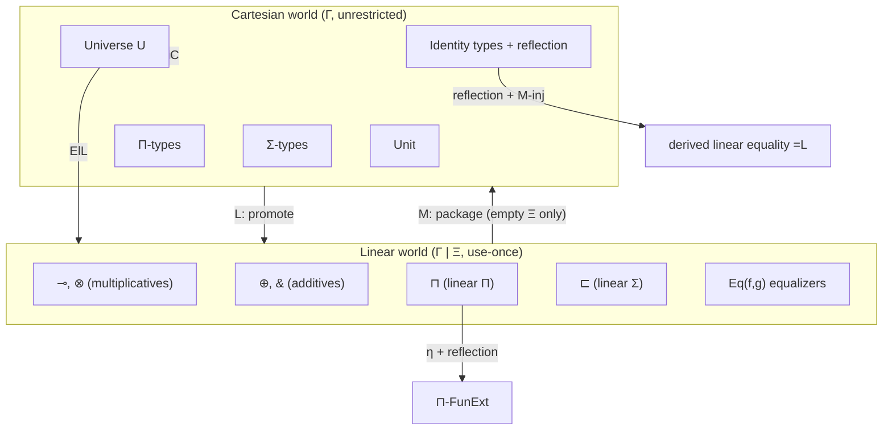

[[book-guidelines|↩ Back to guidelines]]

# Linear Dependent Type Theory

## The problem: dependent types don't know about "using something up"

Ordinary dependent type theory — the kind behind Lean, Rocq, Agda — has exactly one notion of variable use. If you bind `x : A` in a context, you can refer to `x` zero times, once, or a hundred times inside the rest of the term. That's the right default for *proofs and programs about mathematics*: nothing goes wrong if you cite a fact about a natural number twice.

But plenty of real systems have resources that genuinely get consumed: a quantum bit that's destroyed on measurement, a channel endpoint you send exactly one message through and then discard, a file handle that closes once. If your type system lets you casually "duplicate" one of these the same way it lets you duplicate an `x : Nat`, the type system is *lying* to you — the code type-checks, but it doesn't correspond to anything the real resource can actually do.

**Linear logic** is the fix at the level of logic: a discipline in which a linear hypothesis must be used *exactly once* — not zero times (that's weakening), not twice (that's contraction). Once you have linear logic, the natural next question for a language designer is: can we have *dependent* types — types that mention values, `Vec<T, n>`-style — where some of the arguments involved are linear? That's exactly what **linear dependent type theory (LDTT)** is: dependent types plus a linear discipline, living side by side.

This paper's Section 2 doesn't invent LDTT from scratch — it recalls the version due to Lundfall, itself built on the "dual-context" LDTT of Krishnaswami, Pradic, and Benton — and then bolts on several new pieces of machinery (equalizers, an injectivity rule, an impredicative universe) that the rest of the paper needs. This article covers both: the inherited base theory, and the paper's own additions.

## What breaks if you don't separate the two disciplines

Here's the naive idea you might try first: just have *one* kind of context, and mark individual variables as "linear" or "unrestricted." The immediate problem is *types depending on linear variables*. Suppose `Vec : Nat -> Type` and you have a linear natural number `n : Nat` (silly example, but suppose). If a type `Vec n` is allowed to mention a linear variable, then every time you *use* a value of type `Vec n` in two different places, you're implicitly duplicating a reference to `n` — the very thing linearity forbids. Type-level use isn't tracked by the same "use exactly once" bookkeeping that term-level use is, so mixing them freely lets linearity leak through types by the back door.

The paper's solution is architectural: **types are never allowed to depend on linear variables, full stop.** This is enforced by splitting contexts into two kinds from the ground up.

## Two kinds of context, two kinds of judgement

Table 1 in the paper lays out six judgement forms. Read as a whole, they encode a strict layering:

| Judgement | Meaning |
|---|---|
| $\vdash \Gamma\ \mathrm{context}$ | $\Gamma$ is a well-formed **cartesian** context |
| $\vdash \Gamma \mid \Xi\ \mathrm{context}$ | $\Gamma \mid \Xi$ is a well-formed **mixed** context: cartesian part $\Gamma$, linear part $\Xi$ |
| $\Gamma \vdash A\ \mathrm{type}$ | $A$ is a well-formed cartesian type, in a cartesian context |
| $\Gamma \vdash A\ \mathrm{lin}$ | $A$ is a well-formed linear type, in a cartesian context |
| $\Gamma \vdash a : A$ | $a$ is a cartesian term of cartesian type $A$, in a cartesian context |
| $\Gamma \mid \Xi \vdash a : A$ | $a$ is a **linear** term of linear type $A$, in a mixed context |

Call "cartesian" what you'd otherwise just call "normal, unrestricted, Lean-style." The key design choices, in order:

1. **A cartesian context $\Gamma$** holds only unrestricted variables — the ones you can use freely, any number of times. This is the world types live in.
2. **A mixed context $\Gamma \mid \Xi$** has a cartesian part $\Gamma$ *and* a linear part $\Xi$; either can be empty. This is the world linear *terms* live in — a linear computation is still allowed to freely use unrestricted values (a quantum circuit can certainly consult an ordinary `usize` loop counter), it just can't freely use its linear resources.
3. **Types are only well-formed relative to a cartesian context.** Both $\Gamma \vdash A\ \mathrm{type}$ and $\Gamma \vdash A\ \mathrm{lin}$ take a plain $\Gamma$, never a $\Gamma \mid \Xi$. This is the enforcement mechanism for the "types can't depend on linear variables" rule above — there's no judgement form that would even let you write such a type down.
4. **Cartesian terms live in cartesian contexts; linear terms live in mixed contexts.** A cartesian term can't touch anything linear at all (there's no $\Xi$ in its judgement); a linear term gets access to both an unrestricted "back-office" ($\Gamma$) and a linear "must consume" budget ($\Xi$).

This is the "dual-context" idea by name: rather than a single context with per-variable use-annotations, you get two genuinely different sorts of context, and the type-formation rules statically prevent linearity from crossing into type-land.

**Rust analogy.** Think of $\Gamma$ as everything you can access through a shared reference (`&T`) or `Copy` value — read as often as you like — and $\Xi$ as your set of owned, non-`Copy` values that each get moved (consumed) exactly once. Rust's borrow checker enforces linearity-*like* discipline on ownership at the value level, but Rust types themselves can freely mention any value (`[T; N]` doesn't care whether `T` is `Copy`) — Rust doesn't need the LDTT-style split because Rust types aren't *dependent*. The moment you want a type like `Channel<Send<T>>` to be indexed by something that itself must be linear, you're exactly in the territory this dual-context design is built for.

## Type formers, side by side

The **cartesian side** of the theory is deliberately unsurprising: unit type, $\Pi$-types, $\Sigma$-types, and identity types, all with their usual rules. One choice worth flagging: the paper asserts **equality reflection** for cartesian identity types — meaning if you have a proof `p : a = b`, you get to treat `a` and `b` as *definitionally* equal (judgementally interchangeable), not merely propositionally equal. This is a strong, "extensional type theory" choice (as opposed to Lean's default intensional/definitional-equality-is-purely-syntactic stance) — it will matter later, because the paper builds "linear equality" *on top of* cartesian equality reflection.

The **linear side** looks like ordinary linear logic, just relativized to sit over an ambient cartesian context:
- multiplicative connectives: $\multimap$ (linear function/implication), $\otimes$ (linear pair/tensor) and its unit,
- additive connectives: $\oplus$ (linear sum), $\&$ (linear product-with-choice) and their units,
- and, the star of this section, **linear dependent products and sums**, written $\sqcap$ and $\sqsubset$ — the linear analogues of $\Pi$ and $\Sigma$.

Crucially: **the indexing type $A$ in $\sqcap_{x:A} B$ (and in $\sqsubset_{x:A} B$) must be cartesian.** You can have a linear-dependent-function type whose *codomain* depends linearly, but the thing you're quantifying *over* has to be an ordinary, unrestricted type. This is the same architectural discipline as before, just showing up again at the level of the linear quantifiers themselves — even a "linear" $\Pi$-type needs an unrestricted index, because the index gets substituted into a *type*, and types can't see linear variables.

### The rules for $\sqcap$, read as a program

Figure 1 gives four rules for $\sqcap$. It's worth reading them the way you'd read typing rules for a small functional language, because that's exactly what they are.

$$
\dfrac{\Gamma \vdash A\ \mathrm{type} \qquad \Gamma, x:A \vdash B\ \mathrm{lin}}{\Gamma \vdash \sqcap_{x:A} B\ \mathrm{lin}} \ \sqcap\text{-f}
$$

**Formation:** given a cartesian type $A$ and a linear type $B$ that may mention $x:A$, you get a new linear type $\sqcap_{x:A}B$ — "for every cartesian $x$, a linear $B[x]$."

$$
\dfrac{\Gamma, x:A \mid \Xi \vdash b : B}{\Gamma \mid \Xi \vdash \lambda x.\, b : \sqcap_{x:A} B} \ \sqcap\text{-i}
$$

**Introduction:** you build a term of this type by abstracting over a *cartesian* variable $x$ — note $x$ is added to $\Gamma$, not to $\Xi$. Your linear resources $\Xi$ are completely untouched by this step; you're not consuming anything by introducing the abstraction, only by later using it.

$$
\dfrac{\Gamma \mid \Xi \vdash t : \sqcap_{x:A} B \qquad \Gamma \vdash a : A}{\Gamma \mid \Xi \vdash t\, a : B[a/x]} \ \sqcap\text{-e}
$$

**Elimination (application):** apply a term of type $\sqcap_{x:A}B$ to a cartesian argument $a:A$. Note carefully: $a$ is typed in $\Gamma$ alone, no $\Xi$ at all — you cannot apply this kind of function to something linear, only to an unrestricted value. That's what "the indexing type must be cartesian" cashes out to at the term level.

Then the usual computation laws: $\beta$ (an application of a $\lambda$-abstraction reduces by substitution) and $\eta$ (every function is judgementally equal to $\lambda x.\ (\text{itself})\ x$).

**Why this shape, and not something more permissive?** If $\sqcap$-e let you apply $t$ to a *linear* argument, then whatever's inside $B$ could end up mentioning that linear value at the type level after substitution — precisely the leak the whole dual-context design exists to prevent. The rule is exactly as permissive as it can be without breaking that invariant.

### Two modalities bridge the divide: $M$ and $L$

If cartesian and linear are hermetically sealed universes, you need *some* controlled way to move between them, or the two halves of the theory are useless to each other. The paper provides two modalities:

- $M$ turns linear types/terms into cartesian ones,
- $L$ turns cartesian types/terms into linear ones.

Only $M$'s rules are given explicitly (Figure 2); $L$ is mentioned but not detailed in this section (it reappears, along with $M$, as the adjoint pair $L \dashv M$ in the paper's semantic model). Note a subtlety in the paper's phrasing: it says "the modality $L$ turns linear types and terms into cartesian types and terms" right after saying the same of $M$ — read in context (and confirmed by the semantics, where $L \dashv M : \mathbf{Linear} \to \mathbf{Cartesian}$) $L$ actually goes the *other direction*, cartesian $\to$ linear; treat $M$ as "forget/observe linearly-once-used data as an ordinary value" and $L$ as "freely promote an ordinary value into the linear world" (this is precisely Girard's $!$ modality of linear logic, dependent-type-ified).

$$
\dfrac{\Gamma \vdash A\ \mathrm{lin}}{\Gamma \vdash M(A)\ \mathrm{type}}\ M\text{-f}
\qquad
\dfrac{\Gamma \mid \cdot \vdash a : A}{\Gamma \vdash M(a) : M(A)}\ M\text{-i}
\qquad
\dfrac{\Gamma \vdash a : M(A)}{\Gamma \mid \cdot \vdash \mu(a) : A}\ M\text{-e}
$$

$$
\dfrac{\Gamma \mid \cdot \vdash a : A}{\Gamma \mid \cdot \vdash \mu(M(a)) \equiv a : A}\ M\text{-}\beta
\qquad
\dfrac{\Gamma \vdash a : M(A)}{\Gamma \vdash M(\mu(a)) \equiv a : M(A)}\ M\text{-}\eta
$$

Read $M\text{-i}$ carefully: it takes a linear term $a : A$ typed in the *mixed* context $\Gamma \mid \cdot$ — the linear part is forced to be **empty**. You can only wrap $M(-)$ around a linear computation that doesn't itself depend on any live linear resource. That restriction is the whole point: if $M$ could package up a computation that still owed you a linear resource, then $M(a)$ would be an unrestricted (freely-duplicable!) cartesian value secretly hiding an obligation to consume something exactly once — duplicate $M(a)$ twice and you've silently duplicated a resource that was supposed to be single-use. Requiring the empty linear context for $M\text{-i}$ is what keeps $M$ sound.

$\beta$/$\eta$ say $M$ and its "unwrap" operation $\mu$ are mutually inverse — $M$ behaves like an isomorphism between "$A$-lin-in-empty-context" and "$M(A)$-cartesian," not just a one-way coercion.

## The paper's own additions

Everything above is recalled from prior work. Now the paper adds machinery it needs for its own results (Sections 4 and 5) that, per the authors, hasn't previously appeared in LDTT.

### Equalizers on the linear side

An **equalizer** of two parallel maps $f, g : A \to B$ is, categorically, the largest sub-object of $A$ on which $f$ and $g$ agree — think `filter(|x| f(x) == g(x))` applied at the type level. The paper adds this as a *linear type former*, $\mathrm{Eq}(f,g)$:

$$
\dfrac{\Gamma \mid \cdot \vdash f : A \multimap B \qquad \Gamma \mid \cdot \vdash g : A \multimap B}{\Gamma \vdash \mathrm{Eq}(f,g)\ \mathrm{lin}}\ \mathrm{eq\text{-}f}
$$

$$
\dfrac{\Gamma \mid \Xi \vdash h : C \multimap A \qquad \Gamma \mid \Xi \vdash f \circ h \equiv g \circ h : C \multimap B}{\Gamma \mid \Xi \vdash h : C \multimap \mathrm{Eq}(f,g)}\ \mathrm{eq\text{-}i}
\qquad
\dfrac{}{\Gamma \mid \Xi \vdash \iota_{f,g} : \mathrm{Eq}(f,g) \multimap A}\ \mathrm{eq\text{-}e}
$$

together with $\beta$-rules saying $f$ and $g$ really do agree on the image of $\iota_{f,g}$ (up to judgemental equality), and an $\eta$-rule saying the universal map $h$ into $\mathrm{Eq}(f,g)$ is unique whenever two candidates agree after post-composing with $\iota_{f,g}$. This is standard universal-property bookkeeping — the interesting part is *why the paper needs it at all*, which is entirely about the next big topic below (subtype-based initial algebras). One motivating detail flagged explicitly in the paper: the natural tool for constructing a sub-object like this in ordinary dependent type theory is a $\Sigma$-type (pack a value with a proof), but $\Sigma$'s linear cousin $\sqsubset$ requires a *cartesian* indexing type — so $\sqsubset$-types can't carve out a subtype of something linear. Equalizers are introduced specifically to plug that gap.

### Injectivity of $M$ ($M$-inj)

$$
\dfrac{\Gamma \mid \cdot \vdash M(a) \equiv M(a') : M(A)}{\Gamma \mid \cdot \vdash a \equiv a' : A}\ M\text{-inj}
$$

If two things look the same *after* wrapping them with $M$, they were already the same *before* wrapping. Semantically this says the functor $M$ is faithful (injective on morphisms) — not just structure-preserving, but structure-*reflecting*. Note again the empty-linear-context restriction: $M$-inj is a statement purely about closed linear terms viewed through $M$.

**What this buys you: "linear equality," definable rather than primitive.** The theory has identity types for cartesian types (with reflection). Rather than adding a *second*, primitive notion of identity type for linear types, the paper *derives* one:

$$
a =_L a' \quad :\equiv \quad M(a) = M(a')
$$

— "two linear terms are linearly-equal iff their $M$-images are cartesian-equal." (This forces $a, a'$ to live in the empty linear context, since that's the only place $M$ applies.) Now watch $M$-inj do real work: suppose you have a proof $p : a =_L a'$. By definition $p$ proves $M(a) = M(a')$ in the cartesian identity type. Cartesian equality reflection turns that propositional equality into a *definitional* one: $M(a) \equiv M(a')$. Now apply $M$-inj to that definitional equality, and you get $a \equiv a'$ — **definitional equality of the underlying linear terms**, derived, not assumed. This chain (reflection, then injectivity) is exactly what the paper means by "linear equality reflection," and it's flagged as essential machinery for Section 5's initiality proof.

**Lean correspondence.** If you've used Lean's `Eq` and `rfl`, this is the linear-world analogue of turning a propositional `h : a = b` into something you can `rw` or that the kernel accepts as definitionally equal via `Eq.mpr`/reflection-style reasoning — except here the "reflection" step is bootstrapped through the cartesian side and then transported back across $M$ by injectivity, because there's no native identity type on the linear side to begin with.

### Function extensionality for $\sqcap$

$$
\dfrac{\Gamma \mid \cdot \vdash f, g : \sqcap_{x:A} B \qquad \Gamma, x:A \vdash p : f\,x =_L g\,x}{\Gamma \vdash \mathrm{FunExt}(p) : f =_L g}\ \sqcap\text{-FunExt}
$$

Two linear dependent functions that agree pointwise are (linearly) equal. The derivation given is a nice two-step pattern worth internalizing, because it recurs constantly in extensional type theories: first prove a *judgemental* version using $\sqcap$-$\eta$ (functions are judgementally equal to their own $\eta$-expansions, so pointwise judgemental agreement composes into judgemental function equality), then upgrade the judgemental fact to the *propositional* statement using equality reflection. "Derive the strong (definitional) statement first when you can, then repackage it as the weaker (propositional) statement you actually needed" is a recurring move in this paper.

### The impredicative universe $U$

This is the paper's headline addition, and the reason the whole paper is titled the way it is. First, the base rule:

$$
\dfrac{\vdash \Gamma\ \mathrm{context}}{\Gamma \vdash U\ \mathrm{type}}\ U\text{-f}
$$

$U$ is declared a **cartesian** type — deliberately, so that "codes for types" (elements of $U$) can be used unrestrictedly, exactly like any other cartesian value. Two decoding operations turn a code into an actual type:

$$
\dfrac{\Gamma \vdash A : U}{\Gamma \vdash \mathrm{El}_C(A)\ \mathrm{type}}\ \mathrm{El}_C
\qquad
\dfrac{\Gamma \vdash A : U}{\Gamma \vdash \mathrm{El}_L(A)\ \mathrm{lin}}\ \mathrm{El}_L
$$

*(reading $\mathrm{El}_L$ as $\Gamma \vdash \mathrm{El}_L(A)\ \mathrm{lin}$.)* This is a **Tarski-style universe** — codes are separate syntactic citizens from the types they denote, connected by an explicit decoding function, as opposed to a **Russell-style** universe where codes *are* types (this is the choice Lean and Rocq make with their `Type u` hierarchy, for comparison). The paper's twist: *one* universe, *two* decodings — a single code $A:U$ can be read either as a cartesian type $\mathrm{El}_C(A)$ or as a linear type $\mathrm{El}_L(A)$, rather than maintaining two separate universes (one per discipline). That design choice is what lets the impredicativity clauses below quantify over "types" generically without committing up front to which discipline the quantified-over type belongs to.

**Impredicativity itself**, spelled out: $U$ is closed under *large* products — a $\Pi$- or $\sqcap$-type whose codomain is (a decoding of) a code in $U$ is *itself* packageable back into a code in $U$, even though the product ranges over *all* of $A$, which may be much bigger than any individual small type:

$$
\dfrac{\Gamma \vdash A\ \mathrm{type} \qquad \Gamma, x:A \vdash B : U}{\Gamma \vdash \widehat{\textstyle\prod}_{x:A} B : U}\ \widehat{\Pi}\text{-f}
\qquad
\dfrac{\Gamma \vdash A\ \mathrm{type} \qquad \Gamma, x:A \vdash B : U}{\Gamma \vdash \widehat{\sqcap}_{x:A} B : U}\ \widehat{\sqcap}\text{-f}
$$

The hats ($\widehat{\Pi}$, $\widehat{\sqcap}$) mark these as *internal*, "$U$-valued" constructors — a code-level mirror of the *external* type formers $\Pi$ and $\sqcap$ you already have. They're related by an isomorphism the paper states as its equation (1):

$$
\mathrm{El}_C\Big(\widehat{\textstyle\prod}_{x:A} B\Big) \;\cong\; \prod_{x:A} \mathrm{El}_C(B)
\qquad\qquad
\mathrm{El}_L\Big(\widehat{\sqcap}_{x:A} B\Big) \;\cong\; \sqcap_{x:A} \mathrm{El}_L(B)
$$

— decoding a large-product *code* gives you (up to iso) exactly the large-product *type* you'd have built externally. Once that isomorphism is in hand, the paper stops bothering with the hat notation when working entirely inside $U$ and just writes $\Pi$/$\sqcap$ for both — a convenience the reader should track, since it means "$\Pi$" is now ambiguously either the external type former or its internal, $U$-valued shadow, disambiguated only by context.

**Why "impredicative" is the right word, and what breaks without it.** A universe is *predicative* if a large product like $\prod_{x:A}B$ can only itself be assigned to a *bigger* universe than the one $A$ and $B$'s components live in — this is exactly Lean/Rocq's `Type 0 : Type 1 : Type 2 : ...` stratification, where forming a $\Pi$-type over `Type 0` bumps you up to `Type 1` if the domain is `Type 0`-sized. **Impredicative** means no bump: $U$ is closed under products *over itself*, including products ranging over arbitrarily large index types $A$ (note $A$ itself isn't even required to live in $U$ — it's just some ambient cartesian type, possibly much bigger than any single code). Without impredicativity, you cannot write down the classic polymorphic/Church encoding of an inductive type — something like "for every type $X$, given a nil case and a cons case for $X$, produce an $X$" — because that definition *itself quantifies over all types $X$*, including, self-referentially, its own type. A predicative universe hierarchy would force such a definition to live one universe level up from every $X$ it quantifies over, which makes it a different, bigger type than any of the types you're trying to define it in terms of — the whole polymorphic-encoding trick becomes impossible to typecheck at a single, fixed level. This is precisely the machinery Section 5 exploits to encode linear lists.

## How it all fits together

The picture to keep in your head: two disciplines, kept apart at the level of *types* by construction (types only form over cartesian contexts), reconnected at the level of *terms* by a controlled adjoint pair $L \dashv M$, with a single impredicative universe $U$ acting as the shared currency that lets you talk about "a type" — of either flavor — as a first-class, unrestricted value.

## Where this leads

This section is pure syntax — no semantics yet, no proof that any of these rules are even consistent with each other. That's exactly the gap Section 4 (the realizability model, built from a linear combinatory algebra) exists to close: it's where $M$-inj gets justified as "faithfulness of $M$," and where $U$'s impredicativity gets justified via the equivalence between modest sets and partial equivalence relations. Section 5 then puts the impredicative universe to work directly: the polymorphic list encoding $\mathrm{List}^*(A) := \sqcap_{X:U}\ \mathrm{El}_L(X) \multimap\ !(A \multimap \mathrm{El}_L(X) \multimap \mathrm{El}_L(X)) \multimap \mathrm{El}_L(X)$ is only well-typed at all *because* $U$ is impredicative, and the equalizer type former introduced here is exactly the tool used to cut that encoding down to a genuinely initial algebra.

**Focus-area connections** (per this book's `.learning-goals.md`):
- **`type-theory`** — this section *is* the dependent-type surface language in miniature: judgments, contexts, $\Pi$/$\Sigma$-style formers, definitional equality via reflection, and a Tarski-style universe with explicit decoding — all directly analogous to the term/type representation and `isDefEq`-style judgmental equality your own elaborator's kernel will need, just with an extra "which discipline is this context" dimension layered on top of the usual context/type/term judgments.
- **`automated-reasoning`** — the linear connectives ($\multimap, \otimes, \oplus, \&$) are, by design, a direct type-theoretic mirror of linear logic's proof rules (this is literally "propositions as types" specialized to a resource-aware logic), and the two-step "derive judgmentally, then reflect to propositionally" pattern used for $M$-inj-based linear equality and for $\sqcap$-FunExt is a recurring proof-search/proof-reconstruction move worth recognizing anywhere a system needs to bridge definitional and propositional equality.
